# Strings and StringBuilder in Java — Complete In-Depth Guide

**Video #21 of the Java + DSA playlist:** *Strings and StringBuilder in Java* (1:27:28)

A deep-dive into how `String` works inside the JVM: literals, the String Pool, immutability, `==` vs `.equals()`, how `println` and `toString()` work, formatted output, the rules of the `+` operator, why concatenation in a loop is slow, and how `StringBuilder` fixes it. Ends with the common `String` methods and a palindrome program.

---

## Table of Contents

| # | Topic | Timestamp |
|---|---|---|
| 0 | [Introduction](#0-introduction-000) | 0:00 |
| 1 | [What is String?](#1-what-is-string-036) | 0:36 |
| 2 | [String Creation: String Literal](#2-string-creation-string-literal-235) | 2:35 |
| 3 | [Internal Working of String](#3-internal-working-of-string-336) | 3:36 |
| 4 | [String Pooling](#4-string-pooling-729) | 7:29 |
| 5 | [String Immutability](#5-string-immutability-943) | 9:43 |
| 6 | [String Comparison: ==](#6-string-comparison--1617) | 16:17 |
| 7 | [String Creation: new Keyword](#7-string-creation-new-keyword-2013) | 20:13 |
| 8 | [String Comparison: .equals()](#8-string-comparison-equals-2202) | 22:02 |
| 9 | [PrintStream Class](#9-printstream-class-2801) | 28:01 |
| 10 | [toString() Method](#10-tostring-method-3812) | 38:12 |
| 11 | [Pretty Printing in Java](#11-pretty-printing-in-java-4247) | 42:47 |
| 12 | [Format Specifiers](#12-format-specifiers-4705) | 47:05 |
| 13 | [String Concatenation Operator](#13-string-concatenation-operator-4829) | 48:29 |
| 14 | [String Performance](#14-string-performance-10042) | 1:00:42 |
| 15 | [StringBuilder Class](#15-stringbuilder-class-10959) | 1:09:59 |
| 16 | [String Methods](#16-string-methods-11237) | 1:12:37 |
| 17 | [Palindrome Program](#17-palindrome-program-11750) | 1:17:50 |
| 18 | [Outro](#18-outro-12620) | 1:26:20 |

---

## 0. Introduction (0:00)

Strings are the most used class in Java, and they come up in a large share of interview questions: palindromes, anagrams, substrings, parsing. To use them well you need to know **how they live in memory**, because that explains why `==` sometimes "works" and sometimes doesn't, and why some string code is very slow.

> [!IMPORTANT]
> This video builds directly on the **stack / heap / reference** model from video #5. A `String` variable is a **reference**, and the text itself is an **object** in the heap.

---

## 1. What is String? (0:36)

A **String** is a **sequence of characters**, such as `"Kunal"`, `"Hello World"` or `""` (the empty string).

In Java:
- `String` is a **class** (`java.lang.String`), not a primitive. It is imported automatically.
- A `String` is an **object**; the variable holds a **reference** to it.
- It is **immutable**: once created, its content can never change.
- It is `final`, so you cannot extend it.

| | `char` | `String` |
|---|---|---|
| Type | Primitive | Class (object) |
| Holds | Exactly one character | Zero or more characters |
| Literal | Single quotes `'K'` | Double quotes `"K"` |
| Default (as field) | `'\u0000'` | `null` |
| Compare with | `==` ✅ | `.equals()` ✅ |

```java
public class WhatIsString {
    public static void main(String[] args) {
        char c = 'K';             // primitive
        String s = "Kunal";       // object
        System.out.println(s.length());     // 5
        System.out.println(s.charAt(0));    // K
        System.out.println(s.charAt(0) == c); // true  (char vs char, primitives)
    }
}
```

> [!NOTE]
> `String[] args` in `main` is an array of Strings. That's why `String` with a capital S has been in every program since video #8.

---

## 2. String Creation: String Literal (2:35)

The most common way to create a String is a **literal**, text in double quotes:

```java
String name = "Kunal Kushwaha";
String greeting = "Hello";
String empty = "";
```

What happens:
1. `name` is a **reference variable** on the **stack**.
2. `"Kunal Kushwaha"` is a `String` **object** in the **heap**, inside a special region called the **String Pool**.
3. `name` stores the address of that object.

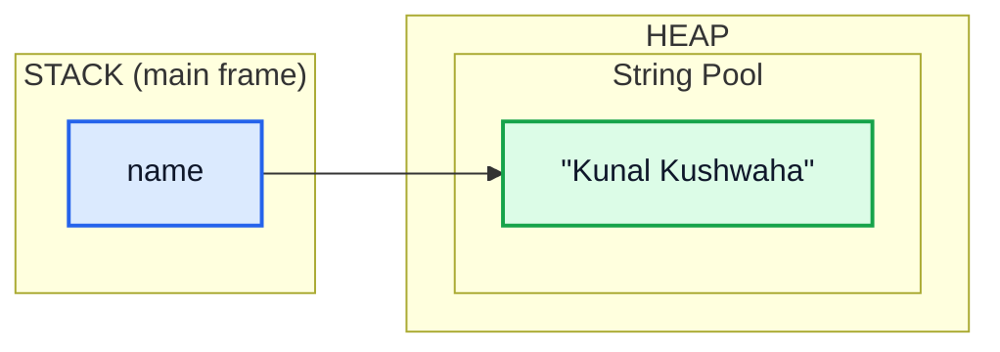

### Bonus: Text Blocks (Java 15+)

Modern Java also has multi-line literals called **text blocks**:

```java
String poem = """
    Hello
      World""";
System.out.println(poem);
// Hello
//   World
```

The common leading indentation is removed automatically; relative indentation is kept. Text blocks are also pooled, like normal literals.

---

## 3. Internal Working of String (3:36)

### Reference Variables and Objects

Kunal's key point: the **variable is not the string**. It is a pointer to a `String` object, and many variables can point to the **same** object.

```java
String a = "Kunal";
String b = "Kunal";
```

Both `a` and `b` refer to **one** object, not two (the next section explains why).

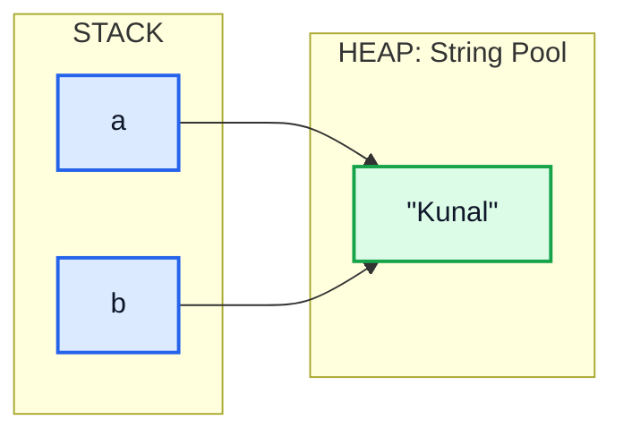

### What Is Inside a `String` Object?

| Java version | Internal storage | Note |
|---|---|---|
| Java 8 and earlier | `private final char[] value` | 2 bytes per character, always |
| **Java 9+ (Compact Strings)** | `private final byte[] value` + `byte coder` | Latin-1 text uses **1 byte/char**; UTF-16 only when needed |
| All versions | `int hash` (cached) | `hashCode()` is computed once, then reused |

> [!NOTE]
> Older explanations (and some in the video) say a String is "a `char[]` inside". That's true up to Java 8. Since Java 9 it's a `byte[]` plus an encoding flag, which roughly halves memory for English text. The behaviour you see (immutability, pooling) is the same.

---

## 4. String Pooling (7:29)

### What Is the String Pool?

The **String Pool** (also called the String Constant Pool or intern pool) is a table of unique String objects kept by the JVM. When the compiler or JVM sees a literal:

1. It checks whether an equal string is already in the pool.
2. **If yes**, it reuses that object (no new object).
3. **If no**, it creates the object in the pool and remembers it.

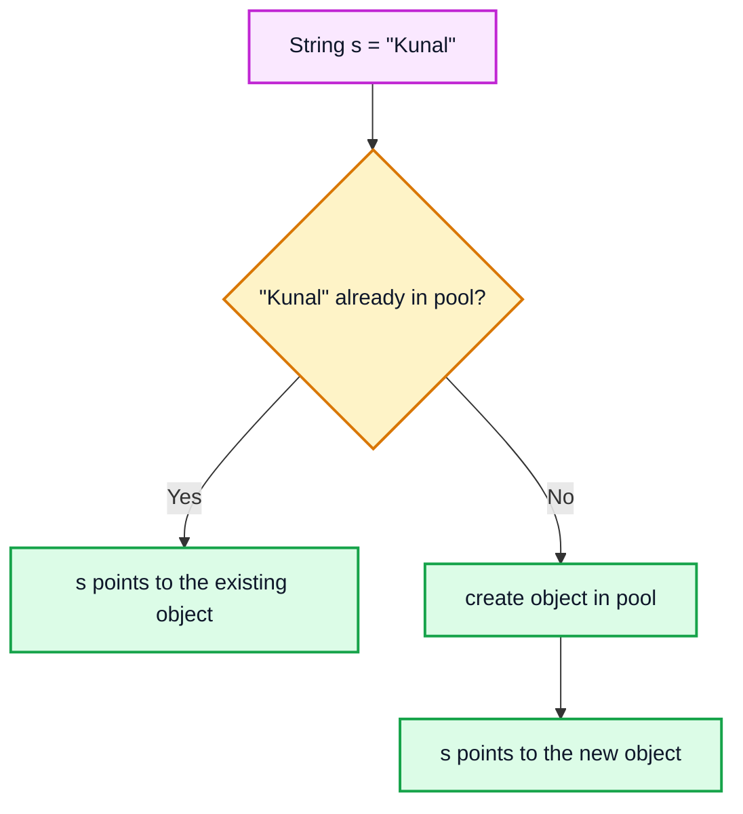

### Why Pooling?

**Memory optimisation.** Programs repeat the same text constantly (`""`, `"id"`, `"name"`, `"OK"`, ...). Sharing one object per unique literal saves a lot of heap.

### Compile-Time Constants Are Pooled Too

```java
String s1 = "Kunal";
String s2 = "Kun" + "al";      // both literals → folded at compile time → pooled
String part = "Kun";
String s3 = part + "al";       // involves a variable → built at RUNTIME → NOT pooled

System.out.println(s1 == s2);           // true
System.out.println(s1 == s3);           // false
System.out.println(s1 == s3.intern());  // true  ← intern() returns the pooled copy
```

> [!NOTE]
> Since **Java 7** the String Pool lives in the **regular heap** (before that it was in PermGen), so pooled strings that are no longer referenced can be garbage collected.

---

## 5. String Immutability (9:43)

### What Does Immutable Mean?

A `String` object **can never be changed** after it is created. No method modifies it. Methods like `toUpperCase()`, `concat()`, `replace()` and `trim()` all **return a new String**.

```java
String a = "Kunal";
String b = a;               // b and a point to the same object
a = "Kushwaha";             // a now points to a DIFFERENT object

System.out.println(a);      // Kushwaha
System.out.println(b);      // Kunal  ← unaffected
```

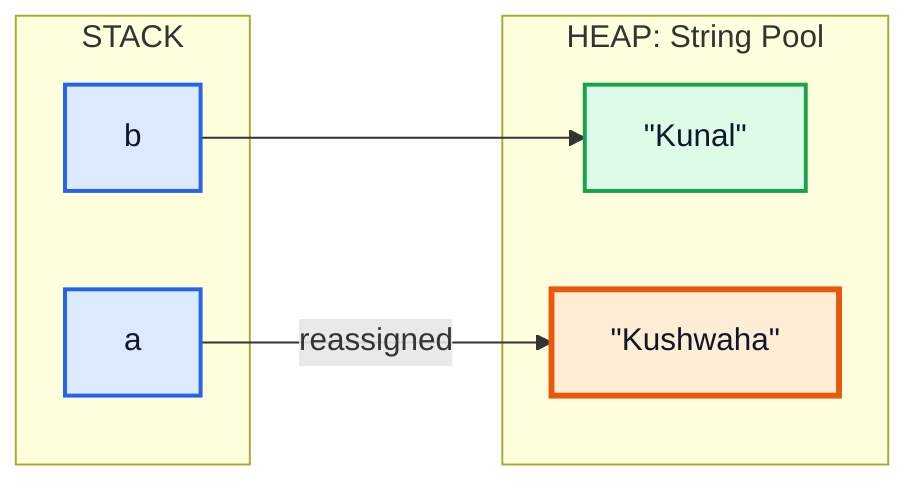

The object `"Kunal"` was **not changed**. `a` was just pointed at another object.

```java
String s = "hello";
s.toUpperCase();            // result thrown away!
System.out.println(s);      // hello   ← unchanged
s = s.toUpperCase();        // must reassign
System.out.println(s);      // HELLO
```

### Why Is String Immutable? (Pool + Safety)

| Reason | Explanation |
|---|---|
| **Pooling is only safe if immutable** | If `a` and `b` share `"Kunal"` and `a` could edit it, `b` would silently change too. Immutability makes sharing safe. |
| **Security** | File paths, URLs, class names and DB usernames are Strings. They can't be modified after being validated. |
| **Thread safety** | Immutable objects can be shared between threads without locks. |
| **Hash caching** | The hash never changes, so `HashMap<String, ...>` keys are fast and reliable. |

> [!WARNING]
> Immutability is about the **object**, not the variable. `String s = "a"; s = "b";` is perfectly legal because you're changing the reference. To stop the reference from changing, use `final String s = "a";`.

---

## 6. String Comparison: == (16:17)

### `==` Compares References

For objects, `==` checks whether two references point to **the exact same object** (same address). It does **not** look at the characters.

```java
String a = "Kunal";
String b = "Kunal";
System.out.println(a == b);   // true  → both point to the one pooled object
```

It returns `true` here **only because of pooling**, not because the text matches.

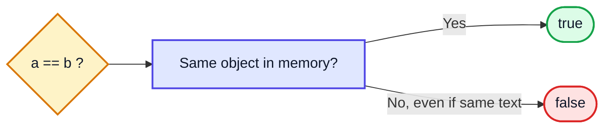

> [!CAUTION]
> Code that compares Strings with `==` may pass a quick test using literals and then fail when the text comes from user input, a file or `substring()`, because those Strings are not pooled. Never use `==` for String content.

---

## 7. String Creation: new Keyword (20:13)

```java
String a = "Kunal";
String c = new String("Kunal");
```

`new` **always** creates a brand-new object in the heap, **outside** the pool, even if the same text is already pooled.

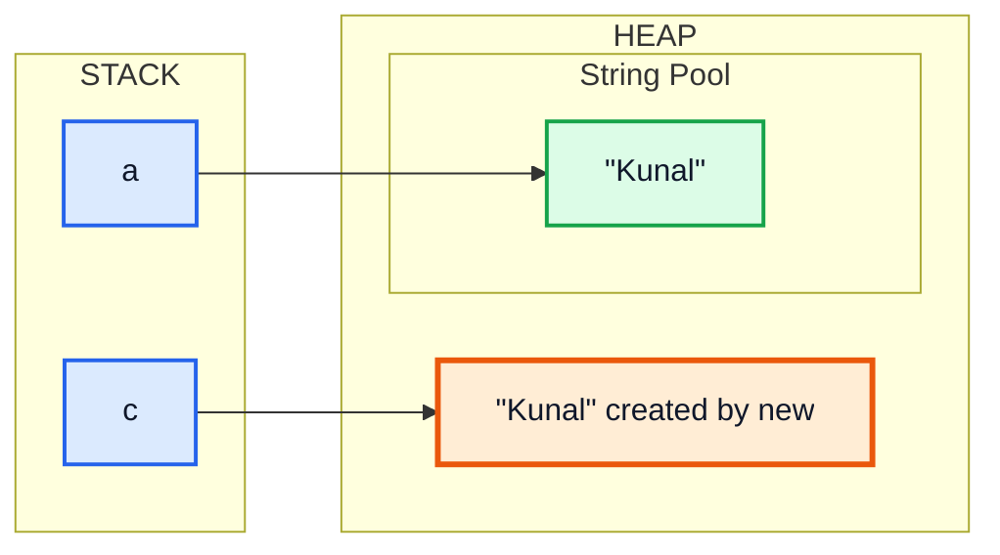

```java
System.out.println(a == c);            // false → different objects
System.out.println(a == c.intern());   // true  → intern() gives the pooled one
```

| | `String s = "Kunal";` | `String s = new String("Kunal");` |
|---|---|---|
| Where | String Pool | Normal heap (plus the literal in the pool) |
| Reuses existing? | ✅ Yes | ❌ Always a new object |
| Objects created (first time) | 1 | Up to 2 (pool literal + new object) |
| Recommended? | ✅ | ❌ Almost never needed |

> [!TIP]
> Classic interview question: *"How many objects does `new String("Kunal")` create?"* Answer: **up to two**. One for the literal in the pool (if not already there) and one by `new` in the heap.

---

## 8. String Comparison: .equals() (22:02)

`.equals()` compares the **content**, character by character.

```java
String a = "Kunal";
String b = "Kunal";
String c = new String("Kunal");

System.out.println(a == c);              // false  (different objects)
System.out.println(a.equals(c));         // true   (same characters) ✅
System.out.println(a.equals(b));         // true
System.out.println("kunal".equalsIgnoreCase("KUNAL"));  // true
```

### `==` vs `.equals()`

| | `==` | `.equals()` |
|---|---|---|
| Compares | References (addresses) | Content |
| Works on primitives | ✅ | ❌ (not a method on primitives) |
| `"Kunal" == new String("Kunal")` | `false` | `true` |
| Use for String content | ❌ Never | ✅ Always |

### Null-Safe Comparison

```java
String input = null;
// input.equals("yes");               // 💥 NullPointerException
System.out.println("yes".equals(input));                     // false ✅ (literal first)
System.out.println(java.util.Objects.equals(input, "yes"));  // false ✅
```

### Ordering: `compareTo`

```java
System.out.println("apple".compareTo("banana"));   // negative → apple comes first
System.out.println("Kunal".compareTo("Kushwaha")); // -5  ('n' - 's' = 110 - 115)
System.out.println("abc".compareTo("abc"));        // 0
```

---

## 9. PrintStream Class (28:01)

### What Is `System.out`?

`System.out.println("Hi")` breaks down into:

| Part | What it is |
|---|---|
| `System` | A `final` class in `java.lang` |
| `out` | A `public static final PrintStream` field of `System` (connected to the console) |
| `println` | An **overloaded** method of `PrintStream` |

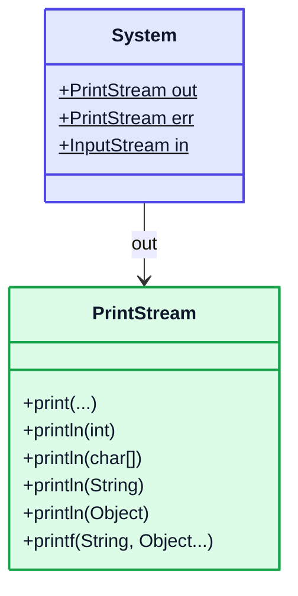

### `println` Is Overloaded

There's a separate `println` for each primitive type, `char[]`, `String`, and `Object`. The compiler picks the most specific one.

```java
System.out.println(56);              // println(int)     → 56
System.out.println('K');             // println(char)    → K
System.out.println(new char[]{'h', 'i'});  // println(char[]) → hi   (prints the characters!)
System.out.println(new int[]{1, 2}); // println(Object)  → [I@1b6d3586 (type@hash)
String n = null;
System.out.println(n);               // println(String)  → null (no exception)
```

### How `println(Object)` Works Internally

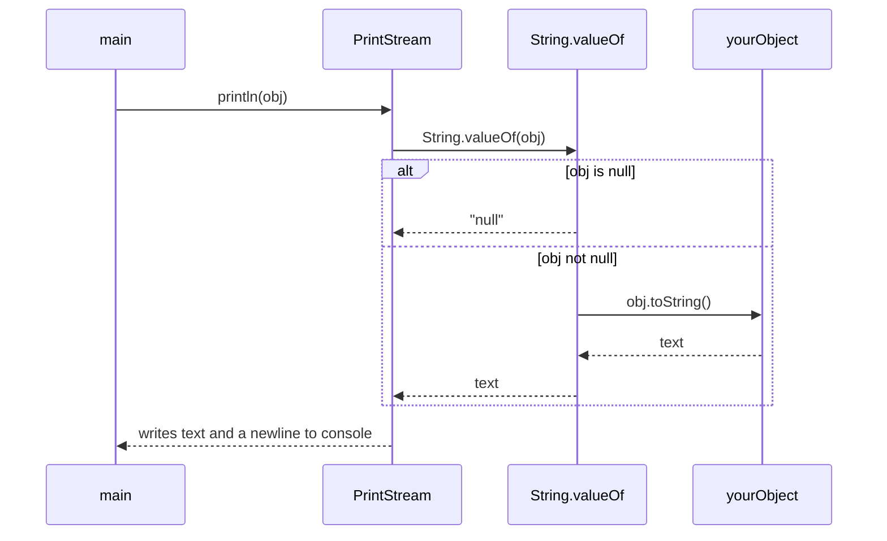

That's why **anything** can be printed: every object has a `toString()` (inherited from `Object`), and `null` is handled explicitly.

> [!NOTE]
> `System.out.println(char[])` printing the characters is a special case. `System.out.println("x" + chars)` uses concatenation instead, which calls `toString()` on the array and prints something like `x[C@6d06d69c`. Use `new String(chars)` or `Arrays.toString(chars)` when you mix arrays with text.

---

## 10. toString() Method (38:12)

### Default `toString()`

Every class inherits `toString()` from `java.lang.Object`. The default returns:

```
ClassName@hexHashCode        e.g.  Student@7a81197d
```

That's useless for humans, so you **override** it.

```java
class Student {
    String name;
    int marks;
    Student(String name, int marks) { this.name = name; this.marks = marks; }

    @Override
    public String toString() {
        return "Student{name='" + name + "', marks=" + marks + "}";
    }
}

public class ToStringDemo {
    public static void main(String[] args) {
        Student s = new Student("Rahul", 92);
        System.out.println(s);                 // Student{name='Rahul', marks=92}
        System.out.println("Topper: " + s);    // Topper: Student{name='Rahul', marks=92}
    }
}
```

### Printing Arrays

Arrays don't override `toString()`. Use the helpers in `java.util.Arrays`:

| Expression | Output |
|---|---|
| `System.out.println(arr)` | `[I@1b6d3586` ❌ |
| `Arrays.toString(arr)` | `[1, 2, 3]` ✅ |
| `Arrays.deepToString(matrix)` | `[[1, 2], [3, 4]]` ✅ for 2D |
| `List.of(1, 2, 3)` printed | `[1, 2, 3]` ✅ collections override `toString()` |

> [!TIP]
> In modern Java, a **record** gets a readable `toString()` for free: `record Point(int x, int y) {}` prints as `Point[x=1, y=2]`.

---

## 11. Pretty Printing in Java (42:47)

**Pretty printing** means controlling how output looks: decimal places, padding, alignment. Use `printf` (prints) or `String.format` / `.formatted()` (returns a String).

```java
float a = 453.1274f;
System.out.printf("Formatted number is %.2f%n", a);   // Formatted number is 453.13

System.out.printf("Pi is %.3f%n", Math.PI);           // Pi is 3.142
System.out.printf("Hello my name is %s and I am %s%n", "Kunal", "cool");
// Hello my name is Kunal and I am cool

String s = String.format("%s is %d years", "Kunal", 22);   // returns a String
System.out.println(s);                                     // Kunal is 22 years
System.out.println("%s-%s".formatted("a", "b"));           // a-b   (Java 15+)
```

| Method | Returns | Use when |
|---|---|---|
| `System.out.printf(fmt, args...)` | `PrintStream` (prints) | Printing directly |
| `String.format(fmt, args...)` | `String` | Need the text for later |
| `fmt.formatted(args...)` | `String` | Same, modern style (Java 15+) |

> [!NOTE]
> `printf` does **not** add a newline. Use `%n` (platform-independent) rather than `\n` inside format strings.

---

## 12. Format Specifiers (47:05)

General form: `%[flags][width][.precision]conversion`

| Specifier | Meaning | Example | Output |
|---|---|---|---|
| `%d` | Integer | `printf("%d", 42)` | `42` |
| `%f` | Floating point | `printf("%f", 3.5)` | `3.500000` |
| `%.2f` | 2 decimal places (rounded) | `printf("%.2f", Math.PI)` | `3.14` |
| `%e` | Scientific | `printf("%e", 12345.678)` | `1.234568e+04` |
| `%s` | String (calls `toString()`) | `printf("%s", "Hi")` | `Hi` |
| `%c` | Character | `printf("%c", 'K')` | `K` |
| `%b` | Boolean | `printf("%b", true)` | `true` |
| `%o` | Octal | `printf("%o", 8)` | `10` |
| `%x` / `%X` | Hexadecimal | `printf("%x", 255)` | `ff` / `FF` |
| `%n` | New line | | |
| `%%` | Literal `%` | `printf("%d%%", 90)` | `90%` |

### Width, Alignment and Flags

```java
System.out.printf("[%5d]%n", 42);        // [   42]   right-aligned in width 5
System.out.printf("[%-5s]%n", "ab");     // [ab   ]   '-' = left-aligned
System.out.printf("[%10.3f]%n", Math.PI);// [     3.142]
System.out.printf("%,d%n", 1234567);     // 1,234,567 ',' = grouping
System.out.printf("%05d%n", 42);         // 00042     '0' = zero-pad
```

> [!WARNING]
> A wrong specifier is a **runtime** error, not a compile error. `printf("%d", 3.5)` throws `IllegalFormatConversionException`.

---

## 13. String Concatenation Operator (48:29)

The `+` operator does **two different jobs** in Java:

| Operands | `+` does | Example | Result |
|---|---|---|---|
| Both numeric / `char` | **Arithmetic** | `'a' + 'b'` | `195` (97 + 98) |
| At least one `String` | **Concatenation** | `"a" + 'b'` | `"ab"` |

### Rule: Evaluated Left to Right

The decision is made **at each `+`, from left to right**. Once a String appears, everything after it becomes concatenation.

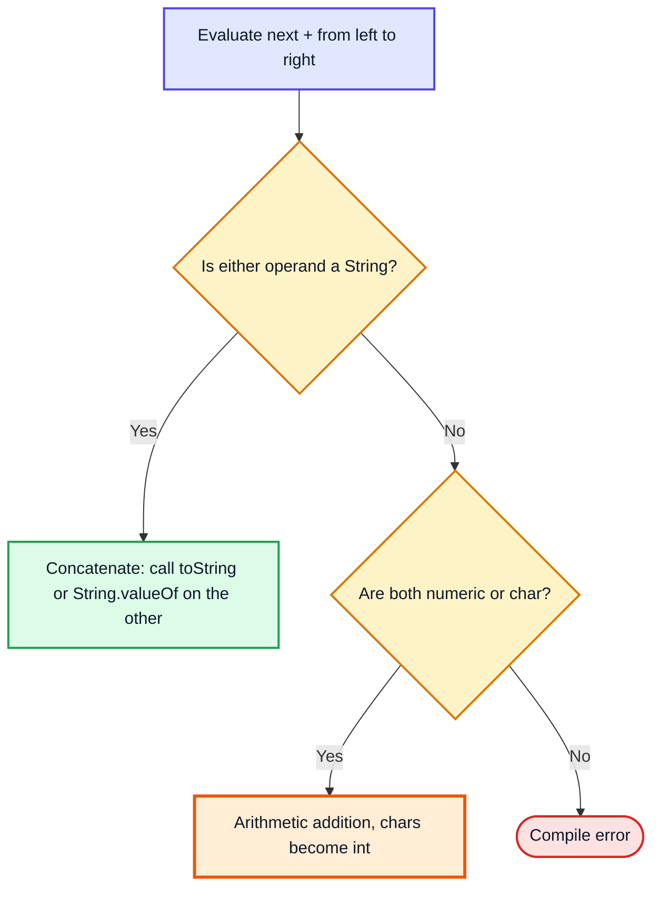

```java
import java.util.ArrayList;

public class ConcatDemo {
    public static void main(String[] args) {
        System.out.println('a' + 'b');          // 195
        System.out.println("a" + 'b');          // ab
        System.out.println((char) ('a' + 3));   // d
        System.out.println("a" + 1);            // a1   (int → "1")

        System.out.println("a" + 1 + 2);        // a12  ("a1" + 2)
        System.out.println(1 + 2 + "a");        // 3a   (3 + "a")
        System.out.println("c" + ('a' + 'b'));  // c195 (brackets first)
        System.out.println('a' + 'b' + "c");    // 195c

        System.out.println("Kunal" + new ArrayList<>());   // Kunal[]
        Integer num = 56;
        System.out.println(num + "" + new ArrayList<>());  // 56[]
        String n = null;
        System.out.println("x" + n);            // xnull
        // System.out.println(num + new ArrayList<>());     // ❌ compile error: no String involved
    }
}
```

### Step-by-Step Trace

| Expression | Step 1 | Step 2 | Result |
|---|---|---|---|
| `"a" + 1 + 2` | `"a" + 1` → `"a1"` | `"a1" + 2` → `"a12"` | `a12` |
| `1 + 2 + "a"` | `1 + 2` → `3` | `3 + "a"` → `"3a"` | `3a` |
| `'a' + 'b' + "c"` | `97 + 98` → `195` | `195 + "c"` → `"195c"` | `195c` |

> [!NOTE]
> The video uses `new Integer(56)`. Wrapper constructors like `new Integer(...)` have been **deprecated since Java 9** (marked for removal). Use autoboxing (`Integer num = 56;`) or `Integer.valueOf(56)`.

> [!IMPORTANT]
> Java has **no operator overloading** for programmers. `+` on Strings is the only built-in special case, which is why `num + new ArrayList<>()` doesn't compile: neither side is a String.

---

## 14. String Performance (1:00:42)

### The Problem: Concatenation in a Loop

```java
String series = "";
for (int i = 0; i < 26; i++) {
    char ch = (char) ('a' + i);
    series = series + ch;            // creates a NEW String every iteration
}
System.out.println(series);          // abcdefghijklmnopqrstuvwxyz
```

Because Strings are immutable, every `+` makes a **new** object and **copies all old characters** into it:

| Iteration | New object | Chars copied |
|---|---|---|
| 1 | `"a"` | 1 |
| 2 | `"ab"` | 2 |
| 3 | `"abc"` | 3 |
| ... | ... | ... |
| 26 | `"a...z"` | 26 |
| **Total** | **26 objects (25 garbage)** | **1 + 2 + ... + N = N(N+1)/2 → O(N²)** |

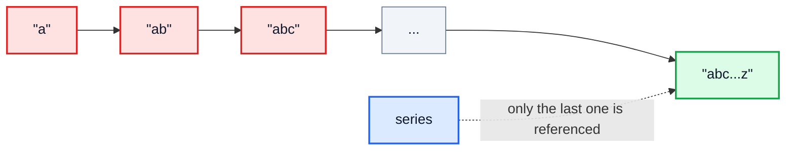

The red objects are unreachable immediately and become garbage for the GC to clean up.

> [!NOTE]
> Since **Java 9**, a single expression like `a + b + c` compiles to an efficient `invokedynamic` call (`StringConcatFactory`), so one-line concatenation is fine. But **inside a loop** each iteration still creates a new String, so the total work stays **O(N²)**. Use `StringBuilder` for loops.

---

## 15. StringBuilder Class (1:09:59)

### What Is StringBuilder?

`StringBuilder` is a **mutable** sequence of characters. It keeps an internal resizable buffer and **modifies it in place**: no new object per change.

```java
StringBuilder builder = new StringBuilder();
for (int i = 0; i < 26; i++) {
    char ch = (char) ('a' + i);
    builder.append(ch);              // modifies the same object
}
System.out.println(builder.toString());   // abcdefghijklmnopqrstuvwxyz
```

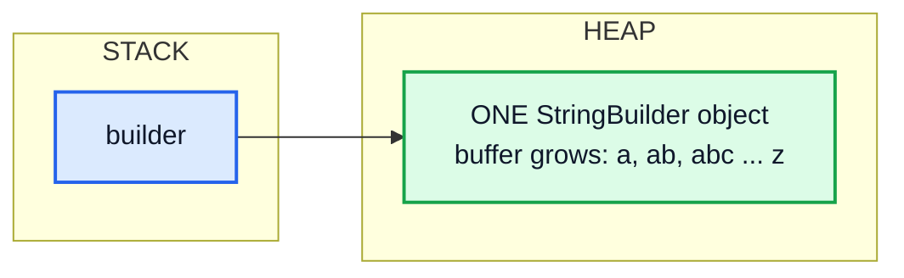

### How It Grows

The default capacity is **16** characters. When full, it allocates a bigger array (about `2 × old + 2`) and copies once. Because the size doubles, appending N characters costs **amortised O(1) per append → O(N) total**.

### Common Methods

```java
StringBuilder sb = new StringBuilder("Hello");
sb.append(" World");         // Hello World
sb.insert(0, ">> ");         // >> Hello World
sb.deleteCharAt(sb.length() - 1); // >> Hello Worl
sb.setCharAt(3, 'h');        // >> hello Worl
sb.replace(0, 3, "");        // hello Worl
sb.reverse();                // lroW olleh
System.out.println(sb);      // lroW olleh
System.out.println(sb.length());   // 10
String result = sb.toString();     // back to an immutable String
```

### String vs StringBuilder vs StringBuffer

| | `String` | `StringBuilder` | `StringBuffer` |
|---|---|---|---|
| Mutable? | ❌ | ✅ | ✅ |
| Thread-safe? | ✅ (immutable) | ❌ | ✅ (synchronized) |
| Speed for many edits | Slow (new object each time) | **Fastest** | Slower (locking) |
| Pooled? | ✅ literals | ❌ | ❌ |
| Overrides `equals()`? | ✅ content | ❌ reference only | ❌ reference only |
| Use when | Fixed text, map keys | Building text in a loop | Legacy multi-threaded code |

> [!CAUTION]
> `sb1.equals(sb2)` compares **references** for `StringBuilder`. To compare content use `sb1.toString().equals(sb2.toString())` or `sb1.compareTo(sb2) == 0` (Java 11+).

---

## 16. String Methods (1:12:37)

All of these **return new values**; none change the original String.

```java
import java.util.Arrays;

public class StringMethods {
    public static void main(String[] args) {
        String name = "Kunal Kushwaha Hello World";

        System.out.println(name.length());                    // 26
        System.out.println(name.charAt(0));                   // K
        System.out.println(name.toLowerCase());               // kunal kushwaha hello world
        System.out.println(name.toUpperCase());               // KUNAL KUSHWAHA HELLO WORLD
        System.out.println(name.indexOf('a'));                // 3
        System.out.println(name.lastIndexOf('a'));            // 13
        System.out.println(name.substring(6, 14));            // Kushwaha  (end exclusive)
        System.out.println(name.contains("Hello"));           // true
        System.out.println(name.startsWith("Kunal"));         // true
        System.out.println(name.replace('a', 'o'));           // Kunol Kushwoho Hello World
        System.out.println(Arrays.toString(name.split(" "))); // [Kunal, Kushwaha, Hello, World]
        System.out.println(Arrays.toString("Kunal".toCharArray())); // [K, u, n, a, l]
        System.out.println("   Kunal  ".trim());              // Kunal
        System.out.println(String.join("-", "a", "b", "c"));  // a-b-c
        System.out.println(String.valueOf(56) + 1);           // 561

        // Java 11+
        System.out.println("  hi  ".strip());                 // hi (Unicode-aware trim)
        System.out.println("   ".isBlank());                  // true
        System.out.println("ab".repeat(3));                   // ababab
        System.out.println("a\nb\nc".lines().count());        // 3
    }
}
```

### Method Reference Table

| Method | Returns | Example → Result |
|---|---|---|
| `length()` | `int` | `"abc".length()` → `3` |
| `charAt(i)` | `char` | `"abc".charAt(1)` → `'b'` |
| `substring(b, e)` | `String` | `"Hello".substring(1, 3)` → `"el"` |
| `indexOf(x)` / `lastIndexOf(x)` | `int` (−1 if absent) | `"banana".lastIndexOf('a')` → `5` |
| `contains(s)` | `boolean` | `"Hello".contains("ell")` → `true` |
| `equals` / `equalsIgnoreCase` | `boolean` | `"abc".equalsIgnoreCase("ABC")` → `true` |
| `compareTo(s)` | `int` | `"a".compareTo("b")` → `-1` |
| `toUpperCase()` / `toLowerCase()` | `String` | |
| `trim()` / `strip()` | `String` | remove leading/trailing whitespace |
| `split(regex)` | `String[]` | `"a,b,,c".split(",").length` → `4` |
| `replace(a, b)` | `String` | `"Kunal".replace('a','o')` → `"Kunol"` |
| `toCharArray()` | `char[]` | |
| `isEmpty()` / `isBlank()` | `boolean` | `""` empty; `"  "` blank |
| `repeat(n)` | `String` | Java 11+ |
| `String.valueOf(x)` / `String.join` | `String` | static helpers |

> [!WARNING]
> `split` takes a **regular expression**. `"a.b".split(".")` returns an empty array because `.` means "any character". Escape it: `split("\\.")`.

---

## 17. Palindrome Program (1:17:50)

**Problem:** A **palindrome** reads the same forwards and backwards (`"abcdcba"`, `"racecar"`, `"madam"`). Check if a given string is one.

A related LeetCode problem is **125 — Valid Palindrome**, which also ignores non-alphanumeric characters and case.

### Approach: Two Pointers

1. `start = 0`, `end = length − 1`.
2. While `start < end`: if `charAt(start) != charAt(end)` → **not** a palindrome.
3. Otherwise move both inward.
4. If the pointers meet without a mismatch → palindrome.

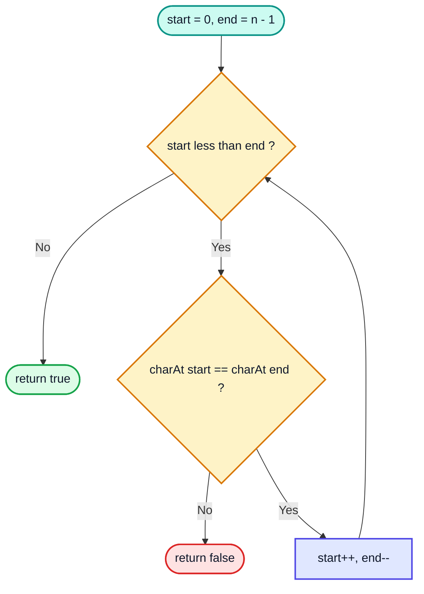

### Code

```java
public class Palindrome {
    static boolean isPalindrome(String str) {
        if (str == null || str.length() == 0) {
            return true;
        }
        str = str.toLowerCase();
        int start = 0;
        int end = str.length() - 1;
        while (start < end) {
            if (str.charAt(start) != str.charAt(end)) {
                return false;
            }
            start++;
            end--;
        }
        return true;
    }

    public static void main(String[] args) {
        System.out.println(isPalindrome("abcdcba"));   // true
        System.out.println(isPalindrome("Racecar"));   // true
        System.out.println(isPalindrome("kunal"));     // false
    }
}
```

> [!NOTE]
> A single-index version also works: loop `i` from `0` to `str.length() / 2` and compare `str.charAt(i)` with `str.charAt(str.length() - 1 - i)`. It's the same idea. The two-pointer version is easier to extend (for example, skipping punctuation for LeetCode 125).

### Dry Run: `"abcdcba"`

| start | end | charAt(start) | charAt(end) | Match? |
|---|---|---|---|---|
| 0 | 6 | a | a | ✅ |
| 1 | 5 | b | b | ✅ |
| 2 | 4 | c | c | ✅ |
| 3 | 3 | — | — | loop ends (start == end) → **true** |

### Dry Run: `"kunal"`

| start | end | charAt(start) | charAt(end) | Match? |
|---|---|---|---|---|
| 0 | 4 | k | l | ❌ → **false** |

### Complexity

| | Value |
|---|---|
| Time | O(N): at most N/2 comparisons (plus O(N) for `toLowerCase`) |
| Space | O(N) for the lowercase copy; O(1) if you compare with `Character.toLowerCase` per char instead |

### Alternative Approaches

| Approach | Time | Space | Note |
|---|---|---|---|
| **Two pointers** | O(N) | O(1)* | ✅ best |
| Reverse with `StringBuilder` and compare | O(N) | O(N) | `new StringBuilder(s).reverse().toString().equals(s)`, short but allocates |
| Recursion `s[0]==s[n-1] && isPal(s[1..n-2])` | O(N) | O(N) stack | Good recursion practice |

\* when case conversion is done per character.

```java
// LeetCode 125 variant: ignore non-alphanumeric characters and case
static boolean isValidPalindrome(String s) {
    int l = 0, r = s.length() - 1;
    while (l < r) {
        while (l < r && !Character.isLetterOrDigit(s.charAt(l))) l++;
        while (l < r && !Character.isLetterOrDigit(s.charAt(r))) r--;
        if (Character.toLowerCase(s.charAt(l)) != Character.toLowerCase(s.charAt(r))) return false;
        l++;
        r--;
    }
    return true;   // "A man, a plan, a canal: Panama" → true
}
```

---

## 18. Outro (1:26:20)

Practise with the string assignments in the course's GitHub repository (reverse words, anagrams, character counting). Later videos use Strings heavily in **recursion** (subsets, permutations), where `substring` and `StringBuilder` come up again.

---

## 🧩 Complete Example: Everything Together

One program that covers every concept from this video:

```java
import java.util.ArrayList;
import java.util.Arrays;
import java.util.List;

public class StringsDemo {

    // A class with a custom toString()
    static class Student {
        String name;
        int marks;
        Student(String name, int marks) { this.name = name; this.marks = marks; }

        @Override
        public String toString() {
            return "Student{name='" + name + "', marks=" + marks + "}";
        }
    }

    // Palindrome with two pointers
    static boolean isPalindrome(String str) {
        if (str == null || str.isEmpty()) return true;
        str = str.toLowerCase();
        int start = 0, end = str.length() - 1;
        while (start < end) {
            if (str.charAt(start) != str.charAt(end)) return false;
            start++;
            end--;
        }
        return true;
    }

    public static void main(String[] args) {
        // 1. Literals, String Pool, ==, equals
        String a = "Kunal";
        String b = "Kunal";
        String c = new String("Kunal");
        System.out.println("a == b         : " + (a == b));
        System.out.println("a == c         : " + (a == c));
        System.out.println("a.equals(c)    : " + a.equals(c));
        System.out.println("a == c.intern(): " + (a == c.intern()));

        // 2. Immutability
        String s = a;
        s = s + " Kushwaha";
        System.out.println("a after s+=    : " + a);
        System.out.println("s              : " + s);

        // 3. toString() and println
        Student st = new Student("Rahul", 92);
        System.out.println(st);
        int[] arr = {1, 2, 3};
        System.out.println("Arrays.toString: " + Arrays.toString(arr));

        // 4. Pretty printing / format specifiers
        System.out.printf("Pi rounded     : %.2f%n", Math.PI);
        System.out.printf("Formatted      : %s scored %d (%.1f%%)%n", "Kunal", 45, 90.0);
        System.out.println(String.format("Padded         : [%5d] [%-5s]", 42, "ab"));

        // 5. Concatenation operator rules
        System.out.println('a' + 'b');
        System.out.println("a" + 'b');
        System.out.println((char) ('a' + 3));
        System.out.println("a" + 1 + 2);
        System.out.println(1 + 2 + "a");
        System.out.println("Kunal" + new ArrayList<>(List.of(2, 3)));

        // 6. StringBuilder performance
        StringBuilder builder = new StringBuilder();
        for (int i = 0; i < 26; i++) {
            builder.append((char) ('a' + i));
        }
        System.out.println("Alphabet       : " + builder);
        System.out.println("Reversed       : " + builder.reverse());

        // 7. String methods
        String name = "  Kunal Kushwaha Hello World  ";
        String t = name.trim();
        System.out.println("trim           : '" + t + "'");
        System.out.println("toUpperCase    : " + t.toUpperCase());
        System.out.println("indexOf('a')   : " + t.indexOf('a'));
        System.out.println("split          : " + Arrays.toString(t.split(" ")));
        System.out.println("isBlank        : " + "   ".isBlank());
        System.out.println("repeat         : " + "ab".repeat(3));

        // 8. Palindrome
        for (String word : new String[]{"abcdcba", "Racecar", "kunal", ""}) {
            System.out.println("isPalindrome(\"" + word + "\") = " + isPalindrome(word));
        }
    }
}
```

**Expected Output:**
```
a == b         : true
a == c         : false
a.equals(c)    : true
a == c.intern(): true
a after s+=    : Kunal
s              : Kunal Kushwaha
Student{name='Rahul', marks=92}
Arrays.toString: [1, 2, 3]
Pi rounded     : 3.14
Formatted      : Kunal scored 45 (90.0%)
Padded         : [   42] [ab   ]
195
ab
d
a12
3a
Kunal[2, 3]
Alphabet       : abcdefghijklmnopqrstuvwxyz
Reversed       : zyxwvutsrqponmlkjihgfedcba
trim           : 'Kunal Kushwaha Hello World'
toUpperCase    : KUNAL KUSHWAHA HELLO WORLD
indexOf('a')   : 3
split          : [Kunal, Kushwaha, Hello, World]
isBlank        : true
repeat         : ababab
isPalindrome("abcdcba") = true
isPalindrome("Racecar") = true
isPalindrome("kunal") = false
isPalindrome("") = true
```

---

## Quick Reference Cheat Sheet

| Concept | One-Line Summary |
|---|---|
| **String** | Immutable, `final` class; variable is a reference to an object in the heap |
| **Literal** `"..."` | Stored in the String Pool; equal literals share one object |
| **Internals** | `char[]` up to Java 8; `byte[]` + coder (Compact Strings) since Java 9 |
| **String Pool** | JVM table of unique strings in the heap (since Java 7); `intern()` returns the pooled copy |
| **Immutability** | Methods return new Strings; reassigning moves the reference, the object never changes |
| **`new String("x")`** | Always a new heap object outside the pool (up to 2 objects) |
| **`==`** | Compares references; never use it for String content |
| **`.equals()`** | Compares content; use `"literal".equals(var)` for null safety |
| **`System.out`** | `static final PrintStream`; `println` is overloaded |
| **`println(Object)`** | Calls `String.valueOf(obj)` → `toString()`, or prints `null` |
| **`toString()`** | Default `ClassName@hash`; override it; use `Arrays.toString` for arrays |
| **`printf` / `format`** | `%d %f %.2f %s %c %b %x %e %n %%`, width, `-` left align, `,` grouping |
| **`+` operator** | Left to right; arithmetic until a String appears, then concatenation |
| **`'a' + 'b'`** | `195` (char arithmetic); `"a" + 'b'` is `"ab"` |
| **Concat in loop** | New object each time → O(N²) total; avoid |
| **StringBuilder** | Mutable, amortised O(1) `append`, `reverse`, `insert`, `delete`; not thread-safe |
| **StringBuffer** | Synchronized StringBuilder; rarely needed |
| **Palindrome** | Two pointers from both ends; O(N) time, O(1) space |
