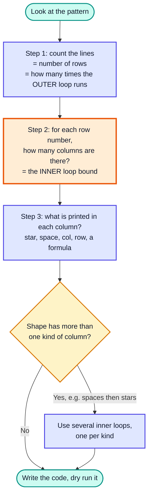
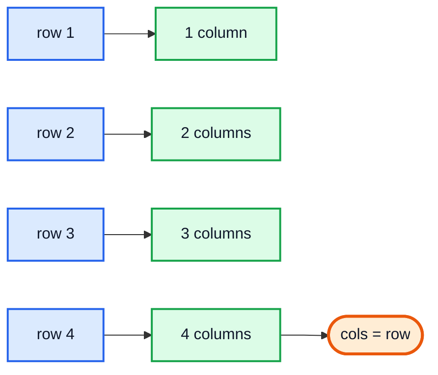
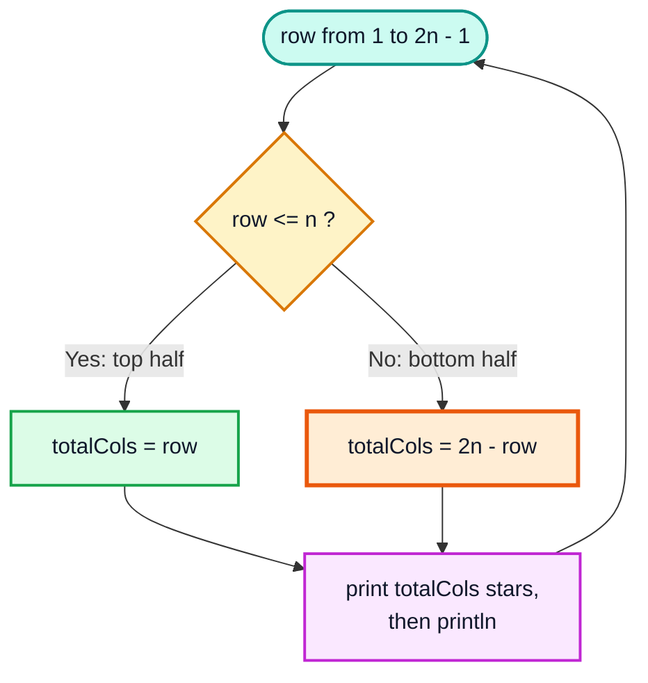
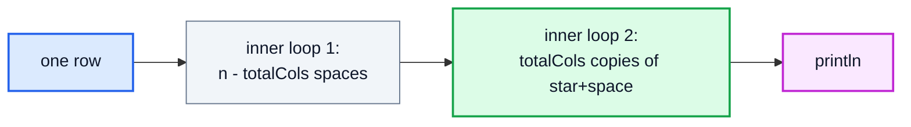
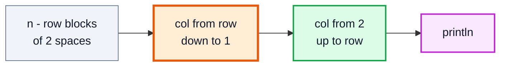
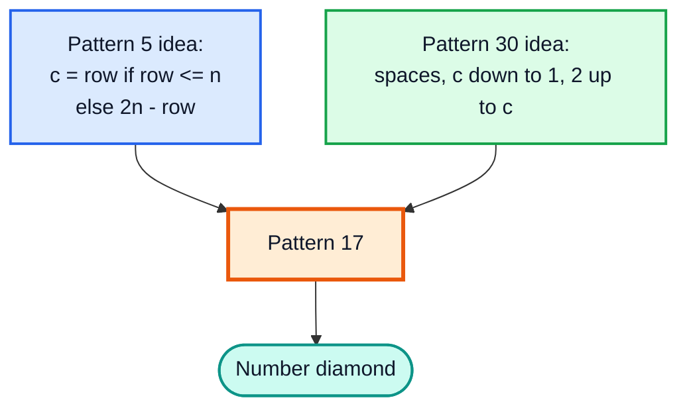
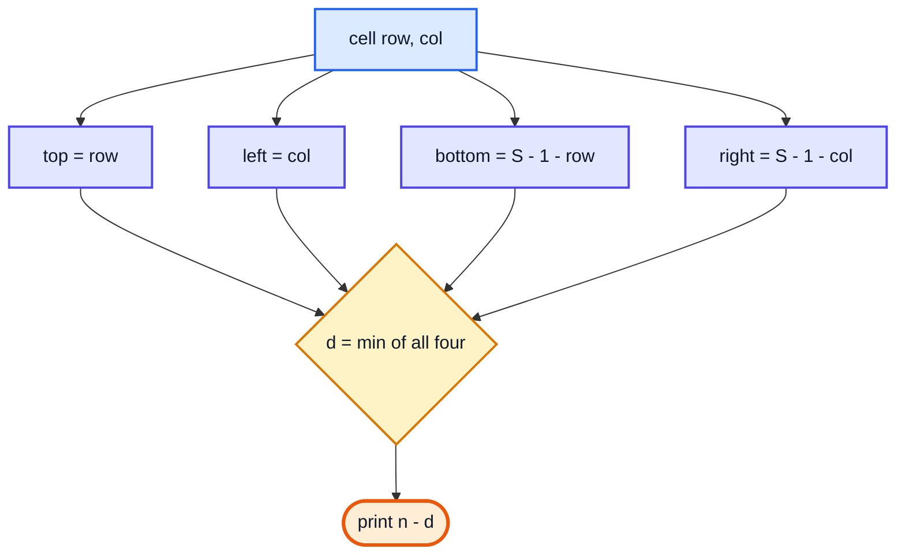

# Pattern Questions — Complete In-Depth Guide

**Video #22 of the Java + DSA playlist:** *Solve Any Pattern Question With This Trick!* (57:19)

A step-by-step method for solving **any** star/number pattern question with nested loops: count the rows, work out how many columns each row has, then decide what to print. The method is applied to patterns 1, 2, 3, 4, 5, 28, 30, 17 and 31 from the course assignment, each with a row/column analysis, code, a dry run and complexity.

---

## Table of Contents

| # | Topic | Timestamp |
|---|---|---|
| 0 | [Introduction](#0-introduction-000) | 0:00 |
| 1 | [Importance of Pattern Questions](#1-importance-of-pattern-questions-234) | 2:34 |
| 2 | [Prerequisites to solve Pattern Questions](#2-prerequisites-to-solve-pattern-questions-444) | 4:44 |
| 3 | [Approach to solve Pattern Questions](#3-approach-to-solve-pattern-questions-503) | 5:03 |
| 4 | [Step 1](#4-step-1-514) | 5:14 |
| 5 | [Step 2](#5-step-2-832) | 8:32 |
| 6 | [Step 3](#6-step-3-1112) | 11:12 |
| 7 | [Pattern Question 02](#7-pattern-question-02-1305) | 13:05 |
| 8 | [Pattern Question 01](#8-pattern-question-01-1441) | 14:41 |
| 9 | [Pattern Question 03](#9-pattern-question-03-1617) | 16:17 |
| 10 | [Pattern Question 04](#10-pattern-question-04-2041) | 20:41 |
| 11 | [Pattern Question 05](#11-pattern-question-05-2226) | 22:26 |
| 12 | [Pattern Question 28](#12-pattern-question-28-3349) | 33:49 |
| 13 | [Pattern Question 30](#13-pattern-question-30-3740) | 37:40 |
| 14 | [Pattern Question 17](#14-pattern-question-17-4059) | 40:59 |
| 15 | [Pattern Question 31](#15-pattern-question-31-4501) | 45:01 |
| 16 | [Outro](#16-outro-5553) | 55:53 |

---

## 0. Introduction (0:00)

Pattern questions ask you to print a shape (a triangle, a diamond, a pyramid of numbers) using loops. They look like puzzles, but nearly all of them fall to **one repeatable three-step method**. The goal of this video is not to memorise 30 patterns. It is to learn the thinking process, so that a pattern you have never seen before is still easy.

> [!IMPORTANT]
> The real skill being trained here is **nested loops**: understanding how an inner loop's range can depend on the outer loop's variable. That skill is reused in sorting (bubble, selection, insertion), 2D arrays and matrix problems.

---

## 1. Importance of Pattern Questions (2:34)

Why spend a whole video on printing stars?

| Reason | What it teaches |
|---|---|
| **Nested loops** | An outer loop for rows, an inner loop whose bounds change per row |
| **Finding a formula** | Turning a visual shape into a relation like `cols = 2n - row` |
| **Dry running** | Tracing `row` and `col` by hand to check your formula |
| **Index thinking** | Using `row`, `col`, distances to edges: the same thinking used in 2D arrays |
| **Interviews / college exams** | Patterns are common in first-round tests and campus placements |

> [!NOTE]
> In top product-company interviews, patterns are rarely asked directly. Their value is as **practice**: they make nested loops and index arithmetic second nature before you reach harder topics.

---

## 2. Prerequisites to solve Pattern Questions (4:44)

You only need what the earlier videos covered:

- `for` loops and `while` loops (video #9)
- Nested loops: a loop inside a loop
- `System.out.print` vs `System.out.println`
- The ternary operator / `if-else` and `Math.min` / `Math.max`

| Method | Effect |
|---|---|
| `System.out.print("* ")` | Prints and **stays** on the same line |
| `System.out.println()` | Moves to the **next line** (ends the current row) |
| `System.out.println("x")` | Prints `x`, then moves to the next line |

```java
public class PrintVsPrintln {
    public static void main(String[] args) {
        System.out.print("* ");
        System.out.print("* ");
        System.out.println();     // end of row
        System.out.print("* ");
        System.out.println();
        // Output:
        // * *
        // *
    }
}
```

---

## 3. Approach to solve Pattern Questions (5:03)

Every pattern is a grid of **rows** and **columns**. The outer loop walks the rows and the inner loop walks the columns of the current row.



The universal skeleton:

```java
for (int row = 1; row <= totalRows; row++) {          // Step 1
    for (int col = 1; col <= colsIn(row); col++) {   // Step 2
        System.out.print(whatToPrint(row, col));     // Step 3
    }
    System.out.println();                            // finish this row
}
```

---

## 4. Step 1 (5:14)

**Count the lines.** The number of lines in the output is the number of rows, so it is the number of times the **outer loop** runs.

| Pattern | Lines for input `n` | Outer loop |
|---|---|---|
| Square, triangle | `n` | `for (row = 1; row <= n; row++)` |
| Half diamond, full diamond | `2n - 1` | `for (row = 1; row <= 2*n - 1; row++)` |
| Concentric square (pattern 31) | `2n - 1` | `for (row = 0; row < 2*n - 1; row++)` |

> [!TIP]
> Write the pattern out for a small `n` (3 or 4) and **count**. Then express the count in terms of `n`. Never guess the formula from the picture alone.

---

## 5. Step 2 (8:32)

**For every row, how many columns does it have?** This number becomes the inner loop's upper bound, and it is usually a formula in `row` (and `n`).

Example: the triangle pattern for `n = 4`.

| row | Columns in this row | Formula |
|---|---|---|
| 1 | 1 | `row` |
| 2 | 2 | `row` |
| 3 | 3 | `row` |
| 4 | 4 | `row` |



> [!IMPORTANT]
> If the column count is **not** a single simple formula (it grows then shrinks, or the row has spaces before the stars), split it: find a formula for each part, or use a ternary like `row <= n ? row : 2*n - row`.

---

## 6. Step 3 (11:12)

**What do you print in each column?** Options seen in this video:

| Print | Example pattern |
|---|---|
| A constant (`"* "`) | Patterns 1, 2, 3, 5 |
| The column number `col` | Pattern 4 |
| Spaces, then stars | Pattern 28 |
| A countdown then a count-up | Patterns 30, 17 |
| A formula of `row`, `col`, `n` | Pattern 31 |

> [!TIP]
> Printing `"* "` (star **plus a space**) instead of `"*"` makes shapes look evenly spaced and is what makes diamonds line up. If your diamond looks lopsided, check this first.

---

## 7. Pattern Question 02 (13:05)

The video starts with pattern 2 because it shows all three steps most clearly.

```
*
* *
* * *
* * * *
```

### Analysis (`n = 4`)

| Step | Answer |
|---|---|
| 1. Rows | `n` |
| 2. Columns in row `row` | `row` |
| 3. Print | `"* "` |

### Code

```java
static void pattern2(int n) {
    for (int row = 1; row <= n; row++) {
        for (int col = 1; col <= row; col++) {
            System.out.print("* ");
        }
        System.out.println();
    }
}
```

### Dry Run (`n = 3`)

| row | inner loop `col` values | Printed line |
|---|---|---|
| 1 | 1 | `*` |
| 2 | 1, 2 | `* *` |
| 3 | 1, 2, 3 | `* * *` |

**Complexity:** stars printed = 1 + 2 + ... + n = n(n+1)/2 → **O(n²)** time, **O(1)** extra space.

---

## 8. Pattern Question 01 (14:41)

```
* * * *
* * * *
* * * *
* * * *
```

| Step | Answer |
|---|---|
| 1. Rows | `n` |
| 2. Columns | `n` for **every** row (it does not depend on `row`) |
| 3. Print | `"* "` |

```java
static void pattern1(int n) {
    for (int row = 1; row <= n; row++) {
        for (int col = 1; col <= n; col++) {
            System.out.print("* ");
        }
        System.out.println();
    }
}
```

**Complexity:** exactly n × n prints → **O(n²)** time, O(1) space.

> [!NOTE]
> Patterns 1 and 2 differ only in the inner loop bound: `n` vs `row`. That single change is the whole point of Step 2.

---

## 9. Pattern Question 03 (16:17)

```
* * * *
* * *
* *
*
```

### Analysis (`n = 4`)

| row | Columns |
|---|---|
| 1 | 4 |
| 2 | 3 |
| 3 | 2 |
| 4 | 1 |

The columns **decrease** by one per row. `row + cols = n + 1`, so **cols = n − row + 1**.

```java
static void pattern3(int n) {
    for (int row = 1; row <= n; row++) {
        for (int col = 1; col <= n - row + 1; col++) {
            System.out.print("* ");
        }
        System.out.println();
    }
}
```

### Alternative: count the row down

```java
for (int row = n; row >= 1; row--) {
    for (int col = 1; col <= row; col++) System.out.print("* ");
    System.out.println();
}
```

Both print the same output. The first keeps the "row grows from 1" habit, and the formula `n - row + 1` (or `n - row` with 0-based rows) appears again in every pattern that needs leading spaces.

**Complexity:** O(n²) time, O(1) space.

---

## 10. Pattern Question 04 (20:41)

```
1
1 2
1 2 3
1 2 3 4
```

Same shape as pattern 2. Only **Step 3** changes: print the column number instead of a star.

```java
static void pattern4(int n) {
    for (int row = 1; row <= n; row++) {
        for (int col = 1; col <= row; col++) {
            System.out.print(col + " ");
        }
        System.out.println();
    }
}
```

| Variant | Change in Step 3 | Output row 3 |
|---|---|---|
| Print `col` | `col + " "` | `1 2 3` |
| Print `row` | `row + " "` | `3 3 3` |
| Running count (Floyd's triangle) | `count++ + " "` with `count` declared outside both loops | `4 5 6` |

> [!WARNING]
> `System.out.print(col + " ")` is string concatenation. `System.out.print(col + ' ')` adds the **char code** of space (32) to `col` and prints a number like `33`. Use a `String` `" "`, not a `char` `' '`.

---

## 11. Pattern Question 05 (22:26)

The half diamond:

```
*
* *
* * *
* * * *
* * *
* *
*
```

### Step 1: rows

For `n = 4` there are 7 lines → **2n − 1 rows**.

### Step 2: columns per row

| row | 1 | 2 | 3 | 4 | 5 | 6 | 7 |
|---|---|---|---|---|---|---|---|
| cols | 1 | 2 | 3 | 4 🟧 | 3 | 2 | 1 |

- While `row <= n`, cols = `row`.
- After the middle, cols drop by one per row. At row 5 the count is 3 = 2·4 − 5, so cols = **2n − row**.



### Code

```java
static void pattern5(int n) {
    for (int row = 1; row <= 2 * n - 1; row++) {
        int totalCols = row <= n ? row : 2 * n - row;
        for (int col = 1; col <= totalCols; col++) {
            System.out.print("* ");
        }
        System.out.println();
    }
}
```

> [!NOTE]
> The video writes the loop 0-based (`row` from `0` while `row < 2 * n`, `totalCols = row > n ? 2 * n - row : row`). With those bounds row 0 has zero columns, so the output starts with an empty line. The 1-based form above produces exactly `2n - 1` lines. Whichever base you choose, **dry run the first, middle and last rows**.

### Dry Run (`n = 3`)

| row | `row <= n`? | totalCols | Line |
|---|---|---|---|
| 1 | ✅ | 1 | `*` |
| 2 | ✅ | 2 | `* *` |
| 3 | ✅ | 3 | `* * *` |
| 4 | ❌ | 6 − 4 = 2 | `* *` |
| 5 | ❌ | 6 − 5 = 1 | `*` |

### Alternative: two separate loops

```java
for (int row = 1; row <= n; row++)  { /* row stars */ }
for (int row = n - 1; row >= 1; row--) { /* row stars */ }
```

Easier to read, but the single-loop ternary form is what makes patterns 28 and 17 short.

**Complexity:** about n² stars in total → **O(n²)** time, O(1) space.

---

## 12. Pattern Question 28 (33:49)

The full diamond is pattern 5 with **leading spaces**:

```
   *
  * *
 * * *
* * * *
 * * *
  * *
   *
```

### Analysis

Each row now has **two kinds of columns**: spaces, then stars.

| row (n = 4) | stars (`totalCols`) | spaces |
|---|---|---|
| 1 | 1 | 3 |
| 2 | 2 | 2 |
| 3 | 3 | 1 |
| 4 | 4 | 0 |
| 5 | 3 | 1 |
| 6 | 2 | 2 |
| 7 | 1 | 3 |

`stars + spaces = n` on every row, so **spaces = n − totalCols**.



### Code

```java
static void pattern28(int n) {
    for (int row = 1; row <= 2 * n - 1; row++) {
        int totalCols = row <= n ? row : 2 * n - row;
        int spaces = n - totalCols;
        for (int s = 1; s <= spaces; s++) System.out.print(" ");
        for (int col = 1; col <= totalCols; col++) System.out.print("* ");
        System.out.println();
    }
}
```

> [!TIP]
> One plain space `" "` before stars that are printed as `"* "` shifts by **half** a star width, which is exactly what makes the diamond symmetric. If you print stars as `"*"` you would need different spacing.

**Complexity:** O(n²) time, O(1) space.

---

## 13. Pattern Question 30 (37:40)

```
      1
    2 1 2
  3 2 1 2 3
4 3 2 1 2 3 4
```

### Analysis (row `r`)

Each row has **three kinds of columns**:

| Part | Content | Count |
|---|---|---|
| Leading spaces | `"  "` (two spaces, the width of one `"d "`) | `n − r` |
| Countdown | `r, r−1, ..., 1` | `r` |
| Count-up | `2, 3, ..., r` | `r − 1` |



### Code

```java
static void pattern30(int n) {
    for (int row = 1; row <= n; row++) {
        for (int s = 1; s <= n - row; s++) System.out.print("  ");
        for (int col = row; col >= 1; col--) System.out.print(col + " ");
        for (int col = 2; col <= row; col++) System.out.print(col + " ");
        System.out.println();
    }
}
```

### Dry Run (row 3, n = 4)

| Part | Loop values | Printed |
|---|---|---|
| Spaces | s = 1 | `"  "` |
| Countdown | col = 3, 2, 1 | `3 2 1 ` |
| Count-up | col = 2, 3 | `2 3 ` |
| Line | | `  3 2 1 2 3` |

### Alternative: one loop using `Math.abs`

The numbers are `|col| + 1` for `col` from `-(row-1)` to `row-1`:

```java
for (int col = -(row - 1); col <= row - 1; col++) {
    System.out.print(Math.abs(col) + 1 + " ");
}
```

**Complexity:** O(n²) time, O(1) space.

> [!WARNING]
> Spacing assumes single-digit numbers. For `n >= 10` use `System.out.printf("%3d", value)` and pad spaces with the same width, or the shape breaks.

---

## 14. Pattern Question 17 (40:59)

Pattern 17 is pattern 30 **mirrored vertically**, the same way pattern 28 is pattern 2 mirrored:

```
      1
    2 1 2
  3 2 1 2 3
4 3 2 1 2 3 4
  3 2 1 2 3
    2 1 2
      1
```

### Combining two known ideas

| Borrowed from | Idea |
|---|---|
| Pattern 5 / 28 | `2n − 1` rows; "size" of row = `row <= n ? row : 2n − row` |
| Pattern 30 | Spaces, countdown, count-up for a row of size `c` |



### Code

```java
static void pattern17(int n) {
    for (int row = 1; row <= 2 * n - 1; row++) {
        int c = row <= n ? row : 2 * n - row;
        for (int s = 1; s <= n - c; s++) System.out.print("  ");
        for (int col = c; col >= 1; col--) System.out.print(col + " ");
        for (int col = 2; col <= c; col++) System.out.print(col + " ");
        System.out.println();
    }
}
```

> [!IMPORTANT]
> This is the key lesson of the video: **complex patterns are combinations of simpler ones.** Identify which earlier pattern gives the rows and which gives the content of each row, then merge them.

**Complexity:** O(n²) time, O(1) space.

---

## 15. Pattern Question 31 (45:01)

```
4 4 4 4 4 4 4
4 3 3 3 3 3 4
4 3 2 2 2 3 4
4 3 2 1 2 3 4
4 3 2 2 2 3 4
4 3 3 3 3 3 4
4 4 4 4 4 4 4
```

### Why the step method alone is not enough

Rows and columns are easy: a `(2n − 1) × (2n − 1)` square. Step 3 is the hard part, since the value changes inside each row in a non-obvious way. The trick: think about **distance to the nearest edge**.

### The trick

For a cell at `(row, col)` (0-based) in a square of size `S = 2n − 1`, its distances to the four edges are:

| Edge | Distance |
|---|---|
| Top | `row` |
| Left | `col` |
| Bottom | `S − 1 − row` |
| Right | `S − 1 − col` |

The outermost ring has distance 0 and shows `n`; each ring inward shows one less. So:

**value = n − min(row, col, S − 1 − row, S − 1 − col)**



### Code

```java
static void pattern31(int n) {
    int size = 2 * n - 1;
    for (int row = 0; row < size; row++) {
        for (int col = 0; col < size; col++) {
            int distToEdge = Math.min(Math.min(row, col),
                                      Math.min(size - 1 - row, size - 1 - col));
            System.out.print((n - distToEdge) + " ");
        }
        System.out.println();
    }
}
```

### Dry Run (`n = 3`, `size = 5`)

| (row, col) | top | left | bottom | right | min | value |
|---|---|---|---|---|---|---|
| (0, 2) | 0 | 2 | 4 | 2 | 0 | 3 |
| (1, 1) | 1 | 1 | 3 | 3 | 1 | 2 |
| (1, 3) | 1 | 3 | 3 | 1 | 1 | 2 |
| (2, 2) 🟧 | 2 | 2 | 2 | 2 | 2 | **1** |
| (3, 0) | 3 | 0 | 1 | 4 | 0 | 3 |

> [!NOTE]
> The video's code sets `n = 2 * n` and loops `row` and `col` from `0` to `n` **inclusive**, which prints a `(2n + 1)`-wide square whose centre is `0`. The version above uses `size = 2n − 1` so the centre is `1`, matching the assignment's picture. Both use the same "minimum distance to an edge" idea.

**Complexity:** (2n − 1)² cells, O(1) work each → **O(n²)** time, O(1) space.

---

## 16. Outro (55:53)

Practise the remaining patterns in the course's assignment list using the same three steps. When stuck, write the output for `n = 3` or `4`, build a `row → columns` table and look for the formula. Next up: **recursion** (video #23).

---

## 🧩 Complete Example: Everything Together

All nine patterns from the video in one program, with small fixed inputs.

```java
public class PatternsAll {

    // Pattern 1: n x n square
    static void pattern1(int n) {
        for (int row = 1; row <= n; row++) {
            for (int col = 1; col <= n; col++) {
                System.out.print("* ");
            }
            System.out.println();
        }
    }

    // Pattern 2: right-angled triangle (row stars in row)
    static void pattern2(int n) {
        for (int row = 1; row <= n; row++) {
            for (int col = 1; col <= row; col++) {
                System.out.print("* ");
            }
            System.out.println();
        }
    }

    // Pattern 3: inverted triangle (n - row + 1 stars)
    static void pattern3(int n) {
        for (int row = 1; row <= n; row++) {
            for (int col = 1; col <= n - row + 1; col++) {
                System.out.print("* ");
            }
            System.out.println();
        }
    }

    // Pattern 4: number triangle (print col)
    static void pattern4(int n) {
        for (int row = 1; row <= n; row++) {
            for (int col = 1; col <= row; col++) {
                System.out.print(col + " ");
            }
            System.out.println();
        }
    }

    // Pattern 5: half diamond, 2n - 1 rows
    static void pattern5(int n) {
        for (int row = 1; row <= 2 * n - 1; row++) {
            int totalCols = row <= n ? row : 2 * n - row;
            for (int col = 1; col <= totalCols; col++) {
                System.out.print("* ");
            }
            System.out.println();
        }
    }

    // Pattern 28: full diamond = spaces + stars
    static void pattern28(int n) {
        for (int row = 1; row <= 2 * n - 1; row++) {
            int totalCols = row <= n ? row : 2 * n - row;
            int spaces = n - totalCols;
            for (int s = 1; s <= spaces; s++) System.out.print(" ");
            for (int col = 1; col <= totalCols; col++) System.out.print("* ");
            System.out.println();
        }
    }

    // Pattern 30: number pyramid  k ... 2 1 2 ... k
    static void pattern30(int n) {
        for (int row = 1; row <= n; row++) {
            for (int s = 1; s <= n - row; s++) System.out.print("  ");
            for (int col = row; col >= 1; col--) System.out.print(col + " ");
            for (int col = 2; col <= row; col++) System.out.print(col + " ");
            System.out.println();
        }
    }

    // Pattern 17: number diamond (pattern 30 mirrored vertically)
    static void pattern17(int n) {
        for (int row = 1; row <= 2 * n - 1; row++) {
            int c = row <= n ? row : 2 * n - row;
            for (int s = 1; s <= n - c; s++) System.out.print("  ");
            for (int col = c; col >= 1; col--) System.out.print(col + " ");
            for (int col = 2; col <= c; col++) System.out.print(col + " ");
            System.out.println();
        }
    }

    // Pattern 31: concentric squares, size 2n - 1
    static void pattern31(int n) {
        int size = 2 * n - 1;
        for (int row = 0; row < size; row++) {
            for (int col = 0; col < size; col++) {
                int distToEdge = Math.min(Math.min(row, col),
                                          Math.min(size - 1 - row, size - 1 - col));
                System.out.print((n - distToEdge) + " ");
            }
            System.out.println();
        }
    }

    public static void main(String[] args) {
        System.out.println("Pattern 1 (n = 3):");   pattern1(3);
        System.out.println("Pattern 2 (n = 4):");   pattern2(4);
        System.out.println("Pattern 3 (n = 4):");   pattern3(4);
        System.out.println("Pattern 4 (n = 4):");   pattern4(4);
        System.out.println("Pattern 5 (n = 3):");   pattern5(3);
        System.out.println("Pattern 28 (n = 3):");  pattern28(3);
        System.out.println("Pattern 30 (n = 4):");  pattern30(4);
        System.out.println("Pattern 17 (n = 3):");  pattern17(3);
        System.out.println("Pattern 31 (n = 3):");  pattern31(3);
    }
}
```

**Expected Output:**
```
Pattern 1 (n = 3):
* * * 
* * * 
* * * 
Pattern 2 (n = 4):
* 
* * 
* * * 
* * * * 
Pattern 3 (n = 4):
* * * * 
* * * 
* * 
* 
Pattern 4 (n = 4):
1 
1 2 
1 2 3 
1 2 3 4 
Pattern 5 (n = 3):
* 
* * 
* * * 
* * 
* 
Pattern 28 (n = 3):
  * 
 * * 
* * * 
 * * 
  * 
Pattern 30 (n = 4):
      1 
    2 1 2 
  3 2 1 2 3 
4 3 2 1 2 3 4 
Pattern 17 (n = 3):
    1 
  2 1 2 
3 2 1 2 3 
  2 1 2 
    1 
Pattern 31 (n = 3):
3 3 3 3 3 
3 2 2 2 3 
3 2 1 2 3 
3 2 2 2 3 
3 3 3 3 3 
```

---

## Quick Reference Cheat Sheet

| Concept / Pattern | One-Line Summary |
|---|---|
| **Step 1** | Lines in output = rows = outer loop count |
| **Step 2** | Columns per row = inner loop bound (a formula in `row`, `n`) |
| **Step 3** | What to print: star, space, `col`, `row`, or a formula |
| **Two kinds of columns** | One inner loop per kind (e.g. spaces loop, then stars loop) |
| **Grow-then-shrink rows** | `2n - 1` rows, `cols = row <= n ? row : 2n - row` |
| **Pattern 1** | `n` rows × `n` stars |
| **Pattern 2** | `row` stars in row `row` |
| **Pattern 3** | `n - row + 1` stars |
| **Pattern 4** | Print `col` instead of a star |
| **Pattern 5** | Half diamond with the ternary column formula |
| **Pattern 28** | Pattern 5 + `n - totalCols` leading spaces |
| **Pattern 30** | `n - row` space blocks, `row..1`, then `2..row` |
| **Pattern 17** | Pattern 30 contents with pattern 5's row sizes |
| **Pattern 31** | `n - min(row, col, S-1-row, S-1-col)` with `S = 2n - 1` |
| **Complexity** | All of these are O(n²) time and O(1) extra space |
