# Introduction to Recursion — Complete In-Depth Guide

**Video #23 of the Java + DSA playlist:** *Introduction to Recursion - Learn In The Best Way* (1:55:49)

A ground-up introduction to **recursion**: how function calls live on the call stack, why every recursive function needs a base condition, how to draw and read recursion trees, and a repeatable method for writing recursive code. It is applied to Fibonacci numbers and recursive binary search, with recurrence relations, tail recursion and the "which variables go in the arguments" rule.

---

## Table of Contents

| # | Topic | Timestamp |
|---|---|---|
| 0 | [Introduction](#0-introduction-000) | 0:00 |
| 1 | [Prerequisites](#1-prerequisites-629) | 6:29 |
| 2 | [E1: Message Program](#2-e1-message-program-650) | 6:50 |
| 3 | [E2: Numbers Program](#3-e2-numbers-program-1303) | 13:03 |
| 4 | [Working of function calls](#4-working-of-function-calls-1757) | 17:57 |
| 5 | [What is Recursion?](#5-what-is-recursion-3002) | 30:02 |
| 6 | [Recursive Function for E2](#6-recursive-function-for-e2-3110) | 31:10 |
| 7 | [Internal Working of Recursive Function](#7-internal-working-of-recursive-function-3535) | 35:35 |
| 8 | [Base Condition in Recursion](#8-base-condition-in-recursion-3753) | 37:53 |
| 9 | [Definition of Recursion](#9-definition-of-recursion-4536) | 45:36 |
| 10 | [Use of Recursion](#10-use-of-recursion-4552) | 45:52 |
| 11 | [Visualising Recursion (Recursion Tree)](#11-visualising-recursion-recursion-tree-5048) | 50:48 |
| 12 | [Q1: Fibonacci Numbers](#12-q1-fibonacci-numbers-5301) | 53:01 |
| 13 | [Identifying Recursion problem](#13-identifying-recursion-problem-5931) | 59:31 |
| 14 | [Finding Base Condition](#14-finding-base-condition-5949) | 59:49 |
| 15 | [Code for Q1](#15-code-for-q1-10228) | 1:02:28 |
| 16 | [Tail Recursion](#16-tail-recursion-11301) | 1:13:01 |
| 17 | [Best Approach for Recursion Problems](#17-best-approach-for-recursion-problems-11353) | 1:13:53 |
| 18 | [Understanding Recursion Tree](#18-understanding-recursion-tree-11512) | 1:15:12 |
| 19 | [Key areas to be focused for Recursion](#19-key-areas-to-be-focused-for-recursion-12219) | 1:22:19 |
| 20 | [Q2: Binary Search](#20-q2-binary-search-12426) | 1:24:26 |
| 21 | [Types of Recurrence Relation](#21-types-of-recurrence-relation-12754) | 1:27:54 |
| 22 | [Important Tip](#22-important-tip-13407) | 1:34:07 |
| 23 | [When to take which variable?](#23-when-to-take-which-variable-13804) | 1:38:04 |
| 24 | [Recursion Tree for Binary Search](#24-recursion-tree-for-binary-search-14433) | 1:44:33 |
| 25 | [Outro](#25-outro-15028) | 1:50:28 |

---

## 0. Introduction (0:00)

Recursion is the single most important topic for the rest of DSA. Linked lists, trees, graphs, backtracking, divide-and-conquer sorting (merge sort, quick sort) and dynamic programming are all built on it. Most people find it confusing at first because they try to follow every call in their head. This video replaces that with a method: **trust the smaller call, find the base condition, and draw the tree**.

> [!IMPORTANT]
> Do not skip the "how function calls work" part. Recursion is not a new language feature. It is **ordinary function calls** that happen to call the same function. Once the call stack makes sense, recursion makes sense.

---

## 1. Prerequisites (6:29)

| You should know | From |
|---|---|
| Writing and calling methods, parameters, return values | Video #11 (functions/methods) |
| Scope of variables (each call has its own local variables) | Video #11 |
| Stack vs heap memory | Video #5 |
| Binary search (iterative) | Video #14 |

---

## 2. E1: Message Program (6:50)

**Task:** print `"Hello World"` five times **without a loop**, using only function calls.

A first, naive attempt is a chain of different functions, each printing once and calling the next:

```java
public class MessageChain {
    public static void main(String[] args) {
        message1();
    }
    static void message1() { System.out.println("Hello World"); message2(); }
    static void message2() { System.out.println("Hello World"); message3(); }
    static void message3() { System.out.println("Hello World"); message4(); }
    static void message4() { System.out.println("Hello World"); message5(); }
    static void message5() { System.out.println("Hello World"); }
    // Output: Hello World (5 times)
}
```

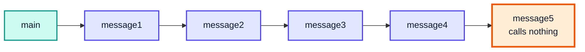

It works, but the five bodies are **identical**. That repetition is the hint that one function calling itself could do the same job.

---

## 3. E2: Numbers Program (13:03)

**Task:** print the numbers `1` to `5`, again with function calls only.

```java
public class NumbersChain {
    public static void main(String[] args) {
        print1(1);
    }
    static void print1(int n) { System.out.println(n); print2(2); }
    static void print2(int n) { System.out.println(n); print3(3); }
    static void print3(int n) { System.out.println(n); print4(4); }
    static void print4(int n) { System.out.println(n); print5(5); }
    static void print5(int n) { System.out.println(n); }
    // Output: 1 2 3 4 5 (one per line)
}
```

| Function | Body | Calls next with |
|---|---|---|
| `print1` | print `n` | `2` = `n + 1` |
| `print2` | print `n` | `3` = `n + 1` |
| `print3` | print `n` | `4` = `n + 1` |
| `print4` | print `n` | `5` = `n + 1` |
| `print5` | print `n` | nothing (stop) |

Every function does the same thing: **print `n`, then call the next one with `n + 1`**. Only the last one is different: it **stops**. Keep that observation; it becomes the base condition in section 6.

---

## 4. Working of function calls (17:57)

When a method is called, Java pushes a **stack frame** onto the **call stack**. The frame holds that call's parameters, local variables and the place to return to.

Rules:

1. A called function's frame goes **on top** of the caller's frame.
2. While a function has not finished, its frame **stays** on the stack.
3. When it finishes (returns or reaches its end), its frame is **popped** and control goes back to the line after the call in the frame below.

### Call stack while `print5` is running

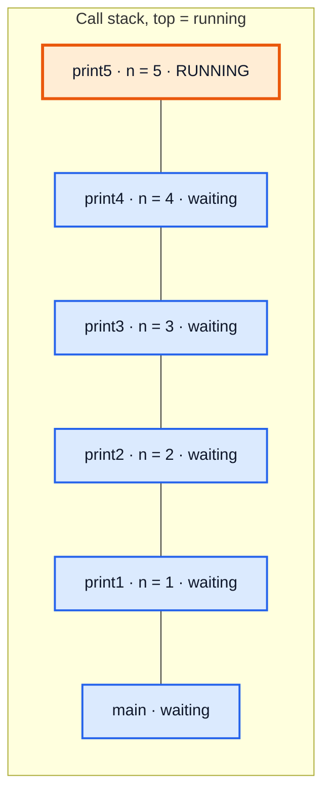

### Order of calls and returns

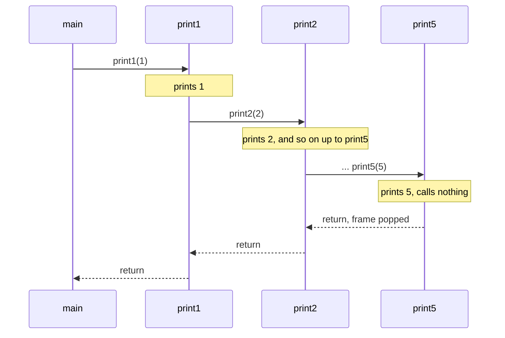

> [!NOTE]
> Each frame has its **own copy** of `n`. The `n` in `print2` and the `n` in `print1` are different variables, even when the function is the same (as in recursion).

---

## 5. What is Recursion? (30:02)

**Recursion** is when a function **calls itself**. Since the chained functions in E1 and E2 all had the same body, we can replace them with a single function that calls itself with a changed argument.

| Chain of functions | Recursion |
|---|---|
| `print1`, `print2`, ..., `print5` | one `print(n)` |
| Each hard-codes the next call | Calls `print(n + 1)` |
| Last function simply has no call | A **base condition** decides when to stop |

---

## 6. Recursive Function for E2 (31:10)

```java
public class NumbersRecursive {
    public static void main(String[] args) {
        print(1);
    }

    static void print(int n) {
        if (n == 5) {                 // base condition: the old print5
            System.out.println(n);
            return;
        }
        System.out.println(n);
        print(n + 1);                 // recursive call
    }
    // Output: 1 2 3 4 5 (one per line)
}
```

The body is exactly what `print1..print4` did, and the `if` block is exactly what `print5` did.

A cleaner, general version that prints `1..n`:

```java
static void printUpTo(int i, int n) {
    if (i > n) return;          // nothing left to print
    System.out.print(i + " ");
    printUpTo(i + 1, n);
}
```

---

## 7. Internal Working of Recursive Function (35:35)

The stack looks **exactly the same** as with the five separate functions. Recursion does not create one shared frame; every call of `print` gets its own frame with its own `n`.

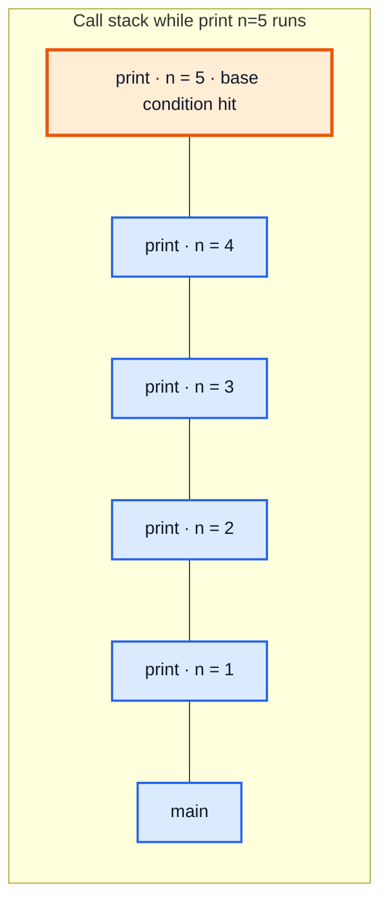

### Trace

| Step | Action | Stack (bottom → top) | Printed |
|---|---|---|---|
| 1 | `main` calls `print(1)` | main, p(1) | 1 |
| 2 | `print(1)` calls `print(2)` | main, p(1), p(2) | 2 |
| 3 | ... | ..., p(3), p(4) | 3, 4 |
| 4 | `print(4)` calls `print(5)` 🟧 | ..., p(4), p(5) | 5 |
| 5 | `print(5)` returns | ..., p(4) | |
| 6 | Frames pop one by one | main | |

### Printing before vs after the call

Moving the print **below** the recursive call reverses the output, because each print now runs while the stack **unwinds**:

```java
static void printDownFrom(int i, int n) {
    if (i > n) return;
    printDownFrom(i + 1, n);
    System.out.print(i + " ");   // runs on the way back
}
// printDownFrom(1, 5) prints: 5 4 3 2 1
```

---

## 8. Base Condition in Recursion (37:53)

The **base condition** is the case where the function **returns without calling itself**. It is what stops the recursion.

Without one, each call adds a new frame forever. The stack has a fixed size, so Java eventually throws **`StackOverflowError`**.

```java
public class NoBaseCondition {
    static void print(int n) {
        System.out.println(n);
        print(n + 1);                // never stops
    }
    public static void main(String[] args) {
        print(1);                    // prints thousands of lines, then:
        // Exception in thread "main" java.lang.StackOverflowError
    }
}
```

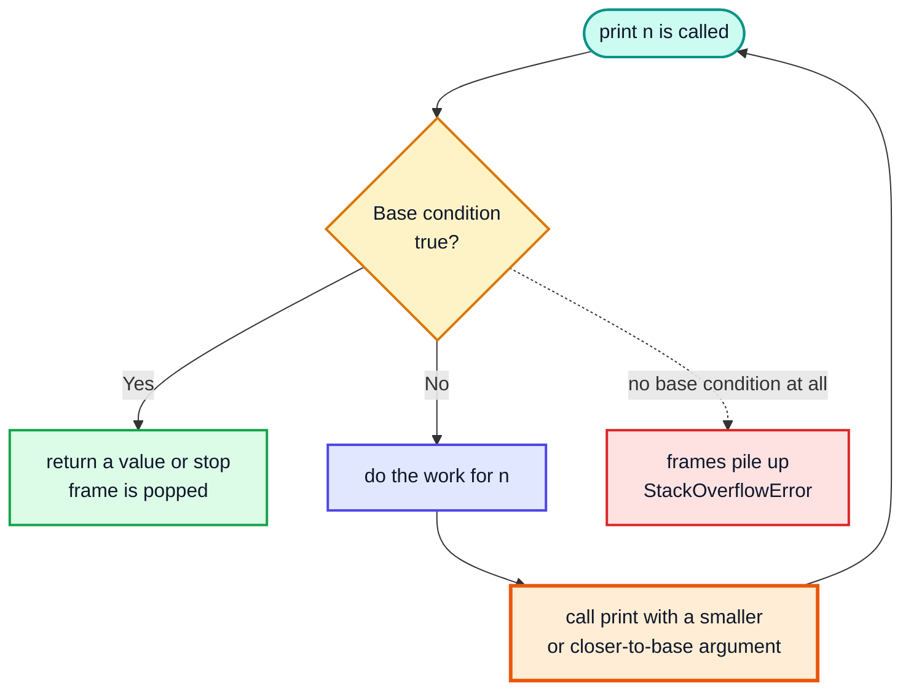

> [!CAUTION]
> `StackOverflowError` is an `Error`, not an `Exception`. You can technically catch it, but it signals a bug: a missing base condition, or a recursive call that never moves towards the base condition (e.g. calling `print(n)` instead of `print(n + 1)`).

> [!NOTE]
> The default stack depth depends on the JVM and frame size, typically several thousand to tens of thousands of calls. It can be raised with the `-Xss` JVM option (for example `java -Xss4m Main`), but a deep-recursion crash is usually a sign to change the algorithm.

---

## 9. Definition of Recursion (45:36)

> **Recursion:** a function that calls itself, where each call solves a **smaller instance** of the same problem, until a **base condition** is reached that can be answered directly.

---

## 10. Use of Recursion (45:52)

| Benefit | Explanation |
|---|---|
| **Breaks big problems into smaller ones** | Solve `f(n)` by trusting `f(n-1)` (or `f(n/2)`) |
| **Natural for recursive structures** | Trees, graphs, nested data |
| **Short, clear code** | Divide and conquer, backtracking, DP become a few lines |
| **Can be converted** | Any recursion can be written iteratively (with an explicit stack if needed), and vice versa |

| Cost | Explanation |
|---|---|
| **Space** | Every pending call uses a stack frame → O(depth) extra space |
| **Overhead** | Function calls are slower than loop iterations |
| **Risk** | Deep recursion → `StackOverflowError` |

> [!TIP]
> Solve it recursively first if that is how the problem is defined, then convert to iteration (or add memoization) only if space or speed matters.

---

## 11. Visualising Recursion (Recursion Tree) (50:48)

A **recursion tree** draws each call as a node and each recursive call as an edge to a child. For a function that calls itself once (like `print`), the tree is a straight line:

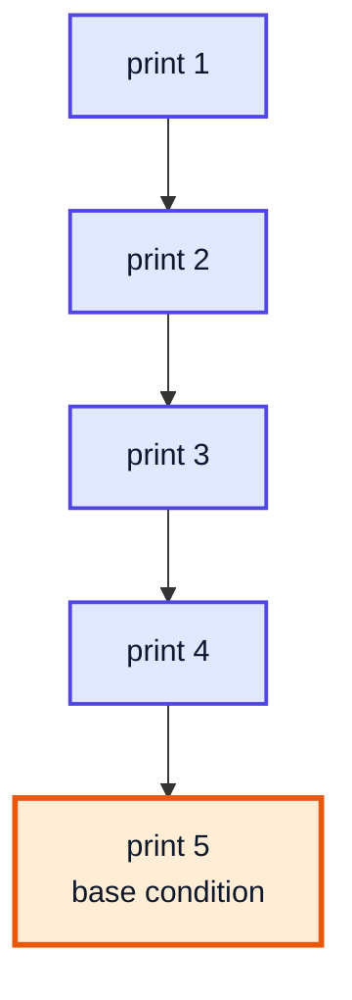

For functions that call themselves more than once, the tree branches. The height of the tree is the **maximum stack depth**, which gives the space complexity.

---

## 12. Q1: Fibonacci Numbers (53:01)

**LeetCode 509 — Fibonacci Number.** `F(0) = 0`, `F(1) = 1`, and `F(n) = F(n-1) + F(n-2)` for `n > 1`. Return `F(n)`.

| n | 0 | 1 | 2 | 3 | 4 | 5 | 6 | 7 | 8 | 9 |
|---|---|---|---|---|---|---|---|---|---|---|
| F(n) | 0 | 1 | 1 | 2 | 3 | 5 | 8 | 13 | 21 | 34 |

The definition itself is recursive: to know `F(4)` you need `F(3)` and `F(2)`, which are smaller versions of the same question.

---

## 13. Identifying Recursion problem (59:31)

A problem is a good fit for recursion when the answer for a big input can be written using the answer(s) for **smaller inputs of the same problem**. Writing that relation down gives the **recurrence relation**:

**F(n) = F(n − 1) + F(n − 2)**

| Question to ask | For Fibonacci |
|---|---|
| Can I break it into smaller same-type problems? | Yes, `F(n-1)` and `F(n-2)` |
| How do I combine their answers? | Add them |
| Where does it stop? | Section 14 |

---

## 14. Finding Base Condition (59:49)

The base condition is the **smallest input whose answer is already known**, without recursion.

For Fibonacci the definition gives two: `F(0) = 0` and `F(1) = 1`. Both are needed, because `F(n-2)` can reach `0` while `F(n-1)` stops at `1`. Since both answers equal `n`:

```java
if (n < 2) return n;
```

> [!WARNING]
> With only `if (n == 1) return 1;`, a call like `fib(2)` calls `fib(0)`, which calls `fib(-1)`, `fib(-2)`, ... forever → `StackOverflowError`. Always check that **every** branch of the recurrence reaches a base case.

---

## 15. Code for Q1 (1:02:28)

```java
public class Fibonacci {
    static int fib(int n) {
        if (n < 2) {                     // base condition
            return n;
        }
        return fib(n - 1) + fib(n - 2);  // recurrence relation
    }

    public static void main(String[] args) {
        System.out.println(fib(6));      // 8
    }
}
```

### Recursion tree for `fib(4)`

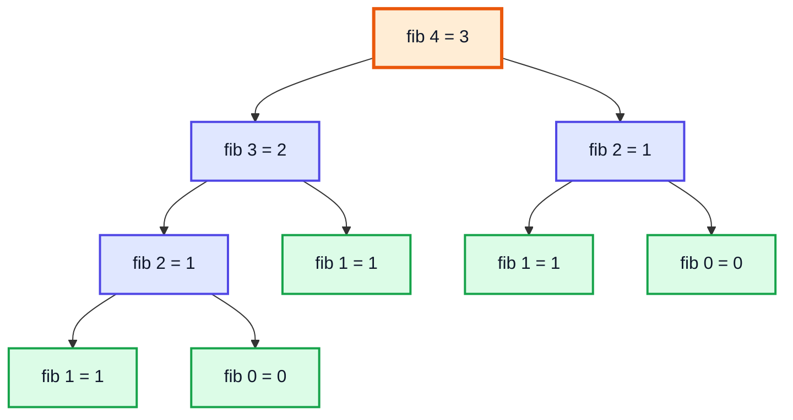

Green nodes are base cases. Notice `fib(2)` is computed **twice**; for larger `n` the repetition explodes.

### Complexity

| | Value | Why |
|---|---|---|
| Time | **O(2ⁿ)** (more precisely about O(1.618ⁿ)) | Each call branches into two; the tree has exponentially many nodes |
| Space | **O(n)** | The deepest path is `fib(n) → fib(n-1) → ... → fib(1)`; only one path is on the stack at a time |

`fib(20)` already makes **21,891** calls (measured in the complete example below).

### Alternative approaches

| Approach | Time | Space | Idea |
|---|---|---|---|
| Plain recursion | O(2ⁿ) | O(n) | As above |
| **Memoization** | O(n) | O(n) | Store each `F(k)` the first time it is computed |
| Iterative (two variables) | O(n) | O(1) | Keep `prev`, `curr`, slide forward |
| Binet's formula | O(1)* | O(1) | Uses the golden ratio; floating-point error for large `n` |

```java
// Memoized: each F(k) is computed only once
static long fibMemo(int n, long[] memo) {
    if (n < 2) return n;
    if (memo[n] != 0) return memo[n];
    return memo[n] = fibMemo(n - 1, memo) + fibMemo(n - 2, memo);
}

// Iterative
static long fibIter(int n) {
    long prev = 0, curr = 1;
    if (n == 0) return 0;
    for (int i = 2; i <= n; i++) {
        long next = prev + curr;
        prev = curr;
        curr = next;
    }
    return curr;
}
```

> [!NOTE]
> `int` overflows after `F(46)`. Use `long` (good up to `F(92)`) or `BigInteger` beyond that.

---

## 16. Tail Recursion (1:13:01)

A call is a **tail call** when it is the **very last thing** the function does: nothing is left to compute after it returns.

| Function | Last operation | Tail recursive? |
|---|---|---|
| `printUpTo(i, n)`: `print(i); printUpTo(i + 1, n);` | The recursive call | ✅ Yes |
| `fib(n)`: `return fib(n-1) + fib(n-2);` | The `+` after both calls return | ❌ No |
| `printDownFrom`: call, then `print(i)` | The print | ❌ No |

```java
// Tail-recursive Fibonacci: carries the running values as arguments
static long fibTail(int n, long a, long b) {
    if (n == 0) return a;
    return fibTail(n - 1, b, a + b);   // nothing to do after this returns
}
// fibTail(10, 0, 1) == 55
```

> [!IMPORTANT]
> Some languages (Scheme, Scala with `@tailrec`, Kotlin with `tailrec`) reuse the same stack frame for tail calls. **Java does not perform tail-call optimisation**, even in Java 21. A tail-recursive Java method still uses O(depth) stack space and can still overflow. If you need constant space, rewrite it as a loop.

---

## 17. Best Approach for Recursion Problems (1:13:53)

A repeatable recipe:

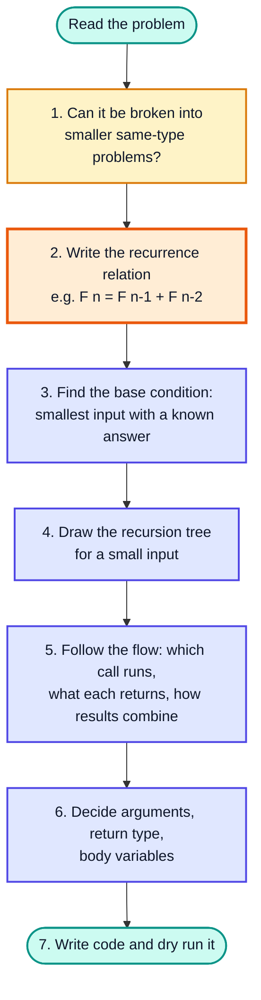

> [!TIP]
> **Trust the recursive call.** When writing `fib(n)`, assume `fib(n-1)` already returns the right answer, and only think about how to use it. Tracing every level mentally is for debugging, not for writing.

---

## 18. Understanding Recursion Tree (1:15:12)

The tree is not executed level by level. Java runs it **depth-first, left child first**, because `fib(n-1)` in `fib(n-1) + fib(n-2)` must fully finish before `fib(n-2)` starts.

### Execution order for `fib(4)`

| Order | Call starts | Returns | Stack (bottom → top) when it starts |
|---|---|---|---|
| 1 | fib(4) | 3 (last) | f4 |
| 2 | fib(3) | 2 | f4, f3 |
| 3 | fib(2) | 1 | f4, f3, f2 |
| 4 | fib(1) 🟩 | 1 | f4, f3, f2, f1 |
| 5 | fib(0) 🟩 | 0 | f4, f3, f2, f0 |
| 6 | fib(1) 🟩 | 1 | f4, f3, f1 |
| 7 | fib(2) | 1 | f4, f2 |
| 8 | fib(1) 🟩 | 1 | f4, f2, f1 |
| 9 | fib(0) 🟩 | 0 | f4, f2, f0 |

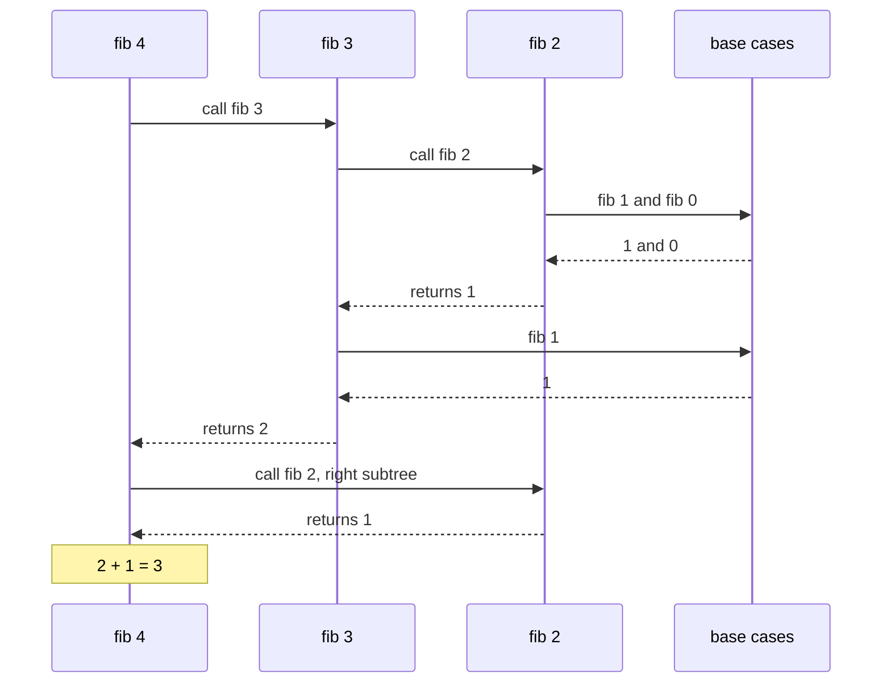

Key observations:

- The stack never holds more than **one root-to-leaf path** → space = tree height = O(n).
- A node's value is known only **after all its children return**.
- The number of nodes in the tree = the number of calls → time.

---

## 19. Key areas to be focused for Recursion (1:22:19)

When writing a recursive function, decide three things explicitly:

| Area | Question | Example (binary search) |
|---|---|---|
| **Arguments** | What changes between calls? | `s`, `e` |
| **Return type** | What does each call give back to its caller? | `int` index, or `-1` |
| **Body** | What is computed only for this call? | `mid` |

> [!NOTE]
> These three are the most common source of bugs: a value that should change is not passed, a return value is ignored, or a body variable is wrongly made an argument.

---

## 20. Q2: Binary Search (1:24:26)

**LeetCode 704 — Binary Search.** Given a sorted array and a target, return the target's index or `-1`.

Binary search is naturally recursive: after comparing with the middle element, you search **the same problem on half the array**.

### Approach

1. Base condition: if `s > e` the range is empty → return `-1`.
2. Compute `m = s + (e - s) / 2`.
3. If `arr[m] == target` → return `m`.
4. If `target < arr[m]` → search the left half `[s, m - 1]`.
5. Else → search the right half `[m + 1, e]`.

```java
public class RecursiveBinarySearch {
    static int search(int[] arr, int target, int s, int e) {
        if (s > e) {
            return -1;                                   // not found
        }
        int m = s + (e - s) / 2;                         // avoids int overflow
        if (arr[m] == target) {
            return m;
        }
        if (target < arr[m]) {
            return search(arr, target, s, m - 1);
        }
        return search(arr, target, m + 1, e);
    }

    public static void main(String[] args) {
        int[] arr = {-1, 0, 3, 5, 9, 12};
        System.out.println(search(arr, 9, 0, arr.length - 1));   // 4
        System.out.println(search(arr, 2, 0, arr.length - 1));   // -1
    }
}
```

### Dry Run: `arr = {-1, 0, 3, 5, 9, 12}`, `target = 9`

| Call | s | e | m | arr[m] | Decision |
|---|---|---|---|---|---|
| 1 | 0 | 5 | 2 | 3 | 9 > 3 → right half |
| 2 | 3 | 5 | 4 | 9 | ✅ found → return 4 |

### Complexity

| | Recursive | Iterative |
|---|---|---|
| Time | O(log n) | O(log n) |
| Space | **O(log n)** stack frames | **O(1)** |

> [!TIP]
> The iterative version (video #14) is preferred in practice for its O(1) space. The recursive version is worth knowing because the same "search one half" shape appears in merge sort, quick sort and tree problems.

---

## 21. Types of Recurrence Relation (1:27:54)

| Type | Shape | Input shrinks by | Example | Typical cost |
|---|---|---|---|---|
| **Linear recurrence** | `F(n) = F(n-1) + F(n-2)` | A constant (subtract) | Fibonacci, factorial `f(n) = n · f(n-1)` | Often slow (Fibonacci is exponential) |
| **Divide and conquer recurrence** | `F(N) = F(N/2) + O(1)` | A factor (divide) | Binary search, merge sort `T(N) = 2T(N/2) + O(N)` | Usually fast (log or N log N) |

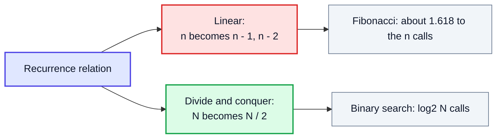

For binary search, `T(N) = T(N/2) + O(1)`: comparing with the middle is constant work, and only **one** half is searched. Halving N until it reaches 1 takes log₂N steps → **O(log N)**.

> [!NOTE]
> Solving recurrences formally (Master theorem, Akra–Bazzi) is covered in the later time and space complexity video. For now, just recognise which type a relation is.

---

## 22. Important Tip (1:34:07)

**Return the result of the recursive call.** When a function has a return type, each recursive call's answer must be passed back up the chain:

```java
// ❌ WRONG: the found index is computed and then thrown away
static int searchWrong(int[] arr, int target, int s, int e) {
    if (s > e) return -1;
    int m = s + (e - s) / 2;
    if (arr[m] == target) return m;
    if (target < arr[m]) {
        searchWrong(arr, target, s, m - 1);     // result ignored
    } else {
        searchWrong(arr, target, m + 1, e);     // result ignored
    }
    return -1;                                  // always reached for a non-middle target
}

// ✅ RIGHT
// return search(arr, target, s, m - 1);
```

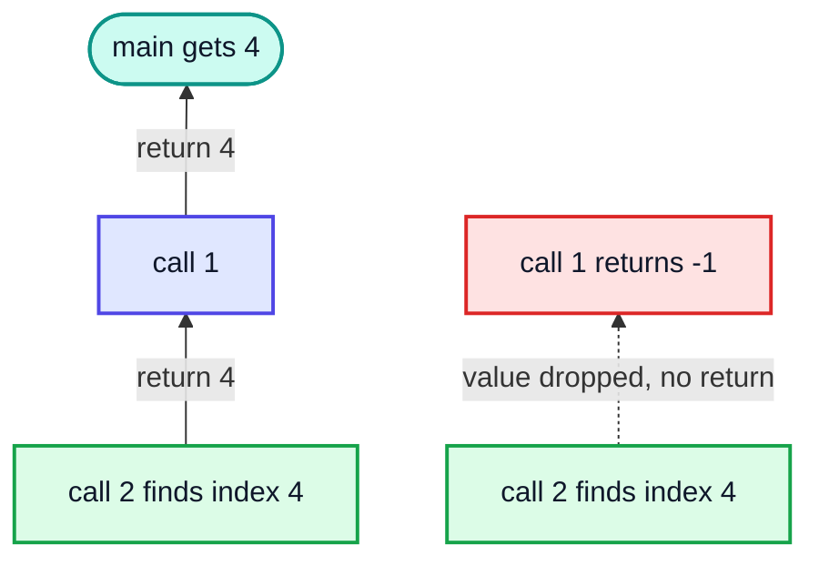

> [!WARNING]
> The compiler cannot catch this bug: the code compiles and returns `-1`. Each frame only returns to the frame directly below it, so if one level drops the value it is lost for good.

---

## 23. When to take which variable? (1:38:04)

| Put it in... | When | Binary search |
|---|---|---|
| **Arguments** | The value changes from call to call, **or** later calls need it | `s`, `e` (change); `arr`, `target` (needed by every call) |
| **Function body** | The value is computed fresh in each call and later calls do not need it passed in | `m` |
| **Return value** | The caller needs the result | the index |

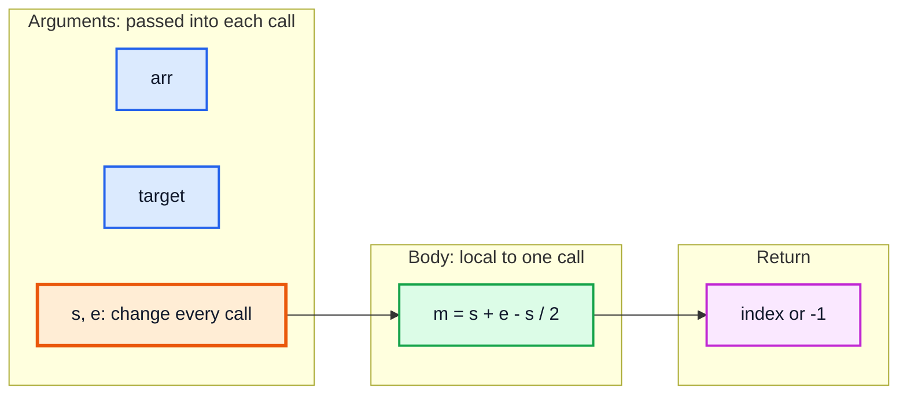

> [!NOTE]
> Passing `arr` does **not** copy the array. Java passes the **reference** by value, so every frame points to the same array object on the heap. Only the small `int` arguments (`target`, `s`, `e`) are copied per frame.

A common Java convenience is a public wrapper that hides the extra arguments:

```java
public static int search(int[] arr, int target) {
    return search(arr, target, 0, arr.length - 1);   // helper does the recursion
}
```

---

## 24. Recursion Tree for Binary Search (1:44:33)

Binary search calls itself **at most once** per call, so its tree is a single chain, unlike Fibonacci's branching tree.

Search `target = 12` in `{-1, 0, 3, 5, 9, 12}`:

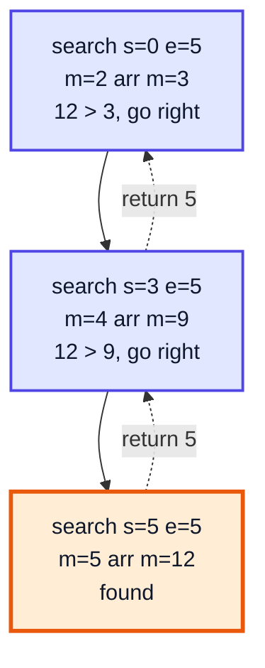

| | Fibonacci tree | Binary search tree |
|---|---|---|
| Calls per node | 2 | 1 |
| Height | n | log₂ n |
| Total nodes (time) | ~2ⁿ | ~log₂ n |
| Stack depth (space) | O(n) | O(log n) |

---

## 25. Outro (1:50:28)

Recursion is learned by **drawing trees** for many problems, not by reading. The next videos continue with more recursion problems (arrays, patterns, strings, subsets, permutations), all using the same recipe: recurrence relation, base condition, tree, then arguments / return / body.

---

## 🧩 Complete Example: Everything Together

```java
import java.util.Arrays;

public class RecursionAll {

    // E2 done recursively: print 1..n
    static void printUpTo(int i, int n) {
        if (i > n) return;                 // base condition
        System.out.print(i + " ");
        printUpTo(i + 1, n);               // tail call
    }

    // Same calls, printing AFTER the recursive call -> reversed order
    static void printDownFrom(int i, int n) {
        if (i > n) return;
        printDownFrom(i + 1, n);
        System.out.print(i + " ");
    }

    // Q1: Fibonacci (LeetCode 509), plain recursion with a call counter
    static int calls = 0;
    static int fib(int n) {
        calls++;
        if (n < 2) return n;               // fib(0) = 0, fib(1) = 1
        return fib(n - 1) + fib(n - 2);
    }

    // Fibonacci with memoization: O(n)
    static long fibMemo(int n, long[] memo) {
        if (n < 2) return n;
        if (memo[n] != 0) return memo[n];
        return memo[n] = fibMemo(n - 1, memo) + fibMemo(n - 2, memo);
    }

    // Q2: recursive binary search (LeetCode 704)
    static int search(int[] arr, int target, int s, int e) {
        if (s > e) return -1;              // base condition: empty range
        int m = s + (e - s) / 2;
        if (arr[m] == target) return m;
        if (target < arr[m]) return search(arr, target, s, m - 1);
        return search(arr, target, m + 1, e);
    }

    // Depth probe: how deep can the call stack go?
    static int depth = 0;
    static void dive() {
        depth++;
        dive();                            // no base condition!
    }

    public static void main(String[] args) {
        System.out.print("printUpTo(1, 5)     : ");
        printUpTo(1, 5);
        System.out.println();

        System.out.print("printDownFrom(1, 5) : ");
        printDownFrom(1, 5);
        System.out.println();

        int[] fibs = new int[10];
        for (int i = 0; i < 10; i++) fibs[i] = fib(i);
        System.out.println("fib(0..9)           : " + Arrays.toString(fibs));

        calls = 0;
        System.out.println("fib(20)             : " + fib(20) + " using " + calls + " calls");
        System.out.println("fibMemo(50)         : " + fibMemo(50, new long[51]));

        int[] arr = {-1, 0, 3, 5, 9, 12};
        System.out.println("search 9            : index " + search(arr, 9, 0, arr.length - 1));
        System.out.println("search 2            : index " + search(arr, 2, 0, arr.length - 1));

        try {
            dive();
        } catch (StackOverflowError err) {
            System.out.println("No base condition   : StackOverflowError (depth > 1000? " + (depth > 1000) + ")");
        }
    }
}
```

**Expected Output:**
```
printUpTo(1, 5)     : 1 2 3 4 5 
printDownFrom(1, 5) : 5 4 3 2 1 
fib(0..9)           : [0, 1, 1, 2, 3, 5, 8, 13, 21, 34]
fib(20)             : 6765 using 21891 calls
fibMemo(50)         : 12586269025
search 9            : index 4
search 2            : index -1
No base condition   : StackOverflowError (depth > 1000? true)
```

---

## Quick Reference Cheat Sheet

| Concept | One-Line Summary |
|---|---|
| **Recursion** | A function calling itself on a smaller instance of the same problem |
| **Stack frame** | Each call gets its own frame with its own parameters and locals |
| **Base condition** | Input answered without recursion; missing it → `StackOverflowError` |
| **Recurrence relation** | Formula linking `f(n)` to smaller calls, e.g. `F(n) = F(n-1) + F(n-2)` |
| **Recursion tree** | Nodes = calls; node count ≈ time, height = stack space |
| **Execution order** | Depth-first, left child first; a node's value is known after its children return |
| **Print before / after call** | Before → order on the way down; after → reversed order on the way back |
| **Tail recursion** | Recursive call is the last operation; Java does **not** optimise it |
| **Fibonacci (LC 509)** | `n < 2 → n`; O(2ⁿ) time, O(n) space; memo or loop → O(n) |
| **Binary search (LC 704)** | `s > e → -1`; `return` the half-search; O(log n) time, O(log n) stack |
| **Linear recurrence** | Input shrinks by a constant (`n - 1`) |
| **Divide & conquer recurrence** | Input shrinks by a factor (`N / 2`) |
| **Arguments vs body** | Arguments: changes per call or needed later; body: computed fresh per call |
| **Important tip** | Always `return` the recursive call's result when the function returns a value |
