# Time and Space Complexity — Complete In-Depth Guide

**Video #24 of the Java + DSA playlist:** *Time and Space Complexity COMPLETE Tutorial - What is Big O?* (2:28:24)

A deep-dive into how to measure algorithms: what time complexity really means, the five asymptotic notations (O, Ω, Θ, o, ω), space complexity, analysing loops, sorts and recursive programs, solving divide-and-conquer recurrences with the Akra-Bazzi theorem, solving linear (homogeneous and non-homogeneous) recurrences, and a first look at NP-completeness.

---

## Table of Contents

| # | Topic | Timestamp |
|---|---|---|
| 0 | [Introduction](#0-introduction-000) | 0:00 |
| 1 | [Example](#1-example-345) | 3:45 |
| 2 | [Time Complexity](#2-time-complexity-627) | 6:27 |
| 3 | [Comparing Complexities](#3-comparing-complexities-1718) | 17:18 |
| 4 | [Procedure for Analysing Complexity](#4-procedure-for-analysing-complexity-2318) | 23:18 |
| 5 | [Big-Oh Notation](#5-big-oh-notation-3750) | 37:50 |
| 6 | [Big-Omega Notation](#6-big-omega-notation-4438) | 44:38 |
| 7 | [Big-Theta Notation](#7-big-theta-notation-4628) | 46:28 |
| 8 | [Little-Oh Notation](#8-little-oh-notation-4920) | 49:20 |
| 9 | [Little-Omega Notation](#9-little-omega-notation-5303) | 53:03 |
| 10 | [Space Complexity](#10-space-complexity-5529) | 55:29 |
| 11 | [Question](#11-question-5822) | 58:22 |
| 12 | [Complexity Analysis: Sorting Algorithms](#12-complexity-analysis-sorting-algorithms-10424) | 1:04:24 |
| 13 | [Complexity Analysis: Recursive Programs](#13-complexity-analysis-recursive-programs-10557) | 1:05:57 |
| 14 | [Types of Recurrence Relations](#14-types-of-recurrence-relations-11355) | 1:13:55 |
| 15 | [Divide-and-Conquer Recurrence Relation](#15-divide-and-conquer-recurrence-relation-11649) | 1:16:49 |
| 16 | [Akra-Bazzi Theorem](#16-akra-bazzi-theorem-12555) | 1:25:55 |
| 17 | [Linear Recurrence Relation](#17-linear-recurrence-relation-14411) | 1:44:11 |
| 18 | [Solving Homogeneous Linear Recurrence Relation](#18-solving-homogeneous-linear-recurrence-relation-14646) | 1:46:46 |
| 19 | [Q: Find nth Fibonacci Number using Golden Ratio](#19-q-find-nth-fibonacci-number-using-golden-ratio-15743) | 1:57:43 |
| 20 | [Q: Solve Recurrence Relation with Repeated Roots](#20-q-solve-recurrence-relation-with-repeated-roots-20315) | 2:03:15 |
| 21 | [Non-Homogeneous Linear Recurrence Relation](#21-non-homogeneous-linear-recurrence-relation-20800) | 2:08:00 |
| 22 | [Solving Non-Homogeneous Linear Recurrence Relation](#22-solving-non-homogeneous-linear-recurrence-relation-20910) | 2:09:10 |
| 23 | [How to Guess a Particular Solution?](#23-how-to-guess-a-particular-solution-21628) | 2:16:28 |
| 24 | [Example](#24-example-22034) | 2:20:34 |
| 25 | [NP-Complete Problems](#25-np-complete-problems-22454) | 2:24:54 |
| 26 | [Outro](#26-outro-22720) | 2:27:20 |

---

## 0. Introduction (0:00)

Up to this point the playlist has written algorithms (searching, sorting, recursion) and said things like "binary search is O(log N)" or "bubble sort is O(N²)". This video explains **what those statements actually mean** and how to derive them yourself, from simple loops all the way to recursive programs.

The video moves through three layers:

1. **Intuition**: time complexity is a *growth rate*, not seconds.
2. **Notation**: the formal definitions of O, Ω, Θ, o and ω.
3. **Maths for recursion**: recurrence relations and how to solve them (Akra-Bazzi, characteristic equations).

> [!IMPORTANT]
> Every interview answer you give from now on should end with "time complexity is ___ and space complexity is ___". Interviewers expect you to derive it, not memorise it.

---

## 1. Example (3:45)

### Same Code, Different Machines

Suppose you run linear search on an array of 1 million elements on an old laptop and on a new high-end machine.

| Machine | Time taken |
|---|---|
| Old laptop | ~10 seconds |
| New machine | ~1 second |

Which one has the better time complexity? **Neither.** They run the *same algorithm*, so they have the **same time complexity**. The actual seconds depend on CPU, memory, JIT warm-up, other processes and so on.

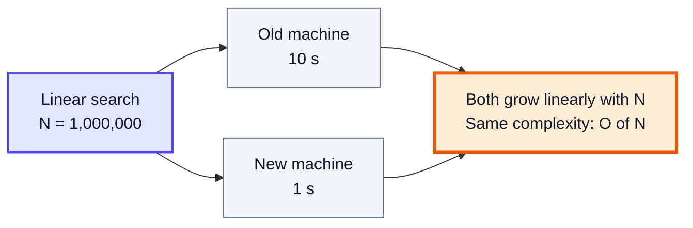

> [!NOTE]
> **Time complexity ≠ time taken.** Wall-clock time is a property of a machine. Time complexity is a property of an algorithm.

---

## 2. Time Complexity (6:27)

### Definition

**Time complexity** is the function that describes **how the number of operations grows as the input size N grows**.

If you plot "time taken" against "input size" for linear search on *any* machine, the plot is a straight line. The slope differs per machine, but the *shape* (linear) is the same. That shape is the time complexity.

| Input size N | Old machine | New machine | Ratio new/old |
|---|---|---|---|
| 1,000 | 10 ms | 1 ms | constant |
| 10,000 | 100 ms | 10 ms | constant |
| 100,000 | 1 s | 100 ms | constant |

Both columns grow 10× when N grows 10×. That is what "linear" means.

### Why We Care About Large Inputs

For tiny inputs every algorithm is fast. Complexity matters when **N is large** (millions of users, billions of records). So we always analyse **as N → ∞**.

### Rules of Thumb (from the video)

1. **Always look at the worst case.** You want a guarantee that holds for every input.
2. **Always look at large N.** Small inputs do not tell you anything.
3. **Ignore constants.** `3N` and `N` grow the same way; the hardware decides the constant.
4. **Ignore less dominating terms.** In `N² + 100N + 5000`, for huge N only `N²` matters.

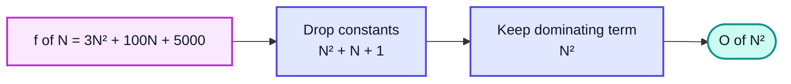

### Why Constants Can Be Ignored

| N | 3N | N² | Who is bigger |
|---|---|---|---|
| 1 | 3 | 1 | 3N |
| 3 | 9 | 9 | equal |
| 10 | 30 | 100 | N² |
| 1,000 | 3,000 | 1,000,000 | N² by far |

No matter how big the constant in front of `N`, `N²` eventually wins. Constants change *where* the lines cross, not *who wins in the end*.

### Example: Counting Operations

```java
public class CountOps {
    public static void main(String[] args) {
        int n = 5;
        int ops = 0;
        for (int i = 0; i < n; i++) {       // runs n times
            for (int j = 0; j < n; j++) {   // runs n times per i
                ops++;
            }
        }
        System.out.println("ops = " + ops); // ops = 25  →  N²
    }
}
```

> [!TIP]
> In practice, a modern machine does roughly **10⁸ simple operations per second**. If N = 10⁵, an O(N²) solution does 10¹⁰ operations (too slow), while O(N log N) does ~1.7 × 10⁶ (fast). This is how you read constraints on LeetCode to guess the required complexity.

| Constraint on N | Complexity that usually passes |
|---|---|
| N ≤ 10 | O(N!) , O(2ᴺ·N) |
| N ≤ 20 | O(2ᴺ) |
| N ≤ 500 | O(N³) |
| N ≤ 5,000 | O(N²) |
| N ≤ 10⁶ | O(N log N) or O(N) |
| N ≥ 10⁹ | O(log N) or O(1) |

---

## 3. Comparing Complexities (17:18)

### The Growth Ladder

From fastest (best) to slowest (worst):

```mermaid
flowchart LR
    C1["O of 1"]:::good --> C2["O of log N"]:::good --> C3["O of √N"]:::good --> C4["O of N"]:::process --> C5["O of N log N"]:::process --> C6["O of N²"]:::decision --> C7["O of 2ᴺ"]:::bad --> C8["O of N!"]:::bad
    classDef good fill:#dcfce7,stroke:#16a34a,stroke-width:2px,color:#0f172a
    classDef process fill:#e0e7ff,stroke:#4f46e5,stroke-width:2px,color:#0f172a
    classDef decision fill:#fef3c7,stroke:#d97706,stroke-width:2px,color:#0f172a
    classDef bad fill:#fee2e2,stroke:#dc2626,stroke-width:2px,color:#0f172a
```

### Numbers Make It Obvious

| N | log₂N | N | N log₂N | N² | 2ᴺ |
|---|---|---|---|---|---|
| 8 | 3 | 8 | 24 | 64 | 256 |
| 16 | 4 | 16 | 64 | 256 | 65,536 |
| 1,024 | 10 | 1,024 | 10,240 | ~10⁶ | ~10³⁰⁸ |
| 10⁶ | 20 | 10⁶ | 2 × 10⁷ | 10¹² | astronomically large |

| Complexity | Name | Typical example |
|---|---|---|
| O(1) | Constant | Array index access, `HashMap.get` (average) |
| O(log N) | Logarithmic | Binary search |
| O(N) | Linear | Linear search, one pass over array |
| O(N log N) | Linearithmic | Merge sort, `Arrays.sort` on objects |
| O(N²) | Quadratic | Bubble / selection / insertion sort |
| O(2ᴺ) | Exponential | Naive recursive Fibonacci, all subsets |
| O(N!) | Factorial | All permutations |

### Mixed Expressions

When an expression has independent variables, **keep both**:

- `O(N + M)`: loop over array of size N, then array of size M. Neither can be dropped because we do not know which is larger.
- `O(N · M)`: loop over M inside a loop over N.
- `O(N³ + log N)` → `O(N³)` (same variable, keep dominant).

> [!WARNING]
> `O(N + M)` is **not** `O(N)`. Only drop a term when it is provably smaller for large inputs.

---

## 4. Procedure for Analysing Complexity (23:18)

### Step-by-Step

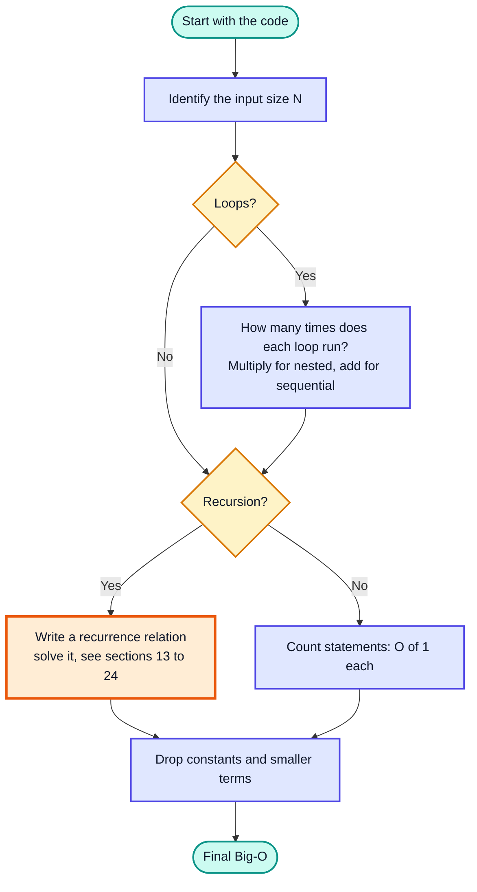

### Pattern 1: Simple Loop, O(N)

```java
for (int i = 0; i < n; i++) {
    System.out.println(i);   // runs n times
}
```

### Pattern 2: Nested Loops, O(N²)

```java
for (int i = 0; i < n; i++)
    for (int j = 0; j < n; j++)
        sum++;                // n × n
```

### Pattern 3: Dependent Inner Loop, Still O(N²)

```java
for (int i = 0; i < n; i++)
    for (int j = 0; j <= i; j++)
        sum++;                // 1 + 2 + ... + n = n(n+1)/2
```

`n(n+1)/2 = n²/2 + n/2` → drop constant and smaller term → **O(N²)**.

### Pattern 4: Doubling / Halving, O(log N)

```java
for (int i = 1; i < n; i *= 2) {
    sum++;
}
```

`i` takes values `1, 2, 4, ..., 2ᵏ`. The loop stops when `2ᵏ ≥ n`, i.e. `k = log₂ n`.

| Iteration | i |
|---|---|
| 1 | 1 |
| 2 | 2 |
| 3 | 4 |
| k | 2ᵏ⁻¹ |
| stop | 2ᵏ ≥ n → k ≈ log₂ n |

### Pattern 5: Loop Inside a Log Loop

```java
for (int i = 0; i < n; i++)          // n
    for (int j = 1; j < n; j *= 2)   // log n
        sum++;                        // total O(N log N)
```

### Pattern 6: Sequential Blocks Add

```java
for (int i = 0; i < n; i++) a++;          // O(N)
for (int i = 0; i < n; i++)
    for (int j = 0; j < n; j++) b++;      // O(N²)
// Total: O(N + N²) = O(N²)
```

### Pattern 7: Square Root Loop

```java
for (int i = 1; i * i <= n; i++) {   // runs √n times
    sum++;
}
```

Used in prime checking: you only need divisors up to √N.

> [!TIP]
> When the loop variable is **multiplied/divided** by a constant, think **log**. When it is **added/subtracted**, think **linear**. When the condition is `i * i <= n`, think **√N**.

---

## 5. Big-Oh Notation (37:50)

### Basic Meaning

**Big-O gives an upper bound.** Saying an algorithm is O(N²) means: "it will **never grow faster** than N² (up to a constant), for large N".

### Formal Definition

`f(N) = O(g(N))` if there exist constants `c > 0` and `N₀` such that

```
0 ≤ f(N) ≤ c · g(N)   for all N ≥ N₀
```

An equivalent limit test:

```
lim (N → ∞)  f(N) / g(N)  <  ∞
```

### Example

Is `f(N) = 6N³ + 3N + 5` in `O(N³)`?

`lim (6N³ + 3N + 5) / N³ = lim (6 + 3/N² + 5/N³) = 6`, which is finite. ✅ So yes.

Is it also in `O(N⁴)`? `lim (6N³ + ...) / N⁴ = 0` (finite). ✅ Also yes, because Big-O is only an **upper** bound.

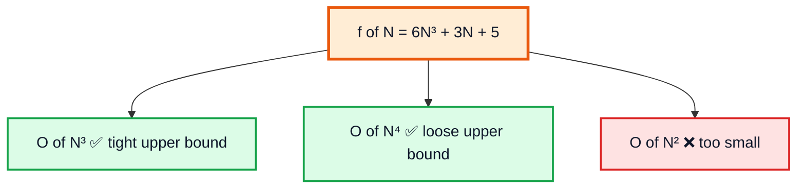

> [!NOTE]
> In everyday interview language, people say "Big-O" but they usually mean the **tight** bound (which is formally Θ). When asked "what is the complexity", give the tightest bound you can prove.

---

## 6. Big-Omega Notation (44:38)

### Basic Meaning

**Big-Omega (Ω) is a lower bound.** `f(N) = Ω(g(N))` means f grows **at least as fast as** g.

### Formal Definition

```
0 ≤ c · g(N) ≤ f(N)    for all N ≥ N₀
lim (N → ∞)  f(N) / g(N)  >  0
```

### Example

`f(N) = 6N³ + 3N + 5`:

- `Ω(N³)` ✅ (limit = 6 > 0)
- `Ω(N²)` ✅ (limit = ∞ > 0)
- `Ω(N⁴)` ❌ (limit = 0)

> [!WARNING]
> Ω is **not** "best case" and O is **not** "worst case". O/Ω/Θ are *bounds on a function*. You can talk about the O and Ω of the worst-case function, or of the best-case function. They are separate ideas that often get mixed up.

---

## 7. Big-Theta Notation (46:28)

### Basic Meaning

**Theta (Θ) is a tight bound**: both an upper and a lower bound.

```
f(N) = Θ(g(N))   ⟺   f(N) = O(g(N))  AND  f(N) = Ω(g(N))
0 < lim (N → ∞) f(N) / g(N) < ∞
```

### Example

`6N³ + 3N + 5 = Θ(N³)` because the limit is 6, a finite non-zero number.

| Notation | Bound | Limit of f/g | Analogy |
|---|---|---|---|
| O(g) | Upper (≤) | < ∞ | "at most" |
| Ω(g) | Lower (≥) | > 0 | "at least" |
| Θ(g) | Tight (=) | finite, > 0 | "exactly, up to constants" |
| o(g) | Strict upper (<) | = 0 | "strictly less" |
| ω(g) | Strict lower (>) | = ∞ | "strictly more" |

---

## 8. Little-Oh Notation (49:20)

### Basic Meaning

**Little-o is a strict (loose) upper bound.** `f = o(g)` means f grows **strictly slower** than g.

```
For EVERY c > 0 there exists N₀ such that  0 ≤ f(N) < c · g(N)   for all N ≥ N₀
lim (N → ∞)  f(N) / g(N)  =  0
```

### Big-O vs Little-o

| | Big-O | Little-o |
|---|---|---|
| Inequality | f ≤ c·g for **some** c | f < c·g for **every** c |
| Analogy | ≤ | < |
| `N² = ? (N²)` | ✅ O(N²) | ❌ not o(N²) |
| `N² = ? (N³)` | ✅ O(N³) | ✅ o(N³) |

Example: `f(N) = N²`, `g(N) = N³`. `lim N²/N³ = lim 1/N = 0` → `N² = o(N³)` ✅.

---

## 9. Little-Omega Notation (53:03)

### Basic Meaning

**Little-omega is a strict lower bound.** `f = ω(g)` means f grows **strictly faster** than g.

```
lim (N → ∞)  f(N) / g(N)  =  ∞
```

Example: `f(N) = N³`, `g(N) = N²`. `lim N³/N² = lim N = ∞` → `N³ = ω(N²)` ✅. But `N³ ≠ ω(N³)`.

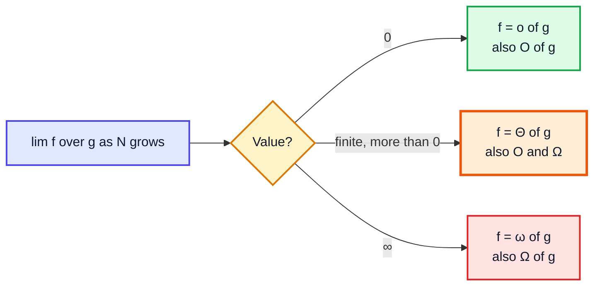

---

## 10. Space Complexity (55:29)

### Definition

**Space complexity** = how much memory the algorithm needs as N grows.

```
Total space = Input space + Auxiliary space
```

- **Input space**: memory for the input itself (an array of N elements).
- **Auxiliary space**: **extra** memory the algorithm creates (temp arrays, recursion stack, hash maps).

> [!IMPORTANT]
> In interviews, "space complexity" almost always means **auxiliary space**. Binary search on an array of N elements is said to be **O(1) space**, even though the array itself takes N.

### Examples

```java
// O(1) auxiliary space: only a few variables
static int sum(int[] arr) {
    int total = 0;
    for (int x : arr) total += x;
    return total;
}

// O(N) auxiliary space: a new array of size N
static int[] copyDoubled(int[] arr) {
    int[] res = new int[arr.length];
    for (int i = 0; i < arr.length; i++) res[i] = arr[i] * 2;
    return res;
}
```

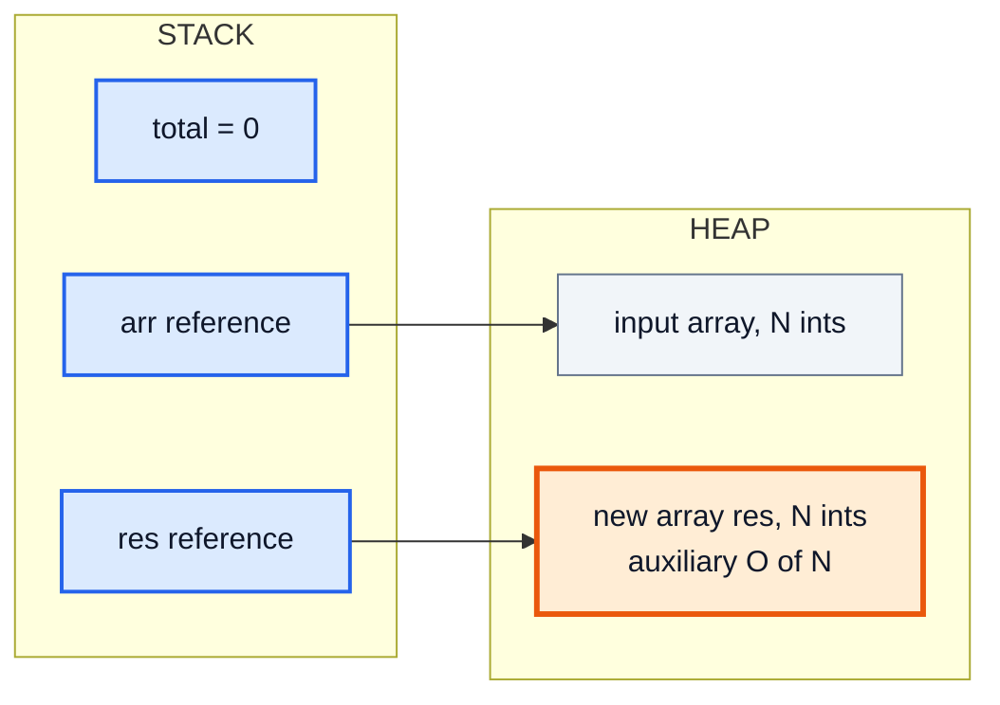

---

## 11. Question (58:22)

### The Problem

What is the time complexity of this code?

```java
for (int i = 1; i <= n; ) {
    for (int j = 1; j <= k; j++) {
        // some O(1) work
    }
    i = i + k;
}
```

### Approach

- The outer loop jumps by `k`, so it runs `n / k` times.
- Each outer iteration runs the inner loop `k` times.
- Total = `(n / k) · k = n`.

| Outer runs | Inner per outer | Total |
|---|---|---|
| n / k | k | **n** → O(N) |

**Answer: O(N)** (or more precisely O(N + k) if k may exceed n, because the inner loop still runs once fully).

### Dry Run (n = 8, k = 2)

| i at start | inner j runs | total so far |
|---|---|---|
| 1 | 2 | 2 |
| 3 | 2 | 4 |
| 5 | 2 | 6 |
| 7 | 2 | 8 ✅ = n |

### More Practice

| Code shape | Complexity |
|---|---|
| `for i in 0..n: for j in 0..n: for k in 0..n` | O(N³) |
| `for i = n; i > 0; i /= 2` | O(log N) |
| `for i in 0..n: for j = 1; j < n; j *= 2` | O(N log N) |
| `for i in 0..n: for j in 0..m` | O(N · M) |
| `for i = 2; i <= n; i = i * i` | O(log log N) |

> [!TIP]
> The last row: `i` goes 2, 4, 16, 256, ... (squares each time), i.e. `2^(2^k)`. It stops when `2^(2^k) ≥ n` → `k = log log n`.

---

## 12. Complexity Analysis: Sorting Algorithms (1:04:24)

| Algorithm | Best | Average | Worst | Space | Stable? |
|---|---|---|---|---|---|
| Bubble sort | O(N) (with swapped flag) | O(N²) | O(N²) | O(1) | ✅ |
| Selection sort | O(N²) | O(N²) | O(N²) | O(1) | ❌ |
| Insertion sort | O(N) | O(N²) | O(N²) | O(1) | ✅ |
| Cyclic sort | O(N) | O(N) | O(N) | O(1) | ❌ (range 1..N only) |
| Merge sort | O(N log N) | O(N log N) | O(N log N) | O(N) | ✅ |
| Quick sort | O(N log N) | O(N log N) | O(N²) | O(log N) stack | ❌ |

Why insertion sort's best case is O(N): on an already-sorted array the inner loop breaks immediately each time, so you only do N - 1 comparisons.

> [!NOTE]
> **Modern Java:** `Arrays.sort(int[])` uses **Dual-Pivot Quicksort** (O(N log N) average), while `Arrays.sort(Object[])` and `Collections.sort` use **TimSort**, a stable hybrid of merge sort and insertion sort with O(N) best case and O(N log N) worst case.

---

## 13. Complexity Analysis: Recursive Programs (1:05:57)

### Space Complexity of Recursion

Every recursive call that is **still waiting** occupies a stack frame. So:

> **Recursive space = maximum depth of the recursion tree** (the longest chain of calls on the stack at the same time), not the total number of calls.

### Example: Fibonacci

```java
static int fib(int n) {
    if (n < 2) return n;
    return fib(n - 1) + fib(n - 2);
}
```

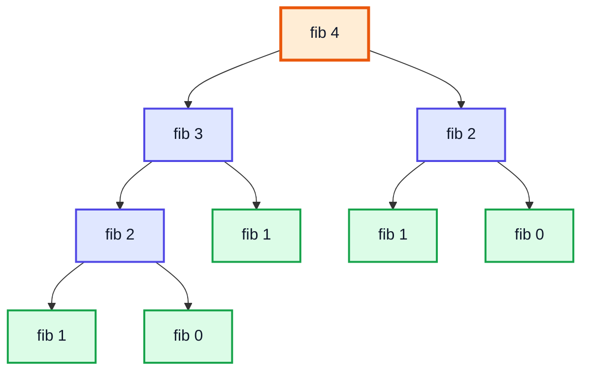

- Calls at the same level are **not** on the stack at the same time. `fib(3)` fully finishes (and its frames pop) before `fib(2)` on the right starts.
- The deepest path is `fib(4) → fib(3) → fib(2) → fib(1)`: depth N.
- **Space: O(N)**. **Time: O(2ᴺ)** loosely, exactly **O(φᴺ) ≈ O(1.618ᴺ)** (proved in section 18).

### Call Stack Over Time

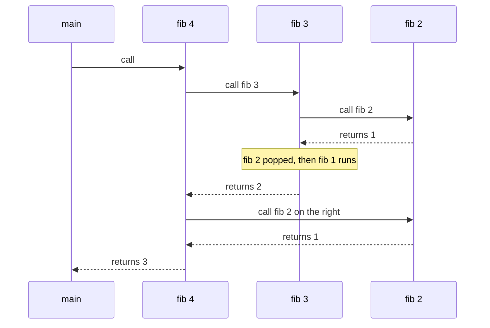

### From Code to Recurrence

Write `T(N)` = time to solve size N:

| Program | Recurrence |
|---|---|
| Fibonacci | T(N) = T(N-1) + T(N-2) + O(1) |
| Binary search | T(N) = T(N/2) + O(1) |
| Merge sort | T(N) = 2T(N/2) + O(N) |
| Linear recursion (e.g. sum of array) | T(N) = T(N-1) + O(1) |

---

## 14. Types of Recurrence Relations (1:13:55)

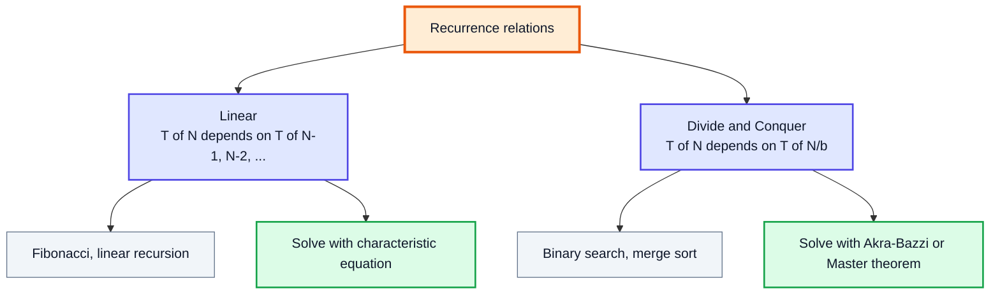

| Type | Shape | How input shrinks | Example |
|---|---|---|---|
| Linear | `f(n) = a₁f(n-1) + a₂f(n-2) + ... + g(n)` | subtracts a constant | Fibonacci |
| Divide & Conquer | `T(x) = a₁T(b₁x + ε) + ... + g(x)` | divides by a factor | Merge sort |

---

## 15. Divide-and-Conquer Recurrence Relation (1:16:49)

### General Form

```
T(x) = a₁·T(b₁x + ε₁(x)) + a₂·T(b₂x + ε₂(x)) + ... + aₖ·T(bₖx + εₖ(x)) + g(x)     for x ≥ x₀
```

- `aᵢ` = number of subproblems of that kind (`aᵢ > 0`)
- `bᵢ` = fraction of the input each subproblem gets (`0 < bᵢ < 1`)
- `εᵢ(x)` = small rounding term like `-1` or the ceiling/floor (it does not change the answer)
- `g(x)` = work done in this call outside the recursive calls

### Mapping Known Algorithms

| Algorithm | Recurrence | a | b | g(x) |
|---|---|---|---|---|
| Binary search | T(N) = T(N/2) + c | 1 | 1/2 | c |
| Merge sort | T(N) = 2T(N/2) + (N - 1) | 2 | 1/2 | N - 1 |
| Unbalanced split | T(N) = T(N/4) + T(3N/4) + N | 1, 1 | 1/4, 3/4 | N |

### Solving by Expansion (Binary Search)

```
T(N) = T(N/2) + c
     = T(N/4) + c + c
     = T(N/8) + 3c
     = T(N/2ᵏ) + k·c
Stop when N/2ᵏ = 1 → k = log₂ N
T(N) = T(1) + c·log₂N = O(log N)
```

### Recursion Tree (Merge Sort)

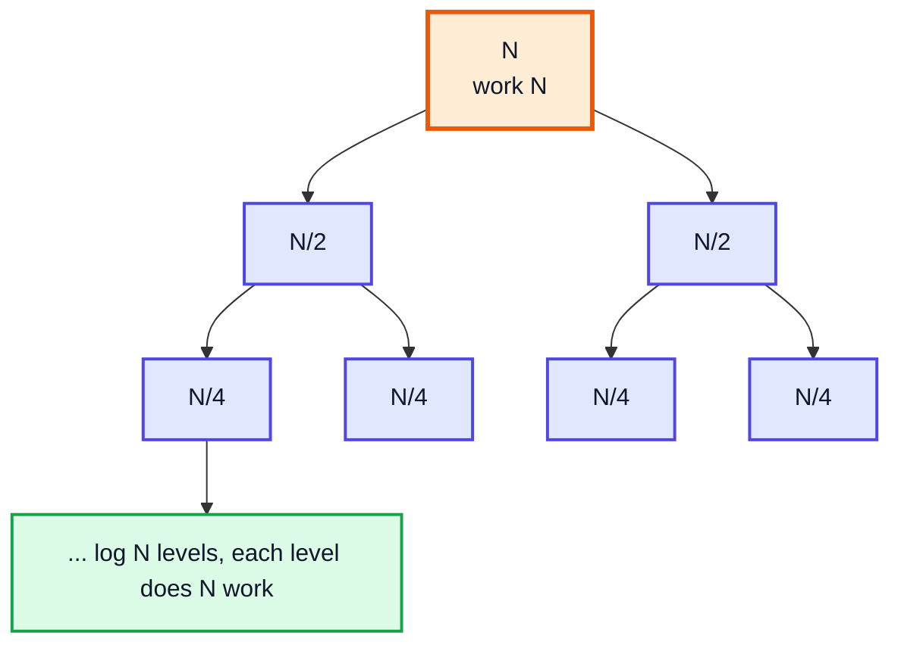

`log N` levels × `N` work per level = **O(N log N)**. Expansion works for simple cases, but it gets painful for messy ones (multiple different `bᵢ`). That is why we need a formula.

---

## 16. Akra-Bazzi Theorem (1:25:55)

### The Formula

For `T(x) = Σ aᵢ·T(bᵢx + εᵢ) + g(x)`:

1. Find `p` such that

```
Σ aᵢ · bᵢᵖ = 1
```

2. Then

```
T(x) = Θ( xᵖ · ( 1 + ∫₁ˣ  g(u) / u^(p+1)  du ) )
```

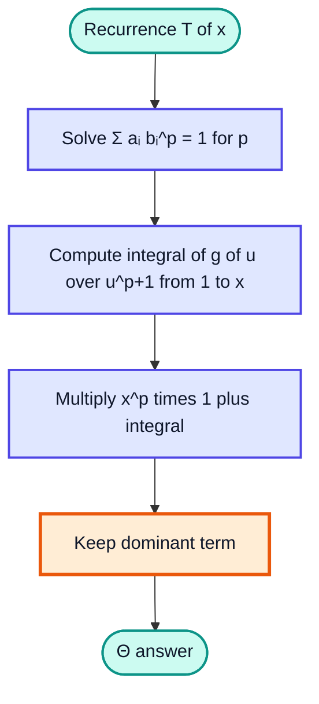

### Example 1: Merge Sort, T(N) = 2T(N/2) + (N - 1)

- `2 · (1/2)ᵖ = 1` → `p = 1`
- `∫₁ˣ (u - 1) / u² du = ∫ (1/u - 1/u²) du = [ln u + 1/u]₁ˣ = ln x + 1/x - 1`
- `T = Θ(x · (1 + ln x + 1/x - 1)) = Θ(x ln x + 1)` → **Θ(N log N)** ✅

### Example 2: Binary Search, T(N) = T(N/2) + c

- `1 · (1/2)ᵖ = 1` → `p = 0`
- `∫₁ˣ c / u du = c ln x`
- `T = Θ(x⁰ · (1 + c ln x))` → **Θ(log N)** ✅

### Example 3: T(N) = 2T(N/2) + N²

- `p = 1` (same as merge sort)
- `∫₁ˣ u² / u² du = x - 1`
- `T = Θ(x · (1 + x - 1)) = Θ(x²)` → **Θ(N²)**: the work at the top dominates.

### Example 4: T(N) = 3T(N/3) + 4T(N/4) + N² (p is not a nice number)

- Need `3·(1/3)ᵖ + 4·(1/4)ᵖ = 1`.
  - Try `p = 1`: `1 + 1 = 2` (> 1)
  - Try `p = 2`: `1/3 + 1/4 = 7/12` (< 1)
  - So `1 < p < 2` (numerically p ≈ 1.56).
- `∫₁ˣ u² / u^(p+1) du = ∫ u^(1-p) du = (x^(2-p) - 1)/(2 - p)`; since `p < 2`, this is `Θ(x^(2-p))`.
- `T = Θ(xᵖ · x^(2-p)) = Θ(x²)` → **Θ(N²)**.

> [!TIP]
> Shortcut that falls out of Akra-Bazzi: if `g(x) = Θ(xᶜ)` then
> - `p > c` → `T = Θ(xᵖ)` (recursion dominates)
> - `p = c` → `T = Θ(xᶜ log x)` (balanced)
> - `p < c` → `T = Θ(xᶜ)` (top-level work dominates)
>
> This is exactly the **Master Theorem**, which is a special case of Akra-Bazzi with one kind of subproblem.

### Example 5: T(N) = T(N/4) + T(3N/4) + N

- `(1/4)ᵖ + (3/4)ᵖ = 1` → `p = 1`
- `∫₁ˣ u / u² du = ln x` → **Θ(N log N)** (the uneven split does not hurt).

> [!NOTE]
> The video's description adds: if the recurrence contains a **root** (e.g. `T(N) = T(√N) + 1`), substitute `N = 2ᵏ`. Then `√N = 2^(k/2)`, and with `S(k) = T(2ᵏ)` you get `S(k) = S(k/2) + 1` → `S = Θ(log k)` → `T = Θ(log log N)`.

---

## 17. Linear Recurrence Relation (1:44:11)

### Form

```
f(n) = a₁·f(n-1) + a₂·f(n-2) + ... + aₖ·f(n-k) + g(n)
```

- **Homogeneous**: `g(n) = 0` (e.g. Fibonacci: `f(n) = f(n-1) + f(n-2)`)
- **Non-homogeneous**: `g(n) ≠ 0` (e.g. `f(n) = 4f(n-1) + 3ⁿ`)

The input shrinks by **subtraction** (n-1, n-2), so the recursion tree is deep (height ~N) and often wide, which usually leads to exponential time.

| Recurrence | Time |
|---|---|
| f(n) = f(n-1) + c | O(N) |
| f(n) = 2f(n-1) + c | O(2ᴺ) |
| f(n) = f(n-1) + f(n-2) | O(φᴺ) ≈ O(1.618ᴺ) |

---

## 18. Solving Homogeneous Linear Recurrence Relation (1:46:46)

### Method (Characteristic Equation)

1. **Guess** `f(n) = αⁿ`.
2. Substitute and divide by the smallest power to get a polynomial in α (the **characteristic equation**).
3. Solve for roots `α₁, α₂, ...`.
4. If roots are distinct: `f(n) = c₁·α₁ⁿ + c₂·α₂ⁿ + ...`
5. Use base cases to find `c₁, c₂, ...`. You need as many base cases as roots.

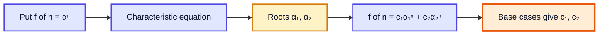

### Worked Example: Fibonacci

`f(n) = f(n-1) + f(n-2)`, `f(0) = 0`, `f(1) = 1`.

1. `αⁿ = αⁿ⁻¹ + αⁿ⁻²` → divide by `αⁿ⁻²` → `α² - α - 1 = 0`
2. Roots: `α = (1 ± √5) / 2` → `φ = 1.618...` (golden ratio) and `ψ = -0.618...`
3. `f(n) = c₁·φⁿ + c₂·ψⁿ`
4. `f(0) = 0` → `c₁ + c₂ = 0`
5. `f(1) = 1` → `c₁φ + c₂ψ = 1` → `c₁(φ - ψ) = 1` → `c₁ = 1/√5`, `c₂ = -1/√5`

```
f(n) = (1/√5) · [ ((1 + √5)/2)ⁿ - ((1 - √5)/2)ⁿ ]       (Binet's formula)
```

### Complexity Conclusion

`|ψ| < 1`, so `ψⁿ → 0`. The dominating term is `φⁿ`. Therefore recursive Fibonacci takes **Θ(φⁿ) ≈ Θ(1.618ⁿ)**, which is tighter than the loose O(2ⁿ) bound.

---

## 19. Q: Find nth Fibonacci Number using Golden Ratio (1:57:43)

### Approach

From Binet's formula, since `ψⁿ/√5` is always smaller than 0.5 in absolute value:

```
fib(n) = round( φⁿ / √5 )
```

### Code

```java
public class FibGolden {
    static long fibGolden(int n) {
        double phi = (1 + Math.sqrt(5)) / 2;
        return Math.round(Math.pow(phi, n) / Math.sqrt(5));
    }

    public static void main(String[] args) {
        for (int n = 0; n <= 10; n++) {
            System.out.print(fibGolden(n) + " ");
        }
        // 0 1 1 2 3 5 8 13 21 34 55
    }
}
```

### Trace

| n | φⁿ / √5 | round |
|---|---|---|
| 1 | 0.7236 | 1 |
| 2 | 1.1708 | 1 |
| 5 | 4.9597 | 5 |
| 10 | 55.0036 | 55 |

### Complexity

| Approach | Time | Space |
|---|---|---|
| Naive recursion | O(φᴺ) | O(N) stack |
| Memoised / iterative DP | O(N) | O(N) / O(1) |
| Golden ratio formula | O(1) arithmetic (or O(log N) for `pow`) | O(1) |
| Matrix exponentiation | O(log N) | O(1), exact with `long`/`BigInteger` |

> [!CAUTION]
> `double` has ~15-16 significant digits. The golden-ratio formula is exact only up to about **n = 70**. Beyond that, rounding errors creep in. For exact large values use iteration with `BigInteger` or matrix exponentiation. This relates to LeetCode **509. Fibonacci Number**.

---

## 20. Q: Solve Recurrence Relation with Repeated Roots (2:03:15)

### Rule

If a root `r` repeats `m` times, its part of the solution is

```
(c₁ + c₂·n + c₃·n² + ... + cₘ·nᵐ⁻¹) · rⁿ
```

### Worked Example

`f(n) = 6f(n-1) - 9f(n-2)`, `f(0) = 1`, `f(1) = 6`.

1. Characteristic equation: `α² - 6α + 9 = 0` → `(α - 3)² = 0` → root `3`, repeated twice.
2. `f(n) = (c₁ + c₂·n) · 3ⁿ`
3. `f(0) = 1` → `c₁ = 1`
4. `f(1) = 6` → `(1 + c₂)·3 = 6` → `c₂ = 1`
5. **`f(n) = (n + 1) · 3ⁿ`**

### Verify

| n | Recurrence | Formula (n+1)·3ⁿ |
|---|---|---|
| 0 | 1 | 1 ✅ |
| 1 | 6 | 6 ✅ |
| 2 | 6·6 - 9·1 = 27 | 3·9 = 27 ✅ |
| 3 | 6·27 - 9·6 = 108 | 4·27 = 108 ✅ |

Complexity: `Θ(n · 3ⁿ)`.

> [!WARNING]
> Without the extra `n` factor you would get `f(n) = c·3ⁿ`, and one constant cannot satisfy two base cases. Repeated roots **always** need the `n`, `n²`, ... multipliers.

---

## 21. Non-Homogeneous Linear Recurrence Relation (2:08:00)

```
f(n) = a₁f(n-1) + ... + aₖf(n-k) + g(n),      g(n) ≠ 0
```

Examples of `g(n)`: `3ⁿ`, `n`, `n²`, `2ⁿ·n`, `5`. The extra term often represents **work done per call** (like the `+ N` in a loop inside recursion).

| Homogeneous | Non-homogeneous |
|---|---|
| `f(n) = 2f(n-1)` | `f(n) = 2f(n-1) + n` |
| Only one part to the solution | Solution = homogeneous part + particular part |

---

## 22. Solving Non-Homogeneous Linear Recurrence Relation (2:09:10)

### Method

1. Drop `g(n)` and solve the **homogeneous** part → `f_h(n)` (with unknown constants).
2. **Guess** a particular solution `f_p(n)` with the same "shape" as `g(n)` (see section 23).
3. Substitute `f_p` into the full recurrence to find its coefficients.
4. Full solution: `f(n) = f_h(n) + f_p(n)`.
5. Use base cases on the **full** solution to get the constants of `f_h`.

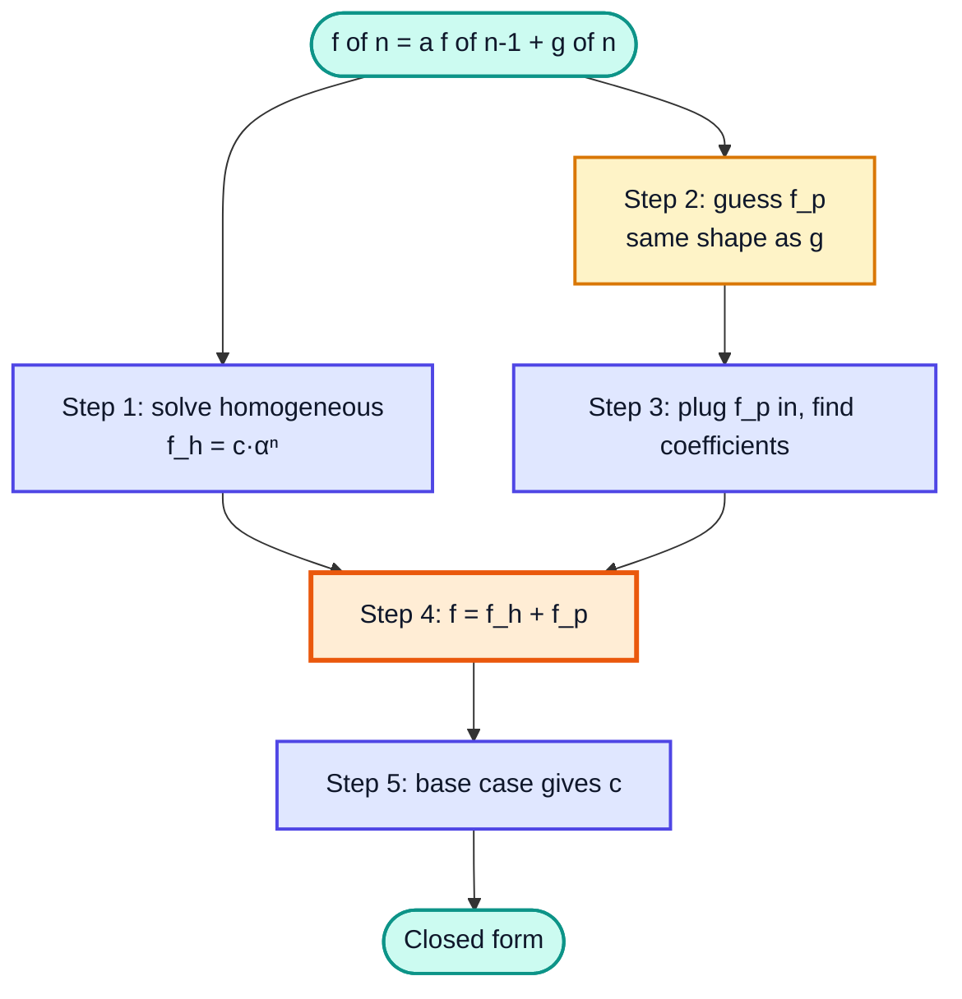

### Worked Example

`f(n) = 4f(n-1) + 3ⁿ`, `f(1) = 1`.

1. Homogeneous: `α = 4` → `f_h = c·4ⁿ`
2. Guess `f_p = a·3ⁿ`
3. `a·3ⁿ = 4a·3ⁿ⁻¹ + 3ⁿ` → divide by `3ⁿ⁻¹` → `3a = 4a + 3` → `a = -3` → `f_p = -3·3ⁿ = -3ⁿ⁺¹`
4. `f(n) = c·4ⁿ - 3ⁿ⁺¹`
5. `f(1) = 1` → `4c - 9 = 1` → `c = 5/2`

**`f(n) = (5/2)·4ⁿ - 3ⁿ⁺¹`** → complexity **Θ(4ⁿ)**.

| n | Recurrence | Formula |
|---|---|---|
| 1 | 1 | 10 - 9 = 1 ✅ |
| 2 | 4·1 + 9 = 13 | 40 - 27 = 13 ✅ |
| 3 | 4·13 + 27 = 79 | 160 - 81 = 79 ✅ |

---

## 23. How to Guess a Particular Solution? (2:16:28)

| g(n) | Guess for f_p(n) |
|---|---|
| constant `c` | `A` |
| `n` | `An + B` |
| `n²` | `An² + Bn + C` |
| `kⁿ` | `A·kⁿ` |
| `n·kⁿ` | `(An + B)·kⁿ` |
| `n² + 2ⁿ` | `(An² + Bn + C) + D·2ⁿ` (sum of guesses) |

> [!IMPORTANT]
> **Collision rule:** if your guess already appears in the homogeneous solution (e.g. `g(n) = 2ⁿ` and 2 is a root of the characteristic equation), multiply the guess by `n` (or `nᵐ` if the root repeats m times). Otherwise substitution gives a contradiction like `0 = 1`.

---

## 24. Example (2:20:34)

### Problem

`f(n) = 2f(n-1) + 2ⁿ`, `f(0) = 1`.

### Solution

1. Homogeneous: `α = 2` → `f_h = c·2ⁿ`
2. `g(n) = 2ⁿ`, but `2ⁿ` is already in `f_h` → collision → guess `f_p = a·n·2ⁿ`
3. `a·n·2ⁿ = 2·a(n-1)·2ⁿ⁻¹ + 2ⁿ` → divide by `2ⁿ` → `an = a(n - 1) + 1` → `a = 1`
4. `f(n) = c·2ⁿ + n·2ⁿ`
5. `f(0) = 1` → `c = 1`

**`f(n) = (n + 1)·2ⁿ`** → **Θ(n·2ⁿ)**

| n | Recurrence | (n+1)·2ⁿ |
|---|---|---|
| 0 | 1 | 1 ✅ |
| 1 | 2 + 2 = 4 | 4 ✅ |
| 2 | 8 + 4 = 12 | 12 ✅ |
| 3 | 24 + 8 = 32 | 32 ✅ |

### What Goes Wrong Without the Collision Rule

Guess `f_p = a·2ⁿ` → `a·2ⁿ = 2a·2ⁿ⁻¹ + 2ⁿ` → `a = a + 1` → `0 = 1` ❌. That contradiction is the signal to multiply by `n`.

---

## 25. NP-Complete Problems (2:24:54)

### Basics

| Class | Meaning | Example |
|---|---|---|
| **P** | Solvable in polynomial time (O(Nᵏ)) | Sorting, shortest path (Dijkstra) |
| **NP** | A given answer can be **verified** in polynomial time | Sudoku: checking a filled grid is easy |
| **NP-Hard** | At least as hard as every NP problem | Halting problem, TSP optimisation |
| **NP-Complete** | In NP **and** NP-Hard | SAT, 3-SAT, Subset Sum, Vertex Cover, decision TSP |

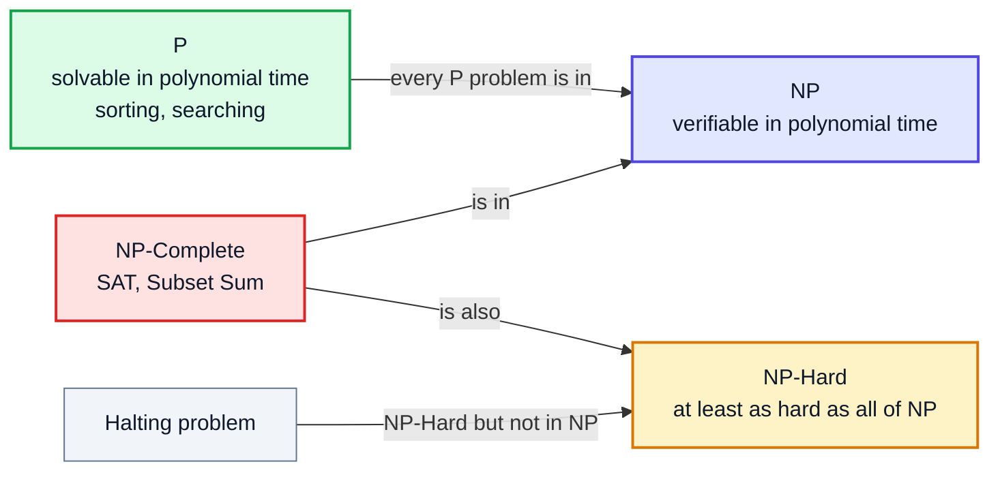

- No polynomial-time algorithm is known for any NP-complete problem.
- If **one** NP-complete problem is solved in polynomial time, **all** NP problems are (P = NP). This is one of the biggest open questions in computer science.
- **Reduction:** to show a new problem X is NP-complete, show X is in NP and transform a known NP-complete problem into X in polynomial time.

> [!TIP]
> In interviews, if a problem smells NP-complete (subsets, permutations, "choose items to hit exactly a target"), the expected answer is usually exponential backtracking or a pseudo-polynomial DP (e.g. O(N · target) for subset sum), not a polynomial algorithm.

---

## 26. Outro (2:27:20)

You can now: count operations in loops, state O/Ω/Θ/o/ω precisely, separate input space from auxiliary space, convert a recursive function into a recurrence and solve it using Akra-Bazzi (divide and conquer) or the characteristic equation (linear). The next videos (maths for DSA, bitwise operators) build on this.

> [!TIP]
> Practise by writing the recurrence for every recursive function you code from here on, and solving it before checking the known answer.

---

## 🧩 Complete Example: Everything Together

One program that counts operations for common loop shapes, measures binary search steps, counts recursive Fibonacci calls versus stack depth, checks the golden-ratio formula, solves the Akra-Bazzi `p` numerically, and verifies the closed forms from sections 20 and 24.

```java
import java.util.Arrays;

public class ComplexityDemo {

    // ---------- 1. Counting operations of common loop shapes ----------
    static long linear(int n) {            // O(N)
        long ops = 0;
        for (int i = 0; i < n; i++) ops++;
        return ops;
    }

    static long quadratic(int n) {         // O(N^2)
        long ops = 0;
        for (int i = 0; i < n; i++)
            for (int j = 0; j < n; j++) ops++;
        return ops;
    }

    static long logarithmic(int n) {       // O(log N): i doubles
        long ops = 0;
        for (int i = 1; i < n; i *= 2) ops++;
        return ops;
    }

    static long nLogN(int n) {             // O(N log N)
        long ops = 0;
        for (int i = 0; i < n; i++)
            for (int j = 1; j < n; j *= 2) ops++;
        return ops;
    }

    static long jumpByK(int n, int k) {    // the "Question": still O(N)
        long ops = 0;
        for (int i = 1; i <= n; ) {
            for (int j = 1; j <= k; j++) ops++;
            i += k;
        }
        return ops;
    }

    // ---------- 2. Binary search: O(log N) time, O(1) space ----------
    static int steps;
    static int binarySearch(int[] arr, int target) {
        int lo = 0, hi = arr.length - 1;
        steps = 0;
        while (lo <= hi) {
            steps++;
            int mid = lo + (hi - lo) / 2;
            if (arr[mid] == target) return mid;
            if (arr[mid] < target) lo = mid + 1; else hi = mid - 1;
        }
        return -1;
    }

    // ---------- 3. Recursive Fibonacci: O(phi^N) time, O(N) space ----------
    static long calls;
    static int maxDepth;
    static long fib(int n, int depth) {
        calls++;
        maxDepth = Math.max(maxDepth, depth);
        if (n < 2) return n;
        return fib(n - 1, depth + 1) + fib(n - 2, depth + 1);
    }

    // Binet / golden-ratio formula: O(1) arithmetic (exact for n <= ~70 with double)
    static long fibGolden(int n) {
        double phi = (1 + Math.sqrt(5)) / 2;
        return Math.round(Math.pow(phi, n) / Math.sqrt(5));
    }

    // ---------- 4. Akra-Bazzi: solve sum(a_i * b_i^p) = 1 for p ----------
    static double findP(double[] a, double[] b) {
        double lo = -10, hi = 10;
        for (int it = 0; it < 200; it++) {
            double mid = (lo + hi) / 2, s = 0;
            for (int i = 0; i < a.length; i++) s += a[i] * Math.pow(b[i], mid);
            if (s > 1) lo = mid; else hi = mid;   // sum decreases as p grows
        }
        double p = (lo + hi) / 2;
        return Math.abs(p) < 1e-9 ? 0.0 : p;     // avoid printing -0.0000
    }

    // ---------- 5. Linear recurrences: check closed forms ----------
    static long repeatedRoots(int n) {     // f(n) = 6f(n-1) - 9f(n-2), f(0)=1, f(1)=6
        if (n == 0) return 1;
        if (n == 1) return 6;
        return 6 * repeatedRoots(n - 1) - 9 * repeatedRoots(n - 2);
    }

    static long nonHomogeneous(int n) {    // f(n) = 2f(n-1) + 2^n, f(0)=1
        if (n == 0) return 1;
        return 2 * nonHomogeneous(n - 1) + (1L << n);
    }

    public static void main(String[] args) {
        int n = 16;
        System.out.println("== 1. Operation counts for N = " + n + " ==");
        System.out.println("O(log N)   : " + logarithmic(n));
        System.out.println("O(N)       : " + linear(n));
        System.out.println("O(N log N) : " + nLogN(n));
        System.out.println("O(N^2)     : " + quadratic(n));
        System.out.println("Jump by k=4: " + jumpByK(n, 4) + "  (still about N)");

        System.out.println("\n== 2. Binary search ==");
        int[] arr = new int[1024];
        for (int i = 0; i < arr.length; i++) arr[i] = i * 2;
        int idx = binarySearch(arr, 2046);
        System.out.println("Found at " + idx + " in " + steps + " steps (log2 1024 + 1 = 11)");

        System.out.println("\n== 3. Fibonacci ==");
        for (int k : new int[]{10, 20, 25}) {
            calls = 0; maxDepth = 0;
            long f = fib(k, 1);
            System.out.println("fib(" + k + ") = " + f + ", calls = " + calls
                    + ", max stack depth = " + maxDepth + ", golden = " + fibGolden(k));
        }
        System.out.println("fibGolden(50) = " + fibGolden(50));

        System.out.println("\n== 4. Akra-Bazzi p values ==");
        System.out.printf("T(N) = 2T(N/2) + N        -> p = %.4f%n",
                findP(new double[]{2}, new double[]{0.5}));
        System.out.printf("T(N) = T(N/2) + c         -> p = %.4f%n",
                findP(new double[]{1}, new double[]{0.5}));
        System.out.printf("T(N) = 3T(N/3) + 4T(N/4) + N^2 -> p = %.4f%n",
                findP(new double[]{3, 4}, new double[]{1.0 / 3, 0.25}));

        System.out.println("\n== 5. Closed forms vs recursion ==");
        long[] a = new long[6], b = new long[6], c = new long[6], d = new long[6];
        for (int i = 0; i < 6; i++) {
            a[i] = repeatedRoots(i);
            b[i] = (long) ((1 + i) * Math.pow(3, i));
            c[i] = nonHomogeneous(i);
            d[i] = (long) ((i + 1) * Math.pow(2, i));
        }
        System.out.println("6f(n-1)-9f(n-2) : " + Arrays.toString(a));
        System.out.println("(n+1)*3^n       : " + Arrays.toString(b));
        System.out.println("2f(n-1)+2^n     : " + Arrays.toString(c));
        System.out.println("(n+1)*2^n       : " + Arrays.toString(d));
    }
}
```

**Expected Output:**
```
== 1. Operation counts for N = 16 ==
O(log N)   : 4
O(N)       : 16
O(N log N) : 64
O(N^2)     : 256
Jump by k=4: 16  (still about N)

== 2. Binary search ==
Found at 1023 in 11 steps (log2 1024 + 1 = 11)

== 3. Fibonacci ==
fib(10) = 55, calls = 177, max stack depth = 10, golden = 55
fib(20) = 6765, calls = 21891, max stack depth = 20, golden = 6765
fib(25) = 75025, calls = 242785, max stack depth = 25, golden = 75025
fibGolden(50) = 12586269025

== 4. Akra-Bazzi p values ==
T(N) = 2T(N/2) + N        -> p = 1.0000
T(N) = T(N/2) + c         -> p = 0.0000
T(N) = 3T(N/3) + 4T(N/4) + N^2 -> p = 1.5605

== 5. Closed forms vs recursion ==
6f(n-1)-9f(n-2) : [1, 6, 27, 108, 405, 1458]
(n+1)*3^n       : [1, 6, 27, 108, 405, 1458]
2f(n-1)+2^n     : [1, 4, 12, 32, 80, 192]
(n+1)*2^n       : [1, 4, 12, 32, 80, 192]
```

What to notice:

- Operation counts for N = 16 follow the ladder: 4 < 16 < 64 < 256.
- Recursive Fibonacci **calls** explode (177 → 21,891 → 242,785) while **stack depth** stays equal to n: time O(φᴺ), space O(N).
- `p ≈ 1.56 < 2` for `3T(N/3) + 4T(N/4) + N²`, so the `N²` term dominates → Θ(N²).

---

## Quick Reference Cheat Sheet

| Concept | One-Line Summary |
|---|---|
| **Time complexity** | How operations grow with N, not seconds |
| **Rules** | Worst case, large N, drop constants, drop smaller terms |
| **Ladder** | 1 < log N < √N < N < N log N < N² < 2ᴺ < N! |
| **Big-O** | Upper bound, lim f/g < ∞ |
| **Big-Ω** | Lower bound, lim f/g > 0 |
| **Big-Θ** | Tight bound, 0 < lim f/g < ∞ |
| **Little-o** | Strict upper bound, lim f/g = 0 |
| **Little-ω** | Strict lower bound, lim f/g = ∞ |
| **Space complexity** | Input + auxiliary; interviews mean auxiliary |
| **Recursive space** | Maximum depth of recursion tree |
| **Loop ×2 or ÷2** | O(log N) |
| **Jump-by-k outer + k inner** | O(N) |
| **Divide & conquer** | T(x) = Σ aᵢT(bᵢx) + g(x) → Akra-Bazzi |
| **Akra-Bazzi** | Σ aᵢbᵢᵖ = 1, T = Θ(xᵖ(1 + ∫₁ˣ g(u)/uᵖ⁺¹ du)) |
| **Master shortcut** | g = xᶜ: p > c → xᵖ; p = c → xᶜ log x; p < c → xᶜ |
| **Root in recurrence** | Substitute N = 2ᵏ |
| **Linear homogeneous** | Guess αⁿ, characteristic equation, Σ cᵢαᵢⁿ |
| **Repeated root r (m times)** | (c₁ + c₂n + ... + cₘnᵐ⁻¹)·rⁿ |
| **Fibonacci** | Θ(φⁿ), φ = 1.618; fib(n) = round(φⁿ/√5) up to n ≈ 70 |
| **Non-homogeneous** | f = f_h + f_p; guess f_p shaped like g(n) |
| **Collision rule** | Guess already in f_h → multiply by n |
| **P / NP / NP-complete** | Solvable fast / verifiable fast / hardest problems in NP |
