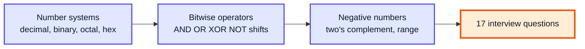
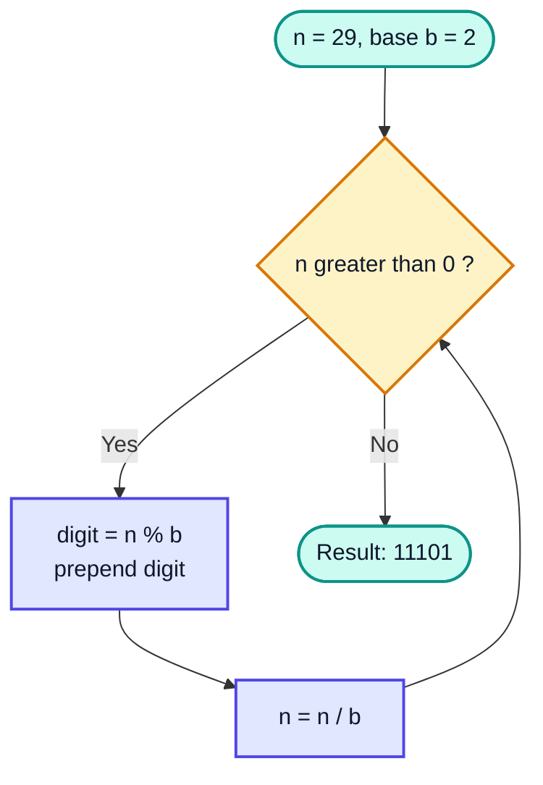
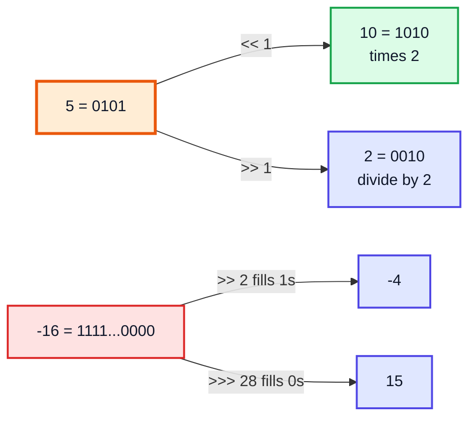
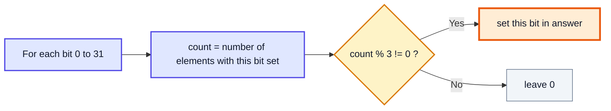
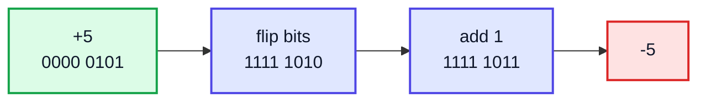
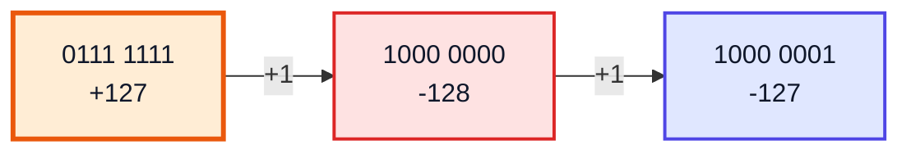
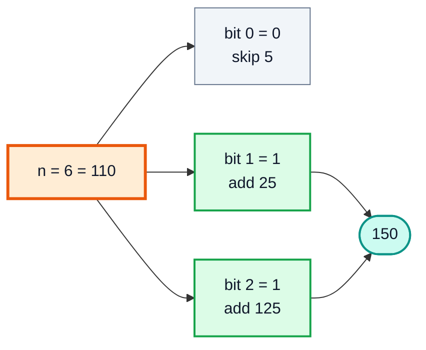
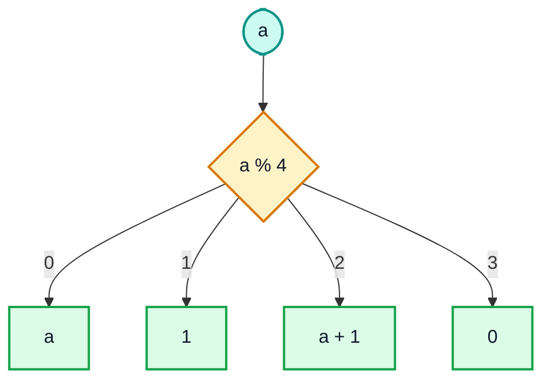
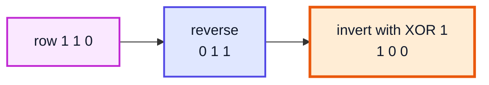
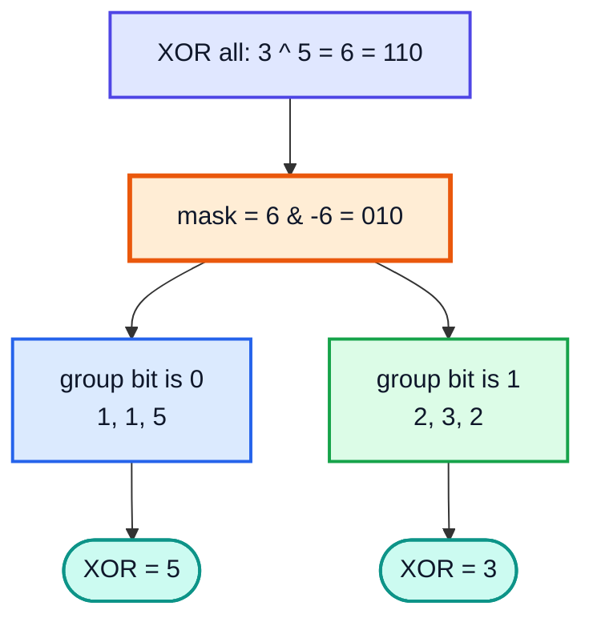

# Bitwise Operators + Number Systems — Complete In-Depth Guide

**Video #25 of the Java + DSA playlist:** *Bitwise Operators + Number Systems - Maths for DSA* (2:17:08)

A deep-dive into the bit-level maths behind DSA: every bitwise operator in Java, number systems and base conversion, how negative numbers are stored (two's complement), the range of a data type, and 17 interview questions solved with bit tricks, each with an approach, code, dry run and complexity.

> [!NOTE]
> The video's timestamps name the questions only as "Question-01" to "Question-17". The problem each one solves is written under its heading and in the Table of Contents. They follow the lecture's code and material in the order taught. Where a question number could map to more than one problem, the notes cover the problem from the lecture that fits that point in the sequence.

---

## Table of Contents

| # | Topic | Timestamp |
|---|---|---|
| 0 | [Introduction](#0-introduction-000) | 0:00 |
| 1 | [Bitwise Operators](#1-bitwise-operators-440) | 4:40 |
| 2 | [Number Systems](#2-number-systems-1441) | 14:41 |
| 3 | [Number System Conversion](#3-number-system-conversion-1955) | 19:55 |
| 4 | [More Bitwise Operators](#4-more-bitwise-operators-2649) | 26:49 |
| 5 | [Question-01](#5-question-01-3305): Odd or even | 33:05 |
| 6 | [Question-02](#6-question-02-4239): Unique element (others appear twice) | 42:39 |
| 7 | [Question-03](#7-question-03-4645): Find the ith bit | 46:45 |
| 8 | [Question-04](#8-question-04-4908): Set the ith bit | 49:08 |
| 9 | [Question-05](#9-question-05-5221): Reset the ith bit | 52:21 |
| 10 | [Question-06](#10-question-06-5332): Position of the rightmost set bit | 53:32 |
| 11 | [Question-07](#11-question-07-5540): Unique element (others appear thrice) | 55:40 |
| 12 | [Negative Binary Numbers](#12-negative-binary-numbers-5957) | 59:57 |
| 13 | [Range of Numbers](#13-range-of-numbers-10926) | 1:09:26 |
| 14 | [Formula to Calculate Range](#14-formula-to-calculate-range-11454) | 1:14:54 |
| 15 | [Question-08](#15-question-08-11700): Number of digits in base b | 1:17:00 |
| 16 | [Question-09 (Amazon)](#16-question-09-amazon-12306): nth magic number | 1:23:06 |
| 17 | [Question-10](#17-question-10-12913): Sum of nth row of Pascal's triangle | 1:29:13 |
| 18 | [Question-11](#18-question-11-13536): Power of two | 1:35:36 |
| 19 | [Question-12](#19-question-12-13826): Calculate a^b fast | 1:38:26 |
| 20 | [Question-13](#20-question-13-14342): Count set bits | 1:43:42 |
| 21 | [Question-14](#21-question-14-15124): XOR of 0 to a | 1:51:24 |
| 22 | [Question-15](#22-question-15-15939): XOR of a range a to b | 1:59:39 |
| 23 | [Question-16](#23-question-16-20345): Flipping an image | 2:03:45 |
| 24 | [Question-17 (Google)](#24-question-17-google-20940): Two unique numbers | 2:09:40 |
| 25 | [Outro](#25-outro-21644) | 2:16:44 |

---

## 0. Introduction (0:00)

Computers store everything as **bits** (0s and 1s). Bitwise operators work directly on those bits, which makes them:

- **Fast**: one CPU instruction each.
- **Memory-friendly**: a single `int` can store 32 yes/no flags.
- **A favourite interview topic**: many "find the unique / missing / count" problems have an O(1)-space bit trick.



---

## 1. Bitwise Operators (4:40)

Bitwise operators compare numbers **bit by bit** (column by column in binary).

### AND `&`: 1 only if both bits are 1

| a | b | a & b |
|---|---|---|
| 0 | 0 | 0 |
| 0 | 1 | 0 |
| 1 | 0 | 0 |
| 1 | 1 | 1 |

**Observation:** `x & 1 = x` and `x & 0 = 0`. AND-ing with 1 **keeps** a bit; AND-ing with 0 **clears** it. This is how we "mask" bits.

### OR `|`: 1 if at least one bit is 1

| a | b | a \| b |
|---|---|---|
| 0 | 0 | 0 |
| 0 | 1 | 1 |
| 1 | 0 | 1 |
| 1 | 1 | 1 |

**Observation:** `x | 1 = 1`, `x | 0 = x`. OR-ing with 1 **sets** a bit.

### XOR `^`: 1 if the bits are different

| a | b | a ^ b |
|---|---|---|
| 0 | 0 | 0 |
| 0 | 1 | 1 |
| 1 | 0 | 1 |
| 1 | 1 | 0 |

**XOR identities (memorise these):**

| Identity | Meaning |
|---|---|
| `a ^ 0 = a` | XOR with 0 changes nothing |
| `a ^ a = 0` | A number cancels itself |
| `a ^ 1 = ~a` (per bit) | XOR with 1 flips the bit |
| `a ^ b = b ^ a`, `(a ^ b) ^ c = a ^ (b ^ c)` | Order does not matter |

### NOT `~`: flips every bit

`~a` turns every 0 into 1 and every 1 into 0. In Java, `~a = -a - 1` (explained in section 12).

### Worked Example: 12 and 10

```
  12 = 1100
  10 = 1010
  ---------
   &   1000  = 8
   |   1110  = 14
   ^   0110  = 6
```

```java
public class BitOps {
    public static void main(String[] args) {
        int a = 12, b = 10;
        System.out.println(a & b);   // 8
        System.out.println(a | b);   // 14
        System.out.println(a ^ b);   // 6
        System.out.println(~a);      // -13
    }
}
```

> [!WARNING]
> `&` and `|` on **booleans** are non-short-circuit logical operators (both sides always run). `&&` and `||` are the short-circuit versions. On **integers**, `&` and `|` are bitwise. Do not mix them up in conditions.

---

## 2. Number Systems (14:41)

A **number system** (base / radix) says how many distinct digits are available.

| System | Base | Digits | Java literal | Example: 29 |
|---|---|---|---|---|
| Decimal | 10 | 0-9 | `29` | 29 |
| Binary | 2 | 0, 1 | `0b11101` | 11101 |
| Octal | 8 | 0-7 | `035` | 35 |
| Hexadecimal | 16 | 0-9, A-F | `0x1D` | 1D |

### Place Value

In any base `b`, the digit at position `i` (from the right, starting at 0) is worth `digit × bⁱ`.

```
Decimal 345   = 3·10² + 4·10¹ + 5·10⁰
Binary 11101  = 1·2⁴ + 1·2³ + 1·2² + 0·2¹ + 1·2⁰ = 16 + 8 + 4 + 0 + 1 = 29
```

> [!CAUTION]
> A leading `0` makes a Java integer literal **octal**. `int x = 010;` is **8**, not 10. Use `0b` for binary and `0x` for hex. Underscores are allowed for readability: `0b1010_0101`, `1_000_000`.

---

## 3. Number System Conversion (19:55)

### Decimal → Base b: Repeatedly Divide

Divide by `b`, write down remainders, read them **bottom to top**.

**29 → binary**

| Division | Quotient | Remainder |
|---|---|---|
| 29 ÷ 2 | 14 | 1 |
| 14 ÷ 2 | 7 | 0 |
| 7 ÷ 2 | 3 | 1 |
| 3 ÷ 2 | 1 | 1 |
| 1 ÷ 2 | 0 | 1 |

Read bottom to top → **11101**.



### Base b → Decimal: Multiply and Add

`11101₂ = 1·16 + 1·8 + 1·4 + 0·2 + 1·1 = 29`. Same idea for octal: `35₈ = 3·8 + 5 = 29`.

### Code

```java
public class Convert {
    static String toBase(int n, int base) {
        if (n == 0) return "0";
        String digits = "0123456789ABCDEF";
        StringBuilder sb = new StringBuilder();
        while (n > 0) {
            sb.append(digits.charAt(n % base));
            n /= base;
        }
        return sb.reverse().toString();
    }

    static int fromBase(String s, int base) {
        int result = 0;
        for (char c : s.toCharArray()) {
            result = result * base + Character.digit(c, base);
        }
        return result;
    }

    public static void main(String[] args) {
        System.out.println(toBase(29, 2));         // 11101
        System.out.println(toBase(29, 16));        // 1D
        System.out.println(fromBase("11101", 2));  // 29
        // Built-ins:
        System.out.println(Integer.toBinaryString(29));     // 11101
        System.out.println(Integer.parseInt("1D", 16));     // 29
    }
}
```

Complexity: O(log_b N) time (one step per digit), O(log_b N) space for the string.

---

## 4. More Bitwise Operators (26:49)

### Left Shift `<<`

`a << k` shifts bits left by `k` places, filling with 0s. Each shift **multiplies by 2**.

```
a << k  =  a · 2ᵏ
5 << 2:   00101 → 10100  = 20
```

### Right Shift `>>` (Signed / Arithmetic)

`a >> k` shifts bits right, filling with the **sign bit**. Each shift **divides by 2** (rounding toward negative infinity).

```
a >> k  =  floor(a / 2ᵏ)
20 >> 2:  10100 → 00101  = 5
-16 >> 2  = -4
```

### Unsigned Right Shift `>>>` (Java only)

Fills with **0** regardless of sign. Useful for treating an `int` as unsigned.

```java
System.out.println(-16 >> 2);    // -4         (sign bit copied)
System.out.println(-16 >>> 28);  // 15         (zeros shifted in)
```



| Operator | Name | Effect | Example |
|---|---|---|---|
| `&` | AND | 1 if both 1 | `12 & 10 = 8` |
| `\|` | OR | 1 if any 1 | `12 \| 10 = 14` |
| `^` | XOR | 1 if different | `12 ^ 10 = 6` |
| `~` | NOT | flip all bits | `~12 = -13` |
| `<<` | Left shift | × 2ᵏ | `5 << 2 = 20` |
| `>>` | Signed right shift | ÷ 2ᵏ, keeps sign | `-16 >> 2 = -4` |
| `>>>` | Unsigned right shift | fills with 0 | `-16 >>> 28 = 15` |

> [!CAUTION]
> Java masks the shift distance: for `int`, only the lowest 5 bits are used, so `1 << 32 == 1` (not 0) and `1 << 33 == 2`. For `long`, the lowest 6 bits are used. Use `1L << k` when `k` can reach 31 or more.

---

## 5. Question-01 (33:05)

### Problem: Check whether a number is odd or even

### Approach

In binary, every place value except the last (`2⁰ = 1`) is even. So **the last bit alone decides parity**: last bit 1 → odd, 0 → even. Extract it with `n & 1`.

| n | Binary | n & 1 | Result |
|---|---|---|---|
| 7 | 0111 | 1 | Odd |
| 10 | 1010 | 0 | Even |
| -3 | ...1101 | 1 | Odd ✅ (works for negatives too) |

### Code

```java
static boolean isOdd(int n) {
    return (n & 1) == 1;
}
// isOdd(7)  → true
// isOdd(10) → false
```

### Complexity

O(1) time, O(1) space.

> [!TIP]
> `n % 2 == 1` fails for negative odd numbers in Java (`-3 % 2 == -1`). `(n & 1) == 1` or `n % 2 != 0` both work for negatives. Modern JIT compilers optimise `% 2` well, so the bit version is about correctness and habit more than speed.

---

## 6. Question-02 (42:39)

### Problem: Every element appears twice except one. Find it. (LeetCode **136. Single Number**)

### Approach

XOR all elements. Pairs cancel (`a ^ a = 0`), and `0 ^ unique = unique`. Order does not matter because XOR is commutative and associative.

### Dry Run: `[2, 3, 4, 1, 2, 1, 3, 6, 4]`

| Step | Element | Running XOR (decimal) | Binary |
|---|---|---|---|
| 1 | 2 | 2 | 0010 |
| 2 | 3 | 1 | 0001 |
| 3 | 4 | 5 | 0101 |
| 4 | 1 | 4 | 0100 |
| 5 | 2 | 6 | 0110 |
| 6 | 1 | 7 | 0111 |
| 7 | 3 | 4 | 0100 |
| 8 | 6 | 2 | 0010 |
| 9 | 4 | **6** ✅ | 0110 |

### Code

```java
static int singleNumber(int[] arr) {
    int x = 0;
    for (int v : arr) x ^= v;
    return x;
}
// singleNumber(new int[]{2, 3, 4, 1, 2, 1, 3, 6, 4}) → 6
```

### Complexity and Alternatives

| Approach | Time | Space |
|---|---|---|
| Nested loops counting | O(N²) | O(1) |
| HashMap of counts | O(N) | O(N) |
| Sort, then compare neighbours | O(N log N) | O(1) |
| **XOR** | **O(N)** | **O(1)** |

---

## 7. Question-03 (46:45)

### Problem: Find the ith bit of a number

Bit positions are counted from the right. Java code below uses **0-based** `i` (the video uses 1-based positions, so it shifts by `i - 1`).

### Approach

Build a **mask** with a 1 only at position `i`: `1 << i`. AND with n. If the result is non-zero, the bit is 1.

```
n = 13    = 1101
mask 1<<2 = 0100
n & mask  = 0100  → non-zero → bit 2 is 1
```

### Code

```java
static int ithBit(int n, int i) {
    return (n >> i) & 1;           // or: (n & (1 << i)) != 0 ? 1 : 0
}
// ithBit(13, 2) → 1
// ithBit(13, 1) → 0
```

O(1) time and space.

---

## 8. Question-04 (49:08)

### Problem: Set the ith bit (make it 1)

### Approach

OR with the mask. `x | 1 = 1`, `x | 0 = x`, so only bit `i` changes.

```
n = 13    = 1101
mask 1<<1 = 0010
n | mask  = 1111  = 15
```

```java
static int setBit(int n, int i) {
    return n | (1 << i);
}
// setBit(13, 1) → 15
```

---

## 9. Question-05 (52:21)

### Problem: Reset the ith bit (make it 0)

### Approach

AND with the **inverted** mask: `~(1 << i)` has a 0 only at position `i` and 1s everywhere else.

```
n = 13       = 1101
~(1<<2)      = ...1011
n & ~(1<<2)  = 1001  = 9
```

```java
static int resetBit(int n, int i) {
    return n & ~(1 << i);
}
// resetBit(13, 2) → 9
```

| Task | Expression |
|---|---|
| Get bit i | `(n >> i) & 1` |
| Set bit i | `n \| (1 << i)` |
| Reset bit i | `n & ~(1 << i)` |
| Toggle bit i | `n ^ (1 << i)` |

---

## 10. Question-06 (53:32)

### Problem: Find the position of the rightmost set bit

### Approach

`n & -n` keeps **only** the lowest 1-bit. Why: `-n = ~n + 1` (two's complement, section 12). Inverting flips all bits; adding 1 carries through the trailing 1s (formerly trailing 0s) and stops at exactly the position of the lowest 1. Everything above it is now the opposite of `n`, so AND-ing clears it.

```
n      = 40  = 0010 1000
~n           = 1101 0111
-n = ~n + 1  = 1101 1000
n & -n       = 0000 1000  = 8  → position 3 (0-based)
```

```java
static int rightmostSetBit(int n) {
    int lowest = n & -n;                               // 8
    return Integer.numberOfTrailingZeros(lowest);      // 3
}
```

Without the built-in, count how many times you can shift `lowest` right until it becomes 1, or use `log₂(lowest)`.

> [!TIP]
> `Integer.lowestOneBit(n)` returns `n & -n` directly. `n & (n - 1)` is the companion trick: it **removes** the lowest set bit (used in questions 11 and 13).

---

## 11. Question-07 (55:40)

### Problem: Every element appears three times except one. Find it. (LeetCode **137. Single Number II**)

### Approach

XOR does not work (three copies XOR to the number itself). Instead, **count bits column by column**. For each bit position, add up that bit across all numbers. Numbers appearing 3 times contribute a multiple of 3. So `count % 3` is exactly the unique number's bit.

### Dry Run: `[2, 2, 3, 2, 7, 7, 7]`

| Number | bit 2 | bit 1 | bit 0 |
|---|---|---|---|
| 2 (×3) | 0 | 1 | 0 |
| 3 | 0 | 1 | 1 |
| 7 (×3) | 1 | 1 | 1 |
| **column sum** | 3 | 7 | 4 |
| **sum % 3** | 0 | 1 | 1 |

Result bits `011` = **3** ✅



### Code

```java
static int singleNumberII(int[] arr) {
    int ans = 0;
    for (int bit = 0; bit < 32; bit++) {
        int count = 0;
        for (int v : arr) count += (v >> bit) & 1;
        if (count % 3 != 0) ans |= (1 << bit);
    }
    return ans;
}
// singleNumberII(new int[]{2, 2, 3, 2, 7, 7, 7}) → 3
```

### Complexity

O(32 · N) = **O(N)** time, **O(1)** space. Works for negatives too, because bit 31 (the sign bit) is handled like any other.

> [!NOTE]
> Generalises: "every element appears **k** times except one" → use `count % k`. A cleverer O(N) state-machine solution with two variables (`ones`, `twos`) also exists, but the counting version is easier to derive in an interview.

---

## 12. Negative Binary Numbers (59:57)

### Basics

How does a computer store `-5` with only 0s and 1s? Three historical ideas:

| Scheme | -5 in 8 bits | Problem |
|---|---|---|
| Sign-magnitude | 1000 0101 | Two zeros (+0, -0); addition hardware is messy |
| One's complement | 1111 1010 | Still two zeros |
| **Two's complement** | **1111 1011** | One zero, normal addition works ✅ |

### Two's Complement: How to Negate

1. Write the positive number in binary.
2. Flip all bits (one's complement).
3. Add 1.

```
 5      = 0000 0101
 flip   = 1111 1010
 +1     = 1111 1011   = -5
```



### Why It Works

In n bits, `-x` is stored as `2ⁿ - x`. Adding `x + (2ⁿ - x) = 2ⁿ`, which overflows to exactly 0 in n bits. So ordinary addition gives correct results with no special sign logic.

Check: `5 + (-5)` = `0000 0101 + 1111 1011` = `1 0000 0000` → the 9th bit is discarded → `0000 0000` ✅.

### Reading a Negative Number

The **most significant bit (MSB)** has weight `-2ⁿ⁻¹` instead of `+2ⁿ⁻¹`:

```
1111 1011 = -128 + 64 + 32 + 16 + 8 + 0 + 2 + 1 = -5
```

### Consequence: `~n = -n - 1`

From `-n = ~n + 1`, rearranging gives `~n = -n - 1`. So `~12 = -13` and `~0 = -1`.

```java
System.out.println(Integer.toBinaryString(-5));
// 11111111111111111111111111111011
```

---

## 13. Range of Numbers (1:09:26)

### Basics

With n bits there are `2ⁿ` patterns. In two's complement, the MSB is the sign bit, so half the patterns are negative.

**8 bits (`byte`):**

| Pattern | Value |
|---|---|
| 0111 1111 | +127 (largest) |
| 0000 0001 | +1 |
| 0000 0000 | 0 |
| 1111 1111 | -1 |
| 1000 0000 | -128 (smallest) |

There is one more negative number than positive, because 0 takes one of the "non-negative" patterns.

### Java Primitive Ranges

| Type | Bits | Min | Max |
|---|---|---|---|
| `byte` | 8 | -128 | 127 |
| `short` | 16 | -32,768 | 32,767 |
| `int` | 32 | -2,147,483,648 | 2,147,483,647 |
| `long` | 64 | -9.22 × 10¹⁸ | 9.22 × 10¹⁸ |
| `char` | 16 (unsigned) | 0 | 65,535 |

### Overflow Wraps Around

```java
int max = Integer.MAX_VALUE;
System.out.println(max + 1);        // -2147483648  (wraps to MIN_VALUE)
System.out.println(Math.abs(Integer.MIN_VALUE)); // -2147483648 (!)
// Math.addExact(max, 1) throws ArithmeticException instead
```



> [!WARNING]
> `int mid = (lo + hi) / 2` can overflow when `lo + hi > 2³¹ - 1`. Use `lo + (hi - lo) / 2` or `(lo + hi) >>> 1`.

---

## 14. Formula to Calculate Range (1:14:54)

For an **n-bit signed** (two's complement) number:

```
Range = -2ⁿ⁻¹  to  2ⁿ⁻¹ - 1
```

For an **n-bit unsigned** number:

```
Range = 0  to  2ⁿ - 1
```

| n | Signed range | Unsigned range |
|---|---|---|
| 4 | -8 to 7 | 0 to 15 |
| 8 | -128 to 127 | 0 to 255 |
| 16 | -32,768 to 32,767 | 0 to 65,535 |
| 32 | -2³¹ to 2³¹ - 1 | 0 to 2³² - 1 |

> [!NOTE]
> Java has no unsigned `int` type, but since Java 8 it has helpers: `Integer.toUnsignedString`, `Integer.divideUnsigned`, `Integer.compareUnsigned`, `Byte.toUnsignedInt`.

---

## 15. Question-08 (1:17:00)

### Problem: Find the number of digits of n in base b

### Approach

A number with `d` digits in base b satisfies `bᵈ⁻¹ ≤ n < bᵈ`. Take `log_b`: `d - 1 ≤ log_b n < d`, so

```
digits = floor(log_b n) + 1 = floor(ln n / ln b) + 1
```

| n | base | log_b n | digits | Check |
|---|---|---|---|---|
| 10 | 2 | 3.32 | 4 | 1010 ✅ |
| 999 | 10 | 2.9996 | 3 | ✅ |
| 255 | 16 | 1.998 | 2 | FF ✅ |

### Code

```java
static int digitsInBase(int n, int base) {
    return (int) (Math.log(n) / Math.log(base)) + 1;
}
// digitsInBase(10, 2) → 4
```

O(1) time.

> [!CAUTION]
> Floating-point division can be slightly off at exact powers: `Math.log(1000) / Math.log(10)` is `2.9999999999999996`, which gives 3 digits instead of 4. For base 10 use `Math.log10(n)`; for base 2 use `32 - Integer.numberOfLeadingZeros(n)`. A safe general method is a loop: `while (n > 0) { n /= base; count++; }` in O(log_b n).

---

## 16. Question-09 (Amazon) (1:23:06)

### Problem: Find the nth magic number

A **magic number** is a sum of distinct powers of 5: 5, 25, 30 (25 + 5), 125, 130, 150, ...

### Approach

Write `n` in binary. Each bit says whether to include the matching power of 5: bit 0 → 5¹, bit 1 → 5², bit 2 → 5³, ...

| n | Binary | Powers chosen | Magic number |
|---|---|---|---|
| 1 | 001 | 5 | 5 |
| 2 | 010 | 25 | 25 |
| 3 | 011 | 25 + 5 | 30 |
| 4 | 100 | 125 | 125 |
| 5 | 101 | 125 + 5 | 130 |
| 6 | 110 | 125 + 25 | 150 |



### Code

```java
static int nthMagic(int n) {
    int ans = 0, base = 5;
    while (n > 0) {
        if ((n & 1) == 1) ans += base;
        base *= 5;
        n >>= 1;
    }
    return ans;
}
// nthMagic(6) → 150
```

### Dry Run (n = 6)

| n (binary) | last bit | base | ans |
|---|---|---|---|
| 110 | 0 | 5 | 0 |
| 11 | 1 | 25 | 25 |
| 1 | 1 | 125 | 150 |
| 0 | stop | | **150** |

### Complexity

O(log n) time (one step per bit), O(1) space.

---

## 17. Question-10 (1:29:13)

### Problem: Find the sum of the nth row of Pascal's triangle

```
Row 1:        1              sum 1
Row 2:       1 1             sum 2
Row 3:      1 2 1            sum 4
Row 4:     1 3 3 1           sum 8
Row 5:    1 4 6 4 1          sum 16
```

### Approach

Each number in a row contributes to **two** numbers in the next row (below-left and below-right). So every row's sum is double the previous one: `sum(n) = 2ⁿ⁻¹`. Compute it with a shift.

```java
static int pascalRowSum(int n) {
    return 1 << (n - 1);   // 2^(n-1)
}
// pascalRowSum(5) → 16
```

O(1) time. Mathematically, it is the identity `C(m,0) + C(m,1) + ... + C(m,m) = 2ᵐ` with `m = n - 1`.

---

## 18. Question-11 (1:35:36)

### Problem: Check whether a number is a power of two (LeetCode **231. Power of Two**)

### Approach

A power of two has **exactly one** set bit: `1, 10, 100, 1000, ...`. Subtracting 1 flips that bit to 0 and all lower bits to 1, so `n & (n - 1) == 0`.

| n | Binary | n - 1 | n & (n-1) | Power of 2? |
|---|---|---|---|---|
| 64 | 1000000 | 0111111 | 0 | ✅ |
| 96 | 1100000 | 1011111 | 1000000 | ❌ |
| 0 | 0 | -1 | 0 | ❌ (special case) |

```java
static boolean isPowerOfTwo(int n) {
    return n > 0 && (n & (n - 1)) == 0;
}
```

O(1) time. Alternatives: `Integer.bitCount(n) == 1` (for n > 0), or loop dividing by 2 in O(log n).

> [!WARNING]
> Without the `n > 0` check, `0` passes the test and `Integer.MIN_VALUE` (1 followed by 31 zeros) also passes, but neither is a power of two.

---

## 19. Question-12 (1:38:26)

### Problem: Calculate aᵇ efficiently (LeetCode **50. Pow(x, n)**)

### Approach (Binary Exponentiation)

Write the exponent in binary. Example: `3⁶`, and `6 = 110₂ = 4 + 2`, so `3⁶ = 3⁴ · 3²`. Keep squaring the base (`3, 3², 3⁴, 3⁸, ...`) and multiply it into the answer whenever the current bit of the exponent is 1.

### Dry Run: 3⁶

| exp (binary) | last bit | base | ans |
|---|---|---|---|
| 110 | 0 | 3 | 1 |
| 11 | 1 | 9 | 9 |
| 1 | 1 | 81 | 729 |
| 0 | stop | | **729** |

### Code

```java
static long power(long base, int exp) {
    long ans = 1;
    while (exp > 0) {
        if ((exp & 1) == 1) ans *= base;
        base *= base;
        exp >>= 1;
    }
    return ans;
}
// power(3, 6) → 729
```

### Complexity

| Approach | Time |
|---|---|
| Multiply b times | O(b) |
| **Binary exponentiation** | **O(log b)** |

> [!TIP]
> In competitive programming this is usually combined with a modulus: `ans = ans * base % MOD; base = base * base % MOD;`. For LeetCode 50 you also handle negative `n` with `1 / power(x, -n)`, using a `long` for `-n` because `-Integer.MIN_VALUE` overflows.

---

## 20. Question-13 (1:43:42)

### Problem: Count the number of set bits (LeetCode **191. Number of 1 Bits**)

### Approach 1: Check Every Bit

Look at the last bit, shift right, repeat. O(number of bits) = O(log n).

### Approach 2: Brian Kernighan's Trick

`n & (n - 1)` **removes the lowest set bit**. Count how many times you can do it before n becomes 0. The loop runs only as many times as there are 1s.

### Dry Run: n = 45 (101101)

| Step | n (binary) | n - 1 | n & (n-1) | count |
|---|---|---|---|---|
| 1 | 101101 | 101100 | 101100 | 1 |
| 2 | 101100 | 101011 | 101000 | 2 |
| 3 | 101000 | 100111 | 100000 | 3 |
| 4 | 100000 | 011111 | 000000 | **4** ✅ |

### Code

```java
static int countSetBits(int n) {
    int count = 0;
    while (n != 0) {
        n &= (n - 1);
        count++;
    }
    return count;
}
// countSetBits(45) → 4
```

### Complexity

O(number of set bits) ≤ O(log n), O(1) space. The built-in `Integer.bitCount(n)` compiles to a single CPU instruction (`POPCNT`) on most modern hardware.

> [!NOTE]
> Using `while (n > 0)` with `n >>= 1` loops forever for negative numbers (the sign bit keeps refilling). Use `n != 0` with `n >>>= 1`, or Kernighan's version, which handles negatives correctly.

---

## 21. Question-14 (1:51:24)

### Problem: Find the XOR of all numbers from 0 to a

### Approach

Write out the prefix XORs and a pattern with period 4 appears:

| a | 0 ^ 1 ^ ... ^ a | a % 4 | Pattern |
|---|---|---|---|
| 0 | 0 | 0 | a |
| 1 | 1 | 1 | 1 |
| 2 | 3 | 2 | a + 1 |
| 3 | 0 | 3 | 0 |
| 4 | 4 | 0 | a |
| 5 | 1 | 1 | 1 |
| 6 | 7 | 2 | a + 1 |
| 7 | 0 | 3 | 0 |
| 8 | 8 | 0 | a |
| 9 | 1 | 1 | 1 |

Why: every block of 4 consecutive numbers starting at a multiple of 4 (`4k, 4k+1, 4k+2, 4k+3`) XORs to 0, since the upper bits cancel and the last two bits are `00 ^ 01 ^ 10 ^ 11 = 00`.



### Code

```java
static int xorUpTo(int a) {
    return switch (a % 4) {
        case 0 -> a;
        case 1 -> 1;
        case 2 -> a + 1;
        default -> 0;
    };
}
// xorUpTo(9) → 1
```

O(1) time versus O(a) for the loop.

---

## 22. Question-15 (1:59:39)

### Problem: Find the XOR of all numbers from a to b

### Approach

Like prefix sums, but with XOR. Since `x ^ x = 0`:

```
xor(a..b) = xor(0..b) ^ xor(0..a-1)
```

The part `0..a-1` appears in both and cancels.

### Example: a = 3, b = 9

- `xor(0..9) = 1` (9 % 4 = 1)
- `xor(0..2) = 3` (2 % 4 = 2 → a + 1 = 3)
- `1 ^ 3 = 2`

Check by brute force: `3^4^5^6^7^8^9 = 2` ✅.

```java
static int xorRange(int a, int b) {
    return xorUpTo(b) ^ xorUpTo(a - 1);
}
// xorRange(3, 9) → 2
```

O(1) time, O(1) space.

---

## 23. Question-16 (2:03:45)

### Problem: Flip the image horizontally, then invert it (LeetCode **832. Flipping an Image**)

Given a binary matrix, reverse each row, then replace each 0 with 1 and each 1 with 0.

### Approach

Do both in one pass with two pointers per row. Inverting a bit is `x ^ 1`. Swap `row[l]` and `row[r]` while inverting both; when `l == r` (middle element), it is just inverted.



### Code

```java
static int[][] flipAndInvertImage(int[][] image) {
    for (int[] row : image) {
        int l = 0, r = row.length - 1;
        while (l <= r) {
            int tmp = row[l] ^ 1;
            row[l] = row[r] ^ 1;
            row[r] = tmp;
            l++;
            r--;
        }
    }
    return image;
}
// [[1,1,0],[1,0,1],[0,0,0]] → [[1,0,0],[0,1,0],[1,1,1]]
```

### Dry Run: Row `[1, 1, 0]`

| l | r | Action | Row after |
|---|---|---|---|
| 0 | 2 | row[0] = 0^1 = 1, row[2] = 1^1 = 0 | [1, 1, 0] |
| 1 | 1 | middle: 1^1 = 0 | [1, 0, 0] ✅ |

### Complexity

O(R · C) time (each cell touched once), O(1) extra space (in place).

---

## 24. Question-17 (Google) (2:09:40)

### Problem: Every element appears twice except two. Find both. (LeetCode **260. Single Number III**)

This combines Question-02 (XOR cancels pairs) with Question-06 (rightmost set bit).

### Approach

1. XOR everything → `xor = a ^ b` (the two unique numbers). Since `a ≠ b`, `xor` has at least one set bit.
2. Take the rightmost set bit: `mask = xor & -xor`. In that bit, `a` and `b` differ.
3. Split all numbers into two groups by that bit. Each group contains exactly one unique number, and pairs always land in the same group.
4. XOR each group → `a` and `b`.



### Code

```java
static int[] singleNumberIII(int[] arr) {
    int xor = 0;
    for (int v : arr) xor ^= v;
    int mask = xor & -xor;
    int a = 0, b = 0;
    for (int v : arr) {
        if ((v & mask) == 0) a ^= v;
        else b ^= v;
    }
    return new int[]{a, b};
}
// singleNumberIII(new int[]{1, 2, 1, 3, 2, 5}) → [5, 3]
```

### Dry Run: `[1, 2, 1, 3, 2, 5]`, mask = 010

| v | binary | v & mask | Group | a | b |
|---|---|---|---|---|---|
| 1 | 001 | 0 | a | 1 | 0 |
| 2 | 010 | 2 | b | 1 | 2 |
| 1 | 001 | 0 | a | 0 | 2 |
| 3 | 011 | 2 | b | 0 | 1 |
| 2 | 010 | 2 | b | 0 | 3 |
| 5 | 101 | 0 | a | **5** | **3** |

### Complexity

O(N) time, O(1) space. A HashSet solution is also O(N) but uses O(N) space.

---

## 25. Outro (2:16:44)

Key ideas to carry forward:

- **XOR** cancels pairs → unique-element problems.
- **Masks** (`1 << i`) get, set, reset and toggle bits.
- **`n & (n - 1)`** removes the lowest set bit → power of two, count set bits.
- **`n & -n`** isolates the lowest set bit → split into groups.
- **Two's complement**: `-n = ~n + 1`, signed n-bit range is `-2ⁿ⁻¹` to `2ⁿ⁻¹ - 1`.

The next video continues **Maths for DSA** (primes, sieve, square roots, GCD/LCM). Practise with the bitwise assignment questions from the course repository.

---

## 🧩 Complete Example: Everything Together

One program that exercises every operator, the number-system helpers, the range of types, and all 17 questions with hard-coded inputs.

```java
import java.util.Arrays;

public class BitwiseDemo {

    static boolean isOdd(int n)            { return (n & 1) == 1; }
    static int ithBit(int n, int i)        { return (n >> i) & 1; }      // i is 0-based
    static int setBit(int n, int i)        { return n | (1 << i); }
    static int resetBit(int n, int i)      { return n & ~(1 << i); }
    static int rightmostSetBit(int n)      { return Integer.numberOfTrailingZeros(n & -n); }

    static int uniqueAmongPairs(int[] arr) {           // LeetCode 136
        int x = 0;
        for (int v : arr) x ^= v;
        return x;
    }

    static int uniqueAmongTriples(int[] arr) {         // LeetCode 137
        int ans = 0;
        for (int bit = 0; bit < 32; bit++) {
            int count = 0;
            for (int v : arr) count += (v >> bit) & 1;
            if (count % 3 != 0) ans |= (1 << bit);
        }
        return ans;
    }

    static int digitsInBase(int n, int base) {
        return (int) (Math.log(n) / Math.log(base)) + 1;
    }

    static int nthMagic(int n) {                        // sums of distinct powers of 5
        int ans = 0, base = 5;
        while (n > 0) {
            if ((n & 1) == 1) ans += base;
            base *= 5;
            n >>= 1;
        }
        return ans;
    }

    static int pascalRowSum(int n)          { return 1 << (n - 1); }   // nth row, 1-based
    static boolean isPowerOfTwo(int n)      { return n > 0 && (n & (n - 1)) == 0; }

    static long power(long base, int exp) {             // fast exponentiation
        long ans = 1;
        while (exp > 0) {
            if ((exp & 1) == 1) ans *= base;
            base *= base;
            exp >>= 1;
        }
        return ans;
    }

    static int countSetBits(int n) {                    // Brian Kernighan
        int count = 0;
        while (n != 0) {
            n &= (n - 1);
            count++;
        }
        return count;
    }

    static int xorUpTo(int a) {                         // 0 ^ 1 ^ ... ^ a
        return switch (a % 4) {
            case 0 -> a;
            case 1 -> 1;
            case 2 -> a + 1;
            default -> 0;
        };
    }

    static int xorRange(int a, int b)       { return xorUpTo(b) ^ xorUpTo(a - 1); }

    static int[][] flipAndInvert(int[][] image) {      // LeetCode 832
        for (int[] row : image) {
            int l = 0, r = row.length - 1;
            while (l <= r) {
                int tmp = row[l] ^ 1;
                row[l] = row[r] ^ 1;
                row[r] = tmp;
                l++; r--;
            }
        }
        return image;
    }

    static int[] twoUniques(int[] arr) {               // LeetCode 260
        int xor = 0;
        for (int v : arr) xor ^= v;
        int mask = xor & -xor;
        int a = 0, b = 0;
        for (int v : arr) {
            if ((v & mask) == 0) a ^= v; else b ^= v;
        }
        return a < b ? new int[]{a, b} : new int[]{b, a};
    }

    public static void main(String[] args) {
        System.out.println("== Operators ==");
        int x = 12, y = 10;   // 1100, 1010
        System.out.println("12 & 10 = " + (x & y) + ", 12 | 10 = " + (x | y)
                + ", 12 ^ 10 = " + (x ^ y) + ", ~12 = " + (~x));
        System.out.println("5 << 2 = " + (5 << 2) + ", 20 >> 2 = " + (20 >> 2)
                + ", -16 >> 2 = " + (-16 >> 2) + ", -16 >>> 28 = " + (-16 >>> 28));

        System.out.println("\n== Number systems ==");
        System.out.println("29 in binary = " + Integer.toBinaryString(29)
                + ", octal = " + Integer.toOctalString(29) + ", hex = " + Integer.toHexString(29));
        System.out.println("\"11101\" base 2 -> " + Integer.parseInt("11101", 2));
        System.out.println("-5 in 32-bit two's complement = " + Integer.toBinaryString(-5));
        System.out.println("byte range: " + Byte.MIN_VALUE + " to " + Byte.MAX_VALUE
                + ", int range: " + Integer.MIN_VALUE + " to " + Integer.MAX_VALUE);

        System.out.println("\n== Questions ==");
        System.out.println("Q1  isOdd(7) = " + isOdd(7) + ", isOdd(10) = " + isOdd(10));
        System.out.println("Q2  unique in [2,3,4,1,2,1,3,6,4] = " + uniqueAmongPairs(new int[]{2, 3, 4, 1, 2, 1, 3, 6, 4}));
        System.out.println("Q3  bit 2 of 13 (1101) = " + ithBit(13, 2));
        System.out.println("Q4  set bit 1 of 13 = " + setBit(13, 1));
        System.out.println("Q5  reset bit 2 of 13 = " + resetBit(13, 2));
        System.out.println("Q6  rightmost set bit index of 40 (101000) = " + rightmostSetBit(40));
        System.out.println("Q7  unique in [2,2,3,2,7,7,7] = " + uniqueAmongTriples(new int[]{2, 2, 3, 2, 7, 7, 7}));
        System.out.println("Q8  digits of 10 in base 2 = " + digitsInBase(10, 2) + ", 999 in base 10 = " + digitsInBase(999, 10));
        int[] magic = new int[6];
        for (int i = 1; i <= 6; i++) magic[i - 1] = nthMagic(i);
        System.out.println("Q9  first 6 magic numbers = " + Arrays.toString(magic));
        System.out.println("Q10 sum of 5th row of Pascal = " + pascalRowSum(5));
        System.out.println("Q11 isPowerOfTwo(64) = " + isPowerOfTwo(64) + ", isPowerOfTwo(96) = " + isPowerOfTwo(96));
        System.out.println("Q12 3^6 = " + power(3, 6) + ", 2^30 = " + power(2, 30));
        System.out.println("Q13 set bits in 45 (101101) = " + countSetBits(45) + ", Integer.bitCount = " + Integer.bitCount(45));
        System.out.println("Q14 xor 0..9 = " + xorUpTo(9));
        System.out.println("Q15 xor 3..9 = " + xorRange(3, 9));
        int[][] img = {{1, 1, 0}, {1, 0, 1}, {0, 0, 0}};
        System.out.println("Q16 flip+invert = " + Arrays.deepToString(flipAndInvert(img)));
        System.out.println("Q17 two uniques in [1,2,1,3,2,5] = " + Arrays.toString(twoUniques(new int[]{1, 2, 1, 3, 2, 5})));
    }
}
```

**Expected Output:**
```
== Operators ==
12 & 10 = 8, 12 | 10 = 14, 12 ^ 10 = 6, ~12 = -13
5 << 2 = 20, 20 >> 2 = 5, -16 >> 2 = -4, -16 >>> 28 = 15

== Number systems ==
29 in binary = 11101, octal = 35, hex = 1d
"11101" base 2 -> 29
-5 in 32-bit two's complement = 11111111111111111111111111111011
byte range: -128 to 127, int range: -2147483648 to 2147483647

== Questions ==
Q1  isOdd(7) = true, isOdd(10) = false
Q2  unique in [2,3,4,1,2,1,3,6,4] = 6
Q3  bit 2 of 13 (1101) = 1
Q4  set bit 1 of 13 = 15
Q5  reset bit 2 of 13 = 9
Q6  rightmost set bit index of 40 (101000) = 3
Q7  unique in [2,2,3,2,7,7,7] = 3
Q8  digits of 10 in base 2 = 4, 999 in base 10 = 3
Q9  first 6 magic numbers = [5, 25, 30, 125, 130, 150]
Q10 sum of 5th row of Pascal = 16
Q11 isPowerOfTwo(64) = true, isPowerOfTwo(96) = false
Q12 3^6 = 729, 2^30 = 1073741824
Q13 set bits in 45 (101101) = 4, Integer.bitCount = 4
Q14 xor 0..9 = 1
Q15 xor 3..9 = 2
Q16 flip+invert = [[1, 0, 0], [0, 1, 0], [1, 1, 1]]
Q17 two uniques in [1,2,1,3,2,5] = [3, 5]
```

---

## Quick Reference Cheat Sheet

| Concept | One-Line Summary |
|---|---|
| **AND `&`** | 1 only if both 1; masks / clears bits |
| **OR `\|`** | 1 if any 1; sets bits |
| **XOR `^`** | 1 if different; `a^a = 0`, `a^0 = a` |
| **NOT `~`** | Flips all bits; `~n = -n - 1` |
| **`<<` / `>>`** | × 2ᵏ / ÷ 2ᵏ (sign kept) |
| **`>>>`** | Right shift filling 0s (unsigned) |
| **Shift distance** | int uses k & 31; `1 << 32 == 1`; use `1L` for long |
| **Base conversion** | Decimal → base b: divide, read remainders bottom-up |
| **Literals** | `0b101` binary, `017` octal, `0x1F` hex |
| **Odd/even** | `(n & 1) == 1` → odd |
| **Get / set / reset / toggle bit i** | `(n>>i)&1`, `n\|(1<<i)`, `n&~(1<<i)`, `n^(1<<i)` |
| **Lowest set bit** | `n & -n` |
| **Remove lowest set bit** | `n & (n - 1)` |
| **Unique among pairs (LC 136)** | XOR all |
| **Unique among triples (LC 137)** | Per-bit count % 3 |
| **Two uniques (LC 260)** | XOR all, split by lowest set bit |
| **Two's complement** | `-n = ~n + 1`; MSB weight is -2ⁿ⁻¹ |
| **Signed n-bit range** | -2ⁿ⁻¹ to 2ⁿ⁻¹ - 1 |
| **Digits of n in base b** | floor(log_b n) + 1 (watch float error) |
| **nth magic number** | Binary digits of n pick powers of 5 |
| **Pascal row n sum** | 2ⁿ⁻¹ = `1 << (n - 1)` |
| **Power of two (LC 231)** | `n > 0 && (n & (n-1)) == 0` |
| **aᵇ fast (LC 50)** | Square base, multiply when bit set: O(log b) |
| **Count set bits (LC 191)** | Kernighan loop or `Integer.bitCount` |
| **XOR 0..a** | a%4: 0→a, 1→1, 2→a+1, 3→0 |
| **XOR a..b** | xor(0..b) ^ xor(0..a-1) |
| **Flipping an image (LC 832)** | Two pointers + `^ 1` |
