# Maths for DSA — Complete In-Depth Guide

**Video #26 of the Java + DSA playlist:** *Maths for Data Structures & Algorithms* (1:54:54)

The number-theory toolkit every DSA learner needs: primality testing, the Sieve of Eratosthenes, square roots via binary search and Newton–Raphson, finding factors in O(√n), modular arithmetic, the Die-Hard water-jug puzzle, and HCF/GCD/LCM with the Euclidean algorithm — each with diagrams, traces, complexity analysis and runnable Java.

---

## Table of Contents

| # | Topic | Timestamp |
|---|---|---|
| 0 | [Introduction](#0-introduction-000) | 0:00 |
| 1 | [Prime Numbers](#1-prime-numbers-115) | 1:15 |
| 2 | [Question](#2-question-1155) | 11:55 |
| 3 | [Sieve of Eratosthenes](#3-sieve-of-eratosthenes-1416) | 14:16 |
| 4 | [Complexity Analysis of SoE](#4-complexity-analysis-of-soe-2721) | 27:21 |
| 5 | [Square Root](#5-square-root-3150) | 31:50 |
| 6 | [Newton Raphson Method](#6-newton-raphson-method-4358) | 43:58 |
| 7 | [Complexity Analysis of NRM](#7-complexity-analysis-of-nrm-5125) | 51:25 |
| 8 | [Factors](#8-factors-5507) | 55:07 |
| 9 | [Optimised Code for Factors](#9-optimised-code-for-factors-5820) | 58:20 |
| 10 | [Modulo Properties](#10-modulo-properties-10617) | 1:06:17 |
| 11 | [Die-Hard Example](#11-die-hard-example-11331) | 1:13:31 |
| 12 | [HCF/GCD](#12-hcfgcd-12515) | 1:25:15 |
| 13 | [Euclidean Algorithm](#13-euclidean-algorithm-13157) | 1:31:57 |
| 14 | [LCM](#14-lcm-14111) | 1:41:11 |
| 15 | [Outro](#15-outro-15345) | 1:53:45 |

---

## 0. Introduction (0:00)

Many interview questions are "easy" once you know one mathematical fact and "impossible" if you don't. This video collects the most common ones:

1. **Primes** — testing one number, then generating all primes up to `n`
2. **Square roots** — without `Math.sqrt`, using binary search and Newton–Raphson
3. **Factors** — listing divisors efficiently
4. **Modular arithmetic** — keeping huge numbers small (`1e9 + 7`)
5. **GCD / LCM** — the Euclidean algorithm and a famous movie puzzle

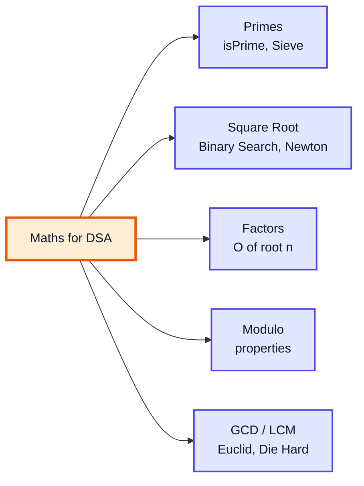

> [!IMPORTANT]
> The single most reused idea in this video is **"you only need to go up to √n"**. It appears in primality testing, the sieve, and factor finding. Understand *why* it works (Section 1) and you understand half the video.

> [!NOTE]
> The video also touches bitwise tricks in passing; those get their own dedicated video (#25, Bitwise Operators). Recursion-based maths continues in video #27.

---

## 1. Prime Numbers (1:15)

### What is a Prime Number?

A **prime number** is a natural number **greater than 1** whose only divisors are **1 and itself**.

| Number | Divisors | Prime? |
|---|---|---|
| 1 | 1 | ❌ (by definition — needs exactly two divisors) |
| 2 | 1, 2 | ✅ (the only even prime) |
| 7 | 1, 7 | ✅ |
| 9 | 1, 3, 9 | ❌ composite |
| 29 | 1, 29 | ✅ |
| 91 | 1, 7, 13, 91 | ❌ (tricky: 7 × 13) |

A number with more than two divisors is **composite**. `0` and `1` are **neither** prime nor composite.

### Approach 1: Brute Force — Check Every Number Below n

If `n` has any divisor `c` with `2 ≤ c < n`, it is not prime.

```java
static boolean isPrimeBrute(int n) {
    if (n <= 1) return false;
    for (int c = 2; c < n; c++) {
        if (n % c == 0) return false;   // found a divisor
    }
    return true;
}
// isPrimeBrute(29) -> true   (28 checks... wasteful)
// isPrimeBrute(91) -> false  (stops at c = 7)
```

**Time:** O(n) per number. For `n = 10⁹` that is a billion divisions — far too slow.

### The Key Insight: Divisors Come in Pairs

Every divisor `c` of `n` has a partner `n / c`. If `c ≤ √n` then `n / c ≥ √n`. So **if `n` has any divisor other than 1 and n, at least one of the pair is ≤ √n**.

Take `n = 36` (√36 = 6):

| Smaller (≤ 6) | × | Larger (≥ 6) | = 36 |
|---|---|---|---|
| 1 | × | 36 | ✅ |
| 2 | × | 18 | ✅ |
| 3 | × | 12 | ✅ |
| 4 | × | 9 | ✅ |
| 🟧 6 | × | 🟧 6 | ✅ (the pair meets at √n) |

After 6 the pairs just repeat in reverse (9 × 4, 12 × 3, ...). Checking beyond √n finds nothing new.

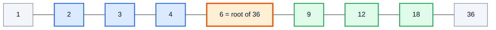

*Blue divisors (≤ √n) each have a green partner (≥ √n). Checking only the blue side is enough.*

### Approach 2: Optimised — Check Up to √n

```java
public class PrimeCheck {

    static boolean isPrime(int n) {
        if (n <= 1) return false;
        for (int c = 2; (long) c * c <= n; c++) {   // c <= sqrt(n)
            if (n % c == 0) return false;
        }
        return true;
    }

    public static void main(String[] args) {
        System.out.println(isPrime(1));    // false
        System.out.println(isPrime(2));    // true
        System.out.println(isPrime(29));   // true
        System.out.println(isPrime(91));   // false
        System.out.println(isPrime(97));   // true
    }
}
```

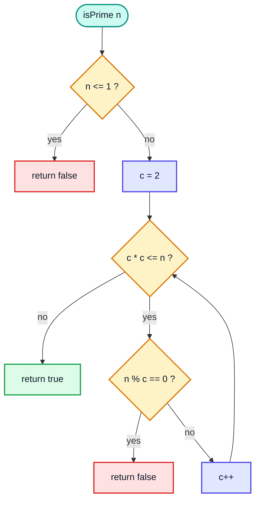

### Dry Run: `isPrime(29)` (√29 ≈ 5.38)

| c | c × c | c×c ≤ 29? | 29 % c | Action |
|---|---|---|---|---|
| 2 | 4 | ✅ | 1 | continue |
| 3 | 9 | ✅ | 2 | continue |
| 4 | 16 | ✅ | 1 | continue |
| 5 | 25 | ✅ | 4 | continue |
| 6 | 36 | ❌ | — | 🟩 return **true** |

Only 4 checks instead of 27.

> [!WARNING]
> Write the condition as `c * c <= n` (with a `long` cast for large `n`), **not** `c <= Math.sqrt(n)` recomputed every iteration and not `c * c <= n` in plain `int` for `n` near `Integer.MAX_VALUE` — `c * c` overflows to a negative number once `c > 46340`, and the loop never ends.

### Complexity

| Approach | Time | Space |
|---|---|---|
| Brute force (2..n-1) | O(n) | O(1) |
| Up to √n | **O(√n)** | O(1) |
| Skip evens (check 2, then 3, 5, 7, ...) | O(√n / 2) — same Big-O, 2× faster | O(1) |
| 6k ± 1 trick (check 2, 3, then 5, 7, 11, 13, ...) | O(√n / 3) | O(1) |

### Bonus: The 6k ± 1 Optimisation

Every prime greater than 3 is of the form `6k − 1` or `6k + 1` (all other forms are divisible by 2 or 3).

```java
static boolean isPrimeFast(long n) {
    if (n <= 3) return n > 1;
    if (n % 2 == 0 || n % 3 == 0) return false;
    for (long c = 5; c * c <= n; c += 6) {
        if (n % c == 0 || n % (c + 2) == 0) return false;
    }
    return true;
}
// isPrimeFast(1_000_000_007L) -> true
```

> [!TIP]
> For really large numbers Java has a built-in probabilistic test: `BigInteger.valueOf(n).isProbablePrime(20)`. It's great for checking your own code, but interviewers expect you to write the √n loop yourself.

---

## 2. Question (11:55)

### Problem: Print All Primes from 1 to n

The obvious first answer reuses `isPrime` on every number:

```java
public class PrintPrimes {

    static boolean isPrime(int n) {
        if (n <= 1) return false;
        for (int c = 2; (long) c * c <= n; c++) {
            if (n % c == 0) return false;
        }
        return true;
    }

    public static void main(String[] args) {
        int n = 40;
        for (int i = 2; i <= n; i++) {
            if (isPrime(i)) System.out.print(i + " ");
        }
        // 2 3 5 7 11 13 17 19 23 29 31 37
    }
}
```

### Complexity

Each call costs O(√i) and we make `n` calls:

```
T(n) = √2 + √3 + ... + √n  ≈  O(n √n)
```

| n | n √n (approx. operations) |
|---|---|
| 10³ | ~31,600 |
| 10⁶ | ~10⁹ ❌ (about a second or more) |
| 10⁷ | ~3 × 10¹⁰ ❌ (way too slow) |


> [!NOTE]
> The wasted work: to reject 35, 45, 55, ... we keep discovering "divisible by 5" separately for each. The sieve flips the question from *"what divides this number?"* to *"which numbers does this prime divide?"*

---

## 3. Sieve of Eratosthenes (14:16)

### The Idea

Write down all numbers 2..n. Repeatedly:

1. Take the **smallest number not yet crossed out** — it must be prime (nothing smaller divides it).
2. **Cross out all its multiples** — they can't be prime.

Whatever survives is prime.

### Why Start Crossing at i × i?

When we reach prime `i`, every multiple `k × i` with `k < i` has **already** been crossed out by the smaller prime factor of `k`. Example for `i = 5`: 10 (by 2), 15 (by 3), 20 (by 2) are already gone — the first new one is **25 = 5 × 5**.

This also means we only need outer `i` up to **√n**: if `i * i > n`, there is nothing new to cross out.

### Visual: Sieve up to 40

| Step | Prime `i` | Starts at | Crossed out (new) |
|---|---|---|---|
| 1 | 🟩 2 | 4 | 4, 6, 8, 10, 12, 14, 16, 18, 20, 22, 24, 26, 28, 30, 32, 34, 36, 38, 40 |
| 2 | 🟩 3 | 9 | 9, 15, 21, 27, 33, 39 (12, 18, ... already gone) |
| 3 | 🟩 5 | 25 | 25, 35 |
| 4 | 🟧 7 | 49 > 40 | stop — 7 × 7 > 40, every survivor is prime |

**Survivors (primes ≤ 40):** 2, 3, 5, 7, 11, 13, 17, 19, 23, 29, 31, 37

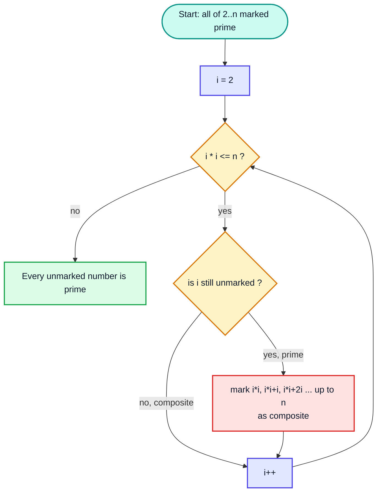

### Code

```java
import java.util.Arrays;

public class Sieve {

    // returns isComposite[]: false means prime (for indices >= 2)
    static boolean[] sieve(int n) {
        boolean[] isComposite = new boolean[n + 1];   // default false
        for (int i = 2; (long) i * i <= n; i++) {
            if (!isComposite[i]) {
                for (int j = i * i; j <= n; j += i) {
                    isComposite[j] = true;
                }
            }
        }
        return isComposite;
    }

    public static void main(String[] args) {
        int n = 40;
        boolean[] composite = sieve(n);
        for (int i = 2; i <= n; i++) {
            if (!composite[i]) System.out.print(i + " ");
        }
        System.out.println();
        // 2 3 5 7 11 13 17 19 23 29 31 37
    }
}
```

> [!NOTE]
> Kunal's version uses a `boolean[] primes` where `false` means "prime" — exactly the trick above. It avoids filling the array with `true` first, because Java initialises `boolean[]` to `false`. Name the array `isComposite` (or `notPrime`) so the meaning is obvious.

### Common Mistakes

| Mistake | Effect |
|---|---|
| Array of size `n` instead of `n + 1` | `ArrayIndexOutOfBoundsException` on index `n` |
| Starting inner loop at `2 * i` | Still correct, just does redundant work |
| `i * i` in `int` for `n` ≈ 2³¹ | Overflow → negative `j` → crash. Use `long` |
| Treating 0 and 1 as prime | Start printing from 2 |

> [!TIP]
> The sieve is the model answer to **LeetCode 204 — Count Primes** (count primes strictly less than `n`). Allocate `new boolean[n]`, sieve, then count unmarked indices ≥ 2.

---

## 4. Complexity Analysis of SoE (27:21)

### Counting the Work

For each prime `p ≤ √n`, the inner loop crosses out about `n / p` numbers:

```
n/2 + n/3 + n/5 + n/7 + n/11 + ...  =  n × (1/2 + 1/3 + 1/5 + 1/7 + ...)
```

The sum of reciprocals of primes up to `n` grows like **log log n** (a result due to Euler/Mertens), so:

| Measure | Value |
|---|---|
| **Time** | **O(n log log n)** — practically linear |
| **Space** | O(n) for the boolean array |

### How Small Is log log n?

| n | log₂ n | log₂ log₂ n |
|---|---|---|
| 10³ | ~10 | ~3.3 |
| 10⁶ | ~20 | ~4.3 |
| 10⁹ | ~30 | ~4.9 |

Even for a billion, `log log n` is under 5 — so the sieve behaves almost like O(n).

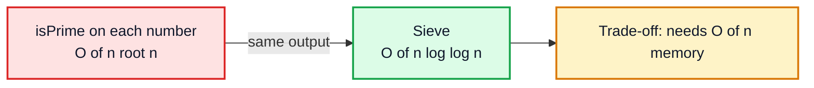

### When to Use Which?

| Situation | Best tool |
|---|---|
| Is **one** number prime? | `isPrime` in O(√n) |
| **All** primes up to n ≤ ~10⁷ | Sieve |
| Many queries "is x prime?" with x ≤ 10⁷ | Sieve once, answer each in O(1) |
| Primes in a range [L, R] with R up to 10¹² but R − L small | *Segmented sieve* (sieve up to √R, then mark the window) |

> [!NOTE]
> A `boolean[]` uses 1 byte per entry in HotSpot, so a sieve to 10⁸ needs ~100 MB. `java.util.BitSet` stores 1 bit per entry (~12.5 MB) if memory is tight.

---

## 5. Square Root (31:50)

### Problem

Find √n **without** `Math.sqrt`, either as an integer (floor) or to `p` decimal places.

### Approach: Binary Search on the Answer

The function `f(m) = m²` is **monotonically increasing**, so the answer space `[0, n]` is sorted. Binary search for the largest `m` with `m² ≤ n`.

**Step 1 — integer part (binary search):**

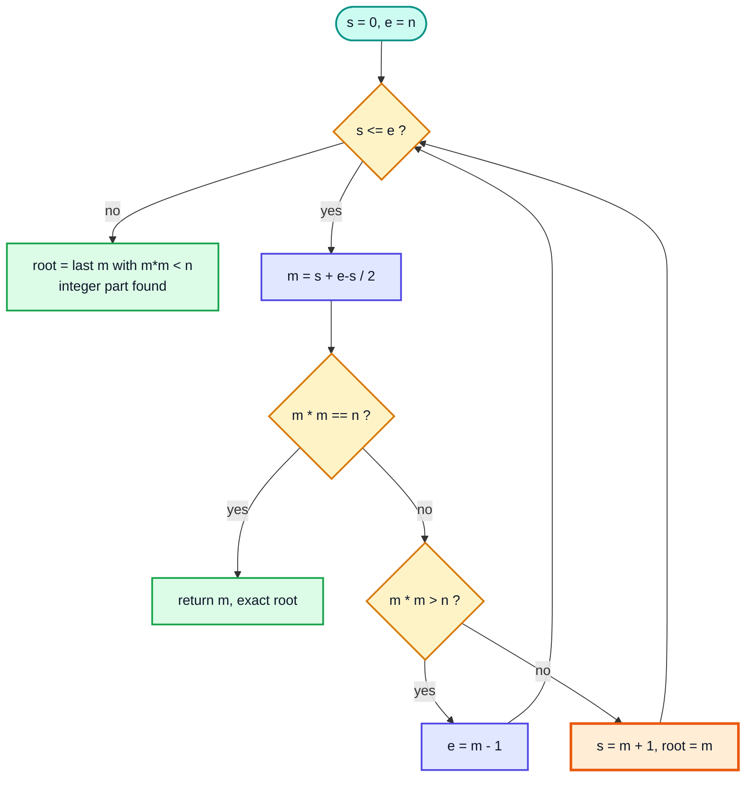

**Step 2 — decimal places:** for each of the `p` digits, add `0.1`, then `0.01`, then `0.001` ... as long as `root² ≤ n`, then step back once.

### Code

```java
public class SqrtBinarySearch {

    static double sqrt(int n, int p) {
        int s = 0, e = n;
        double root = 0;

        // integer part
        while (s <= e) {
            int m = s + (e - s) / 2;
            if ((long) m * m == n) return m;
            if ((long) m * m > n) {
                e = m - 1;
            } else {
                s = m + 1;
                root = m;              // m is a candidate (m*m < n)
            }
        }

        // decimal part, one digit at a time
        double incr = 0.1;
        for (int i = 0; i < p; i++) {
            while (root * root <= n) root += incr;
            root -= incr;              // went one step too far
            incr /= 10;
        }
        return root;
    }

    public static void main(String[] args) {
        System.out.printf("%.3f%n", sqrt(40, 3));   // 6.324
        System.out.printf("%.3f%n", sqrt(36, 3));   // 6.000
        System.out.printf("%.2f%n", sqrt(2, 2));    // 1.41
    }
}
```

### Dry Run: `sqrt(40, 3)`

**Integer part:**

| s | e | m | m² | Compare to 40 | Action | root |
|---|---|---|---|---|---|---|
| 0 | 40 | 20 | 400 | > | e = 19 | 0 |
| 0 | 19 | 9 | 81 | > | e = 8 | 0 |
| 0 | 8 | 4 | 16 | < | s = 5 | 🟧 4 |
| 5 | 8 | 6 | 36 | < | s = 7 | 🟧 6 |
| 7 | 8 | 7 | 49 | > | e = 6 | 6 |
| 7 | 6 | — | — | s > e | stop | **6** |

**Decimal part:**

| incr | Values tried (root²) | Stops at | root after step back |
|---|---|---|---|
| 0.1 | 6.1 (37.21), 6.2 (38.44), 6.3 (39.69), 6.4 (40.96 ❌) | 6.4 | 6.3 |
| 0.01 | 6.31 (39.82), 6.32 (39.94), 6.33 (40.07 ❌) | 6.33 | 6.32 |
| 0.001 | 6.321 … 6.324 (39.993), 6.325 (40.006 ❌) | 6.325 | **6.324** |

### Complexity

| Part | Time |
|---|---|
| Integer part | O(log n) |
| Each decimal digit | at most 10 steps |
| **Total** | **O(log n + 10 p)** |

> [!WARNING]
> Repeatedly adding `0.1` to a `double` accumulates floating-point error (0.1 has no exact binary representation). Always print with `printf("%.3f")` rather than trusting every digit of the raw `double`. Also note the `(long) m * m` cast: `m * m` in `int` overflows for `m > 46340`.

> [!TIP]
> The integer-only version is **LeetCode 69 — Sqrt(x)**: return `⌊√x⌋`. It's the integer part of the code above with `return e;` (or `root`) at the end. Use `long` for `m * m` since `x` can be up to 2³¹ − 1.

---

## 6. Newton Raphson Method (43:58)

### The Idea (Basics)

Start with a guess `x`. If `x` is too big, `n / x` is too small (and vice versa), so their **average** is a better guess:

```
root = (x + n / x) / 2
```

Repeat until the guess stops changing (the error `|root − x|` is tiny).

### Where the Formula Comes From (In Depth)

Newton–Raphson finds a zero of any differentiable function `f(x)` by following the tangent line:

```
x_next = x − f(x) / f'(x)
```

For √n we want `f(x) = x² − n = 0`, with `f'(x) = 2x`:

```
x_next = x − (x² − n) / (2x)  =  (x + n/x) / 2
```

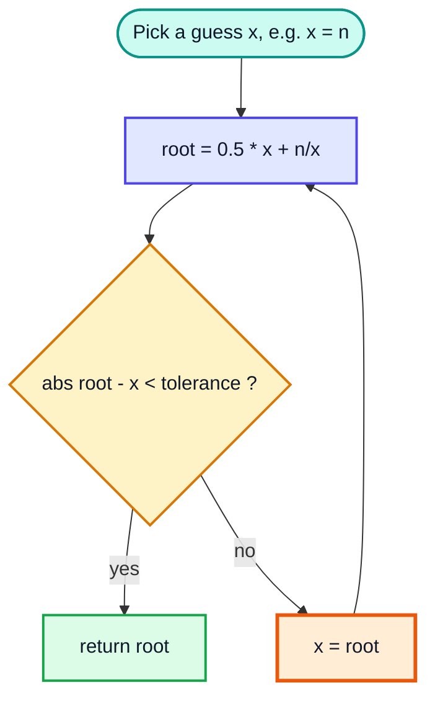

### Code

```java
public class NewtonSqrt {

    static double sqrt(double n) {
        if (n < 0) throw new IllegalArgumentException("negative input");
        if (n == 0) return 0;
        double x = n;                          // initial guess
        while (true) {
            double root = 0.5 * (x + n / x);
            if (Math.abs(root - x) < 1e-9) return root;
            x = root;
        }
    }

    public static void main(String[] args) {
        System.out.printf("%.6f%n", sqrt(40));   // 6.324555
        System.out.printf("%.6f%n", sqrt(2));    // 1.414214
        System.out.printf("%.6f%n", sqrt(36));   // 6.000000
    }
}
```

### Dry Run: `sqrt(40)` (true value 6.3245553203...)

| Iteration | x | root = (x + 40/x) / 2 | error = \|root − x\| |
|---|---|---|---|
| 0 | 40.0000000000 | 20.5000000000 | 19.50 |
| 1 | 20.5000000000 | 11.2256097561 | 9.27 |
| 2 | 11.2256097561 | 7.3944452909 | 3.83 |
| 3 | 7.3944452909 | 6.4019556191 | 0.99 |
| 4 | 6.4019556191 | 6.3250232091 | 0.077 |
| 5 | 6.3250232091 | 🟧 6.3245553376 | 0.00047 |
| 6 | 6.3245553376 | 🟩 6.3245553203 | 0.000000017 |

Notice how from iteration 4 onwards the number of correct digits roughly **doubles** each step (2 → 4 → 9).

> [!NOTE]
> Kunal's code uses an error threshold of `1` or `0.5` in some places to keep the demo short. For real use pick a tolerance that matches the precision you need (e.g. `1e-9`), or iterate until `root == x` for full `double` precision.

### Binary Search vs Newton–Raphson

| | Binary search | Newton–Raphson |
|---|---|---|
| Convergence | Linear — 1 bit per step | **Quadratic** — digits double per step |
| Needs a derivative? | No | Yes (`f'(x) = 2x`) |
| Works on integers only? | Yes, cleanly | Integer variant exists (`x = (x + n/x) / 2` in `long`) |
| Risk | None | Bad start / `f'(x) = 0` can diverge (never for √n with x > 0) |

---

## 7. Complexity Analysis of NRM (51:25)

### Basics

Newton's method has **quadratic convergence**: if the current guess has `k` correct digits, the next has about `2k`. To reach `N` digits of precision you need about **log N** iterations.

### In Depth

Each iteration has to compute `f(x) / f'(x)` at the desired precision. If that costs `F(N)` for `N`-digit numbers, then:

```
T = O( log N × F(N) )
```

| Precision wanted | Iterations needed (once close) |
|---|---|
| 2 digits | ~1 |
| 8 digits | ~3 |
| 16 digits (full `double`) | ~4 |
| 1000 digits (BigDecimal) | ~10 |


> [!NOTE]
> The very first few iterations from a poor guess (like `x = n` for huge `n`) only halve the guess each time, costing O(log n) extra steps. A better initial guess (for example a power of 2 near √n) removes that phase. Java's `Math.sqrt` doesn't use either loop — it maps to a single hardware instruction.

**Space:** O(1).

---

## 8. Factors (55:07)

### Problem

Print all **factors** (divisors) of `n` — numbers that divide `n` with remainder 0.

`Factors of 20 = 1, 2, 4, 5, 10, 20`

### Brute Force: O(n)

```java
static void factorsBrute(int n) {
    for (int i = 1; i <= n; i++) {
        if (n % i == 0) System.out.print(i + " ");
    }
    System.out.println();
}
// factorsBrute(20) -> 1 2 4 5 10 20
```

| n | Iterations |
|---|---|
| 20 | 20 |
| 10⁶ | 10⁶ |
| 10¹² (use `long`) | 10¹² ❌ hours |

### The Pair Trick (Same as Primes)

If `i` divides `n`, then so does `n / i`. Loop `i` only up to √n and print **both**:

```java
static void factorsPairs(int n) {
    for (int i = 1; (long) i * i <= n; i++) {
        if (n % i == 0) {
            if (n / i == i) {
                System.out.print(i + " ");                 // perfect square: print once
            } else {
                System.out.print(i + " " + n / i + " ");
            }
        }
    }
    System.out.println();
}
// factorsPairs(20) -> 1 20 2 10 4 5
// factorsPairs(36) -> 1 36 2 18 3 12 4 9 6
```

Now O(√n) — but the output is **not sorted**. That's the motivation for the next section.

> [!CAUTION]
> Without the `n / i == i` check, perfect squares print the middle factor twice (`6 6` for 36).

---

## 9. Optimised Code for Factors (58:20)

### Getting Sorted Output in O(√n)

Notice the pattern in `1 36 2 18 3 12 4 9 6`:

- The **small** factors (`1, 2, 3, 4, 6`) come out **ascending**.
- The **large** partners (`36, 18, 12, 9`) come out **descending**.

So print the small ones immediately, store the large ones in a list, and print that list **in reverse** at the end.

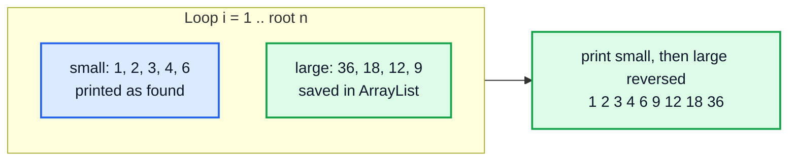

### Code

```java
import java.util.ArrayList;

public class Factors {

    static void factors(int n) {
        ArrayList<Integer> large = new ArrayList<>();
        for (int i = 1; (long) i * i <= n; i++) {
            if (n % i == 0) {
                System.out.print(i + " ");
                if (n / i != i) large.add(n / i);
            }
        }
        for (int k = large.size() - 1; k >= 0; k--) {
            System.out.print(large.get(k) + " ");
        }
        System.out.println();
    }

    public static void main(String[] args) {
        factors(20);   // 1 2 4 5 10 20
        factors(36);   // 1 2 3 4 6 9 12 18 36
        factors(17);   // 1 17
    }
}
```

### Dry Run: `factors(36)`

| i | 36 % i | Print now | Add to `large` | `large` |
|---|---|---|---|---|
| 1 | 0 ✅ | 1 | 36 | [36] |
| 2 | 0 ✅ | 2 | 18 | [36, 18] |
| 3 | 0 ✅ | 3 | 12 | [36, 18, 12] |
| 4 | 0 ✅ | 4 | 9 | [36, 18, 12, 9] |
| 5 | 1 ❌ | — | — | [36, 18, 12, 9] |
| 6 | 0 ✅ | 6 | 🟧 skip (6 == 36/6) | [36, 18, 12, 9] |
| 7 | 7×7 = 49 > 36 → stop | | | |

Reverse print `large`: `9 12 18 36` → final: **1 2 3 4 6 9 12 18 36**

### Complexity

| Version | Time | Space | Sorted? |
|---|---|---|---|
| Brute force | O(n) | O(1) | ✅ |
| Pairs | O(√n) | O(1) | ❌ |
| **Pairs + list** | **O(√n)** | O(√n) (a number has at most ~2√n factors) | ✅ |

> [!TIP]
> **LeetCode 1492 — The kth Factor of n** is this exact problem: build the sorted factor list in O(√n) and return index `k − 1` (or `-1` if there are fewer than `k` factors).

---

## 10. Modulo Properties (1:06:17)

### Why Modulo Matters

Answers like "number of ways" or "nᵗʰ Fibonacci" quickly exceed `long` (max ≈ 9.2 × 10¹⁸). Problems ask for the answer **mod 10⁹ + 7** — a large prime that keeps numbers small and whose square still fits in a `long`.

### The Properties

| Operation | Property | Safe? |
|---|---|---|
| Addition | `(a + b) % m = ((a % m) + (b % m)) % m` | ✅ |
| Subtraction | `(a − b) % m = ((a % m) − (b % m) + m) % m` | ✅ (the `+ m` fixes negatives) |
| Multiplication | `(a × b) % m = ((a % m) × (b % m)) % m` | ✅ |
| Division | `(a / b) % m ≠ ((a % m) / (b % m)) % m` | ❌ — use the **modular inverse** |
| Inverse (m prime) | `b⁻¹ ≡ b^(m−2) (mod m)` (Fermat's little theorem) | ✅ |
| Power | `(a^k) % m` via fast exponentiation, O(log k) | ✅ |

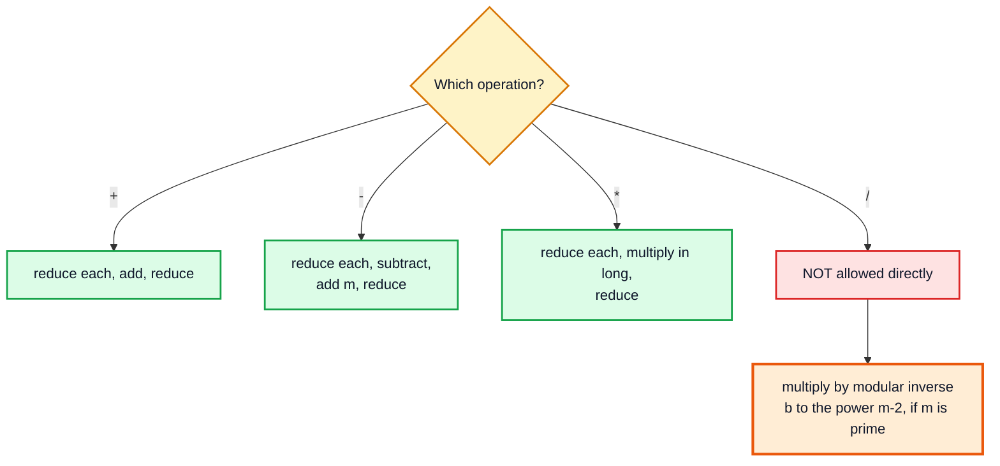

### Java's `%` Is a Remainder, Not a Mathematical Mod

In Java, the sign of `a % m` follows `a`:

```java
System.out.println(7 % 3);                 // 1
System.out.println(-7 % 3);                // -1   (not 2!)
System.out.println(Math.floorMod(-7, 3));  // 2    (always in [0, m))
```

> [!WARNING]
> That's why the subtraction rule adds `m` before the final `%`. Alternatively use `Math.floorMod(a, m)` (Java 8+), which always returns a non-negative result for positive `m`.

### Code

```java
public class ModuloDemo {
    static final int MOD = 1_000_000_007;

    static long add(long a, long b) { return ((a % MOD) + (b % MOD)) % MOD; }
    static long sub(long a, long b) { return (((a % MOD) - (b % MOD)) % MOD + MOD) % MOD; }
    static long mul(long a, long b) { return ((a % MOD) * (b % MOD)) % MOD; }

    // fast exponentiation: O(log exp)
    static long pow(long base, long exp) {
        long result = 1;
        base %= MOD;
        while (exp > 0) {
            if ((exp & 1) == 1) result = result * base % MOD;
            base = base * base % MOD;
            exp >>= 1;
        }
        return result;
    }

    static long inverse(long b) { return pow(b, MOD - 2); }   // MOD is prime

    public static void main(String[] args) {
        System.out.println(add(1_000_000_006L, 5));          // 4
        System.out.println(sub(3, 10));                      // 1000000000
        System.out.println(mul(123456789L, 987654321L));     // 259106859
        System.out.println(pow(2, 100));                     // 976371285
        System.out.println(mul(10, inverse(2)));             // 5  (10 / 2)
    }
}
```

> [!IMPORTANT]
> In `mul`, both operands are already `< MOD ≈ 10⁹`, so the product is `< 10¹⁸` and fits in a `long`. If you multiply two `int`s you **must** cast to `long` first: `(long) a * b % MOD`. Writing `(long)(a * b)` casts *after* the overflow happened.

### Other Handy Facts

| Fact | Example |
|---|---|
| `a % m` is in `[0, m − 1]` for `a ≥ 0` | `17 % 5 = 2` |
| `a % 2 == 0` ⇔ even; same as `(a & 1) == 0` | `10 % 2 = 0` |
| `a % 10` = last digit, `a / 10` drops it | used constantly in video #27 |
| `(a % m) % m = a % m` | reducing twice changes nothing |

---

## 11. Die-Hard Example (1:13:31)

### The Puzzle

In *Die Hard with a Vengeance* the heroes have a **3-gallon** jug and a **5-gallon** jug, unlimited water, and must put **exactly 4 gallons** on a scale. Allowed moves: fill a jug, empty a jug, pour one jug into the other until one is empty or the other is full.

### A Solution (state = (jug5, jug3))

| Step | Move | Jug 5 | Jug 3 |
|---|---|---|---|
| 0 | start | 0 | 0 |
| 1 | fill 5 | 5 | 0 |
| 2 | pour 5 → 3 | 2 | 3 |
| 3 | empty 3 | 2 | 0 |
| 4 | pour 5 → 3 | 0 | 2 |
| 5 | fill 5 | 5 | 2 |
| 6 | pour 5 → 3 (only 1 fits) | 🟩 **4** | 3 |

```mermaid
stateDiagram-v2
    direction LR
    s00: 0, 0
    s50: 5, 0
    s23: 2, 3
    s20: 2, 0
    s02: 0, 2
    s52: 5, 2
    s43: 4, 3 goal
    [*] --> s00
    s00 --> s50: fill 5
    s50 --> s23: pour 5 into 3
    s23 --> s20: empty 3
    s20 --> s02: pour 5 into 3
    s02 --> s52: fill 5
    s52 --> s43: pour 5 into 3
    s43 --> [*]
    classDef goal fill:#dcfce7,stroke:#16a34a,stroke-width:3px,color:#0f172a
    classDef start fill:#ccfbf1,stroke:#0d9488,stroke-width:2px,color:#0f172a
    classDef step fill:#e0e7ff,stroke:#4f46e5,stroke-width:2px,color:#0f172a
    class s43 goal
    class s00 start
    class s50,s23,s20,s02,s52 step
```

### The Maths Behind It: Bézout's Identity

Every amount you can ever measure is a combination `a·x + b·y` of the jug sizes (positive = filled, negative = emptied). **Bézout's identity** says the integers of the form `a·x + b·y` are exactly the **multiples of gcd(a, b)**.

So the puzzle is solvable **if and only if**:

1. `target ≤ a + b` (it has to fit in the jugs, if the target may be split across both — LeetCode's version), and
2. `target % gcd(a, b) == 0`

| Jugs | gcd | Target | Solvable? |
|---|---|---|---|
| 3, 5 | 1 | 4 | ✅ (anything 0..8) |
| 2, 6 | 2 | 5 | ❌ (only even amounts) |
| 6, 9 | 3 | 6 | ✅ |
| 4, 6 | 2 | 11 | ❌ (11 > 10) |

### Code — LeetCode 365: Water and Jug Problem

```java
public class WaterJug {

    static int gcd(int a, int b) {
        return a == 0 ? b : gcd(b % a, a);
    }

    static boolean canMeasureWater(int x, int y, int target) {
        if (target > x + y) return false;
        return target % gcd(x, y) == 0;
    }

    public static void main(String[] args) {
        System.out.println(canMeasureWater(3, 5, 4));   // true
        System.out.println(canMeasureWater(2, 6, 5));   // false
        System.out.println(canMeasureWater(1, 2, 3));   // true
    }
}
```

**Time:** O(log min(x, y)) for the GCD. **Space:** O(log min(x, y)) recursion (O(1) iteratively).

> [!TIP]
> An alternative (and what you'd do if the maths escaped you) is a **BFS over states** `(jug1, jug2)` with the six possible moves. It's O(x · y) states — correct but much slower. The GCD solution is why this video is in a *maths* lecture.

---

## 12. HCF/GCD (1:25:15)

### Definitions

The **HCF** (Highest Common Factor) or **GCD** (Greatest Common Divisor) of `a` and `b` is the largest number that divides both.

| a, b | Factors of a | Factors of b | Common | GCD |
|---|---|---|---|---|
| 4, 6 | 1, 2, 4 | 1, 2, 3, 6 | 1, 2 | **2** |
| 12, 18 | 1, 2, 3, 4, 6, 12 | 1, 2, 3, 6, 9, 18 | 1, 2, 3, 6 | **6** |
| 7, 9 | 1, 7 | 1, 3, 9 | 1 | **1** (co-prime) |

Two numbers with GCD 1 are called **co-prime** (or relatively prime).

### Prime-Factorisation View

Write both numbers as products of primes; the GCD takes the **minimum** power of each common prime:

```
105 = 3 × 5 × 7
224 = 2⁵ × 7
GCD = 7         (only 7 is common, with power 1)
```

### Brute Force

```java
static int gcdBrute(int a, int b) {
    for (int d = Math.min(a, b); d >= 1; d--) {
        if (a % d == 0 && b % d == 0) return d;
    }
    return Math.max(a, b);   // one of them is 0
}
// gcdBrute(12, 18) -> 6
```

**Time:** O(min(a, b)) — fine for small numbers, hopeless for 10¹⁸.

### Useful GCD Properties

| Property | Example |
|---|---|
| `gcd(a, 0) = a` | `gcd(9, 0) = 9` |
| `gcd(a, b) = gcd(b, a)` | symmetric |
| `gcd(a, b) = gcd(a − b, b)` for `a ≥ b` | `gcd(18, 12) = gcd(6, 12)` |
| `gcd(a, b) = gcd(a % b, b)` | the shortcut of repeated subtraction |
| `gcd(a, b, c) = gcd(gcd(a, b), c)` | extends to arrays |

> [!TIP]
> **LeetCode 1979 — Find Greatest Common Divisor of Array**: GCD of the min and max element. **LeetCode 1071 — Greatest Common Divisor of Strings** uses `gcd(len1, len2)` once you know `s1 + s2 == s2 + s1`.

---

## 13. Euclidean Algorithm (1:31:57)

### The Rule

```
gcd(a, b) = gcd(b % a, a),   and   gcd(0, b) = b
```

### Why It Works

If `d` divides both `a` and `b`, then it divides `b − k·a` for any `k` — in particular `b % a = b − ⌊b/a⌋·a`. Conversely, anything dividing `a` and `b % a` divides `b`. So the pairs `(a, b)` and `(b % a, a)` have **exactly the same common divisors**, hence the same GCD. The numbers shrink every step until one hits 0.

### Code

```java
public class Euclid {

    // recursive — Kunal's version
    static int gcd(int a, int b) {
        if (a == 0) return b;
        return gcd(b % a, a);
    }

    // iterative — no stack usage
    static long gcdIter(long a, long b) {
        while (b != 0) {
            long t = a % b;
            a = b;
            b = t;
        }
        return Math.abs(a);
    }

    public static void main(String[] args) {
        System.out.println(gcd(105, 224));       // 7
        System.out.println(gcd(4, 9));           // 1
        System.out.println(gcdIter(48, 18));     // 6
    }
}
```

### Dry Run: `gcd(105, 224)`

| Call | a | b | b % a | Next call |
|---|---|---|---|---|
| 1 | 105 | 224 | 14 | gcd(14, 105) |
| 2 | 14 | 105 | 7 | gcd(7, 14) |
| 3 | 7 | 14 | 0 | gcd(0, 7) |
| 4 | 🟩 0 | 7 | — | return **7** |

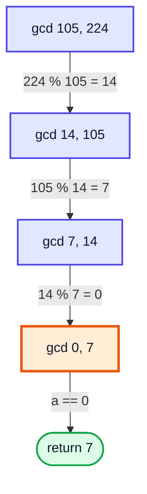

> [!NOTE]
> If `a > b` initially, the first step just swaps them: `gcd(224, 105) → gcd(105 % 224 = 105, 224) = gcd(105, 224)`. No special handling needed.

### Complexity

After **two** steps the larger number at least halves (`b % a < b / 2` whenever `a ≤ b`). So:

| Measure | Value |
|---|---|
| **Time** | **O(log min(a, b))** |
| **Space** | O(log min(a, b)) recursive / O(1) iterative |
| Worst case | consecutive Fibonacci numbers (Lamé's theorem) |

| Method | gcd of two 18-digit numbers |
|---|---|
| Brute force | ~10¹⁸ steps ❌ |
| Euclid | ≤ ~90 steps ✅ |

> [!TIP]
> Java already provides `BigInteger.gcd()`. For primitives there is no `Math.gcd`, so write the 3-line function yourself.

---

## 14. LCM (1:41:11)

### Definition

The **LCM** (Least Common Multiple) of `a` and `b` is the smallest positive number divisible by both.

| a, b | Multiples of a | Multiples of b | LCM |
|---|---|---|---|
| 4, 6 | 4, 8, **12**, 16, 20, 24 | 6, **12**, 18, 24 | **12** |
| 3, 5 | 3, 6, 9, 12, **15** | 5, 10, **15** | **15** |

### The GCD–LCM Relationship

```
gcd(a, b) × lcm(a, b) = a × b      →      lcm(a, b) = a × b / gcd(a, b)
```

**Why:** in prime factorisations, GCD takes the **min** power of each prime and LCM takes the **max**. `min + max = sum of both powers`, which is exactly the factorisation of `a × b`.

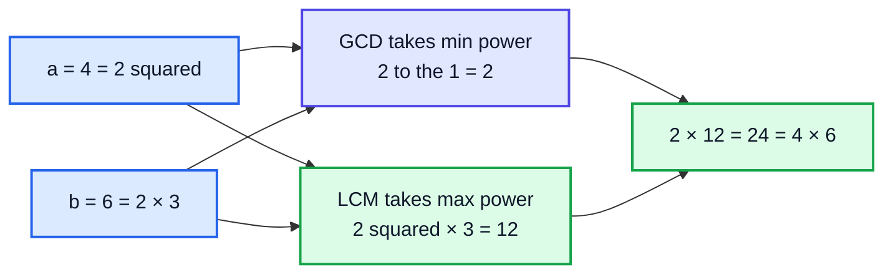

### Code

```java
public class Lcm {

    static int gcd(int a, int b) {
        return a == 0 ? b : gcd(b % a, a);
    }

    static long lcm(int a, int b) {
        return (long) a / gcd(a, b) * b;   // divide FIRST to avoid overflow
    }

    static long lcmOfArray(int[] arr) {
        long result = arr[0];
        for (int i = 1; i < arr.length; i++) {
            long g = gcdLong(result, arr[i]);
            result = result / g * arr[i];
        }
        return result;
    }

    static long gcdLong(long a, long b) {
        return a == 0 ? b : gcdLong(b % a, a);
    }

    public static void main(String[] args) {
        System.out.println(lcm(4, 6));                         // 12
        System.out.println(lcm(105, 224));                     // 3360
        System.out.println(lcmOfArray(new int[]{2, 3, 4, 5})); // 60
    }
}
```

### Dry Run: `lcm(105, 224)`

| Step | Value |
|---|---|
| gcd(105, 224) | 7 |
| 105 / 7 | 15 |
| 15 × 224 | **3360** |
| Check: 3360 / 105 = 32, 3360 / 224 = 15 | ✅ both divide |

> [!WARNING]
> `a * b / gcd(a, b)` computes `a * b` first, which can overflow `int` even when the LCM itself fits. Compute `a / gcd * b` instead, and use `long` (or `Math.multiplyExact` to detect overflow).

**Time:** O(log min(a, b)). **Space:** O(1) beyond the GCD recursion.

> [!TIP]
> **LeetCode 2413 — Smallest Even Multiple** is `lcm(n, 2)`. Many "when do two cycles line up again?" problems (traffic lights, gears, repeating schedules) are LCM in disguise.

---

## 15. Outro (1:53:45)

You now have the core maths toolkit:

- **√n bound** — primes and factors
- **Sieve** — all primes up to n in O(n log log n)
- **Binary search / Newton** — roots without `Math.sqrt`
- **Modulo rules** — `+ − ×` distribute, `÷` needs an inverse
- **Euclid** — GCD in O(log n), and LCM from it

> [!NOTE]
> Practise with: LeetCode 204 (Count Primes), 69 (Sqrt(x)), 367 (Valid Perfect Square), 1492 (kth Factor of n), 365 (Water and Jug Problem), 1979 (GCD of Array), 50 (Pow(x, n) — fast exponentiation). Next video (#27) returns to recursion with Level 1 questions, many of which use `% 10` and `/ 10` from this one.

---

## 🧩 Complete Example: Everything Together

```java
import java.util.ArrayList;
import java.util.List;

public class MathsForDSA {

    // 1. Primality test: trial division up to sqrt(n) -> O(sqrt n)
    static boolean isPrime(int n) {
        if (n <= 1) return false;
        for (int c = 2; (long) c * c <= n; c++) {
            if (n % c == 0) return false;
        }
        return true;
    }

    // 2. Sieve of Eratosthenes -> O(n log log n) time, O(n) space
    static List<Integer> sieve(int n) {
        boolean[] composite = new boolean[n + 1];   // false = "still possibly prime"
        List<Integer> primes = new ArrayList<>();
        for (int i = 2; i <= n; i++) {
            if (!composite[i]) {
                primes.add(i);
                for (long j = (long) i * i; j <= n; j += i) {
                    composite[(int) j] = true;
                }
            }
        }
        return primes;
    }

    // 3. Square root by binary search, with p digits after the decimal point
    static double sqrtBinarySearch(int n, int p) {
        int s = 0, e = n;
        double root = 0;
        while (s <= e) {                           // integer part
            int m = s + (e - s) / 2;
            if ((long) m * m == n) return m;
            if ((long) m * m > n) e = m - 1;
            else { s = m + 1; root = m; }
        }
        double incr = 0.1;
        for (int i = 0; i < p; i++) {              // one decimal digit at a time
            while (root * root <= n) root += incr;
            root -= incr;
            incr /= 10;
        }
        return root;
    }

    // 4. Newton-Raphson square root: root = (x + n/x) / 2
    static double newtonSqrt(double n) {
        if (n == 0) return 0;
        double x = n;
        while (true) {
            double root = 0.5 * (x + n / x);
            if (Math.abs(root - x) < 1e-9) return root;
            x = root;
        }
    }

    // 5. Factors in ascending order in O(sqrt n)
    static List<Integer> factors(int n) {
        List<Integer> small = new ArrayList<>();
        List<Integer> large = new ArrayList<>();
        for (int i = 1; (long) i * i <= n; i++) {
            if (n % i == 0) {
                small.add(i);
                if (i != n / i) large.add(n / i);
            }
        }
        for (int k = large.size() - 1; k >= 0; k--) small.add(large.get(k));
        return small;
    }

    // 6. Modulo helpers
    static final int MOD = 1_000_000_007;
    static long modAdd(long a, long b) { return ((a % MOD) + (b % MOD)) % MOD; }
    static long modSub(long a, long b) { return (((a % MOD) - (b % MOD)) % MOD + MOD) % MOD; }
    static long modMul(long a, long b) { return ((a % MOD) * (b % MOD)) % MOD; }
    static long modPow(long base, long exp) {      // fast exponentiation
        long result = 1;
        base %= MOD;
        while (exp > 0) {
            if ((exp & 1) == 1) result = result * base % MOD;
            base = base * base % MOD;
            exp >>= 1;
        }
        return result;
    }

    // 7. Euclidean algorithm + LCM
    static int gcd(int a, int b) {
        return a == 0 ? b : gcd(b % a, a);
    }
    static long lcm(int a, int b) {
        return (long) a / gcd(a, b) * b;           // divide first to avoid overflow
    }

    // 8. Die Hard water jugs (LeetCode 365)
    static boolean canMeasure(int x, int y, int target) {
        if (target > x + y) return false;
        return target % gcd(x, y) == 0;
    }

    public static void main(String[] args) {
        System.out.println("isPrime(29) = " + isPrime(29) + ", isPrime(91) = " + isPrime(91));
        System.out.println("Primes <= 40: " + sieve(40));
        System.out.printf("sqrt(40) binary search (3 dp): %.3f%n", sqrtBinarySearch(40, 3));
        System.out.printf("sqrt(40) Newton-Raphson: %.6f%n", newtonSqrt(40));
        System.out.println("Factors of 36: " + factors(36));
        System.out.println("modAdd(1e9+6, 5) = " + modAdd(1_000_000_006L, 5));
        System.out.println("modSub(3, 10) = " + modSub(3, 10));
        System.out.println("modMul(123456789, 987654321) = " + modMul(123456789L, 987654321L));
        System.out.println("2^100 mod 1e9+7 = " + modPow(2, 100));
        System.out.println("gcd(105, 224) = " + gcd(105, 224));
        System.out.println("lcm(4, 6) = " + lcm(4, 6) + ", lcm(105, 224) = " + lcm(105, 224));
        System.out.println("Jugs 3 & 5, measure 4? " + canMeasure(3, 5, 4));
        System.out.println("Jugs 2 & 6, measure 5? " + canMeasure(2, 6, 5));
    }
}
```

**Expected Output:**
```
isPrime(29) = true, isPrime(91) = false
Primes <= 40: [2, 3, 5, 7, 11, 13, 17, 19, 23, 29, 31, 37]
sqrt(40) binary search (3 dp): 6.324
sqrt(40) Newton-Raphson: 6.324555
Factors of 36: [1, 2, 3, 4, 6, 9, 12, 18, 36]
modAdd(1e9+6, 5) = 4
modSub(3, 10) = 1000000000
modMul(123456789, 987654321) = 259106859
2^100 mod 1e9+7 = 976371285
gcd(105, 224) = 7
lcm(4, 6) = 12, lcm(105, 224) = 3360
Jugs 3 & 5, measure 4? true
Jugs 2 & 6, measure 5? false
```

---

## Quick Reference Cheat Sheet

| Concept | One-Line Summary |
|---|---|
| **Prime** | > 1 with exactly two divisors (1 and itself); 2 is the only even prime |
| **√n bound** | Divisors pair up as (i, n/i); one of each pair is ≤ √n |
| **isPrime** | Trial division with `c * c <= n` → O(√n) |
| **All primes ≤ n (naive)** | isPrime on each → O(n√n) |
| **Sieve of Eratosthenes** | Cross out multiples from i×i, outer loop to √n → O(n log log n), O(n) space |
| **√n by binary search** | Largest m with m² ≤ n, then add 0.1, 0.01, ... → O(log n + 10p) |
| **Newton–Raphson** | `root = (x + n/x) / 2` until error < tolerance; digits double each step |
| **NRM complexity** | O(log N · F(N)) for N digits of precision |
| **Factors (brute)** | Loop 1..n → O(n) |
| **Factors (optimised)** | Loop to √n, print i, store n/i, print stored in reverse → O(√n), sorted |
| **Modulo + − ×** | Reduce operands first; add `m` after subtracting |
| **Modulo ÷** | Multiply by inverse `b^(m−2) mod m` (m prime) |
| **Java `%`** | Remainder; sign follows dividend. `Math.floorMod` for true mod |
| **Die Hard / LeetCode 365** | Possible iff target ≤ a + b and target % gcd(a, b) == 0 (Bézout) |
| **GCD / HCF** | Largest common divisor; co-prime if 1 |
| **Euclid** | `gcd(a, b) = gcd(b % a, a)`, `gcd(0, b) = b` → O(log min(a, b)) |
| **LCM** | `a / gcd(a, b) * b` — divide first to avoid overflow |
