# Recursion Level 1 Questions — Complete In-Depth Guide

**Video #27 of the Java + DSA playlist:** *Recursion - Level 1 Questions (Theory + Code + Tips)* (1:13:22)

Ten foundational recursion problems on numbers — printing sequences, factorial, sums, digit manipulation, reversing, palindromes, counting zeros and counting steps — plus the crucial concept of *how values are passed* into recursive calls (`n - 1` vs `n--`). Every question comes with the recurrence, code, a call-stack trace and complexity.

---

## Table of Contents

| # | Topic | Timestamp |
|---|---|---|
| 0 | [Introduction](#0-introduction-000) | 0:00 |
| 1 | [Revision](#1-revision-226) | 2:26 |
| 2 | [Q-01: n to 1](#2-q-01-n-to-1-240) | 2:40 |
| 3 | [Q-02: 1 to n](#3-q-02-1-to-n-852) | 8:52 |
| 4 | [Q-03: Product of n to 1](#4-q-03-product-of-n-to-1-1504) | 15:04 |
| 5 | [Q-04: Sum of n to 1](#5-q-04-sum-of-n-to-1-2337) | 23:37 |
| 6 | [Q-05: Sum of digits](#6-q-05-sum-of-digits-2428) | 24:28 |
| 7 | [Q-06: Product of digits](#7-q-06-product-of-digits-3042) | 30:42 |
| 8 | [Concept: Passing Numbers](#8-concept-passing-numbers-3156) | 31:56 |
| 9 | [Q-07: Reverse a number](#9-q-07-reverse-a-number-3519) | 35:19 |
| 10 | [Way-1 for Q-07](#10-way-1-for-q-07-4029) | 40:29 |
| 11 | [Way-2 for Q-07](#11-way-2-for-q-07-4820) | 48:20 |
| 12 | [Q-08: Palindrome](#12-q-08-palindrome-5440) | 54:40 |
| 13 | [Q-09: Count Zeros](#13-q-09-count-zeros-5807) | 58:07 |
| 14 | [Q-10: Count Steps](#14-q-10-count-steps-10805) | 1:08:05 |
| 15 | [Outro](#15-outro-11241) | 1:12:41 |

---

## 0. Introduction (0:00)

Video #23 explained **what** recursion is. This video is about **practice**: easy questions that build the habit of thinking recursively. Each one is solved with the same recipe:

1. **Find the recurrence** — express the answer for `n` using the answer for a smaller input.
2. **Find the base condition** — the smallest input whose answer you know directly.
3. **Decide what goes before and after the recursive call.**
4. **Draw the recursion tree / call stack** to check it.

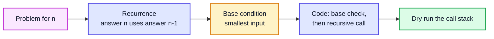

> [!IMPORTANT]
> These questions look trivial — and loops would do them just as well. That's the point: when the problem is easy, you can focus entirely on **how recursion behaves** (the stack, the order of work, how arguments are passed). Those mechanics are what make trees, backtracking and DP possible later.

---

## 1. Revision (2:26)

Quick recap from video #23:

| Concept | Meaning |
|---|---|
| **Recursion** | A function calling itself on a smaller version of the problem |
| **Base condition** | Stops the recursion; without it → `StackOverflowError` |
| **Call stack** | Each call gets its own **stack frame** with its own copies of parameters and locals |
| **Recurrence relation** | Formula like `f(n) = n + f(n − 1)` |
| **Tail recursion** | Recursive call is the very last action |
| **Recursion tree** | Diagram of which calls make which calls |

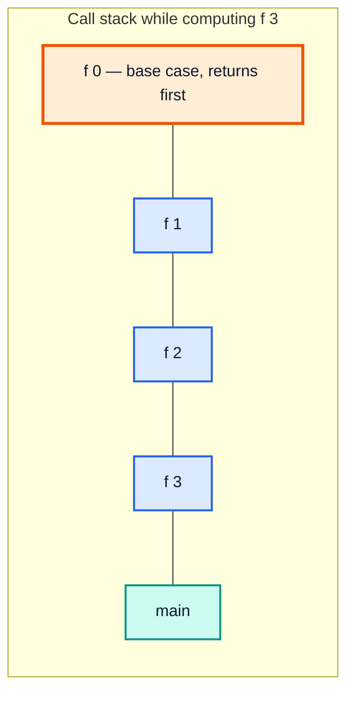

*The top of the stack is the call currently running; frames are popped in reverse order of creation (LIFO).*

---

## 2. Q-01: n to 1 (2:40)

### Problem

Print the numbers from `n` down to `1`. For `n = 5`: `5 4 3 2 1`.

### Approach

- **Recurrence:** printing `n..1` = print `n`, then print `(n−1)..1`.
- **Base condition:** `n == 0` → nothing to print.
- **Work placement:** print **before** the recursive call (so the bigger number comes out first).

```java
public class NTo1 {

    static void fun(int n) {
        if (n == 0) return;              // base condition
        System.out.print(n + " ");       // work BEFORE the call
        fun(n - 1);                      // smaller problem
    }

    public static void main(String[] args) {
        fun(5);                          // 5 4 3 2 1
    }
}
```

### Order of Calls

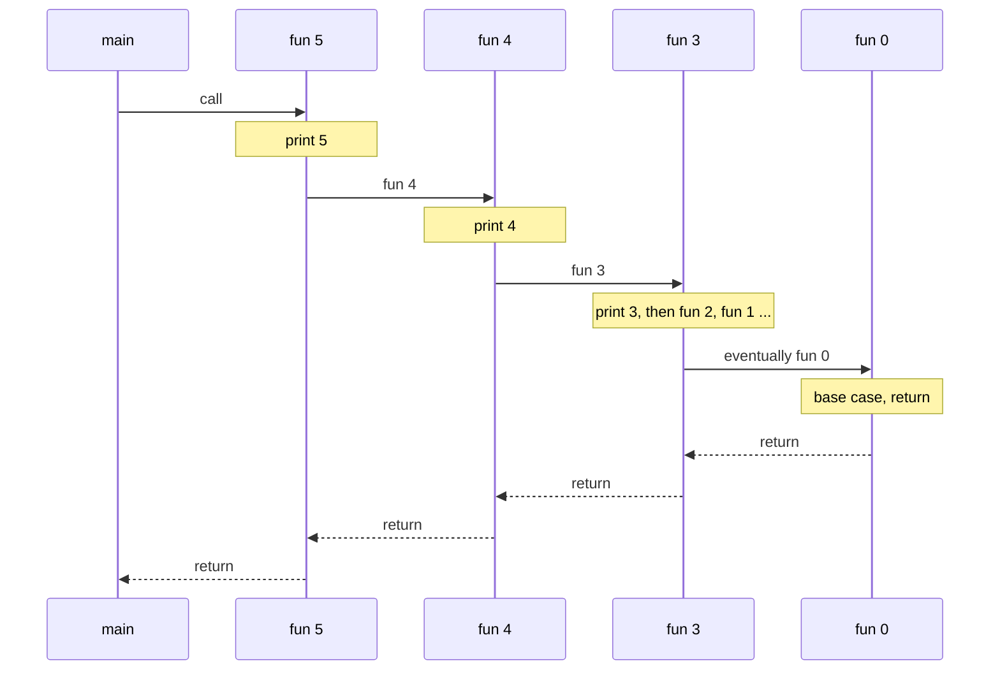

### Dry Run: `fun(5)`

| Call | n == 0? | Prints | Then calls |
|---|---|---|---|
| fun(5) | ❌ | 5 | fun(4) |
| fun(4) | ❌ | 4 | fun(3) |
| fun(3) | ❌ | 3 | fun(2) |
| fun(2) | ❌ | 2 | fun(1) |
| fun(1) | ❌ | 1 | fun(0) |
| fun(0) | ✅ 🟧 | — | return |

**Time:** O(n) — n + 1 calls doing O(1) each. **Space:** O(n) — the call stack holds up to n + 1 frames.

> [!NOTE]
> This is **tail recursion** (the recursive call is the last statement). Some languages turn it into a loop automatically; **Java does not** perform tail-call optimisation, so the stack still grows to depth n.

---

## 3. Q-02: 1 to n (8:52)

### Problem

Print `1` up to `n`. For `n = 5`: `1 2 3 4 5`.

### Approach: Same Calls, Print After

Keep the exact same calls (`n`, `n−1`, ..., `0`), but print **after** the recursive call returns. The deepest call (`n = 1`) finishes first, so `1` is printed first.

```java
public class OneToN {

    static void funRev(int n) {
        if (n == 0) return;
        funRev(n - 1);                   // go all the way down first
        System.out.print(n + " ");       // work AFTER the call (while returning)
    }

    // Both orders in one function
    static void funBoth(int n) {
        if (n == 0) return;
        System.out.print(n + " ");       // on the way down
        funBoth(n - 1);
        System.out.print(n + " ");       // on the way back up
    }

    public static void main(String[] args) {
        funRev(5);                       // 1 2 3 4 5
        System.out.println();
        funBoth(3);                      // 3 2 1 1 2 3
    }
}
```

### Visualising "Before" vs "After" the Call

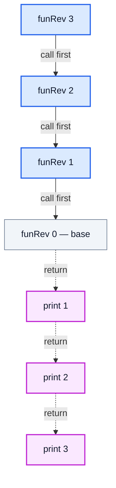

### Dry Run: `funBoth(3)`

| Step | Frame | Action | Output so far |
|---|---|---|---|
| 1 | funBoth(3) | print 3 (before) | `3` |
| 2 | funBoth(2) | print 2 (before) | `3 2` |
| 3 | funBoth(1) | print 1 (before) | `3 2 1` |
| 4 | funBoth(0) | 🟧 base, return | `3 2 1` |
| 5 | funBoth(1) | print 1 (after) | `3 2 1 1` |
| 6 | funBoth(2) | print 2 (after) | `3 2 1 1 2` |
| 7 | funBoth(3) | print 3 (after) | `3 2 1 1 2 3` |

### Alternative: Count Upwards With a Second Parameter

```java
static void upTo(int i, int n) {
    if (i > n) return;
    System.out.print(i + " ");
    upTo(i + 1, n);
}
// upTo(1, 5) -> 1 2 3 4 5
```

| Way | Pros | Cons |
|---|---|---|
| Print after the call (`funRev`) | One parameter; teaches stack unwinding | Not tail-recursive |
| Extra parameter `i` | Reads like a loop | Extra argument to pass |

> [!TIP]
> **Rule of thumb:** code *before* the recursive call runs in the order the calls are made (top-down); code *after* runs in reverse (bottom-up). This single idea explains tree traversals (pre-order vs post-order) later in the course.

**Time:** O(n). **Space:** O(n).

---

## 4. Q-03: Product of n to 1 (15:04)

### Problem

Compute `n × (n−1) × ... × 1` — the **factorial** `n!`.

### Approach

- **Recurrence:** `fact(n) = n × fact(n − 1)`
- **Base condition:** `fact(1) = 1` (and `fact(0) = 1` by definition, so use `n <= 1`)

```java
public class Factorial {

    static long fact(int n) {
        if (n <= 1) return 1;
        return n * fact(n - 1);
    }

    public static void main(String[] args) {
        System.out.println(fact(5));     // 120
        System.out.println(fact(0));     // 1
        System.out.println(fact(20));    // 2432902008176640000
    }
}
```

### Recursion Tree: `fact(5)`

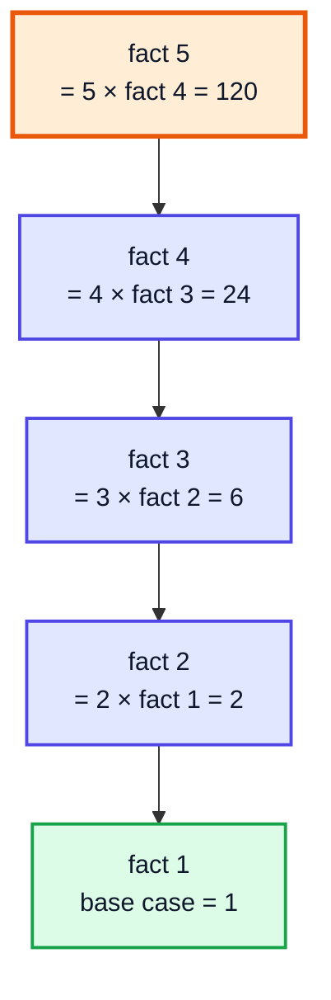

### Dry Run (Returning Values)

| Call | Waits for | Returns |
|---|---|---|
| fact(1) | — | 🟩 1 |
| fact(2) | fact(1) = 1 | 2 × 1 = 2 |
| fact(3) | fact(2) = 2 | 3 × 2 = 6 |
| fact(4) | fact(3) = 6 | 4 × 6 = 24 |
| fact(5) | fact(4) = 24 | 5 × 24 = **120** |

### Overflow Limits

| Return type | Largest correct n | What happens after |
|---|---|---|
| `int` | 12 (479001600) | `fact(13)` silently gives 1932053504 ❌ |
| `long` | 20 | wraps around at 21 ❌ |
| `BigInteger` | unlimited | slower but exact ✅ |

> [!WARNING]
> Java integer overflow throws **no error** — you just get a wrong number. For factorials above 20 use `BigInteger`, or `Math.multiplyExact(n, fact(n - 1))` to get an `ArithmeticException` instead of silent garbage.

> [!CAUTION]
> A base condition of `n == 1` only (instead of `n <= 1`) makes `fact(0)` recurse into `fact(-1)`, `fact(-2)`, ... until `StackOverflowError`.

**Time:** O(n). **Space:** O(n) stack.

---

## 5. Q-04: Sum of n to 1 (23:37)

### Problem

Compute `n + (n−1) + ... + 1`.

Identical structure to factorial, with `+` instead of `×` and base value `0`:

```java
static int sum(int n) {
    if (n == 0) return 0;
    return n + sum(n - 1);
}
// sum(5)   -> 15
// sum(100) -> 5050
```

| Call | Returns |
|---|---|
| sum(0) | 🟩 0 |
| sum(1) | 1 + 0 = 1 |
| sum(2) | 2 + 1 = 3 |
| sum(3) | 3 + 3 = 6 |
| sum(4) | 4 + 6 = 10 |
| sum(5) | 5 + 10 = **15** |

**Time:** O(n). **Space:** O(n).

> [!TIP]
> In real code, use the formula `n * (n + 1) / 2` — O(1) time and O(1) space. The recursive version exists to practise the pattern. And for `n` around 10⁵ or more, the recursion will likely throw `StackOverflowError` on the default stack size.

### Factorial vs Sum — Pattern Comparison

| | Factorial | Sum |
|---|---|---|
| Recurrence | `n × f(n−1)` | `n + f(n−1)` |
| Base | `f(1) = 1` (identity for ×) | `f(0) = 0` (identity for +) |
| Closed form | none simple | `n(n+1)/2` |

---

## 6. Q-05: Sum of digits (24:28)

### Problem

Sum the digits of a number: `1342 → 1 + 3 + 4 + 2 = 10`.

### Two Digit Tools (from video #26)

| Expression | Meaning | 1342 |
|---|---|---|
| `n % 10` | last digit | 2 |
| `n / 10` | number without its last digit | 134 |

### Approach

- **Recurrence:** `sumDigits(n) = (n % 10) + sumDigits(n / 10)`
- **Base:** `n == 0` → 0

```java
public class SumOfDigits {

    static int sumOfDigits(int n) {
        if (n == 0) return 0;
        return n % 10 + sumOfDigits(n / 10);
    }

    public static void main(String[] args) {
        System.out.println(sumOfDigits(1342));   // 10
        System.out.println(sumOfDigits(9));      // 9
        System.out.println(sumOfDigits(1005));   // 6
    }
}
```

### Recursion Tree: `sumOfDigits(1342)`

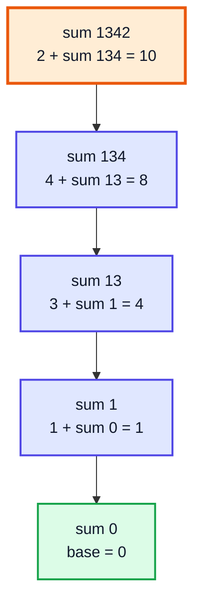

### Complexity

Each call removes one digit, so the number of calls is the number of digits:

| Measure | Value |
|---|---|
| **Time** | O(d) = **O(log₁₀ n)** |
| **Space** | O(log₁₀ n) stack |

> [!NOTE]
> Negative input: in Java `-1342 % 10 == -2`, so the function returns `-10`. Pass `Math.abs(n)` if you want the positive digit sum.

---

## 7. Q-06: Product of digits (30:42)

### Problem

Multiply the digits: `1342 → 1 × 3 × 4 × 2 = 24`.

### Why the Base Case Changes

Copying the sum version with `return 1` at `n == 0` *works* for most inputs, but for `n = 0` it returns `1` — wrong, the product of the single digit 0 is 0. The cleaner base case: **stop at a single digit** and return it.

`n % 10 == n` is true exactly when `n` is a single digit (0–9).

```java
public class ProductOfDigits {

    static int productOfDigits(int n) {
        if (n % 10 == n) return n;                  // single digit
        return n % 10 * productOfDigits(n / 10);
    }

    public static void main(String[] args) {
        System.out.println(productOfDigits(1342));  // 24
        System.out.println(productOfDigits(505));   // 0
        System.out.println(productOfDigits(7));     // 7
        System.out.println(productOfDigits(0));     // 0
    }
}
```

### Dry Run: `productOfDigits(1342)`

| Call | n % 10 == n? | Returns |
|---|---|---|
| p(1) | ✅ 🟩 | 1 |
| p(13) | ❌ | 3 × 1 = 3 |
| p(134) | ❌ | 4 × 3 = 12 |
| p(1342) | ❌ | 2 × 12 = **24** |

### Base-Case Choice Compared

| Base case | p(1342) | p(0) | Comment |
|---|---|---|---|
| `if (n == 0) return 1;` | 24 ✅ | 1 ❌ | identity for × breaks the 0 input |
| `if (n % 10 == n) return n;` | 24 ✅ | 0 ✅ | Kunal's version |

> [!TIP]
> An optimisation: as soon as `n % 10 == 0` you can return 0 immediately — anything times 0 is 0.

**Time:** O(log n). **Space:** O(log n).

---

## 8. Concept: Passing Numbers (31:56)

### The Question

What is the difference between these three recursive calls?

```java
fun(n - 1);   // passes n - 1, n itself unchanged
fun(n--);     // passes n (!), then decrements the local n
fun(--n);     // decrements n first, then passes the new value
```

### Post-decrement Passes the OLD Value

`n--` is **post**-decrement: the expression's value is the current `n`, and the decrement happens afterwards. So `fun(n--)` calls `fun(5)` again from `fun(5)` — forever.

```java
static void down(int n) {
    if (n == 0) return;
    System.out.print(n + " ");
    down(n--);            // BUG: calls down(5) again and again
}
// down(5) -> 5 5 5 5 5 ... then java.lang.StackOverflowError
```

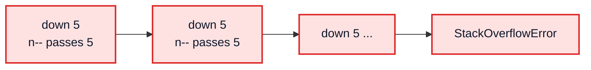

### Comparison

| Call | Value passed (n = 5) | Local `n` after | Safe? |
|---|---|---|---|
| `fun(n - 1)` | 4 | 5 (unchanged) | ✅ **preferred** |
| `fun(--n)` | 4 | 4 (changed!) | ⚠️ works, but `n` is now different for code after the call |
| `fun(n--)` | **5** | 4 | ❌ infinite recursion |

### Why `--n` Is Still Risky

```java
static void bothBad(int n) {
    if (n == 0) return;
    System.out.print(n + " ");
    bothBad(--n);
    System.out.print(n + " ");    // prints n-1, not n!
}
// bothBad(3) -> 3 2 1 0 1 2   (expected 3 2 1 1 2 3)
```

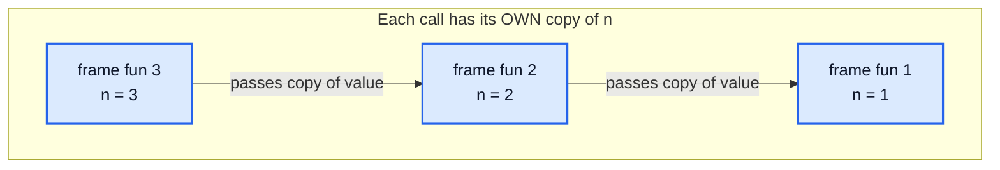

> [!IMPORTANT]
> Java is **pass-by-value**: each call receives a *copy* of the number. Changing `n` inside one frame never affects the caller's `n`, but it does affect the *rest of the current frame*. Always pass `n - 1` — it expresses "smaller problem" without side effects.

---

## 9. Q-07: Reverse a number (35:19)

### Problem

Reverse the digits: `1824 → 4281`, `1200 → 21`.

### The Iterative Idea (to Build On)

```java
int rev = 0;
while (n > 0) {
    rev = rev * 10 + n % 10;   // shift left one place, append last digit
    n /= 10;
}
```

| n | n % 10 | rev = rev × 10 + digit |
|---|---|---|
| 1824 | 4 | 4 |
| 182 | 2 | 42 |
| 18 | 8 | 428 |
| 1 | 1 | 4281 |
| 0 | — | done |

### The Recursive Challenge

The recursive answer for `1824` should be built from the answer for `182` (which is `281`). But `4281 ≠ 4 + 281` and `≠ 281 × 10 + 4`. We need **extra information** — either:

- **Way 1:** carry the running result (`rev`) along with each call, or
- **Way 2:** know **how many digits** remain, so we know which place value `4` belongs to (`4 × 10³`).

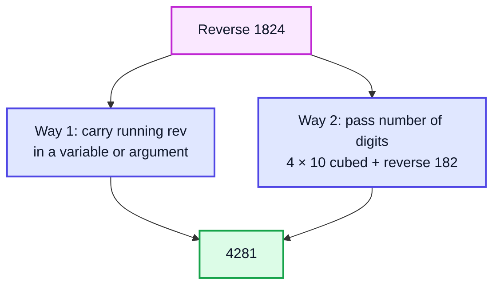

> [!TIP]
> **LeetCode 7 — Reverse Integer** is the same task with negatives and a 32-bit overflow check: before `rev * 10 + d`, return 0 if `rev > Integer.MAX_VALUE / 10` (or `< MIN_VALUE / 10`).

---

## 10. Way-1 for Q-07 (40:29)

### Version A (as in the video): A `static` Accumulator

```java
public class ReverseWay1 {

    static int sum = 0;                      // shared across all calls

    static void rev1(int n) {
        if (n == 0) return;
        int rem = n % 10;
        sum = sum * 10 + rem;
        rev1(n / 10);
    }

    public static void main(String[] args) {
        rev1(1824);
        System.out.println(sum);             // 4281
    }
}
```

### Dry Run: `rev1(1824)`

| Call | rem | sum before | sum after |
|---|---|---|---|
| rev1(1824) | 4 | 0 | 4 |
| rev1(182) | 2 | 4 | 42 |
| rev1(18) | 8 | 42 | 428 |
| rev1(1) | 1 | 428 | 🟩 4281 |
| rev1(0) | — | base, return | 4281 |

> [!WARNING]
> A `static` accumulator is **shared state**: call `rev1(1824)` twice without resetting `sum` and the second result is `42814281`. It is also not thread-safe. Fine for learning; avoid it in interviews unless you reset it.

### Version B (modern): Pass the Accumulator as a Parameter

Each frame receives the running result, so no global state is needed — and the function becomes **pure** and **tail-recursive**.

```java
static int rev(int n, int acc) {
    if (n == 0) return acc;
    return rev(n / 10, acc * 10 + n % 10);
}
// rev(1824, 0) -> 4281
// rev(1200, 0) -> 21
```

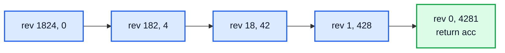

| | Static variable | Accumulator parameter |
|---|---|---|
| Reusable without reset | ❌ | ✅ |
| Return value | `void` (read `sum`) | returns the answer |
| Thread-safe | ❌ | ✅ |
| Matches a common pattern | — | "helper with extra argument" (used in Q-09, Q-10) |

**Time:** O(log n). **Space:** O(log n) stack.

---

## 11. Way-2 for Q-07 (48:20)

### Idea: Use the Digit Count

For a `d`-digit number, the last digit moves to place value `10^(d−1)`:

```
reverse(1824) = 4 × 10³ + reverse(182)
              = 4 × 1000 + (2 × 10² + reverse(18))
              = 4000 + 200 + (8 × 10 + reverse(1))
              = 4000 + 200 + 80 + 1  =  4281
```

The number of digits is `⌊log₁₀ n⌋ + 1`.

```java
public class ReverseWay2 {

    static int rev2(int n) {
        int digits = (int) Math.log10(n) + 1;
        return helper(n, digits);
    }

    static int helper(int n, int digits) {
        if (n % 10 == n) return n;                    // single digit
        int rem = n % 10;
        return rem * (int) Math.pow(10, digits - 1) + helper(n / 10, digits - 1);
    }

    public static void main(String[] args) {
        System.out.println(rev2(1824));   // 4281
        System.out.println(rev2(1200));   // 21
        System.out.println(rev2(1024));   // 4201
    }
}
```

### Recursion Tree: `helper(1824, 4)`

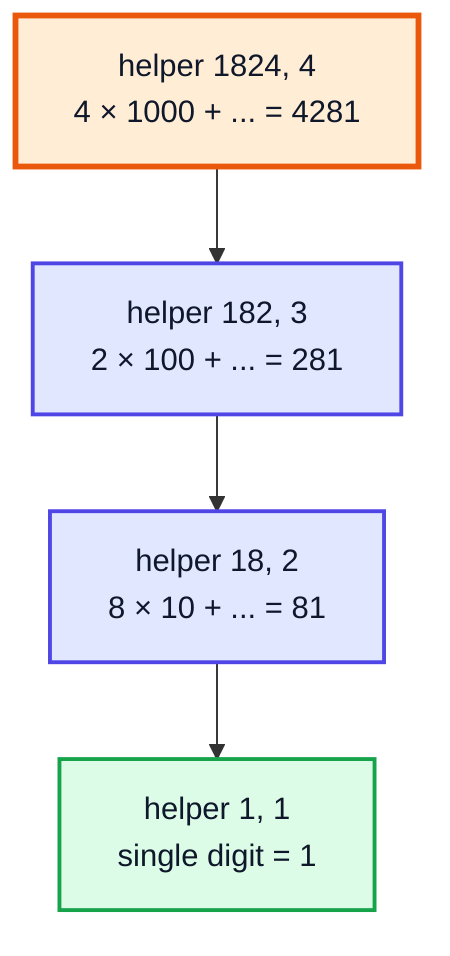

### Dry Run (Returning Values)

| Call | rem | rem × 10^(d−1) | Returns |
|---|---|---|---|
| helper(1, 1) | — | — | 🟩 1 |
| helper(18, 2) | 8 | 80 | 80 + 1 = 81 |
| helper(182, 3) | 2 | 200 | 200 + 81 = 281 |
| helper(1824, 4) | 4 | 4000 | 4000 + 281 = **4281** |

### Way 1 vs Way 2

| | Way 1 (accumulator) | Way 2 (digit count) |
|---|---|---|
| Extra info carried | running result | number of digits |
| Uses `Math.pow` / `log10` | No | Yes (doubles, then cast) |
| Pure function | Version B: ✅ | ✅ |
| Teaching point | carrying state down | **helper function with extra parameter** |

> [!NOTE]
> `Math.log10(0)` is `-Infinity`, so guard `n == 0` before calling `rev2` (here `helper` happens to return 0 anyway). Also `Math.pow` works in `double`; it's exact for small powers of 10, but an integer loop or precomputed table is safer for production code.

> [!IMPORTANT]
> The **helper-function pattern** — a public function with a clean signature that calls a private recursive function with extra arguments — is the main takeaway of this question. You'll use it constantly in arrays, strings and backtracking.

**Time:** O(log n) calls (each `Math.pow` is effectively O(1)). **Space:** O(log n).

---

## 12. Q-08: Palindrome (54:40)

### Problem

A number is a **palindrome** if it reads the same backwards: `12321` ✅, `1234` ❌.

### Approach: Reuse the Reverse

```java
public class PalindromeNumber {

    static int rev(int n, int acc) {
        if (n == 0) return acc;
        return rev(n / 10, acc * 10 + n % 10);
    }

    static boolean isPalindrome(int n) {
        if (n < 0) return false;             // "-121" reversed is "121-"
        return n == rev(n, 0);
    }

    public static void main(String[] args) {
        System.out.println(isPalindrome(12321));  // true
        System.out.println(isPalindrome(1234));   // false
        System.out.println(isPalindrome(7));      // true
        System.out.println(isPalindrome(-121));   // false
    }
}
```

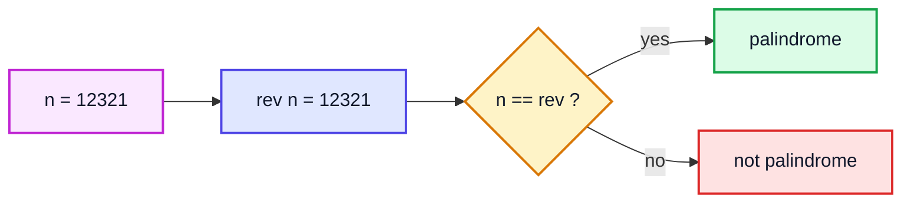

| n | rev(n) | Equal? |
|---|---|---|
| 12321 | 12321 | ✅ |
| 1234 | 4321 | ❌ |
| 120 | 21 | ❌ (trailing zero can never be leading) |

> [!TIP]
> **LeetCode 9 — Palindrome Number.** An optimal variant reverses only **half** the digits (stop when `rev >= n`), which also avoids overflow when reversing numbers near `Integer.MAX_VALUE`. A recursive two-pointer version on the digit string (`s.charAt(i) == s.charAt(len-1-i)`) works too, and is the template for string palindromes.

**Time:** O(log n). **Space:** O(log n).

---

## 13. Q-09: Count Zeros (58:07)

### Problem

Count the zero digits in a number: `30204 → 2`.

### Approach: Pass the Count Down

Use a helper that carries `count` as an argument. Each call looks at the last digit; if it's 0, the recursive call receives `count + 1`.

```java
public class CountZeros {

    static int countZeros(int n) {
        if (n == 0) return 1;                 // edge case: the number 0 has one zero
        return helper(n, 0);
    }

    private static int helper(int n, int count) {
        if (n == 0) return count;
        int rem = n % 10;
        if (rem == 0) return helper(n / 10, count + 1);
        return helper(n / 10, count);
    }

    public static void main(String[] args) {
        System.out.println(countZeros(30204));    // 2
        System.out.println(countZeros(1000));     // 3
        System.out.println(countZeros(123));      // 0
        System.out.println(countZeros(0));        // 1
    }
}
```

### Dry Run: `helper(30204, 0)`

| Call | rem | Zero? | Next call |
|---|---|---|---|
| helper(30204, 0) | 4 | ❌ | helper(3020, 0) |
| helper(3020, 0) | 0 | ✅ 🟩 | helper(302, 1) |
| helper(302, 1) | 2 | ❌ | helper(30, 1) |
| helper(30, 1) | 0 | ✅ 🟩 | helper(3, 2) |
| helper(3, 2) | 3 | ❌ | helper(0, 2) |
| helper(0, 2) | — | base | return **2** |

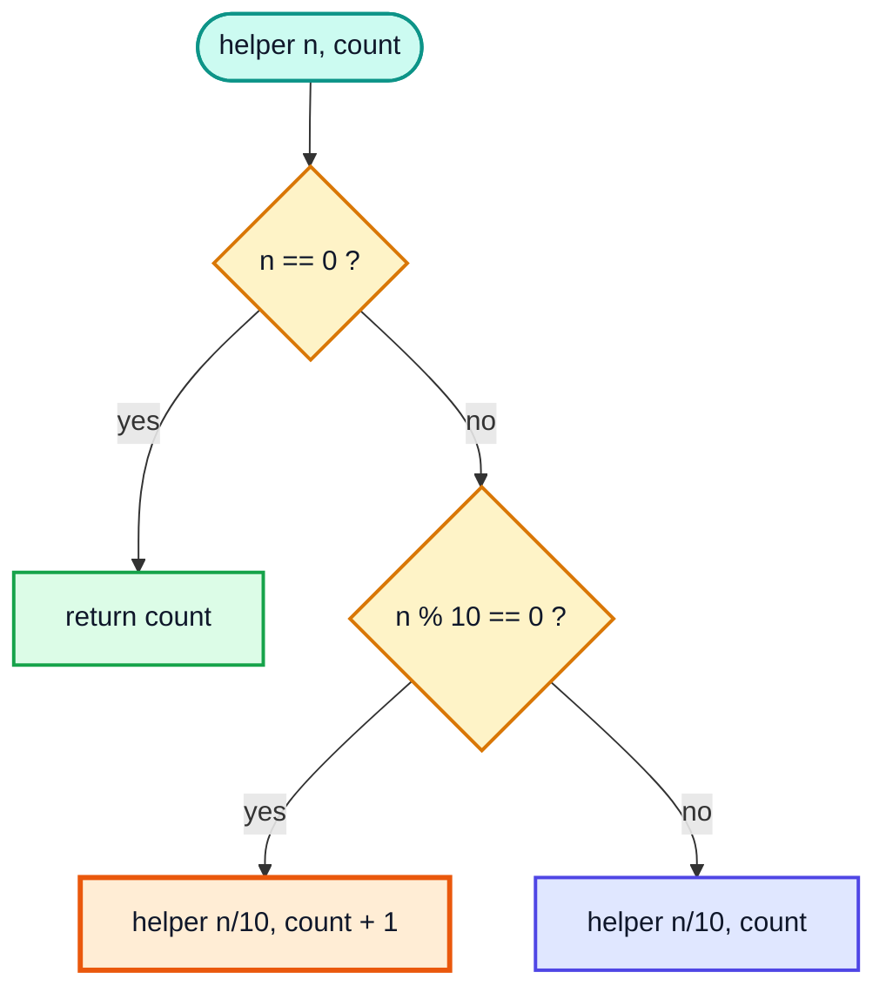

### Alternative: Return-Based (No Extra Parameter)

```java
static int zeros(int n) {
    if (n < 10) return n == 0 ? 1 : 0;        // single digit
    return (n % 10 == 0 ? 1 : 0) + zeros(n / 10);
}
// zeros(30204) -> 2
```

| Style | Where the count lives | Answer computed |
|---|---|---|
| Pass count down (video) | argument | at the base case (top-down) |
| Return and add | return value | while returning (bottom-up) |

> [!IMPORTANT]
> **Tip from the video:** this "pass a value into the next call" technique is how you *return a value that you build up along the way*. The same base case (`return count`) hands the final answer all the way back up unchanged, because each frame simply returns what its child returned.

**Time:** O(log n). **Space:** O(log n).

---

## 14. Q-10: Count Steps (1:08:05)

### Problem — LeetCode 1342: Number of Steps to Reduce a Number to Zero

Given `num`, in one step: if it is even, divide by 2; if odd, subtract 1. Return the number of steps to reach 0.

`14 → 7 → 6 → 3 → 2 → 1 → 0` = **6 steps**

### Approach

Exactly the count-zeros pattern: a helper with a `steps` counter.

```java
public class NumberOfSteps {

    static int numberOfSteps(int num) {
        return helper(num, 0);
    }

    private static int helper(int num, int steps) {
        if (num == 0) return steps;
        if (num % 2 == 0) return helper(num / 2, steps + 1);
        return helper(num - 1, steps + 1);
    }

    public static void main(String[] args) {
        System.out.println(numberOfSteps(14));    // 6
        System.out.println(numberOfSteps(8));     // 4
        System.out.println(numberOfSteps(123));   // 12
    }
}
```

### Dry Run: `numberOfSteps(14)`

| Call | Even? | Operation | steps after |
|---|---|---|---|
| helper(14, 0) | ✅ | 14 / 2 = 7 | 1 |
| helper(7, 1) | ❌ | 7 − 1 = 6 | 2 |
| helper(6, 2) | ✅ | 6 / 2 = 3 | 3 |
| helper(3, 3) | ❌ | 3 − 1 = 2 | 4 |
| helper(2, 4) | ✅ | 2 / 2 = 1 | 5 |
| helper(1, 5) | ❌ | 1 − 1 = 0 | 6 |
| helper(0, 6) | base | — | return **6** |

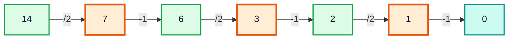

*Green = even (halve), orange = odd (subtract 1).*

### Complexity

Every odd step is immediately followed by an even step, so at most 2 steps per bit:

| Measure | Value |
|---|---|
| **Time** | O(log n) |
| **Space** | O(log n) stack |

### Alternative: Bit Counting (O(1)-ish)

Each `1` bit costs a subtract (plus a shift unless it's the leading bit), each `0` bit costs one shift:

```java
static int stepsBits(int num) {
    if (num == 0) return 0;
    return Integer.bitCount(num) + (31 - Integer.numberOfLeadingZeros(num));
}
// stepsBits(14) -> 3 + 3 = 6
// stepsBits(123) -> 6 + 6 = 12
```

> [!NOTE]
> This ties back to video #25 (Bitwise Operators): dividing by 2 is a right shift `num >> 1`, and `num % 2 == 0` is the same as `(num & 1) == 0`.

---

## 15. Outro (1:12:41)

Patterns you practised in this video:

| Pattern | Questions |
|---|---|
| Work **before** the call (top-down order) | Q-01 |
| Work **after** the call (bottom-up order) | Q-02, funBoth |
| **Combine** the returned answer (`n op f(n−1)`) | Q-03, Q-04, Q-05, Q-06 |
| **Carry state down** (static var or accumulator) | Q-07 Way 1, Q-08 |
| **Helper function** with extra arguments | Q-07 Way 2, Q-09, Q-10 |
| Pass `n - 1`, never `n--` | Concept: Passing Numbers |

> [!TIP]
> Practise: LeetCode 1342 (Number of Steps), 9 (Palindrome Number), 7 (Reverse Integer), 509 (Fibonacci), 231 (Power of Two, recursively), 258 (Add Digits). Next up are recursion with **arrays** — the same patterns, with an index as the extra argument.

---

## 🧩 Complete Example: Everything Together

```java
public class RecursionLevel1 {

    // Q-01: print n down to 1 (work BEFORE the call)
    static void nTo1(int n) {
        if (n == 0) return;
        System.out.print(n + " ");
        nTo1(n - 1);
    }

    // Q-02: print 1 up to n (work AFTER the call)
    static void oneToN(int n) {
        if (n == 0) return;
        oneToN(n - 1);
        System.out.print(n + " ");
    }

    // Both: n..1 then 1..n
    static void both(int n) {
        if (n == 0) return;
        System.out.print(n + " ");
        both(n - 1);
        System.out.print(n + " ");
    }

    // Q-03: factorial (product of n to 1)
    static long fact(int n) {
        if (n <= 1) return 1;
        return n * fact(n - 1);
    }

    // Q-04: sum of n to 1
    static int sum(int n) {
        if (n == 0) return 0;
        return n + sum(n - 1);
    }

    // Q-05: sum of digits
    static int sumOfDigits(int n) {
        if (n == 0) return 0;
        return n % 10 + sumOfDigits(n / 10);
    }

    // Q-06: product of digits
    static int productOfDigits(int n) {
        if (n % 10 == n) return n;              // single digit
        return n % 10 * productOfDigits(n / 10);
    }

    // Q-07 Way 1: reverse using an extra variable
    static int rev1(int n, int acc) {
        if (n == 0) return acc;
        return rev1(n / 10, acc * 10 + n % 10);
    }

    // Q-07 Way 2: reverse using the digit count
    static int rev2(int n) {
        int digits = (int) Math.log10(n) + 1;
        return helper(n, digits);
    }
    static int helper(int n, int digits) {
        if (n % 10 == n) return n;
        int rem = n % 10;
        return rem * (int) Math.pow(10, digits - 1) + helper(n / 10, digits - 1);
    }

    // Q-08: palindrome
    static boolean isPalindrome(int n) {
        return n == rev1(n, 0);
    }

    // Q-09: count zeros
    static int countZeros(int n) {
        if (n == 0) return 1;                   // the number 0 itself has one zero
        return zerosHelper(n, 0);
    }
    static int zerosHelper(int n, int count) {
        if (n == 0) return count;
        if (n % 10 == 0) return zerosHelper(n / 10, count + 1);
        return zerosHelper(n / 10, count);
    }

    // Q-10: steps to reduce to zero (LeetCode 1342)
    static int numberOfSteps(int n) {
        return stepsHelper(n, 0);
    }
    static int stepsHelper(int n, int steps) {
        if (n == 0) return steps;
        if (n % 2 == 0) return stepsHelper(n / 2, steps + 1);
        return stepsHelper(n - 1, steps + 1);
    }

    public static void main(String[] args) {
        System.out.print("n to 1    (5): "); nTo1(5);   System.out.println();
        System.out.print("1 to n    (5): "); oneToN(5); System.out.println();
        System.out.print("both      (3): "); both(3);   System.out.println();
        System.out.println("fact(5)            = " + fact(5));
        System.out.println("fact(20)           = " + fact(20));
        System.out.println("sum(5)             = " + sum(5));
        System.out.println("sumOfDigits(1342)  = " + sumOfDigits(1342));
        System.out.println("productOfDigits(1342) = " + productOfDigits(1342));
        System.out.println("rev1(1824)         = " + rev1(1824, 0));
        System.out.println("rev2(1824)         = " + rev2(1824));
        System.out.println("isPalindrome(12321) = " + isPalindrome(12321));
        System.out.println("isPalindrome(1234)  = " + isPalindrome(1234));
        System.out.println("countZeros(30204)  = " + countZeros(30204));
        System.out.println("numberOfSteps(14)  = " + numberOfSteps(14));
        System.out.println("numberOfSteps(123) = " + numberOfSteps(123));
    }
}
```

**Expected Output:**
```
n to 1    (5): 5 4 3 2 1 
1 to n    (5): 1 2 3 4 5 
both      (3): 3 2 1 1 2 3 
fact(5)            = 120
fact(20)           = 2432902008176640000
sum(5)             = 15
sumOfDigits(1342)  = 10
productOfDigits(1342) = 24
rev1(1824)         = 4281
rev2(1824)         = 4281
isPalindrome(12321) = true
isPalindrome(1234)  = false
countZeros(30204)  = 2
numberOfSteps(14)  = 6
numberOfSteps(123) = 12
```

---

## Quick Reference Cheat Sheet

| Question | Recurrence / Key Line | Base Case | Time | Space |
|---|---|---|---|---|
| **Q-01 n to 1** | print n; `f(n−1)` | n == 0 | O(n) | O(n) |
| **Q-02 1 to n** | `f(n−1)`; print n | n == 0 | O(n) | O(n) |
| **Q-03 Factorial** | `n × f(n−1)` | n ≤ 1 → 1 | O(n) | O(n) |
| **Q-04 Sum** | `n + f(n−1)` | n == 0 → 0 | O(n) | O(n) |
| **Q-05 Sum of digits** | `n%10 + f(n/10)` | n == 0 → 0 | O(log n) | O(log n) |
| **Q-06 Product of digits** | `n%10 × f(n/10)` | n%10 == n → n | O(log n) | O(log n) |
| **Passing numbers** | use `n - 1`; `n--` passes old value → infinite | — | — | — |
| **Q-07 Way 1** | `rev(n/10, acc×10 + n%10)` | n == 0 → acc | O(log n) | O(log n) |
| **Q-07 Way 2** | `rem × 10^(d−1) + h(n/10, d−1)` | single digit → n | O(log n) | O(log n) |
| **Q-08 Palindrome** | `n == rev(n)` (LeetCode 9) | — | O(log n) | O(log n) |
| **Q-09 Count zeros** | `h(n/10, count + (rem==0 ? 1 : 0))` | n == 0 → count | O(log n) | O(log n) |
| **Q-10 Count steps** | even: `h(n/2, s+1)`, odd: `h(n−1, s+1)` (LeetCode 1342) | n == 0 → steps | O(log n) | O(log n) |
| **Before vs after call** | before = top-down order, after = reverse order | — | — | — |
| **Helper pattern** | public clean signature → private recursive helper with extra args | — | — | — |
