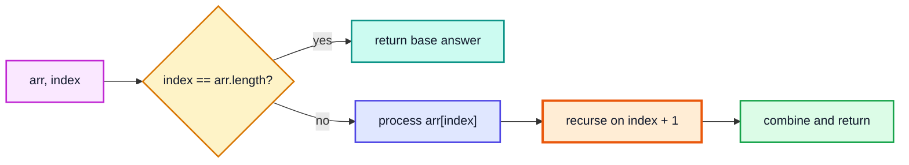
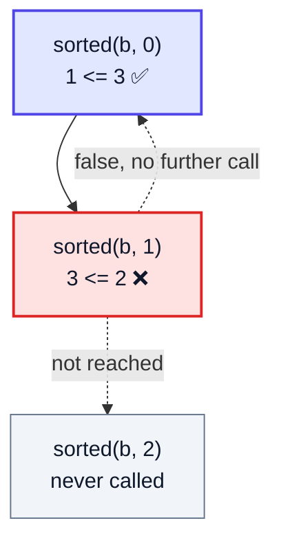
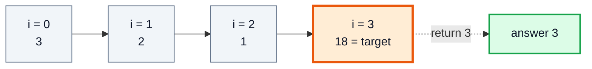
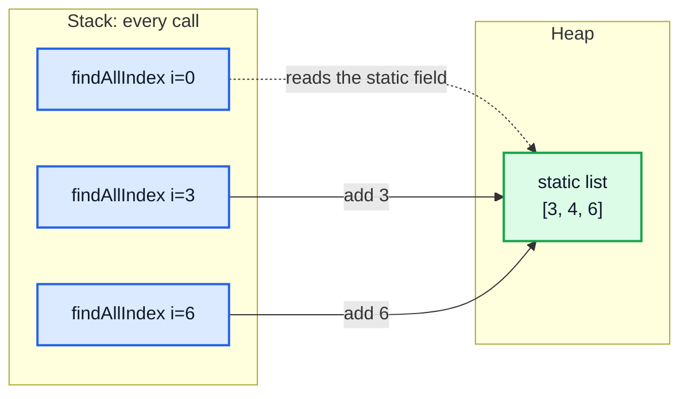
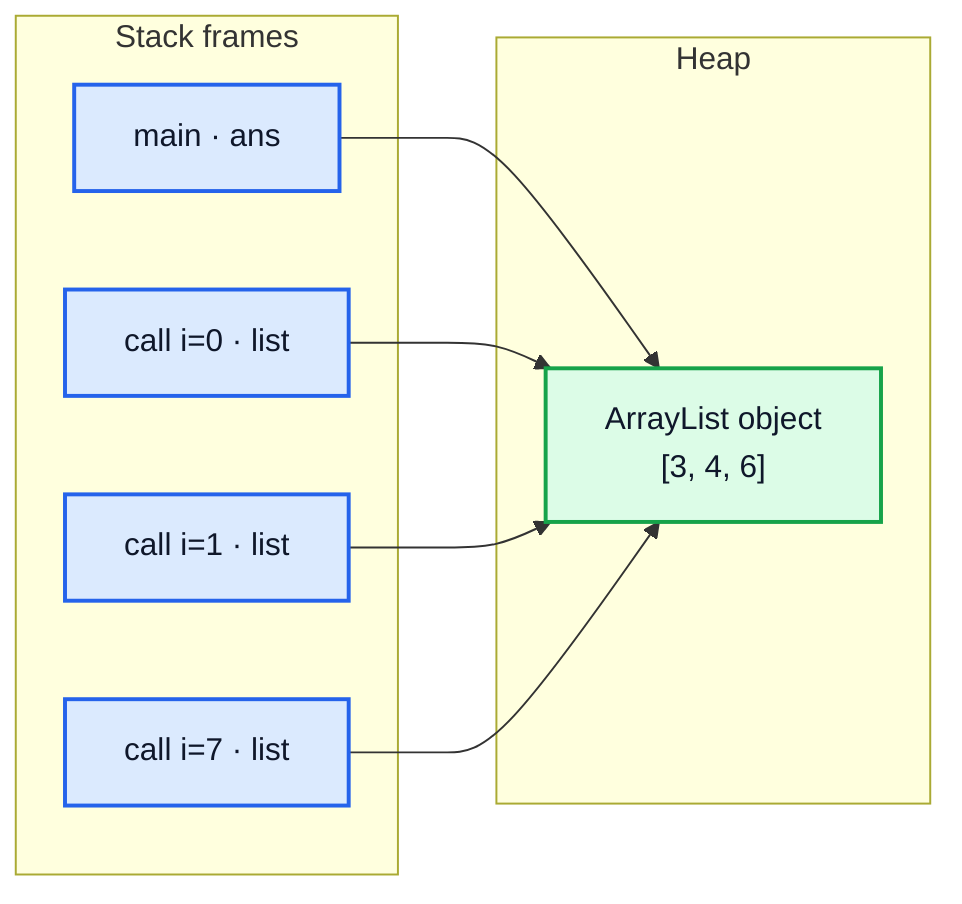
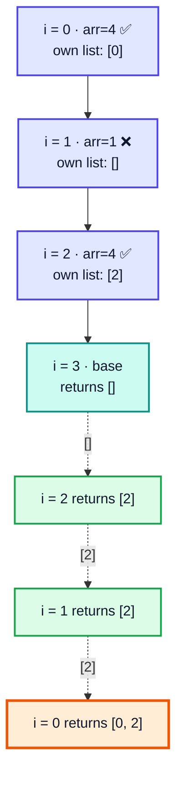
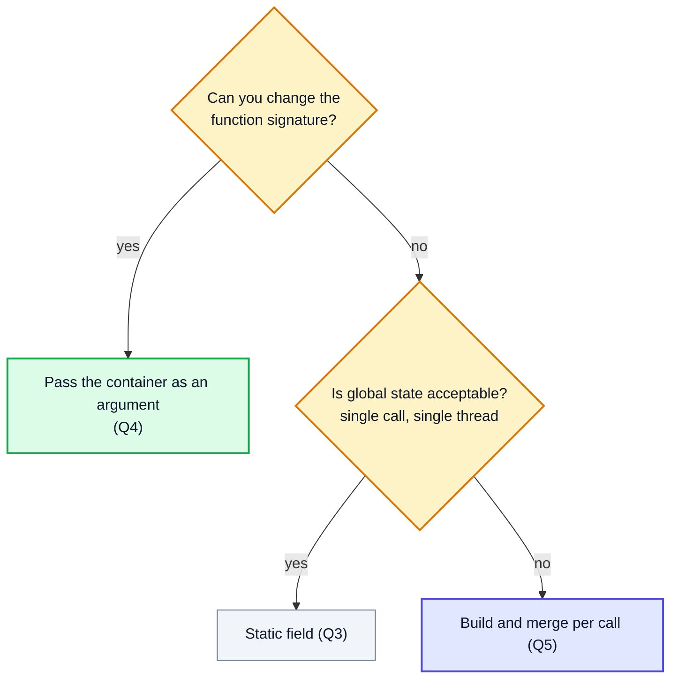
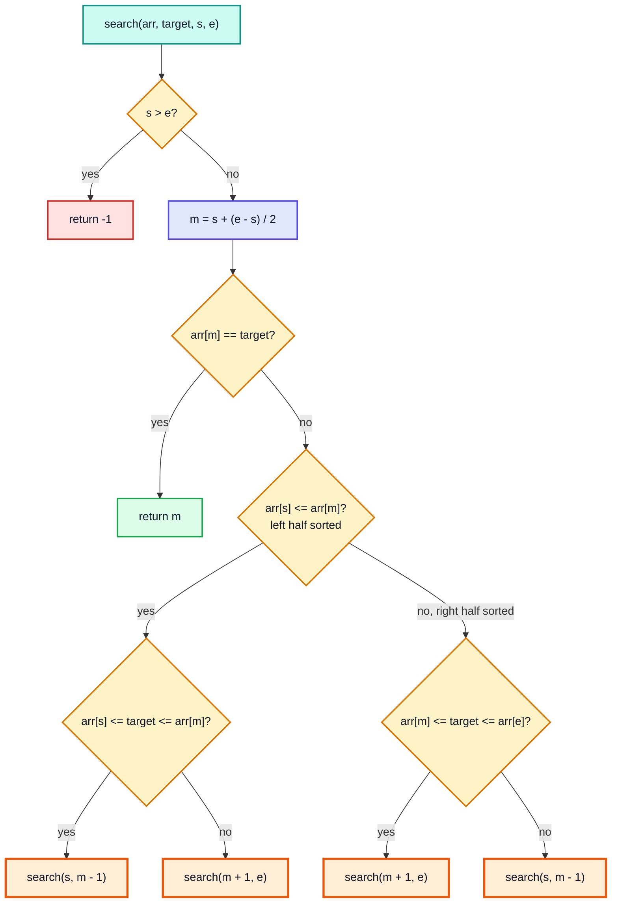
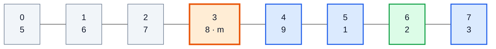

# Recursion with Arrays — Complete In-Depth Guide

**Video #28 of the Java + DSA playlist:** *Recursion - Array Questions (Theory + Code + Tips)* (1:18:47)

Recursion applied to arrays: checking whether an array is sorted, linear search in three flavours (boolean, first index, every index), three ways to collect answers into an `ArrayList` (static field, passed-in list, freshly-built list per call), and a fully recursive search in a rotated sorted array. The real lesson is **which technique to use when**: what goes in the arguments, what goes in the return value, and what is shared on the heap.

---

## Table of Contents

| # | Topic | Timestamp |
|---|---|---|
| 0 | [Introduction](#0-introduction-000) | 0:00 |
| 1 | [Q1: Sorted Array](#1-q1-sorted-array-318) | 3:18 |
| 2 | [Q2: Linear Search](#2-q2-linear-search-1842) | 18:42 |
| 3 | [Q3: Linear Search (on multiple occurrences)](#3-q3-linear-search-on-multiple-occurrences-2709) | 27:09 |
| 4 | [Q4: Return an ArrayList](#4-q4-return-an-arraylist-3050) | 30:50 |
| 5 | [Q5: Return the list without passing the argument](#5-q5-return-the-list-without-passing-the-argument-4947) | 49:47 |
| 6 | [Q6: Rotated Binary Search](#6-q6-rotated-binary-search-10419) | 1:04:19 |
| 7 | [Outro](#7-outro-11752) | 1:17:52 |

---

## 0. Introduction (0:00)

Video #23 showed how recursion works on numbers. Arrays add one new idea: the array itself never changes size, so recursion walks over it with an **index** that is passed as an argument. Everything in this video is a variation of:

```java
static <ReturnType> solve(int[] arr, int index /*, extra state */) {
    if (index == arr.length) return <answer for an empty remainder>;   // base condition
    // work on arr[index], then trust solve(arr, index + 1) for the rest
}
```



> [!IMPORTANT]
> Passing an array to a recursive call does **not** copy it. Every call receives a copy of the **reference**, so all calls look at (and can modify) the same array on the heap. Only the `index` differs between calls. This is why array recursion costs O(1) extra space per call, not O(n).

---

## 1. Q1: Sorted Array (3:18)

**Problem:** return `true` if the array is sorted in ascending order, using recursion only.

### Basics

An array is sorted if **every adjacent pair is in order**. Recursively: the array from `index` onwards is sorted if `arr[index] <= arr[index + 1]` **and** the array from `index + 1` onwards is sorted.

- **Base condition:** when `index` reaches the last element (`arr.length - 1`) there is no pair left to check, so the remainder is trivially sorted → `true`.
- **Recursive relation:** `sorted(i) = arr[i] <= arr[i+1] && sorted(i+1)`.

```java
public class SortedArray {
    public static void main(String[] args) {
        int[] a = {1, 2, 3, 5, 8, 12};
        int[] b = {1, 3, 2, 4};
        System.out.println(sorted(a, 0));   // true
        System.out.println(sorted(b, 0));   // false
        System.out.println(sorted(new int[]{}, 0));   // true
    }

    static boolean sorted(int[] arr, int index) {
        if (index >= arr.length - 1) {          // 0 or 1 elements left
            return true;
        }
        return arr[index] <= arr[index + 1] && sorted(arr, index + 1);
    }
}
```

> [!NOTE]
> The video uses `index == arr.length - 1` and a strict `<`. Two small improvements: `>=` also handles an **empty** array (where `arr.length - 1` is `-1`, so `==` would recurse forever and crash), and `<=` treats duplicates like `{1, 2, 2, 3}` as sorted (non-decreasing). Use `<` if the problem says "strictly increasing".

### Short-circuiting

`&&` evaluates left to right and **stops at the first `false`**. If `arr[index] > arr[index + 1]`, the recursive call never happens, so the recursion ends early at the first bad pair.



### Dry run: `a = {1, 2, 3, 5, 8, 12}`

| Call | `index` | Compare | Result of pair | Returns |
|---|---|---|---|---|
| 1 | 0 | 1 ≤ 2 | ✅ | `true && sorted(1)` |
| 2 | 1 | 2 ≤ 3 | ✅ | `true && sorted(2)` |
| 3 | 2 | 3 ≤ 5 | ✅ | `true && sorted(3)` |
| 4 | 3 | 5 ≤ 8 | ✅ | `true && sorted(4)` |
| 5 | 4 | 8 ≤ 12 | ✅ | `true && sorted(5)` |
| 6 | 5 | base (last index) | — | `true` 🟩 |

The `true` then bubbles back through all five frames.

### Complexity

| | Value | Why |
|---|---|---|
| Time | O(n) | one call per element |
| Space | O(n) | call-stack depth n (arrays are not copied) |

> [!TIP]
> The iterative version is O(1) space. Recursion here is for practice: it teaches the "check one thing, trust the rest" pattern used later in linked lists and trees.

---

## 2. Q2: Linear Search (18:42)

**Problem:** search for `target` in an unsorted array. Three versions: return a boolean, return the first index, and search from the end.

### Version A: does it exist?

```java
static boolean find(int[] arr, int target, int index) {
    if (index == arr.length) {
        return false;                      // walked off the end: not found
    }
    return arr[index] == target || find(arr, target, index + 1);
}
```

Same structure as Q1, but with `||`: it stops at the **first `true`**.

### Version B: first index (or -1)

```java
static int findIndex(int[] arr, int target, int index) {
    if (index == arr.length) {
        return -1;
    }
    if (arr[index] == target) {
        return index;
    }
    return findIndex(arr, target, index + 1);
}
```

### Version C: last index (search from the end)

```java
static int findIndexLast(int[] arr, int target, int index) {
    if (index == -1) {
        return -1;
    }
    if (arr[index] == target) {
        return index;
    }
    return findIndexLast(arr, target, index - 1);
}
// call: findIndexLast(arr, target, arr.length - 1)
```

### Recursion chain for `findIndex({3, 2, 1, 18, 9}, 18, 0)`



### Dry run (Version B)

| `index` | `arr[index]` | `== 18`? | Action |
|---|---|---|---|
| 0 | 3 | ❌ | recurse with 1 |
| 1 | 2 | ❌ | recurse with 2 |
| 2 | 1 | ❌ | recurse with 3 |
| 3 | 18 | ✅ | return **3** 🟧 |

### Comparison

| Version | Return type | Base condition | Not-found value |
|---|---|---|---|
| `find` | `boolean` | `index == arr.length` | `false` |
| `findIndex` | `int` | `index == arr.length` | `-1` |
| `findIndexLast` | `int` | `index == -1` | `-1` |

**Complexity:** O(n) time, O(n) stack space for all three. This is the same as LeetCode-style "find the element" tasks; there is no dedicated LeetCode number for plain linear search.

> [!WARNING]
> Notice that the answer is **returned all the way up**: `return findIndex(...)`. Forgetting the `return` keyword in front of the recursive call (just writing `findIndex(...)`) compiles in a `void` method but loses the answer. In an `int` method it will not compile without a final return, which is a helpful safety net.

---

## 3. Q3: Linear Search (on multiple occurrences) (27:09)

**Problem:** the target may appear many times; collect **all** indices.

### Approach 1: a static list outside the function

The simplest idea: keep one `ArrayList` as a **static field**. Every call that finds the target adds its index to it. The method itself returns nothing.

```java
import java.util.ArrayList;

public class FindAllStatic {
    static ArrayList<Integer> list = new ArrayList<>();

    static void findAllIndex(int[] arr, int target, int index) {
        if (index == arr.length) {
            return;
        }
        if (arr[index] == target) {
            list.add(index);
        }
        findAllIndex(arr, target, index + 1);   // keep going even after a match
    }

    public static void main(String[] args) {
        findAllIndex(new int[]{1, 2, 3, 4, 4, 5, 4}, 4, 0);
        System.out.println(list);   // [3, 4, 6]
    }
}
```

Two differences from Q2:

1. **No early return on a match**: we must visit every index.
2. The answer lives **outside** the recursion, so nothing has to be returned.



> [!CAUTION]
> A static list is **global state**. Call `findAllIndex` twice and the second call's indices are appended to the first call's. You must `list.clear()` between uses, and it is not safe if two threads search at once. Q4 and Q5 remove this problem.

---

## 4. Q4: Return an ArrayList (30:50)

**Problem:** same as Q3, but return the list instead of using a static field.

### Approach 2: pass the list as an argument

Create the list once in the caller and **pass the reference down**. Every call adds to the **same object** on the heap and returns that same reference.

```java
static ArrayList<Integer> findAllIndex(int[] arr, int target, int index,
                                       ArrayList<Integer> list) {
    if (index == arr.length) {
        return list;
    }
    if (arr[index] == target) {
        list.add(index);
    }
    return findAllIndex(arr, target, index + 1, list);
}

// call
ArrayList<Integer> ans = findAllIndex(new int[]{1, 2, 3, 4, 4, 5, 4}, 4, 0, new ArrayList<>());
System.out.println(ans);   // [3, 4, 6]
```

### Why it works: one object, many references



Java is **pass-by-value**, but the value passed is a **reference**. `list.add(...)` modifies the shared object, so changes made deep in the recursion are visible to every frame and to `main`.

### Dry run: `arr = {1, 2, 3, 4, 4, 5, 4}`, `target = 4`

| `index` | `arr[index]` | Match? | `list` after this call |
|---|---|---|---|
| 0 | 1 | ❌ | `[]` |
| 1 | 2 | ❌ | `[]` |
| 2 | 3 | ❌ | `[]` |
| 3 | 4 | ✅ | `[3]` 🟩 |
| 4 | 4 | ✅ | `[3, 4]` 🟩 |
| 5 | 5 | ❌ | `[3, 4]` |
| 6 | 4 | ✅ | `[3, 4, 6]` 🟩 |
| 7 | — | base | return `[3, 4, 6]` |

### Complexity

| | Value |
|---|---|
| Time | O(n) (amortised O(1) per `add`) |
| Space | O(n) stack + O(k) for k matches |

> [!TIP]
> Returning `list` is optional here. Since the caller already holds the reference, a `void` method that only adds would work too. Returning it just makes the call a one-liner. This "pass a mutable container down" technique is the one you will use most in backtracking (subsets, permutations).

> [!NOTE]
> Modern Java: prefer the interface type `List<Integer>` in signatures and `new ArrayList<>()` (the diamond operator, Java 7+). If the result should not be modified, return `List.copyOf(list)` (Java 10+).

---

## 5. Q5: Return the list without passing the argument (49:47)

**Problem:** return all indices, but the signature must be `findAllIndex(arr, target, index)`: no list parameter and no static field.

### Approach 3: each call builds its own list

Every call creates a **new local list**, adds its own index if it matches, then **merges** the list returned by the call below.

```java
static ArrayList<Integer> findAllIndex2(int[] arr, int target, int index) {
    ArrayList<Integer> list = new ArrayList<>();      // new object in EVERY call
    if (index == arr.length) {
        return list;                                  // empty list
    }
    if (arr[index] == target) {
        list.add(index);                              // this call's contribution
    }
    ArrayList<Integer> ansFromBelowCalls = findAllIndex2(arr, target, index + 1);
    list.addAll(ansFromBelowCalls);                   // merge
    return list;
}
```

### Lists built on the way back up (`arr = {4, 1, 4}`, `target = 4`)



Each list is created on the heap; once its contents are copied into the caller's list by `addAll` and the frame returns, the lower list has no references left and becomes **eligible for garbage collection**.

### Comparing the three techniques

| | Q3: static field | Q4: list in argument | Q5: new list per call |
|---|---|---|---|
| Lists created | 1 (forever) | 1 per search | n + 1 per search |
| Extra copying | none | none | `addAll` at every level |
| Worst-case time | O(n) | O(n) | **O(n²)** when every element matches |
| Reusable / thread-safe | ❌ needs `clear()` | ✅ | ✅ |
| Signature has a list? | no | yes | no |
| Style | imperative, global | accumulator | pure / functional |

> [!WARNING]
> Approach 3 is elegant but **not efficient**: if all n elements match, level `i` copies up to `n - i` elements, which totals ~n²/2 copies. The video shows it to teach the *pattern* (combine answers returned from below), which is essential later for problems where the returned values really must be combined, such as subsets returned as a `List<List<Integer>>`. In interviews, prefer Approach 2 for this problem.

### When to use which



> [!TIP]
> A cleaner way to keep a 3-argument public API **and** be efficient is a private helper: `public static List<Integer> findAll(int[] a, int t) { return helper(a, t, 0, new ArrayList<>()); }`. The user calls the simple version, the helper uses the accumulator.

---

## 6. Q6: Rotated Binary Search (1:04:19)

**Problem (LeetCode 33 – Search in Rotated Sorted Array):** a sorted array with distinct values has been rotated at an unknown pivot, e.g. `{5, 6, 7, 8, 9, 1, 2, 3}`. Find the index of `target` in O(log n), here with **recursion** and **without** finding the pivot first.

### Key observation

Pick `m = s + (e - s) / 2`. In a rotated sorted array, **at least one half around `m` is fully sorted**:

- If `arr[s] <= arr[m]`, the **left half** `s..m` is sorted.
- Otherwise, the **right half** `m..e` is sorted.

In the sorted half you can check with two comparisons whether `target` lies inside it. If it does, search there; otherwise search the other half.



### Code

```java
static int search(int[] arr, int target, int s, int e) {
    if (s > e) {
        return -1;
    }
    int m = s + (e - s) / 2;
    if (arr[m] == target) {
        return m;
    }

    if (arr[s] <= arr[m]) {                                  // left half sorted
        if (target >= arr[s] && target <= arr[m]) {
            return search(arr, target, s, m - 1);
        }
        return search(arr, target, m + 1, e);
    }

    if (target >= arr[m] && target <= arr[e]) {              // right half sorted
        return search(arr, target, m + 1, e);
    }
    return search(arr, target, s, m - 1);
}
// call: search(arr, target, 0, arr.length - 1)
```

> [!NOTE]
> `arr[s] <= arr[m]` uses `<=` on purpose: when `s == m` (two elements left), the one-element "left half" counts as sorted. With `<` the code would wrongly decide the right half is sorted.

### Indices of `{5, 6, 7, 8, 9, 1, 2, 3}`



(First call with `target = 2`: left half `5..8` is sorted, 2 is not in it, so grey is discarded and the search continues in blue; green is the answer.)

### Dry run: `target = 2`

| Call | `s` | `e` | `m` | `arr[m]` | Sorted half | Target in it? | Next |
|---|---|---|---|---|---|---|---|
| 1 | 0 | 7 | 3 | 8 | left (5 ≤ 8) | 5 ≤ 2? ❌ | right: `s = 4` |
| 2 | 4 | 7 | 5 | 1 | right (9 > 1) | 1 ≤ 2 ≤ 3 ✅ | right: `s = 6` |
| 3 | 6 | 7 | 6 | 2 | — | found 🟧 | return **6** |

### Complexity

| | Value | Why |
|---|---|---|
| Time | O(log n) | half the range is discarded each call |
| Space | O(log n) | recursion depth (the iterative version is O(1)) |

### Alternative approaches

| Approach | Idea | Time |
|---|---|---|
| **One-pass (this video)** | decide which half is sorted at each step | O(log n) |
| Pivot + two binary searches (video #15) | find the max element's index, then binary-search the correct sorted part | O(log n), but two passes |
| Linear search | ignore sortedness | O(n) |

> [!CAUTION]
> With **duplicates** (LeetCode 81) the test `arr[s] <= arr[m]` can be ambiguous, e.g. `{1, 1, 1, 3, 1}`. The usual fix is: if `arr[s] == arr[m] && arr[m] == arr[e]`, shrink with `s + 1, e - 1`, which makes the worst case O(n).

> [!TIP]
> All the "which half" checks are **tail calls**: nothing happens after the recursive call returns, so this recursion converts directly into a `while (s <= e)` loop. Java does not optimise tail calls, so the loop is preferred in production.

---

## 7. Outro (1:17:52)

Kunal recaps the techniques and points to the next video, where recursion is used for **pattern printing and sorting** (bubble and selection sort, video #29). Practise the assignments in the DSA-Bootcamp-Java repository and share what you learn with #DSAwithKunal.

| Technique from this video | Reused later in |
|---|---|
| Index in the argument | every array / string recursion |
| `&&` / `\|\|` short-circuit returns | tree checks (is BST, same tree) |
| Container passed as argument | backtracking, subsets, permutations |
| Build-and-merge return values | subsets returned as lists, divide and conquer |
| Recursive binary search with `s`, `e` | merge sort, quick sort |

---

## 🧩 Complete Example: Everything Together

```java
import java.util.ArrayList;
import java.util.List;

public class RecursionArrays {

    // Q1: is the array sorted (non-decreasing)?
    static boolean sorted(int[] arr, int index) {
        if (index >= arr.length - 1) return true;
        return arr[index] <= arr[index + 1] && sorted(arr, index + 1);
    }

    // Q2: linear search, three ways
    static boolean find(int[] arr, int target, int index) {
        if (index == arr.length) return false;
        return arr[index] == target || find(arr, target, index + 1);
    }

    static int findIndex(int[] arr, int target, int index) {
        if (index == arr.length) return -1;
        if (arr[index] == target) return index;
        return findIndex(arr, target, index + 1);
    }

    static int findIndexLast(int[] arr, int target, int index) {
        if (index == -1) return -1;
        if (arr[index] == target) return index;
        return findIndexLast(arr, target, index - 1);
    }

    // Q3: all indices into a static list
    static List<Integer> staticList = new ArrayList<>();

    static void findAllStatic(int[] arr, int target, int index) {
        if (index == arr.length) return;
        if (arr[index] == target) staticList.add(index);
        findAllStatic(arr, target, index + 1);
    }

    // Q4: all indices, list passed as an argument
    static List<Integer> findAll(int[] arr, int target, int index, List<Integer> list) {
        if (index == arr.length) return list;
        if (arr[index] == target) list.add(index);
        return findAll(arr, target, index + 1, list);
    }

    // Q5: all indices, a new list in every call
    static List<Integer> findAll2(int[] arr, int target, int index) {
        List<Integer> list = new ArrayList<>();
        if (index == arr.length) return list;
        if (arr[index] == target) list.add(index);
        list.addAll(findAll2(arr, target, index + 1));
        return list;
    }

    // Q6: search in a rotated sorted array (LeetCode 33)
    static int search(int[] arr, int target, int s, int e) {
        if (s > e) return -1;
        int m = s + (e - s) / 2;
        if (arr[m] == target) return m;
        if (arr[s] <= arr[m]) {
            if (target >= arr[s] && target <= arr[m]) return search(arr, target, s, m - 1);
            return search(arr, target, m + 1, e);
        }
        if (target >= arr[m] && target <= arr[e]) return search(arr, target, m + 1, e);
        return search(arr, target, s, m - 1);
    }

    public static void main(String[] args) {
        int[] sortedArr = {1, 2, 2, 5, 8, 12};
        int[] unsorted = {1, 3, 2, 4};
        System.out.println("Q1 sorted {1,2,2,5,8,12}: " + sorted(sortedArr, 0));
        System.out.println("Q1 sorted {1,3,2,4}:      " + sorted(unsorted, 0));
        System.out.println("Q1 sorted {}:             " + sorted(new int[]{}, 0));

        int[] arr = {3, 2, 1, 18, 9, 18};
        System.out.println("Q2 find 18:          " + find(arr, 18, 0));
        System.out.println("Q2 find 7:           " + find(arr, 7, 0));
        System.out.println("Q2 first index of 18: " + findIndex(arr, 18, 0));
        System.out.println("Q2 last index of 18:  " + findIndexLast(arr, 18, arr.length - 1));
        System.out.println("Q2 index of 7:        " + findIndex(arr, 7, 0));

        int[] many = {1, 2, 3, 4, 4, 5, 4};
        findAllStatic(many, 4, 0);
        System.out.println("Q3 static list:      " + staticList);
        findAllStatic(many, 4, 0);   // forgot to clear!
        System.out.println("Q3 after 2nd call:   " + staticList);
        staticList.clear();

        System.out.println("Q4 list as argument: " + findAll(many, 4, 0, new ArrayList<>()));
        System.out.println("Q5 new list per call: " + findAll2(many, 4, 0));

        int[] rotated = {5, 6, 7, 8, 9, 1, 2, 3};
        for (int t : new int[]{2, 5, 9, 3, 4}) {
            System.out.println("Q6 search " + t + " -> " + search(rotated, t, 0, rotated.length - 1));
        }
    }
}
```

**Expected Output:**
```
Q1 sorted {1,2,2,5,8,12}: true
Q1 sorted {1,3,2,4}:      false
Q1 sorted {}:             true
Q2 find 18:          true
Q2 find 7:           false
Q2 first index of 18: 3
Q2 last index of 18:  5
Q2 index of 7:        -1
Q3 static list:      [3, 4, 6]
Q3 after 2nd call:   [3, 4, 6, 3, 4, 6]
Q4 list as argument: [3, 4, 6]
Q5 new list per call: [3, 4, 6]
Q6 search 2 -> 6
Q6 search 5 -> 0
Q6 search 9 -> 4
Q6 search 3 -> 7
Q6 search 4 -> -1
```

---

## Quick Reference Cheat Sheet

| Concept | One-Line Summary |
|---|---|
| **Index in the argument** | Arrays are shared by reference; recursion moves through them with an `index` parameter |
| **Sorted check** | `arr[i] <= arr[i+1] && sorted(i+1)`; base when `i >= length - 1` |
| **Short-circuit** | `&&` stops at the first `false`, `\|\|` at the first `true`, so recursion ends early |
| **Linear search (boolean)** | base `index == length` → `false`; else `arr[i] == t \|\| find(i+1)` |
| **Linear search (index)** | return `index` on a match, `-1` at the end; always `return` the recursive call |
| **Search from the end** | start at `length - 1`, base `index == -1`, recurse with `index - 1` |
| **All occurrences** | do not return on a match; keep recursing to the end |
| **Static list (Q3)** | simplest, but global state: must `clear()`, not thread-safe |
| **List as argument (Q4)** | one heap object shared by every call; O(n); the go-to accumulator pattern |
| **New list per call (Q5)** | combine answers from below with `addAll`; clean signature but O(n²) worst case |
| **Rotated binary search** | one half is always sorted; check if target is inside it, else go to the other half |
| **`arr[s] <= arr[m]`** | `<=` makes a one-element left half count as sorted |
| **Complexities** | linear recursions O(n) time + O(n) stack; rotated search O(log n) time + O(log n) stack |
| **LeetCode** | 33 Search in Rotated Sorted Array (81 with duplicates) |
