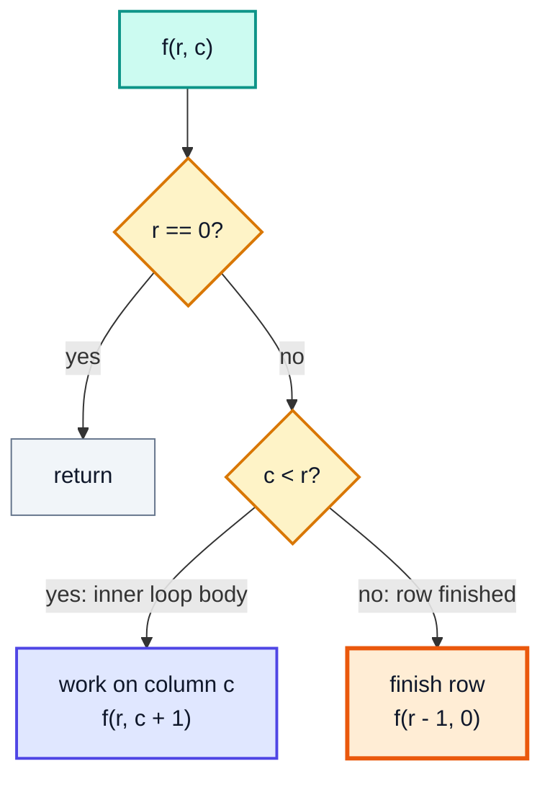
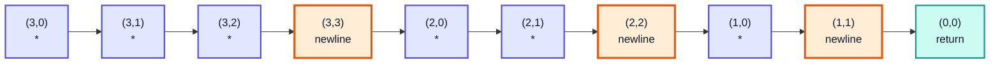
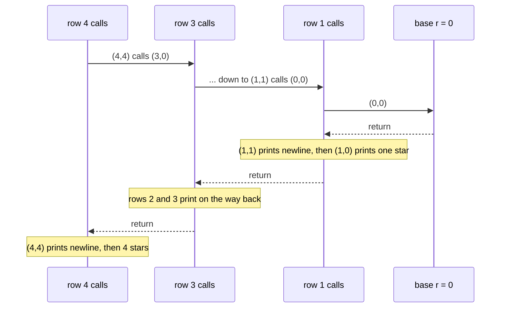
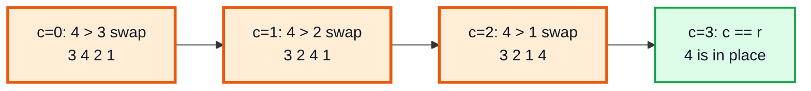
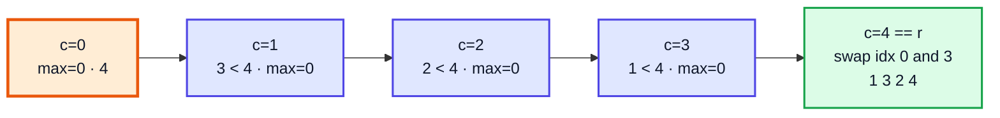
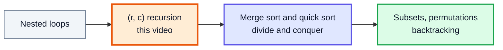

# Recursion: Patterns, Bubble Sort and Selection Sort — Complete In-Depth Guide

**Video #29 of the Java + DSA playlist:** *Recursion - Pattern Questions + Bubble Sort + Selection Sort* (34:35)

Nested loops rewritten as recursion. Two star triangles show how a pair of loop variables `(row, col)` becomes a pair of arguments, and how moving the `print` **before** or **after** the recursive call flips the pattern. The same two-variable recursion then implements bubble sort and selection sort with no loops at all.

---

## Table of Contents

| # | Topic | Timestamp |
|---|---|---|
| 0 | [Introduction](#0-introduction-000) | 0:00 |
| 1 | [Q1: Triangle 1](#1-q1-triangle-1-119) | 1:19 |
| 2 | [Q2: Triangle 2](#2-q2-triangle-2-927) | 9:27 |
| 3 | [Q3: Bubble Sort](#3-q3-bubble-sort-1344) | 13:44 |
| 4 | [Q4: Selection Sort](#4-q4-selection-sort-2132) | 21:32 |
| 5 | [Outro](#5-outro-3417) | 34:17 |

---

## 0. Introduction (0:00)

Any loop can be written as recursion: the loop variable becomes a **parameter**, the loop condition becomes the **base condition** (inverted), and `i++` becomes "call yourself with `i + 1`". A **nested** loop simply needs **two** parameters:

| Nested loop | Recursion |
|---|---|
| outer variable `r` | parameter `r` |
| inner variable `c` | parameter `c` |
| inner loop runs while `c < r` | `if (c < r)` → do work, call `(r, c + 1)` |
| inner loop ends → next row | `else` → call `(r - 1, 0)` |
| outer loop ends when `r == 0` | base condition `if (r == 0) return;` |



> [!IMPORTANT]
> This template (`if (c < r) ... else ...` with a row counter that shrinks) is the whole video. Triangle 1, Triangle 2, bubble sort and selection sort are all the same skeleton with a different "work" step.

---

## 1. Q1: Triangle 1 (1:19)

**Problem:** print this pattern for `n = 4`, using recursion only:

```
* * * *
* * *
* *
*
```

### Basics: the loop version first

```java
for (int r = 4; r > 0; r--) {        // row r has r stars
    for (int c = 0; c < r; c++) {
        System.out.print("* ");
    }
    System.out.println();
}
```

### Recursive version

```java
static void triangle(int r, int c) {
    if (r == 0) {
        return;                          // no rows left
    }
    if (c < r) {
        System.out.print("* ");          // print BEFORE the call
        triangle(r, c + 1);              // next column, same row
    } else {
        System.out.println();            // row done
        triangle(r - 1, 0);              // next row, one star fewer
    }
}
// call: triangle(4, 0)
```

### Recursion chain for `triangle(3, 0)`

Every call makes **exactly one** recursive call, so the "tree" is a straight line.



### Dry run: `triangle(3, 0)`

| Call | `r` | `c` | `c < r`? | Prints | Next call |
|---|---|---|---|---|---|
| 1 | 3 | 0 | ✅ | `* ` | `(3, 1)` |
| 2 | 3 | 1 | ✅ | `* ` | `(3, 2)` |
| 3 | 3 | 2 | ✅ | `* ` | `(3, 3)` |
| 4 | 3 | 3 | ❌ | newline | `(2, 0)` |
| 5 | 2 | 0 | ✅ | `* ` | `(2, 1)` |
| 6 | 2 | 1 | ✅ | `* ` | `(2, 2)` |
| 7 | 2 | 2 | ❌ | newline | `(1, 0)` |
| 8 | 1 | 0 | ✅ | `* ` | `(1, 1)` |
| 9 | 1 | 1 | ❌ | newline | `(0, 0)` |
| 10 | 0 | 0 | base 🟩 | — | return |

### Complexity

| | Value | Why |
|---|---|---|
| Time | O(n²) | n + (n−1) + … + 1 stars plus n newlines ≈ n²/2 calls |
| Space | **O(n²)** | the call stack holds every call until the base case, since nothing returns early |

> [!WARNING]
> The loop version uses O(1) space, but the recursive one keeps **all** ~n²/2 frames alive. For `n` in the low thousands this throws `StackOverflowError`. That is fine for learning, but it is why loops are the right tool for patterns in practice.

> [!TIP]
> All the calls here are **tail calls** (nothing runs after them). Languages with tail-call optimisation would run this in O(1) stack; Java does **not** perform that optimisation, even in Java 21.

---

## 2. Q2: Triangle 2 (9:27)

**Problem:** print the triangle the other way up, still starting with `triangle2(4, 0)`:

```
*
* *
* * *
* * * *
```

### The trick: move the work after the call

Keep the **same calls**, but print on the way **back** (after the recursive call returns) instead of on the way down.

```java
static void triangle2(int r, int c) {
    if (r == 0) {
        return;
    }
    if (c < r) {
        triangle2(r, c + 1);             // go deeper first
        System.out.print("* ");          // print AFTER the call
    } else {
        triangle2(r - 1, 0);             // smaller rows first
        System.out.println();            // then end this row
    }
}
```

### Why it reverses

The call `(4, 4)` reaches `(3, 0)` and **waits**. Everything for rows 3, 2, 1 finishes first. So the output of the smallest row appears first, and row 4's stars are printed last.



> [!NOTE]
> Look closely at the order: within each row, the **newline comes first and the stars after**. The `else` branch of row r runs `triangle2(r - 1, 0)` then `println()`, and the stars of row r are printed when calls `(r, r-1) ... (r, 0)` unwind. So the real output is `\n* \n* * \n* * * \n* * * * ` : a leading blank line and no newline at the end. In the IDE it looks like the expected pattern; the complete example below shows it exactly.

### Comparison

| | Triangle 1 | Triangle 2 |
|---|---|---|
| `print` placement | before the recursive call | after the recursive call |
| Output order | as the calls go **down** | as the calls **return** |
| First row printed | longest (r = n) | shortest (r = 1) |
| Calls made | identical | identical |

> [!IMPORTANT]
> This "pre-order vs post-order" effect (doing work before or after the recursive call) is exactly what distinguishes pre-order and post-order traversal of trees later in the course.

---

## 3. Q3: Bubble Sort (13:44)

**Problem:** sort an array with bubble sort, without loops. (Iterative bubble sort: video #17.)

### Mapping the loops

```java
for (int r = n - 1; r > 0; r--)          // passes; last r slots are sorted
    for (int c = 0; c < r; c++)          // compare neighbours
        if (arr[c] > arr[c + 1]) swap(arr, c, c + 1);
```

`r` is the last index still unsorted in this pass; `c` walks from 0 to `r - 1` comparing `arr[c]` with `arr[c + 1]`.

### Recursive code

```java
static void bubble(int[] arr, int r, int c) {
    if (r == 0) {
        return;
    }
    if (c < r) {
        if (arr[c] > arr[c + 1]) {       // neighbour out of order
            int temp = arr[c];
            arr[c] = arr[c + 1];
            arr[c + 1] = temp;
        }
        bubble(arr, r, c + 1);           // next comparison
    } else {
        bubble(arr, r - 1, 0);           // pass done: largest is at index r
    }
}
// call: bubble(arr, arr.length - 1, 0)
```

> [!NOTE]
> The video calls it with `r = arr.length - 1`, so `c + 1` never goes past the end. If you prefer `r = arr.length` (as in selection sort), change the condition to `c < r - 1`. Mixing the two causes `ArrayIndexOutOfBoundsException`.

### One pass on `{4, 3, 2, 1}` (`r = 3`)



### Dry run: all passes on `{4, 3, 2, 1}`

| `r` | `c` | Compare | Swap? | Array after |
|---|---|---|---|---|
| 3 | 0 | 4 > 3 | ✅ | `3 4 2 1` |
| 3 | 1 | 4 > 2 | ✅ | `3 2 4 1` |
| 3 | 2 | 4 > 1 | ✅ | `3 2 1 🟩4` |
| 3 | 3 | — | next pass | `3 2 1 🟩4` |
| 2 | 0 | 3 > 2 | ✅ | `2 3 1 🟩4` |
| 2 | 1 | 3 > 1 | ✅ | `2 1 🟩3 🟩4` |
| 2 | 2 | — | next pass | |
| 1 | 0 | 2 > 1 | ✅ | `1 🟩2 🟩3 🟩4` |
| 1 | 1 | — | next pass | |
| 0 | — | base | done | `🟩1 🟩2 🟩3 🟩4` |

### Complexity

| | Value |
|---|---|
| Time | O(n²) always (this version has no early exit) |
| Space | O(n²) call stack (~n²/2 frames), versus O(1) for the loop |
| Stable? | ✅ yes (only strictly greater elements are swapped) |
| In place? | ✅ the array is shared by reference |

### Alternative: early exit when already sorted

The iterative version stops when a pass makes no swaps. Recursively, carry a `swapped` flag:

```java
static void bubbleFast(int[] arr, int r, int c, boolean swapped) {
    if (r == 0) return;
    if (c < r) {
        if (arr[c] > arr[c + 1]) {
            int t = arr[c]; arr[c] = arr[c + 1]; arr[c + 1] = t;
            swapped = true;
        }
        bubbleFast(arr, r, c + 1, swapped);
    } else if (swapped) {                // only start another pass if something moved
        bubbleFast(arr, r - 1, 0, false);
    }
}
// call: bubbleFast(arr, arr.length - 1, 0, false); best case O(n) on sorted input
```

---

## 4. Q4: Selection Sort (21:32)

**Problem:** sort with selection sort recursively. (Iterative selection sort: video #18.)

### Idea

In each pass over `arr[0 .. r-1]`, find the index of the **maximum** element, then swap it to position `r - 1` (the last unsorted slot). So we need **one more piece of state** than bubble sort: the index of the max seen so far. It goes in the arguments.

```java
static void selection(int[] arr, int r, int c, int max) {
    if (r == 0) {
        return;
    }
    if (c < r) {
        if (arr[c] > arr[max]) {
            selection(arr, r, c + 1, c);     // new max found at c
        } else {
            selection(arr, r, c + 1, max);   // keep old max
        }
    } else {
        int temp = arr[max];                 // pass done: put max at the end
        arr[max] = arr[r - 1];
        arr[r - 1] = temp;
        selection(arr, r - 1, 0, 0);         // next pass, max reset to index 0
    }
}
// call: selection(arr, arr.length, 0, 0)
```

> [!IMPORTANT]
> The **"which variable goes where"** rule from video #23: values that each call needs its own copy of (`r`, `c`, `max`) go in the **arguments**. A local `int max` inside the method would be reset in every call and the max would be lost.

### Bubble vs selection: the `r` boundary

| | Bubble sort | Selection sort |
|---|---|---|
| Initial call | `bubble(arr, n - 1, 0)` | `selection(arr, n, 0, 0)` |
| `r` means | last index to compare into (`c + 1 ≤ r`) | number of unsorted elements |
| Work when `c < r` | compare `arr[c]`, `arr[c+1]`, maybe swap | update `max` |
| Work when `c == r` | nothing | swap `arr[max]` with `arr[r - 1]` |
| Swaps per pass | up to r | exactly 1 |
| Extra parameter | — | `max` |

### One pass on `{4, 3, 2, 1}` (`r = 4`)



### Dry run: all passes on `{4, 3, 2, 1}`

| `r` | Pass scans | `max` index found | Swap | Array after pass |
|---|---|---|---|---|
| 4 | `4 3 2 1` | 0 (value 4) | idx 0 ↔ 3 | `1 3 2 🟩4` |
| 3 | `1 3 2` | 1 (value 3) | idx 1 ↔ 2 | `1 2 🟩3 🟩4` |
| 2 | `1 2` | 1 (value 2) | idx 1 ↔ 1 | `1 🟩2 🟩3 🟩4` |
| 1 | `1` | 0 (value 1) | idx 0 ↔ 0 | `🟩1 🟩2 🟩3 🟩4` |
| 0 | — | — | base | done ✅ |

### Detailed trace of pass `r = 4` with a mixed array `{3, 1, 5, 2}`

| `c` | `arr[c]` | `arr[max]` | `arr[c] > arr[max]`? | `max` passed on |
|---|---|---|---|---|
| 0 | 3 | 3 | ❌ | 0 |
| 1 | 1 | 3 | ❌ | 0 |
| 2 | 5 | 3 | ✅ | **2** 🟧 |
| 3 | 2 | 5 | ❌ | 2 |
| 4 | — | — | `c == r` | swap idx 2 ↔ 3 → `3 1 2 5` |

### Complexity

| | Value |
|---|---|
| Time | O(n²) in every case (no early exit possible) |
| Space | O(n²) call stack (~n²/2 frames) |
| Swaps | O(n), one per pass |
| Stable? | ❌ no: the long-distance swap can reorder equal elements |

> [!CAUTION]
> Using `>=` instead of `>` in the max check is still correct for sorting, but picks the **last** maximum instead of the first. Neither choice makes this selection sort stable.

---

## 5. Outro (34:17)

Kunal wraps up and sets up the next videos, where recursion powers **merge sort and quick sort**, and later subsets and permutations. Practise by converting other nested-loop patterns (from video #22) into recursion with the same `(r, c)` skeleton.



---

## 🧩 Complete Example: Everything Together

```java
import java.util.Arrays;

public class RecursionPatternsSorting {

    // Q1: stars printed on the way down -> longest row first
    static void triangle(int r, int c) {
        if (r == 0) return;
        if (c < r) {
            System.out.print("* ");
            triangle(r, c + 1);
        } else {
            System.out.println();
            triangle(r - 1, 0);
        }
    }

    // Q2: stars printed on the way back up -> shortest row first
    static void triangle2(int r, int c) {
        if (r == 0) return;
        if (c < r) {
            triangle2(r, c + 1);
            System.out.print("* ");
        } else {
            triangle2(r - 1, 0);
            System.out.println();
        }
    }

    // Q3: bubble sort, call with r = arr.length - 1
    static void bubble(int[] arr, int r, int c) {
        if (r == 0) return;
        if (c < r) {
            if (arr[c] > arr[c + 1]) swap(arr, c, c + 1);
            bubble(arr, r, c + 1);
        } else {
            bubble(arr, r - 1, 0);
        }
    }

    // Q4: selection sort, call with r = arr.length, max = 0
    static void selection(int[] arr, int r, int c, int max) {
        if (r == 0) return;
        if (c < r) {
            if (arr[c] > arr[max]) selection(arr, r, c + 1, c);
            else selection(arr, r, c + 1, max);
        } else {
            swap(arr, max, r - 1);
            selection(arr, r - 1, 0, 0);
        }
    }

    static void swap(int[] arr, int i, int j) {
        int t = arr[i];
        arr[i] = arr[j];
        arr[j] = t;
    }

    public static void main(String[] args) {
        System.out.println("Triangle 1:");
        triangle(4, 0);

        System.out.print("Triangle 2:");   // triangle2 starts with a newline
        triangle2(4, 0);
        System.out.println();              // triangle2 ends without one

        int[] a = {4, 3, 2, 1};
        bubble(a, a.length - 1, 0);
        System.out.println("Bubble sort {4,3,2,1}:        " + Arrays.toString(a));

        int[] b = {5, -1, 3, 3, 0, 8, 2};
        bubble(b, b.length - 1, 0);
        System.out.println("Bubble sort {5,-1,3,3,0,8,2}: " + Arrays.toString(b));

        int[] c = {4, 3, 2, 1};
        selection(c, c.length, 0, 0);
        System.out.println("Selection sort {4,3,2,1}:     " + Arrays.toString(c));

        int[] d = {3, 1, 5, 2, 9, -4};
        selection(d, d.length, 0, 0);
        System.out.println("Selection sort {3,1,5,2,9,-4}: " + Arrays.toString(d));

        int[] single = {7};
        selection(single, single.length, 0, 0);
        bubble(single, single.length - 1, 0);
        System.out.println("Single element: " + Arrays.toString(single));
    }
}
```

**Expected Output:**
```
Triangle 1:
* * * * 
* * * 
* * 
* 
Triangle 2:
* 
* * 
* * * 
* * * * 
Bubble sort {4,3,2,1}:        [1, 2, 3, 4]
Bubble sort {5,-1,3,3,0,8,2}: [-1, 0, 2, 3, 3, 5, 8]
Selection sort {4,3,2,1}:     [1, 2, 3, 4]
Selection sort {3,1,5,2,9,-4}: [-4, 1, 2, 3, 5, 9]
Single element: [7]
```

---

## Quick Reference Cheat Sheet

| Concept | One-Line Summary |
|---|---|
| **Loop → recursion** | loop variable → parameter, `i++` → call with `i + 1`, loop end → base condition |
| **Nested loops** | two parameters `(r, c)`: `if (c < r)` = inner loop, `else` = move to next row `(r - 1, 0)` |
| **Base condition** | `if (r == 0) return;` (no rows / no unsorted elements left) |
| **Triangle 1** | print **before** the recursive call → longest row first |
| **Triangle 2** | print **after** the recursive call → output reversed, shortest row first |
| **Before vs after the call** | the same idea as pre-order vs post-order tree traversal |
| **Recursive bubble sort** | `c < r`: compare/swap `c`, `c+1`, recurse `c+1`; else recurse `(r-1, 0)`; start `(n-1, 0)` |
| **Recursive selection sort** | carry `max` index as an argument; at `c == r` swap `max` with `r-1`; start `(n, 0, 0)` |
| **State in arguments** | anything each call must remember (`r`, `c`, `max`) is a parameter, not a local |
| **Arrays in recursion** | shared by reference, so sorting happens in place |
| **Complexity** | O(n²) time; O(n²) stack depth for these versions (loops use O(1)) |
| **Stability** | bubble sort stable ✅, selection sort not stable ❌ |
| **Java and tail calls** | Java does not optimise tail calls, so deep recursion can throw `StackOverflowError` |
