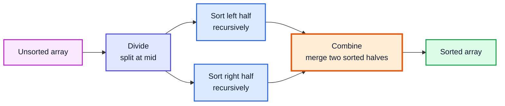
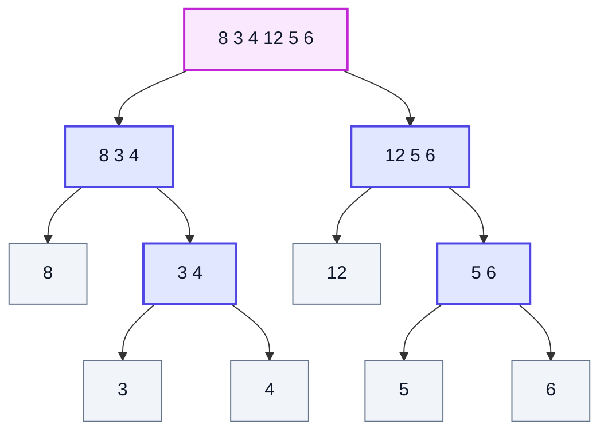
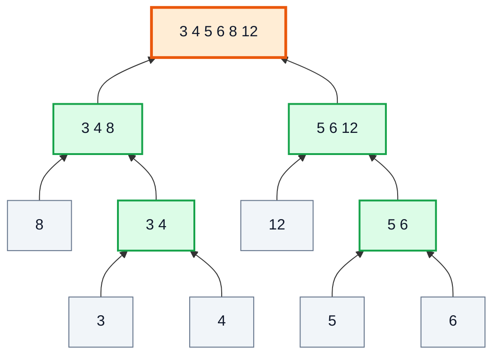
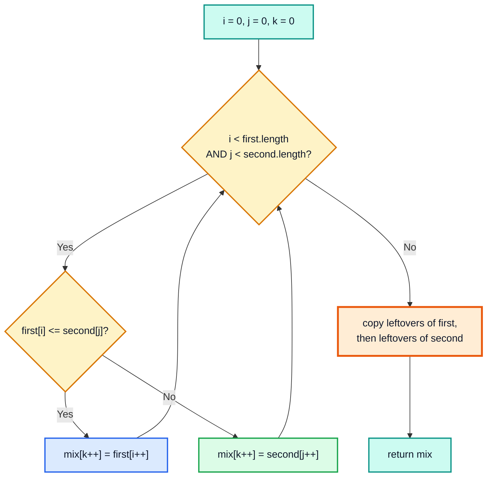
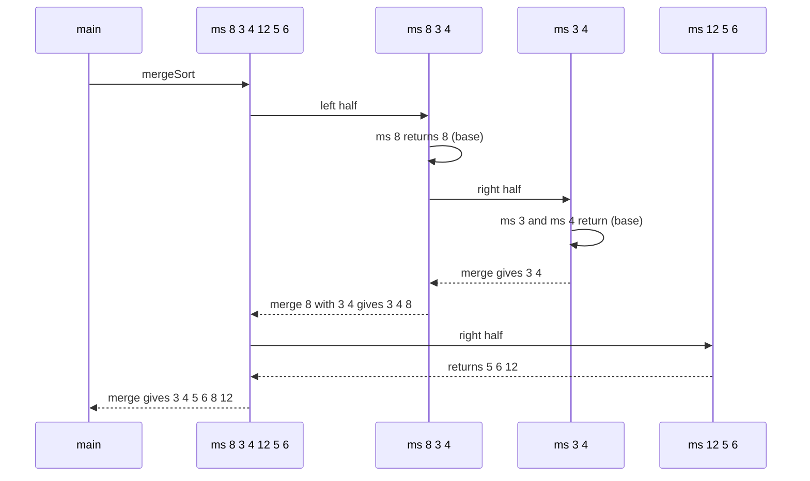
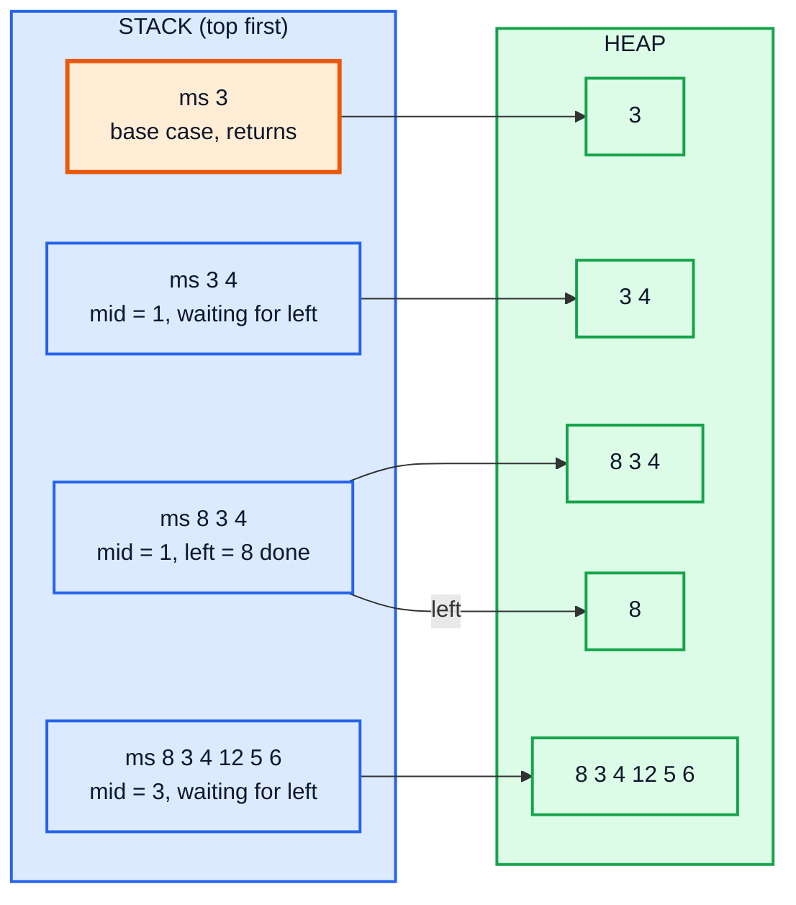
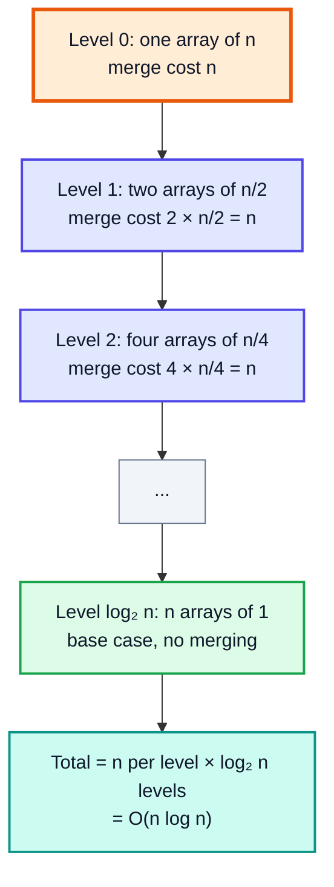
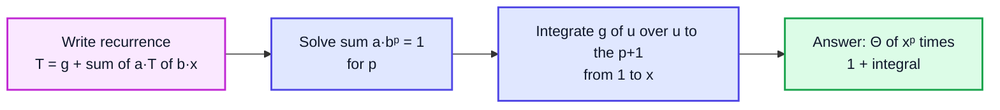
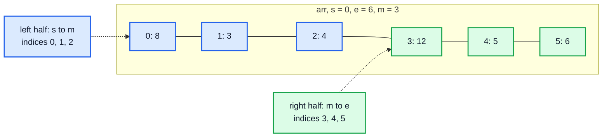
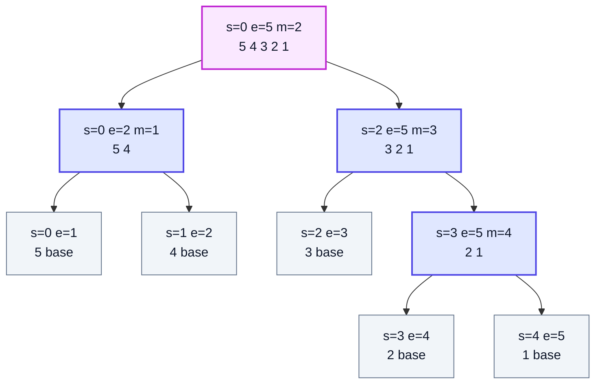

# Merge Sort — Complete In-Depth Guide

**Video #30 of the Java + DSA playlist:** *Merge Sort Using Recursion (Theory + Complexity + Code)* (49:47)

Merge sort is the first **divide and conquer** sorting algorithm in the course: split the array in half, sort each half recursively, then merge the two sorted halves. These notes cover the theory, the recursive code that returns a new array, the recursion tree, time and space complexity (including a full Akra-Bazzi derivation), and the "in-place" version that sorts inside the original array.

---

## Table of Contents

| # | Topic | Timestamp |
|---|---|---|
| 0 | [Introduction](#0-introduction-000) | 0:00 |
| 1 | [Merge Sort](#1-merge-sort-031) | 0:31 |
| 2 | [Steps for Merge Sort](#2-steps-for-merge-sort-316) | 3:16 |
| 3 | [E1: Recursive Merge Sort](#3-e1-recursive-merge-sort-658) | 6:58 |
| 4 | [Explanation of E1](#4-explanation-of-e1-2218) | 22:18 |
| 5 | [Time Complexity](#5-time-complexity-2531) | 25:31 |
| 6 | [Space Complexity](#6-space-complexity-2901) | 29:01 |
| 7 | [Solving Complexity using Akra-Bazzi Formula](#7-solving-complexity-using-akra-bazzi-formula-2937) | 29:37 |
| 8 | [In-place Merge Sort](#8-in-place-merge-sort-3306) | 33:06 |
| 9 | [Code for in-place Approach](#9-code-for-in-place-approach-4414) | 44:14 |
| 10 | [Outro](#10-outro-4934) | 49:34 |

---

## 0. Introduction (0:00)

The earlier sorting videos (bubble, selection, insertion, cyclic sort) were all iterative and, apart from cyclic sort, O(n²) in the worst case. Merge sort is the first sort that uses **recursion**, and it brings the worst case down to **O(n log n)**.

> [!IMPORTANT]
> You need the recursion videos (#23 onwards) before this one. Merge sort is a direct application of the recursion recipe: write the recurrence, find the base condition, draw the tree, and trust the smaller calls.

| You should know | From |
|---|---|
| Recursion, base condition, recursion trees | Video #23 |
| Recurrence relations (linear vs divide and conquer) | Videos #23 and the complexity video |
| Arrays and `Arrays.copyOfRange` | Video #12 |
| Iterative sorts for comparison | Videos #17 to #20 |

---

## 1. Merge Sort (0:31)

### The Basic Idea

Sorting a big array is hard. Sorting an array of **one** element is trivial: it is already sorted. And merging **two already sorted arrays** into one sorted array is easy and fast. Merge sort combines those two facts:

1. **Divide** the array into two halves.
2. **Conquer**: sort each half recursively (keep halving until each piece has one element).
3. **Combine**: merge the two sorted halves into one sorted array.



### Why It Is Faster Than O(n²) Sorts

Bubble, selection and insertion sort fix **one element per pass** and each pass costs O(n), giving n passes × n work = O(n²). Merge sort halves the problem, so there are only **log₂ n levels** of splitting, and each level does **O(n)** total merging work. That gives **O(n log n)**.

| n | n² (bubble, worst) | n log₂ n (merge) |
|---|---|---|
| 8 | 64 | 24 |
| 1,000 | 1,000,000 | ≈ 10,000 |
| 1,000,000 | 10¹² | ≈ 2 × 10⁷ |

> [!NOTE]
> Merge sort is used on LeetCode **912. Sort an Array** (where O(n²) sorts time out), **148. Sort List** (merge sort on a linked list), and its merge step is exactly **88. Merge Sorted Array** and **21. Merge Two Sorted Lists**.

---

## 2. Steps for Merge Sort (3:16)

### The Recurrence

Written as a recursive definition:

```
mergeSort(arr):
    if arr has 0 or 1 elements → return arr          (base condition)
    left  = mergeSort(first half of arr)
    right = mergeSort(second half of arr)
    return merge(left, right)
```

The recurrence relation for the running time is:

**T(N) = T(N/2) + T(N/2) + (N − 1)**, which is usually written **T(N) = 2T(N/2) + O(N)**.

- `T(N/2) + T(N/2)`: the two recursive calls on halves.
- `(N − 1)`: the maximum number of comparisons while merging N elements.

### Example: `{8, 3, 4, 12, 5, 6}`



*Splitting phase (going down). Grey leaves are single elements: the base condition.*



*Merging phase (coming back up). Every green node is the result of merging its two sorted children.*

> [!TIP]
> The **splitting** does no real work: it only decides boundaries. All of the sorting happens during **merging**, on the way back up the recursion.

---

## 3. E1: Recursive Merge Sort (6:58)

### Step 1: The Merge Function (Two Sorted Arrays → One)

Use **three pointers**: `i` walks the first array, `j` walks the second, `k` walks the output. Always copy the smaller front element. When one array runs out, copy whatever is left of the other.

```java
static int[] merge(int[] first, int[] second) {
    int[] mix = new int[first.length + second.length];
    int i = 0, j = 0, k = 0;

    while (i < first.length && j < second.length) {
        if (first[i] <= second[j]) {   // <= keeps equal elements in original order (stable)
            mix[k++] = first[i++];
        } else {
            mix[k++] = second[j++];
        }
    }
    // one of the arrays is exhausted; copy the rest of the other
    while (i < first.length)  mix[k++] = first[i++];
    while (j < second.length) mix[k++] = second[j++];

    return mix;
}
```

### Dry Run: Merge `{3, 4, 8}` and `{5, 6, 12}`

| Step | i | j | Compare | Copy | mix so far |
|---|---|---|---|---|---|
| 1 | 0 | 0 | 3 vs 5 | 🟦 3 (first) | `[3]` |
| 2 | 1 | 0 | 4 vs 5 | 🟦 4 (first) | `[3, 4]` |
| 3 | 2 | 0 | 8 vs 5 | 🟩 5 (second) | `[3, 4, 5]` |
| 4 | 2 | 1 | 8 vs 6 | 🟩 6 (second) | `[3, 4, 5, 6]` |
| 5 | 2 | 2 | 8 vs 12 | 🟦 8 (first) | `[3, 4, 5, 6, 8]` |
| 6 | 3 | 2 | first exhausted | 🟧 12 (leftover) | `[3, 4, 5, 6, 8, 12]` |

5 comparisons for 6 elements: at most **N − 1** comparisons, which is the `(N − 1)` term in the recurrence.



### Step 2: The Recursive Sort

```java
import java.util.Arrays;

public class MergeSort {
    public static void main(String[] args) {
        int[] arr = {8, 3, 4, 12, 5, 6};
        int[] ans = mergeSort(arr);
        System.out.println(Arrays.toString(ans));   // [3, 4, 5, 6, 8, 12]
        System.out.println(Arrays.toString(arr));   // [8, 3, 4, 12, 5, 6]  original untouched
    }

    static int[] mergeSort(int[] arr) {
        if (arr.length <= 1) {          // base condition: 0 or 1 element is sorted
            return arr;
        }
        int mid = arr.length / 2;

        int[] left  = mergeSort(Arrays.copyOfRange(arr, 0, mid));          // [0, mid)
        int[] right = mergeSort(Arrays.copyOfRange(arr, mid, arr.length)); // [mid, n)

        return merge(left, right);
    }

    static int[] merge(int[] first, int[] second) {
        int[] mix = new int[first.length + second.length];
        int i = 0, j = 0, k = 0;
        while (i < first.length && j < second.length) {
            mix[k++] = (first[i] <= second[j]) ? first[i++] : second[j++];
        }
        while (i < first.length)  mix[k++] = first[i++];
        while (j < second.length) mix[k++] = second[j++];
        return mix;
    }
}
```

> [!IMPORTANT]
> `Arrays.copyOfRange(arr, from, to)` copies indices **from (inclusive) to to (exclusive)**. That is why the left half is `(0, mid)` and the right half is `(mid, arr.length)`: no element is lost or duplicated.

> [!NOTE]
> The video's base condition is `arr.length == 1`. Using `<= 1` also handles an **empty input array**, which would otherwise recurse forever (an empty array splits into two empty arrays). LeetCode 912 never passes an empty array, but real code should guard it.

### Why `mid = arr.length / 2` Is Safe Here

In binary search we wrote `s + (e - s) / 2` to avoid integer overflow of `s + e`. Here we only divide a length, so there is no addition and no overflow risk. In the index-based version (section 9) we go back to `s + (e - s) / 2`.

---

## 4. Explanation of E1 (22:18)

### Order of Calls

Recursion runs **depth first, left first**. A call does not merge until **both** of its children have returned. For `{8, 3, 4, 12, 5, 6}`:



### What Is on the Stack at the Deepest Point

When `mergeSort({3})` is running, four frames are on the call stack. Each frame holds its own `arr`, `mid`, `left` and `right` references; the arrays themselves live in the heap.



### Key Observations

| Observation | Why it matters |
|---|---|
| The original array is never modified | `copyOfRange` always creates new arrays; `mergeSort` returns a **new** sorted array |
| Max stack depth is ⌈log₂ n⌉ + 1 | Only one root-to-leaf path is active at a time |
| Every level of the tree holds all n elements | So every level costs O(n) to merge |
| Merging uses `<=` | Equal elements from the left half go first, so the sort is **stable** |

### Stability

A sort is **stable** if equal keys keep their original relative order. Merge sort is stable as long as the merge takes from the **left** half on ties.

```java
record Person(String name, int age) {}
// input : Asha 25, Ravi 22, Bina 25, Dev 22
// sorted by age with merge sort (<= in merge):
// Ravi 22, Dev 22, Asha 25, Bina 25   ← Ravi still before Dev, Asha still before Bina
```

> [!CAUTION]
> Change `<=` to `<` in the merge and the algorithm still sorts numbers correctly, but it is **no longer stable**: on a tie it takes from the right half first. With plain `int`s you cannot see the difference; with objects you can.

---

## 5. Time Complexity (25:31)

### Method 1: Count Work per Level of the Recursion Tree



How many levels? At level k each piece has size n / 2ᵏ. We stop when n / 2ᵏ = 1, so 2ᵏ = n, k = log₂ n.

### Method 2: Unroll the Recurrence

```
T(n) = 2T(n/2) + n
     = 2[2T(n/4) + n/2] + n        = 4T(n/4) + 2n
     = 4[2T(n/8) + n/4] + 2n       = 8T(n/8) + 3n
     ...
     = 2ᵏ T(n/2ᵏ) + k·n
put k = log₂ n:  = n·T(1) + n log₂ n  = O(n log n)
```

### Best, Average, Worst

| Case | Input | Time |
|---|---|---|
| Best | Already sorted | **O(n log n)** |
| Average | Random | **O(n log n)** |
| Worst | Any (reverse sorted, etc.) | **O(n log n)** |

Merge sort always splits in the middle and always merges, no matter what the data looks like, so all three cases are the same. That predictability is its biggest advantage over quick sort (next video), whose worst case is O(n²).

> [!TIP]
> The **number of comparisons** does depend on the input (merging `{1,2,3}` with `{4,5,6}` needs only 3 comparisons, not 5), but it is always between ½·n log₂ n and n log₂ n, so the Big-O stays the same.

---

## 6. Space Complexity (29:01)

| Part | Space |
|---|---|
| Recursion stack | O(log n): the tree height |
| The `mix` array in the current merge | O(n) |
| Copies made by `copyOfRange` along the active path | n/2 + n/4 + … ≈ O(n) |
| **Total auxiliary space** | **O(n)** |

The copies made at deeper levels are freed (become eligible for GC) when those calls return, so at any moment the live extra memory is bounded by a constant times n, not n log n.

> [!NOTE]
> Over the whole run the version from section 3 **allocates** O(n log n) bytes in total (every level creates new arrays), which costs GC time, but the **peak** memory is O(n). The section 9 version allocates less because it skips the `copyOfRange` calls.

---

## 7. Solving Complexity using Akra-Bazzi Formula (29:37)

### What Is Akra-Bazzi?

The **Master Theorem** solves recurrences like `T(n) = aT(n/b) + f(n)` where all sub-problems have the **same** size. **Akra-Bazzi** (1998) generalises it to sub-problems of **different** sizes:

T(x) = g(x) + Σ aᵢ · T(bᵢ·x + hᵢ(x))

Steps:

1. Find **p** such that **Σ aᵢ · bᵢᵖ = 1**.
2. Compute **T(x) = Θ( xᵖ · ( 1 + ∫₁ˣ g(u) / u^(p+1) du ) )**.



### Applying It to Merge Sort

Recurrence: **T(N) = 2T(N/2) + (N − 1)**, so a₁ = 2, b₁ = ½, g(N) = N − 1.

**Step 1:** 2 · (½)ᵖ = 1 → (½)ᵖ = ½ → **p = 1**.

**Step 2:**

```
∫₁ᴺ (u − 1) / u²  du  =  ∫₁ᴺ (1/u − 1/u²) du
                      =  [ ln u + 1/u ]₁ᴺ
                      =  ln N + 1/N − 1
```

**Step 3:**

```
T(N) = Θ( N¹ · (1 + ln N + 1/N − 1) )
     = Θ( N ln N + 1 )
     = Θ( N log N )
```

### A Second Example (Unequal Splits)

T(n) = T(n/3) + T(2n/3) + n

- Step 1: (⅓)ᵖ + (⅔)ᵖ = 1 → p = 1.
- Step 2: ∫₁ⁿ u / u² du = ln n.
- Result: Θ(n · (1 + ln n)) = **Θ(n log n)**.

Even a lopsided ⅓ / ⅔ split is still n log n. This matters in the next video: quick sort with a "reasonably balanced" pivot stays O(n log n).

| Recurrence | p | Integral | Result |
|---|---|---|---|
| T(n) = 2T(n/2) + n (merge sort) | 1 | ln n | Θ(n log n) |
| T(n) = T(n/2) + 1 (binary search) | 0 | ln n | Θ(log n) |
| T(n) = 2T(n/2) + 1 (tree traversal) | 1 | ≈ 1 | Θ(n) |
| T(n) = T(n/3) + T(2n/3) + n | 1 | ln n | Θ(n log n) |

> [!TIP]
> If **g(x) grows slower than xᵖ**, the answer is simply Θ(xᵖ). If **g(x) ≈ xᵖ**, you pick up an extra log factor. If **g(x) grows faster**, g dominates. This is the same three-way split as the Master Theorem.

---

## 8. In-place Merge Sort (33:06)

### Why Change the Approach?

The E1 version creates a new array for every half via `copyOfRange`. Instead, we can pass **indices** `s` (start, inclusive) and `e` (end, exclusive) and sort the subarray `arr[s..e)` inside the original array.

| | E1: copy version | In-place (index) version |
|---|---|---|
| Signature | `int[] mergeSort(int[] arr)` | `void mergeSort(int[] arr, int s, int e)` |
| Halves | New arrays via `copyOfRange` | Index ranges `[s, m)` and `[m, e)` |
| Result | Returns a **new** array | Modifies `arr` itself |
| Original array | Unchanged | Sorted |
| Extra allocations | Every split + every merge | Only every merge |
| Auxiliary space | O(n) | O(n) |

> [!WARNING]
> The "in-place" name in the video means **"sorts the original array"**, not "uses O(1) extra space". The merge step still uses a temporary `mix` array of size `e − s`, so the space complexity remains **O(n)**. A truly in-place merge (O(1) extra space) exists but is complicated and slower in practice; it is almost never used.

### The Index Idea



The merge of `[s, m)` and `[m, e)` writes into a temporary `mix`, then copies `mix` back into `arr` starting at index `s`.

### Recursion Tree with Ranges for `{5, 4, 3, 2, 1}`



### State of `arr` After Each Merge

| Merge # | Range merged | arr after copy-back |
|---|---|---|
| 1 | `[0,1)` + `[1,2)` | `[🟧4, 🟧5, 3, 2, 1]` |
| 2 | `[3,4)` + `[4,5)` | `[4, 5, 3, 🟧1, 🟧2]` |
| 3 | `[2,3)` + `[3,5)` | `[4, 5, 🟧1, 🟧2, 🟧3]` |
| 4 | `[0,2)` + `[2,5)` | `[🟩1, 🟩2, 🟩3, 🟩4, 🟩5]` |

Notice merges happen in **post-order**: a range is merged only after both of its sub-ranges have been sorted in place.

---

## 9. Code for in-place Approach (44:14)

```java
import java.util.Arrays;

public class MergeSortInPlace {
    public static void main(String[] args) {
        int[] arr = {5, 4, 3, 2, 1};
        mergeSortInPlace(arr, 0, arr.length);
        System.out.println(Arrays.toString(arr));   // [1, 2, 3, 4, 5]
    }

    // sorts arr[s..e)  (e is exclusive)
    static void mergeSortInPlace(int[] arr, int s, int e) {
        if (e - s <= 1) {                // 0 or 1 element in the range
            return;
        }
        int m = s + (e - s) / 2;         // overflow-safe mid

        mergeSortInPlace(arr, s, m);     // sort left  [s, m)
        mergeSortInPlace(arr, m, e);     // sort right [m, e)

        merge(arr, s, m, e);
    }

    static void merge(int[] arr, int s, int m, int e) {
        int[] mix = new int[e - s];
        int i = s, j = m, k = 0;

        while (i < m && j < e) {
            if (arr[i] <= arr[j]) {
                mix[k++] = arr[i++];
            } else {
                mix[k++] = arr[j++];
            }
        }
        while (i < m) mix[k++] = arr[i++];
        while (j < e) mix[k++] = arr[j++];

        // copy the merged result back into the original positions
        for (int l = 0; l < mix.length; l++) {
            arr[s + l] = mix[l];
        }
        // modern alternative: System.arraycopy(mix, 0, arr, s, mix.length);
    }
}
```

### Common Bugs

| Bug | Symptom | Fix |
|---|---|---|
| Base case `e - s == 1` only | Infinite recursion on empty arrays | Use `e - s <= 1` |
| Mixing inclusive and exclusive `e` | Last element never sorted, or duplicated | Pick one convention; here `e` is **exclusive** |
| Copying back to `arr[l]` instead of `arr[s + l]` | Corrupts the left part of the array | Offset by `s` |
| `j = m + 1` with exclusive ranges | Skips `arr[m]` | Right half starts at `m` |
| Using `<` in the merge | Not stable | Use `<=` |

### Complexity

| | Value |
|---|---|
| Time | O(n log n) in every case |
| Auxiliary space | O(n) for `mix` + O(log n) stack |
| Stable | Yes |
| In-place (O(1) extra) | No |

### Alternatives Worth Knowing

| Variant | Idea | Notes |
|---|---|---|
| **Single buffer** | Allocate one `temp` array of size n once, reuse it in every merge | Same O(n) space, but no allocation per merge; what production code does |
| **Bottom-up (iterative)** | Merge runs of size 1, then 2, 4, 8 … with loops | No recursion, O(1) stack |
| **Skip sorted merges** | If `arr[m-1] <= arr[m]`, the two halves are already in order, skip the merge | Already-sorted input becomes O(n) |
| **Insertion sort for small ranges** | Below ~16 to 32 elements use insertion sort | Faster in practice (see hybrid sorts, next video) |
| **Merge sort on linked lists** | Split with slow/fast pointers, merge by relinking nodes | O(1) extra space for merging; LeetCode 148 |

```java
// Bottom-up merge sort: no recursion at all
static void bottomUp(int[] arr) {
    int n = arr.length;
    for (int size = 1; size < n; size *= 2) {
        for (int s = 0; s < n - size; s += 2 * size) {
            int m = s + size;
            int e = Math.min(s + 2 * size, n);
            merge(arr, s, m, e);          // the same merge as above
        }
    }
}
```

---

## 10. Outro (49:34)

Merge sort is the template for divide and conquer: split, solve halves recursively, combine. The next video (#31) covers **quick sort**, which flips the order of work: it does the hard part (partitioning around a pivot) **before** recursing, and needs no combine step at all.

---

## 🧩 Complete Example: Everything Together

```java
import java.util.Arrays;

public class MergeSortAll {

    // E1: recursive merge sort that returns a NEW sorted array (video style)
    static int[] mergeSort(int[] arr) {
        if (arr.length <= 1) return arr;                       // base condition
        int mid = arr.length / 2;
        int[] left = mergeSort(Arrays.copyOfRange(arr, 0, mid));
        int[] right = mergeSort(Arrays.copyOfRange(arr, mid, arr.length));
        return merge(left, right);
    }

    static int[] merge(int[] first, int[] second) {
        int[] mix = new int[first.length + second.length];
        int i = 0, j = 0, k = 0;
        while (i < first.length && j < second.length) {
            if (first[i] <= second[j]) mix[k++] = first[i++]; // <= keeps it stable
            else mix[k++] = second[j++];
        }
        while (i < first.length) mix[k++] = first[i++];
        while (j < second.length) mix[k++] = second[j++];
        return mix;
    }

    // "In-place" version: sorts arr[s..e) inside the original array
    static void mergeSortInPlace(int[] arr, int s, int e) {
        if (e - s <= 1) return;
        int m = s + (e - s) / 2;
        mergeSortInPlace(arr, s, m);
        mergeSortInPlace(arr, m, e);
        mergeInPlace(arr, s, m, e);
    }

    static void mergeInPlace(int[] arr, int s, int m, int e) {
        int[] mix = new int[e - s];
        int i = s, j = m, k = 0;
        while (i < m && j < e) {
            if (arr[i] <= arr[j]) mix[k++] = arr[i++];
            else mix[k++] = arr[j++];
        }
        while (i < m) mix[k++] = arr[i++];
        while (j < e) mix[k++] = arr[j++];
        System.arraycopy(mix, 0, arr, s, mix.length);         // copy back
    }

    // Instrumented version: counts merge calls and max recursion depth
    static int merges = 0, maxDepth = 0;
    static void countingSort(int[] arr, int s, int e, int depth) {
        maxDepth = Math.max(maxDepth, depth);
        if (e - s <= 1) return;
        int m = s + (e - s) / 2;
        countingSort(arr, s, m, depth + 1);
        countingSort(arr, m, e, depth + 1);
        merges++;
        mergeInPlace(arr, s, m, e);
    }

    // Bonus: count inversions while merging (pairs i < j with a[i] > a[j])
    static long inversions(int[] arr, int s, int e) {
        if (e - s <= 1) return 0;
        int m = s + (e - s) / 2;
        long count = inversions(arr, s, m) + inversions(arr, m, e);
        int[] mix = new int[e - s];
        int i = s, j = m, k = 0;
        while (i < m && j < e) {
            if (arr[i] <= arr[j]) mix[k++] = arr[i++];
            else { count += m - i; mix[k++] = arr[j++]; }
        }
        while (i < m) mix[k++] = arr[i++];
        while (j < e) mix[k++] = arr[j++];
        System.arraycopy(mix, 0, arr, s, mix.length);
        return count;
    }

    // Stability demo: sort records by age; equal ages keep input order
    record Person(String name, int age) {}

    static Person[] sortByAge(Person[] p) {
        if (p.length <= 1) return p;
        int mid = p.length / 2;
        Person[] l = sortByAge(Arrays.copyOfRange(p, 0, mid));
        Person[] r = sortByAge(Arrays.copyOfRange(p, mid, p.length));
        Person[] mix = new Person[p.length];
        int i = 0, j = 0, k = 0;
        while (i < l.length && j < r.length) mix[k++] = (l[i].age() <= r[j].age()) ? l[i++] : r[j++];
        while (i < l.length) mix[k++] = l[i++];
        while (j < r.length) mix[k++] = r[j++];
        return mix;
    }

    public static void main(String[] args) {
        int[] original = {8, 3, 4, 12, 5, 6};
        int[] sorted = mergeSort(original);
        System.out.println("mergeSort (copy)  : " + Arrays.toString(sorted));
        System.out.println("original untouched: " + Arrays.toString(original));

        int[] inPlace = {5, 4, 3, 2, 1};
        mergeSortInPlace(inPlace, 0, inPlace.length);
        System.out.println("mergeSortInPlace  : " + Arrays.toString(inPlace));

        System.out.println("merge([1,3,5],[2,4,6,8]): " + Arrays.toString(merge(new int[]{1, 3, 5}, new int[]{2, 4, 6, 8})));

        int[] edge1 = {}, edge2 = {7};
        System.out.println("empty / single    : " + Arrays.toString(mergeSort(edge1)) + " " + Arrays.toString(mergeSort(edge2)));

        int[] big = new int[16];
        for (int i = 0; i < big.length; i++) big[i] = (i * 7) % 16;   // a permutation of 0..15
        countingSort(big, 0, big.length, 0);
        System.out.println("n=16 -> merges=" + merges + ", max depth=" + maxDepth + ", sorted=" + Arrays.toString(big));

        int[] inv = {8, 4, 2, 1};
        System.out.println("inversions {8,4,2,1}: " + inversions(inv, 0, inv.length));

        Person[] people = {
            new Person("Asha", 25), new Person("Ravi", 22),
            new Person("Bina", 25), new Person("Dev", 22)
        };
        System.out.println("stable by age     : " + Arrays.toString(sortByAge(people)));
    }
}
```

**Expected Output:**
```
mergeSort (copy)  : [3, 4, 5, 6, 8, 12]
original untouched: [8, 3, 4, 12, 5, 6]
mergeSortInPlace  : [1, 2, 3, 4, 5]
merge([1,3,5],[2,4,6,8]): [1, 2, 3, 4, 5, 6, 8]
empty / single    : [] [7]
n=16 -> merges=15, max depth=4, sorted=[0, 1, 2, 3, 4, 5, 6, 7, 8, 9, 10, 11, 12, 13, 14, 15]
inversions {8,4,2,1}: 6
stable by age     : [Person[name=Ravi, age=22], Person[name=Dev, age=22], Person[name=Asha, age=25], Person[name=Bina, age=25]]
```

*n = 16 needs exactly n − 1 = 15 merges (every internal node of the tree) and the tree has depth log₂ 16 = 4. The inversion counter is a classic merge sort extension: every time an element from the right half is taken, it is smaller than all `m − i` elements still waiting in the left half.*

---

## Quick Reference Cheat Sheet

| Concept | One-Line Summary |
|---|---|
| **Merge sort** | Split in half, sort halves recursively, merge the two sorted halves |
| **Divide and conquer** | Break into sub-problems, solve recursively, combine results |
| **Base condition** | `length <= 1` (or `e - s <= 1`): already sorted |
| **Merge** | Three pointers `i`, `j`, `k`; copy the smaller front; then copy leftovers |
| **Merge comparisons** | At most N − 1 for N elements |
| **Recurrence** | T(N) = 2T(N/2) + (N − 1) |
| **Time** | O(n log n) best, average and worst |
| **Space** | O(n) auxiliary + O(log n) recursion stack |
| **Levels in the tree** | log₂ n, each doing O(n) merge work |
| **Akra-Bazzi** | Solve Σ aᵢbᵢᵖ = 1, then Θ(xᵖ(1 + ∫ g(u)/u^(p+1) du)); merge sort: p = 1 → n log n |
| **Stable?** | Yes, if the merge uses `<=` (take from the left on ties) |
| **E1 version** | Uses `copyOfRange`, returns a new array, original unchanged |
| **"In-place" version** | Indices `[s, m)` and `[m, e)`, merges into `mix`, copies back to `arr[s + l]` |
| **Truly in-place?** | No: still O(n) extra for `mix` |
| **Best use** | Linked lists (LC 148), external sorting, when stability or guaranteed n log n is needed |
| **LeetCode** | 912 Sort an Array, 148 Sort List, 88 Merge Sorted Array, 21 Merge Two Sorted Lists |
