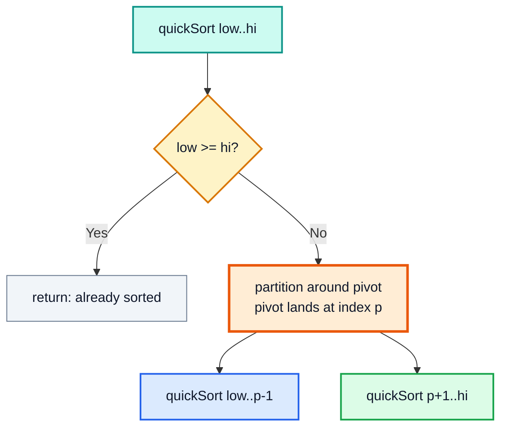
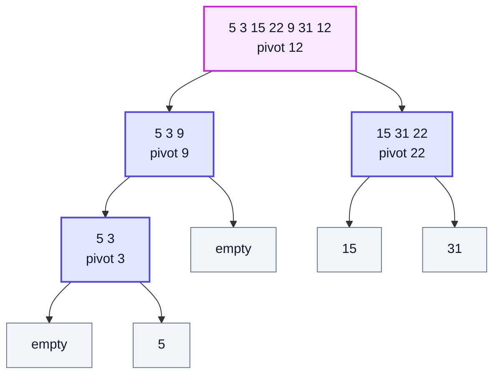
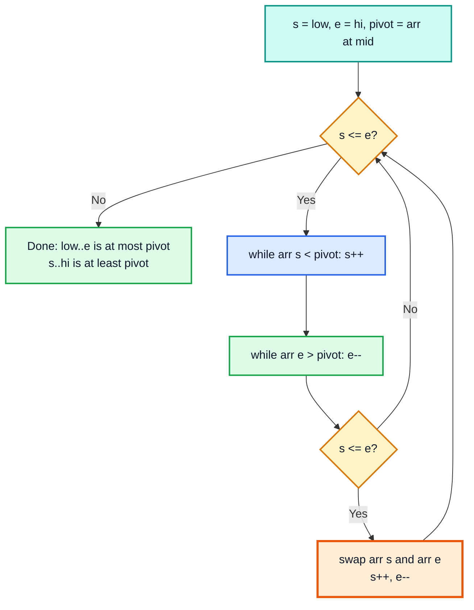
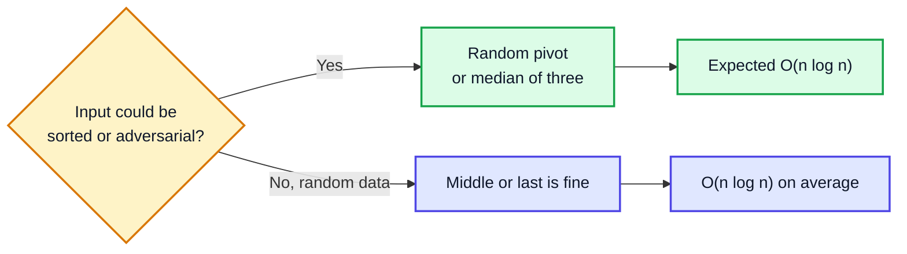
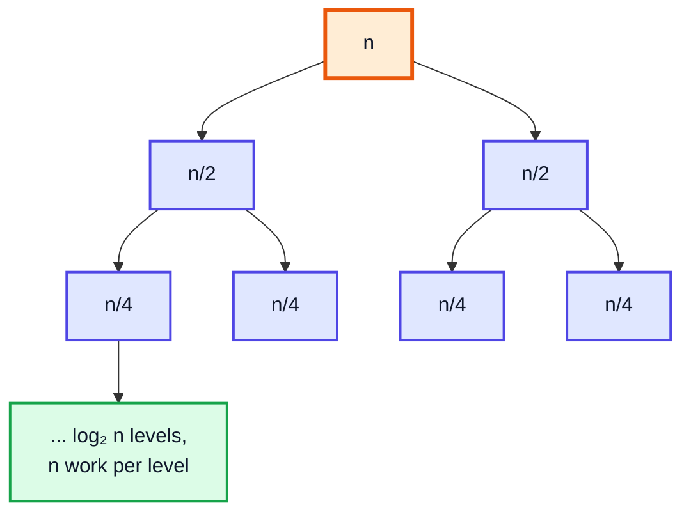
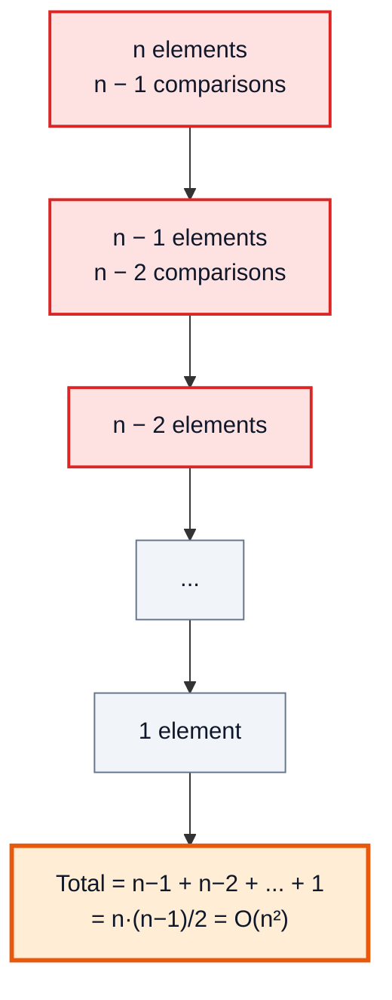
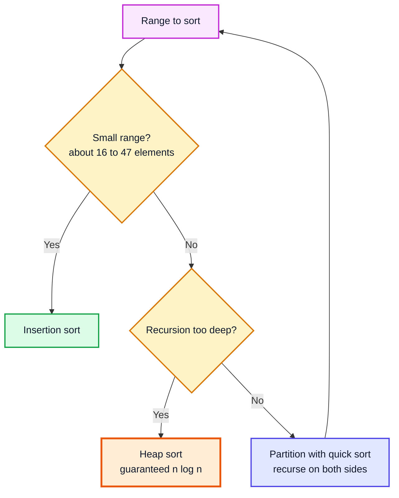
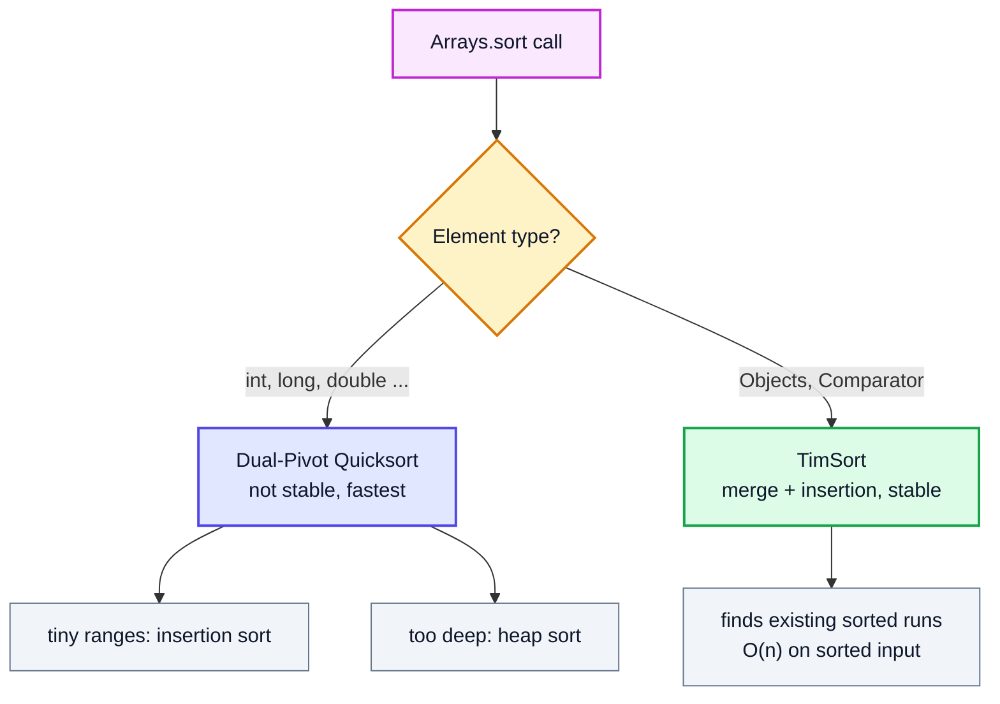

# Quick Sort — Complete In-Depth Guide

**Video #31 of the Java + DSA playlist:** *Quick Sort Using Recursion (Theory + Complexity + Code)* (42:13)

Quick sort picks a **pivot**, rearranges the array so smaller elements go left and larger elements go right, then recursively sorts both sides. These notes cover partitioning, pivot choice, best and worst case complexity, how it compares with merge sort, hybrid algorithms like TimSort and IntroSort, and what `Arrays.sort` actually does in modern Java.

---

## Table of Contents

| # | Topic | Timestamp |
|---|---|---|
| 0 | [Introduction](#0-introduction-000) | 0:00 |
| 1 | [What is Pivot?](#1-what-is-pivot-301) | 3:01 |
| 2 | [Recursive Quick Sort](#2-recursive-quick-sort-443) | 4:43 |
| 3 | [How to put pivot at correct position?](#3-how-to-put-pivot-at-correct-position-958) | 9:58 |
| 4 | [How to pick the pivot?](#4-how-to-pick-the-pivot-1755) | 17:55 |
| 5 | [Complexity comparison of pivot positions](#5-complexity-comparison-of-pivot-positions-2015) | 20:15 |
| 6 | [Important Notes](#6-important-notes-2745) | 27:45 |
| 7 | [Hybrid Sorting Algorithms](#7-hybrid-sorting-algorithms-2932) | 29:32 |
| 8 | [Code for Quick Sort](#8-code-for-quick-sort-3149) | 31:49 |
| 9 | [Internal Sorting Algorithm](#9-internal-sorting-algorithm-3912) | 39:12 |
| 10 | [Outro](#10-outro-4120) | 41:20 |

---

## 0. Introduction (0:00)

Quick sort is the second divide and conquer sort in the course, and in practice it is the fastest general-purpose comparison sort for arrays. It differs from merge sort in **where the work happens**:

| | Merge sort (video #30) | Quick sort |
|---|---|---|
| Hard work done | **After** recursion (merge) | **Before** recursion (partition) |
| Split point | Always the middle index | Wherever the pivot lands |
| Combine step | Merge two halves | None: the array is already sorted |
| Extra array | Yes, O(n) | No, sorts in place |

> [!IMPORTANT]
> Prerequisites: recursion (#23 onwards) and merge sort (#30). The complexity part reuses the recurrences T(n) = 2T(n/2) + n and T(n) = T(n−1) + n.

---

## 1. What is Pivot? (3:01)

The **pivot** is one chosen element of the array. After one **partition** pass:

- every element **smaller** than the pivot is on its **left**,
- every element **greater** than the pivot is on its **right**,
- so the pivot is at its **final sorted position**.

The left and right parts do **not** have to be sorted yet. Only the pivot is "done".

### Example: pivot = 15 in `{5, 3, 15, 22, 9, 31, 12}`

```mermaid
flowchart LR
    subgraph BEFORE["Before partition"]
        direction LR
        a0["5"]:::muted --- a1["3"]:::muted --- a2["15"]:::highlight --- a3["22"]:::muted --- a4["9"]:::muted --- a5["31"]:::muted --- a6["12"]:::muted
    end
    subgraph AFTER["After partition"]
        direction LR
        b0["5"]:::stack --- b1["3"]:::stack --- b2["9"]:::stack --- b3["12"]:::stack --- b4["15"]:::highlight --- b5["22"]:::heap --- b6["31"]:::heap
    end
    BEFORE --> AFTER
    classDef muted fill:#f1f5f9,stroke:#64748b,stroke-width:1px,color:#0f172a
    classDef highlight fill:#ffedd5,stroke:#ea580c,stroke-width:3px,color:#0f172a
    classDef stack fill:#dbeafe,stroke:#2563eb,stroke-width:2px,color:#0f172a
    classDef heap fill:#dcfce7,stroke:#16a34a,stroke-width:2px,color:#0f172a
```



*Blue: less than 15. Orange: the pivot, now at index 4 forever. Green: greater than 15. The blue part happens to look sorted here, but that is not guaranteed.*

> [!TIP]
> The pivot's final index equals **the number of elements smaller than it**. 15 has four smaller elements (5, 3, 9, 12), so it ends at index 4.

---

## 2. Recursive Quick Sort (4:43)

### The Recurrence

```
quickSort(arr, low, hi):
    if low >= hi → return                    (0 or 1 element: sorted)
    p = partition(arr, low, hi)              (pivot placed, p = its index)
    quickSort(arr, low, p - 1)               (sort left of pivot)
    quickSort(arr, p + 1, hi)                (sort right of pivot)
```



The time recurrence is **T(N) = T(k) + T(N − k − 1) + O(N)**, where k is the number of elements smaller than the pivot and O(N) is the partition pass.

### Recursion Tree (pivot = last element) for `{5, 3, 15, 22, 9, 31, 12}`



*Each node fixes one pivot. There is no merge on the way back: once every pivot is placed, the array is sorted.*

---

## 3. How to put pivot at correct position? (9:58)

### The Two-Pointer Idea (Video Approach)

Put pointer `s` at the start and `e` at the end of the range:

1. Move `s` right while `arr[s] < pivot` (those are already on the correct side).
2. Move `e` left while `arr[e] > pivot` (also already correct).
3. Now `arr[s]` is ≥ pivot (should go right) and `arr[e]` is ≤ pivot (should go left): if `s <= e`, **swap** them and step both pointers inward.
4. Repeat until `s > e`.



### Dry Run: `{5, 4, 3, 2, 1}`, low = 0, hi = 4, m = 2, pivot = 3

| Step | s | e | Action | Array |
|---|---|---|---|---|
| start | 0 | 4 | `arr[0]=5` not < 3, `arr[4]=1` not > 3 | `[5, 4, 3, 2, 1]` |
| swap | 0 → 1 | 4 → 3 | swap 5 and 1 | `[🟦1, 4, 3, 2, 🟩5]` |
| next | 1 | 3 | `arr[1]=4` not < 3, `arr[3]=2` not > 3 | `[1, 4, 3, 2, 5]` |
| swap | 1 → 2 | 3 → 2 | swap 4 and 2 | `[1, 🟦2, 3, 🟩4, 5]` |
| next | 2 | 2 | `arr[2]=3` equals pivot: neither loop moves | `[1, 2, 🟧3, 4, 5]` |
| swap | 2 → 3 | 2 → 1 | `s <= e`, swap 3 with itself | `[1, 2, 🟧3, 4, 5]` |
| end | 3 | 1 | `s > e`, stop | recurse on `[0..1]` and `[3..4]` |

> [!NOTE]
> This two-pointer scheme is a variant of **Hoare's partition**. When it finishes, everything in `[low..e]` is ≤ pivot and everything in `[s..hi]` is ≥ pivot, but the pivot itself is **not always** left at its final index. Example: `{8, 3, 4, 12, 5, 6}` with pivot 4 ends as `{4, 3, 8, 12, 5, 6}` with `e = 1`, `s = 2`; the 4 is still inside the left part and gets fixed by the next call. That is why the recursion uses `(low, e)` and `(s, hi)` rather than `p − 1` and `p + 1`. Either way the algorithm is correct.

### Why `s <= e` and Not `s < e`

When `s == e`, that single element still has to be compared with the pivot, and the pointers must **cross** (`s > e`) so that the two recursive ranges `(low, e)` and `(s, hi)` do not overlap. The self-swap in the `s == e` case is what steps them past each other.

### The Other Classic: Lomuto Partition

Many textbooks (CLRS) use **Lomuto**, which takes the **last** element as pivot and does put it at its exact final index:

```java
// returns the final index of the pivot
static int partition(int[] a, int low, int hi) {
    int pivot = a[hi];
    int i = low;                         // next slot for a "small" element
    for (int j = low; j < hi; j++) {
        if (a[j] < pivot) {
            swap(a, i, j);
            i++;
        }
    }
    swap(a, i, hi);                      // pivot goes right after the small ones
    return i;
}
```

| | Hoare-style (video) | Lomuto |
|---|---|---|
| Pivot | Usually middle | Usually last |
| Pivot at final index? | Not guaranteed | Yes, returned as `p` |
| Recursive calls | `(low, e)` and `(s, hi)` | `(low, p - 1)` and `(p + 1, hi)` |
| Swaps | Fewer (about 3× fewer on average) | More |
| Many duplicates | Handles well (splits equal elements across both sides) | Degrades to O(n²) when all keys are equal |
| Easier to get right | Harder | Easier |

---

## 4. How to pick the pivot? (17:55)

Any element can be the pivot; the algorithm is correct for every choice. The choice only affects **speed**.

| Strategy | How | Risk |
|---|---|---|
| First element | `arr[low]` | O(n²) on sorted / reverse-sorted input |
| Last element | `arr[hi]` | Same as first |
| Middle element | `arr[low + (hi - low) / 2]` | Good on sorted input; rare bad inputs exist |
| **Random element** | `arr[low + rand.nextInt(hi - low + 1)]` | Expected O(n log n) on **every** input |
| **Median of three** | Median of first, middle, last | Very good in practice; used by many libraries |
| Median of medians | Exact median in O(n) | Guarantees O(n log n) but large constant; rarely used |



```java
// random pivot: move a random element to hi, then run Lomuto as usual
static final java.util.Random RNG = new java.util.Random();
static int randomPartition(int[] a, int low, int hi) {
    int r = low + RNG.nextInt(hi - low + 1);
    swap(a, r, hi);
    return partition(a, low, hi);
}
```

> [!WARNING]
> A fixed pivot rule (first, last, even middle) can be attacked: someone who knows your rule can craft an input that forces O(n²). This has been used against real servers. Randomising the pivot makes the bad case depend on luck, not on the input.

---

## 5. Complexity comparison of pivot positions (20:15)

### Best Case: Pivot Always Lands in the Middle

T(N) = 2T(N/2) + N, the same recurrence as merge sort.



Result: **O(n log n)** time, **O(log n)** stack.

### Worst Case: Pivot Is Always the Smallest or Largest

Example: sorted input `{1, 2, 3, 4, 5}` with the last element as pivot. Every partition peels off **one** element.

T(N) = T(N − 1) + N



Result: **O(n²)** time and **O(n)** stack depth (deep enough to cause `StackOverflowError` for large n).

Solving with Akra-Bazzi does not apply directly (it needs a shrinking factor b < 1), so unroll: T(N) = N + (N−1) + … + 1 = N(N+1)/2 → O(N²).

### In Between: Unbalanced but Proportional Splits

If the pivot always splits 10% / 90%: T(n) = T(n/10) + T(9n/10) + n. Akra-Bazzi gives p = 1 (since 0.1 + 0.9 = 1), so the result is still **Θ(n log n)**. The tree is just deeper (log base 10/9 instead of base 2).

### Measured (from the complete example below, n = 1000, sorted input)

| Pivot rule | Comparisons | Shape |
|---|---|---|
| Last element | 🟥 499,500 = n(n−1)/2 | Every split is 0 / n−1 |
| Random element | 🟩 10,836 | Close to n log₂ n ≈ 9,966 |

### Summary

| Case | When | Time | Stack space |
|---|---|---|---|
| Best | Pivot is the median every time | O(n log n) | O(log n) |
| Average | Random input or random pivot | O(n log n), about 1.39 n log₂ n comparisons | O(log n) |
| Worst | Pivot is min or max every time | O(n²) | O(n) |

> [!TIP]
> To guarantee **O(log n)** stack even in the worst case, recurse on the **smaller** side and loop on the larger side. Production implementations do this.

---

## 6. Important Notes (27:45)

| Property | Quick sort | Merge sort |
|---|---|---|
| Worst-case time | O(n²) | O(n log n) |
| Average time | O(n log n), smaller constant | O(n log n) |
| Extra space | O(log n) stack, **in place** | O(n) |
| Stable? | ❌ No | ✅ Yes |
| Cache friendly? | ✅ Very (scans contiguous memory) | Less (copies to a buffer) |
| Arrays | ✅ Usually preferred | Good |
| Linked lists | ❌ Needs random access for good pivots | ✅ Preferred (no extra space, LeetCode 148) |
| External sorting (data on disk) | ❌ | ✅ |

### Why Quick Sort Is Not Stable

Long-distance swaps can jump an element over an equal one. Example with cards sorted by rank: `5♥, 2♠, 5♣` with pivot 2♠ might become `2♠, 5♣, 5♥`. The two 5s swapped order.

### Why Quick Sort Is Preferred for Arrays

- No extra array: it works **in place**.
- Its inner loop is a tight comparison against one pivot value in a register, scanning memory sequentially, which modern CPUs handle very well.
- The O(n²) worst case is avoided in practice with random or median-of-three pivots.

> [!IMPORTANT]
> "In place" here is genuine: unlike the "in-place merge sort" of video #30, quick sort uses no extra array at all, only the O(log n) recursion stack.

---

## 7. Hybrid Sorting Algorithms (29:32)

A **hybrid** sort combines algorithms so each handles the situation it is best at. The common trick: for small sub-arrays (around 16 to 47 elements), **insertion sort** beats both merge and quick sort because it has almost no overhead and works well on nearly sorted data.

| Hybrid | Combines | Used by |
|---|---|---|
| **TimSort** | Merge sort + binary insertion sort, and detects already sorted "runs" in the data | Java (`Arrays.sort` for objects, `Collections.sort`), Python, Android |
| **IntroSort** | Quick sort + heap sort (if recursion gets too deep) + insertion sort (small ranges) | C++ `std::sort`, .NET |
| **Dual-Pivot Quicksort** | Quick sort with two pivots + insertion sort + heap sort fallback + run merging | Java `Arrays.sort` for primitives |
| **pdqsort** | Pattern-defeating quicksort: IntroSort with pattern detection | Go `sort` (since 1.19), Rust `sort_unstable` (pdqsort family) |



*IntroSort decision flow: quick sort normally, heap sort as a safety net, insertion sort at the leaves.*

### A Tiny Hybrid of Our Own

```java
static void hybrid(int[] a, int low, int hi) {
    if (hi - low + 1 <= 16) {            // small: hand over to insertion sort
        insertion(a, low, hi);
        return;
    }
    int s = low, e = hi, pivot = a[low + (hi - low) / 2];
    while (s <= e) {
        while (a[s] < pivot) s++;
        while (a[e] > pivot) e--;
        if (s <= e) { swap(a, s, e); s++; e--; }
    }
    hybrid(a, low, e);
    hybrid(a, s, hi);
}

static void insertion(int[] a, int low, int hi) {
    for (int i = low + 1; i <= hi; i++) {
        int key = a[i], j = i - 1;
        while (j >= low && a[j] > key) { a[j + 1] = a[j]; j--; }
        a[j + 1] = key;
    }
}
```

---

## 8. Code for Quick Sort (31:49)

```java
import java.util.Arrays;

public class QuickSort {
    public static void main(String[] args) {
        int[] arr = {5, 4, 3, 2, 1};
        sort(arr, 0, arr.length - 1);
        System.out.println(Arrays.toString(arr));   // [1, 2, 3, 4, 5]

        int[] dup = {3, 1, 3, 2, 3, 1};
        sort(dup, 0, dup.length - 1);
        System.out.println(Arrays.toString(dup));   // [1, 1, 2, 3, 3, 3]
    }

    static void sort(int[] nums, int low, int hi) {
        if (low >= hi) {
            return;
        }

        int s = low;
        int e = hi;
        int m = s + (e - s) / 2;
        int pivot = nums[m];          // store the VALUE, the element may move

        while (s <= e) {
            // these elements are already on the correct side; skip them
            while (nums[s] < pivot) s++;
            while (nums[e] > pivot) e--;

            if (s <= e) {
                int temp = nums[s];
                nums[s] = nums[e];
                nums[e] = temp;
                s++;
                e--;
            }
        }

        // now the pivot is in a correct position; sort the two halves
        sort(nums, low, e);
        sort(nums, s, hi);
    }
}
```

### Line-by-Line Points

| Line | Why |
|---|---|
| `if (low >= hi) return;` | Ranges with 0 or 1 element are sorted. `low > hi` happens when a side is empty |
| `int pivot = nums[m];` | Save the **value**. Swaps can move the pivot element to another index; comparing against `nums[m]` later would be wrong |
| `nums[s] < pivot` (strict) | Stops on elements **equal** to the pivot, so equal keys get swapped and spread across both sides. This keeps duplicates from causing O(n²) |
| The pivot acts as a sentinel | `s` cannot run past `hi` because some element ≥ pivot (the pivot itself) is always ahead of it, and symmetrically for `e` |
| `sort(nums, low, e); sort(nums, s, hi);` | Recurse on the two sides left by the pointers |

> [!CAUTION]
> Changing `<` to `<=` in the inner loops looks harmless but breaks the sentinel: `s` can run off the end of the array and throw `ArrayIndexOutOfBoundsException`.

### Complexity

| | Value |
|---|---|
| Time | O(n log n) average, O(n²) worst |
| Space | O(log n) average stack, O(n) worst |
| Stable | No |
| In place | Yes |

### LeetCode Connections

| Problem | Link to this video |
|---|---|
| **912. Sort an Array** | Direct application. A plain first/last-pivot quick sort times out on the sorted test cases; use a random or middle pivot |
| **215. Kth Largest Element in an Array** | **Quickselect**: partition, then recurse into only the side that contains index k. Average O(n) |
| **75. Sort Colors** | Three-way (Dutch national flag) partition with pivot 1 |

```java
// Quickselect: k-th smallest (0-based), average O(n), worst O(n²)
static int quickSelect(int[] a, int k) {
    int low = 0, hi = a.length - 1;
    while (true) {
        int pivot = a[hi], i = low;
        for (int j = low; j < hi; j++) if (a[j] < pivot) swap(a, i++, j);
        swap(a, i, hi);                  // pivot at its final index i
        if (i == k) return a[i];
        if (i < k) low = i + 1; else hi = i - 1;
    }
}
// quickSelect({7, 10, 4, 3, 20, 15}, 2) → 7
```

---

## 9. Internal Sorting Algorithm (39:12)

What does Java actually use when you call the built-in sorts?

| Call | Algorithm (Java 21) | Stable? |
|---|---|---|
| `Arrays.sort(int[])` and other primitives | **Dual-Pivot Quicksort** (Yaroslavskiy), hybrid with insertion sort, heap sort fallback and run merging | Not needed (equal primitives are indistinguishable) |
| `Arrays.sort(Object[])` / `Arrays.sort(T[], Comparator)` | **TimSort** | ✅ Yes, guaranteed by the docs |
| `Collections.sort(list)` / `list.sort(cmp)` | Copies to an array, **TimSort**, copies back | ✅ Yes |
| `Arrays.parallelSort(...)` | Parallel merge-based sort using the ForkJoin pool for large arrays | Objects: ✅ |
| `stream.sorted()` | Delegates to `Arrays.sort` on the buffered elements | ✅ for ordered streams |



### Why Two Different Algorithms?

- **Objects need stability.** If you sort employees by name and then by department, a stable second sort keeps names in order within each department. TimSort gives that.
- **Primitives do not.** Two equal `int`s are identical, so stability is meaningless and the faster unstable quick sort wins.

```java
record Card(String suit, int rank) {}
Card[] cards = { new Card("hearts", 5), new Card("spades", 2),
                 new Card("clubs", 5), new Card("diamonds", 2) };
Arrays.sort(cards, (x, y) -> Integer.compare(x.rank(), y.rank()));
// [spades 2, diamonds 2, hearts 5, clubs 5]  ← equal ranks keep input order (TimSort is stable)
```

> [!NOTE]
> Older explanations say `Arrays.sort(int[])` is "quick sort, worst case O(n²)". Since **JDK 14** the Dual-Pivot Quicksort implementation falls back to **heap sort** when recursion gets too deep, so its worst case is O(n log n). It also detects and merges already sorted runs. TimSort for objects has been the default since **Java 7**.

---

## 10. Outro (41:20)

Merge sort and quick sort are the two divide and conquer sorts you will meet in every interview. Merge sort guarantees O(n log n) and is stable; quick sort is usually faster in practice and sorts in place. The partition idea from this video reappears in quickselect, the Dutch national flag problem and many two-pointer questions.

---

## 🧩 Complete Example: Everything Together

```java
import java.util.Arrays;
import java.util.Random;

public class QuickSortAll {

    // Video version: middle element as pivot, two pointers s and e
    static void sort(int[] nums, int low, int hi) {
        if (low >= hi) return;                       // 0 or 1 element
        int s = low, e = hi;
        int m = s + (e - s) / 2;
        int pivot = nums[m];

        while (s <= e) {
            while (nums[s] < pivot) s++;             // left element already fine
            while (nums[e] > pivot) e--;             // right element already fine
            if (s <= e) {                            // both violate: swap them
                int t = nums[s]; nums[s] = nums[e]; nums[e] = t;
                s++; e--;
            }
        }
        // now pivot (and its equals) sit between e and s
        sort(nums, low, e);
        sort(nums, s, hi);
    }

    // Lomuto partition with LAST element as pivot, counting comparisons
    static long comparisons = 0;
    static void lomuto(int[] a, int low, int hi) {
        if (low >= hi) return;
        int pivot = a[hi], i = low;
        for (int j = low; j < hi; j++) {
            comparisons++;
            if (a[j] < pivot) { swap(a, i, j); i++; }
        }
        swap(a, i, hi);                              // pivot to its final index i
        lomuto(a, low, i - 1);
        lomuto(a, i + 1, hi);
    }

    // Lomuto with a RANDOM pivot (fixed seed so output is repeatable)
    static final Random RNG = new Random(42);
    static void randomized(int[] a, int low, int hi) {
        if (low >= hi) return;
        swap(a, low + RNG.nextInt(hi - low + 1), hi); // random element becomes pivot
        int pivot = a[hi], i = low;
        for (int j = low; j < hi; j++) {
            comparisons++;
            if (a[j] < pivot) { swap(a, i, j); i++; }
        }
        swap(a, i, hi);
        randomized(a, low, i - 1);
        randomized(a, i + 1, hi);
    }

    // Hybrid: quick sort that hands small ranges to insertion sort
    static void hybrid(int[] a, int low, int hi) {
        if (hi - low + 1 <= 16) { insertion(a, low, hi); return; }
        int s = low, e = hi, pivot = a[low + (hi - low) / 2];
        while (s <= e) {
            while (a[s] < pivot) s++;
            while (a[e] > pivot) e--;
            if (s <= e) { swap(a, s, e); s++; e--; }
        }
        hybrid(a, low, e);
        hybrid(a, s, hi);
    }

    static void insertion(int[] a, int low, int hi) {
        for (int i = low + 1; i <= hi; i++) {
            int key = a[i], j = i - 1;
            while (j >= low && a[j] > key) { a[j + 1] = a[j]; j--; }
            a[j + 1] = key;
        }
    }

    // Quickselect: k-th smallest (0-based) in average O(n)
    static int quickSelect(int[] a, int k) {
        int low = 0, hi = a.length - 1;
        while (true) {
            int pivot = a[hi], i = low;
            for (int j = low; j < hi; j++) if (a[j] < pivot) swap(a, i++, j);
            swap(a, i, hi);
            if (i == k) return a[i];
            if (i < k) low = i + 1; else hi = i - 1;
        }
    }

    static void swap(int[] a, int i, int j) { int t = a[i]; a[i] = a[j]; a[j] = t; }

    static int[] ascending(int n) {
        int[] a = new int[n];
        for (int i = 0; i < n; i++) a[i] = i;
        return a;
    }

    record Card(String suit, int rank) {}

    public static void main(String[] args) {
        int[] arr = {5, 4, 3, 2, 1};
        sort(arr, 0, arr.length - 1);
        System.out.println("video quick sort   : " + Arrays.toString(arr));

        int[] dup = {3, 1, 3, 2, 3, 1};
        sort(dup, 0, dup.length - 1);
        System.out.println("with duplicates    : " + Arrays.toString(dup));

        int n = 1000;
        comparisons = 0;
        lomuto(ascending(n), 0, n - 1);
        System.out.println("last pivot, sorted input n=1000   : " + comparisons + " comparisons");

        comparisons = 0;
        randomized(ascending(n), 0, n - 1);
        System.out.println("random pivot, sorted input n=1000 : " + comparisons + " comparisons");
        System.out.println("n(n-1)/2 = " + (n * (n - 1) / 2) + ", n*log2(n) ~ " + Math.round(n * Math.log(n) / Math.log(2)));

        int[] big = new int[50];
        for (int i = 0; i < big.length; i++) big[i] = (i * 37) % 50;
        hybrid(big, 0, big.length - 1);
        int[] check = big.clone();
        Arrays.sort(check);
        System.out.println("hybrid sorted 50?  : " + Arrays.equals(big, check));

        System.out.println("3rd smallest of {7,10,4,3,20,15}: " + quickSelect(new int[]{7, 10, 4, 3, 20, 15}, 2));

        int[] prim = {9, -2, 7, 0, 7};
        Arrays.sort(prim);                                  // Dual-Pivot Quicksort
        System.out.println("Arrays.sort(int[]) : " + Arrays.toString(prim));

        Card[] cards = { new Card("hearts", 5), new Card("spades", 2), new Card("clubs", 5), new Card("diamonds", 2) };
        Arrays.sort(cards, (x, y) -> Integer.compare(x.rank(), y.rank()));   // TimSort, stable
        System.out.println("Arrays.sort(Card[]): " + Arrays.toString(cards));
    }
}
```

**Expected Output:**
```
video quick sort   : [1, 2, 3, 4, 5]
with duplicates    : [1, 1, 2, 3, 3, 3]
last pivot, sorted input n=1000   : 499500 comparisons
random pivot, sorted input n=1000 : 10836 comparisons
n(n-1)/2 = 499500, n*log2(n) ~ 9966
hybrid sorted 50?  : true
3rd smallest of {7,10,4,3,20,15}: 7
Arrays.sort(int[]) : [-2, 0, 7, 7, 9]
Arrays.sort(Card[]): [Card[suit=spades, rank=2], Card[suit=diamonds, rank=2], Card[suit=hearts, rank=5], Card[suit=clubs, rank=5]]
```

*The two comparison counts show the whole story of section 5: the same sorted input costs exactly n(n−1)/2 comparisons with a last-element pivot, but close to n log₂ n with a random pivot.*

---

## Quick Reference Cheat Sheet

| Concept | One-Line Summary |
|---|---|
| **Quick sort** | Partition around a pivot, then recursively sort the left and right parts |
| **Pivot** | Chosen element; after partition, smaller on the left, larger on the right |
| **Pivot's final index** | Number of elements smaller than it |
| **Base condition** | `low >= hi`: 0 or 1 element |
| **Video partition (Hoare-style)** | `s` skips `< pivot`, `e` skips `> pivot`, swap when `s <= e`; recurse `(low, e)` and `(s, hi)` |
| **Lomuto partition** | Last element pivot, `i` marks the end of the small part; returns the pivot's exact index |
| **Save pivot value** | `int pivot = nums[m]`, because swaps can move the element |
| **Pivot choices** | First, last, middle, random, median of three |
| **Best / average time** | O(n log n): T(n) = 2T(n/2) + n |
| **Worst time** | O(n²): T(n) = T(n−1) + n, pivot is always min or max |
| **Space** | O(log n) stack average, O(n) worst; no extra array |
| **Stable?** | No |
| **vs merge sort** | Faster in practice and in place, but O(n²) worst case and not stable |
| **Hybrid sorts** | TimSort (merge + insertion), IntroSort (quick + heap + insertion), Dual-Pivot Quicksort |
| **Java `Arrays.sort`** | Primitives: Dual-Pivot Quicksort; objects: TimSort (stable) |
| **Quickselect** | Partition and recurse into one side: k-th element in average O(n) |
| **LeetCode** | 912 Sort an Array, 215 Kth Largest Element, 75 Sort Colors |
