# Recursion: Subsets, Subsequences & String Questions — Complete In-Depth Guide

**Video #32 of the Java + DSA playlist:** *Recursion Subset, Subsequence, String Questions* (1:23:56)

Part 1 of the subset + string recursion series: how to solve string problems with the **processed / unprocessed** pattern, how the **subset (take it or leave it)** pattern works, and how to turn a recursive subset program into an **iterative** one, including the duplicate-elements case.

---

## Table of Contents

| # | Topic | Timestamp |
|---|---|---|
| 0 | [Introduction](#0-introduction-000) | 0:00 |
| 1 | [Basic String Questions using Recursion](#1-basic-string-questions-using-recursion-140) | 1:40 |
| 2 | [Q1 : Skip a character](#2-q1--skip-a-character-219) | 2:19 |
| 3 | [Q2 : Skip a string](#3-q2--skip-a-string-1730) | 17:30 |
| 4 | [Q3 : Skip a string if it's not the required string](#4-q3--skip-a-string-if-its-not-the-required-string-2132) | 21:32 |
| 5 | [Subsets Introduction](#5-subsets-introduction-2434) | 24:34 |
| 6 | [When to apply subset problem?](#6-when-to-apply-subset-problem-3135) | 31:35 |
| 7 | [Q4 : Subsequences](#7-q4--subsequences-3235) | 32:35 |
| 8 | [Q5 : Return an ArrayList of string](#8-q5--return-an-arraylist-of-string-4311) | 43:11 |
| 9 | [Q6 : Print ASCII value of a character](#9-q6--print-ascii-value-of-a-character-5210) | 52:10 |
| 10 | [Q7 : Subsequences with ASCII values](#10-q7--subsequences-with-ascii-values-5415) | 54:15 |
| 11 | [Q8 : Iterative program to print subsequences](#11-q8--iterative-program-to-print-subsequences-5821) | 58:21 |
| 12 | [Complexity Analysis](#12-complexity-analysis-10948) | 1:09:48 |
| 13 | [Q9 : Subsequences of a string with duplicate elements](#13-q9--subsequences-of-a-string-with-duplicate-elements-11215) | 1:12:15 |
| 14 | [Outro](#14-outro-12207) | 1:22:07 |

---

## 0. Introduction (0:00)

Earlier recursion videos worked on numbers and arrays. This one moves to **strings** and to a new problem family, **subsets**. These are the basis for permutations (video #33), backtracking, and many dynamic-programming problems.

You will learn two reusable ideas:

1. **Processed vs Unprocessed**: carry the answer built so far (`p`) and the input still left to handle (`up`) as arguments.
2. **Take it or leave it**: for every element, make one recursive call that **includes** it and one that **excludes** it.

> [!IMPORTANT]
> Almost every problem in this video uses the same function shape: `f(p, up)`. The base case is "`up` is empty", and each call removes one character from `up`. Once this shape feels natural, the rest of the series becomes much easier.

---

## 1. Basic String Questions using Recursion (1:40)

### The Processed / Unprocessed Pattern

A string problem can be seen as moving characters from the **unprocessed** string to the **processed** string, one per call, deciding what to do with each one.

| Variable | Meaning | Starts as | Ends as |
|---|---|---|---|
| `p` (processed) | The answer built so far | `""` | The final answer |
| `up` (unprocessed) | Characters not looked at yet | The input | `""` → **base case** |

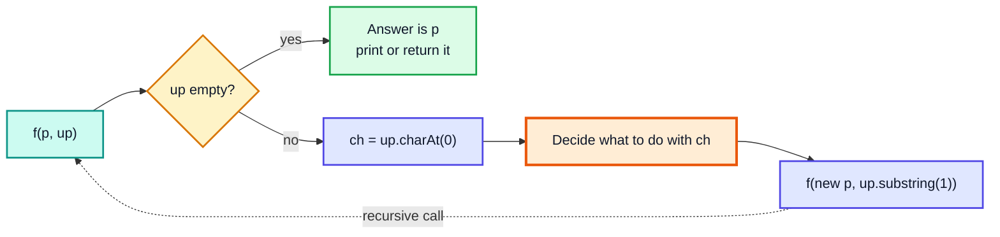

### Useful String Methods

| Method | What it does | Example | Result |
|---|---|---|---|
| `s.charAt(i)` | Character at index `i` | `"abc".charAt(0)` | `'a'` |
| `s.substring(i)` | Everything from index `i` to the end | `"abc".substring(1)` | `"bc"` |
| `s.substring(i, j)` | Indices `i` to `j - 1` | `"abcd".substring(1, 3)` | `"bc"` |
| `s.isEmpty()` | `true` if length is 0 | `"".isEmpty()` | `true` |
| `s.startsWith(x)` | Does `s` begin with `x`? | `"apple".startsWith("app")` | `true` |

> [!NOTE]
> `String` is **immutable**. `p + ch` and `up.substring(1)` each create a **new** string. That means recursive calls never mess up each other's data, which keeps these solutions simple, but each step costs O(n) to copy.

---

## 2. Q1 : Skip a character (2:19)

**Problem:** Remove every `'a'` from a string. `"baccad"` → `"bccd"`.

### Approach 1: Pass the Answer Down (`p`, `up`)

At each step look at the first character of `up`:
- if it is `'a'`, **skip** it: don't add it to `p`
- otherwise **add** it to `p`

Either way, recurse on the rest of `up`.

```java
public class SkipChar {
    static void skip(String p, String up) {
        if (up.isEmpty()) {          // base case: nothing left
            System.out.println(p);
            return;
        }
        char ch = up.charAt(0);
        if (ch == 'a') {
            skip(p, up.substring(1));        // ignore 'a'
        } else {
            skip(p + ch, up.substring(1));   // keep ch
        }
    }

    public static void main(String[] args) {
        skip("", "baccad");   // bccd
    }
}
```

### Dry Run: `skip("", "baccad")`

| Call | `p` | `up` | `ch` | Action |
|---|---|---|---|---|
| 1 | `""` | `baccad` | `b` | ✅ keep → `p = "b"` |
| 2 | `"b"` | `accad` | `a` | ❌ skip |
| 3 | `"b"` | `ccad` | `c` | ✅ keep → `"bc"` |
| 4 | `"bc"` | `cad` | `c` | ✅ keep → `"bcc"` |
| 5 | `"bcc"` | `ad` | `a` | ❌ skip |
| 6 | `"bcc"` | `d` | `d` | ✅ keep → `"bccd"` |
| 7 | `"bccd"` | `""` | — | 🟩 base case → print `bccd` |

### Approach 2: Return the Answer (Only `up`)

Instead of carrying `p`, each call **returns** the cleaned-up rest of the string, and the caller puts its own character in front.

```java
public class SkipCharReturn {
    static String skip(String up) {
        if (up.isEmpty()) return "";
        char ch = up.charAt(0);
        if (ch == 'a') {
            return skip(up.substring(1));        // drop ch
        }
        return ch + skip(up.substring(1));       // ch + answer for the rest
    }

    public static void main(String[] args) {
        System.out.println(skip("baccad"));      // bccd
    }
}
```

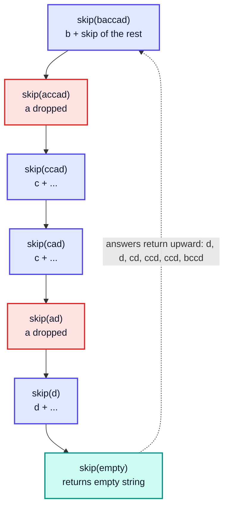

| | **Pass `p` down** | **Return the answer** |
|---|---|---|
| Signature | `void skip(String p, String up)` | `String skip(String up)` |
| Answer lives in | The argument | The return value |
| Work happens | On the way **down** | On the way **back up** |
| Best when | You only print results | You need the result as a value |

### Complexity

- **Time:** n calls, and each one makes a `substring` and possibly a concatenation of O(n) → **O(n²)**.
- **Space:** recursion depth **O(n)** (plus the temporary strings).

> [!TIP]
> To make it O(n), pass an **index** instead of `substring(1)` and build the answer in a `StringBuilder`. Kunal uses `substring` because it makes the idea clearer to read.

### Alternative: Iterative / Built-in

```java
String s = "baccad";
StringBuilder sb = new StringBuilder();
for (char c : s.toCharArray()) {
    if (c != 'a') sb.append(c);
}
System.out.println(sb);                   // bccd
System.out.println(s.replace("a", ""));  // bccd
```

---

## 3. Q2 : Skip a string (17:30)

**Problem:** Remove every occurrence of `"apple"`. `"bcdapplefg"` → `"bcdfg"`.

### Approach

Same shape as Q1, but instead of checking one character we check whether `up` **starts with** `"apple"`. If it does, jump forward by `"apple".length()` = 5 characters.

```java
public class SkipString {
    static String skipApple(String up) {
        if (up.isEmpty()) return "";
        if (up.startsWith("apple")) {
            return skipApple(up.substring(5));          // skip all 5 chars
        }
        return up.charAt(0) + skipApple(up.substring(1));
    }

    public static void main(String[] args) {
        System.out.println(skipApple("bcdapplefg"));    // bcdfg
        System.out.println(skipApple("appleapplex"));   // x
    }
}
```

### Dry Run: `skipApple("bcdapplefg")`

| `up` | starts with `apple`? | Action |
|---|---|---|
| `bcdapplefg` | ❌ | keep `b` |
| `cdapplefg` | ❌ | keep `c` |
| `dapplefg` | ❌ | keep `d` |
| `applefg` | ✅ | 🟥 skip 5 chars |
| `fg` | ❌ | keep `f` |
| `g` | ❌ | keep `g` |
| `""` | — | return `""` |

Result: `"bcd" + "" + "fg"` = **`bcdfg`**.

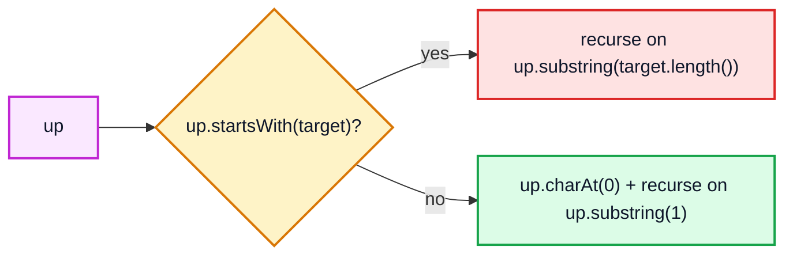

> [!TIP]
> Avoid hard-coding `5`. Write a general version: `skip(String up, String target)` and use `up.substring(target.length())`.

**Complexity:** O(n · m) for the `startsWith` checks (m = target length) plus O(n²) for the substrings. Recursion depth is O(n).

---

## 4. Q3 : Skip a string if it's not the required string (21:32)

**Problem:** Remove `"app"`, but **not** when it is part of `"apple"`. `"bcappdapplefg"` → `"bcdapplefg"`.

### Approach

Add one more check: skip only when `up` starts with `"app"` **and does not** start with `"apple"`.

```java
public class SkipAppNotApple {
    static String skipAppNotApple(String up) {
        if (up.isEmpty()) return "";
        if (up.startsWith("app") && !up.startsWith("apple")) {
            return skipAppNotApple(up.substring(3));     // skip "app"
        }
        return up.charAt(0) + skipAppNotApple(up.substring(1));
    }

    public static void main(String[] args) {
        System.out.println(skipAppNotApple("bcappdapplefg"));   // bcdapplefg
    }
}
```

| `up` (start) | `app`? | `apple`? | Action |
|---|---|---|---|
| `bcappd…` | ❌ | ❌ | keep `b` |
| `cappd…` | ❌ | ❌ | keep `c` |
| `appdapplefg` | ✅ | ❌ | 🟥 skip 3 |
| `dapplefg` | ❌ | ❌ | keep `d` |
| `applefg` | ✅ | ✅ | 🟩 keep `a` (it's an apple) |
| `pplefg` … | ❌ | ❌ | keep each char |

> [!WARNING]
> Once you keep the `a` of `"apple"`, the next `up` is `"pplefg"`, which no longer starts with `"app"`, so the rest of `apple` is kept automatically. Watch out for these overlap cases when you change the conditions.

---

## 5. Subsets Introduction (24:34)

### Subset vs Subsequence vs Substring

| Term | Order kept? | Must be contiguous? | Example from `"abc"` | Count |
|---|---|---|---|---|
| **Substring / subarray** | ✅ | ✅ | `"ab"`, `"bc"` (not `"ac"`) | n(n+1)/2 non-empty |
| **Subsequence** | ✅ | ❌ | `"ac"` ✅, `"ca"` ❌ | 2ⁿ (incl. empty) |
| **Subset** (of a set/array) | not relevant | ❌ | `{a, c}` | 2ⁿ (incl. empty) |
| **Permutation** | order is the point | — | `"cab"` | n! |

For `"abc"`, the 8 subsequences are: `"" , a, b, c, ab, ac, bc, abc`.

### Why 2ⁿ?

Each element has exactly **two** choices: **take it** or **leave it**. n independent binary choices give 2 × 2 × … × 2 = **2ⁿ** combinations.

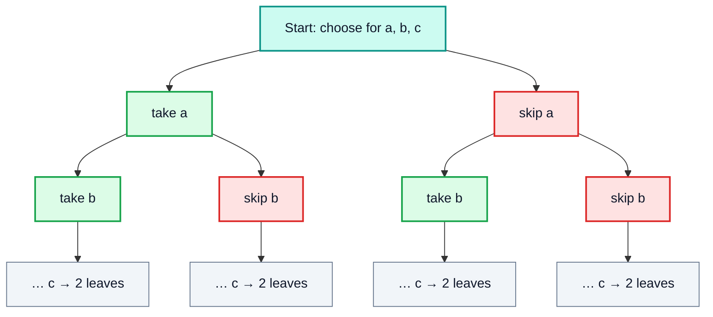

### The Bitmask View

Each subset matches an n-bit number: bit `i` = 1 means "take element i". For `[a, b, c]`:

| Number | Bits (c b a) | Subset |
|---|---|---|
| 0 | 000 | `{}` |
| 1 | 001 | `{a}` |
| 2 | 010 | `{b}` |
| 3 | 011 | `{a, b}` |
| 4 | 100 | `{c}` |
| 5 | 101 | `{a, c}` |
| 6 | 110 | `{b, c}` |
| 7 | 111 | `{a, b, c}` |

```java
public class BitmaskSubsets {
    public static void main(String[] args) {
        String s = "abc";
        int n = s.length();
        for (int mask = 0; mask < (1 << n); mask++) {
            StringBuilder sb = new StringBuilder();
            for (int i = 0; i < n; i++) {
                if ((mask & (1 << i)) != 0) sb.append(s.charAt(i));
            }
            System.out.print("[" + sb + "]");
        }
        // [][a][b][ab][c][ac][bc][abc]
    }
}
```

> [!NOTE]
> The bitmask method is a third way to build subsets (next to recursion and the iterative method in Q8). It only works when n ≤ 30 for an `int` mask (or ≤ 62 for a `long`), which is fine because 2ⁿ results would be too many anyway.

---

## 6. When to apply subset problem? (31:35)

Use the subset / take-or-leave pattern when:

- the problem asks for **all combinations**, **all subsequences** or **all subsets**
- every element can be **included or excluded** (or has a small fixed set of choices)
- you must explore every choice: "count the ways", "does any selection add up to X", "generate all …"

| Problem signal | Pattern |
|---|---|
| "All subsets / power set" | Subset (2 calls) |
| "All subsequences of a string" | Subset (2 calls) |
| "Combinations that sum to target" | Subset with pruning |
| "All arrangements / orderings" | **Permutations** (video #33) |
| "Contiguous part" | Not subsets: use sliding window / two loops |

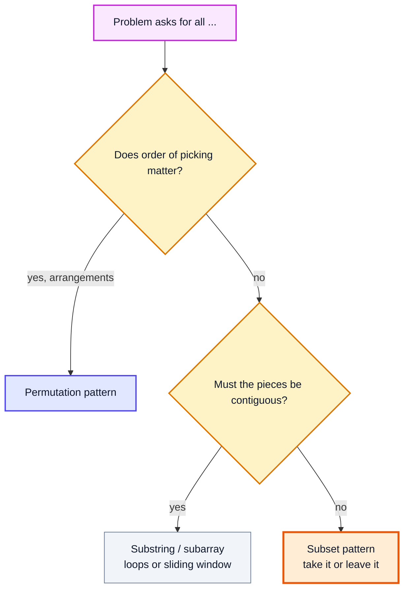

---

## 7. Q4 : Subsequences (32:35)

**Problem:** Print all subsequences of `"abc"`.

### Approach

For the first character `ch` of `up`, make **two** calls:
1. **Take** `ch`: `subseq(p + ch, up.substring(1))`
2. **Ignore** `ch`: `subseq(p, up.substring(1))`

When `up` is empty, `p` is one complete subsequence: print it.

```java
public class Subsequences {
    static void subseq(String p, String up) {
        if (up.isEmpty()) {
            System.out.print("[" + p + "] ");
            return;
        }
        char ch = up.charAt(0);
        subseq(p + ch, up.substring(1));  // take ch
        subseq(p, up.substring(1));       // ignore ch
    }

    public static void main(String[] args) {
        subseq("", "abc");
        // [abc] [ab] [ac] [a] [bc] [b] [c] []
    }
}
```

### Recursion Tree for `subseq("", "abc")`

Left edge = **take**, right edge = **ignore**. Leaves are the answers.

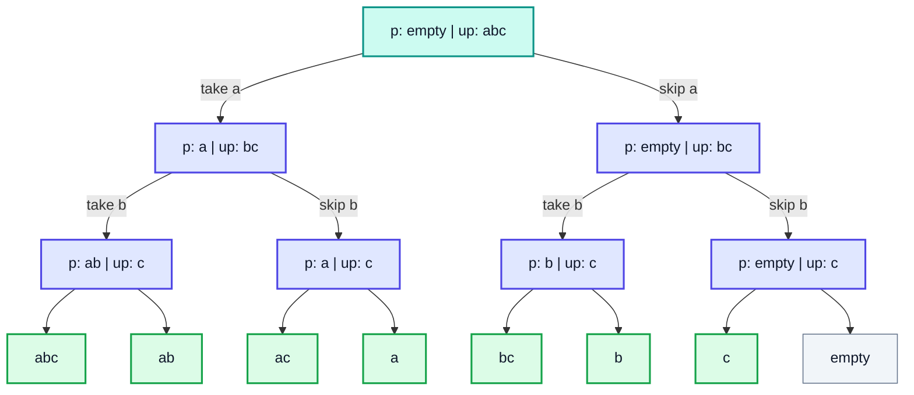

### Order of Execution (first few calls)

| Step | Call | Output |
|---|---|---|
| 1 | `("", "abc")` → take a | |
| 2 | `("a", "bc")` → take b | |
| 3 | `("ab", "c")` → take c | |
| 4 | `("abc", "")` | 🟩 `[abc]` |
| 5 | back in `("ab", "c")` → skip c → `("ab", "")` | 🟩 `[ab]` |
| 6 | back in `("a", "bc")` → skip b → `("a", "c")` → take c | 🟩 `[ac]` |
| … | … | … |

> [!IMPORTANT]
> The recursion is **depth-first**: the full "take" branch finishes before the "ignore" branch starts. That is why `abc` is printed first and the empty string last.

### Complexity

- **Calls:** 2⁰ + 2¹ + … + 2ⁿ = 2ⁿ⁺¹ − 1 → **O(2ⁿ)** calls
- **Time:** each call does O(n) string work → **O(n · 2ⁿ)**
- **Auxiliary space:** recursion depth **O(n)** (printing only, nothing is stored)

### LeetCode Connection

This is the string version of **LeetCode 78 – Subsets**. The recursive array version:

```java
import java.util.ArrayList;
import java.util.List;

public class SubsetsRecursive {
    static void helper(int[] nums, int i, List<Integer> cur, List<List<Integer>> ans) {
        if (i == nums.length) {
            ans.add(new ArrayList<>(cur));  // copy! cur keeps changing
            return;
        }
        cur.add(nums[i]);                   // take
        helper(nums, i + 1, cur, ans);
        cur.remove(cur.size() - 1);         // undo (backtrack)
        helper(nums, i + 1, cur, ans);      // ignore
    }

    public static void main(String[] args) {
        List<List<Integer>> ans = new ArrayList<>();
        helper(new int[]{1, 2, 3}, 0, new ArrayList<>(), ans);
        System.out.println(ans);
        // [[1, 2, 3], [1, 2], [1, 3], [1], [2, 3], [2], [3], []]
    }
}
```

> [!CAUTION]
> With a **mutable** list you must (a) add a **copy** to the answer and (b) **undo** the change after the take-call. Strings didn't need this because they are immutable, so every call gets its own `p`.

---

## 8. Q5 : Return an ArrayList of string (43:11)

**Problem:** Return the subsequences instead of printing them.

### Approach 1: Each Call Returns Its Own List (Kunal's Way)

- Base case: create a **new** list containing just `p` and return it.
- Otherwise: get the list from the "take" call and the list from the "ignore" call, **merge** them, and return the result.

```java
import java.util.ArrayList;

public class SubseqList {
    static ArrayList<String> subseq(String p, String up) {
        if (up.isEmpty()) {
            ArrayList<String> list = new ArrayList<>();
            list.add(p);
            return list;
        }
        char ch = up.charAt(0);
        ArrayList<String> left  = subseq(p + ch, up.substring(1));
        ArrayList<String> right = subseq(p, up.substring(1));
        left.addAll(right);
        return left;
    }

    public static void main(String[] args) {
        System.out.println(subseq("", "abc"));
        // [abc, ab, ac, a, bc, b, c, ]
    }
}
```

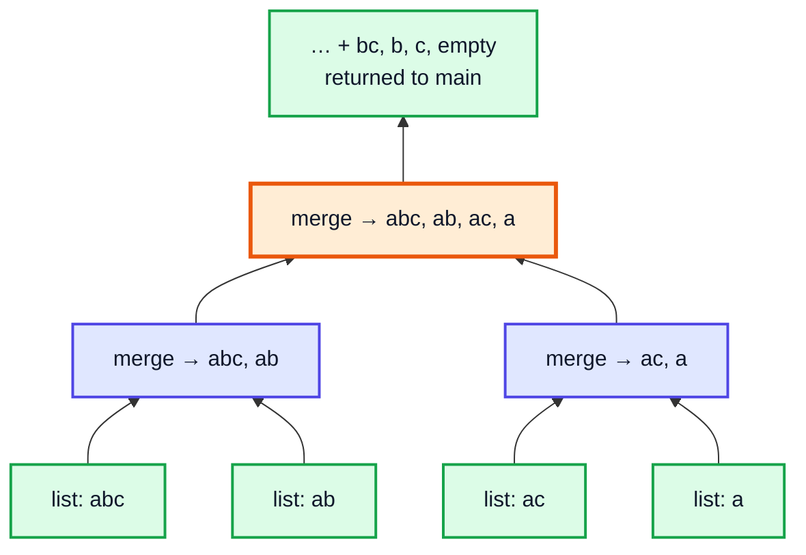

### Approach 2: Pass One List Down

```java
import java.util.ArrayList;
import java.util.List;

public class SubseqListArg {
    static void subseq(String p, String up, List<String> ans) {
        if (up.isEmpty()) {
            ans.add(p);
            return;
        }
        char ch = up.charAt(0);
        subseq(p + ch, up.substring(1), ans);
        subseq(p, up.substring(1), ans);
    }

    public static void main(String[] args) {
        List<String> ans = new ArrayList<>();
        subseq("", "abc", ans);
        System.out.println(ans);   // [abc, ab, ac, a, bc, b, c, ]
    }
}
```

| | **List in the return value** | **List as an argument** |
|---|---|---|
| Lists created | One per leaf + merges | Exactly one |
| Extra copying | `addAll` at every level | None |
| Pure function? | ✅ (no shared state) | ❌ (changes `ans`) |
| Video's point | Shows how answers flow **up** the tree | Easier and faster in practice |

> [!TIP]
> Do **not** declare the list inside the function body for the argument style. Every call would get a new empty list and the answers would be lost. The list must be created **once** (in `main` or in the base case of the return style).

---

## 9. Q6 : Print ASCII value of a character (52:10)

A `char` in Java is a 16-bit unsigned number (a UTF-16 code unit). In arithmetic it is **widened to `int`** automatically.

```java
public class AsciiDemo {
    public static void main(String[] args) {
        char ch = 'a';
        System.out.println(ch);            // a
        System.out.println(ch + 0);        // 97   (char + int → int)
        System.out.println((int) ch);      // 97   (explicit cast)
        System.out.println((char) (ch + 1)); // b  (int back to char)
        System.out.println("" + ch + 1);   // a1   (string concatenation, left to right)
        System.out.println(ch + 1 + "");   // 98   (math first, then string)
    }
}
```

| Expression | Type | Value |
|---|---|---|
| `'a'` | `char` | `a` |
| `'a' + 0` | `int` | `97` |
| `'A' + 0` | `int` | `65` |
| `'0' + 0` | `int` | `48` |
| `(char) 98` | `char` | `b` |
| `"x" + ('a' + 0)` | `String` | `x97` |

> [!WARNING]
> `+` is evaluated **left to right**. Once one side is a `String`, everything after it is concatenated. That is why Q7 writes `p + (ch + 0)`: the parentheses make sure `ch + 0` becomes the number `97` **before** it is joined to `p`.

---

## 10. Q7 : Subsequences with ASCII values (54:15)

**Problem:** For each character you now have **three** choices: take the character, skip it, or take its **ASCII value**. For `"ab"`: `ab, a, a98, b, "", 98, 97b, 97, 9798`.

### Approach

Same as Q5, with a third recursive call.

```java
import java.util.ArrayList;

public class SubseqAscii {
    static ArrayList<String> subseqAscii(String p, String up) {
        if (up.isEmpty()) {
            ArrayList<String> list = new ArrayList<>();
            list.add(p);
            return list;
        }
        char ch = up.charAt(0);
        ArrayList<String> first  = subseqAscii(p + ch, up.substring(1));        // take char
        ArrayList<String> second = subseqAscii(p, up.substring(1));             // skip
        ArrayList<String> third  = subseqAscii(p + (ch + 0), up.substring(1));  // take ASCII
        first.addAll(second);
        first.addAll(third);
        return first;
    }

    public static void main(String[] args) {
        ArrayList<String> ans = subseqAscii("", "ab");
        System.out.println(ans.size() + " " + ans);
        // 9 [ab, a, a98, b, , 98, 97b, 97, 9798]
    }
}
```

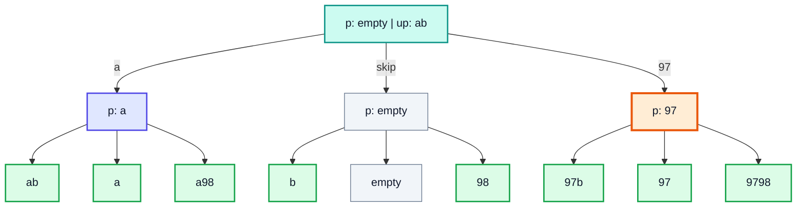

### Complexity

| Choices per element | Number of answers | Time |
|---|---|---|
| 2 (take / skip) | 2ⁿ | O(n · 2ⁿ) |
| 3 (take / skip / ASCII) | 3ⁿ | O(n · 3ⁿ) |
| k | kⁿ | O(n · kⁿ) |

> [!NOTE]
> General rule: **(number of choices) ^ (depth)** leaves. This branching-factor idea also explains why permutations (n, then n−1, then …) give n! in video #33.

---

## 11. Q8 : Iterative program to print subsequences (58:21)

**Problem:** Return all subsets of an integer array **without recursion**. This is **LeetCode 78 – Subsets**.

### Approach: Grow the List One Element at a Time

Start with `[[]]` (just the empty subset). For each number, **copy every subset you already have, add the number to the copy**, and append these copies to the list.

| After processing | Subsets list |
|---|---|
| start | `[]` |
| `1` | `[]`, `[1]` |
| `2` | `[]`, `[1]`, `[2]`, `[1,2]` |
| `3` | `[]`, `[1]`, `[2]`, `[1,2]`, `[3]`, `[1,3]`, `[2,3]`, `[1,2,3]` |

Each step **doubles** the size, so after n numbers you have 2ⁿ subsets.

```java
import java.util.ArrayList;
import java.util.List;

public class SubsetsIterative {
    static List<List<Integer>> subsets(int[] arr) {
        List<List<Integer>> outer = new ArrayList<>();
        outer.add(new ArrayList<>());                 // empty subset
        for (int num : arr) {
            int n = outer.size();                     // freeze size BEFORE adding
            for (int i = 0; i < n; i++) {
                List<Integer> internal = new ArrayList<>(outer.get(i)); // copy
                internal.add(num);
                outer.add(internal);
            }
        }
        return outer;
    }

    public static void main(String[] args) {
        System.out.println(subsets(new int[]{1, 2, 3}));
        // [[], [1], [2], [1, 2], [3], [1, 3], [2, 3], [1, 2, 3]]
    }
}
```

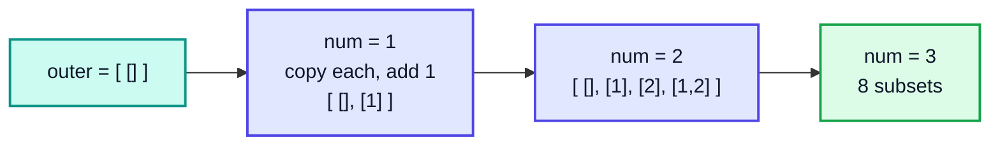

> [!CAUTION]
> Two common bugs:
> 1. Writing `for (int i = 0; i < outer.size(); i++)`: the list grows while you loop, so it **never ends** (until you run out of memory). Save `n = outer.size()` first.
> 2. Writing `outer.get(i).add(num)` without copying: this **changes the existing subset**, so you lose the version without `num`.

### Memory: Why a Copy Is Needed

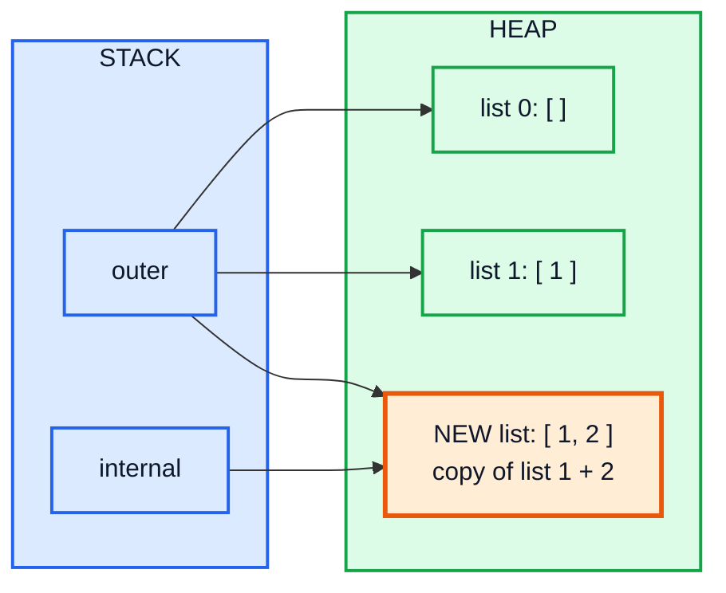

---

## 12. Complexity Analysis (1:09:48)

### Iterative Subsets

- **Number of subsets:** 2ⁿ
- **Copy cost:** each new subset is copied from an existing one of up to n elements → O(n) each
- **Time:** **O(n · 2ⁿ)**
- **Space:** 2ⁿ lists, average size n/2 → **O(n · 2ⁿ)** (this is the output itself, you can't do better)

### Summary for This Video

| Problem | Calls / iterations | Time | Extra space (excl. output) |
|---|---|---|---|
| Skip char / skip string | n | O(n²) with `substring` | O(n) depth |
| Subsequences (print) | 2ⁿ⁺¹ − 1 | O(n · 2ⁿ) | O(n) depth |
| Subsequences (return list) | 2ⁿ⁺¹ − 1 | O(n · 2ⁿ) | O(n) depth + merges |
| Subsequences with ASCII | (3ⁿ⁺¹ − 1)/2 | O(n · 3ⁿ) | O(n) depth |
| Iterative subsets | 2ⁿ copies | O(n · 2ⁿ) | O(1) besides output |
| Subsets with duplicates | ≤ 2ⁿ copies | O(n log n + n · 2ⁿ) | O(1) besides output |

> [!NOTE]
> Exponential algorithms are fine here because the **output itself** is exponential. You cannot list 2ⁿ subsets in less than 2ⁿ time. Expect n to be small (LeetCode 78 has n ≤ 10).

---

## 13. Q9 : Subsequences of a string with duplicate elements (1:12:15)

**Problem:** Return all **unique** subsets when the array has duplicates. `[1, 2, 2]` → `[], [1], [2], [1,2], [2,2], [1,2,2]`. This is **LeetCode 90 – Subsets II**. (The video works on an integer array; for a string the idea is exactly the same.)

### Why the Basic Method Gives Duplicates

Running Q8 on `[1, 2, 2]` produces `[2]` twice and `[1, 2]` twice: the second `2` is added to every old subset, including the ones that already got the first `2` added in the step before.

### Approach

1. **Sort** the array so that duplicates sit next to each other.
2. When the current number is the **same as the previous one**, add it **only to the subsets created in the previous step**, not to all of them.

Keep track of `start` and `end`:
- `end` = last index of the list **before** this step
- if `arr[i] == arr[i-1]`: `start = (previous end) + 1`, else `start = 0`

```java
import java.util.ArrayList;
import java.util.Arrays;
import java.util.List;

public class SubsetsWithDup {
    static List<List<Integer>> subsetsWithDup(int[] arr) {
        Arrays.sort(arr);
        List<List<Integer>> outer = new ArrayList<>();
        outer.add(new ArrayList<>());
        int start, end = 0;
        for (int i = 0; i < arr.length; i++) {
            start = 0;
            if (i > 0 && arr[i] == arr[i - 1]) {
                start = end + 1;             // only the subsets added last round
            }
            end = outer.size() - 1;
            int n = outer.size();
            for (int j = start; j < n; j++) {
                List<Integer> internal = new ArrayList<>(outer.get(j));
                internal.add(arr[i]);
                outer.add(internal);
            }
        }
        return outer;
    }

    public static void main(String[] args) {
        System.out.println(subsetsWithDup(new int[]{2, 1, 2}));
        // [[], [1], [2], [1, 2], [2, 2], [1, 2, 2]]
    }
}
```

### Dry Run: `[1, 2, 2]` (after sorting)

| i | `arr[i]` | duplicate? | `start` | `end` | Copy from indices | New subsets | List after |
|---|---|---|---|---|---|---|---|
| 0 | 1 | ❌ | 0 | 0 | 0 | `[1]` | `[] [1]` |
| 1 | 2 | ❌ | 0 | 1 | 0–1 | `[2] [1,2]` | `[] [1] [2] [1,2]` |
| 2 | 2 | ✅ | **2** | 3 | 🟧 2–3 only | `[2,2] [1,2,2]` | 6 subsets ✅ |

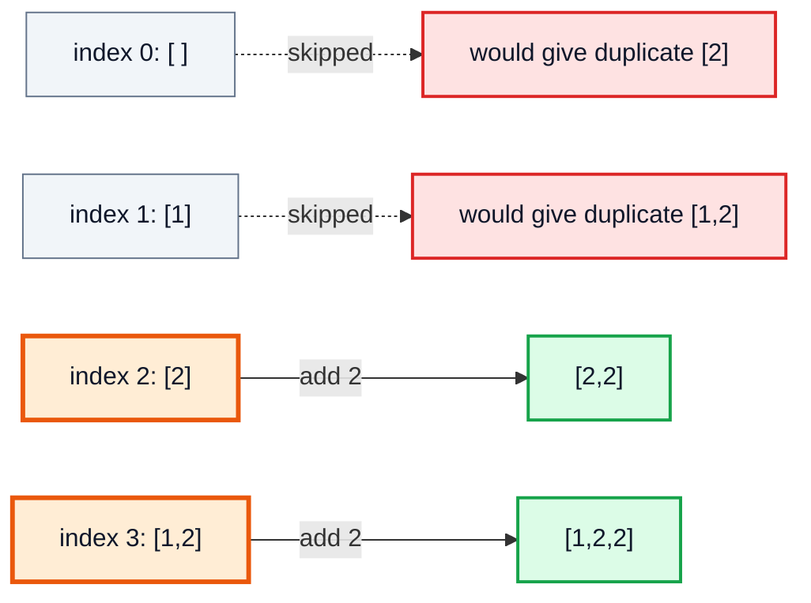

> [!IMPORTANT]
> Sorting is **required**. Without it, equal values may not be next to each other, and the `arr[i] == arr[i-1]` check misses them.

### Alternative: Recursive (Backtracking) Version

```java
import java.util.ArrayList;
import java.util.Arrays;
import java.util.List;

public class SubsetsWithDupRec {
    static void helper(int[] a, int idx, List<Integer> cur, List<List<Integer>> ans) {
        ans.add(new ArrayList<>(cur));
        for (int i = idx; i < a.length; i++) {
            if (i > idx && a[i] == a[i - 1]) continue;  // skip same value at same level
            cur.add(a[i]);
            helper(a, i + 1, cur, ans);
            cur.remove(cur.size() - 1);
        }
    }

    public static void main(String[] args) {
        int[] a = {1, 2, 2};
        Arrays.sort(a);
        List<List<Integer>> ans = new ArrayList<>();
        helper(a, 0, new ArrayList<>(), ans);
        System.out.println(ans);   // [[], [1], [1, 2], [1, 2, 2], [2], [2, 2]]
    }
}
```

| Approach | Needs sort | Time | Notes |
|---|---|---|---|
| Iterative with `start`/`end` (video) | ✅ | O(n log n + n · 2ⁿ) | No recursion |
| Backtracking, skip same value per level | ✅ | O(n log n + n · 2ⁿ) | Common in interviews |
| Generate all + `HashSet<List<Integer>>` | ✅ (so lists compare equal) | O(n · 2ⁿ) + hashing | Simple but wastes work |

---

## 14. Outro (1:22:07)

Next up is **part 2: permutations** (video #33), which reuses the `p` / `up` pattern but inserts each character at **every position** instead of choosing take or leave.

> [!TIP]
> Practise: LeetCode 78 (Subsets), 90 (Subsets II), 17 (Letter Combinations of a Phone Number), and write your own "remove all occurrences of a substring" recursively.

---

## 🧩 Complete Example: Everything Together

```java
import java.util.ArrayList;
import java.util.Arrays;
import java.util.List;

public class SubsetStringRecursion {

    // Q1: skip every 'a' (processed / unprocessed style)
    static void skip(String p, String up) {
        if (up.isEmpty()) {
            System.out.println(p);
            return;
        }
        char ch = up.charAt(0);
        if (ch == 'a') {
            skip(p, up.substring(1));
        } else {
            skip(p + ch, up.substring(1));
        }
    }

    // Q1 (return style)
    static String skipReturn(String up) {
        if (up.isEmpty()) return "";
        char ch = up.charAt(0);
        if (ch == 'a') return skipReturn(up.substring(1));
        return ch + skipReturn(up.substring(1));
    }

    // Q2: skip every "apple"
    static String skipApple(String up) {
        if (up.isEmpty()) return "";
        if (up.startsWith("apple")) return skipApple(up.substring(5));
        return up.charAt(0) + skipApple(up.substring(1));
    }

    // Q3: skip "app" only when it is not part of "apple"
    static String skipAppNotApple(String up) {
        if (up.isEmpty()) return "";
        if (up.startsWith("app") && !up.startsWith("apple")) return skipAppNotApple(up.substring(3));
        return up.charAt(0) + skipAppNotApple(up.substring(1));
    }

    // Q4: print all subsequences
    static void subseq(String p, String up) {
        if (up.isEmpty()) {
            System.out.print("[" + p + "] ");
            return;
        }
        char ch = up.charAt(0);
        subseq(p + ch, up.substring(1)); // take
        subseq(p, up.substring(1));      // ignore
    }

    // Q5: return subsequences as a list
    static ArrayList<String> subseqList(String p, String up) {
        if (up.isEmpty()) {
            ArrayList<String> list = new ArrayList<>();
            list.add(p);
            return list;
        }
        char ch = up.charAt(0);
        ArrayList<String> left = subseqList(p + ch, up.substring(1));
        ArrayList<String> right = subseqList(p, up.substring(1));
        left.addAll(right);
        return left;
    }

    // Q7: subsequences with ASCII values (3 choices per character)
    static ArrayList<String> subseqAscii(String p, String up) {
        if (up.isEmpty()) {
            ArrayList<String> list = new ArrayList<>();
            list.add(p);
            return list;
        }
        char ch = up.charAt(0);
        ArrayList<String> first = subseqAscii(p + ch, up.substring(1));
        ArrayList<String> second = subseqAscii(p, up.substring(1));
        ArrayList<String> third = subseqAscii(p + (ch + 0), up.substring(1));
        first.addAll(second);
        first.addAll(third);
        return first;
    }

    // Q8: iterative subsets
    static List<List<Integer>> subsets(int[] arr) {
        List<List<Integer>> outer = new ArrayList<>();
        outer.add(new ArrayList<>());
        for (int num : arr) {
            int n = outer.size();
            for (int i = 0; i < n; i++) {
                List<Integer> internal = new ArrayList<>(outer.get(i));
                internal.add(num);
                outer.add(internal);
            }
        }
        return outer;
    }

    // Q9: iterative subsets with duplicates
    static List<List<Integer>> subsetsWithDup(int[] arr) {
        int[] a = arr.clone();
        Arrays.sort(a);
        List<List<Integer>> outer = new ArrayList<>();
        outer.add(new ArrayList<>());
        int start, end = 0;
        for (int i = 0; i < a.length; i++) {
            start = 0;
            if (i > 0 && a[i] == a[i - 1]) {
                start = end + 1;
            }
            end = outer.size() - 1;
            int n = outer.size();
            for (int j = start; j < n; j++) {
                List<Integer> internal = new ArrayList<>(outer.get(j));
                internal.add(a[i]);
                outer.add(internal);
            }
        }
        return outer;
    }

    public static void main(String[] args) {
        System.out.print("Q1 skip 'a' (print): ");
        skip("", "baccad");
        System.out.println("Q1 skip 'a' (return): " + skipReturn("baccad"));
        System.out.println("Q2 skip apple: " + skipApple("bcdapplefg"));
        System.out.println("Q3 skip app, keep apple: " + skipAppNotApple("bcappdapplefg"));

        System.out.print("Q4 subsequences of abc: ");
        subseq("", "abc");
        System.out.println();

        System.out.println("Q5 list of abc: " + subseqList("", "abc"));
        System.out.println("Q6 ASCII of 'a': " + ('a' + 0) + ", (char)('a' + 1) = " + (char) ('a' + 1));
        ArrayList<String> ascii = subseqAscii("", "ab");
        System.out.println("Q7 ASCII subsequences of ab (" + ascii.size() + "): " + ascii);

        System.out.println("Q8 subsets of [1, 2, 3]: " + subsets(new int[]{1, 2, 3}));
        System.out.println("Q9 subsets of [1, 2, 2]: " + subsetsWithDup(new int[]{1, 2, 2}));
    }
}
```

**Expected Output:**
```
Q1 skip 'a' (print): bccd
Q1 skip 'a' (return): bccd
Q2 skip apple: bcdfg
Q3 skip app, keep apple: bcdapplefg
Q4 subsequences of abc: [abc] [ab] [ac] [a] [bc] [b] [c] [] 
Q5 list of abc: [abc, ab, ac, a, bc, b, c, ]
Q6 ASCII of 'a': 97, (char)('a' + 1) = b
Q7 ASCII subsequences of ab (9): [ab, a, a98, b, , 98, 97b, 97, 9798]
Q8 subsets of [1, 2, 3]: [[], [1], [2], [1, 2], [3], [1, 3], [2, 3], [1, 2, 3]]
Q9 subsets of [1, 2, 2]: [[], [1], [2], [1, 2], [2, 2], [1, 2, 2]]
```

---

## Quick Reference Cheat Sheet

| Concept | One-Line Summary |
|---|---|
| **Processed / Unprocessed** | `f(p, up)`: move one char from `up` to `p` per call; base case `up.isEmpty()` |
| **Pass down vs return** | Build the answer in arguments (on the way down) or in return values (on the way up) |
| **Skip a char** | `ch == 'a'` → recurse without adding it |
| **Skip a string** | `up.startsWith(t)` → recurse on `up.substring(t.length())` |
| **Skip X but not Y** | `startsWith("app") && !startsWith("apple")` |
| **Subsequence** | Keeps order, need not be contiguous; 2ⁿ of them |
| **Take it or leave it** | Two calls: `f(p + ch, rest)` and `f(p, rest)` |
| **Returning lists** | Base case returns a new list `[p]`; parents `addAll` the children's lists |
| **ASCII value** | `ch + 0` or `(int) ch`; `'a'` = 97, `'A'` = 65, `'0'` = 48 |
| **k choices per element** | kⁿ results; ASCII version is 3ⁿ |
| **Iterative subsets** | Start `[[]]`; for each num, copy every existing subset and add num (LC 78) |
| **Freeze size** | Store `n = outer.size()` before the inner loop |
| **Duplicates** | Sort; if `arr[i] == arr[i-1]`, start from `previous end + 1` (LC 90) |
| **Complexity** | O(n · 2ⁿ) time and space for subsets; recursion depth O(n) |
