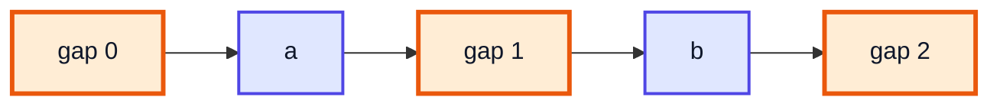
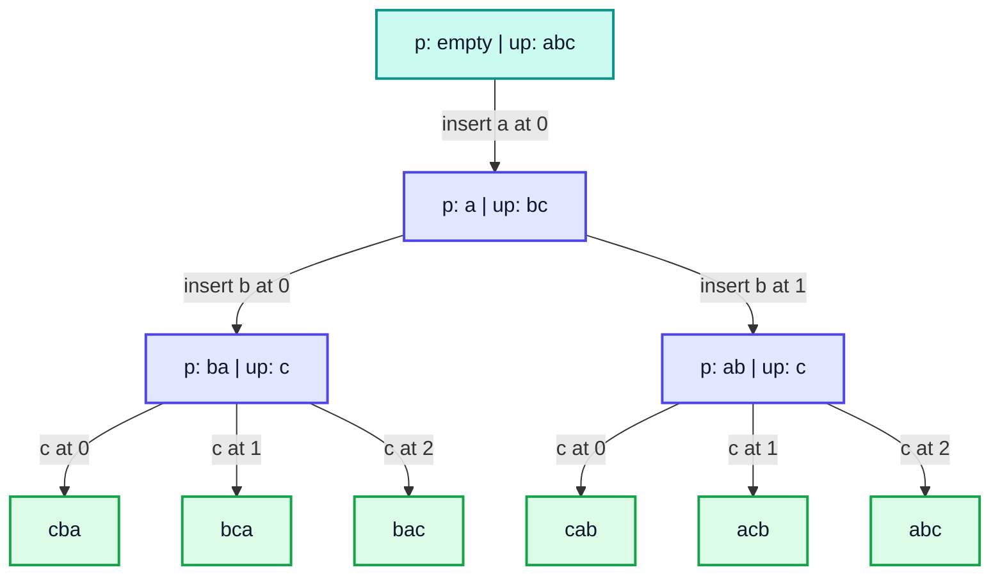
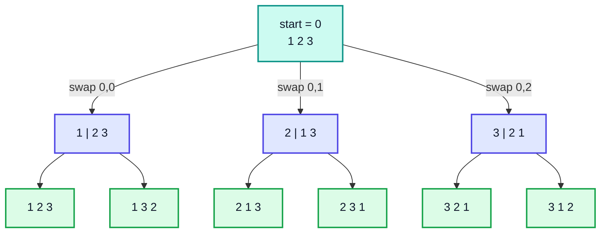
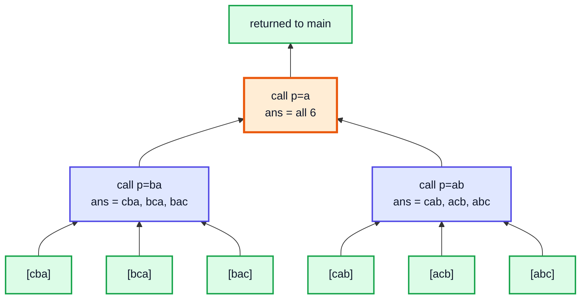
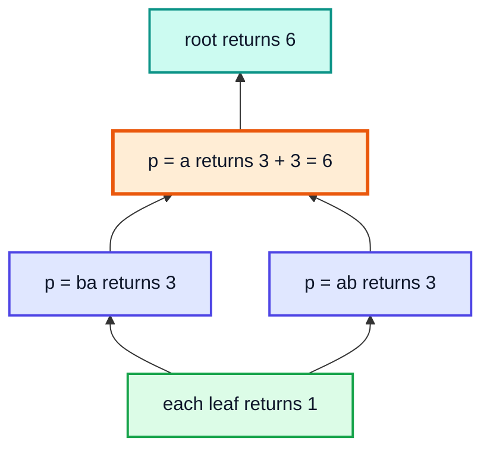

# Recursion: Permutations — Complete In-Depth Guide

**Video #33 of the Java + DSA playlist:** *Recursion - Permutations (Theory + Code + Tips)* (25:21)

Part 2 of the subset + string recursion series: what a permutation is, how to build every arrangement of a string by **inserting each character at every possible position**, how to return the results in an `ArrayList`, and how to count them, with recursion trees, dry runs and complexity.

---

## Table of Contents

| # | Topic | Timestamp |
|---|---|---|
| 0 | [Introduction](#0-introduction-000) | 0:00 |
| 1 | [What is Permutation?](#1-what-is-permutation-022) | 0:22 |
| 2 | [Permutation using Recursion](#2-permutation-using-recursion-153) | 1:53 |
| 3 | [Code for Permutation](#3-code-for-permutation-1148) | 11:48 |
| 4 | [Returning output as an ArrayList](#4-returning-output-as-an-arraylist-1542) | 15:42 |
| 5 | [Counting Number of Permutations](#5-counting-number-of-permutations-2012) | 20:12 |
| 6 | [Outro](#6-outro-2435) | 24:35 |

---

## 0. Introduction (0:00)

Video #32 built **subsets** with the `p` (processed) / `up` (unprocessed) pattern and the "take it or leave it" choice. Permutations use the **same `p` / `up` shape**, but the choice changes: every character is always used, and the question is **where** to put it.

> [!IMPORTANT]
> The recursion-tree way of thinking from the last video still applies: **number of choices at each level** × **number of levels** decides how many answers you get. For subsets that was 2 × 2 × … = 2ⁿ; for permutations it is 1 × 2 × 3 × … × n = **n!**.

---

## 1. What is Permutation? (0:22)

A **permutation** is an **arrangement** of all the elements in some order. Every element is used **exactly once**, and **order matters**.

For `"abc"` there are 6 permutations:

| # | Permutation |
|---|---|
| 1 | `abc` |
| 2 | `acb` |
| 3 | `bac` |
| 4 | `bca` |
| 5 | `cab` |
| 6 | `cba` |

### Subsets vs Permutations

| | **Subsets / Subsequences** | **Permutations** |
|---|---|---|
| Uses every element? | ❌ any number of them | ✅ all of them |
| Order matters? | ❌ (`ab` = `ba` as a set) | ✅ (`ab` ≠ `ba`) |
| Choice at each step | Take or leave (2) | Which position (1, 2, …, n) |
| Count for n distinct | 2ⁿ | n! |
| `"abc"` | 8 | 6 |
| LeetCode | 78 Subsets | **46 Permutations** |

### Why n!?

- The first position can be filled in **n** ways
- The second in **n − 1** ways (one element is used up)
- … the last in **1** way

n × (n − 1) × … × 1 = **n!**

| n | 2ⁿ (subsets) | n! (permutations) |
|---|---|---|
| 3 | 8 | 6 |
| 5 | 32 | 120 |
| 8 | 256 | 40,320 |
| 10 | 1,024 | 3,628,800 |
| 12 | 4,096 | 479,001,600 |

> [!WARNING]
> n! grows **much** faster than 2ⁿ. Generating all permutations is only practical for small n (LeetCode 46 limits n to 6). Past about n = 12 the count no longer fits comfortably in an `int`, and printing them all would take far too long.

---

## 2. Permutation using Recursion (1:53)

### The Idea: Insert the Next Character at Every Position

Take characters from `up` one at a time. A `p` of length k has **k + 1 gaps** where a new character can go: before the first character, between any two characters, or after the last one. Make one recursive call per gap.

For `p = "ab"` and `ch = 'c'`:

| Gap index `i` | `p.substring(0, i)` | + `ch` + | `p.substring(i)` | New `p` |
|---|---|---|---|---|
| 0 | `""` | `c` | `ab` | `cab` |
| 1 | `a` | `c` | `b` | `acb` |
| 2 | `ab` | `c` | `""` | `abc` |



### Recursion Tree for `"abc"`



| Level | `p` length | Calls made per node | Nodes at this level |
|---|---|---|---|
| 0 | 0 | 1 | 1 |
| 1 | 1 | 2 | 1 |
| 2 | 2 | 3 | 2 |
| 3 (leaves) | 3 | — | 6 = 3! |

> [!NOTE]
> The **number of calls inside a node = `p.length() + 1`**. This is why the code uses a **loop** around the recursive call instead of a fixed number of calls like the subsets code. The loop is what makes the branching factor grow level by level.

### Why This Gives Every Permutation Exactly Once

Each permutation of `abc` can be built in exactly one way: the relative order of `a` and `b` is fixed when `b` is inserted, and then `c` goes into one of the three gaps. Different insertion choices always give different strings, so there are no duplicates as long as the characters are **distinct**.

---

## 3. Code for Permutation (11:48)

```java
public class Permutations {
    static void permutations(String p, String up) {
        if (up.isEmpty()) {
            System.out.print(p + " ");
            return;
        }
        char ch = up.charAt(0);
        for (int i = 0; i <= p.length(); i++) {      // p.length() + 1 gaps
            String first = p.substring(0, i);
            String second = p.substring(i);
            permutations(first + ch + second, up.substring(1));
        }
    }

    public static void main(String[] args) {
        permutations("", "abc");
        // cba bca bac cab acb abc
    }
}
```

### Dry Run (first branch)

| Call | `p` | `up` | `ch` | Loop `i` | Next call |
|---|---|---|---|---|---|
| 1 | `""` | `abc` | `a` | 0 | `("a", "bc")` |
| 2 | `"a"` | `bc` | `b` | 0 | `("ba", "c")` |
| 3 | `"ba"` | `c` | `c` | 0 | `("cba", "")` → 🟩 print `cba` |
| 3 | `"ba"` | `c` | `c` | 1 | `("bca", "")` → 🟩 print `bca` |
| 3 | `"ba"` | `c` | `c` | 2 | `("bac", "")` → 🟩 print `bac` |
| 2 | `"a"` | `bc` | `b` | 1 | `("ab", "c")` → `cab`, `acb`, `abc` |

> [!TIP]
> `p.substring(i)` is the same as `p.substring(i, p.length())`. When `i == p.length()` it returns `""` (not an error), which is how the last gap ("append at the end") works.

### Complexity

- **Leaves:** n!
- **Total calls:** 1 + 1 + 2! + 3! + … + n! = O(n!)
- **Work per call:** building strings of length up to n → O(n)
- **Time:** **O(n · n!)**
- **Auxiliary space:** recursion depth **O(n)** (plus the strings on the current path)

### Alternative: Swap-Based Backtracking (LeetCode 46)

The usual interview solution fixes one position at a time and **swaps** each remaining element into it.

```java
import java.util.ArrayList;
import java.util.List;

public class PermuteSwap {
    static void permute(int[] nums, int start, List<List<Integer>> ans) {
        if (start == nums.length) {
            List<Integer> cur = new ArrayList<>();
            for (int x : nums) cur.add(x);
            ans.add(cur);
            return;
        }
        for (int i = start; i < nums.length; i++) {
            swap(nums, start, i);           // choose nums[i] for position start
            permute(nums, start + 1, ans);
            swap(nums, start, i);           // undo (backtrack)
        }
    }

    static void swap(int[] a, int i, int j) {
        int t = a[i]; a[i] = a[j]; a[j] = t;
    }

    public static void main(String[] args) {
        List<List<Integer>> ans = new ArrayList<>();
        permute(new int[]{1, 2, 3}, 0, ans);
        System.out.println(ans);
        // [[1, 2, 3], [1, 3, 2], [2, 1, 3], [2, 3, 1], [3, 2, 1], [3, 1, 2]]
    }
}
```



| Approach | Extra space | Strings created | Notes |
|---|---|---|---|
| Insert at every gap (video) | O(n) depth | Many new strings | Easiest to reason about with `p` / `up` |
| Swap in place | O(n) depth | None | Standard for arrays, LeetCode 46 |
| `used[]` boolean + build list | O(n) depth + O(n) flags | None | Easy to extend to duplicates (LeetCode 47) |

---

## 4. Returning output as an ArrayList (15:42)

Same idea as Q5 in video #32: the base case returns a **new** list holding `p`, and every other call **collects** the lists from its children.

```java
import java.util.ArrayList;

public class PermutationsList {
    static ArrayList<String> permutationsList(String p, String up) {
        if (up.isEmpty()) {
            ArrayList<String> list = new ArrayList<>();
            list.add(p);
            return list;
        }
        char ch = up.charAt(0);
        ArrayList<String> ans = new ArrayList<>();   // local to THIS call
        for (int i = 0; i <= p.length(); i++) {
            String first = p.substring(0, i);
            String second = p.substring(i);
            ans.addAll(permutationsList(first + ch + second, up.substring(1)));
        }
        return ans;
    }

    public static void main(String[] args) {
        System.out.println(permutationsList("", "abc"));
        // [cba, bca, bac, cab, acb, abc]
    }
}
```



> [!IMPORTANT]
> The `ans` list is declared **inside** the function but **outside** the loop. Each call has its own `ans` on its own stack frame, gathers the answers of all its children, and passes them up. Declaring it inside the loop would throw away every child's results except the last.

### Alternative: One Shared List Passed as an Argument

```java
import java.util.ArrayList;
import java.util.List;

public class PermutationsListArg {
    static void perm(String p, String up, List<String> ans) {
        if (up.isEmpty()) {
            ans.add(p);
            return;
        }
        char ch = up.charAt(0);
        for (int i = 0; i <= p.length(); i++) {
            perm(p.substring(0, i) + ch + p.substring(i), up.substring(1), ans);
        }
    }

    public static void main(String[] args) {
        List<String> ans = new ArrayList<>();
        perm("", "abc", ans);
        System.out.println(ans);   // [cba, bca, bac, cab, acb, abc]
    }
}
```

### Strings with Repeated Characters

For `"aab"` the insertion method produces 3! = 6 strings, but only 3 are **distinct** (`aab`, `aba`, `baa`). The simplest fix is to collect into a `Set`; the efficient fix is to sort and skip equal choices (as in LeetCode 47 – Permutations II).

```java
import java.util.LinkedHashSet;
import java.util.Set;

public class PermutationsUnique {
    static void perm(String p, String up, Set<String> ans) {
        if (up.isEmpty()) {
            ans.add(p);
            return;
        }
        char ch = up.charAt(0);
        for (int i = 0; i <= p.length(); i++) {
            perm(p.substring(0, i) + ch + p.substring(i), up.substring(1), ans);
        }
    }

    public static void main(String[] args) {
        Set<String> ans = new LinkedHashSet<>();
        perm("", "aab", ans);
        System.out.println(ans);   // [baa, aba, aab]
    }
}
```

> [!NOTE]
> The number of **distinct** permutations of a multiset is n! / (c₁! · c₂! · …), where cᵢ is how many times each value repeats. For `"aab"`: 3! / 2! = 3.

---

## 5. Counting Number of Permutations (20:12)

**Problem:** Return **how many** permutations there are, without storing them.

### Approach

- Base case (a leaf): return **1**.
- Otherwise: add up the counts returned by all `p.length() + 1` child calls.

```java
public class PermutationsCount {
    static int permutationsCount(String p, String up) {
        if (up.isEmpty()) {
            return 1;
        }
        int count = 0;
        char ch = up.charAt(0);
        for (int i = 0; i <= p.length(); i++) {
            String first = p.substring(0, i);
            String second = p.substring(i);
            count = count + permutationsCount(first + ch + second, up.substring(1));
        }
        return count;
    }

    public static void main(String[] args) {
        System.out.println(permutationsCount("", "abc"));    // 6
        System.out.println(permutationsCount("", "abcd"));   // 24
    }
}
```

### How the Counts Add Up for `"abc"`

| Node | Children | Child counts | Returns |
|---|---|---|---|
| each leaf (`cba`, …) | 0 | — | 1 |
| `p = "ba"` | 3 | 1 + 1 + 1 | 3 |
| `p = "ab"` | 3 | 1 + 1 + 1 | 3 |
| `p = "a"` | 2 | 3 + 3 | 6 |
| `p = ""` (root) | 1 | 6 | **6** |



> [!TIP]
> If you only need the number, you don't need recursion at all: for n **distinct** characters the answer is simply n!. The recursive counter is useful as a pattern, because the same "leaf returns 1, parent adds children" idea counts paths in a maze, ways to climb stairs, dice combinations, and more.

```java
public class Factorial {
    static long factorial(int n) {
        long f = 1;
        for (int i = 2; i <= n; i++) f *= i;
        return f;
    }

    public static void main(String[] args) {
        System.out.println(factorial(3));    // 6
        System.out.println(factorial(10));   // 3628800
        System.out.println(factorial(20));   // 2432902008176640000 (largest that fits in long)
    }
}
```

**Complexity of the recursive counter:** it still visits every node in the tree, so it is **O(n · n!)** time, the same as generating them, but it uses only **O(n)** extra space because no list is stored.

---

## 6. Outro (24:35)

The series continues with more recursion and backtracking problems (keypad letter combinations, dice rolls, mazes, N-Queens), all built on the patterns from videos #32 and #33.

> [!TIP]
> Practise: LeetCode 46 (Permutations), 47 (Permutations II), 17 (Letter Combinations of a Phone Number), and 60 (Permutation Sequence, which finds the k-th permutation without generating all of them).

---

## 🧩 Complete Example: Everything Together

```java
import java.util.ArrayList;
import java.util.LinkedHashSet;
import java.util.List;
import java.util.Set;

public class PermutationsDemo {

    // 1. Print all permutations by inserting ch at every gap of p
    static void permutations(String p, String up) {
        if (up.isEmpty()) {
            System.out.print(p + " ");
            return;
        }
        char ch = up.charAt(0);
        for (int i = 0; i <= p.length(); i++) {
            String first = p.substring(0, i);
            String second = p.substring(i);
            permutations(first + ch + second, up.substring(1));
        }
    }

    // 2. Return them as an ArrayList
    static ArrayList<String> permutationsList(String p, String up) {
        if (up.isEmpty()) {
            ArrayList<String> list = new ArrayList<>();
            list.add(p);
            return list;
        }
        char ch = up.charAt(0);
        ArrayList<String> ans = new ArrayList<>();
        for (int i = 0; i <= p.length(); i++) {
            ans.addAll(permutationsList(p.substring(0, i) + ch + p.substring(i), up.substring(1)));
        }
        return ans;
    }

    // 3. Count them without storing
    static int permutationsCount(String p, String up) {
        if (up.isEmpty()) return 1;
        int count = 0;
        char ch = up.charAt(0);
        for (int i = 0; i <= p.length(); i++) {
            count += permutationsCount(p.substring(0, i) + ch + p.substring(i), up.substring(1));
        }
        return count;
    }

    // 4. Unique permutations when characters repeat
    static void uniquePerms(String p, String up, Set<String> ans) {
        if (up.isEmpty()) {
            ans.add(p);
            return;
        }
        char ch = up.charAt(0);
        for (int i = 0; i <= p.length(); i++) {
            uniquePerms(p.substring(0, i) + ch + p.substring(i), up.substring(1), ans);
        }
    }

    // 5. Swap-based backtracking on an int array (LeetCode 46)
    static void permuteSwap(int[] nums, int start, List<List<Integer>> ans) {
        if (start == nums.length) {
            List<Integer> cur = new ArrayList<>();
            for (int x : nums) cur.add(x);
            ans.add(cur);
            return;
        }
        for (int i = start; i < nums.length; i++) {
            swap(nums, start, i);
            permuteSwap(nums, start + 1, ans);
            swap(nums, start, i);
        }
    }

    static void swap(int[] a, int i, int j) {
        int t = a[i];
        a[i] = a[j];
        a[j] = t;
    }

    static long factorial(int n) {
        long f = 1;
        for (int i = 2; i <= n; i++) f *= i;
        return f;
    }

    public static void main(String[] args) {
        System.out.print("Print abc: ");
        permutations("", "abc");
        System.out.println();

        ArrayList<String> list = permutationsList("", "abc");
        System.out.println("List abc: " + list + " (size " + list.size() + ")");

        System.out.println("Count abc: " + permutationsCount("", "abc"));
        System.out.println("Count abcd: " + permutationsCount("", "abcd"));
        System.out.println("4! by formula: " + factorial(4));

        Set<String> unique = new LinkedHashSet<>();
        uniquePerms("", "aab", unique);
        System.out.println("Unique aab: " + unique + " (size " + unique.size() + ")");

        List<List<Integer>> ans = new ArrayList<>();
        permuteSwap(new int[]{1, 2, 3}, 0, ans);
        System.out.println("Swap [1, 2, 3]: " + ans);
    }
}
```

**Expected Output:**
```
Print abc: cba bca bac cab acb abc 
List abc: [cba, bca, bac, cab, acb, abc] (size 6)
Count abc: 6
Count abcd: 24
4! by formula: 24
Unique aab: [baa, aba, aab] (size 3)
Swap [1, 2, 3]: [[1, 2, 3], [1, 3, 2], [2, 1, 3], [2, 3, 1], [3, 2, 1], [3, 1, 2]]
```

---

## Quick Reference Cheat Sheet

| Concept | One-Line Summary |
|---|---|
| **Permutation** | Arrangement of all elements; each used once, order matters |
| **Count** | n! for n distinct elements; n! / (c₁! · c₂! · …) with repeats |
| **Subsets vs permutations** | 2ⁿ (take or leave) vs n! (which position) |
| **Insertion idea** | Put `ch = up.charAt(0)` into each of the `p.length() + 1` gaps of `p` |
| **Gap split** | `p.substring(0, i) + ch + p.substring(i)` for `i` in `0..p.length()` |
| **Base case** | `up.isEmpty()` → `p` is one full permutation |
| **Loop around recursion** | Number of calls per node changes by level, so use a `for` loop |
| **Return as list** | Leaf returns `[p]`; each call has its own `ans` and `addAll`s children |
| **Counting** | Leaf returns 1; parent returns the sum of its children |
| **Duplicates** | Insertion method repeats strings for repeated chars; use a `Set` or sort + skip (LC 47) |
| **Swap backtracking** | Swap each `i ≥ start` into `start`, recurse, swap back (LC 46) |
| **Complexity** | O(n · n!) time, O(n) recursion depth (plus output) |
