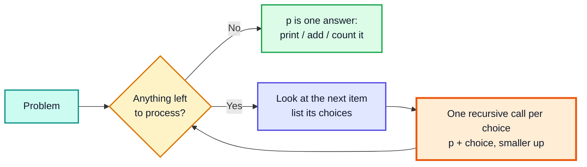
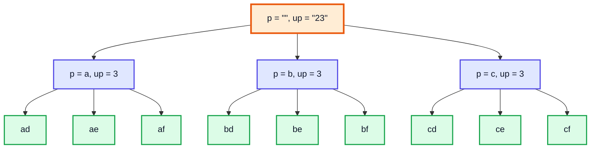
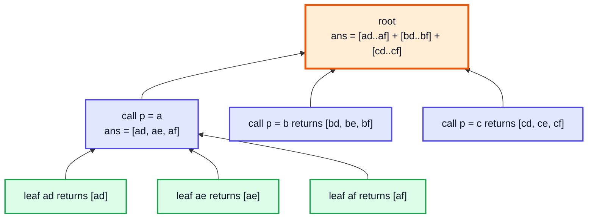
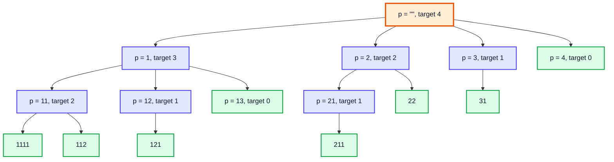

# Recursion Interview Questions: Phone Letters & Dice Throw — Complete In-Depth Guide

**Video #34 of the Java + DSA playlist:** *Recursion Google, Amazon Questions: Dice Throw & Letter Combinations of a Phone Number* (38:36)

Two classic "generate every possibility" recursion problems asked at Google and Amazon: **Letter Combinations of a Phone Number** (LeetCode 17) and **dice rolls that add up to a target** (the idea behind LeetCode 1155). Both use the same *processed / unprocessed* pattern from the subsets and permutations videos, and both are shown in three forms: print, return an `ArrayList`, and return a count.

---

## Table of Contents

| # | Topic | Timestamp |
|---|---|---|
| 0 | [Introduction](#0-introduction-000) | 0:00 |
| 1 | [Q1: Letter Combinations of a Phone Number](#1-q1-letter-combinations-of-a-phone-number-138) | 1:38 |
| 2 | [Code for Q1](#2-code-for-q1-1641) | 16:41 |
| 3 | [Returning Q1 output as an ArrayList](#3-returning-q1-output-as-an-arraylist-2041) | 20:41 |
| 4 | [Returning the count](#4-returning-the-count-2458) | 24:58 |
| 5 | [Q2: Number of Dice Rolls with Target Sum](#5-q2-number-of-dice-rolls-with-target-sum-2709) | 27:09 |
| 6 | [Code for Q2](#6-code-for-q2-3240) | 32:40 |
| 7 | [Returning Q2 output as an ArrayList](#7-returning-q2-output-as-an-arraylist-3425) | 34:25 |
| 8 | [Dice with custom number of faces](#8-dice-with-custom-number-of-faces-3618) | 36:18 |
| 9 | [Outro](#9-outro-3750) | 37:50 |

---

## 0. Introduction (0:00)

The previous videos built subsets and permutations by taking a string apart one character at a time. This video applies the same technique to two interview problems. What matters most is the **thought process**, not memorising the code:

1. Ask: *what choices do I have at this step?* That number becomes the number of recursive calls (the branches of the tree).
2. Ask: *what do I carry down?* The answer built so far (**processed**, `p`) and what is still left to handle (**unprocessed**, `up`, or a remaining `target`).
3. Ask: *when do I stop?* When nothing is left to process, `p` is one complete answer.



> [!IMPORTANT]
> Subsets had **2** choices per character (take it or leave it). Permutations had **(length of p + 1)** choices (positions to insert). Here, the phone problem has **3–4** choices per digit and the dice problem has **up to 6** choices per roll. The skeleton of the code is the same every time. Only the loop that makes the calls changes.

---

## 1. Q1: Letter Combinations of a Phone Number (1:38)

**LeetCode 17 — Letter Combinations of a Phone Number.** Given a string of digits from `2` to `9`, return every letter string the digits could stand for on an old phone keypad.

| Digit | Letters | | Digit | Letters |
|---|---|---|---|---|
| 2 | `abc` | | 6 | `mno` |
| 3 | `def` | | 7 | `pqrs` |
| 4 | `ghi` | | 8 | `tuv` |
| 5 | `jkl` | | 9 | `wxyz` |

Example: `"23"` → `[ad, ae, af, bd, be, bf, cd, ce, cf]`.

### Thought process

- Take the **first digit** of `up`. It has 3 (or 4) letters, so make 3 (or 4) recursive calls.
- Each call adds one of those letters to `p` and passes the **rest of the digits** (`up.substring(1)`).
- When `up` is empty, `p` holds one full combination.

### Recursion tree for `"23"`



Level 1 branches on the letters of `2`, level 2 on the letters of `3`. The leaves (green) are the answers, read left to right.

### Kunal's index trick (simplified keypad)

In the video, to avoid storing a mapping, the letters are computed from the digit with arithmetic, pretending every key has exactly 3 letters and that the keys start at `1`:

| Digit `d` | Range of `i` = `(d-1)*3` to `d*3 - 1` | Letters `'a' + i` |
|---|---|---|
| 1 | 0, 1, 2 | `a b c` |
| 2 | 3, 4, 5 | `d e f` |
| 3 | 6, 7, 8 | `g h i` |
| 4 | 9, 10, 11 | `j k l` |

So in his version, **digit 1 means `abc`** and digit 2 means `def`. That is shifted by one compared with a real phone, and it ignores the 4-letter keys.

> [!WARNING]
> The arithmetic version is fine for understanding the recursion, but it is **wrong for LeetCode**: `7` should be `pqrs` and `9` should be `wxyz`, and with the shift, digit `9` produces `y`, `z` and `{`. For the real problem, use a lookup array of strings (shown in section 2). The recursion does not change at all, only where the letters come from.

### Complexity

| | Value | Why |
|---|---|---|
| Time | **O(4ⁿ · n)** | at most 4 branches per digit, n levels; each leaf builds a string of length n |
| Space (stack) | **O(n)** | the tree is n levels deep |
| Output | up to 4ⁿ strings | e.g. `"79"` → 4 × 4 = 16 |

---

## 2. Code for Q1 (16:41)

### Version from the video (prints, simplified keypad)

```java
public class PhonePad {
    public static void main(String[] args) {
        pad("", "12");    // ad ae af bd be bf cd ce cf
    }

    static void pad(String p, String up) {
        if (up.isEmpty()) {              // base case: no digits left
            System.out.print(p + " ");
            return;
        }
        int digit = up.charAt(0) - '0';  // '2' -> 2
        for (int i = (digit - 1) * 3; i < digit * 3; i++) {
            char ch = (char) ('a' + i);
            pad(p + ch, up.substring(1));
        }
    }
}
```

`up.charAt(0) - '0'` turns the character `'2'` into the number `2`, because the digit characters have consecutive codes (`'0'` = 48, `'1'` = 49, ...).

### Dry run: `pad("", "12")`

| Call | `digit` | Loop `i` | Letters tried | Calls made |
|---|---|---|---|---|
| `pad("", "12")` | 1 | 0..2 | a, b, c | `pad("a","2")`, `pad("b","2")`, `pad("c","2")` |
| `pad("a", "2")` | 2 | 3..5 | d, e, f | `pad("ad","")` ... |
| `pad("ad", "")` | — | — | — | prints `ad` ✅ |

### Correct LeetCode 17 version (real keypad)

```java
import java.util.ArrayList;
import java.util.List;

class Solution {
    private static final String[] KEYS =
        {"", "", "abc", "def", "ghi", "jkl", "mno", "pqrs", "tuv", "wxyz"};

    public List<String> letterCombinations(String digits) {
        List<String> ans = new ArrayList<>();
        if (digits.isEmpty()) return ans;          // LeetCode wants [] for ""
        build(digits, 0, new StringBuilder(), ans);
        return ans;
    }

    private void build(String digits, int idx, StringBuilder sb, List<String> ans) {
        if (idx == digits.length()) {
            ans.add(sb.toString());
            return;
        }
        for (char ch : KEYS[digits.charAt(idx) - '0'].toCharArray()) {
            sb.append(ch);                         // choose
            build(digits, idx + 1, sb, ans);       // explore
            sb.deleteCharAt(sb.length() - 1);      // un-choose
        }
    }
}
// letterCombinations("23") -> [ad, ae, af, bd, be, bf, cd, ce, cf]
// letterCombinations("79").size() -> 16
```

| Difference | Video version | LeetCode version |
|---|---|---|
| Letters | arithmetic, 3 per key | lookup table, 3 or 4 per key |
| Remaining digits | `up.substring(1)` (new string each call) | index `idx` (no copying) |
| Building `p` | `p + ch` (new string each call) | one `StringBuilder`, append then delete |
| Empty input | returns `[""]` (one empty answer) | returns `[]` as LeetCode expects |

> [!TIP]
> The `append → recurse → deleteCharAt` pattern is your first taste of **backtracking**: you change shared state, explore, then undo the change. It is the main topic of the next video (#35).

---

## 3. Returning Q1 output as an ArrayList (20:41)

Printing is easy but an interviewer usually wants the answers **returned**. The approach is the same as in subsets: every call returns the list of answers found **below it**, and the parent joins them.

```java
import java.util.ArrayList;

public class PhonePadList {
    public static void main(String[] args) {
        System.out.println(padList("", "12"));  // [ad, ae, af, bd, be, bf, cd, ce, cf]
    }

    static ArrayList<String> padList(String p, String up) {
        if (up.isEmpty()) {
            ArrayList<String> list = new ArrayList<>();
            list.add(p);                         // a leaf returns a list with one answer
            return list;
        }
        ArrayList<String> ans = new ArrayList<>();   // local to this call
        int digit = up.charAt(0) - '0';
        for (int i = (digit - 1) * 3; i < digit * 3; i++) {
            char ch = (char) ('a' + i);
            ans.addAll(padList(p + ch, up.substring(1)));  // merge child's answers
        }
        return ans;
    }
}
```



> [!NOTE]
> Unlike subsets (exactly 2 calls, so `left.addAll(right)`), here the number of calls depends on the digit, so we keep an `ans` list **inside the loop** and `addAll` each child's result into it.

Another option is to pass **one** list down as a parameter and add to it at the leaves. This avoids creating and merging many small lists, which is what the LeetCode version above does.

---

## 4. Returning the count (24:58)

Sometimes only the **number** of combinations is needed. Replace "list with one answer" with `1`, and "merge lists" with "add numbers".

```java
public class PhonePadCount {
    public static void main(String[] args) {
        System.out.println(padCount("", "123"));   // 27
    }

    static int padCount(String p, String up) {
        if (up.isEmpty()) return 1;               // one complete combination
        int count = 0;
        int digit = up.charAt(0) - '0';
        for (int i = (digit - 1) * 3; i < digit * 3; i++) {
            char ch = (char) ('a' + i);
            count += padCount(p + ch, up.substring(1));
        }
        return count;
    }
}
```

| Form | Base case returns | Combine step |
|---|---|---|
| Print | prints `p`, returns nothing | none |
| `ArrayList` | `[p]` | `ans.addAll(child)` |
| Count | `1` | `count += child` |

> [!TIP]
> The count can be computed without recursion at all: it is the **product** of the number of letters of each digit. `"123"` → 3 × 3 × 3 = 27, and `"79"` on a real keypad → 4 × 4 = 16. Use the recursive version to practise the pattern, and the product when only the number matters.

---

## 5. Q2: Number of Dice Rolls with Target Sum (27:09)

**The video's version:** given a target, print every sequence of rolls of a normal die (faces 1–6) that adds up to `target`. The number of rolls is **not fixed**.

Example: `target = 4` → `1111 112 121 13 211 22 31 4`.

### Thought process

- At each step you can roll any face `i` from 1 to 6, **but never more than what is left** (`i <= target`), otherwise the sum overshoots.
- Add `i` to `p` and recurse with `target - i`.
- When `target == 0`, `p` is a valid sequence.

### Recursion tree for `target = 4`



Faces 5 and 6 never appear because `i <= target` cuts them off at the root. This is **pruning**: branches that cannot lead to an answer are never created.

> [!IMPORTANT]
> **The real LeetCode 1155** is a different problem: you have **exactly `n` dice** with `k` faces each, and you must return the **number of ways** modulo 10⁹ + 7. The video's version allows any number of rolls and lists them. The recursive idea is the same, but LeetCode needs a dice counter and memoization (see below).

### LeetCode 1155 with memoization

```java
class Solution {
    private static final int MOD = 1_000_000_007;

    public int numRollsToTarget(int n, int k, int target) {
        Integer[][] memo = new Integer[n + 1][target + 1];
        return ways(n, k, target, memo);
    }

    // ways to reach 'target' using exactly n dice
    private int ways(int n, int k, int target, Integer[][] memo) {
        if (n == 0) return target == 0 ? 1 : 0;   // used all dice
        if (target <= 0) return 0;                 // dice left but nothing to reach
        if (memo[n][target] != null) return memo[n][target];
        long total = 0;
        for (int face = 1; face <= k && face <= target; face++) {
            total += ways(n - 1, k, target - face, memo);
        }
        return memo[n][target] = (int) (total % MOD);
    }
}
// numRollsToTarget(1, 6, 3)     -> 1
// numRollsToTarget(2, 6, 7)     -> 6
// numRollsToTarget(30, 30, 500) -> 222616187
```

| Approach | Time | Space |
|---|---|---|
| Plain recursion (exactly n dice) | O(kⁿ) | O(n) stack |
| Memoization (above) | O(n · target · k) | O(n · target) |
| Bottom-up DP table | O(n · target · k) | O(target) with a rolling array |

---

## 6. Code for Q2 (32:40)

```java
public class DiceThrow {
    public static void main(String[] args) {
        dice("", 4);   // 1111 112 121 13 211 22 31 4
    }

    static void dice(String p, int target) {
        if (target == 0) {                 // reached exactly the target
            System.out.print(p + " ");
            return;
        }
        for (int i = 1; i <= 6 && i <= target; i++) {
            dice(p + i, target - i);       // p + i: String + int appends the digit
        }
    }
}
```

### Dry run (first branch)

| Call | `target` | Loop range | First call made |
|---|---|---|---|
| `dice("", 4)` | 4 | 1..4 | `dice("1", 3)` |
| `dice("1", 3)` | 3 | 1..3 | `dice("11", 2)` |
| `dice("11", 2)` | 2 | 1..2 | `dice("111", 1)` |
| `dice("111", 1)` | 1 | 1..1 | `dice("1111", 0)` |
| `dice("1111", 0)` | 0 | — | prints `1111` ✅ |

> [!CAUTION]
> Without `i <= target`, the loop would call `dice(p + 5, -1)`. A negative target never becomes `0`, and that call's loop again runs `i = 1..6`, so the targets keep falling (-2, -3, ...) until you get a `StackOverflowError`. Either keep `i <= target` in the loop (pruning) or add a second base case `if (target < 0) return;`. Pruning is better because it never makes the useless calls.

### Complexity

The answers are the **compositions** of `target` into parts 1–6. For target `t` there are at most 2ᵗ⁻¹ of them (exactly 2ᵗ⁻¹ while `t ≤ 6`: target 4 → 8, and target 7 → 63, one less than 64 because `7` alone is not a face).

| | Value |
|---|---|
| Time | O(2ᵗ · t) worst case (number of answers × string length) |
| Space (stack) | O(t) (deepest path is all 1s) |

---

## 7. Returning Q2 output as an ArrayList (34:25)

Same conversion as section 3: the base case returns a list with one item, each call merges its children.

```java
import java.util.ArrayList;

public class DiceThrowList {
    public static void main(String[] args) {
        System.out.println(diceList("", 4));         // [1111, 112, 121, 13, 211, 22, 31, 4]
        System.out.println(diceList("", 7).size());  // 63
    }

    static ArrayList<String> diceList(String p, int target) {
        if (target == 0) {
            ArrayList<String> list = new ArrayList<>();
            list.add(p);
            return list;
        }
        ArrayList<String> ans = new ArrayList<>();
        for (int i = 1; i <= 6 && i <= target; i++) {
            ans.addAll(diceList(p + i, target - i));
        }
        return ans;
    }
}
```

> [!NOTE]
> Returning a count instead works the same way as section 4: base case `return 1`, combine with `count += ...`. For a fixed number of dice, that counting version is exactly the plain-recursion form of LeetCode 1155.

---

## 8. Dice with custom number of faces (36:18)

Hard-coding `6` limits the function. Pass the number of faces as a parameter and use it as the loop bound.

```java
import java.util.ArrayList;

public class DiceFace {
    public static void main(String[] args) {
        System.out.println(diceFace("", 4, 2));          // [1111, 112, 121, 211, 22]
        System.out.println(diceFace("", 5, 3).size());   // 13
    }

    static ArrayList<String> diceFace(String p, int target, int face) {
        if (target == 0) {
            ArrayList<String> list = new ArrayList<>();
            list.add(p);
            return list;
        }
        ArrayList<String> ans = new ArrayList<>();
        for (int i = 1; i <= face && i <= target; i++) {
            ans.addAll(diceFace(p + i, target - i, face));
        }
        return ans;
    }
}
```

| `face` | What it models | `target = 4` gives |
|---|---|---|
| 2 | a coin with values 1 and 2 (the "climbing stairs" problem, LeetCode 70) | 5 sequences |
| 6 | a normal die | 8 sequences |
| ≥ target | no limit at all | 2ᵗ⁻¹ = 8 sequences |

> [!TIP]
> With `face = 2`, the count is a Fibonacci number: the ways to climb `n` stairs taking 1 or 2 steps. Many interview problems are this same tree with a different loop bound.

> [!WARNING]
> `p + i` with a multi-digit face (for example face 12) makes the output ambiguous: `"111"` could mean 1,1,1 or 11,1 or 1,11. If faces can exceed 9, build a `List<Integer>` or add a separator such as `p + i + " "`.

---

## 9. Outro (37:50)

Both problems are the same recipe: **choices → loop of recursive calls, remaining work → argument, nothing left → answer**. Practise converting each into the three return styles (print, list, count). The next video adds **backtracking**, where changes made on the way down are undone on the way back up.

---

## 🧩 Complete Example: Everything Together

```java
import java.util.ArrayList;
import java.util.List;

public class RecursionInterviewAll {

    // ---------- Q1: Letter combinations, Kunal's simplified keypad (3 letters per digit) ----------
    // digit d -> letters from index (d-1)*3 to d*3 - 1, so 2 -> "def", 3 -> "ghi"
    static void pad(String p, String up) {
        if (up.isEmpty()) {
            System.out.print(p + " ");
            return;
        }
        int digit = up.charAt(0) - '0';
        for (int i = (digit - 1) * 3; i < digit * 3; i++) {
            char ch = (char) ('a' + i);
            pad(p + ch, up.substring(1));
        }
    }

    static ArrayList<String> padList(String p, String up) {
        if (up.isEmpty()) {
            ArrayList<String> list = new ArrayList<>();
            list.add(p);
            return list;
        }
        int digit = up.charAt(0) - '0';
        ArrayList<String> ans = new ArrayList<>();
        for (int i = (digit - 1) * 3; i < digit * 3; i++) {
            char ch = (char) ('a' + i);
            ans.addAll(padList(p + ch, up.substring(1)));
        }
        return ans;
    }

    static int padCount(String p, String up) {
        if (up.isEmpty()) return 1;
        int count = 0;
        int digit = up.charAt(0) - '0';
        for (int i = (digit - 1) * 3; i < digit * 3; i++) {
            char ch = (char) ('a' + i);
            count += padCount(p + ch, up.substring(1));
        }
        return count;
    }

    // ---------- Q1 (LeetCode 17): the real phone keypad ----------
    static final String[] KEYS = {"", "", "abc", "def", "ghi", "jkl", "mno", "pqrs", "tuv", "wxyz"};

    static List<String> letterCombinations(String digits) {
        List<String> ans = new ArrayList<>();
        if (digits.isEmpty()) return ans;
        build(digits, 0, new StringBuilder(), ans);
        return ans;
    }

    static void build(String digits, int idx, StringBuilder sb, List<String> ans) {
        if (idx == digits.length()) {
            ans.add(sb.toString());
            return;
        }
        for (char ch : KEYS[digits.charAt(idx) - '0'].toCharArray()) {
            sb.append(ch);                    // choose
            build(digits, idx + 1, sb, ans);  // explore
            sb.deleteCharAt(sb.length() - 1); // un-choose
        }
    }

    // ---------- Q2: Dice combinations that add up to target ----------
    static void dice(String p, int target) {
        if (target == 0) {
            System.out.print(p + " ");
            return;
        }
        for (int i = 1; i <= 6 && i <= target; i++) {
            dice(p + i, target - i);
        }
    }

    static ArrayList<String> diceList(String p, int target) {
        if (target == 0) {
            ArrayList<String> list = new ArrayList<>();
            list.add(p);
            return list;
        }
        ArrayList<String> ans = new ArrayList<>();
        for (int i = 1; i <= 6 && i <= target; i++) {
            ans.addAll(diceList(p + i, target - i));
        }
        return ans;
    }

    static ArrayList<String> diceFace(String p, int target, int face) {
        if (target == 0) {
            ArrayList<String> list = new ArrayList<>();
            list.add(p);
            return list;
        }
        ArrayList<String> ans = new ArrayList<>();
        for (int i = 1; i <= face && i <= target; i++) {
            ans.addAll(diceFace(p + i, target - i, face));
        }
        return ans;
    }

    // ---------- LeetCode 1155: exactly n dice, k faces, count mod 1e9+7 ----------
    static final int MOD = 1_000_000_007;

    static int numRollsToTarget(int n, int k, int target) {
        Integer[][] memo = new Integer[n + 1][target + 1];
        return ways(n, k, target, memo);
    }

    static int ways(int n, int k, int target, Integer[][] memo) {
        if (n == 0) return target == 0 ? 1 : 0;
        if (target <= 0) return 0;
        if (memo[n][target] != null) return memo[n][target];
        long total = 0;
        for (int face = 1; face <= k && face <= target; face++) {
            total += ways(n - 1, k, target - face, memo);
        }
        return memo[n][target] = (int) (total % MOD);
    }

    public static void main(String[] args) {
        System.out.print("pad(\"12\")          : ");
        pad("", "12");
        System.out.println();
        System.out.println("padList(\"12\")      : " + padList("", "12"));
        System.out.println("padCount(\"123\")    : " + padCount("", "123"));
        System.out.println("LC 17 \"23\"         : " + letterCombinations("23"));
        System.out.println("LC 17 \"79\" count   : " + letterCombinations("79").size());

        System.out.print("dice(4)            : ");
        dice("", 4);
        System.out.println();
        System.out.println("diceList(4) size   : " + diceList("", 4).size());
        System.out.println("diceList(7) size   : " + diceList("", 7).size());
        System.out.println("diceFace(4, 2)     : " + diceFace("", 4, 2));
        System.out.println("diceFace(5, 3) size: " + diceFace("", 5, 3).size());

        System.out.println("LC 1155 (1,6,3)    : " + numRollsToTarget(1, 6, 3));
        System.out.println("LC 1155 (2,6,7)    : " + numRollsToTarget(2, 6, 7));
        System.out.println("LC 1155 (30,30,500): " + numRollsToTarget(30, 30, 500));
    }
}
```

**Expected Output:**
```
pad("12")          : ad ae af bd be bf cd ce cf 
padList("12")      : [ad, ae, af, bd, be, bf, cd, ce, cf]
padCount("123")    : 27
LC 17 "23"         : [ad, ae, af, bd, be, bf, cd, ce, cf]
LC 17 "79" count   : 16
dice(4)            : 1111 112 121 13 211 22 31 4 
diceList(4) size   : 8
diceList(7) size   : 63
diceFace(4, 2)     : [1111, 112, 121, 211, 22]
diceFace(5, 3) size: 13
LC 1155 (1,6,3)    : 1
LC 1155 (2,6,7)    : 6
LC 1155 (30,30,500): 222616187
```

---

## Quick Reference Cheat Sheet

| Concept | One-Line Summary |
|---|---|
| **Processed / unprocessed** | `p` = answer so far, `up` (or `target`) = work left; empty `up` → `p` is an answer |
| **Branches = choices** | phone: 3–4 calls per digit; dice: up to `face` calls per roll |
| **Char digit → int** | `up.charAt(0) - '0'` |
| **Video's keypad trick** | letters `'a' + i` for `i` in `[(d-1)*3, d*3)`; teaching only, not LeetCode-correct |
| **LeetCode 17** | lookup `{"", "", "abc", ..., "wxyz"}`; O(4ⁿ · n) time, O(n) stack |
| **Print → List** | base returns `[p]`; parent `ans.addAll(child)` inside the loop |
| **Print → Count** | base returns `1`; parent `count += child` |
| **Dice pruning** | loop `i <= face && i <= target` so the sum never overshoots |
| **Video's dice problem** | any number of rolls; answers = compositions of target, ≤ 2ᵗ⁻¹ |
| **LeetCode 1155** | exactly `n` dice, count mod 1e9+7; memo on `(n, target)` → O(n · target · k) |
| **Custom faces** | pass `face` as a parameter; `face = 2` is climbing stairs (LeetCode 70) |
| **Choose / explore / un-choose** | `sb.append` → recurse → `sb.deleteCharAt`: the backtracking pattern |
