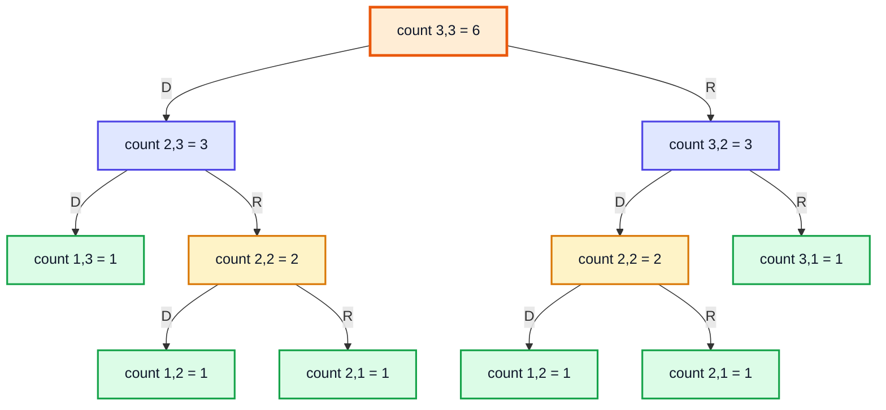
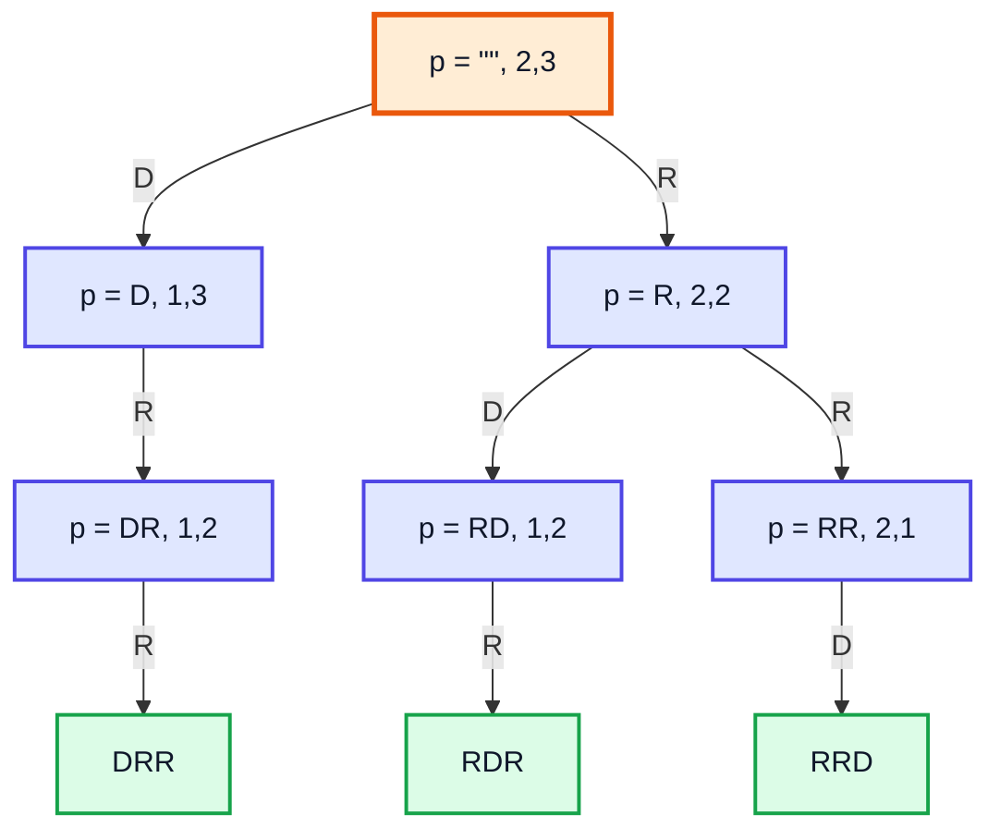
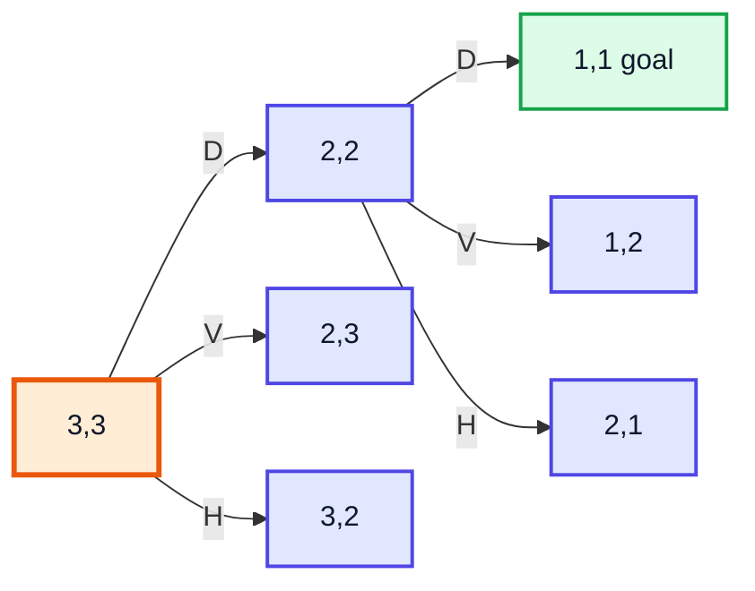
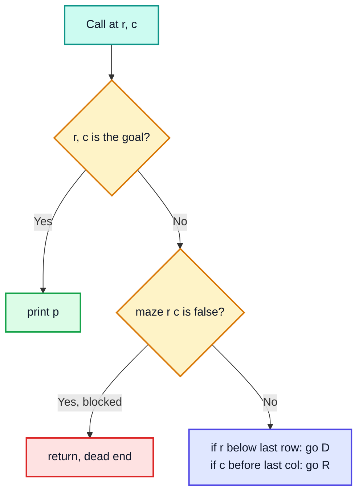
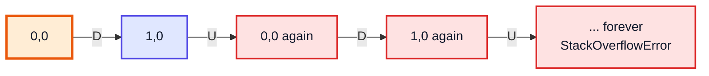
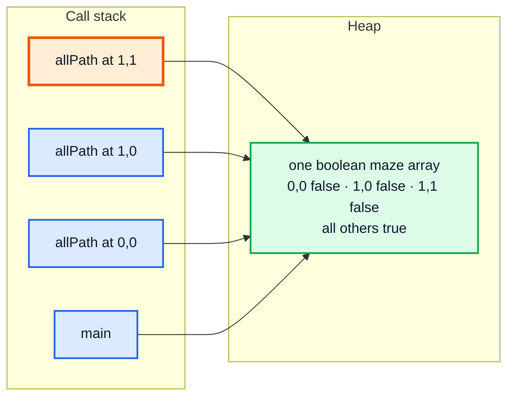
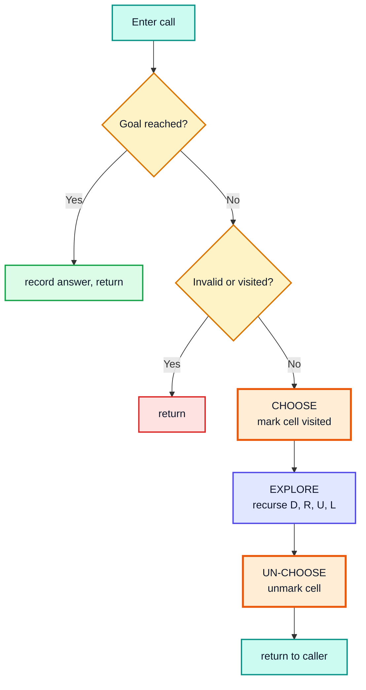
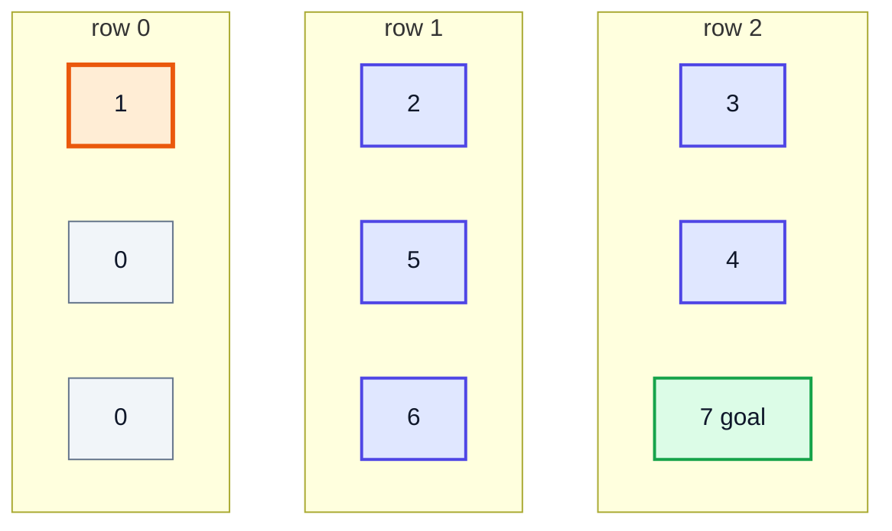

# Backtracking & Maze Problems — Complete In-Depth Guide

**Video #35 of the Java + DSA playlist:** *Backtracking Introduction + Maze Problems - Theory + Code + Tips* (1:28:10)

A step-by-step series of maze problems that starts with simple recursion (count and print the paths in a grid) and grows into **backtracking**: moving in all four directions, marking visited cells, and **undoing** those marks on the way back so other paths can reuse the cells. It ends with printing every path as a matrix of step numbers.

---

## Table of Contents

| # | Topic | Timestamp |
|---|---|---|
| 0 | [Teaser](#0-teaser-000) | 0:00 |
| 1 | [Introduction](#1-introduction-031) | 0:31 |
| 2 | [Maze Problems](#2-maze-problems-151) | 1:51 |
| 3 | [Q1: Counting Paths](#3-q1-counting-paths-311) | 3:11 |
| 4 | [Code for Q1](#4-code-for-q1-1808) | 18:08 |
| 5 | [Q2: Printing Paths](#5-q2-printing-paths-2058) | 20:58 |
| 6 | [Code for Q2](#6-code-for-q2-2700) | 27:00 |
| 7 | [Q3: Including Diagonal Paths](#7-q3-including-diagonal-paths-3218) | 32:18 |
| 8 | [Q4: Maze with Obstacles](#8-q4-maze-with-obstacles-3530) | 35:30 |
| 9 | [Code for Q4](#9-code-for-q4-4043) | 40:43 |
| 10 | [Q5: Including All Paths](#10-q5-including-all-paths-4755) | 47:55 |
| 11 | [Explanation for Q5](#11-explanation-for-q5-5151) | 51:51 |
| 12 | [Backtracking Introduction](#12-backtracking-introduction-10704) | 1:07:04 |
| 13 | [Code for Q5](#13-code-for-q5-11101) | 1:11:01 |
| 14 | [Q6: Print Matrix and Paths](#14-q6-print-matrix-and-paths-11443) | 1:14:43 |
| 15 | [Code for Q6](#15-code-for-q6-12044) | 1:20:44 |
| 16 | [Battlesnake Fall League](#16-battlesnake-fall-league-12537) | 1:25:37 |
| 17 | [Outro](#17-outro-12752) | 1:27:52 |

> [!NOTE]
> This video's timestamps start with a short **Teaser** before the Introduction, so the Teaser is section 0 and the Introduction is section 1.

---

## 0. Teaser (0:00)

A short preview of the final problem: a 3 × 3 maze where the path can go in any direction, printed as a grid of step numbers. By the end of the video you will be able to write that program yourself.

---

## 1. Introduction (0:31)

Backtracking sounds like a new algorithm, but it is ordinary recursion with one extra habit: **whatever you change before a recursive call, you change back after it returns.** The video builds up to that idea through maze problems, each one adding a single new twist.

| Prerequisite | From |
|---|---|
| Recursion basics, recursion trees, base conditions | Video #23 onwards |
| Processed / unprocessed strings, returning `ArrayList` | Subsets, permutations, video #34 |
| 2D arrays | Video #12 |

---

## 2. Maze Problems (1:51)

A maze here is a grid of `rows × cols` cells. You start at one corner and want to reach the opposite corner.

```mermaid
flowchart LR
    S["Start<br/>top-left"]:::startend --> Q1["Q1 count paths<br/>D, R only"]:::process --> Q2["Q2 print paths"]:::process --> Q3["Q3 add diagonal"]:::process --> Q4["Q4 obstacles"]:::process --> Q5["Q5 all 4 directions<br/>BACKTRACKING"]:::highlight --> Q6["Q6 print step matrix"]:::process --> E["Goal<br/>bottom-right"]:::startend
    classDef startend fill:#ccfbf1,stroke:#0d9488,stroke-width:2px,color:#0f172a
    classDef process fill:#e0e7ff,stroke:#4f46e5,stroke-width:2px,color:#0f172a
    classDef highlight fill:#ffedd5,stroke:#ea580c,stroke-width:3px,color:#0f172a
```



| Question | Moves allowed | New idea |
|---|---|---|
| Q1 | Down, Right | count with recursion |
| Q2 | Down, Right | build the path string `p` |
| Q3 | Down, Right, Diagonal | a third branch |
| Q4 | Down, Right + blocked cells | a stop condition on the cell |
| Q5 | Down, Right, Up, Left | mark visited, then **undo** (backtracking) |
| Q6 | all 4 | store step numbers in a matrix, also undone |

---

## 3. Q1: Counting Paths (3:11)

**Problem:** in a 3 × 3 grid, starting top-left, moving only **Down** or **Right**, how many ways are there to reach the bottom-right? This is **LeetCode 62 — Unique Paths**.

### Thinking in terms of "rows and columns left"

The video describes the position by **how many rows and columns remain**, not by index. Start at `(3, 3)` and aim for `(1, 1)`:

- Moving **Down** removes one row: `(r, c)` → `(r - 1, c)`.
- Moving **Right** removes one column: `(r, c)` → `(r, c - 1)`.
- Total paths from here = paths after going down + paths after going right.

**Recurrence:** `count(r, c) = count(r - 1, c) + count(r, c - 1)`

**Base condition:** if `r == 1` or `c == 1`, you are in the last row or last column, and there is **exactly one** way left (go straight).

### Recursion tree for `count(3, 3)`



The amber nodes show `count(2, 2)` being computed **twice**. This repeated work is an *overlapping subproblem*, the sign that dynamic programming will help later.

> [!TIP]
> Why `r == 1 || c == 1` and not `r == 1 && c == 1`? With `&&` you only stop at the goal itself. That also works, but then you need `if (r > 1)` / `if (c > 1)` guards to stop the calls going to row 0 or column 0. Stopping one level earlier with `||` is shorter, since a single row or column has only one path.

---

## 4. Code for Q1 (18:08)

```java
public class MazeCount {
    public static void main(String[] args) {
        System.out.println(count(3, 3));   // 6
        System.out.println(count(3, 7));   // 28
    }

    static int count(int r, int c) {
        if (r == 1 || c == 1) return 1;
        int down  = count(r - 1, c);
        int right = count(r, c - 1);
        return down + right;
    }
}
```

### Complexity and better approaches

| Approach | Time | Space | Idea |
|---|---|---|---|
| Plain recursion (above) | O(2^(r+c)) | O(r + c) stack | every call branches twice |
| Memoization | O(r · c) | O(r · c) | cache `count(r, c)` in a 2D array |
| Bottom-up DP | O(r · c) | O(c) | `row[j] += row[j - 1]` for each row |
| Combinatorics | O(min(r, c)) | O(1) | any path is `r-1` D's and `c-1` R's in some order: C(r + c − 2, r − 1) |

For 3 × 3: C(4, 2) = 6. For 3 × 7: C(8, 2) = 28.

```java
// LeetCode 62 with memoization
static int uniquePaths(int m, int n) {
    return memo(m, n, new int[m + 1][n + 1]);
}
static int memo(int r, int c, int[][] dp) {
    if (r == 1 || c == 1) return 1;
    if (dp[r][c] != 0) return dp[r][c];
    return dp[r][c] = memo(r - 1, c, dp) + memo(r, c - 1, dp);
}
// uniquePaths(3, 7) -> 28
```

---

## 5. Q2: Printing Paths (20:58)

Instead of counting, list each path as a string of moves, e.g. `"DDRR"`. Use the **processed string** `p` from earlier videos: add `'D'` or `'R'` before each call.

Now the base case must be the goal itself, `r == 1 && c == 1`, because the moves still left along the last row or column must be written into `p`. That also means each call needs a guard so it does not step outside the grid.



In row 1 (`p = D`) the Down guard `r > 1` is false, so only the Right branch exists.

---

## 6. Code for Q2 (27:00)

```java
import java.util.ArrayList;

public class MazePaths {
    public static void main(String[] args) {
        path("", 3, 3);                         // DDRR DRDR DRRD RDDR RDRD RRDD
        System.out.println();
        System.out.println(pathList("", 2, 3)); // [DRR, RDR, RRD]
    }

    static void path(String p, int r, int c) {
        if (r == 1 && c == 1) {
            System.out.print(p + " ");
            return;
        }
        if (r > 1) path(p + 'D', r - 1, c);
        if (c > 1) path(p + 'R', r, c - 1);
    }

    static ArrayList<String> pathList(String p, int r, int c) {
        if (r == 1 && c == 1) {
            ArrayList<String> list = new ArrayList<>();
            list.add(p);
            return list;
        }
        ArrayList<String> ans = new ArrayList<>();
        if (r > 1) ans.addAll(pathList(p + 'D', r - 1, c));
        if (c > 1) ans.addAll(pathList(p + 'R', r, c - 1));
        return ans;
    }
}
```

### Dry run (first path)

| Call | `r > 1`? | `c > 1`? | First call made |
|---|---|---|---|
| `path("", 3, 3)` | ✅ | ✅ | `path("D", 2, 3)` |
| `path("D", 2, 3)` | ✅ | ✅ | `path("DD", 1, 3)` |
| `path("DD", 1, 3)` | ❌ | ✅ | `path("DDR", 1, 2)` |
| `path("DDR", 1, 2)` | ❌ | ✅ | `path("DDRR", 1, 1)` |
| `path("DDRR", 1, 1)` | — | — | prints `DDRR` 🟩 |

**Complexity:** the number of paths is C(r + c − 2, r − 1) and each string has length r + c − 2, so time is **O(C(r+c−2, r−1) · (r + c))**; stack depth is **O(r + c)**.

---

## 7. Q3: Including Diagonal Paths (32:18)

Now a third move is allowed: **diagonal** (one down and one right at once). To keep the letters clear, the video renames them:

| Letter | Move | Change |
|---|---|---|
| `D` | Diagonal | `(r - 1, c - 1)`, needs `r > 1 && c > 1` |
| `V` | Vertical (down) | `(r - 1, c)`, needs `r > 1` |
| `H` | Horizontal (right) | `(r, c - 1)`, needs `c > 1` |

```java
static ArrayList<String> pathDiagonal(String p, int r, int c) {
    if (r == 1 && c == 1) {
        ArrayList<String> list = new ArrayList<>();
        list.add(p);
        return list;
    }
    ArrayList<String> ans = new ArrayList<>();
    if (r > 1 && c > 1) ans.addAll(pathDiagonal(p + 'D', r - 1, c - 1));
    if (r > 1)          ans.addAll(pathDiagonal(p + 'V', r - 1, c));
    if (c > 1)          ans.addAll(pathDiagonal(p + 'H', r, c - 1));
    return ans;
}
// pathDiagonal("", 3, 3).size()       -> 13
// first five: [DD, DVH, DHV, VDH, VVHH]
```



> [!NOTE]
> The number of such paths is called a **Delannoy number**: 3 for 2 × 2, 13 for 3 × 3, 63 for 4 × 4. The count version follows the recurrence `f(r, c) = f(r-1, c-1) + f(r-1, c) + f(r, c-1)`.

---

## 8. Q4: Maze with Obstacles (35:30)

Some cells are now **blocked** (a river, a wall). A path may not pass through them. This is the printing version of **LeetCode 63 — Unique Paths II**.

The maze is a `boolean[][]` where `true` = open and `false` = blocked. The video now switches to **real indices**: start at `(0, 0)`, goal at `(rows - 1, cols - 1)`, so Down is `r + 1` and Right is `c + 1`.

| | col 0 | col 1 | col 2 |
|---|---|---|---|
| **row 0** | 🟧 start | 🟩 | 🟩 |
| **row 1** | 🟩 | 🟥 blocked | 🟩 |
| **row 2** | 🟩 | 🟩 | 🟦 goal |

Only two Down/Right paths avoid the centre: `DDRR` and `RRDD`.

**New stop condition:** if the current cell is blocked, return immediately. No path can continue from here.



---

## 9. Code for Q4 (40:43)

```java
public class MazeObstacles {
    public static void main(String[] args) {
        boolean[][] maze = {
            {true, true,  true},
            {true, false, true},
            {true, true,  true}
        };
        pathRestrictions("", maze, 0, 0);   // DDRR RRDD
    }

    static void pathRestrictions(String p, boolean[][] maze, int r, int c) {
        if (r == maze.length - 1 && c == maze[0].length - 1) {
            System.out.print(p + " ");
            return;
        }
        if (!maze[r][c]) return;                     // blocked cell: stop this path

        if (r < maze.length - 1)    pathRestrictions(p + 'D', maze, r + 1, c);
        if (c < maze[0].length - 1) pathRestrictions(p + 'R', maze, r, c + 1);
    }
}
```

> [!WARNING]
> This code checks the goal **before** checking for an obstacle, so a blocked goal cell would still be "reached". For LeetCode 63 (where the start or the goal can be blocked), check `!maze[r][c]` first. Also note `maze.length` is the number of rows and `maze[0].length` is the number of columns.

### LeetCode 63 (count, with memoization)

```java
// grid: 0 = open, 1 = obstacle (LeetCode's format)
static int uniquePathsWithObstacles(int[][] grid) {
    return go(grid, 0, 0, new Integer[grid.length][grid[0].length]);
}
static int go(int[][] g, int r, int c, Integer[][] memo) {
    if (r >= g.length || c >= g[0].length || g[r][c] == 1) return 0;
    if (r == g.length - 1 && c == g[0].length - 1) return 1;
    if (memo[r][c] != null) return memo[r][c];
    return memo[r][c] = go(g, r + 1, c, memo) + go(g, r, c + 1, memo);
}
// {{0,0,0},{0,1,0},{0,0,0}} -> 2
```

---

## 10. Q5: Including All Paths (47:55)

Now you may move in **all four directions**: Down, Right, **Up** and **Left**. A path cannot visit the same cell twice.

The obvious change is to add two more calls:

```java
if (r > 0) allPath(p + 'U', maze, r - 1, c);
if (c > 0) allPath(p + 'L', maze, r, c - 1);
```

> [!CAUTION]
> On its own this is an **infinite recursion**. From `(0, 0)` you go Down to `(1, 0)`, which goes Up to `(0, 0)`, which goes Down again... The calls never end and the program throws `StackOverflowError`.



The problem: a call has no idea which cells the current path has already used.

---

## 11. Explanation for Q5 (51:51)

**Fix, step 1 — mark the cell.** When a call enters a cell, it sets `maze[r][c] = false`. Every deeper call sees that cell as blocked (we already wrote `if (!maze[r][c]) return;` for Q4), so the path can never come back to it.

**Problem with step 1 alone.** The `maze` array is **one shared object on the heap**. All calls receive the same reference. A cell marked by one path stays marked when that path is over, so a later, different path finds it "blocked" and is wrongly cut off. You would only find a few of the paths.



**Fix, step 2 — unmark on the way out.** When a call has tried all four directions and is about to return, it sets `maze[r][c] = true` again. The cell is free for the next path. That undo step is **backtracking**.

> [!IMPORTANT]
> Ask: *does this change belong to the current path only?* If yes, undo it before returning. `p` does not need undoing because `p + 'D'` makes a **new** String for the child, so the parent's `p` is untouched. The `maze` array is **shared**, so it must be restored by hand.

| State | Where it lives | Needs undo? |
|---|---|---|
| `p` (String) | new object per call (`p + 'D'`) | ❌ no |
| `r`, `c` (int) | copied into each stack frame | ❌ no |
| `maze` (boolean[][]) | one object on the heap shared by every call | ✅ yes |
| `path` (int[][], Q6) | one shared object | ✅ yes |

---

## 12. Backtracking Introduction (1:07:04)

**Backtracking** is recursion where a call makes a change to shared state, explores every option with that change in place, then **reverts the change** before returning. In short: *choose → explore → un-choose*.



| | Plain recursion (Q1–Q4) | Backtracking (Q5–Q6) |
|---|---|---|
| State passed down | only new values (`p + 'D'`, `r + 1`) | plus a shared, mutable structure |
| Can revisit? | no, moves only go one way | yes, so cells must be marked |
| Undo step | not needed | required after exploring |
| Typical problems | counting paths, subsets | N-Queens, Sudoku, word search, rat in a maze |

> [!TIP]
> Backtracking is "brute force done carefully": it tries every possibility, but abandons a branch as soon as it is invalid. The coming videos use the same template for **N-Queens**, **N-Knights** and **Sudoku Solver**.

---

## 13. Code for Q5 (1:11:01)

```java
public class MazeAllPaths {
    static int total = 0;

    public static void main(String[] args) {
        boolean[][] maze = {
            {true, true, true},
            {true, true, true},
            {true, true, true}
        };
        allPath("", maze, 0, 0);
        System.out.println();
        System.out.println("total = " + total);   // total = 12
    }

    static void allPath(String p, boolean[][] maze, int r, int c) {
        if (r == maze.length - 1 && c == maze[0].length - 1) {
            System.out.print(p + " ");
            total++;
            return;
        }
        if (!maze[r][c]) return;                // blocked OR already on this path

        maze[r][c] = false;                     // choose: mark visited

        if (r < maze.length - 1)    allPath(p + 'D', maze, r + 1, c);
        if (c < maze[0].length - 1) allPath(p + 'R', maze, r, c + 1);
        if (r > 0)                  allPath(p + 'U', maze, r - 1, c);
        if (c > 0)                  allPath(p + 'L', maze, r, c - 1);

        maze[r][c] = true;                      // un-choose: backtrack
    }
}
// Output starts: DDRR DDRURD DDRUURDD DRDR ...
// total = 12
```

### Trace of how `DDRURD` is found after `DDRR`

| Step | Cell | Action | Visited cells (🟥) after the step |
|---|---|---|---|
| 1 | (0,0) | mark, go D | (0,0) |
| 2 | (1,0) | mark, go D | (0,0) (1,0) |
| 3 | (2,0) | mark, go R | + (2,0) |
| 4 | (2,1) | mark, go R → (2,2) goal, print `DDRR` ✅ | + (2,1) |
| 5 | (2,1) | U → (1,1) | same |
| 6 | (1,1) | mark, D blocked, R → (1,2) | + (1,1) |
| 7 | (1,2) | mark, D → (2,2) goal, print `DDRURD` ✅ | + (1,2) |
| 8 | ... | each call unmarks its cell on return 🟩 | cells freed one by one |

After the very first call returns, the whole `maze` is back to all `true`. The complete example checks this.

**Complexity:** each cell has up to 4 choices and a path can cover all `n·m` cells, so the worst case is **O(4^(n·m))** (in practice far less, as visited cells prune most branches). Stack depth is **O(n·m)**.

> [!NOTE]
> There is no single LeetCode problem with exactly this statement. It is the classic "Rat in a Maze" problem, and the same mark/unmark template solves **LeetCode 79 — Word Search** and **LeetCode 980 — Unique Paths III**.

---

## 14. Q6: Print Matrix and Paths (1:14:43)

Same as Q5, but for each path also print a grid that shows **at which step** each cell was visited. Unvisited cells show `0`.

```
[1, 0, 0]
[2, 0, 0]
[3, 4, 5]
DDRR
```

What changes:

- A second shared array `int[][] path` and a `step` counter parameter.
- On entering a cell: `path[r][c] = step`, and children get `step + 1`.
- At the goal: write the final step, print every row, print `p`.
- On leaving a cell: `path[r][c] = 0` (**backtrack this too**).



The grid above is the path `DDRURD`: 1 → 2 → 3 → 4 → 5 → 6 → 7 (grey cells were not used).

---

## 15. Code for Q6 (1:20:44)

```java
import java.util.Arrays;

public class MazePrintMatrix {
    public static void main(String[] args) {
        boolean[][] maze = {
            {true, true, true},
            {true, true, true},
            {true, true, true}
        };
        int[][] path = new int[maze.length][maze[0].length];
        allPathPrint("", maze, 0, 0, path, 1);
    }

    static void allPathPrint(String p, boolean[][] maze, int r, int c, int[][] path, int step) {
        if (r == maze.length - 1 && c == maze[0].length - 1) {
            path[r][c] = step;
            for (int[] row : path) {
                System.out.println(Arrays.toString(row));
            }
            System.out.println(p);
            System.out.println();
            path[r][c] = 0;      // clean the goal cell too (the video skips this; it gets overwritten anyway)
            return;
        }
        if (!maze[r][c]) return;

        maze[r][c] = false;
        path[r][c] = step;

        if (r < maze.length - 1)    allPathPrint(p + 'D', maze, r + 1, c, path, step + 1);
        if (c < maze[0].length - 1) allPathPrint(p + 'R', maze, r, c + 1, path, step + 1);
        if (r > 0)                  allPathPrint(p + 'U', maze, r - 1, c, path, step + 1);
        if (c > 0)                  allPathPrint(p + 'L', maze, r, c - 1, path, step + 1);

        maze[r][c] = true;       // backtrack the visited mark
        path[r][c] = 0;          // backtrack the step number
    }
}
// [1, 0, 0]
// [2, 0, 0]
// [3, 4, 5]
// DDRR
//
// [1, 0, 0]
// [2, 5, 6]
// [3, 4, 7]
// DDRURD
// ... (12 grids in total)
```

> [!TIP]
> `step` is an `int` parameter, so each call gets its own copy and it never needs undoing. Only the **shared arrays** (`maze`, `path`) are restored. If you forget `path[r][c] = 0`, old step numbers from earlier paths leak into later grids.

> [!NOTE]
> Modern Java alternative for printing a 2D array: `System.out.println(Arrays.deepToString(path));` prints it on one line, e.g. `[[1, 0, 0], [2, 0, 0], [3, 4, 5]]`. The row loop gives the nicer grid view.

---

## 16. Battlesnake Fall League (1:25:37)

A sponsor segment about **Battlesnake**, an online programming game where you write code (in any language, Java included) that controls a snake competing against other players' snakes. Writing a bot is good practice for grid problems: the board is a 2D grid and choosing a move is a search over directions, much like the maze questions.

> [!NOTE]
> The "Fall League 2021" mentioned in the video has finished. The game itself is still a fun way to practise grid traversal and recursion.

---

## 17. Outro (1:27:52)

Recap: maze problems start as simple two-branch recursion, gain extra branches (diagonal), extra stop conditions (obstacles), and finally need **backtracking** once movement can go back on itself. Practise rewriting each question in its print, list and count forms, then attempt the assignment problems before moving on to N-Queens and Sudoku.

---

## 🧩 Complete Example: Everything Together

```java
import java.util.ArrayList;
import java.util.Arrays;

public class MazeBacktrackingAll {

    // Q1: count paths from (r, c) down to (1, 1), moving only Down or Right
    static int count(int r, int c) {
        if (r == 1 || c == 1) return 1;
        return count(r - 1, c) + count(r, c - 1);
    }

    // Q2: print paths (D = down, R = right)
    static void path(String p, int r, int c) {
        if (r == 1 && c == 1) {
            System.out.print(p + " ");
            return;
        }
        if (r > 1) path(p + 'D', r - 1, c);
        if (c > 1) path(p + 'R', r, c - 1);
    }

    static ArrayList<String> pathList(String p, int r, int c) {
        if (r == 1 && c == 1) {
            ArrayList<String> list = new ArrayList<>();
            list.add(p);
            return list;
        }
        ArrayList<String> ans = new ArrayList<>();
        if (r > 1) ans.addAll(pathList(p + 'D', r - 1, c));
        if (c > 1) ans.addAll(pathList(p + 'R', r, c - 1));
        return ans;
    }

    // Q3: diagonal moves allowed (D = diagonal, V = vertical, H = horizontal)
    static ArrayList<String> pathDiagonal(String p, int r, int c) {
        if (r == 1 && c == 1) {
            ArrayList<String> list = new ArrayList<>();
            list.add(p);
            return list;
        }
        ArrayList<String> ans = new ArrayList<>();
        if (r > 1 && c > 1) ans.addAll(pathDiagonal(p + 'D', r - 1, c - 1));
        if (r > 1) ans.addAll(pathDiagonal(p + 'V', r - 1, c));
        if (c > 1) ans.addAll(pathDiagonal(p + 'H', r, c - 1));
        return ans;
    }

    // Q4: obstacles (false = blocked), from (0,0) to bottom-right, Down/Right only
    static void pathRestrictions(String p, boolean[][] maze, int r, int c) {
        if (r == maze.length - 1 && c == maze[0].length - 1) {
            System.out.print(p + " ");
            return;
        }
        if (!maze[r][c]) return;
        if (r < maze.length - 1) pathRestrictions(p + 'D', maze, r + 1, c);
        if (c < maze[0].length - 1) pathRestrictions(p + 'R', maze, r, c + 1);
    }

    // Q5: all four directions, with backtracking
    static int allPathCount = 0;
    static void allPath(String p, boolean[][] maze, int r, int c) {
        if (r == maze.length - 1 && c == maze[0].length - 1) {
            allPathCount++;
            if (allPathCount <= 4) System.out.print(p + " ");
            return;
        }
        if (!maze[r][c]) return;

        maze[r][c] = false;                                  // mark: I am on this cell
        if (r < maze.length - 1) allPath(p + 'D', maze, r + 1, c);
        if (c < maze[0].length - 1) allPath(p + 'R', maze, r, c + 1);
        if (r > 0) allPath(p + 'U', maze, r - 1, c);
        if (c > 0) allPath(p + 'L', maze, r, c - 1);
        maze[r][c] = true;                                   // backtrack: undo the mark
    }

    // Q6: print the step number of every cell on each path
    static int printed = 0;
    static void allPathPrint(String p, boolean[][] maze, int r, int c, int[][] path, int step) {
        if (r == maze.length - 1 && c == maze[0].length - 1) {
            path[r][c] = step;
            if (printed < 2) {
                for (int[] row : path) System.out.println(Arrays.toString(row));
                System.out.println(p);
                System.out.println();
            }
            printed++;
            path[r][c] = 0;
            return;
        }
        if (!maze[r][c]) return;

        maze[r][c] = false;
        path[r][c] = step;
        if (r < maze.length - 1) allPathPrint(p + 'D', maze, r + 1, c, path, step + 1);
        if (c < maze[0].length - 1) allPathPrint(p + 'R', maze, r, c + 1, path, step + 1);
        if (r > 0) allPathPrint(p + 'U', maze, r - 1, c, path, step + 1);
        if (c > 0) allPathPrint(p + 'L', maze, r, c - 1, path, step + 1);
        maze[r][c] = true;
        path[r][c] = 0;
    }

    public static void main(String[] args) {
        System.out.println("Q1 count(3, 3)      : " + count(3, 3));
        System.out.println("Q1 count(3, 7)      : " + count(3, 7));

        System.out.print("Q2 path(3, 3)       : ");
        path("", 3, 3);
        System.out.println();
        System.out.println("Q2 pathList(2, 3)   : " + pathList("", 2, 3));

        ArrayList<String> diag = pathDiagonal("", 3, 3);
        System.out.println("Q3 diagonal(3, 3)   : " + diag.size() + " paths, first 5 = " + diag.subList(0, 5));

        boolean[][] blocked = {
            {true, true, true},
            {true, false, true},
            {true, true, true}
        };
        System.out.print("Q4 with obstacle    : ");
        pathRestrictions("", blocked, 0, 0);
        System.out.println();

        boolean[][] open = {
            {true, true, true},
            {true, true, true},
            {true, true, true}
        };
        System.out.print("Q5 first 4 paths    : ");
        allPath("", open, 0, 0);
        System.out.println();
        System.out.println("Q5 total paths      : " + allPathCount);
        System.out.println("Q5 maze restored?   : " + Arrays.deepToString(open).equals(
                Arrays.deepToString(new boolean[][]{{true, true, true}, {true, true, true}, {true, true, true}})));

        System.out.println("Q6 first 2 paths with step matrix:");
        allPathPrint("", open, 0, 0, new int[3][3], 1);
        System.out.println("Q6 total paths      : " + printed);
    }
}
```

**Expected Output:**
```
Q1 count(3, 3)      : 6
Q1 count(3, 7)      : 28
Q2 path(3, 3)       : DDRR DRDR DRRD RDDR RDRD RRDD 
Q2 pathList(2, 3)   : [DRR, RDR, RRD]
Q3 diagonal(3, 3)   : 13 paths, first 5 = [DD, DVH, DHV, VDH, VVHH]
Q4 with obstacle    : DDRR RRDD 
Q5 first 4 paths    : DDRR DDRURD DDRUURDD DRDR 
Q5 total paths      : 12
Q5 maze restored?   : true
Q6 first 2 paths with step matrix:
[1, 0, 0]
[2, 0, 0]
[3, 4, 5]
DDRR

[1, 0, 0]
[2, 5, 6]
[3, 4, 7]
DDRURD

Q6 total paths      : 12
```

---

## Quick Reference Cheat Sheet

| Concept | One-Line Summary |
|---|---|
| **Q1 count (LC 62)** | `count(r,c) = count(r-1,c) + count(r,c-1)`, base `r == 1 \|\| c == 1 → 1` |
| **Q1 formula** | C(r + c − 2, r − 1); memo/DP gives O(r · c) |
| **Q2 print paths** | base `r == 1 && c == 1`; guard each move with `r > 1` / `c > 1` |
| **Q3 diagonal** | third branch `(r-1, c-1)` if both > 1; letters D / V / H; 13 paths for 3 × 3 |
| **Q4 obstacles (LC 63)** | `boolean[][]`, `false` = blocked; `if (!maze[r][c]) return;` |
| **Index switch** | Q4 onwards uses real indices: start `(0,0)`, goal `(rows-1, cols-1)` |
| **Q5 all directions** | adding U and L alone → infinite recursion → `StackOverflowError` |
| **Mark visited** | `maze[r][c] = false` before exploring |
| **Backtrack** | `maze[r][c] = true` after exploring, so other paths can use the cell |
| **What to undo** | only shared mutable state (arrays); new Strings and `int` parameters need nothing |
| **Template** | goal? → invalid/visited? → choose → explore → un-choose |
| **Q6 step matrix** | `path[r][c] = step` on entry, `= 0` on exit; children get `step + 1` |
| **All-paths complexity** | worst case O(4^(n·m)) time, O(n·m) stack |
| **Same template** | Word Search (LC 79), Unique Paths III (LC 980), N-Queens, Sudoku |
