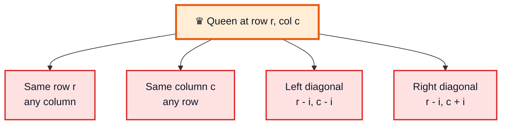
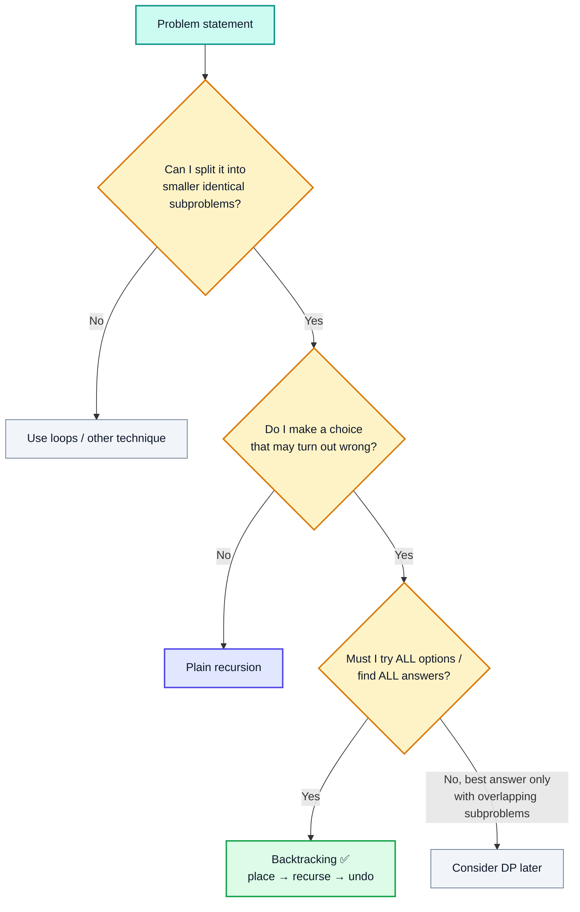
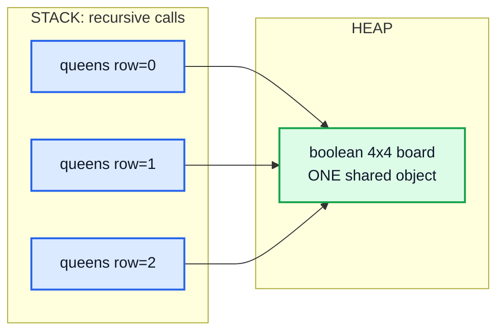
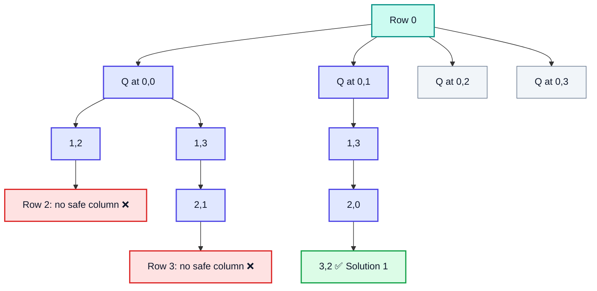
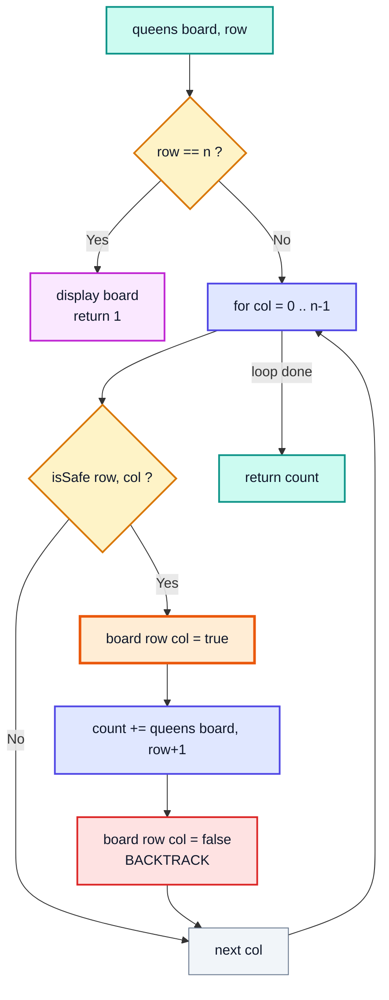
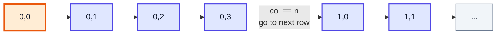
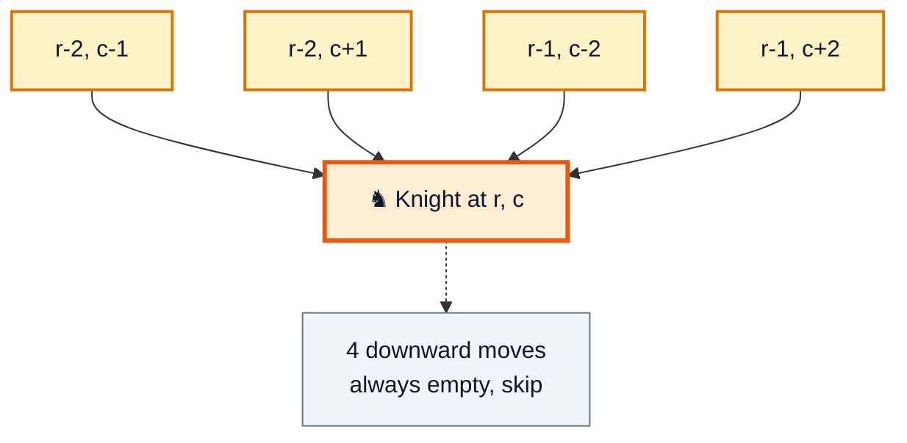
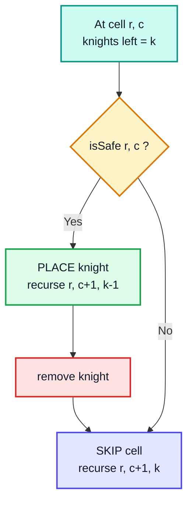
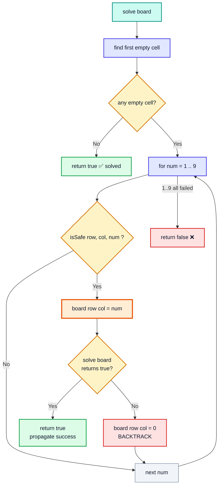
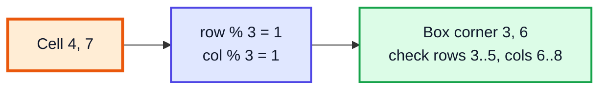

# Backtracking Questions: N-Queens, N-Knights, Sudoku Solver — Complete In-Depth Guide

**Video #36 of the Java + DSA playlist:** *N-Queens, N-Knights, Sudoku Solver (LeetCode) - Backtracking Questions* (1:19:26)

Three classic **backtracking** problems solved from scratch: placing N queens so none attack each other, placing knights the same way, and filling a Sudoku grid. This guide covers how to spot a backtracking problem, the place → recurse → undo pattern, the full Java code with traces, the complexity analysis, and faster versions you will see in interviews.

---

## Table of Contents

| # | Topic | Timestamp |
|---|---|---|
| 0 | [Introduction](#0-introduction-000) | 0:00 |
| 1 | [Q1: N-Queens Problem](#1-q1-n-queens-problem-057) | 0:57 |
| 2 | [How to determine if a problem is of recursion and backtracking?](#2-how-to-determine-if-a-problem-is-of-recursion-and-backtracking-213) | 2:13 |
| 3 | [Code for N-Queens Problem](#3-code-for-n-queens-problem-2012) | 20:12 |
| 4 | [Complexity Analysis (Correction: Linear Recurrence Relation Method)](#4-complexity-analysis-correction-linear-recurrence-relation-method-3205) | 32:05 |
| 5 | [How to eliminate for loops?](#5-how-to-eliminate-for-loops-3748) | 37:48 |
| 6 | [Q2: N-Knights Problem](#6-q2-n-knights-problem-3901) | 39:01 |
| 7 | [Code for N-Knights Problem](#7-code-for-n-knights-problem-4405) | 44:05 |
| 8 | [Q3: Sudoku Solver Problem (LeetCode)](#8-q3-sudoku-solver-problem-leetcode-5251) | 52:51 |
| 9 | [Code for Sudoku Solver Problem](#9-code-for-sudoku-solver-problem-10647) | 1:06:47 |
| 10 | [Correction: `board[row][i] == num`](#10-correction-boardrowi--num-10738) | 1:07:38 |
| 11 | [Code for Sudoku Solver Problem](#11-code-for-sudoku-solver-problem-11047) | 1:10:47 |
| 12 | [Complexity Analysis for Sudoku Solver Problem](#12-complexity-analysis-for-sudoku-solver-problem-11703) | 1:17:03 |
| 13 | [Outro](#13-outro-11820) | 1:18:20 |

---

## 0. Introduction (0:00)

This video builds on **#35 (Backtracking Introduction + Maze Problems)**. In the maze video you learned the core idea of backtracking: *make a change, recurse, then undo the change on the way back*. Here that same idea is used on harder **board problems**:

| Question | Goal | LeetCode |
|---|---|---|
| **N-Queens** | Place `n` queens on an `n × n` board so no two attack each other | [51. N-Queens](https://leetcode.com/problems/n-queens/), [52. N-Queens II](https://leetcode.com/problems/n-queens-ii/) |
| **N-Knights** | Place `k` knights on an `n × n` board so no two attack each other | (not on LeetCode, a classic variant) |
| **Sudoku Solver** | Fill a 9 × 9 grid so every row, column and 3 × 3 box has digits 1–9 | [37. Sudoku Solver](https://leetcode.com/problems/sudoku-solver/) |

> [!IMPORTANT]
> All three problems use **one template**: pick a cell, try every option, check it is safe, place it, recurse, and **remove it** when you come back. Learn the template once and you can solve all three, plus many others (word search, rat in a maze, graph colouring, and more).

---

## 1. Q1: N-Queens Problem (0:57)

### The Problem

Place **N queens** on an **N × N** chessboard so that **no two queens attack each other**. Print every valid board (or count them).

A queen attacks along:

1. Its **row** (left and right)
2. Its **column** (up and down)
3. Both **diagonals**



### Example: N = 4

There are exactly **2** solutions for a 4 × 4 board:

| Solution 1 | | | | | Solution 2 | | | |
|---|---|---|---|---|---|---|---|---|
| ⬜ | 👑 | ⬜ | ⬜ | | ⬜ | ⬜ | 👑 | ⬜ |
| ⬜ | ⬜ | ⬜ | 👑 | | 👑 | ⬜ | ⬜ | ⬜ |
| 👑 | ⬜ | ⬜ | ⬜ | | ⬜ | ⬜ | ⬜ | 👑 |
| ⬜ | ⬜ | 👑 | ⬜ | | ⬜ | 👑 | ⬜ | ⬜ |

### Key Observation: One Queen Per Row

If two queens are in the same row, they attack each other. With N queens and N rows, **each row must hold exactly one queen**. That turns the problem into:

> For each row (top to bottom), choose **which column** the queen goes in.

That removes the row check entirely: we never put two queens in the same row because we move to the next row right after placing one.

| N | Number of solutions |
|---|---|
| 1 | 1 |
| 2 | 0 |
| 3 | 0 |
| 4 | 2 |
| 5 | 10 |
| 6 | 4 |
| 7 | 40 |
| 8 | 92 |

> [!NOTE]
> N = 2 and N = 3 have **no** solutions. Your code must handle that and return 0 rather than crash.

---

## 2. How to determine if a problem is of recursion and backtracking? (2:13)

### The Basics

A problem is a **recursion** problem when a big problem can be described in terms of a **smaller version of itself**. It is a **backtracking** problem when, on top of that, you have to:

1. **Make a choice** (put a queen here)
2. **Explore** everything that follows from that choice (recurse)
3. **Undo** the choice and try the next one (backtrack)



### Signals in the Question

| Signal in the wording | Why it points to backtracking |
|---|---|
| "Find **all** possible ways / arrangements" | You must explore every branch |
| "Place items so that **no two** conflict" | Each placement limits the next |
| "Fill the grid so that ..." | Each cell is a choice with constraints |
| Input is small (N ≤ 10–15) | Exponential solutions are acceptable |
| A wrong early choice can only be discovered later | You need to come back and change it |

### Why Do We Need to "Undo"?

In the maze problems the path was the thing we changed. Here the **board** is shared by every recursive call (arrays are objects on the heap, so every call sees the same board, see video #5). If you place a queen and do not remove it when you return, the next branch would see a queen that should not be there.



### The Recursion Tree for N = 4 (partial)

Each level of the tree is a **row**; each branch is a **column choice**. Branches marked ❌ are cut as soon as a conflict is found. That cutting is called **pruning**, and it is what makes backtracking much faster than trying all `4⁴ = 256` placements.



(The grey branches `0,2` and `0,3` are explored the same way; `0,2` leads to Solution 2.)

### Which Directions Do We Need to Check?

Because we fill rows **top to bottom**, everything **below** the current row is still empty. So we only check **upwards**:

| Direction | Need to check? | Why |
|---|---|---|
| Same row | ❌ | Only one queen per row by design |
| Column, **up** | ✅ | Earlier rows may have a queen in this column |
| Column, down | ❌ | Rows below are empty |
| Left diagonal, **up** | ✅ | `(r-1, c-1), (r-2, c-2), ...` |
| Right diagonal, **up** | ✅ | `(r-1, c+1), (r-2, c+2), ...` |
| Diagonals, down | ❌ | Rows below are empty |

> [!TIP]
> This "only look at what is already filled" idea is the trick for every grid backtracking problem. Decide your **fill order** first, then you know which neighbours can already be occupied.

---

## 3. Code for N-Queens Problem (20:12)

### Approach

1. `queens(board, row)`: try every column in this row.
2. If `isSafe(board, row, col)`: place the queen, recurse on `row + 1`, then remove the queen.
3. **Base case:** `row == n` means every row has a queen → print the board and return `1`.
4. Return the total count of solutions found under this call.



### Code

```java
public class NQueens {
    public static void main(String[] args) {
        int n = 4;
        boolean[][] board = new boolean[n][n];
        System.out.println(queens(board, 0));
    }

    static int queens(boolean[][] board, int row) {
        if (row == board.length) {          // placed a queen in every row
            display(board);
            System.out.println();
            return 1;
        }

        int count = 0;
        // try every column of this row
        for (int col = 0; col < board.length; col++) {
            if (isSafe(board, row, col)) {
                board[row][col] = true;                 // place
                count += queens(board, row + 1);        // explore
                board[row][col] = false;                // undo (backtrack)
            }
        }
        return count;
    }

    static boolean isSafe(boolean[][] board, int row, int col) {
        // 1. vertical: any queen above in this column?
        for (int i = 0; i < row; i++) {
            if (board[i][col]) return false;
        }

        // 2. left diagonal (up-left)
        int maxLeft = Math.min(row, col);
        for (int i = 1; i <= maxLeft; i++) {
            if (board[row - i][col - i]) return false;
        }

        // 3. right diagonal (up-right)
        int maxRight = Math.min(row, board.length - col - 1);
        for (int i = 1; i <= maxRight; i++) {
            if (board[row - i][col + i]) return false;
        }
        return true;
    }

    static void display(boolean[][] board) {
        for (boolean[] row : board) {
            for (boolean cell : row) {
                System.out.print(cell ? "Q " : "X ");
            }
            System.out.println();
        }
    }
}
// Output:
// X Q X X
// X X X Q
// Q X X X
// X X Q X
//
// X X Q X
// Q X X X
// X X X Q
// X Q X X
//
// 2
```

### Why `Math.min` for the Diagonals?

The diagonal walk must stop at whichever **edge** it hits first:

| Diagonal | Steps until top edge | Steps until side edge | Max steps |
|---|---|---|---|
| Up-left | `row` | `col` (to column 0) | `min(row, col)` |
| Up-right | `row` | `n - col - 1` (to column n-1) | `min(row, n - col - 1)` |

Example on a 4 × 4 board, checking cell `(2, 1)`:

| Check | Cells visited |
|---|---|
| Vertical | `(0,1)`, `(1,1)` |
| Up-left, `min(2,1) = 1` | `(1,0)` |
| Up-right, `min(2, 4-1-1) = 2` | `(1,2)`, `(0,3)` |

### Dry-Run Trace (N = 4, start of the search)

| Call | Row | Try col | `isSafe`? | Action |
|---|---|---|---|---|
| 1 | 0 | 0 | ✅ | place `(0,0)`, recurse |
| 2 | 1 | 0 | ❌ column | — |
| 2 | 1 | 1 | ❌ diagonal | — |
| 2 | 1 | 2 | ✅ | place `(1,2)`, recurse |
| 3 | 2 | 0–3 | ❌ all | return 0, undo `(1,2)` 🟥 |
| 2 | 1 | 3 | ✅ | place `(1,3)`, recurse |
| 3 | 2 | 1 | ✅ | place `(2,1)`, recurse |
| 4 | 3 | 0–3 | ❌ all | return 0, undo `(2,1)` 🟥 |
| ... | ... | ... | ... | back up to row 0, undo `(0,0)` |
| 1 | 0 | 1 | ✅ | place `(0,1)` → ... → `(3,2)` ✅ count = 1 🟩 |

### Returning Boards Instead of Printing (LeetCode 51)

LeetCode wants `List<List<String>>`. Same logic, different output:

```java
import java.util.*;

class Solution {
    public List<List<String>> solveNQueens(int n) {
        List<List<String>> ans = new ArrayList<>();
        char[][] board = new char[n][n];
        for (char[] r : board) Arrays.fill(r, '.');
        solve(board, 0, ans);
        return ans;
    }

    private void solve(char[][] board, int row, List<List<String>> ans) {
        if (row == board.length) {
            List<String> snapshot = new ArrayList<>();
            for (char[] r : board) snapshot.add(new String(r));   // COPY the board
            ans.add(snapshot);
            return;
        }
        for (int col = 0; col < board.length; col++) {
            if (isSafe(board, row, col)) {
                board[row][col] = 'Q';
                solve(board, row + 1, ans);
                board[row][col] = '.';
            }
        }
    }

    private boolean isSafe(char[][] b, int row, int col) {
        for (int i = 0; i < row; i++) if (b[i][col] == 'Q') return false;
        for (int i = row - 1, j = col - 1; i >= 0 && j >= 0; i--, j--) if (b[i][j] == 'Q') return false;
        for (int i = row - 1, j = col + 1; i >= 0 && j < b.length; i--, j++) if (b[i][j] == 'Q') return false;
        return true;
    }
}
```

> [!WARNING]
> Always **copy** the board into the answer (`new String(r)`). If you add a reference to the board itself, every later backtrack step changes the "saved" answer, and you end up with a list of empty boards.

---

## 4. Complexity Analysis (Correction: Linear Recurrence Relation Method) (32:05)

### Time Complexity: The Intuition

- Row 0 has **N** choices.
- Row 1 has at most **N − 1** useful choices (one column is already taken).
- Row 2 has at most **N − 2**, and so on.

So the number of branches is at most `N × (N−1) × (N−2) × ... × 1 = N!`.

### Writing It as a Recurrence

At each level we loop over `N` columns, and for each one we call `isSafe` which costs `O(N)`. So the work in one call is `O(N²)` plus the recursive calls:

```
T(N) = N · T(N − 1) + O(N²)
```

Unrolling it:

| Level | Number of calls | Work per call | Total |
|---|---|---|---|
| 0 | 1 | N² | N² |
| 1 | N | N² | N · N² |
| 2 | N(N−1) | N² | N(N−1) · N² |
| ... | ... | ... | ... |
| N | N! | — | N! |

The last levels dominate, which gives **`O(N!)`** (the polynomial factor is swamped by the factorial and is usually dropped; some books write `O(N · N!)` to be precise).

> [!NOTE]
> The correction in the video's title refers to which recurrence-solving method applies. The recurrence `T(N) = N · T(N−1) + f(N)` has a **variable coefficient** (`N`), so the Akra–Bazzi formula from video #24 does **not** apply (that is for divide-and-conquer forms like `T(N) = a·T(N/b) + f(N)`). It is handled by the **linear recurrence** approach of unrolling/substitution, which is what the table above does.

### Space Complexity

| What | Space |
|---|---|
| Board | `O(N²)` |
| Recursion stack (one frame per row) | `O(N)` |
| **Total auxiliary** | **`O(N²)`** |

### Why the Real Runtime Is Much Smaller Than N!

Pruning cuts most branches early. For N = 8, `8! = 40,320`, but the search makes only 2,057 recursive calls. The bound is a worst-case **upper bound**, not an exact count.

### Faster Alternative: O(1) Safety Check

Instead of scanning the board in `isSafe`, keep three boolean arrays:

| Array | Index for cell `(r, c)` | Size |
|---|---|---|
| `cols` | `c` | `N` |
| `diag` (top-left → bottom-right) | `r − c + N − 1` (constant along the diagonal) | `2N − 1` |
| `anti` (top-right → bottom-left) | `r + c` (constant along the diagonal) | `2N − 1` |

```java
public class NQueensFast {
    static int solve(int n, int row, boolean[] cols, boolean[] diag, boolean[] anti) {
        if (row == n) return 1;
        int count = 0;
        for (int c = 0; c < n; c++) {
            int d = row - c + n - 1, a = row + c;
            if (cols[c] || diag[d] || anti[a]) continue;   // O(1) check
            cols[c] = diag[d] = anti[a] = true;
            count += solve(n, row + 1, cols, diag, anti);
            cols[c] = diag[d] = anti[a] = false;
        }
        return count;
    }

    public static void main(String[] args) {
        int n = 8;
        System.out.println(solve(n, 0, new boolean[n], new boolean[2 * n - 1], new boolean[2 * n - 1]));
        // 92
    }
}
```

| Version | `isSafe` cost | Time | Extra space |
|---|---|---|---|
| Board scan (video) | `O(N)` | `O(N!)` with an `O(N)` factor | `O(N²)` |
| Boolean arrays | `O(1)` | `O(N!)` | `O(N)` |
| Bitmask (ints instead of arrays) | `O(1)` | `O(N!)`, fastest constant | `O(N)` |

> [!TIP]
> LeetCode 52 (N-Queens II, count only) is the perfect place for the boolean-array version.

---

## 5. How to eliminate for loops? (37:48)

### The Idea

In N-Queens we used **recursion for rows** and a **for loop for columns**. You can also replace the for loop with recursion by passing `col` as a parameter and moving one cell at a time:

| Style | Parameters | How we move |
|---|---|---|
| Loop + recursion (N-Queens) | `row` | loop over columns, recurse on `row + 1` |
| Pure recursion (N-Knights) | `row, col` | recurse on `col + 1`; at the end of a row go to `row + 1, col = 0` |



### Example: Print Every Cell Without a Loop

```java
public class NoLoopGrid {
    static void visit(int n, int row, int col) {
        if (row == n) return;                    // past the last row → done
        if (col == n) {                          // past the last column → next row
            System.out.println();
            visit(n, row + 1, 0);
            return;
        }
        System.out.print("(" + row + "," + col + ") ");
        visit(n, row, col + 1);                  // next cell
    }

    public static void main(String[] args) {
        visit(2, 0, 0);
    }
}
// Output:
// (0,0) (0,1)
// (1,0) (1,1)
```

> [!NOTE]
> Removing loops does **not** make code faster. It is useful when, at each cell, you have a **binary choice** (place / skip), which is exactly the N-Knights situation: knights can be in the same row, so "one per row" no longer holds.

> [!CAUTION]
> Pure recursion over every cell makes the recursion depth `O(N²)` instead of `O(N)`. For big grids that can cause a `StackOverflowError`. Board problems in interviews are small, so it is fine here.

---

## 6. Q2: N-Knights Problem (39:01)

### The Problem

Place **K knights** on an **N × N** board so that **no two knights attack each other**. Print every arrangement (or count them).

A knight moves in an **L**: two squares one way and one square the other, giving up to 8 targets.

### Why It Is Different From N-Queens

| | N-Queens | N-Knights |
|---|---|---|
| Two pieces in the same row? | Never | Allowed |
| One piece per row? | Yes → loop over columns | No → place/skip **every cell** |
| Cells to check | Whole column + diagonals above | Only 4 fixed cells above |
| Number of pieces | Always N | Any K |

### Which Knight Moves Do We Check?

We fill **left to right, top to bottom**. Cells below (and to the right on the same row) are still empty, so only the **4 upward** L-moves can hold a knight:

| Move | Cell |
|---|---|
| 2 up, 1 left | `(r − 2, c − 1)` |
| 2 up, 1 right | `(r − 2, c + 1)` |
| 1 up, 2 left | `(r − 1, c − 2)` |
| 1 up, 2 right | `(r − 1, c + 2)` |



> [!IMPORTANT]
> Each of those cells may be **off the board** (for example `r − 2 < 0`). Always check **`isValid(row, col)` before reading the array**, otherwise you get `ArrayIndexOutOfBoundsException`.

### The Choice at Every Cell



This is exactly the **subset** pattern from video #32 (take it / leave it), applied to cells with a safety rule.

---

## 7. Code for N-Knights Problem (44:05)

### Code

```java
public class NKnights {
    public static void main(String[] args) {
        int n = 4;
        boolean[][] board = new boolean[n][n];
        knight(board, 0, 0, 4);
    }

    static void knight(boolean[][] board, int row, int col, int knights) {
        if (knights == 0) {                        // 1. all placed → answer
            display(board);
            System.out.println();
            return;
        }
        if (row == board.length - 1 && col == board.length) {
            return;                                // 2. ran out of cells
        }
        if (col == board.length) {                 // 3. end of row → next row
            knight(board, row + 1, 0, knights);
            return;
        }

        if (isSafe(board, row, col)) {             // 4a. place
            board[row][col] = true;
            knight(board, row, col + 1, knights - 1);
            board[row][col] = false;               //     backtrack
        }
        knight(board, row, col + 1, knights);      // 4b. skip
    }

    static boolean isSafe(boolean[][] board, int row, int col) {
        if (isValid(board, row - 2, col - 1) && board[row - 2][col - 1]) return false;
        if (isValid(board, row - 2, col + 1) && board[row - 2][col + 1]) return false;
        if (isValid(board, row - 1, col - 2) && board[row - 1][col - 2]) return false;
        if (isValid(board, row - 1, col + 2) && board[row - 1][col + 2]) return false;
        return true;
    }

    // never read the array before this check passes
    static boolean isValid(boolean[][] board, int row, int col) {
        return row >= 0 && row < board.length && col >= 0 && col < board.length;
    }

    static void display(boolean[][] board) {
        for (boolean[] row : board) {
            for (boolean cell : row) System.out.print(cell ? "K " : "X ");
            System.out.println();
        }
    }
}
// First boards printed:
// K K K K
// X X X X
// X X X X
// X X X X
//
// K K K X
// X K X X
// X X X X
// X X X X
// ... (412 boards in total)
```

### Order of the Base Cases Matters

| Order | What happens |
|---|---|
| `knights == 0` **first** ✅ | If the last knight is placed in the very last cell, we still count it |
| "out of cells" first ❌ | That last-cell answer would be thrown away |

> [!TIP]
> `isValid && board[...]` relies on **short-circuit `&&`**: if `isValid` is `false`, Java never evaluates `board[...]`, so no exception is thrown. Swapping the order would crash.

### Dry-Run Trace (N = 2, K = 2, a tiny board)

On a 2 × 2 board no knight can reach any other cell, so every pair is safe: `C(4, 2) = 6` answers.

| Call `(row, col, k)` | Decision |
|---|---|
| `(0,0,2)` | place K at `(0,0)` → `(0,1,1)` |
| `(0,1,1)` | place K at `(0,1)` → `(0,2,0)` → **answer 1** ✅ |
| `(0,1,1)` | skip → `(0,2,1)` → next row `(1,0,1)` → place → **answer 2** ✅ |
| ... | ... |
| total | **6** answers |

### Complexity

| | Value | Why |
|---|---|---|
| Time | `O(2^(N²))` upper bound | Each of the `N²` cells is placed or skipped; `isSafe` is `O(1)` |
| Tighter bound | `O(C(N², K))` leaves | Only branches with ≤ K knights continue |
| Space | `O(N²)` | Board + recursion depth up to `N²` |

### Alternative: Count Instead of Print

Return `int` from the function and add up the "place" and "skip" branches (this is what the Complete Example at the end does). For 4 knights on a 4 × 4 board the count is **412**.

---

## 8. Q3: Sudoku Solver Problem (LeetCode) (52:51)

**LeetCode 37. Sudoku Solver** (Hard)

### The Rules

Fill the empty cells of a 9 × 9 grid so that:

1. Each **row** contains digits 1–9 exactly once
2. Each **column** contains digits 1–9 exactly once
3. Each of the nine **3 × 3 boxes** contains digits 1–9 exactly once

The puzzle is guaranteed to have **exactly one** solution.

### The Approach

1. Find the **first empty cell**.
2. If there is none → the board is full → **solved**, return `true`.
3. Try digits **1 to 9** in that cell. For each digit that is safe:
   - place it,
   - recurse on the rest of the board,
   - if the recursion returned `true`, **stop** and return `true` (we found the answer),
   - otherwise reset the cell to empty (backtrack).
4. If no digit works → return `false`, so the **caller** changes its own digit.



### Why Return `boolean` This Time?

| Problem | Want | Return type |
|---|---|---|
| N-Queens / N-Knights | **All** answers | `void` or `int` (count) |
| Sudoku | **One** answer, then stop | `boolean`, so success can stop every caller |

> [!IMPORTANT]
> In Sudoku we do **not** undo the digit when the recursion succeeds. The filled board **is** the answer. We only reset the cell when the recursive call fails.

### Finding the 3 × 3 Box

For a cell `(row, col)` the top-left corner of its box is:

```
rowStart = row - row % 3
colStart = col - col % 3
```

| Cell | `row % 3` | `col % 3` | Box starts at |
|---|---|---|---|
| `(0, 0)` | 0 | 0 | `(0, 0)` |
| `(4, 7)` | 1 | 1 | `(3, 6)` |
| `(8, 2)` | 2 | 2 | `(6, 0)` |



The video uses `sqrt = (int) Math.sqrt(board.length)` instead of the literal `3`, so the same code works for 4 × 4 (2 × 2 boxes) or 16 × 16 (4 × 4 boxes) puzzles.

---

## 9. Code for Sudoku Solver Problem (1:06:47)

### The Safety Check

```java
static boolean isSafe(int[][] board, int row, int col, int num) {
    // 1. row: is num already somewhere in this row?
    for (int i = 0; i < board.length; i++) {
        if (board[row][i] == num) return false;
    }

    // 2. column: is num already in this column?
    for (int[] nums : board) {
        if (nums[col] == num) return false;
    }

    // 3. box
    int sqrt = (int) Math.sqrt(board.length);
    int rowStart = row - row % sqrt;
    int colStart = col - col % sqrt;
    for (int r = rowStart; r < rowStart + sqrt; r++) {
        for (int c = colStart; c < colStart + sqrt; c++) {
            if (board[r][c] == num) return false;
        }
    }
    return true;
}
```

| Check | Cells looked at | Cost |
|---|---|---|
| Row | `board[row][0..8]` | `O(N)` |
| Column | `board[0..8][col]` | `O(N)` |
| Box | 9 cells | `O(N)` |

---

## 10. Correction: `board[row][i] == num` (1:07:38)

### The Bug

When writing the row check it is very easy to type the **assignment** or the wrong index. The correct condition is:

```java
if (board[row][i] == num) return false;   // ✅ compares the value at column i of this row
```

| Wrong version | Problem |
|---|---|
| `board[row][i] = num` | Assignment, not comparison. For `int` it does not even compile inside `if` (`int` is not `boolean`) |
| `board[i][row] == num` | Swapped indices: checks a **column**, not the row |
| `board[row][col] == num` | Checks the same cell 9 times; the cell is empty so it never finds a clash |

> [!TIP]
> Java's type system saves you from the `=` vs `==` mistake for `int` (`if (x = 5)` is a compile error). It does **not** save you for `boolean`: `if (flag = true)` compiles and is always true. Many people write the constant first or avoid comparing booleans with `==` at all.

---

## 11. Code for Sudoku Solver Problem (1:10:47)

### Full Solver (int board, as in the video)

```java
public class SudokuSolver {
    public static void main(String[] args) {
        int[][] board = {
            {3, 0, 6, 5, 0, 8, 4, 0, 0},
            {5, 2, 0, 0, 0, 0, 0, 0, 0},
            {0, 8, 7, 0, 0, 0, 0, 3, 1},
            {0, 0, 3, 0, 1, 0, 0, 8, 0},
            {9, 0, 0, 8, 6, 3, 0, 0, 5},
            {0, 5, 0, 0, 9, 0, 6, 0, 0},
            {1, 3, 0, 0, 0, 0, 2, 5, 0},
            {0, 0, 0, 0, 0, 0, 0, 7, 4},
            {0, 0, 5, 2, 0, 6, 3, 0, 0}
        };
        if (solve(board)) display(board);
        else System.out.println("Cannot solve");
    }

    static boolean solve(int[][] board) {
        int n = board.length;
        int row = -1, col = -1;
        boolean emptyLeft = true;

        // find the first empty cell (0 = empty)
        for (int i = 0; i < n; i++) {
            for (int j = 0; j < n; j++) {
                if (board[i][j] == 0) {
                    row = i;
                    col = j;
                    emptyLeft = false;
                    break;
                }
            }
            if (!emptyLeft) break;          // break the outer loop too
        }

        if (emptyLeft) return true;         // no empty cell → solved

        for (int num = 1; num <= 9; num++) {
            if (isSafe(board, row, col, num)) {
                board[row][col] = num;
                if (solve(board)) return true;   // answer found → stop everything
                board[row][col] = 0;             // otherwise undo
            }
        }
        return false;                        // nothing fits here → caller must change
    }

    static boolean isSafe(int[][] board, int row, int col, int num) { /* see section 9 */ return true; }

    static void display(int[][] board) {
        for (int[] row : board) {
            for (int v : row) System.out.print(v + " ");
            System.out.println();
        }
    }
}
// Output (with the real isSafe from section 9):
// 3 1 6 5 7 8 4 9 2
// 5 2 9 1 3 4 7 6 8
// 4 8 7 6 2 9 5 3 1
// 2 6 3 4 1 5 9 8 7
// 9 7 4 8 6 3 1 2 5
// 8 5 1 7 9 2 6 4 3
// 1 3 8 9 4 7 2 5 6
// 6 9 2 3 5 1 8 7 4
// 7 4 5 2 8 6 3 1 9
```

> [!NOTE]
> The flag is named `emptyLeft` in the video's spirit, but read it as "board is full". It starts `true` and becomes `false` the moment an empty cell is found. The **two** `break`s are needed: a plain `break` only leaves the inner loop. In modern Java you can also use a **labelled break** (`outer: for (...) { ... break outer; }`).

### LeetCode 37 Version (`char[][]`, `'.'` = empty)

```java
class Solution {
    public void solveSudoku(char[][] board) {
        solve(board);
    }

    private boolean solve(char[][] board) {
        for (int r = 0; r < 9; r++) {
            for (int c = 0; c < 9; c++) {
                if (board[r][c] != '.') continue;
                for (char d = '1'; d <= '9'; d++) {
                    if (isSafe(board, r, c, d)) {
                        board[r][c] = d;
                        if (solve(board)) return true;
                        board[r][c] = '.';
                    }
                }
                return false;          // this empty cell has no valid digit
            }
        }
        return true;                   // no empty cell found
    }

    private boolean isSafe(char[][] b, int r, int c, char d) {
        int br = r - r % 3, bc = c - c % 3;
        for (int i = 0; i < 9; i++) {
            if (b[r][i] == d || b[i][c] == d) return false;
            if (b[br + i / 3][bc + i % 3] == d) return false;   // box in one loop
        }
        return true;
    }
}
```

`b[br + i / 3][bc + i % 3]` walks the 9 box cells with a single index `i = 0..8`: `i / 3` gives the row offset (0,0,0,1,1,1,2,2,2) and `i % 3` the column offset (0,1,2,0,1,2,0,1,2).

### Dry-Run (first few steps of the board above)

| Step | Empty cell | Try | Safe? | Result |
|---|---|---|---|---|
| 1 | `(0,1)` | 1 | ✅ | place 1, recurse |
| 2 | `(0,4)` | 1 | ❌ row has 1 | — |
| 2 | `(0,4)` | 2 | ✅ | place 2, recurse |
| 3 | `(0,7)` | 1–8 | ❌ row / column | — |
| 3 | `(0,7)` | 9 | ✅ | place 9, recurse |
| ... | ... | ... | ... | a later dead end undoes recent digits and tries the next one 🟧 (in the final answer `(0,4)` ends up as 7) |
| end | none | — | — | board full → `true` propagates up 🟩 |

---

## 12. Complexity Analysis for Sudoku Solver Problem (1:17:03)

### Time

- There are at most `N × N` empty cells (81 for a standard Sudoku).
- Each empty cell can try up to `N` digits (9).
- Each try calls `isSafe`, which is `O(N)`.

So the worst-case upper bound is:

```
O(9^(N·N))    for a 9×9 board → 9^81 branches in theory
```

More precisely, if `E` is the number of **empty** cells: `O(9^E · N)`.

| Factor | Value for standard Sudoku |
|---|---|
| Choices per cell | 9 |
| Empty cells `E` | up to 81 (real puzzles have ~50–60) |
| `isSafe` cost | `O(9)` |
| Worst-case bound | `O(9^E)` |

> [!NOTE]
> Real puzzles finish in milliseconds because the row/column/box rules prune almost every branch. Like N-Queens, the exponential number is a loose **upper bound**.

### Space

| What | Space |
|---|---|
| Board (modified in place) | `O(1)` extra |
| Recursion depth (one frame per empty cell) | `O(N²)` → at most 81 frames |

### Faster Alternatives

| Technique | What changes | Effect |
|---|---|---|
| Boolean tables `rowUsed[9][10]`, `colUsed[9][10]`, `boxUsed[9][10]` | `isSafe` becomes 3 array lookups | `O(1)` check |
| Bitmasks (one `int` per row/col/box) | Same, packed into bits | Even faster constant |
| **Most constrained cell first** (MRV) | Pick the empty cell with the fewest legal digits | Huge pruning; solves hard puzzles instantly |
| Dancing Links (Algorithm X) | Treats Sudoku as exact cover | Used by competitive solvers |

```java
// O(1) isSafe with lookup tables
boolean[][] rowUsed = new boolean[9][10];
boolean[][] colUsed = new boolean[9][10];
boolean[][] boxUsed = new boolean[9][10];
// box index for (r, c): (r / 3) * 3 + c / 3

boolean canPlace(int r, int c, int d) {
    return !rowUsed[r][d] && !colUsed[c][d] && !boxUsed[(r / 3) * 3 + c / 3][d];
}
```

---

## 13. Outro (1:18:20)

The video ends the **recursion and backtracking** block of the course. The next videos start **Object-Oriented Programming** (#37 OOP 1).

> [!TIP]
> Practice the same template on: **79. Word Search**, **46. Permutations**, **39. Combination Sum**, **131. Palindrome Partitioning**, **1219. Path with Maximum Gold**. Every one is "choose → check → place → recurse → undo".

---

## 🧩 Complete Example: Everything Together

One program with all three problems: N-Queens (printing and counting, checked against the fast boolean-array version), N-Knights (no column loop, counts answers and prints the first), and the Sudoku solver on LeetCode 37's example board.

```java
public class Backtracking {

    // ════════════ Q1: N-QUEENS (Kunal's approach) ════════════
    static int queens(boolean[][] board, int row, boolean print) {
        if (row == board.length) {              // all rows filled → one valid answer
            if (print) { display(board); System.out.println(); }
            return 1;
        }
        int count = 0;
        for (int col = 0; col < board.length; col++) {
            if (isSafe(board, row, col)) {
                board[row][col] = true;          // place
                count += queens(board, row + 1, print);
                board[row][col] = false;         // backtrack
            }
        }
        return count;
    }

    static boolean isSafe(boolean[][] board, int row, int col) {
        for (int i = 0; i < row; i++)                                   // vertical (up)
            if (board[i][col]) return false;
        int maxLeft = Math.min(row, col);
        for (int i = 1; i <= maxLeft; i++)                              // left diagonal (up-left)
            if (board[row - i][col - i]) return false;
        int maxRight = Math.min(row, board.length - col - 1);
        for (int i = 1; i <= maxRight; i++)                             // right diagonal (up-right)
            if (board[row - i][col + i]) return false;
        return true;
    }

    static void display(boolean[][] board) {
        for (boolean[] r : board) {
            StringBuilder sb = new StringBuilder();
            for (boolean cell : r) sb.append(cell ? "Q " : ". ");
            System.out.println(sb.toString().trim());
        }
    }

    // ════════════ Optimised N-Queens: O(1) safety check ════════════
    static int queensFast(int n, int row, boolean[] cols, boolean[] d1, boolean[] d2) {
        if (row == n) return 1;
        int count = 0;
        for (int col = 0; col < n; col++) {
            int a = row - col + n - 1, b = row + col;
            if (cols[col] || d1[a] || d2[b]) continue;
            cols[col] = d1[a] = d2[b] = true;
            count += queensFast(n, row + 1, cols, d1, d2);
            cols[col] = d1[a] = d2[b] = false;
        }
        return count;
    }

    // ════════════ Q2: N-KNIGHTS (no for loop over columns) ════════════
    static boolean printedKnight = false;

    static int knights(boolean[][] board, int row, int col, int left) {
        if (left == 0) {                                  // all knights placed
            if (!printedKnight) { displayKnights(board); printedKnight = true; }
            return 1;
        }
        if (row == board.length) return 0;                // ran off the board
        if (col == board.length) return knights(board, row + 1, 0, left);  // next row

        int count = 0;
        if (isSafeKnight(board, row, col)) {
            board[row][col] = true;
            count += knights(board, row, col + 1, left - 1);
            board[row][col] = false;
        }
        count += knights(board, row, col + 1, left);      // skip this cell
        return count;
    }

    static boolean isSafeKnight(boolean[][] b, int r, int c) {
        int[][] moves = {{-2, -1}, {-2, 1}, {-1, -2}, {-1, 2}};   // only cells ABOVE can be filled
        for (int[] m : moves) {
            int nr = r + m[0], nc = c + m[1];
            if (isValid(b, nr, nc) && b[nr][nc]) return false;
        }
        return true;
    }

    static boolean isValid(boolean[][] b, int r, int c) {
        return r >= 0 && r < b.length && c >= 0 && c < b.length;
    }

    static void displayKnights(boolean[][] board) {
        for (boolean[] r : board) {
            StringBuilder sb = new StringBuilder();
            for (boolean cell : r) sb.append(cell ? "K " : ". ");
            System.out.println(sb.toString().trim());
        }
    }

    // ════════════ Q3: SUDOKU SOLVER (LeetCode 37) ════════════
    static boolean solve(int[][] board) {
        int n = board.length;
        int row = -1, col = -1;
        boolean emptyLeft = false;
        for (int i = 0; i < n && !emptyLeft; i++) {      // find the first empty cell
            for (int j = 0; j < n; j++) {
                if (board[i][j] == 0) { row = i; col = j; emptyLeft = true; break; }
            }
        }
        if (!emptyLeft) return true;                      // no empty cell → solved

        for (int num = 1; num <= 9; num++) {
            if (isSafeSudoku(board, row, col, num)) {
                board[row][col] = num;
                if (solve(board)) return true;            // found an answer → stop
                board[row][col] = 0;                      // backtrack
            }
        }
        return false;                                     // nothing fits → go back
    }

    static boolean isSafeSudoku(int[][] board, int row, int col, int num) {
        for (int i = 0; i < board.length; i++) {
            if (board[row][i] == num) return false;       // row   (the video's correction)
            if (board[i][col] == num) return false;       // column
        }
        int sqrt = (int) Math.sqrt(board.length);
        int rs = row - row % sqrt, cs = col - col % sqrt;
        for (int r = rs; r < rs + sqrt; r++)
            for (int c = cs; c < cs + sqrt; c++)
                if (board[r][c] == num) return false;     // 3x3 box
        return true;
    }

    static void displaySudoku(int[][] board) {
        for (int[] r : board) {
            StringBuilder sb = new StringBuilder();
            for (int v : r) sb.append(v).append(' ');
            System.out.println(sb.toString().trim());
        }
    }

    public static void main(String[] args) {
        System.out.println("=== N-Queens, n = 4 ===");
        int c4 = queens(new boolean[4][4], 0, true);
        System.out.println("Solutions: " + c4);

        System.out.print("Counts n=1..8: ");
        for (int n = 1; n <= 8; n++) {
            int fast = queensFast(n, 0, new boolean[n], new boolean[2 * n - 1], new boolean[2 * n - 1]);
            int slow = queens(new boolean[n][n], 0, false);
            System.out.print(fast + (fast == slow ? "" : "!") + (n < 8 ? " " : "\n"));
        }

        System.out.println("\n=== N-Knights, 4 knights on 4x4 ===");
        int k = knights(new boolean[4][4], 0, 0, 4);
        System.out.println("Ways: " + k);

        System.out.println("\n=== Sudoku Solver ===");
        int[][] sudoku = {
            {5, 3, 0, 0, 7, 0, 0, 0, 0},
            {6, 0, 0, 1, 9, 5, 0, 0, 0},
            {0, 9, 8, 0, 0, 0, 0, 6, 0},
            {8, 0, 0, 0, 6, 0, 0, 0, 3},
            {4, 0, 0, 8, 0, 3, 0, 0, 1},
            {7, 0, 0, 0, 2, 0, 0, 0, 6},
            {0, 6, 0, 0, 0, 0, 2, 8, 0},
            {0, 0, 0, 4, 1, 9, 0, 0, 5},
            {0, 0, 0, 0, 8, 0, 0, 7, 9}
        };
        if (solve(sudoku)) displaySudoku(sudoku);
        else System.out.println("Cannot solve");
    }
}
```

**Expected Output:**
```
=== N-Queens, n = 4 ===
. Q . .
. . . Q
Q . . .
. . Q .

. . Q .
Q . . .
. . . Q
. Q . .

Solutions: 2
Counts n=1..8: 1 0 0 2 10 4 40 92

=== N-Knights, 4 knights on 4x4 ===
K K K K
. . . .
. . . .
. . . .
Ways: 412

=== Sudoku Solver ===
5 3 4 6 7 8 9 1 2
6 7 2 1 9 5 3 4 8
1 9 8 3 4 2 5 6 7
8 5 9 7 6 1 4 2 3
4 2 6 8 5 3 7 9 1
7 1 3 9 2 4 8 5 6
9 6 1 5 3 7 2 8 4
2 8 7 4 1 9 6 3 5
3 4 5 2 8 6 1 7 9
```

(Compiled and run with `javac`/`java` 21.)

---

## Quick Reference Cheat Sheet

| Concept | One-Line Summary |
|---|---|
| **Backtracking** | Choose → check safe → place → recurse → **undo** |
| **When to use** | "All ways", "place so no two conflict", small N, wrong choices discovered late |
| **Pruning** | Stop a branch as soon as it breaks a rule; makes real runtime far below the bound |
| **Fill order trick** | Fill top-to-bottom, so only check cells **above** the current one |
| **N-Queens** | One queen per row; loop columns; check column + 2 upward diagonals |
| **Diagonal limits** | Up-left `min(row, col)`, up-right `min(row, n-col-1)` |
| **N-Queens time / space** | `O(N!)` / `O(N²)` board + `O(N)` stack |
| **Fast N-Queens** | `cols[c]`, `diag[r-c+n-1]`, `anti[r+c]` → `O(1)` check |
| **Eliminate loops** | Pass `(row, col)`; `col == n` → `(row+1, 0)`; depth becomes `O(N²)` |
| **N-Knights** | Place or skip every cell; check 4 upward L-moves; `isValid` before indexing |
| **N-Knights time** | `O(2^(N²))` upper bound |
| **Sudoku** | First empty cell → try 1–9 → `return true` on success, reset on failure |
| **Box corner** | `row - row % 3`, `col - col % 3` |
| **Correction** | Row check is `board[row][i] == num` |
| **Sudoku time / space** | `O(9^E)` (E = empty cells) / `O(E)` stack |
| **Return type rule** | All answers → `void`/`int`; one answer → `boolean` to stop early |
| **LeetCode** | 51 & 52 (N-Queens), 37 (Sudoku Solver) |
