# Java OOP — Complete In-Depth Guide

A comprehensive deep-dive into Object-Oriented Programming in Java, covering every foundational concept with detailed explanations, memory diagrams, and runnable code examples.

---

## Table of Contents
1. [What is OOP?](#1-what-is-oop)
2. [Classes](#2-classes)
3. [Objects](#3-objects)
4. [Dynamic Memory Allocation & the `new` Keyword](#4-dynamic-memory-allocation--the-new-keyword)
5. [Constructors](#5-constructors)
6. [The `this` Keyword](#6-the-this-keyword)
7. [Constructor Overloading](#7-constructor-overloading)
8. [Wrapper Classes](#8-wrapper-classes)
9. [The `final` Keyword](#9-the-final-keyword)
10. [Garbage Collection](#10-garbage-collection)

---

## 1. What is OOP?

**Object-Oriented Programming (OOP)** is a programming paradigm that organizes code around **objects** rather than functions and logic. Instead of writing a long list of instructions, you model real-world entities as objects that contain both **data** (state) and **behavior** (methods).

### The Four Pillars of OOP

| Pillar | Meaning | Real-World Analogy |
|---|---|---|
| **Encapsulation** | Bundling data + methods together, hiding internal details | A car's engine is hidden; you just use the steering wheel and pedals |
| **Abstraction** | Exposing only the essential features, hiding complexity | An ATM — you don't know how it works internally, you just use the interface |
| **Inheritance** | A class can inherit properties/methods from another class | A `Dog` is a type of `Animal` — it inherits traits like `eat()`, `sleep()` |
| **Polymorphism** | One interface, many forms — same method behaves differently | The `+` operator adds numbers but concatenates strings |

### Why OOP?

```
Procedural Approach (Without OOP):
─────────────────────────────────
  String student1Name = "Kunal";
  int student1Roll = 15;
  float student1Marks = 85.4f;

  String student2Name = "Rahul";
  int student2Roll = 18;
  float student2Marks = 90.3f;
  // ...imagine doing this for 1000 students 😱

OOP Approach:
─────────────
  Student kunal = new Student(15, "Kunal", 85.4f);
  Student rahul = new Student(18, "Rahul", 90.3f);
  // Clean, organized, scalable ✅
```

> [!IMPORTANT]
> OOP is not just a "style" — it's a fundamental way of thinking about software design. Every real-world Java application (Android apps, Spring backends, game engines) is built with OOP.

---

## 2. Classes

### What is a Class?

A **class** is a **blueprint/template** for creating objects. It defines:
- **What data** an object will hold (instance variables / fields)
- **What behavior** an object will have (methods)

> Think of a class like an **architect's blueprint** for a house. The blueprint itself isn't a house — it describes *how* to build one.

### Syntax

```java
class Student {
    // ========= FIELDS (State) =========
    int rno;
    String name;
    float marks;

    // ========= METHODS (Behavior) =========
    void greeting() {
        System.out.println("Hello! My name is " + name);
    }

    void displayInfo() {
        System.out.println("Roll: " + rno + ", Name: " + name + ", Marks: " + marks);
    }
}
```

### Deep Dive: Anatomy of a Class

```java
class Car {
    // ──── Instance Variables (unique to each object) ────
    String brand;
    String color;
    int speed;

    // ──── Constructor (how to build a Car) ────
    Car(String brand, String color) {
        this.brand = brand;
        this.color = color;
        this.speed = 0;  // Every new car starts at speed 0
    }

    // ──── Instance Methods (behavior) ────
    void accelerate(int increment) {
        speed += increment;
        System.out.println(brand + " accelerated to " + speed + " km/h");
    }

    void brake() {
        speed = 0;
        System.out.println(brand + " has stopped.");
    }

    void showDetails() {
        System.out.println("🚗 " + color + " " + brand + " | Speed: " + speed + " km/h");
    }
}

public class Main {
    public static void main(String[] args) {
        Car tesla = new Car("Tesla Model 3", "White");
        Car bmw   = new Car("BMW M3", "Black");

        tesla.accelerate(80);   // Tesla Model 3 accelerated to 80 km/h
        bmw.accelerate(120);    // BMW M3 accelerated to 120 km/h

        tesla.showDetails();    // 🚗 White Tesla Model 3 | Speed: 80 km/h
        bmw.showDetails();      // 🚗 Black BMW M3 | Speed: 120 km/h

        tesla.brake();          // Tesla Model 3 has stopped.
    }
}
```

### What a Class is NOT

- A class is **not** an object. It's a **logical construct** — it doesn't occupy memory until you create an object from it.
- You cannot "use" a class directly to store data. You must **instantiate** (create an object of) it first.

---

## 3. Objects

### What is an Object?

An **object** is a **specific instance** of a class. If a class is the blueprint, the object is the **actual house built from that blueprint**.

Every object has three essential properties:

| Property | Meaning | Example |
|---|---|---|
| **State** | The current values of its fields | `name = "Kunal"`, `marks = 85.4` |
| **Identity** | What distinguishes it from other objects (its memory address) | `kunal` is at address `0x7a3f`, `rahul` is at `0x8b2c` |
| **Behavior** | The methods it can perform | `greeting()`, `displayInfo()` |

### Creating Objects

```java
// Step 1: Declare a reference variable
Student kunal;          // kunal is just a reference — it points to NOTHING (null) right now

// Step 2: Instantiate the object
kunal = new Student();  // NOW an actual Student object is created in HEAP memory
                        // kunal now holds the REFERENCE (memory address) to that object

// Combined (most common):
Student rahul = new Student();
```

### Reference Variables vs Objects — THE CRITICAL DISTINCTION

This is one of the most **important** concepts to understand:

```java
Student one = new Student();
one.name = "Kunal";

Student two = one;    // ⚠️ NO new object created! 'two' points to the SAME object as 'one'

one.name = "Something something";
System.out.println(two.name);   // Output: "Something something" 😲
```

**What happened in memory:**

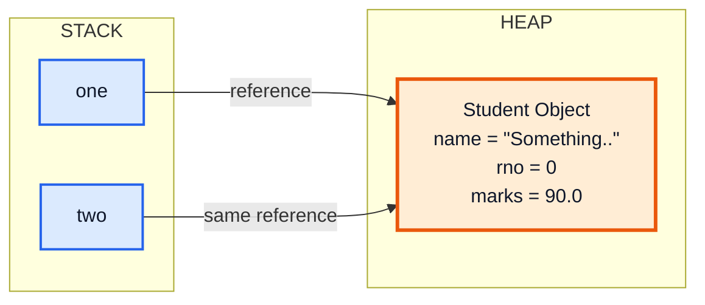

Both `one` and `two` are **references** (like remote controls) pointing to the **same TV (object)**. Changing the channel with one remote changes it for both.

> [!CAUTION]
> `Student two = one;` does **NOT** copy the object. It copies the **reference**. This is one of the most common sources of bugs for beginners.

### Null References

```java
Student s;              // s is declared but not initialized → it's null
System.out.println(s);  // ❌ Compile error: variable s might not have been initialized

Student s = null;       // Explicitly set to null
s.greeting();           // ❌ Runtime error: NullPointerException!
```

---

## 4. Dynamic Memory Allocation & the `new` Keyword

### How Memory Works in Java

Java divides memory into two main regions:

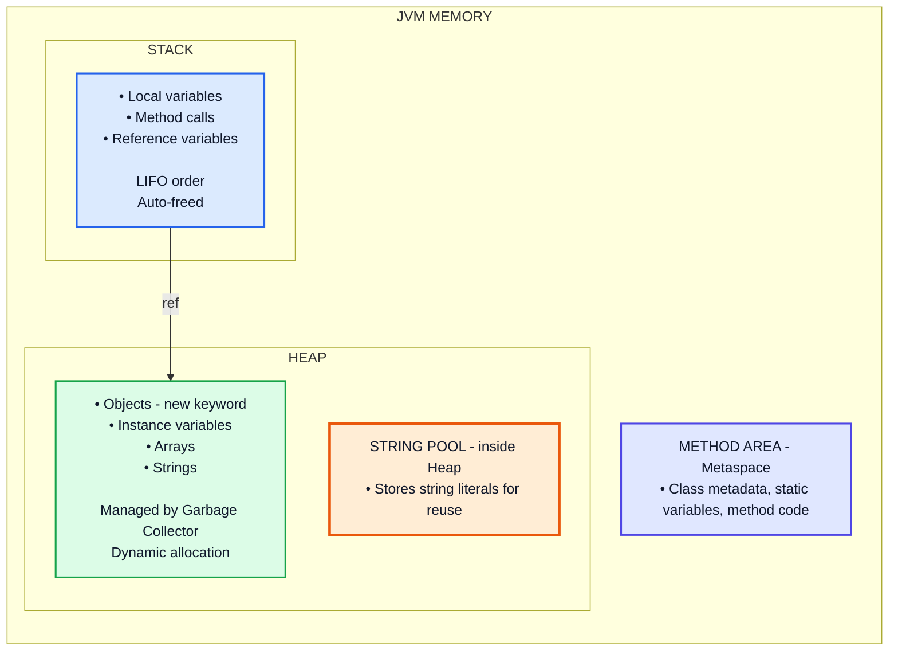

### The `new` Keyword — In Depth

The `new` keyword does **three things**:

1. **Allocates memory** on the heap at runtime for the new object
2. **Invokes the constructor** to initialize the object
3. **Returns a reference** (memory address) to the newly created object

```java
Box mybox = new Box();
//   │          │
//   │          └── 2. Calls Box() constructor, which initializes the object
//   │              3. Returns reference to the object on the heap
//   │
//   └── 1. Reference variable 'mybox' (stored on STACK) receives the reference
```

### Complete Memory Example

```java
public class MemoryDemo {
    public static void main(String[] args) {
        int x = 10;                              // Primitive → stored directly on STACK
        Student kunal = new Student(15, "Kunal", 85.4f);  // Object → HEAP; reference → STACK
        Student rahul = new Student(18, "Rahul", 90.3f);  // Another object on HEAP

        Student copy = kunal;   // copy and kunal point to the SAME heap object

        changeMarks(kunal);     // Pass the reference (not the object itself)
        System.out.println(kunal.marks);  // 100.0 — the original object was modified!
    }

    static void changeMarks(Student s) {
        // 's' is a COPY of the reference, but it still points to the same object
        s.marks = 100.0f;    // Modifies the actual object on the heap
    }
}
```

**Memory snapshot after line 5:**

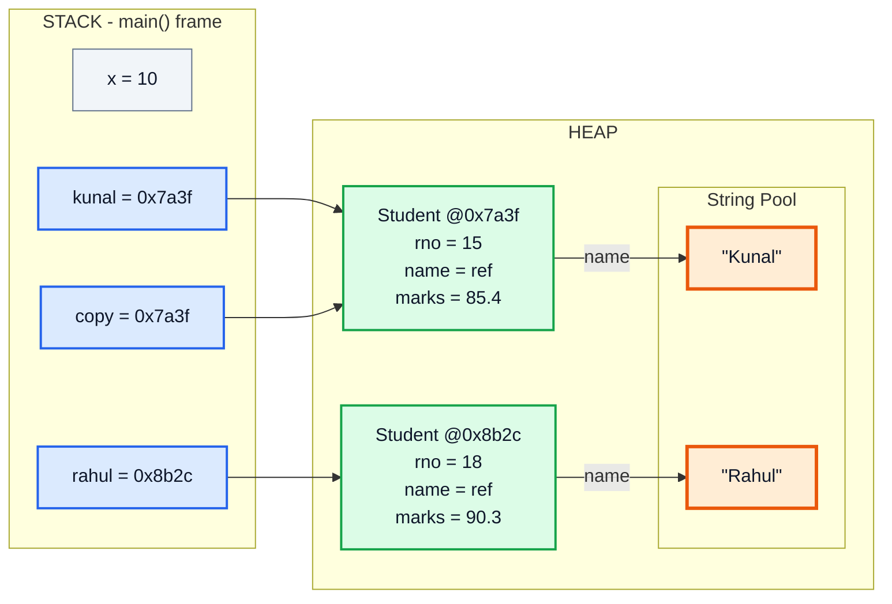

### Why Primitives Don't Use `new`

```java
int a = 10;       // ✅ Stored directly on stack — fast and efficient
Integer b = 10;   // Object wrapper — stored on heap, slower
```

> Java's primitive types (`int`, `float`, `char`, `boolean`, etc.) are **not** objects. They're stored directly on the stack for **performance**. Making them objects would add overhead (heap allocation, garbage collection, etc.) for something used millions of times.

---

## 5. Constructors

### What is a Constructor?

A **constructor** is a special method that is **automatically called** when you create an object with `new`. Its purpose is to **initialize** the object's state.

### Rules for Constructors

| Rule | Explanation |
|---|---|
| Same name as the class | `class Student` → constructor is `Student()` |
| No return type | Not even `void` — the implicit return type is the class itself |
| Called automatically | Invoked by `new`, not by you directly |
| Can be overloaded | Multiple constructors with different parameters |
| Default constructor | If you write NO constructor, Java provides a no-arg one automatically |

### Types of Constructors

#### 1. Default Constructor (No-Arg)

```java
class Student {
    int rno;
    String name;
    float marks;

    // If you don't write ANY constructor, Java creates this invisibly:
    // Student() { }
    // It sets fields to default values: int→0, String→null, float→0.0
}

public class Main {
    public static void main(String[] args) {
        Student s = new Student();
        System.out.println(s.rno);    // 0
        System.out.println(s.name);   // null
        System.out.println(s.marks);  // 0.0
    }
}
```

> [!WARNING]
> The moment you define **any** constructor (even a parameterized one), Java **no longer** provides the default no-arg constructor. If you still need it, you must write it yourself.

#### 2. Parameterized Constructor

```java
class Student {
    int rno;
    String name;
    float marks;

    // Parameterized constructor — YOU decide how to initialize each object
    Student(int rno, String name, float marks) {
        this.rno = rno;
        this.name = name;
        this.marks = marks;
    }
}

public class Main {
    public static void main(String[] args) {
        Student kunal = new Student(15, "Kunal Kushwaha", 85.4f);
        // Behind the scenes:
        //   1. new allocates memory on heap
        //   2. Student(15, "Kunal Kushwaha", 85.4f) is called
        //   3. 'this' inside constructor = the new object being created
        //   4. Reference returned and stored in 'kunal'

        System.out.println(kunal.name);  // Kunal Kushwaha
    }
}
```

#### 3. Copy Constructor

Java doesn't have a built-in copy constructor like C++, but you can create one:

```java
class Student {
    int rno;
    String name;
    float marks;

    // Regular constructor
    Student(int rno, String name, float marks) {
        this.rno = rno;
        this.name = name;
        this.marks = marks;
    }

    // Copy constructor — creates a NEW object with the same values
    Student(Student other) {
        this.rno = other.rno;
        this.name = other.name;
        this.marks = other.marks;
    }
}

public class Main {
    public static void main(String[] args) {
        Student kunal = new Student(15, "Kunal", 85.4f);
        Student copy  = new Student(kunal);  // A completely NEW object with same values

        copy.name = "Modified";
        System.out.println(kunal.name);  // "Kunal"   — original is UNAFFECTED ✅
        System.out.println(copy.name);   // "Modified" — only the copy changed
    }
}
```

> [!TIP]
> Use a copy constructor when you want to create an **independent copy** of an object. This avoids the reference-sharing problem (`Student two = one;`).

### Constructor Execution Flow with Inheritance

```java
class Base {
    Base() {
        System.out.println("Base Class Constructor Called");
    }
}

class Derived extends Base {
    Derived() {
        // super(); ← Java inserts this AUTOMATICALLY as the first line
        System.out.println("Derived Class Constructor Called");
    }
}

public class Main {
    public static void main(String[] args) {
        Derived d = new Derived();
    }
}
// Output:
//   Base Class Constructor Called
//   Derived Class Constructor Called
```

**Why?** A derived class depends on its parent's state being initialized first. Java ensures the parent is always constructed before the child.

---

## 6. The `this` Keyword

`this` is a **reference to the current object** — the object on which a method or constructor was invoked.

### Use Case 1: Distinguish Instance Variables from Parameters

```java
class Student {
    String name;    // instance variable
    int rno;

    Student(String name, int rno) {
        // Without 'this', Java thinks 'name' refers to the PARAMETER (local scope wins)
        // name = name;      ❌ This assigns the parameter to itself — does nothing!
        this.name = name;    // ✅ this.name = instance variable, name = parameter
        this.rno = rno;
    }
}
```

**What `this` really means at runtime:**

```java
Student kunal = new Student("Kunal", 15);
// Inside the constructor, 'this' IS 'kunal' — it refers to the object at kunal's address
```

### Use Case 2: Calling Another Constructor (`this()`)

```java
class Student {
    int rno;
    String name;
    float marks;

    Student() {
        // Call the 3-parameter constructor with default values
        this(13, "default person", 100.0f);  // ⚠️ Must be the FIRST statement
        System.out.println("Default student created");
    }

    Student(int rno, String name, float marks) {
        this.rno = rno;
        this.name = name;
        this.marks = marks;
    }
}
```

> [!IMPORTANT]
> `this()` must be the **very first statement** in the constructor. You cannot call `this()` and `super()` in the same constructor.

### Use Case 3: Passing the Current Object

```java
class Student {
    String name;

    Student(String name) {
        this.name = name;
    }

    void enroll(Course course) {
        course.addStudent(this);  // Pass the current student object to the course
    }
}

class Course {
    void addStudent(Student s) {
        System.out.println(s.name + " enrolled in this course!");
    }
}
```

### Use Case 4: Returning the Current Object (Method Chaining)

```java
class Builder {
    String name;
    int age;

    Builder setName(String name) {
        this.name = name;
        return this;        // Return the current object → enables chaining
    }

    Builder setAge(int age) {
        this.age = age;
        return this;
    }

    void print() {
        System.out.println(name + ", Age: " + age);
    }
}

public class Main {
    public static void main(String[] args) {
        new Builder()
            .setName("Kunal")    // returns 'this'
            .setAge(22)          // returns 'this'
            .print();            // Kunal, Age: 22
    }
}
```

---

## 7. Constructor Overloading

**Constructor overloading** means having **multiple constructors** in the same class, each with a **different parameter list**. Java decides which one to call based on the arguments you pass.

```java
class Student {
    int rno;
    String name;
    float marks;

    // Constructor 1: No arguments → default values
    Student() {
        this(0, "Unknown", 0.0f);
    }

    // Constructor 2: All fields
    Student(int rno, String name, float marks) {
        this.rno = rno;
        this.name = name;
        this.marks = marks;
    }

    // Constructor 3: Copy constructor
    Student(Student other) {
        this.rno = other.rno;
        this.name = other.name;
        this.marks = other.marks;
    }

    // Constructor 4: Only name (rno auto-generated, default marks)
    Student(String name) {
        this(generateRno(), name, 75.0f);
    }

    private static int counter = 0;
    private static int generateRno() {
        return ++counter;
    }

    void display() {
        System.out.println("[" + rno + "] " + name + " — " + marks);
    }
}

public class Main {
    public static void main(String[] args) {
        Student s1 = new Student();                          // Calls Constructor 1
        Student s2 = new Student(15, "Kunal", 85.4f);        // Calls Constructor 2
        Student s3 = new Student(s2);                        // Calls Constructor 3
        Student s4 = new Student("Rahul");                   // Calls Constructor 4

        s1.display();  // [0] Unknown — 0.0
        s2.display();  // [15] Kunal — 85.4
        s3.display();  // [15] Kunal — 85.4
        s4.display();  // [1] Rahul — 75.0
    }
}
```

### How Java Resolves Which Constructor to Call

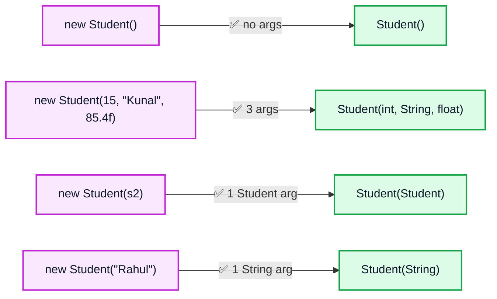

Java uses **the number and types of arguments** to pick the right constructor at **compile time**.

### Constructor Chaining

Constructors can call each other using `this()`:

```java
class Pizza {
    String size;
    String crust;
    boolean extraCheese;

    // Full constructor
    Pizza(String size, String crust, boolean extraCheese) {
        this.size = size;
        this.crust = crust;
        this.extraCheese = extraCheese;
    }

    // Medium thin-crust, no extra cheese (defaults)
    Pizza() {
        this("Medium", "Thin", false);  // Chain to full constructor
    }

    // Custom size, rest defaults
    Pizza(String size) {
        this(size, "Thin", false);      // Chain to full constructor
    }
}
```

This avoids **code duplication** — all initialization logic lives in one place.

---

## 8. The `new` Keyword & Memory — Deep Dive

Let's trace exactly what happens when you write `Student kunal = new Student(15, "Kunal", 85.4f);`

### Step-by-Step Execution

```
Step 1: COMPILE TIME
──────────────────────────────────────────────
  The compiler sees "Student kunal" and knows:
  - 'kunal' is a reference variable of type Student
  - It will be allocated space on the STACK

Step 2: RUNTIME — 'new Student(15, "Kunal", 85.4f)'
──────────────────────────────────────────────
  2a. JVM calculates how much memory a Student needs:
      - int rno     → 4 bytes
      - String name → 4/8 bytes (reference)
      - float marks → 4 bytes
      - Object header → 12-16 bytes
      Total ≈ 24-32 bytes

  2b. JVM allocates that block on the HEAP

  2c. All fields initialized to defaults:
      rno = 0, name = null, marks = 0.0f

  2d. Constructor Student(int, String, float) is invoked:
      this.rno = 15;
      this.name = "Kunal";
      this.marks = 85.4f;

  2e. JVM returns the memory address (reference) of the object

Step 3: ASSIGNMENT
──────────────────────────────────────────────
  The reference is stored in 'kunal' (on the stack)
  kunal now "points to" the object on the heap
```

### What Happens with Arrays of Objects

```java
Student[] students = new Student[3];
// This creates an array of 3 REFERENCES, all initialized to null
// NO Student objects are created yet!

students[0] = new Student(1, "A", 90f);  // NOW one object is created
students[1] = new Student(2, "B", 80f);  // Another object
students[2] = new Student(3, "C", 70f);  // Another object
```

**Memory after `new Student[3]`:**

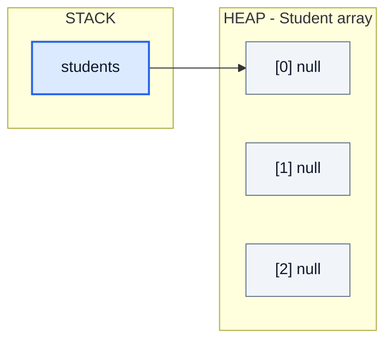

**Memory after assigning `students[0..2]`:**

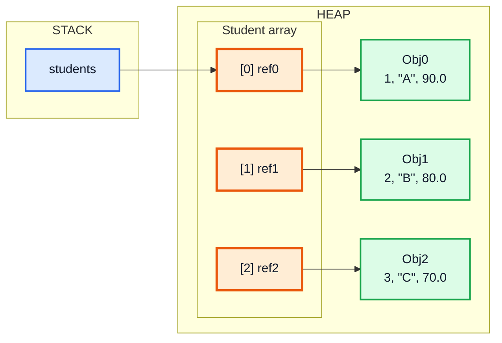

---

## 9. Wrapper Classes

### What are Wrapper Classes?

Every primitive type in Java has a corresponding **wrapper class** — an object-based version of that primitive.

| Primitive | Wrapper Class | Size |
|---|---|---|
| `byte` | `Byte` | 1 byte |
| `short` | `Short` | 2 bytes |
| `int` | `Integer` | 4 bytes |
| `long` | `Long` | 8 bytes |
| `float` | `Float` | 4 bytes |
| `double` | `Double` | 8 bytes |
| `char` | `Character` | 2 bytes |
| `boolean` | `Boolean` | 1 bit (JVM-dependent) |

### Why Do Wrapper Classes Exist?

1. **Collections only work with objects** — `ArrayList<int>` is illegal; you need `ArrayList<Integer>`
2. **Utility methods** — `Integer.parseInt("123")`, `Integer.toBinaryString(10)`
3. **Nullability** — Primitives can't be `null`, but wrappers can (useful for databases)
4. **Generics require objects** — `<T>` can't be a primitive

### Autoboxing and Unboxing

Java automatically converts between primitives and their wrappers:

```java
public class WrapperDemo {
    public static void main(String[] args) {
        // ────── AUTOBOXING: primitive → Wrapper (automatic) ──────
        Integer num = 42;        // int 42 is automatically wrapped into an Integer object
        // Equivalent to: Integer num = Integer.valueOf(42);

        Double pi = 3.14159;     // double → Double
        Boolean flag = true;     // boolean → Boolean

        // ────── UNBOXING: Wrapper → primitive (automatic) ──────
        int x = num;             // Integer → int
        // Equivalent to: int x = num.intValue();

        double y = pi;           // Double → double

        // ────── In expressions ──────
        Integer a = 10;
        Integer b = 20;
        int sum = a + b;         // Both unboxed, added as ints, result is int
        System.out.println(sum); // 30
    }
}
```

### ⚠️ The Wrapper Swap Trap

```java
public class WrapperExample {
    public static void main(String[] args) {
        Integer a = 10;
        Integer b = 20;

        swap(a, b);

        System.out.println(a + " " + b);  // Output: 10 20 — NOT swapped! 😲
    }

    static void swap(Integer a, Integer b) {
        Integer temp = a;
        a = b;           // This only changes the LOCAL reference
        b = temp;        // The original references in main() are UNTOUCHED
    }
}
```

**Why doesn't this work?**

**Before the swap — `swap()` receives COPIES of the references:**

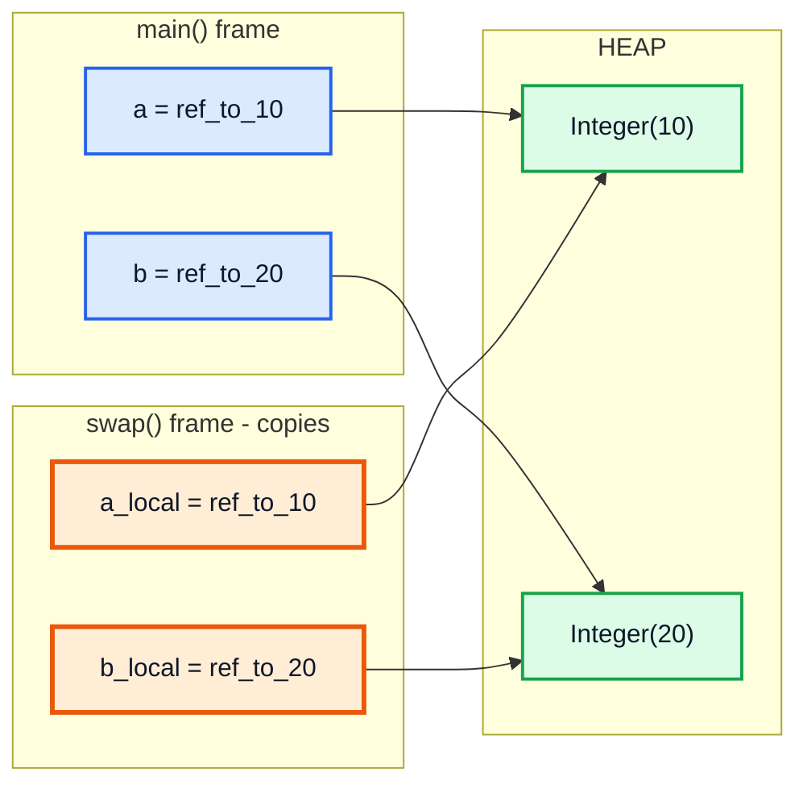

**After the swap inside the method — only the local references changed:**

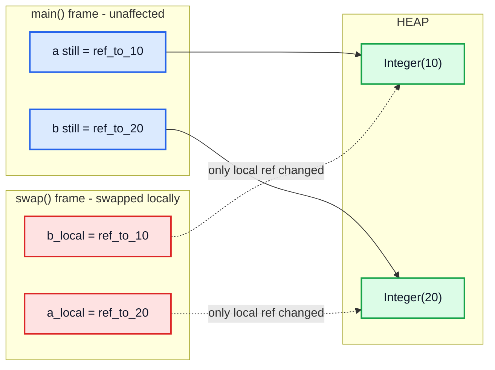

> [!NOTE]
> Java is **always pass-by-value**. For objects, it passes a **copy of the reference**, not the reference itself. So reassigning the parameter doesn't affect the original.

### Integer Caching (`-128` to `127`)

```java
Integer a = 127;
Integer b = 127;
System.out.println(a == b);    // true ✅ (same cached object)

Integer c = 128;
Integer d = 128;
System.out.println(c == d);    // false ❌ (different objects!)
System.out.println(c.equals(d)); // true ✅ (same VALUE)
```

> [!WARNING]
> Java caches `Integer` objects for values `-128` to `127`. Outside this range, `new` objects are created. **Always use `.equals()` to compare wrapper objects**, never `==`.

### Useful Wrapper Methods

```java
// Parsing strings to numbers
int num = Integer.parseInt("42");
double d = Double.parseDouble("3.14");

// Number to string
String s = Integer.toString(255);
String hex = Integer.toHexString(255);     // "ff"
String bin = Integer.toBinaryString(255);  // "11111111"

// Min/Max values
System.out.println(Integer.MAX_VALUE);  // 2147483647
System.out.println(Integer.MIN_VALUE);  // -2147483648

// Comparing
int result = Integer.compare(10, 20);   // -1 (10 < 20)
```

---

## 10. The `final` Keyword

`final` means **"this cannot be changed after initialization"**. It applies to variables, methods, and classes — each with different implications.

### 1. `final` Variables (Constants)

```java
class Constants {
    final double PI = 3.14159265;          // Must initialize at declaration
    final int MAX_STUDENTS;                // OR initialize in constructor (blank final)

    Constants() {
        MAX_STUDENTS = 50;                 // ✅ Initialized in constructor
    }

    void test() {
        // PI = 3.0;                       // ❌ COMPILE ERROR: cannot assign to final
        // MAX_STUDENTS = 100;             // ❌ COMPILE ERROR

        final int LOCAL_CONST = 42;
        // LOCAL_CONST = 99;               // ❌ COMPILE ERROR
    }
}
```

Convention: `final` variables are named in `ALL_CAPS_WITH_UNDERSCORES`.

### 2. `final` with Reference Types — THE GOTCHA

```java
class A {
    String name;

    A(String name) {
        this.name = name;
    }
}

public class Main {
    public static void main(String[] args) {
        final A kunal = new A("Kunal Kushwaha");

        kunal.name = "Other name";    // ✅ This is ALLOWED!
        // kunal = new A("New obj");  // ❌ COMPILE ERROR: cannot reassign 'kunal'
    }
}
```

**Why?** `final` on a reference means **the reference cannot point to a different object**. But the object itself can still be modified!

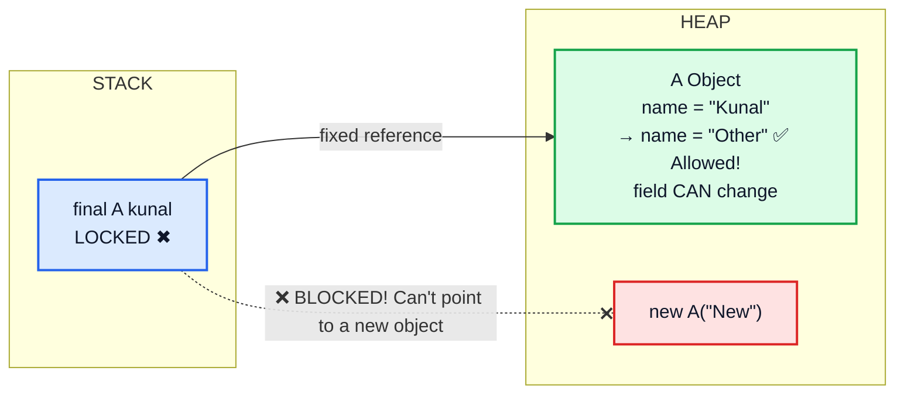

> [!IMPORTANT]
> `final` guarantees **immutability of the reference**, NOT of the object. For primitives (which ARE their value), `final` = constant. For objects, `final` = can't reassign, but CAN mutate the object's internals.

### 3. `final` Methods (Cannot be Overridden)

```java
class Animal {
    final void breathe() {
        System.out.println("Breathing...");
    }
}

class Dog extends Animal {
    // void breathe() { }  // ❌ COMPILE ERROR: cannot override final method
}
```

### 4. `final` Classes (Cannot be Extended)

```java
final class MathUtils {
    static double circleArea(double r) {
        return Math.PI * r * r;
    }
}

// class AdvancedMath extends MathUtils { }  // ❌ COMPILE ERROR: cannot inherit from final class
```

The `String` class is `final` — that's why you can't extend it!

### Summary Table

| `final` on... | Effect |
|---|---|
| **Primitive variable** | Value cannot be changed (true constant) |
| **Reference variable** | Cannot point to a different object; object's fields CAN change |
| **Method** | Cannot be overridden by subclasses |
| **Class** | Cannot be extended (no subclasses) |

---

## 11. Garbage Collection

### What is Garbage Collection?

In languages like C/C++, you must manually free memory (`free()`, `delete`). If you forget, you get **memory leaks**. Java solves this with **automatic garbage collection (GC)**.

The **Garbage Collector** is a background thread in the JVM that:
1. **Identifies** objects that are no longer reachable (no references pointing to them)
2. **Reclaims** the memory those objects occupied
3. Runs **automatically** — you don't control when it runs

### When Does an Object Become Eligible for GC?

```java
public class GCDemo {
    public static void main(String[] args) {
        // Scenario 1: Reference set to null
        Student s1 = new Student("A");
        s1 = null;   // Object "A" is now unreachable → eligible for GC ✅

        // Scenario 2: Reference reassigned
        Student s2 = new Student("B");
        s2 = new Student("C");  // Object "B" is now unreachable → eligible for GC ✅

        // Scenario 3: Object created inside a method
        createStudent();  // After this method returns, the object created inside is eligible ✅

        // Scenario 4: Island of isolation
        Student x = new Student("X");
        Student y = new Student("Y");
        x.friend = y;    // X references Y
        y.friend = x;    // Y references X (circular reference)
        x = null;
        y = null;
        // Both objects reference EACH OTHER, but neither is reachable from the program
        // Java's GC handles this! (Unlike reference counting in some other languages)
    }

    static void createStudent() {
        Student temp = new Student("Temp");
        // 'temp' goes out of scope when method returns
    }
}
```

### Visualizing GC Eligibility

**BEFORE:**

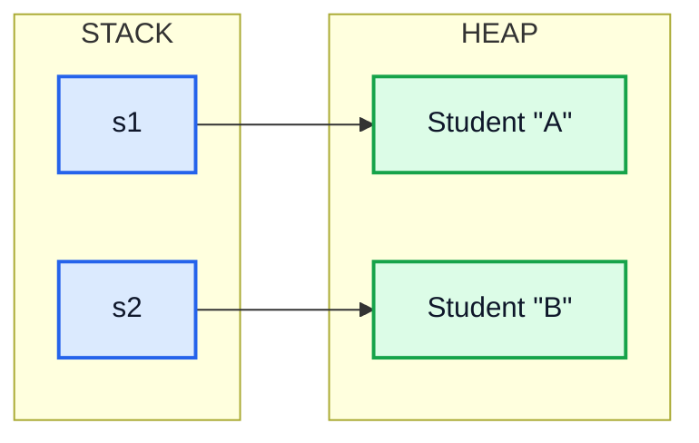

**AFTER `s1 = null; s2 = new Student("C");`:**

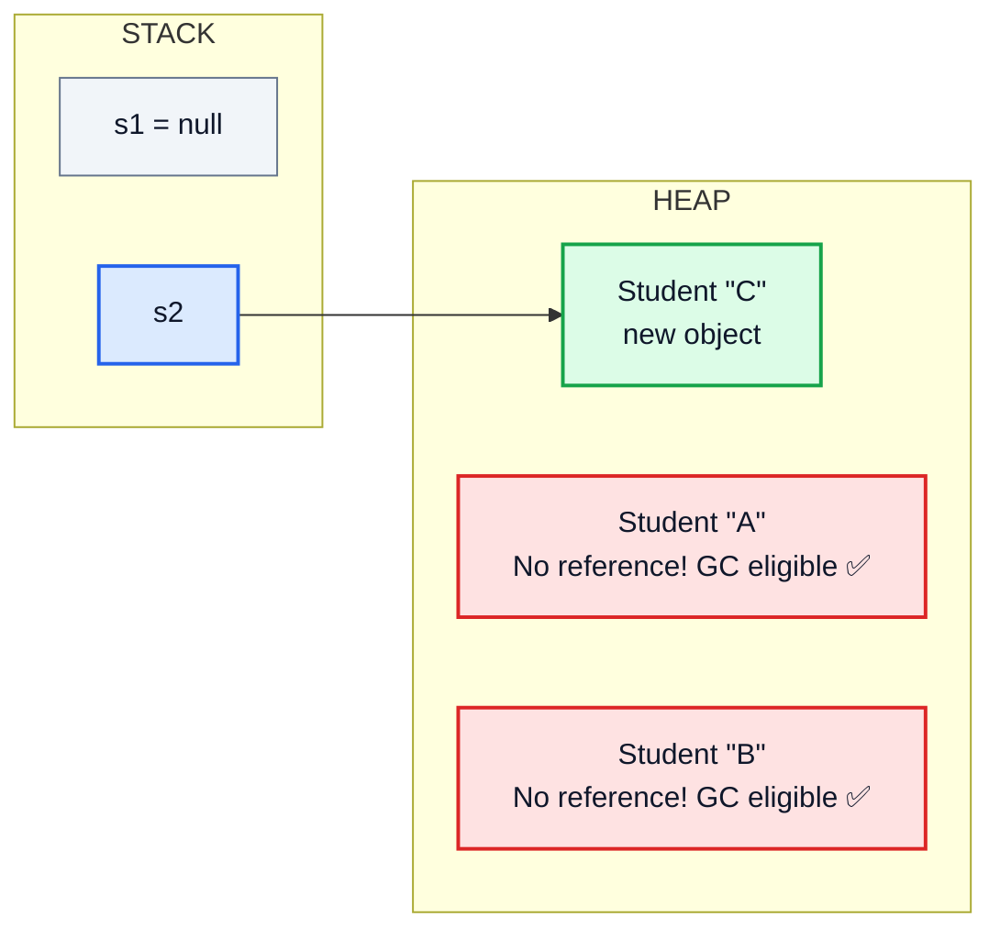

### The `finalize()` Method (Deprecated)

Before an object is garbage collected, the JVM **may** call its `finalize()` method:

```java
class A {
    String name;

    A(String name) {
        this.name = name;
    }

    @Override
    protected void finalize() throws Throwable {
        System.out.println("Object '" + name + "' is being garbage collected!");
    }
}

public class Main {
    public static void main(String[] args) {
        A obj = new A("TestObject");
        obj = null;   // Object eligible for GC

        // REQUEST garbage collection (JVM may or may not honor this)
        System.gc();
    }
}
// Possible output: Object 'TestObject' is being garbage collected!
```

> [!CAUTION]
> `finalize()` has been **deprecated since Java 9** and **removed in Java 18**. Reasons:
> - No guarantee it will run at all
> - No guarantee of timing
> - Significant performance overhead
> - Can accidentally "resurrect" objects
>
> **Modern alternative:** Use `try-with-resources` and `AutoCloseable` for cleanup:
> ```java
> try (FileReader reader = new FileReader("file.txt")) {
>     // use reader
> } // automatically closed here, even if exceptions occur
> ```

### GC Algorithms (Brief Overview)

| Algorithm | Description |
|---|---|
| **Mark and Sweep** | Mark all reachable objects → sweep (delete) unmarked ones |
| **Generational GC** | Divide heap into Young & Old generations; GC young objects more often |
| **G1 (Garbage First)** | Default since Java 9; divides heap into regions for parallel collection |
| **ZGC / Shenandoah** | Ultra-low pause time collectors for large heaps (Java 11+/12+) |

### You Cannot Force GC

```java
System.gc();              // Merely a REQUEST — JVM may ignore it
Runtime.getRuntime().gc(); // Same thing, different syntax
```

The JVM decides when to run GC based on heap usage, allocation pressure, and its own heuristics.

---

## 🧩 Complete Example: Everything Together

Here's one program that uses **every concept** covered:

```java
// ══════════════════════════════════════════════════════════════
// BankAccount — Demonstrating ALL OOP basics in one example
// ══════════════════════════════════════════════════════════════

class BankAccount {
    // ──── Instance Variables ────
    private int accountNumber;
    private String holderName;
    private double balance;

    // ──── Final variable (constant) ────
    final String BANK_NAME = "JavaBank";

    // ──── Static counter for auto-generating account numbers ────
    private static int nextAccountNumber = 1001;

    // ═══════ CONSTRUCTOR OVERLOADING ═══════

    // Constructor 1: Default — creates account with defaults
    BankAccount() {
        this("Unknown", 0.0);  // ← 'this()' chains to Constructor 2
    }

    // Constructor 2: With name and initial balance
    BankAccount(String holderName, double initialBalance) {
        this.accountNumber = nextAccountNumber++;   // 'this' keyword
        this.holderName = holderName;
        this.balance = initialBalance;
    }

    // Constructor 3: Copy constructor
    BankAccount(BankAccount other) {
        this.accountNumber = nextAccountNumber++;  // New account number!
        this.holderName = other.holderName;
        this.balance = other.balance;
    }

    // ═══════ METHODS ═══════

    void deposit(double amount) {
        if (amount > 0) {
            this.balance += amount;  // 'this' refers to the object calling deposit()
            System.out.println("✅ Deposited ₹" + amount);
        }
    }

    void withdraw(double amount) {
        if (amount > 0 && amount <= this.balance) {
            this.balance -= amount;
            System.out.println("✅ Withdrew ₹" + amount);
        } else {
            System.out.println("❌ Insufficient balance!");
        }
    }

    // Method chaining with 'this'
    BankAccount setName(String name) {
        this.holderName = name;
        return this;  // Return current object for chaining
    }

    void displayInfo() {
        System.out.println("┌──────────────────────────────┐");
        System.out.println("│ " + BANK_NAME);
        System.out.println("│ Account #" + accountNumber);
        System.out.println("│ Holder: " + holderName);
        System.out.println("│ Balance: ₹" + balance);
        System.out.println("└──────────────────────────────┘");
    }

    @Override
    protected void finalize() throws Throwable {
        System.out.println("🗑️ Account #" + accountNumber + " garbage collected");
    }
}

public class Main {
    public static void main(String[] args) {
        // ═══════ OBJECTS & DYNAMIC MEMORY ALLOCATION (new) ═══════
        BankAccount acc1 = new BankAccount("Kunal", 5000.0);   // Parameterized
        BankAccount acc2 = new BankAccount();                    // Default
        BankAccount acc3 = new BankAccount(acc1);                // Copy

        acc1.displayInfo();
        acc2.displayInfo();
        acc3.displayInfo();

        // ═══════ USING METHODS ═══════
        acc1.deposit(2000);
        acc1.withdraw(1500);
        acc1.displayInfo();

        // ═══════ METHOD CHAINING with 'this' ═══════
        acc2.setName("Rahul").deposit(10000);
        acc2.displayInfo();

        // ═══════ REFERENCE SHARING ═══════
        BankAccount ref = acc1;       // ref and acc1 point to SAME object
        ref.deposit(100);
        System.out.println("acc1 and ref are same object: " + (acc1 == ref));  // true

        // ═══════ WRAPPER CLASSES ═══════
        Integer wrappedBalance = (int) acc1.balance;   // Autoboxing
        System.out.println("Wrapped balance: " + wrappedBalance);
        System.out.println("As binary: " + Integer.toBinaryString(wrappedBalance));

        // ═══════ FINAL KEYWORD ═══════
        System.out.println("Bank name: " + acc1.BANK_NAME);
        // acc1.BANK_NAME = "Other";  // ❌ Cannot change final field

        final BankAccount locked = acc1;
        locked.deposit(500);          // ✅ Can modify object's state
        // locked = new BankAccount(); // ❌ Cannot reassign final reference

        // ═══════ GARBAGE COLLECTION ═══════
        acc3 = null;     // Account #1003 is now eligible for GC
        acc2 = new BankAccount("New Person", 100);  // Old acc2 eligible for GC

        System.gc();     // Request GC (may or may not run finalize)
        System.out.println("\n✨ Program complete!");
    }
}
```

**Expected Output:**
```
┌──────────────────────────────┐
│ JavaBank
│ Account #1001
│ Holder: Kunal
│ Balance: ₹5000.0
└──────────────────────────────┘
┌──────────────────────────────┐
│ JavaBank
│ Account #1002
│ Holder: Unknown
│ Balance: ₹0.0
└──────────────────────────────┘
┌──────────────────────────────┐
│ JavaBank
│ Account #1003
│ Holder: Kunal
│ Balance: ₹5000.0
└──────────────────────────────┘
✅ Deposited ₹2000.0
✅ Withdrew ₹1500.0
┌──────────────────────────────┐
│ JavaBank
│ Account #1001
│ Holder: Kunal
│ Balance: ₹5500.0
└──────────────────────────────┘
✅ Deposited ₹10000.0
┌──────────────────────────────┐
│ JavaBank
│ Account #1002
│ Holder: Rahul
│ Balance: ₹10000.0
└──────────────────────────────┘
✅ Deposited ₹100.0
acc1 and ref are same object: true
...
✨ Program complete!
```

---

## Quick Reference Cheat Sheet

| Concept | One-Line Summary |
|---|---|
| **OOP** | Organize code around objects (data + behavior) instead of just functions |
| **Class** | A blueprint/template that defines what an object looks like and does |
| **Object** | A specific instance of a class, with its own state in memory |
| **`new` keyword** | Allocates memory on heap, calls constructor, returns reference |
| **Constructor** | Special method to initialize an object; no return type, same name as class |
| **`this` keyword** | Reference to the current object; resolves ambiguity, enables chaining |
| **Constructor Overloading** | Multiple constructors with different parameter lists in the same class |
| **Wrapper Classes** | Object equivalents of primitives (`int` → `Integer`); needed for collections & generics |
| **`final` keyword** | Makes variables constant, methods non-overridable, classes non-extendable |
| **Garbage Collection** | JVM automatically frees memory of unreachable objects |
