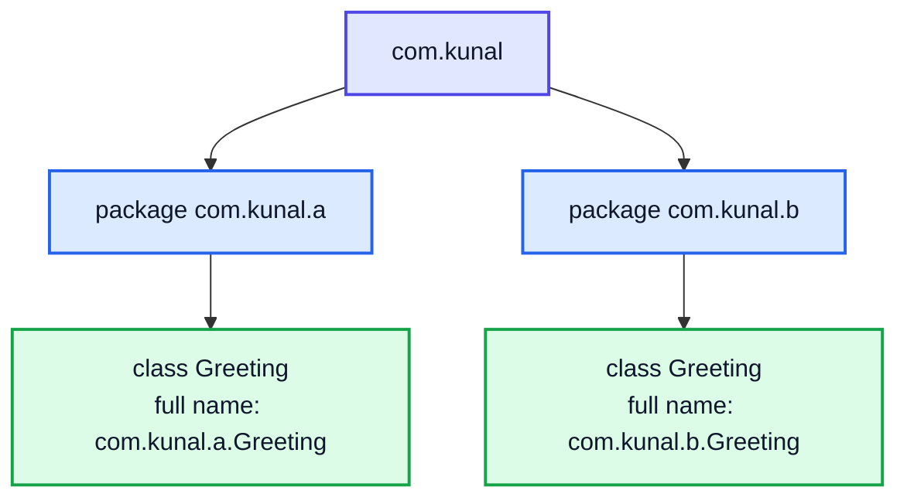
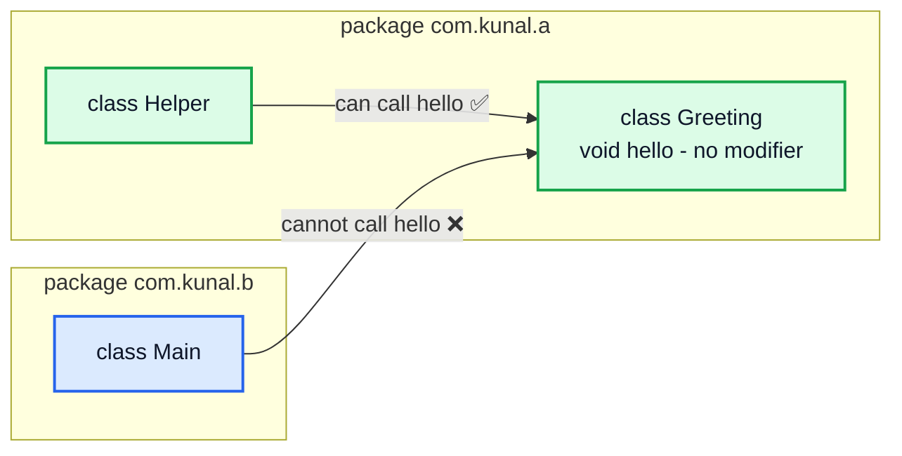
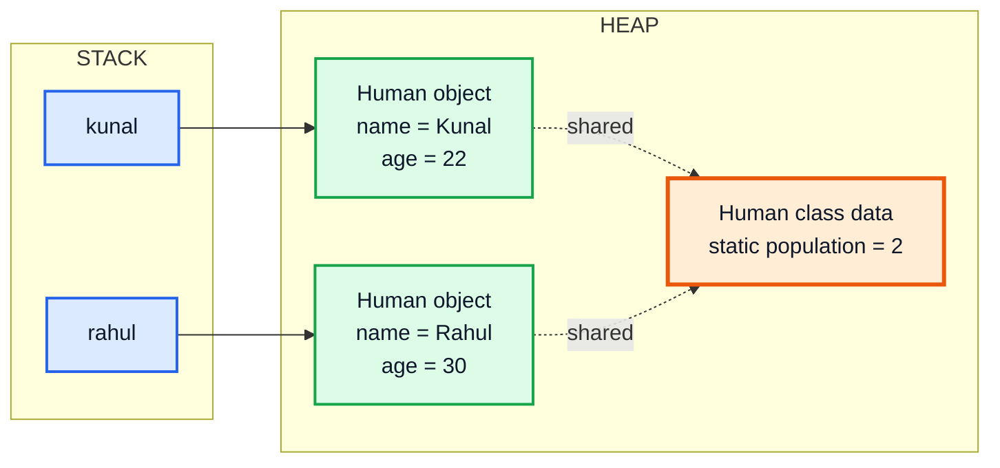
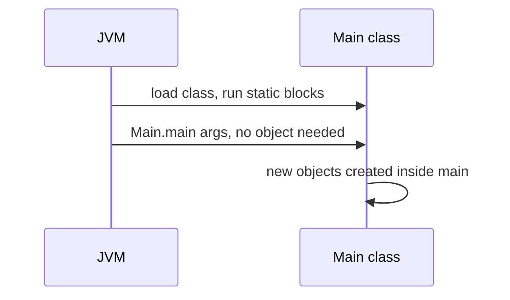
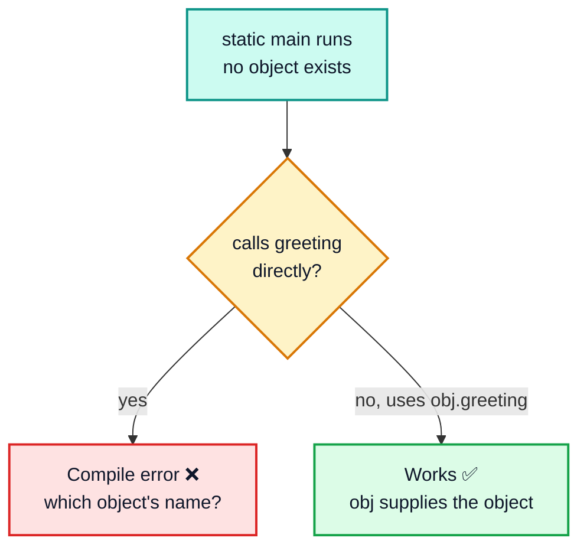
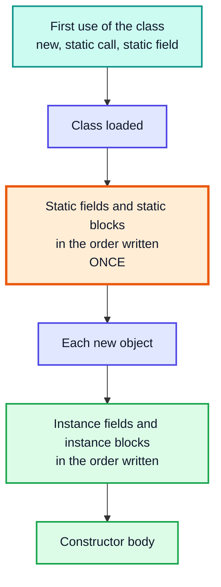
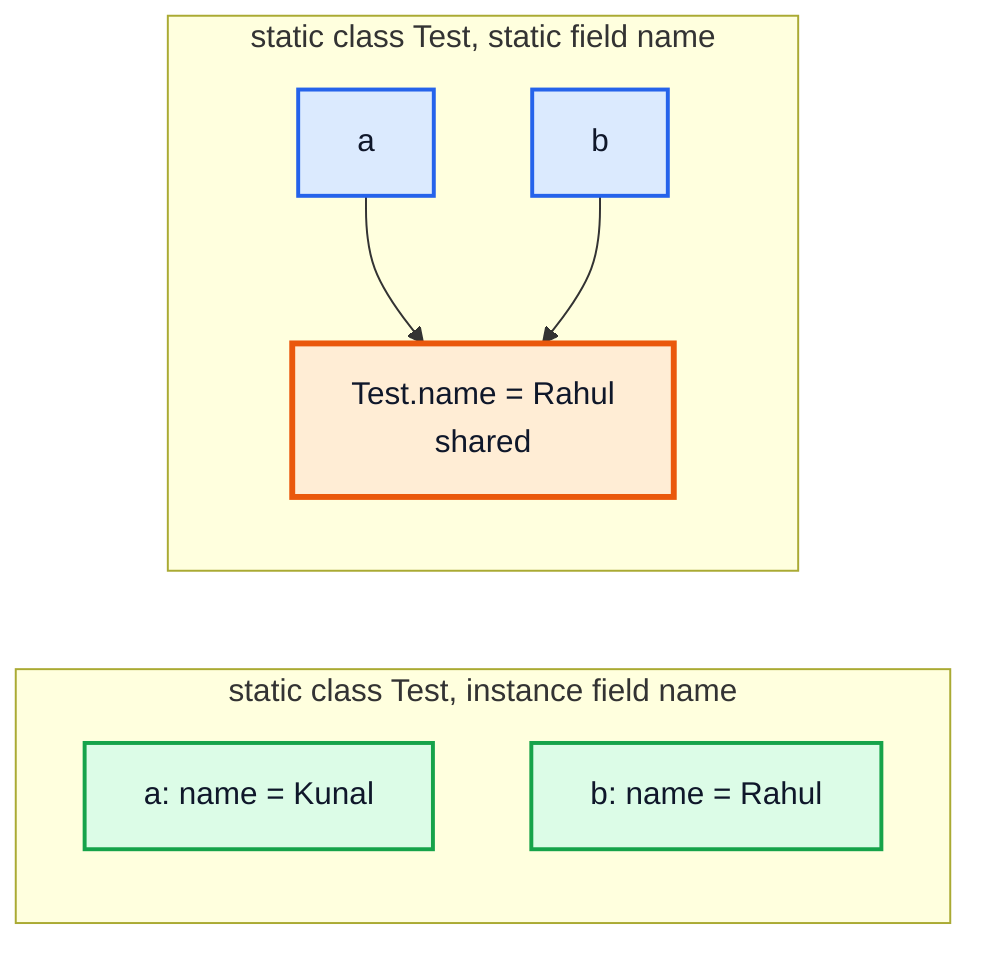
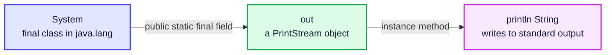
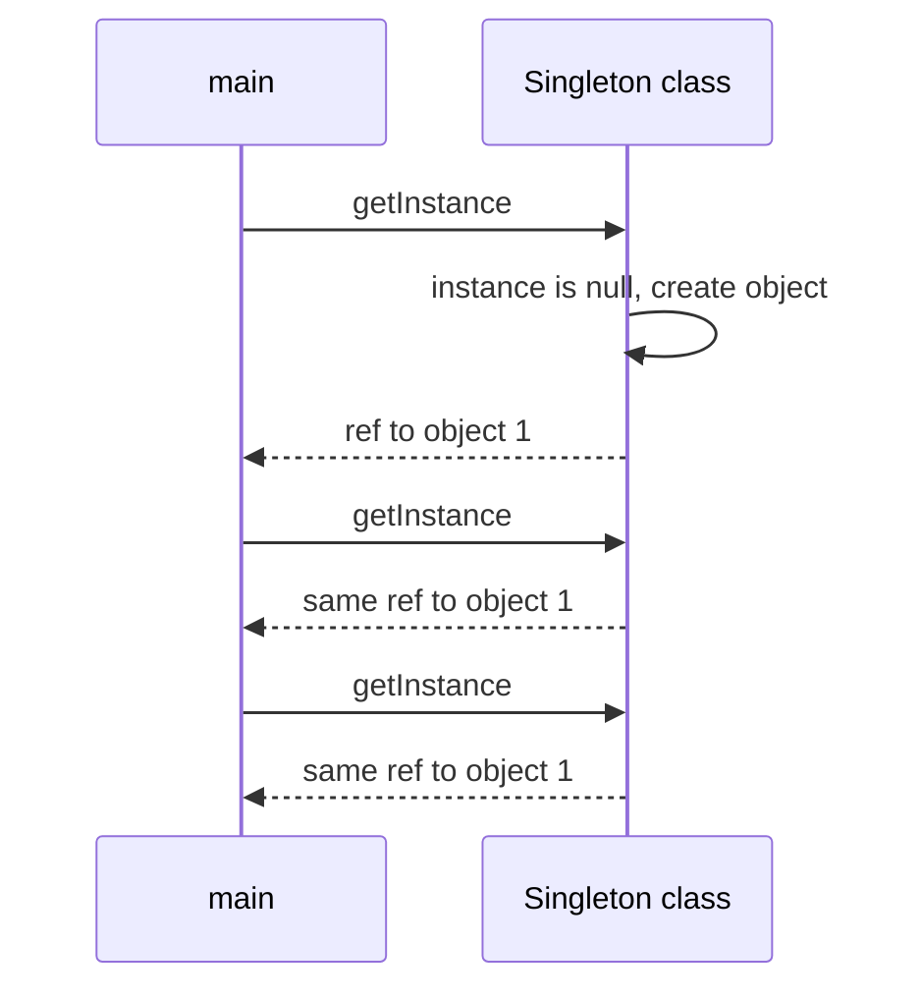
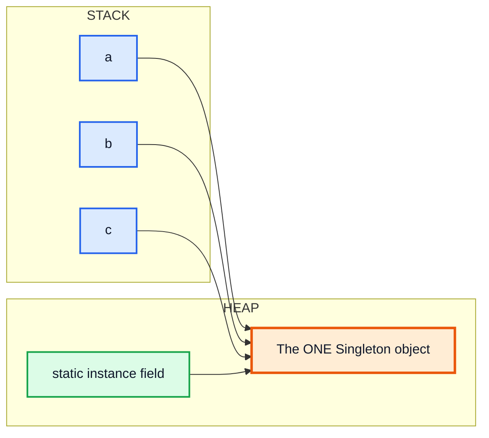

# OOP 2: Packages, Static, Inner Classes, Singleton — Complete In-Depth Guide

**Video #38 of the Java + DSA playlist:** *OOP 2 | Packages, Static, Singleton Class, In-built Methods* (1:19:12)

The second OOP video: how Java organises classes into **packages**, what **`static`** really means (class-level vs object-level), the rules for mixing static and non-static code, static blocks, **inner and nested classes**, what `System.out.println` actually is, and the **Singleton** pattern. Classes, objects, constructors, `this`, `final` and garbage collection were covered in [OOP 1 (video #37)](java_37_video_oops.md) and are only referred to here.

---

## Table of Contents

| # | Topic | Timestamp |
|---|---|---|
| 0 | [Introduction](#0-introduction-000) | 0:00 |
| 1 | [Packages example](#1-packages-example-300) | 3:00 |
| 2 | [Java Packages](#2-java-packages-530) | 5:30 |
| 3 | [`import` statement](#3-import-statement-1422) | 14:22 |
| 4 | [Static elements example](#4-static-elements-example-1857) | 18:57 |
| 5 | [`static` in Java](#5-static-in-java-2409) | 24:09 |
| 6 | [Static variable meaning](#6-static-variable-meaning-3125) | 31:25 |
| 7 | [Non-static member inside a static](#7-non-static-member-inside-a-static-3242) | 32:42 |
| 8 | [Static member inside a non-static](#8-static-member-inside-a-non-static-4002) | 40:02 |
| 9 | [`this` keyword inside static](#9-this-keyword-inside-static-4736) | 47:36 |
| 10 | [Initialisation of static variables](#10-initialisation-of-static-variables-4929) | 49:29 |
| 11 | [Inner Classes](#11-inner-classes-5433) | 54:33 |
| 12 | [Internal working of some statements](#12-internal-working-of-some-statements-10532) | 1:05:32 |
| 13 | [Singleton Class](#13-singleton-class-11040) | 1:10:40 |
| 14 | [Outro](#14-outro-11803) | 1:18:03 |

---

## 0. Introduction (0:00)

In OOP 1 you learned that a **class** is a template and an **object** is an instance of it, created with `new` on the heap. This video answers the next questions:

| Question | Answer in this video |
|---|---|
| Where do classes live, and how do two classes with the same name coexist? | **Packages** |
| How do I use a class from another package? | **`import`** |
| What if a value belongs to *all* objects, not to one? | **`static`** |
| Can a class live inside another class? | **Inner / nested classes** |
| What is `System.out.println` made of? | A class, a static field and an instance method |
| How do I allow only **one** object of a class? | **Singleton** |

> [!IMPORTANT]
> The single most important idea in this video: **static members belong to the class; non-static members belong to each object.** Almost every rule below (what can call what, why `this` is not allowed, why `main` is static) follows from that sentence.

---

## 1. Packages example (3:00)

### The Problem Packages Solve

Imagine two developers both write a class called `Greeting`. If everything sits in one folder, the second file overwrites the first, and Java cannot tell which `Greeting` you mean.

Packages are just **folders** for classes. Put each `Greeting` in its own folder (package) and both can exist:

```
src/
└── com/
    └── kunal/
        ├── a/
        │   └── Greeting.java      ← package com.kunal.a;
        └── b/
            └── Greeting.java      ← package com.kunal.b;
```



The **fully qualified name** (`package + "." + ClassName`) is what Java really uses, so `com.kunal.a.Greeting` and `com.kunal.b.Greeting` are two different classes.

---

## 2. Java Packages (5:30)

### What Is a Package?

A **package** is a named group of related classes and interfaces. It gives you:

1. **No name clashes**: the same class name can exist in different packages
2. **Organisation**: related code lives together (`java.util` = utilities, `java.io` = input/output)
3. **Access control**: classes/members without a modifier are visible **only inside their package**

### The `package` Statement

```java
// File: src/com/kunal/a/Greeting.java
package com.kunal.a;            // MUST be the first statement in the file

public class Greeting {
    public static void message() {
        System.out.println("Hello from package a");
    }
}
```

### Rules

| Rule | Detail |
|---|---|
| Position | `package` must be the **first** statement (only comments may come before it) |
| One per file | A file belongs to exactly one package |
| Folder must match | `package com.kunal.a;` → file must be in `com/kunal/a/` |
| Naming convention | All lowercase, **reverse domain**: `com.google.maps`, `in.kunal.dsa` |
| No `package` line | The class goes into the unnamed **default package** (fine for practice, not for real projects) |

### Compiling and Running Packaged Code

```
> javac -d out src/com/kunal/a/Greeting.java src/com/kunal/Main.java
> java -cp out com.kunal.Main
```

`-d out` tells `javac` to create the `com/kunal/a/` folders under `out/`. `java` is given the **fully qualified name** of the class with `main`.

### Built-in Packages You Will Use

| Package | Contains | Needs import? |
|---|---|---|
| `java.lang` | `String`, `Math`, `System`, `Integer`, `Object` | ❌ imported automatically |
| `java.util` | `ArrayList`, `HashMap`, `Scanner`, `Arrays` | ✅ |
| `java.io` | `File`, `BufferedReader`, `PrintStream` | ✅ |
| `java.nio.file` | `Path`, `Files` (modern file API) | ✅ |
| `java.time` | `LocalDate`, `Duration` | ✅ |

### Package Access (Default Access)



| Modifier | Same class | Same package | Subclass (other package) | Everywhere |
|---|---|---|---|---|
| `public` | ✅ | ✅ | ✅ | ✅ |
| `protected` | ✅ | ✅ | ✅ | ❌ |
| *(none)* package-private | ✅ | ✅ | ❌ | ❌ |
| `private` | ✅ | ❌ | ❌ | ❌ |

> [!NOTE]
> Access modifiers get a full treatment in **video #40 (OOP 4: Access Control)**. For now: to use a class from another package it must be **`public`**, and so must the members you call.

> [!NOTE]
> **Modern Java:** since Java 9, packages can be grouped into **modules** (`module-info.java`), which control which packages are visible to other modules at all. Ordinary programs and DSA practice do not need modules.

---

## 3. `import` statement (14:22)

### The Basics

To use a class from another package you can either write its full name every time, or **import** it once at the top:

```java
package com.kunal;

import com.kunal.a.Greeting;          // single-type import

public class Main {
    public static void main(String[] args) {
        Greeting.message();               // short name thanks to import
        com.kunal.b.Greeting.message();   // fully qualified name, no import needed
    }
}
```

### Kinds of Import

| Form | Example | Imports |
|---|---|---|
| Single-type | `import java.util.ArrayList;` | One class |
| On-demand (wildcard) | `import java.util.*;` | All **classes** of that package (not sub-packages) |
| Static single | `import static java.lang.Math.sqrt;` | One static member |
| Static on-demand | `import static java.lang.Math.*;` | All static members of `Math` |

```java
import static java.lang.Math.*;

public class StaticImportDemo {
    public static void main(String[] args) {
        System.out.println(sqrt(16) + max(3, 9));   // no "Math." prefix
        // 13.0
    }
}
```

### What `import` Does NOT Do

> [!IMPORTANT]
> `import` is only a **compile-time shortcut for names**. It does not copy code, does not load anything at runtime, and has **no performance cost**. `import java.util.*;` is not slower than `import java.util.ArrayList;`.

| Myth | Truth |
|---|---|
| Wildcard imports make the program bigger/slower | No effect on the `.class` file |
| `import java.util.*` imports `java.util.function` too | No, sub-packages are separate packages |
| You must import `String` | `java.lang` is always imported |
| Two wildcards with the same class name is fine | Ambiguity error **if you use** that name (e.g. `java.util.*` + `java.awt.*` → `List`) |

### Resolving a Name Clash

When both `Greeting`s are needed in one file, import one and write the other in full:

```java
import com.kunal.a.Greeting;

Greeting g1;                    // com.kunal.a.Greeting
com.kunal.b.Greeting g2;        // the other one, fully qualified
```

---

## 4. Static elements example (18:57)

### The Story

Make a `Human` class. Every human has a `name`, `age`, `salary`, `married`. These differ per person, so each **object** stores its own copy.

Now we want to count the **population**. If `population` is a normal field, every object has its own copy and each one just says `1`:

```java
class Human {
    String name;
    int age;
    long population;              // ❌ one copy PER object

    Human(String name, int age) {
        this.name = name;
        this.age = age;
        this.population += 1;
    }
}
// new Human("Kunal", 22).population → 1
// new Human("Rahul", 30).population → 1   (not 2!)
```

Population is **not a property of one human**, it is a property of the **whole species** (the class). That is exactly what `static` is for:

```java
class Human {
    String name;
    int age;
    static long population;       // ✅ ONE copy shared by all Humans

    Human(String name, int age) {
        this.name = name;
        this.age = age;
        Human.population += 1;    // refer to it through the class name
    }
}

public class Main {
    public static void main(String[] args) {
        Human kunal = new Human("Kunal", 22);
        Human rahul = new Human("Rahul", 30);
        System.out.println(Human.population);   // 2
        System.out.println(kunal.population);   // 2  (works, but misleading)
    }
}
```



---

## 5. `static` in Java (24:09)

### Definition

A **static** member (variable, method, block or nested class) **belongs to the class itself**, not to any object. It exists **once**, as soon as the class is loaded, even if you never create an object.

| | Instance (non-static) | Static |
|---|---|---|
| Belongs to | Each object | The class |
| Copies | One per object | Exactly one |
| Created when | `new` runs | Class is loaded (first use) |
| Accessed as | `obj.field` | `ClassName.field` |
| Can use `this` | ✅ | ❌ |
| Typical use | Name, age, balance | Counters, constants, utility methods (`Math.max`) |

### What Can Be Static?

```java
public class StaticKinds {
    static int count;                         // static variable
    static final double RATE = 0.07;          // static constant

    static {                                  // static block
        count = 10;
    }

    static int twice(int x) {                 // static method
        return 2 * x;
    }

    static class Node {                       // static nested class
        int val;
    }

    public static void main(String[] args) {
        System.out.println(StaticKinds.count);    // 10
        System.out.println(twice(5));             // 10
        System.out.println(new Node().val);       // 0
    }
}
```

| Can it be static? | Answer |
|---|---|
| Fields, methods, blocks | ✅ |
| Nested classes | ✅ |
| **Top-level** classes | ❌ compile error |
| Local variables inside a method | ❌ |
| Constructors | ❌ (a constructor *builds an object*, so it is instance by nature) |

### Why Is `main` Static?

When you run `java Main`, there is **no object yet**. The JVM must call `main` without creating a `Main` object, so `main` has to be static.



> [!NOTE]
> **Modern Java:** Java 25 finalised **instance main methods and compact source files** (JEP 512), so a beginner file can be just `void main() { IO.println("Hi"); }`. The launcher then creates the object for you. The classic `public static void main(String[] args)` still works everywhere and is what interview platforms expect.

### Static Methods: Utility Code

`Math.max`, `Arrays.sort`, `Integer.parseInt` are all static: they only work on their **parameters**, never on an object's fields, so there is no reason to create an object first.

> [!WARNING]
> Static methods are **not overridden**, they are **hidden**. Which one runs is decided by the reference's declared type at compile time, not by the object. This is covered with polymorphism in **video #39 (OOP 3)**.

---

## 6. Static variable meaning (31:25)

### "Independent of Objects"

A static variable's value does **not depend on any object**. Changing it through one reference changes it for everybody, because there is only one copy.

```java
class Counter {
    static int shared = 0;
    int own = 0;
}

public class Main {
    public static void main(String[] args) {
        Counter a = new Counter();
        Counter b = new Counter();
        a.shared = 5;      // really Counter.shared = 5
        a.own = 5;
        System.out.println(b.shared + " " + b.own);   // 5 0
    }
}
```

| | `a` | `b` |
|---|---|---|
| `own` | 5 🟩 | 0 🟩 (own copy) |
| `shared` | 5 🟧 | 5 🟧 (same single copy) |

> [!TIP]
> Always write `ClassName.staticField`, never `obj.staticField`. IntelliJ warns about the second form because it **looks** like an instance field. Accessing a static through a `null` reference even works (`Counter c = null; c.shared` is fine), which proves the object is never used.

### Where Is It Stored?

In modern HotSpot JVMs (Java 8+), class **metadata** lives in **Metaspace**, while the **values of static fields** live on the heap together with the class's `java.lang.Class` object. Older material, and many videos, say "static variables are in the method area/PermGen"; that was the Java 7-and-earlier layout. Either way, the key fact is the same: **one copy per class, alive as long as the class is loaded**.

---

## 7. Non-static member inside a static (32:42)

### The Rule

**A static method cannot directly use a non-static (instance) member.**

```java
public class Main {
    String name = "Kunal";           // instance field

    void greeting() {                // instance method
        System.out.println("Hello " + name);
    }

    public static void main(String[] args) {
        // greeting();               // ❌ non-static method greeting() cannot be
        //                           //    referenced from a static context
        // System.out.println(name); // ❌ same error for the field

        Main obj = new Main();       // ✅ create an object first
        obj.greeting();              // Hello Kunal
    }
}
```

### Why?

An instance method uses an **object's** fields. A static method runs with **no object at all**. So the question "greeting **of which object**?" has no answer.



> [!IMPORTANT]
> This is why, in all the DSA videos so far, **every helper method was `static`**: they are called from `static main`. If you remove `static` from `binarySearch`, `main` cannot call it without an object.

### Calling Static From Static

Static to static is always fine, with or without the class name:

```java
public class Demo {
    static void a() { b(); Demo.b(); }   // both fine
    static void b() { System.out.println("b"); }
    public static void main(String[] args) { a(); }
}
// b
// b
```

---

## 8. Static member inside a non-static (40:02)

### The Rule

**A non-static method can freely use static members.** The static member always exists (it was created when the class loaded), so there is no problem.

```java
class Human {
    String name;
    static long population;

    Human(String name) {
        this.name = name;
        population++;                       // ✅ instance code using static field
    }

    void introduce() {
        System.out.println(name + " is one of " + population + " humans");  // ✅
        printSpecies();                     // ✅ instance method calling static method
    }

    static void printSpecies() {
        System.out.println("Species: Homo sapiens");
    }
}

public class Main {
    public static void main(String[] args) {
        new Human("Kunal");
        Human r = new Human("Rahul");
        r.introduce();
    }
}
// Rahul is one of 2 humans
// Species: Homo sapiens
```

### The Full Access Matrix

| From ↓ / Uses → | Static member | Instance member |
|---|---|---|
| **Static** method/block | ✅ directly | ❌ needs `obj.member` |
| **Instance** method/constructor | ✅ directly | ✅ directly (implicitly `this.member`) |


> [!TIP]
> Memory trick: the **class exists before any object**, so objects can always look at the class, but the class cannot assume any object exists.

---

## 9. `this` keyword inside static (47:36)

### The Rule

`this` means "**the current object**" (see OOP 1, section 6). A static method has **no current object**, so `this` (and `super`) cannot be used inside it.

```java
public class Main {
    int value = 10;

    static void show() {
        // System.out.println(this.value);
        // ❌ error: non-static variable this cannot be referenced from a static context
    }

    void showInstance() {
        System.out.println(this.value);   // ✅ 10
    }
}
```

| Location | `this` allowed? | Why |
|---|---|---|
| Constructor | ✅ | The object being built |
| Instance method | ✅ | The object the method was called on |
| Static method | ❌ | No object |
| Static block | ❌ | Runs when the class loads, before any object |
| Instance initializer block `{ }` | ✅ | Runs as part of each constructor |

---

## 10. Initialisation of static variables (49:29)

### Option 1: Directly

```java
static int a = 4;
```

### Option 2: In a Static Block

If the value needs more than one expression (a loop, a calculation, a try/catch), use a **static block**. It runs **once**, the first time the class is used.

```java
class StaticBlock {
    static int a = 4;
    static int b;

    static {                               // runs ONCE when the class loads
        System.out.println("I am in static block");
        b = a * 5;
    }
}

public class Main {
    public static void main(String[] args) {
        StaticBlock obj = new StaticBlock();
        System.out.println(StaticBlock.a + " " + StaticBlock.b);

        StaticBlock.b += 3;
        StaticBlock obj2 = new StaticBlock();       // static block does NOT run again
        System.out.println(StaticBlock.a + " " + StaticBlock.b);
    }
}
// I am in static block
// 4 20
// 4 23
```

### Order of Initialisation



```java
public class Order {
    static { System.out.println("1. static block"); }
    { System.out.println("3. instance block"); }

    Order() { System.out.println("4. constructor"); }

    public static void main(String[] args) {
        System.out.println("2. main starts");
        new Order();
        new Order();
    }
}
// 1. static block
// 2. main starts
// 3. instance block
// 4. constructor
// 3. instance block
// 4. constructor
```

### Default Values

Like instance fields, static fields get **default values** if not set: `0`, `0.0`, `false`, `'\u0000'`, `null`. Local variables do not.

> [!CAUTION]
> Classes are loaded **lazily**: a static block runs on the first real use, not at program start. Merely declaring `StaticBlock x;` does not trigger it. Reading a `static final` **compile-time constant** (like `static final int MAX = 5;`) also does not trigger it, because the compiler copies the value in.

---

## 11. Inner Classes (54:33)

### The Basics

A class declared **inside another class** is a **nested class**. There are two main kinds:

| | **Static nested class** | **Inner class** (non-static) |
|---|---|---|
| Declared as | `static class Node { }` | `class Node { }` |
| Needs an outer object? | ❌ | ✅ |
| Created from outside | `new Outer.Node()` | `outerObj.new Node()` |
| Can use outer **instance** fields | ❌ (only through a reference) | ✅ directly |
| Typical use | `LinkedList.Node`, `Map.Entry`, builders | Iterators that read the outer object's data |

### The Error in the Video

```java
public class Main {
    class Test {                   // inner class: belongs to a Main OBJECT
        String name;
        Test(String name) { this.name = name; }
    }

    public static void main(String[] args) {
        // Test a = new Test("Kunal");
        // ❌ non-static variable this cannot be referenced from a static context
    }
}
```

`Test` is a non-static member of `Main`, just like a non-static method. `main` is static, so (section 7) it cannot use `Test` without a `Main` object. Two fixes:

```java
// Fix 1: make it static (most common)
static class Test { ... }
Test a = new Test("Kunal");

// Fix 2: create an outer object first
Main outer = new Main();
Main.Test a = outer.new Test("Kunal");
```

### "Static Class" Does NOT Mean "One Object"

A static nested class can have **as many objects as you like**, each with its own instance fields. `static` only means it does not need an outer object.

```java
public class Main {
    static class Test {
        String name;               // instance field: one per Test object
        Test(String name) { this.name = name; }
    }

    public static void main(String[] args) {
        Test a = new Test("Kunal");
        Test b = new Test("Rahul");
        System.out.println(a.name + " " + b.name);   // Kunal Rahul
    }
}
```

If instead `name` itself were `static`, there would be one shared `name`, and the second constructor call would overwrite it:

```java
static class Test {
    static String name;            // ONE copy for all Test objects
    Test(String name) { Test.name = name; }
}
// a.name and b.name both print "Rahul"
```



### Top-Level Classes Cannot Be Static

```java
static class A { }      // ❌ modifier static not allowed here
```

A top-level class is not a member of anything, so "belongs to the class, not to the object" makes no sense for it.

### Other Nested Types (Brief)

| Kind | Where | Example |
|---|---|---|
| Local class | Inside a method | `void f() { class Helper { } }` |
| Anonymous class | Expression, no name | `new Comparator<>() { ... }` (often replaced by lambdas, video #42) |
| Nested `record`, `enum`, `interface` | Inside a class | Always **implicitly static** |

> [!NOTE]
> **Modern Java:** before Java 16, an inner (non-static) class could not declare `static` members (except compile-time constants). Since **Java 16** (JEP 395, alongside records) inner classes **may** declare static fields and methods. Old tutorials that say "inner classes can't have static members" describe the earlier rule.

---

## 12. Internal working of some statements (1:05:32)

### `System.out.println("Hi")` Taken Apart



| Part | What it is | Why |
|---|---|---|
| `System` | A `final` class in `java.lang` | No import needed |
| `.out` | `public static final PrintStream out` | Static → accessed through the **class name**, no `System` object |
| `.println(...)` | Instance method of `PrintStream` | Called **on the `out` object** |

Proof that it is just an object:

```java
import java.io.PrintStream;

public class Main {
    public static void main(String[] args) {
        PrintStream p = System.out;    // store the static field in a variable
        p.println("Same object");      // Same object
        System.err.println("err is another static PrintStream");
    }
}
```

The same reading works for other familiar calls:

| Statement | Breakdown |
|---|---|
| `Math.max(a, b)` | `Math` class → static method `max` |
| `Integer.parseInt("42")` | `Integer` class → static method |
| `Arrays.toString(arr)` | `Arrays` class → static method |
| `list.add(5)` | `list` object → instance method |
| `"abc".length()` | `String` object → instance method |

### Printing an Object: `toString()`

`println(obj)` calls `String.valueOf(obj)`, which calls **`obj.toString()`**. Every class inherits `toString()` from `Object`; the default prints `ClassName@hexHash`:

```java
class Test {
    String name;
    Test(String name) { this.name = name; }
}

class Test2 {
    String name;
    Test2(String name) { this.name = name; }

    @Override
    public String toString() {           // your own text
        return "Test2{name=" + name + "}";
    }
}

public class Main {
    public static void main(String[] args) {
        System.out.println(new Test("Kunal"));    // Test@1b6d3586  (hash varies)
        System.out.println(new Test2("Kunal"));   // Test2{name=Kunal}
    }
}
```

> [!TIP]
> `@Override` is optional, but always write it: if you misspell the method (`tostring`), the compiler tells you instead of silently printing `Test2@...`. The `Object` class and its other in-built methods (`equals`, `hashCode`, `getClass`, `clone`) are covered in **video #40 (OOP 4)**.

> [!NOTE]
> **Modern Java:** a `record` (Java 16+) generates `toString`, `equals`, `hashCode` and the constructor for you: `record Point(int x, int y) {}` prints as `Point[x=1, y=2]`.

---

## 13. Singleton Class (1:10:40)

### The Problem

Some classes should have **exactly one object** in the whole program: a configuration holder, a logger, a database connection pool. A **Singleton** guarantees that.

### Recipe (3 Steps)

1. Make the constructor **`private`**, so nobody outside can write `new`.
2. Keep the one object in a **`private static`** field.
3. Give a **`public static getInstance()`** method that creates the object the first time and returns the same one afterwards.

```java
public class Singleton {
    private static Singleton instance;      // 2. the only object

    private Singleton() {                   // 1. nobody else can call new
        System.out.println("Singleton created");
    }

    public static Singleton getInstance() { // 3. global access point
        if (instance == null) {
            instance = new Singleton();      // created lazily, on first request
        }
        return instance;
    }
}

class Main {
    public static void main(String[] args) {
        Singleton a = Singleton.getInstance();
        Singleton b = Singleton.getInstance();
        Singleton c = Singleton.getInstance();
        System.out.println(a == b && b == c);   // true
        // Singleton d = new Singleton();      // ❌ Singleton() has private access
    }
}
// Singleton created
// true
```

### Why Every Piece Is Needed

| Piece | If you remove it |
|---|---|
| `private` constructor | Anyone can `new` → many objects |
| `static` field | Each object would hold its own "instance" → nothing shared |
| `static` getInstance | You would need an object to get the object (chicken and egg) |





### Thread Safety and Better Versions

The video's lazy version is correct in a **single-threaded** program. With several threads, two of them can see `instance == null` at the same time and create **two** objects.

| Variant | Code idea | Thread-safe? | Lazy? |
|---|---|---|---|
| Lazy (video) | `if (instance == null) instance = new ...` | ❌ | ✅ |
| Eager | `private static final Singleton INSTANCE = new Singleton();` | ✅ (class loading is thread-safe) | ❌ |
| `synchronized getInstance()` | Lock on every call | ✅ | ✅ (slower) |
| Double-checked locking | `volatile` field + check, lock, check again | ✅ | ✅ |
| **Holder idiom** | Nested `static class Holder { static final Singleton I = new Singleton(); }` | ✅ | ✅ |
| **`enum` singleton** | `enum Config { INSTANCE; }` | ✅, also safe against reflection & serialization | ❌ |

```java
// Holder idiom: lazy AND thread-safe, no locks
public class Logger {
    private Logger() { }

    private static class Holder {                 // loaded only on first getInstance()
        static final Logger INSTANCE = new Logger();
    }

    public static Logger getInstance() {
        return Holder.INSTANCE;
    }
}
```

> [!TIP]
> *Effective Java* recommends the **single-element `enum`** as the simplest robust singleton. In interviews, write the video's version first, then mention thread safety and the holder/enum fixes.

> [!WARNING]
> Singletons are global state. Overusing them makes code hard to test. In large apps, frameworks like Spring manage "one instance" for you instead.

---

## 14. Outro (1:18:03)

Next comes **OOP 3 (video #39)**: the four principles, inheritance, polymorphism, encapsulation and abstraction, where static methods' "hiding instead of overriding" behaviour makes sense.

---

## 🧩 Complete Example: Everything Together

A single file using normal and static imports, static vs instance fields, a static block, the static/non-static access rules, a static nested class, an inner class, `toString()`, `System.out` as an object, and a Singleton. (Packages need several folders, so they are shown in sections 1–3 rather than here.)

```java
import java.io.PrintStream;
import java.util.ArrayList;                 // normal import: one class
import static java.lang.Math.max;           // static import: a static method
import static java.lang.Math.PI;            // static import: a static constant

// ═══════ static vs instance members + static block ═══════
class Human {
    String name;                            // instance: one per object
    int age;
    static long population;                 // static: ONE shared copy
    static final String SPECIES;            // static final, set in the static block

    static {                                // runs ONCE, when Human is first used
        SPECIES = "Homo sapiens";
        System.out.println("[static block] Human class loaded");
    }

    Human(String name, int age) {
        this.name = name;                   // 'this' is fine in a constructor
        this.age = age;
        Human.population++;                 // instance code CAN use static members
    }

    static void describeSpecies() {
        // System.out.println(this.name);   // ❌ no 'this' in a static method
        // System.out.println(name);        // ❌ instance field from static context
        System.out.println("Species: " + SPECIES + ", population: " + population);
    }

    @Override
    public String toString() {              // used by println(obj)
        return name + " (" + age + ")";
    }
}

// ═══════ Singleton: exactly one object ═══════
class Config {
    private static Config instance;         // the single instance
    private static int created = 0;
    private final String env;

    private Config() {                      // private: nobody outside can call 'new'
        env = "dev";
        created++;
    }

    static Config getInstance() {           // lazy creation
        if (instance == null) instance = new Config();
        return instance;
    }

    String env() { return env; }
    static int created() { return created; }
}

public class Main {
    int instanceCounter = 0;

    // static nested class: no outer object needed
    static class Point {
        int x, y;                           // still per object!
        Point(int x, int y) { this.x = x; this.y = y; }
        @Override public String toString() { return "(" + x + ", " + y + ")"; }
    }

    // inner class: tied to an outer Main object
    class Ticker {
        void tick() { instanceCounter++; }  // can read the outer object's fields
    }

    void greet() { System.out.println("Hello from an instance method"); }

    public static void main(String[] args) {
        System.out.println("main starts");

        // 1. static members
        Human a = new Human("Kunal", 22);
        Human b = new Human("Rahul", 30);
        System.out.println(a + " and " + b);
        System.out.println("Human.population = " + Human.population);
        Human.describeSpecies();

        // 2. non-static from static: need an object
        // greet();                         // ❌ compile error
        Main m = new Main();
        m.greet();

        // 3. static nested vs inner class
        Point p1 = new Point(1, 2);
        Point p2 = new Point(3, 4);
        System.out.println("Points: " + p1 + " " + p2);   // separate values
        Main.Ticker t = m.new Ticker();     // inner class needs an outer object
        t.tick(); t.tick(); t.tick();
        System.out.println("Ticks on m: " + m.instanceCounter);

        // 4. static imports
        System.out.println("max(7, 3) = " + max(7, 3));
        System.out.printf("PI = %.4f%n", PI);

        // 5. what System.out.println really is
        PrintStream out = System.out;       // 'out' is a static field of System
        out.println("Printed through the same PrintStream object");
        ArrayList<Human> list = new ArrayList<>();
        list.add(a);
        System.out.println("List uses toString(): " + list);

        // 6. singleton
        Config c1 = Config.getInstance();
        Config c2 = Config.getInstance();
        System.out.println("c1 == c2 ? " + (c1 == c2) + ", env = " + c1.env()
                + ", objects created = " + Config.created());
    }
}
```

**Expected Output:**
```
main starts
[static block] Human class loaded
Kunal (22) and Rahul (30)
Human.population = 2
Species: Homo sapiens, population: 2
Hello from an instance method
Points: (1, 2) (3, 4)
Ticks on m: 3
max(7, 3) = 7
PI = 3.1416
Printed through the same PrintStream object
List uses toString(): [Kunal (22)]
c1 == c2 ? true, env = dev, objects created = 1
```

(Compiled and run with `javac`/`java` 21. Note that the static block prints **after** `main starts`: `Human` is loaded lazily on its first use.)

---

## Quick Reference Cheat Sheet

| Concept | One-Line Summary |
|---|---|
| **Package** | A folder/namespace for classes; `package a.b;` must be the first statement |
| **Fully qualified name** | `package.ClassName`, e.g. `java.util.ArrayList` |
| **Naming** | Lowercase, reverse domain: `com.kunal.dsa` |
| **Default access** | No modifier → visible only inside the same package |
| **`import`** | Compile-time name shortcut; no runtime cost; `java.lang` is automatic |
| **Wildcard import** | `java.util.*` imports classes of that package only, not sub-packages |
| **`import static`** | Use static members without the class name: `sqrt(16)` |
| **`static` member** | Belongs to the class; one copy; exists from class load |
| **Access static** | `ClassName.member` (not `obj.member`) |
| **Why `main` is static** | JVM calls it before any object exists |
| **Static → instance** | ❌ directly; ✅ via an object reference |
| **Instance → static** | ✅ always |
| **`this` in static** | ❌ no current object |
| **Static block** | `static { }` runs once when the class is first used |
| **Init order** | Static (once) → instance fields/blocks → constructor (per object) |
| **Static nested class** | No outer object needed; can still have many objects |
| **Inner class** | Needs an outer object: `outer.new Inner()`; sees outer fields |
| **Top-level static class** | ❌ not allowed |
| **`System.out.println`** | Class `System` → static field `out` (PrintStream) → instance method `println` |
| **`toString()`** | Called when printing an object; default `ClassName@hash`; override it |
| **Singleton** | Private constructor + private static instance + public static `getInstance()` |
| **Thread-safe singleton** | Holder idiom or `enum` singleton |
