# OOP Principles: Inheritance, Polymorphism, Encapsulation, Abstraction — Complete In-Depth Guide

**Video #39 of the Java + DSA playlist:** *OOP 3 | Principles - Inheritance, Polymorphism, Encapsulation, Abstraction* (2:12:51)

The third OOP lecture covers the four pillars properly: inheritance (with `private`, `super` and the types of inheritance), polymorphism (overloading and overriding, dynamic method dispatch, `final`, static methods), and encapsulation vs abstraction vs data hiding. Classes, objects, constructors, `this` and the basic uses of `final` were covered in OOP 1 ([java_37_video_oops.md](java_37_video_oops.md)) and aren't repeated here.

---

## Table of Contents

| # | Topic | Timestamp |
|---|---|---|
| 0 | [Introduction](#0-introduction-000) | 0:00 |
| 1 | [Principles of OOP](#1-principles-of-oop-115) | 1:15 |
| 2 | [Inheritance](#2-inheritance-226) | 2:26 |
| 3 | [Example: Box](#3-example-box-1130) | 11:30 |
| 4 | [Explanation](#4-explanation-1749) | 17:49 |
| 5 | [`private` Keyword](#5-private-keyword-2331) | 23:31 |
| 6 | [`super` Keyword](#6-super-keyword-3626) | 36:26 |
| 7 | [Single Inheritance](#7-single-inheritance-4800) | 48:00 |
| 8 | [Multiple Inheritance](#8-multiple-inheritance-10017) | 1:00:17 |
| 9 | [Hierarchical Inheritance](#9-hierarchical-inheritance-10425) | 1:04:25 |
| 10 | [Hybrid Inheritance](#10-hybrid-inheritance-10728) | 1:07:28 |
| 11 | [Polymorphism](#11-polymorphism-11026) | 1:10:26 |
| 12 | [Example: Shapes](#12-example-shapes-11253) | 1:12:53 |
| 13 | [Types of Polymorphism](#13-types-of-polymorphism-11927) | 1:19:27 |
| 14 | [Static Polymorphism](#14-static-polymorphism-11957) | 1:19:57 |
| 15 | [Overloading](#15-overloading-12034) | 1:20:34 |
| 16 | [Dynamic Polymorphism](#16-dynamic-polymorphism-12802) | 1:28:02 |
| 17 | [Overriding](#17-overriding-12924) | 1:29:24 |
| 18 | [How Overriding Works?](#18-how-overriding-works-13408) | 1:34:08 |
| 19 | [How Java Determines Which Method to Run?](#19-how-java-determines-which-method-to-run-13905) | 1:39:05 |
| 20 | [`final` Keyword](#20-final-keyword-14517) | 1:45:17 |
| 21 | [Can We Override Static Methods?](#21-can-we-override-static-methods-15049) | 1:50:49 |
| 22 | [Encapsulation](#22-encapsulation-15702) | 1:57:02 |
| 23 | [Abstraction](#23-abstraction-15822) | 1:58:22 |
| 24 | [Encapsulation vs Abstraction](#24-encapsulation-vs-abstraction-20014) | 2:00:14 |
| 25 | [Example](#25-example-20533) | 2:05:33 |
| 26 | [Data Hiding](#26-data-hiding-20933) | 2:09:33 |
| 27 | [Outro](#27-outro-21147) | 2:11:47 |

---

## 0. Introduction (0:00)

OOP 1 explained **what** classes and objects are. [OOP 2 (video #38)](java_38_video_oop_static_packages_singleton.md) covered packages, `static`, inner classes and singletons. This video covers the **principles**, the ideas that make OOP worth using:

1. **Inheritance**: reuse and extend existing classes
2. **Polymorphism**: one name, many behaviours
3. **Encapsulation**: bundle data and code, protect the data
4. **Abstraction**: show only what matters, hide the rest

> [!IMPORTANT]
> This is the most interview-heavy OOP lecture. You'll get asked "overloading vs overriding", "encapsulation vs abstraction", "why no multiple inheritance in Java?" and "can static methods be overridden?" all the time. Each one has its own section below.

---

## 1. Principles of OOP (1:15)

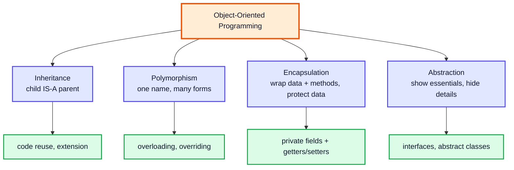

| Principle | Question it answers | Java tools |
|---|---|---|
| Inheritance | How do I reuse an existing class and add to it? | `extends`, `super`, `implements` |
| Polymorphism | How can one call do different things depending on the object? | overloading, overriding, upcasting |
| Encapsulation | How do I keep an object's data safe and consistent? | `private`, getters/setters, validation |
| Abstraction | How do I hide complexity behind a simple interface? | `interface`, `abstract` classes, public APIs |

---

## 2. Inheritance (2:26)

### Basics

**Inheritance** lets a class (the **child**, *subclass* or *derived* class) take on the fields and methods of another class (the **parent**, *superclass* or *base* class). In Java you write it with `extends`.

The real-world version: a child inherits traits from a parent (eye colour, surname) and also has its own traits.

```java
class Parent {
    int x = 10;
    void greet() { System.out.println("Hello from Parent"); }
}

class Child extends Parent {
    int y = 20;                 // child's own field
    void play() { System.out.println("Child playing, x = " + x); }  // uses inherited x
}

public class Demo {
    public static void main(String[] args) {
        Child c = new Child();
        c.greet();   // Hello from Parent   (inherited)
        c.play();    // Child playing, x = 10
        System.out.println(c.x + c.y);  // 30
    }
}
```

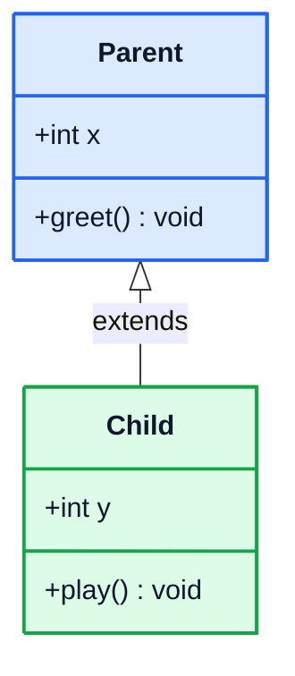

### The IS-A relationship

Use inheritance only when the child **is a** kind of parent: `Dog` IS-A `Animal`, `BoxWeight` IS-A `Box`. If the relationship is **has-a** (`Car` HAS-A `Engine`), use **composition**: make the other object a field.

| Relationship | Example | Java mechanism |
|---|---|---|
| IS-A | `Circle` is a `Shape` | `class Circle extends Shape` |
| HAS-A | `Car` has an `Engine` | `class Car { private Engine engine; }` |

### What gets inherited?

| Member | Inherited? | Notes |
|---|---|---|
| `public` / `protected` fields and methods | ✅ | Directly accessible in the child |
| default (package-private) members | ✅ only if the child is in the **same package** | See OOP 4 (video #40) |
| `private` fields and methods | ❌ not accessible | They still **exist inside the object**, the child just can't name them |
| Constructors | ❌ never inherited | The child must call one with `super(...)` (explicitly or implicitly) |
| `static` members | ✅ accessible via the child | They belong to the class and are **hidden**, not overridden (section 21) |

> [!NOTE]
> Every class you write already extends something: if you don't write `extends`, Java inserts `extends Object`. So `java.lang.Object` is the root of every hierarchy (OOP 4 covers its methods).

---

## 3. Example: Box (11:30)

Kunal builds a small family of classes around a `Box`. The base class stores dimensions:

```java
class Box {
    double l, h, w;

    Box() {                         // default: "unknown" box
        this.l = -1; this.h = -1; this.w = -1;
    }
    Box(double side) {              // cube
        this.l = side; this.h = side; this.w = side;
    }
    Box(double l, double h, double w) {
        this.l = l; this.h = h; this.w = w;
    }
    Box(Box old) {                  // copy constructor
        this.l = old.l; this.h = old.h; this.w = old.w;
    }

    void information() { System.out.println("Running the box"); }
}
```

Now we want a box that also has a **weight**. Instead of copying `l, h, w` into a new class, we **extend** `Box`:

```java
class BoxWeight extends Box {
    double weight;

    BoxWeight() {
        this.weight = -1;       // super() is called automatically first
    }

    BoxWeight(double l, double h, double w, double weight) {
        super(l, h, w);         // let Box initialise l, h, w
        this.weight = weight;
    }
}

public class Main {
    public static void main(String[] args) {
        BoxWeight box = new BoxWeight(2, 3, 4, 8);
        System.out.println(box.l + " " + box.h + " " + box.w + " " + box.weight);
        // 2.0 3.0 4.0 8.0
    }
}
```

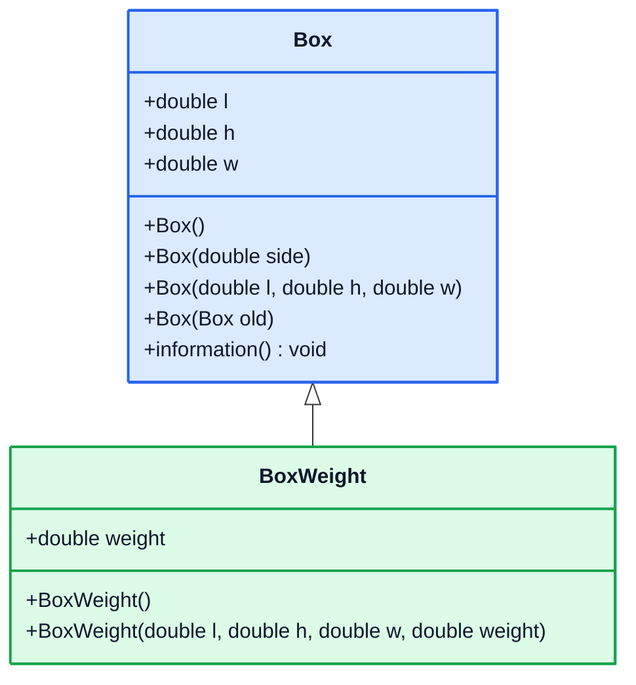

---

## 4. Explanation (17:49)

### One object, with both parts inside it

`new BoxWeight(...)` does **not** create a separate `Box` object. It creates **one** object in the heap with room for the parent's fields and the child's fields.

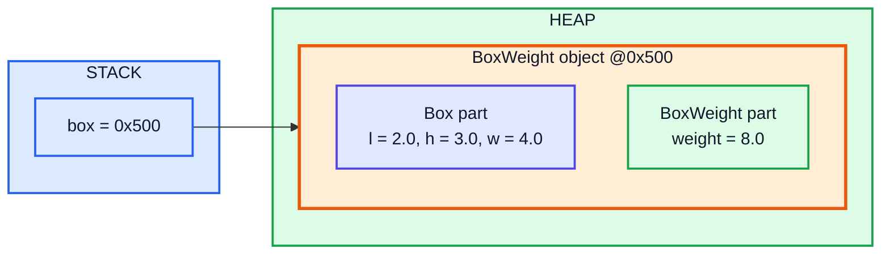

### Constructor order: parent first

The parent part has to be ready before the child part is built, so constructors run **top-down**:

```java
class A { A() { System.out.println("A constructor"); } }
class B extends A { B() { System.out.println("B constructor"); } }
class C extends B { C() { System.out.println("C constructor"); } }

public class Order {
    public static void main(String[] args) {
        new C();
        // A constructor
        // B constructor
        // C constructor
    }
}
```

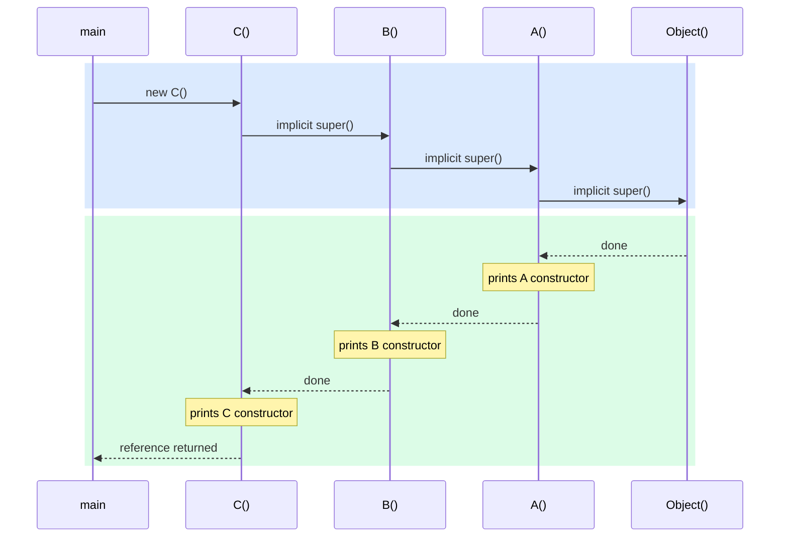

### Reference type vs object type: the key rule

This is the line in the video that confuses most people:

```java
Box box5 = new BoxWeight(2, 3, 4, 8);   // ✅ parent reference, child object
System.out.println(box5.w);              // ✅ w is declared in Box
// System.out.println(box5.weight);      // ❌ compile error: Box has no 'weight'

// BoxWeight box6 = new Box(2, 3, 4);    // ❌ compile error: a Box is not a BoxWeight
```

> [!IMPORTANT]
> **The reference type decides what you are allowed to access** (checked by the compiler).
> **The object type decides which overridden method actually runs** (decided at runtime, section 19).

Why is `BoxWeight b = new Box()` illegal? The variable type promises that `b.weight` exists. A plain `Box` object has no `weight` slot, so the promise would be broken. Going the other way is safe: every `BoxWeight` really does contain `l, h, w`.

| Declaration | Compiles? | Why |
|---|---|---|
| `Box b = new Box();` | ✅ | Same type |
| `Box b = new BoxWeight();` | ✅ | Upcasting: a child IS-A parent |
| `BoxWeight b = new Box();` | ❌ | A parent is not necessarily a child |
| `BoxWeight b = (BoxWeight) someBox;` | ✅ compiles | Downcast; throws `ClassCastException` at runtime if `someBox` isn't really a `BoxWeight` |

---

## 5. `private` Keyword (23:31)

### Basics

`private` members are visible **only inside the class that declares them**. Subclasses can't name them either.

```java
class Box {
    private double l;      // now private
    double h, w;
    Box(double l, double h, double w) { this.l = l; this.h = h; this.w = w; }
    double getL() { return l; }  // controlled access
}

class BoxWeight extends Box {
    double weight;
    BoxWeight(double l, double h, double w, double weight) {
        super(l, h, w);                 // ✅ Box sets its own private field
        this.weight = weight;
        // System.out.println(this.l);  // ❌ l has private access in Box
        System.out.println(getL());     // ✅ via an inherited non-private method
    }
}
```

### In depth: does the child "have" the private field?

Yes. The private field **is stored inside the child object**. The child just can't refer to it by name. That's why `super(l, h, w)` matters: only `Box`'s own code can initialise `l`.

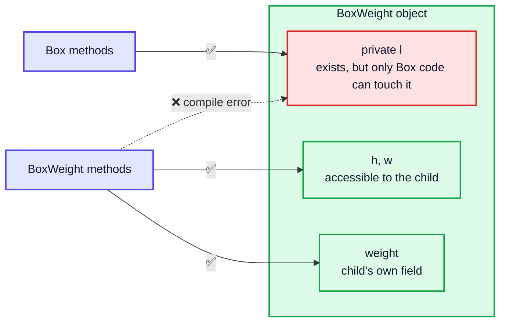

> [!TIP]
> If a subclass really needs to read parent state, give the parent a getter (or make the member `protected`). Don't drop `private` just to make the child compile. That throws away encapsulation (section 22).

---

## 6. `super` Keyword (36:26)

`super` refers to **the parent part of the current object**. There are three uses:

| Use | Syntax | Purpose |
|---|---|---|
| Call parent constructor | `super(args);` | Initialise the parent part, including private fields |
| Access parent field | `super.field` | When the child has a field with the same name (field hiding) |
| Call parent method | `super.method()` | Reuse the parent's version inside an override |

### 6.1 `super(...)` — calling the parent constructor

```java
class BoxWeight extends Box {
    double weight;
    BoxWeight(double l, double h, double w, double weight) {
        super(l, h, w);   // must come before any use of 'this'
        this.weight = weight;
    }
}
```

Rules:
- If you don't write `super(...)` or `this(...)`, the compiler inserts a call to `super()` (no arguments).
- So if the parent has **no** no-arg constructor, the child **must** call `super(...)` explicitly, otherwise you get a compile error.
- A constructor calls **either** `this(...)` **or** `super(...)`, never both. With `this(...)`, the other constructor is the one that calls `super`.

```java
class Parent {
    Parent(int x) { }          // the only constructor takes an argument
}
class Child extends Parent {
    // Child() { }             // ❌ error: constructor Parent() not found (implicit super())
    Child() { super(5); }      // ✅
}
```

> [!NOTE]
> **Modern Java:** older Java (and the video) says `super(...)` must be the very **first** statement. Since **Java 25** (JEP 513, *Flexible Constructor Bodies*) you may put statements **before** `super(...)` as long as they don't use `this` (for example to validate arguments). For Java 17/21 the first-statement rule still holds, and calling `super` first is still the usual style.

### 6.2 `super.field` — reaching a hidden parent field

```java
class Box {
    double weight = 1;
}
class BoxWeight extends Box {
    double weight = 9;                       // hides Box.weight (avoid this in real code!)
    void show() {
        System.out.println(this.weight);     // 9.0  (child's)
        System.out.println(super.weight);    // 1.0  (parent's)
    }
}
```

### 6.3 `super.method()` — extending rather than replacing

```java
class Box {
    String describe() { return "Box"; }
}
class BoxWeight extends Box {
    @Override
    String describe() { return super.describe() + " with weight"; }  // "Box with weight"
}
```

### `super` vs `this`

| | `this` | `super` |
|---|---|---|
| Refers to | Current object (as its own class) | Parent part of the current object |
| Constructor call | `this(...)`: another constructor of the **same** class | `super(...)`: a constructor of the **parent** |
| Usable in static context? | ❌ | ❌ |
| Chains? | `super.super.x` is **not** allowed | Only the **immediate** parent is reachable |

---

## 7. Single Inheritance (48:00)

### Single inheritance

One child extends one parent.

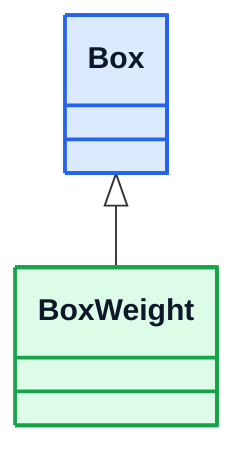

### Multilevel inheritance

Kunal goes on to extend `BoxWeight` again: a chain where each class has exactly one parent.

```java
class BoxPrice extends BoxWeight {
    double cost;

    BoxPrice() { super(); this.cost = -1; }

    BoxPrice(double l, double h, double w, double weight, double cost) {
        super(l, h, w, weight);   // calls BoxWeight's constructor, which calls Box's
        this.cost = cost;
    }

    BoxPrice(double side, double weight, double cost) {
        super(side, side, side, weight);
        this.cost = cost;
    }
}
```

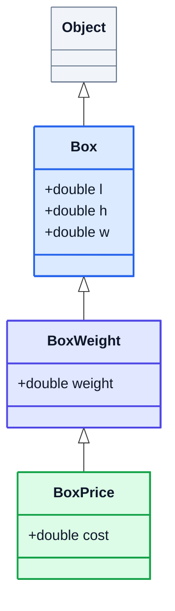

A `BoxPrice` object contains `l, h, w` (from `Box`), `weight` (from `BoxWeight`) and `cost`.

> [!NOTE]
> Strictly speaking, *single* inheritance means "one parent per class". Multilevel inheritance is just single inheritance applied repeatedly, and Java allows **unlimited levels**.

---

## 8. Multiple Inheritance (1:00:17)

### Basics

**Multiple inheritance** means one class extends **two or more** parents at once: `class C extends A, B`.

> [!CAUTION]
> **Java does not allow multiple inheritance of classes.** `class C extends A, B { }` is a compile error.

### Why not? The diamond problem

If `A` and `B` both define `int n` or `void greet()`, which one does `C` get?

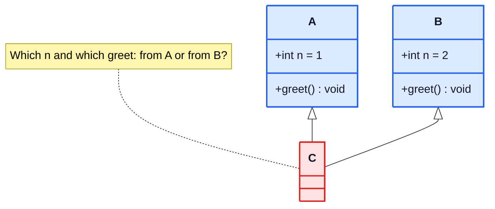

C++ allows this and needs extra rules (virtual inheritance) to sort it out. Java's designers kept the language simpler by banning it for classes.

### The Java way: interfaces

A class can **implement any number of interfaces**. Interfaces have no instance fields, so there's no ambiguity about state. If two interfaces give the same `default` method, the compiler **forces** you to override it and pick one:

```java
interface Flyer   { default String move() { return "fly"; } }
interface Swimmer { default String move() { return "swim"; } }

class Duck implements Flyer, Swimmer {
    @Override
    public String move() {                       // required, otherwise compile error
        return Flyer.super.move() + " and " + Swimmer.super.move();
    }
}
// new Duck().move()  →  "fly and swim"
```

Interfaces are covered in detail in OOP 5.

---

## 9. Hierarchical Inheritance (1:04:25)

**One parent, many children.** Each child gets the parent's members, and the children are unrelated to each other.

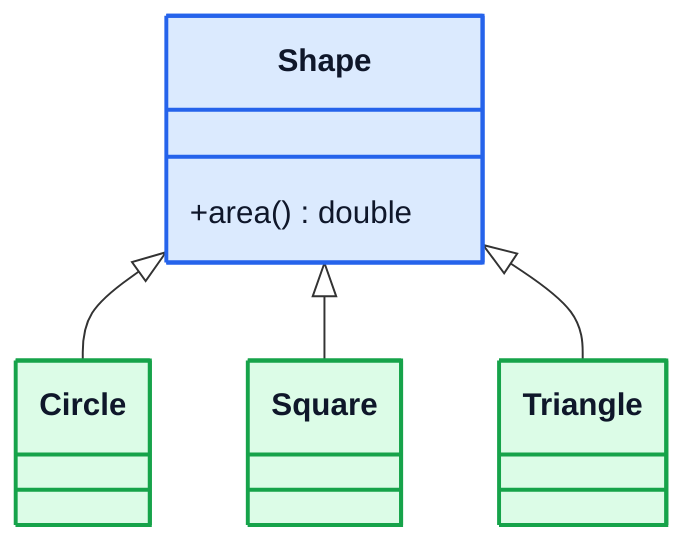

✅ Fully supported in Java. This is the shape polymorphism depends on: one parent type, many concrete behaviours.

> [!TIP]
> **Modern Java (17+):** you can **restrict** who may extend a parent with *sealed classes*:
> `sealed class Shape permits Circle, Square, Triangle { }`. Each permitted subclass must be `final`, `sealed` or `non-sealed`. This pairs well with pattern-matching `switch` in Java 21.

---

## 10. Hybrid Inheritance (1:07:28)

**Hybrid** inheritance mixes two or more types, typically hierarchical plus multiple, which brings back the diamond:

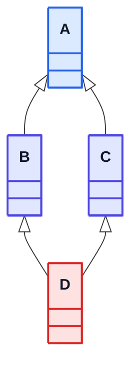

Because `D` would need two class parents, **this isn't possible with classes in Java**. It is possible with interfaces (`interface B extends A`, `interface C extends A`, `class D implements B, C`).

### Summary of inheritance types

| Type | Shape | Java classes? | Java interfaces? |
|---|---|---|---|
| Single | A → B | ✅ | ✅ |
| Multilevel | A → B → C | ✅ | ✅ |
| Hierarchical | A → B, A → C | ✅ | ✅ |
| Multiple | A, B → C | ❌ | ✅ |
| Hybrid | diamond / mix | ❌ | ✅ |

> [!NOTE]
> **Cyclic inheritance** (`class A extends B`, `class B extends A`) is always a compile error. A class can't be its own ancestor.

---

## 11. Polymorphism (1:10:26)

**Polymorphism** (Greek: *poly* = many, *morph* = form) means **the same name can take many forms**: one method name or one reference type, different behaviour.

Real-world: a person is a student in class, a customer in a shop and a child at home. Same person, different behaviour depending on context.

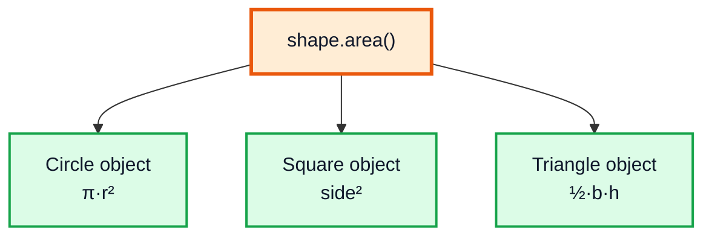

You can write `shape.area()` once and it works for every current and future shape. That's the main payoff: code that depends on the general type keeps working when new subtypes are added.

---

## 12. Example: Shapes (1:12:53)

```java
class Shapes {
    void area() { System.out.println("I am in shapes"); }
}
class Circle extends Shapes {
    @Override
    void area() { System.out.println("Area is pi * r * r"); }
}
class Square extends Shapes {
    @Override
    void area() { System.out.println("Area is square of side"); }
}
class Triangle extends Shapes {
    @Override
    void area() { System.out.println("Area is 0.5 * h * b"); }
}

public class Main {
    public static void main(String[] args) {
        Shapes shape    = new Shapes();
        Shapes circle   = new Circle();     // parent reference, child object
        Shapes square   = new Square();
        Shapes triangle = new Triangle();

        shape.area();     // I am in shapes
        circle.area();    // Area is pi * r * r
        square.area();    // Area is square of side
        triangle.area();  // Area is 0.5 * h * b
    }
}
```

All four variables have type `Shapes`, yet each call runs a different method: the one belonging to the **actual object**.

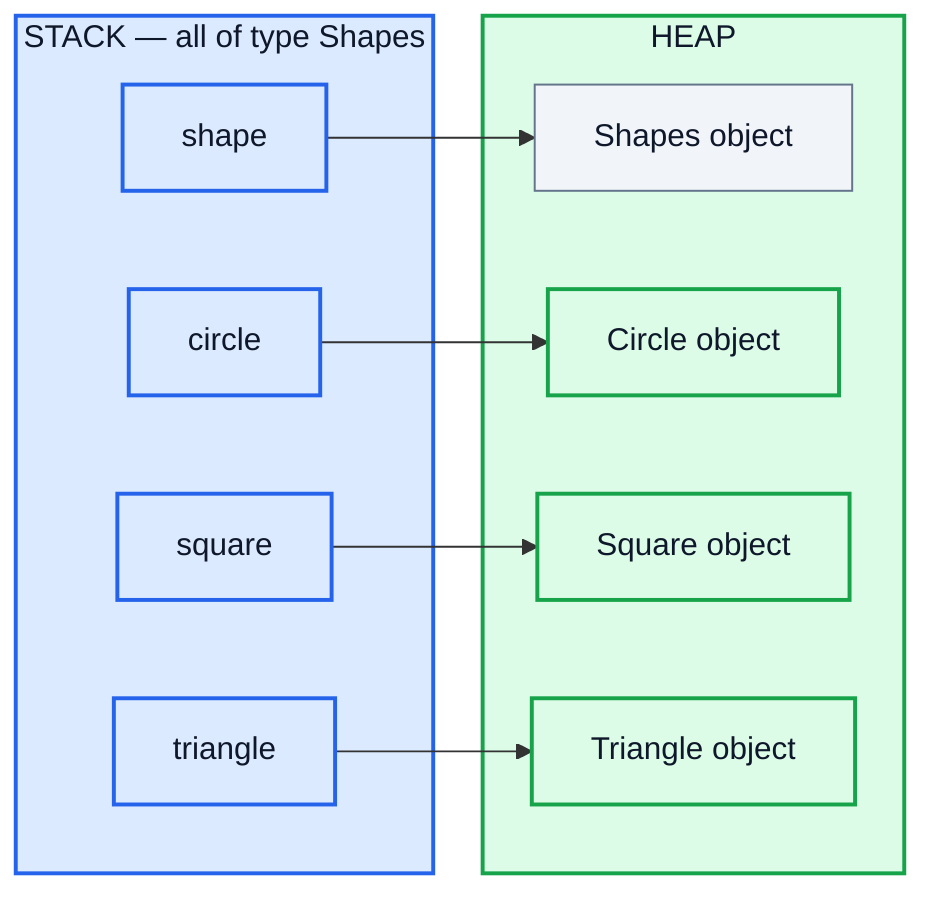

> [!TIP]
> `Shapes.area()` has no sensible body: what's the area of a "shape"? That's a sign it should be `abstract` (OOP 5). Then `new Shapes()` becomes illegal and every subclass is forced to implement `area()`.

---

## 13. Types of Polymorphism (1:19:27)

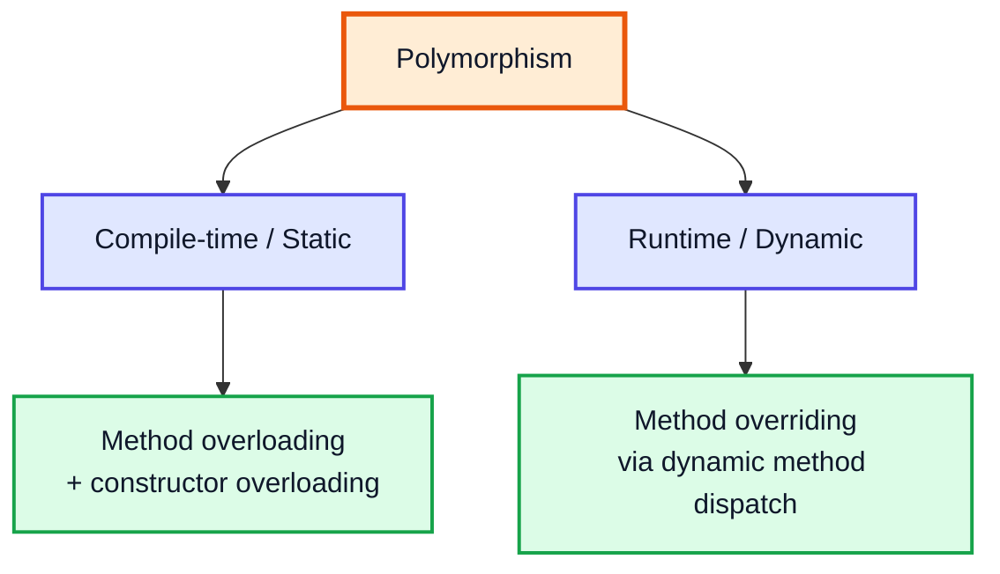

| | Compile-time (static) | Runtime (dynamic) |
|---|---|---|
| Achieved by | Overloading | Overriding |
| Decided by | Compiler, from **argument types** | JVM, from the **object's actual class** |
| Binding | Early / static binding | Late / dynamic binding |
| Needs inheritance? | No (same class is enough) | Yes |

---

## 14. Static Polymorphism (1:19:57)

**Static (compile-time) polymorphism**: the compiler already knows **exactly which method** a call means while it compiles. It picks one by looking at the method name plus the **number, types and order** of the arguments.

```java
System.out.println(5);        // println(int)
System.out.println("five");   // println(String)
System.out.println(5.0);      // println(double)
```

`println` is the classic example: one name with many overloads, each picked at compile time. The operator `+` behaves the same way (numeric addition vs string concatenation). It's the only operator that's "overloaded" in Java, and you can't overload operators yourself.

---

## 15. Overloading (1:20:34)

### Basics

**Method overloading**: the **same method name** with **different parameter lists** in the same class (or inherited into it).

```java
class Calculator {
    int    sum(int a, int b)           { return a + b; }
    int    sum(int a, int b, int c)    { return a + b + c; }      // different count
    double sum(double a, double b)     { return a + b; }          // different types
    String sum(String a, int b)        { return a + b; }          // different types
    String sum(int a, String b)        { return a + b; }          // different order
}

public class Main {
    public static void main(String[] args) {
        Calculator c = new Calculator();
        System.out.println(c.sum(2, 3));        // 5
        System.out.println(c.sum(2, 3, 4));     // 9
        System.out.println(c.sum(2.5, 3.5));    // 6.0
        System.out.println(c.sum("a", 1));      // a1
        System.out.println(c.sum(1, "a"));      // 1a
    }
}
```

### What counts as a valid overload?

| Change | Valid overload? |
|---|---|
| Different number of parameters | ✅ |
| Different parameter types | ✅ |
| Different order of parameter types | ✅ |
| **Only** the return type differs | ❌ compile error: the call `sum(2, 3)` would be ambiguous |
| **Only** parameter names differ | ❌ same signature |
| Different access modifier / `static` only | ❌ same signature |

> [!IMPORTANT]
> A method's **signature** = name + parameter types (in order). Return type and parameter names are **not** part of it.

### In depth: how the compiler picks an overload

When there's no exact match, Java widens in phases:

1. **Exact match / primitive widening** (`int → long → float → double`)
2. **Boxing / unboxing** (`int → Integer`)
3. **Varargs** (`int...`)

```java
class Pick {
    static void f(long x)    { System.out.println("long"); }
    static void f(Integer x) { System.out.println("Integer"); }
    static void f(int... x)  { System.out.println("varargs"); }

    public static void main(String[] args) {
        f(5);   // long   ← widening beats boxing, which beats varargs
    }
}
```

If two candidates are equally good, e.g. `f(int, double)` and `f(double, int)` called as `f(1, 1)`, the compiler reports **"reference to f is ambiguous"**.

Constructor overloading (OOP 1, section 7) is the same idea applied to constructors.

---

## 16. Dynamic Polymorphism (1:28:02)

**Dynamic (runtime) polymorphism**: which method body runs is decided **while the program runs**, from the object's actual class rather than the variable's declared type.

```java
Shapes s;
if (Math.random() > 0.5) s = new Circle();
else                     s = new Square();
s.area();   // the compiler can't know which one; the JVM decides at runtime
```

The compiler only checks that `Shapes` **has** an `area()` method. Which `area()` actually executes depends on the object, and that may only be known at runtime. This is achieved with **method overriding**.

---

## 17. Overriding (1:29:24)

### Basics

**Method overriding**: a subclass provides its own implementation of a method that it inherits from its parent, with the **same signature**.

```java
class Shapes {
    void area() { System.out.println("I am in shapes"); }
}
class Circle extends Shapes {
    @Override                 // asks the compiler to verify this really overrides
    void area() { System.out.println("Area is pi * r * r"); }
}
```

### Rules for overriding

| Rule | Detail |
|---|---|
| Same name and parameter list | Otherwise it's an overload, not an override |
| Return type | Same, or a **subtype** (covariant return) for reference types |
| Access | Same or **wider** (`protected → public` ok; `public → private` ❌) |
| Checked exceptions | Same, narrower, or none. Can't add new or broader checked exceptions |
| Can't override | `final` methods, `static` methods (hidden instead), `private` methods (not inherited), constructors |

> [!TIP]
> **Always use `@Override`.** If you mistype the name or parameters (`void Area()` or `boolean equals(Circle c)`), the compiler reports an error instead of quietly creating a new method.

### Overloading vs Overriding

| | Overloading | Overriding |
|---|---|---|
| Where | Same class (or inherited) | Parent and child classes |
| Signature | **Must differ** | **Must be the same** |
| Return type | Anything | Same or covariant |
| Polymorphism type | Compile-time | Runtime |
| Resolved by | Compiler (argument types) | JVM (object type) |
| `static`/`private`/`final` methods | Can be overloaded | Can't be overridden |
| Purpose | Convenience: same operation for different inputs | Specialised behaviour in a subclass |

---

## 18. How Overriding Works? (1:34:08)

### Upcasting

```java
Shapes circle = new Circle();
```

This is **upcasting**: storing a child object in a parent-type reference. It's always safe and automatic.

When you call `circle.area()`:

1. **Compile time:** the compiler looks in `Shapes` (the reference type). Is there an `area()` it can call? Yes, so the call compiles.
2. **Runtime:** the JVM looks at the **actual object** (`Circle`) and runs the most specific override of `area()`. This is called **dynamic method dispatch**.

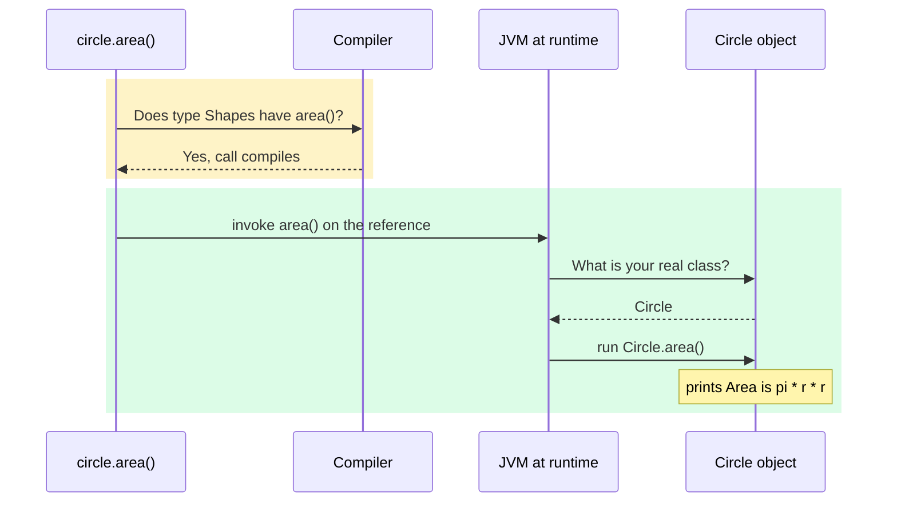

### What if the child has a method the parent doesn't?

```java
class Circle extends Shapes {
    @Override void area() { System.out.println("pi r^2"); }
    void radius() { System.out.println("radius!"); }
}

Shapes s = new Circle();
s.area();          // ✅ pi r^2
// s.radius();     // ❌ compile error: Shapes has no radius()
((Circle) s).radius();   // ✅ downcast first
```

> [!WARNING]
> Downcasting compiles, but it throws `ClassCastException` if the object isn't really of that type. Check first, preferably with modern pattern matching:
> `if (s instanceof Circle c) c.radius();` (Java 16+). See OOP 4 for `instanceof`.

---

## 19. How Java Determines Which Method to Run? (1:39:05)

### The rule

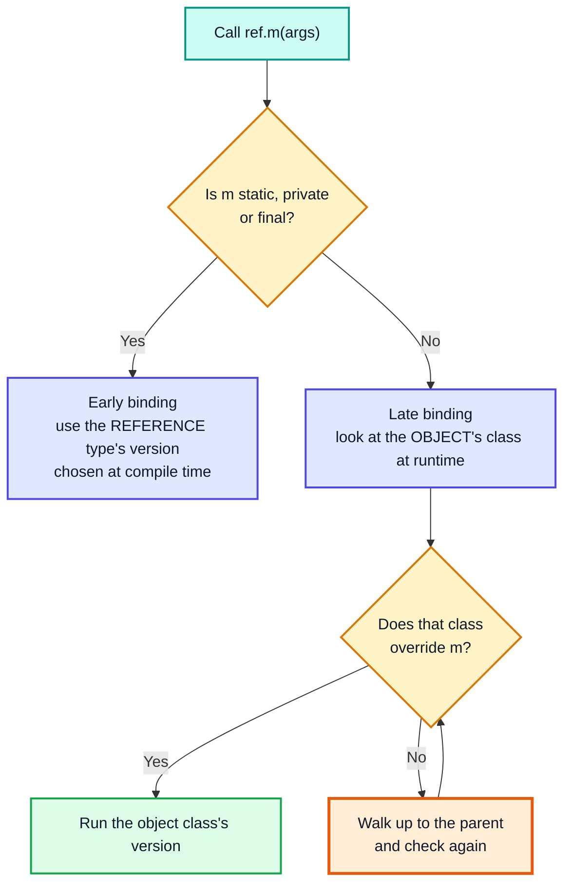

| Step | Who | Uses | Question |
|---|---|---|---|
| 1 | Compiler | **Reference type** | Is this method accessible and does it exist? Which overload? |
| 2 | JVM | **Object type** | Which override of that signature should run? |

### Under the hood (brief)

For each class the JVM keeps a **virtual method table (vtable)**: one slot per overridable method, pointing at the most specific implementation for that class. A virtual call is "look at the object's class, take slot *k*, jump". That's fast, so polymorphism costs almost nothing.

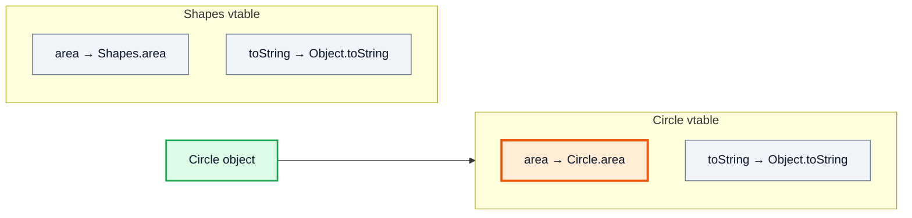

### ⚠️ Fields are NOT polymorphic

Only **instance methods** are dispatched dynamically. **Fields** are resolved from the **reference type**:

```java
class P { String name = "P"; String who() { return "P"; } }
class Q extends P { String name = "Q"; @Override String who() { return "Q"; } }

P obj = new Q();
System.out.println(obj.name);   // P   ← field: reference type
System.out.println(obj.who());  // Q   ← method: object type
```

### Trace table

| Expression (ref type → object type) | Checked by compiler in | Runs |
|---|---|---|
| `Shapes s = new Shapes(); s.area()` | `Shapes` | `Shapes.area` |
| `Shapes s = new Circle(); s.area()` | `Shapes` | `Circle.area` ✅ |
| `Circle c = new Circle(); c.area()` | `Circle` | `Circle.area` |
| `Shapes s = new Circle(); s.radius()` | `Shapes` ❌ | compile error |
| `P obj = new Q(); obj.name` | `P` | `P.name` (no dispatch for fields) |

---

## 20. `final` Keyword (1:45:17)

OOP 1 (section 10) covered `final` variables, methods and classes. This video looks at `final` from the **inheritance and binding** side.

### `final` methods prevent overriding

```java
class A {
    final void config() { System.out.println("fixed behaviour"); }
}
class B extends A {
    // void config() { }   // ❌ config() in B cannot override config() in A; overridden method is final
}
```

Use it when a subclass changing the behaviour would break the class: security checks, or template steps that must run in order.

### `final` classes prevent inheritance

```java
final class Money { }
// class Coins extends Money { }   // ❌ cannot inherit from final Money
```

Every method of a `final` class is effectively final too, since there's no subclass to override it. JDK examples: `String`, `Integer` and the other wrappers, `Math`. Records are implicitly final as well.

### `final` and early binding

Kunal points out that because a `final` method can't be overridden, the call can be resolved early, and the compiler/JIT can **inline** it (paste the body at the call site) for speed. Calls to `private` and `static` methods are resolved early too.

> [!NOTE]
> On modern JVMs the JIT compiler also inlines **non-final** methods whenever it can prove there's only one implementation in use, and it de-optimises if a new subclass is loaded later. So add `final` for **design** reasons ("this must not change"), not for speed.

| `final` on | Effect |
|---|---|
| Variable | Assign once |
| Method | Can't be overridden; bound early |
| Class | Can't be extended; all methods effectively final |
| Constructor | ❌ not allowed (constructors aren't inherited anyway) |

---

## 21. Can We Override Static Methods? (1:50:49)

**Short answer: no.** Static methods can be **inherited** and **re-declared**, but that's **method hiding**, not overriding. No dynamic dispatch happens.

```java
class Parent {
    static void greet() { System.out.println("Parent static"); }
}
class Child extends Parent {
    static void greet() { System.out.println("Child static"); }   // hides, doesn't override
}

public class Main {
    public static void main(String[] args) {
        Parent p = new Child();
        p.greet();        // Parent static   ← decided by REFERENCE type
        Child.greet();    // Child static
        Parent.greet();   // Parent static
    }
}
```

Why? Overriding is about choosing behaviour based on the **object**. A static method belongs to the **class** and needs no object (calling it via `p` is legal but misleading, and IDEs warn about it). The compiler simply uses the declared type of `p`.

| | Instance method redeclared | Static method redeclared |
|---|---|---|
| Name | Overriding | Hiding |
| Chosen by | Object type (runtime) | Reference type (compile time) |
| `@Override` allowed? | ✅ | ❌ compile error |
| Polymorphic? | ✅ | ❌ |

Mixing them is an error:

```java
class Parent { void a() { } static void b() { } }
class Child extends Parent {
    // static void a() { }  // ❌ compile error: overriding method is static
    // void b() { }         // ❌ compile error: overridden method is static
}
```

> [!IMPORTANT]
> Interview line: *"Static methods are inherited but not overridden; redefining one in a subclass hides it, and the call is resolved from the reference type at compile time."* The same goes for **fields**: they're hidden, never overridden.

---

## 22. Encapsulation (1:57:02)

### Basics

**Encapsulation** means **wrapping data (fields) and the code that works on that data (methods) into one unit**, the class, and **controlling access** to that data.

A medicine capsule is the usual analogy: the ingredients are sealed inside and you interact with the capsule as a whole.

```java
class Student {
    private String name;      // data is hidden
    private int marks;

    public String getName() { return name; }
    public int getMarks()   { return marks; }

    public void setMarks(int marks) {        // all writes go through here
        if (marks < 0 || marks > 100) {
            throw new IllegalArgumentException("marks must be 0-100");
        }
        this.marks = marks;
    }
}
```

### Why it matters

| Benefit | How |
|---|---|
| **Data integrity** | Setters validate, so an object can't be put into an invalid state |
| **Flexibility** | You can change the internal representation without breaking callers |
| **Read-only / write-only** | Provide only a getter (or only a setter) |
| **Debugging** | Only one place can modify the field, so a breakpoint there catches every change |

---

## 23. Abstraction (1:58:22)

### Basics

**Abstraction** means **showing only the essential features and hiding the implementation details**. The user knows **what** something does, not **how**.

Real-world: you drive a car with a steering wheel, pedals and gears. You don't need to know how fuel injection or the gearbox works.

```java
import java.util.ArrayList;
import java.util.List;

public class AbstractionDemo {
    public static void main(String[] args) {
        List<Integer> list = new ArrayList<>();
        list.add(5);          // you don't know (or care) how the array resizes
        list.add(7);
        System.out.println(list.size());   // 2
    }
}
```

`List` is the abstraction (what you can do). `ArrayList` is one hidden implementation (how it's done).

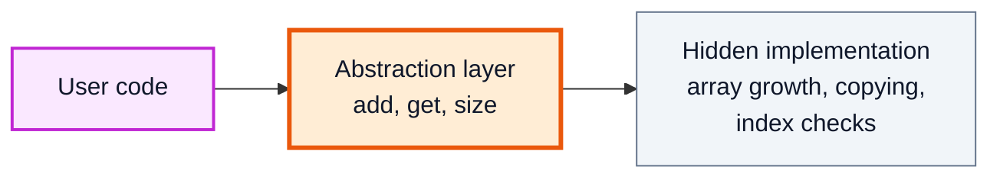

In Java, abstraction is built mainly with **interfaces** and **abstract classes** (OOP 5), and also with any well-designed public API.

---

## 24. Encapsulation vs Abstraction (2:00:14)

This is the most-asked comparison. Kunal's summary: **abstraction is about the design (what to show), encapsulation is about the implementation (how to hide and protect it).**

| | Abstraction | Encapsulation |
|---|---|---|
| Focus | **What** an object does | **How** it keeps its data and code together and safe |
| Level | Design level | Implementation level |
| Solves | Complexity: hides unnecessary detail from the user | Protection: hides internal data from outside access |
| Achieved with | Interfaces, abstract classes | Access modifiers (`private`), getters/setters |
| Question it answers | "Which operations should the outside world see?" | "How do I stop outsiders messing with internals?" |
| Example | `List` interface exposes `add`, `get` | `ArrayList` keeps `elementData` array `private` |

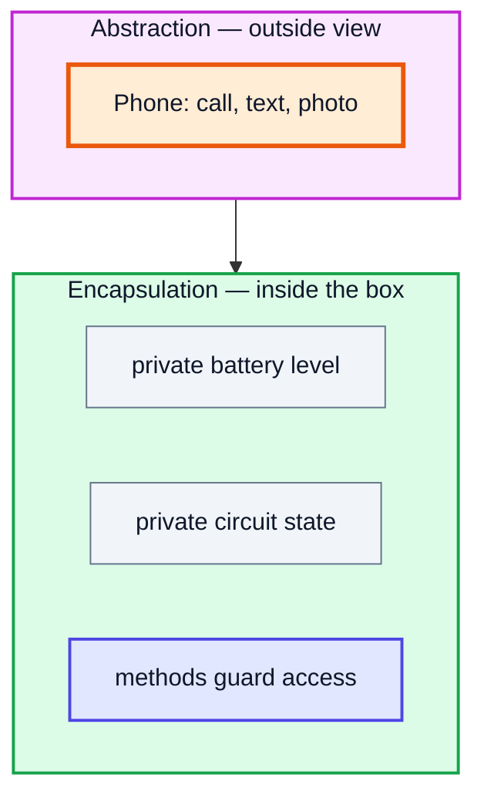

> [!TIP]
> They work together: abstraction decides the **public face** of a class, and encapsulation makes sure everything behind that face can only be reached through it.

---

## 25. Example (2:05:33)

A single class that shows both ideas:

```java
public class CoffeeMachine {
    // ── Encapsulation: hidden, protected state ──
    private int waterMl = 1000;
    private int beansG  = 200;

    // ── Abstraction: one simple public operation ──
    public String makeEspresso() {
        if (!hasResources(30, 18)) return "Please refill";
        grindBeans(18);
        boilWater(30);
        return "☕ Espresso ready";
    }

    // ── Hidden implementation details ──
    private boolean hasResources(int water, int beans) {
        return waterMl >= water && beansG >= beans;
    }
    private void grindBeans(int g) { beansG -= g; }
    private void boilWater(int ml) { waterMl -= ml; }

    public static void main(String[] args) {
        CoffeeMachine m = new CoffeeMachine();
        System.out.println(m.makeEspresso());   // ☕ Espresso ready
        // m.beansG = -5;   // ❌ not possible from outside the class: encapsulated
    }
}
```

- **Abstraction:** the user sees one button, `makeEspresso()`.
- **Encapsulation:** `waterMl`, `beansG` and the helper steps are `private`. Nobody outside can put the machine in an invalid state.

---

## 26. Data Hiding (2:09:33)

**Data hiding** is a **part of encapsulation**: specifically restricting direct access to an object's data, usually by making fields `private`.

| | Data Hiding | Encapsulation | Abstraction |
|---|---|---|---|
| Concern | Security/access of **data** | Bundling **data + methods**, with controlled access | Hiding **complexity** |
| Tool | `private` (access modifiers) | Class + `private` + getters/setters | Interfaces, abstract classes |
| Relationship | Subset of encapsulation | Includes data hiding | Separate idea, works alongside |

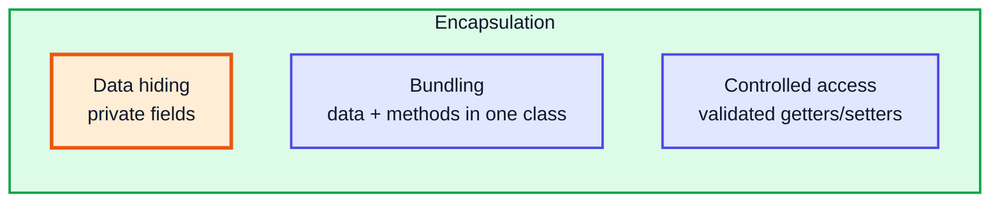

> [!WARNING]
> Private fields with a public getter **and** a plain public setter for every one is barely better than public fields. Real encapsulation exposes **behaviour** (`deposit`, `withdraw`) and validates, rather than handing out raw setters.

> [!NOTE]
> **Modern Java:** for simple immutable data carriers, `record Point(int x, int y) { }` (Java 16+) gives you private final fields, accessors, `equals`, `hashCode` and `toString` automatically. That's encapsulation with no boilerplate.

---

## 27. Outro (2:11:47)

Recap: inheritance (and why Java avoids multiple class inheritance), compile-time vs runtime polymorphism, how the JVM picks the method to run, `final` and static methods in hierarchies, and the encapsulation / abstraction / data hiding trio. Next, OOP 4 (video #40) covers **access modifiers** in detail, Java's **built-in packages**, and the **`Object` class**.

---

## 🧩 Complete Example: Everything Together

```java
import java.util.List;

// ═══════ INHERITANCE + private + super ═══════
class Box {
    private double l, h, w;            // private: invisible to subclasses
    static int boxesMade = 0;

    Box() { this(-1, -1, -1); }                    // constructor chaining
    Box(double side) { this(side, side, side); }   // overloaded constructor
    Box(double l, double h, double w) {
        this.l = l; this.h = h; this.w = w;
        boxesMade++;
    }
    Box(Box other) { this(other.l, other.h, other.w); } // copy constructor

    double volume() { return l * h * w; }

    // overloading: same name, different parameter lists
    double scaledVolume(int factor)    { return volume() * factor; }
    double scaledVolume(double factor) { return volume() * factor; }

    String describe() { return "Box[" + l + "x" + h + "x" + w + "]"; }

    static String kind() { return "generic box"; }   // static: hidden, not overridden

    final String brand() { return "KK Boxes"; }       // final: cannot be overridden
}

class BoxWeight extends Box {
    double weight;

    BoxWeight(double l, double h, double w, double weight) {
        super(l, h, w);        // parent initialises its own private fields
        this.weight = weight;
    }

    @Override
    String describe() { return super.describe() + " weighing " + weight + "kg"; }

    static String kind() { return "weighted box"; }  // hides Box.kind()
}

class BoxPrice extends BoxWeight {   // multilevel: Box -> BoxWeight -> BoxPrice
    double cost;

    BoxPrice(double side, double weight, double cost) {
        super(side, side, side, weight);
        this.cost = cost;
    }

    @Override
    String describe() { return super.describe() + " costing Rs." + cost; }
}

// ═══════ POLYMORPHISM: Shapes ═══════
class Shape {
    String name() { return "Shape"; }
    double area() { return 0; }
}
class Circle extends Shape {
    private final double r;
    Circle(double r) { this.r = r; }
    @Override String name() { return "Circle"; }
    @Override double area() { return Math.PI * r * r; }
}
class Square extends Shape {
    private final double s;
    Square(double s) { this.s = s; }
    @Override String name() { return "Square"; }
    @Override double area() { return s * s; }
}

// ═══════ ENCAPSULATION + DATA HIDING ═══════
class Account {
    private double balance;                 // hidden data
    double getBalance() { return balance; } // controlled read
    void deposit(double amt) {              // controlled write with validation
        if (amt <= 0) throw new IllegalArgumentException("amount must be positive");
        balance += amt;
    }
}

public class Main {
    public static void main(String[] args) {
        System.out.println("=== Inheritance ===");
        BoxPrice bp = new BoxPrice(2, 5, 300);
        System.out.println(bp.describe());
        System.out.println("volume = " + bp.volume() + ", brand = " + bp.brand());

        System.out.println("\n=== Reference type vs object type ===");
        Box ref = new BoxWeight(1, 2, 3, 8);   // upcasting
        System.out.println(ref.describe());     // BoxWeight's version runs
        // System.out.println(ref.weight);      // compile error: Box has no 'weight'
        System.out.println("weight via cast = " + ((BoxWeight) ref).weight);

        System.out.println("\n=== Overloading (compile time) ===");
        Box cube = new Box(3);
        System.out.println(cube.scaledVolume(2));    // int version
        System.out.println(cube.scaledVolume(0.5));  // double version
        Box copy = new Box(cube);
        System.out.println("copy: " + copy.describe());

        System.out.println("\n=== Overriding (run time) ===");
        List<Shape> shapes = List.of(new Shape(), new Circle(1), new Square(4));
        for (Shape s : shapes) {
            System.out.printf("%-6s area = %.2f%n", s.name(), s.area());
        }

        System.out.println("\n=== Static methods are hidden, not overridden ===");
        Box b = new BoxWeight(1, 1, 1, 1);
        System.out.println("Box.kind()       = " + Box.kind());
        System.out.println("BoxWeight.kind() = " + BoxWeight.kind());
        System.out.println("b.kind()         = " + b.kind() + "  (decided by reference type Box)");
        System.out.println("boxes made so far = " + Box.boxesMade);

        System.out.println("\n=== Encapsulation / data hiding ===");
        Account acc = new Account();
        acc.deposit(500);
        try {
            acc.deposit(-50);
        } catch (IllegalArgumentException e) {
            System.out.println("Rejected: " + e.getMessage());
        }
        System.out.println("balance = " + acc.getBalance());
    }
}
```

**Expected Output:**
```
=== Inheritance ===
Box[2.0x2.0x2.0] weighing 5.0kg costing Rs.300.0
volume = 8.0, brand = KK Boxes

=== Reference type vs object type ===
Box[1.0x2.0x3.0] weighing 8.0kg
weight via cast = 8.0

=== Overloading (compile time) ===
54.0
13.5
copy: Box[3.0x3.0x3.0]

=== Overriding (run time) ===
Shape  area = 0.00
Circle area = 3.14
Square area = 16.00

=== Static methods are hidden, not overridden ===
Box.kind()       = generic box
BoxWeight.kind() = weighted box
b.kind()         = generic box  (decided by reference type Box)
boxes made so far = 5

=== Encapsulation / data hiding ===
Rejected: amount must be positive
balance = 500.0
```

---

## Quick Reference Cheat Sheet

| Concept | One-Line Summary |
|---|---|
| **Inheritance** | `class Child extends Parent`: child gets parent's non-private members (IS-A) |
| **Constructor order** | Parent constructor runs first, always (implicit `super()` if not written) |
| **Reference vs object type** | Reference type = what you may access; object type = which override runs |
| **`private` in parent** | Exists in the child object but not accessible by name; use `super(...)`/getters |
| **`super(...)`** | Calls parent constructor; first statement (Java 25 relaxes this for code not using `this`) |
| **`super.x` / `super.m()`** | Access the immediate parent's hidden field or overridden method |
| **Single / Multilevel / Hierarchical** | ✅ Supported with classes |
| **Multiple / Hybrid** | ❌ With classes (diamond problem); ✅ with interfaces |
| **Polymorphism** | Same name, many forms |
| **Overloading** | Same name, different parameters; compile-time; return type alone isn't enough |
| **Overriding** | Same signature in child; runtime; use `@Override`; can't narrow access |
| **Dynamic method dispatch** | JVM picks the override from the object's real class at runtime |
| **Fields** | Never polymorphic; resolved by reference type |
| **`final` method / class** | Can't override / can't extend; early binding |
| **Static methods** | Inherited, not overridden: redeclaring **hides** them (reference type decides) |
| **Encapsulation** | Bundle data + methods, restrict access (implementation level) |
| **Abstraction** | Show what, hide how (design level) |
| **Data hiding** | The `private`-fields part of encapsulation |
