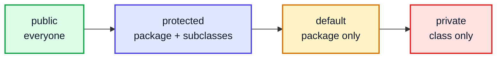
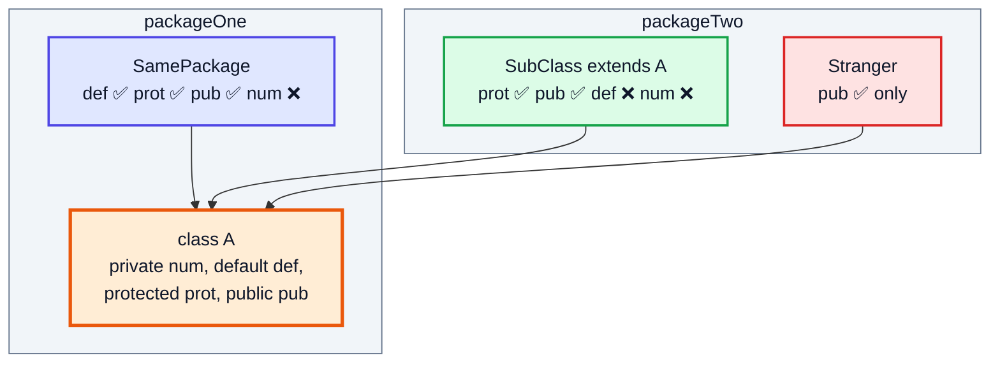
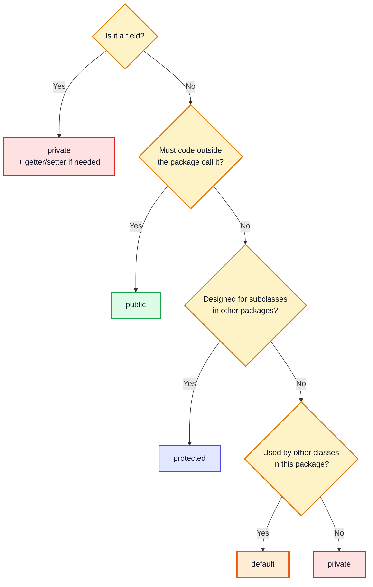
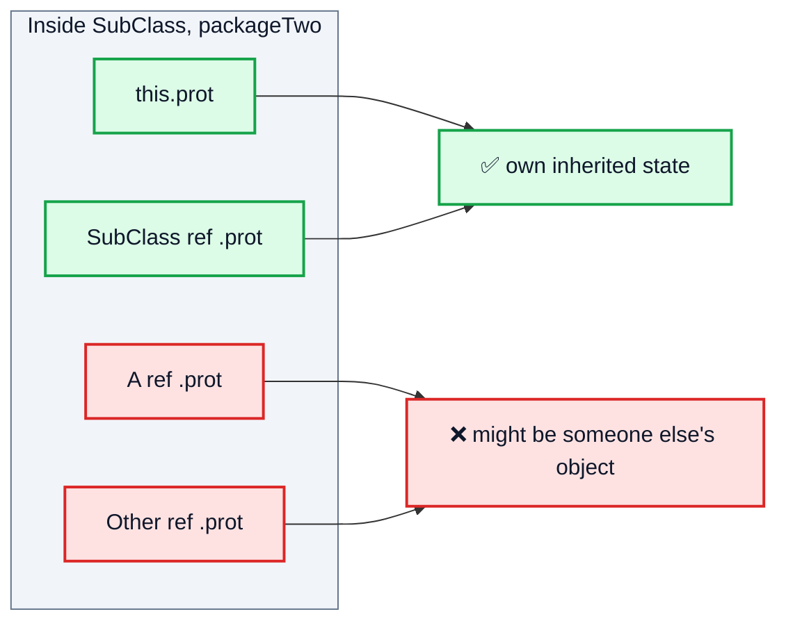
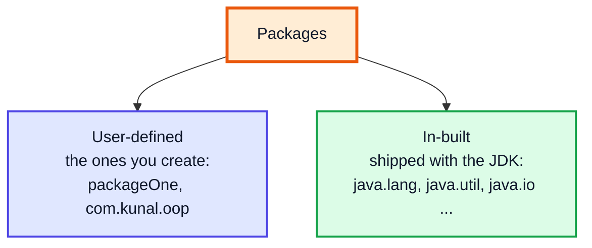
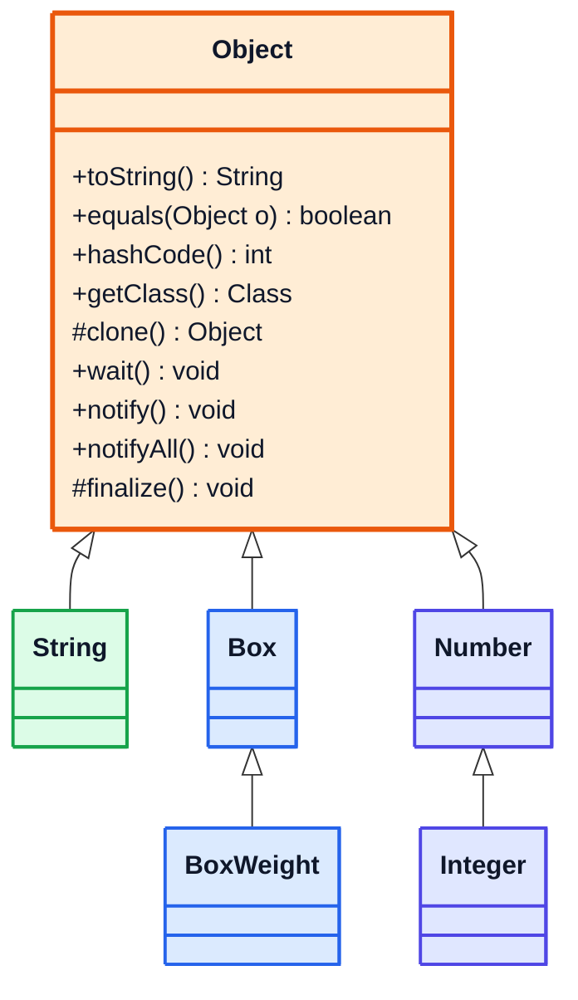
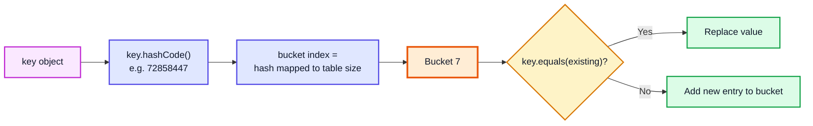
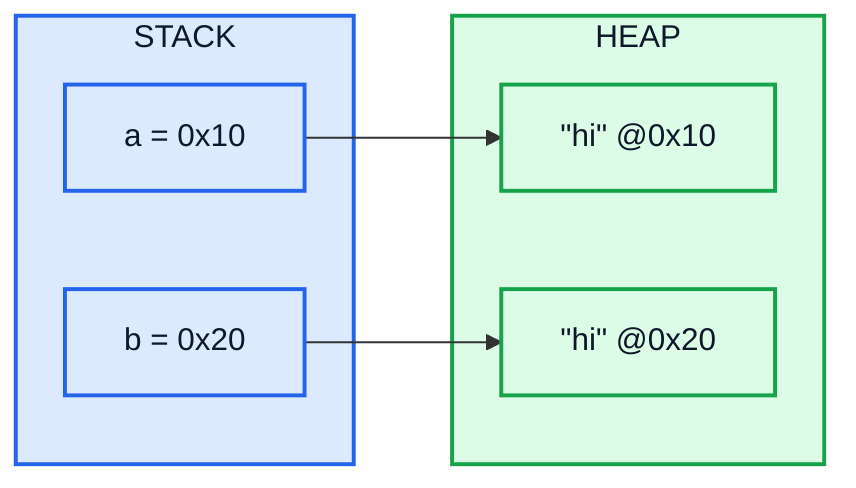
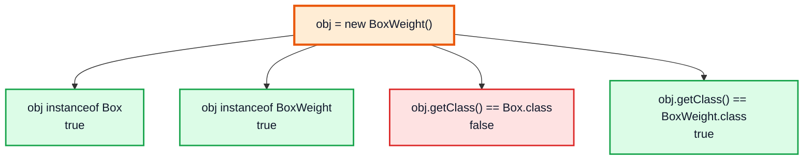

# Access Control, In-built Packages & the Object Class — Complete In-Depth Guide

**Video #40 of the Java + DSA playlist:** *OOP 4 | Access Control, In-built Packages, Object Class* (50:45)

The fourth OOP lecture covers the four access levels (`private`, default, `protected`, `public`) and the tricky `protected` rule across packages, then tours Java's built-in packages, then goes through `java.lang.Object` (the root of every class) and its key methods: `toString`, `hashCode`, `equals`, `getClass`, along with the `instanceof` operator. Inheritance and `super` come from OOP 3 ([java_39_video_oop_principles.md](java_39_video_oop_principles.md)); classes and objects come from OOP 1 ([java_37_video_oops.md](java_37_video_oops.md)).

---

## Table of Contents

| # | Topic | Timestamp |
|---|---|---|
| 0 | [Introduction](#0-introduction-000) | 0:00 |
| 1 | [Example: private, public and protected modifiers](#1-example-private-public-and-protected-modifiers-104) | 1:04 |
| 2 | [Rules for modifiers](#2-rules-for-modifiers-1229) | 12:29 |
| 3 | [When to use which modifier?](#3-when-to-use-which-modifier-1556) | 15:56 |
| 4 | [Important point for protected modifier](#4-important-point-for-protected-modifier-1803) | 18:03 |
| 5 | [More about Packages](#5-more-about-packages-2610) | 26:10 |
| 6 | [In-built Packages](#6-in-built-packages-2717) | 27:17 |
| 7 | [`lang` Package](#7-lang-package-2736) | 27:36 |
| 8 | [`io` Package](#8-io-package-2852) | 28:52 |
| 9 | [`util` Package](#9-util-package-2931) | 29:31 |
| 10 | [`applet` Package](#10-applet-package-3037) | 30:37 |
| 11 | [`awt` Package](#11-awt-package-3113) | 31:13 |
| 12 | [`net` Package](#12-net-package-3149) | 31:49 |
| 13 | [Object Class](#13-object-class-3223) | 32:23 |
| 14 | [Object Methods](#14-object-methods-3413) | 34:13 |
| 15 | [`hashCode` Method](#15-hashcode-method-3531) | 35:31 |
| 16 | [`equals` Method](#16-equals-method-3928) | 39:28 |
| 17 | [`instanceof` Operator](#17-instanceof-operator-4606) | 46:06 |
| 18 | [`getClass` Method](#18-getclass-method-4750) | 47:50 |
| 19 | [Outro](#19-outro-5006) | 50:06 |

---

## 0. Introduction (0:00)

OOP 3 used `private` to explain why a child can't touch some parent fields. This video fills in the rest of **access control** (who is allowed to see which member) and then looks at the class that every class inherits from: **`Object`**.

> [!IMPORTANT]
> The `equals`/`hashCode` contract in this video matters well beyond OOP. `HashMap`, `HashSet` and almost every hashing DSA problem depend on it. Get it wrong and your map "loses" keys.

---

## 1. Example: private, public and protected modifiers (1:04)

### Basics: the four access levels

Java has **four** access levels, from most to least restrictive:

| Modifier | Keyword written? | Visible to |
|---|---|---|
| **private** | `private` | Only the **same class** |
| **default** (package-private) | *(nothing)* | Classes in the **same package** |
| **protected** | `protected` | Same package **+ subclasses** in other packages |
| **public** | `public` | **Everyone** |

### The access matrix (memorise this)

| Modifier | Same class | Same package, subclass | Same package, non-subclass | Other package, subclass | Other package, non-subclass |
|---|---|---|---|---|---|
| `public` | ✅ | ✅ | ✅ | ✅ | ✅ |
| `protected` | ✅ | ✅ | ✅ | ✅ (via inheritance, see section 4) | ❌ |
| default | ✅ | ✅ | ✅ | ❌ | ❌ |
| `private` | ✅ | ❌ | ❌ | ❌ | ❌ |



### The example, Kunal-style

A class with one member per access level, used from various places. Two packages, `packageOne` and `packageTwo`:

```java
// File: packageOne/A.java
package packageOne;

public class A {
    private   int num  = 1;   // only inside A
              int def  = 2;   // default: anywhere in packageOne
    protected int prot = 3;   // packageOne + subclasses anywhere
    public    int pub  = 4;   // everywhere

    public int getNum() { return num; }   // public door to a private field
}
```

```java
// File: packageOne/SamePackage.java
package packageOne;

public class SamePackage {
    public static void main(String[] args) {
        A a = new A();
        // System.out.println(a.num);  // ❌ num has private access in A
        System.out.println(a.def);     // ✅ 2  same package
        System.out.println(a.prot);    // ✅ 3  same package (protected ⊇ default)
        System.out.println(a.pub);     // ✅ 4
        System.out.println(a.getNum());// ✅ 1  through a public getter
    }
}
```

```java
// File: packageTwo/SubClass.java
package packageTwo;

import packageOne.A;

public class SubClass extends A {
    void show() {
        // System.out.println(def);   // ❌ def is not public in A; cannot be accessed from outside package
        System.out.println(prot);     // ✅ inherited protected member
        System.out.println(pub);      // ✅
    }
}
```

```java
// File: packageTwo/Stranger.java
package packageTwo;

import packageOne.A;

public class Stranger {                 // NOT a subclass
    public static void main(String[] args) {
        A a = new A();
        // System.out.println(a.prot);  // ❌ prot has protected access in A
        System.out.println(a.pub);      // ✅ 4
    }
}
```



> [!NOTE]
> "default" here has nothing to do with the `default` keyword used in `switch` or interface `default` methods. Package-private access is simply what you get when you write **no** modifier.

---

## 2. Rules for modifiers (12:29)

### Where each modifier can be used

| Applies to | `public` | `protected` | default | `private` |
|---|---|---|---|---|
| Top-level class / interface | ✅ | ❌ | ✅ | ❌ |
| Nested (inner) class | ✅ | ✅ | ✅ | ✅ |
| Field | ✅ | ✅ | ✅ | ✅ |
| Method | ✅ | ✅ | ✅ | ✅ |
| Constructor | ✅ | ✅ | ✅ | ✅ (used by singletons, [OOP 2](java_38_video_oop_static_packages_singleton.md)) |
| Local variable (inside a method) | ❌ | ❌ | (none allowed) | ❌ |

### Rules to remember

1. A **top-level class** can only be `public` or default. `private class X` at top level is an error, because it would be visible to nobody.
2. A `.java` file can have **at most one `public` top-level class**, and the file name **must** match it (`public class Main` → `Main.java`).
3. **Interface members** are implicitly `public` (methods are `public abstract` unless `default`/`static`/`private`; fields are `public static final`).
4. **Overriding can't reduce visibility.** If the parent method is `protected`, the override may be `protected` or `public`, never default or `private`.

```java
class Parent {
    protected void work() { }
}
class Child extends Parent {
    // void work() { }          // ❌ attempting to assign weaker access privileges; was protected
    @Override
    public void work() { }      // ✅ widening is fine
}
```

Why rule 4? Polymorphism. Code holding a `Parent` reference is allowed to call `work()`. If the child could hide it, `parentRef.work()` would suddenly fail for some objects.

> [!NOTE]
> **Modern Java (9+) modules** add a layer on top: a `public` class in a module is visible to other modules **only if its package is `exports`-ed** in `module-info.java`. For ordinary classpath projects (like this course) you can ignore this.

---

## 3. When to use which modifier? (15:56)

**Default rule: start as restrictive as possible and open up only when there's a real need.**

| Use | When |
|---|---|
| `private` | **Fields, almost always.** Helper methods that are internal implementation details |
| default | Classes/methods that only collaborate within one package (internal helpers, tests in same package) |
| `protected` | Hooks you **intend** subclasses to use or override (template-method steps). Use rarely |
| `public` | The class's API: the methods outside code is meant to call; constants (`public static final`) |



> [!TIP]
> Making something more visible later is easy and safe. Making it less visible later breaks everyone who started depending on it. That's why "private by default" is the professional habit.

---

## 4. Important point for protected modifier (18:03)

This is the subtle part, and it's a popular interview trap.

### The rule

In a subclass that lives in a **different package**, you can access an inherited `protected` member **only through a reference of the subclass type (or its own subclasses)**, i.e. through `this` or another object of your own class. You **can't** access it through a reference of the **parent** type, or of a sibling subclass.

```java
// File: packageTwo/SubClass.java
package packageTwo;

import packageOne.A;

public class SubClass extends A {
    void test(A a, SubClass s, Other o) {
        System.out.println(prot);     // ✅ this.prot (inherited)
        System.out.println(s.prot);   // ✅ reference of my own type
        // System.out.println(a.prot);   // ❌ prot has protected access in A
        // System.out.println(o.prot);   // ❌ Other is a sibling, not my subtype
    }

    public static void main(String[] args) {
        SubClass me = new SubClass();
        System.out.println(me.prot);  // ✅ 3

        A ref = new SubClass();       // same object, but reference type is A
        // System.out.println(ref.prot); // ❌ prot has protected access in A
    }
}

class Other extends A { }
```

*(Verified with `javac` 21: the three ❌ lines each give "prot has protected access in A".)*

### Why?

`protected` means "available to **your** subclass so it can manage **its own** inherited state", not "available on any `A` object anywhere". Otherwise any class could read the protected data of every `A` just by writing `extends A`.



| Access attempted from `packageTwo.SubClass` | Result |
|---|---|
| `prot` / `this.prot` | ✅ |
| `subClassRef.prot` | ✅ |
| `aRef.prot` (type `A`, even if the object is a `SubClass`) | ❌ |
| `siblingRef.prot` (another subclass of `A`) | ❌ |
| Any of the above from **inside `packageOne`** | ✅ (same-package access applies) |

> [!WARNING]
> This is also why `Object.clone()` (which is `protected`) can't be called as `someObject.clone()` from an unrelated class. Your class must override `clone()` and make it `public` first.

---

## 5. More about Packages (26:10)

Recap from [OOP 2](java_38_video_oop_static_packages_singleton.md): a **package** is a namespace/folder that groups related classes, avoids name clashes and supports access control (default and `protected` are defined in terms of packages).

```text
src/
├── packageOne/
│   ├── A.java            (package packageOne;)
│   └── SamePackage.java
└── packageTwo/
    ├── SubClass.java     (package packageTwo;)
    └── Stranger.java
```

Two kinds of packages:



> [!TIP]
> Real projects name packages with a **reversed domain**: `com.company.project.feature`. Package names are all lowercase.

---

## 6. In-built Packages (27:17)

The JDK ships thousands of ready-made classes, organised into packages. The ones the video lists:

| Package | Contains | Typical classes |
|---|---|---|
| `java.lang` | Core language classes, **auto-imported** | `Object`, `String`, `Math`, `Integer`, `System`, `Thread` |
| `java.io` | Input/output via streams | `File`, `InputStream`, `BufferedReader`, `PrintWriter` |
| `java.util` | Collections and utilities | `ArrayList`, `HashMap`, `Scanner`, `Arrays`, `Random` |
| `java.applet` | Applets (obsolete) | `Applet` |
| `java.awt` | Old GUI toolkit | `Frame`, `Button`, `Color`, `Graphics` |
| `java.net` | Networking | `URL`, `URI`, `Socket`, `InetAddress` |

Other packages you'll meet: `java.time` (dates/times), `java.nio.file` (modern files), `java.util.function` (lambdas), `java.util.stream`, `java.util.concurrent`, `java.math` (`BigInteger`, `BigDecimal`).

```java
import java.util.ArrayList;        // one class
import java.util.*;                // every class in java.util (not sub-packages!)
import static java.lang.Math.max;  // static import: call max(...) directly
```

> [!NOTE]
> `import java.util.*` does **not** import `java.util.function.*`. Sub-packages are separate packages despite the dotted name. Wildcard imports don't slow your program down either: imports are compile-time only.

---

## 7. `lang` Package (27:36)

`java.lang` holds the classes Java can't live without, and it's **imported automatically** into every file. That's why you never write `import java.lang.String;`.

```java
public class LangDemo {
    public static void main(String[] args) {
        String s = "Kunal";                          // java.lang.String
        int big = Math.max(10, 20);                  // java.lang.Math
        int parsed = Integer.parseInt("42");         // java.lang.Integer
        StringBuilder sb = new StringBuilder("ab");  // java.lang.StringBuilder
        System.out.println(s + " " + big + " " + parsed + " " + sb.reverse());
        // Kunal 20 42 ba
    }
}
```

Key members: `Object`, `String`, `StringBuilder`, wrapper classes, `Math`, `System`, `Thread`, `Runnable`, `Exception`/`RuntimeException`/`Error`, `Record` and `Enum` (base classes of records/enums), `Iterable`, `Comparable`.

---

## 8. `io` Package (28:52)

`java.io` handles **input and output** using **streams** (byte streams `InputStream`/`OutputStream`, character streams `Reader`/`Writer`).

```java
import java.io.BufferedReader;
import java.io.IOException;
import java.io.StringReader;

public class IoDemo {
    public static void main(String[] args) throws IOException {
        // StringReader stands in for a file so the output is deterministic
        try (BufferedReader br = new BufferedReader(new StringReader("line one\nline two"))) {
            String line;
            while ((line = br.readLine()) != null) {
                System.out.println("> " + line);
            }
        }
        // > line one
        // > line two
    }
}
```

> [!TIP]
> For competitive programming, `BufferedReader` + `InputStreamReader(System.in)` is much faster than `Scanner`. For new file code, `java.nio.file.Files` (for example `Files.readAllLines(Path.of("a.txt"))`) is the modern, shorter API.

---

## 9. `util` Package (29:31)

`java.util` is the package you'll import most in DSA: the **Collections Framework** plus utilities.

| Category | Classes |
|---|---|
| Lists | `ArrayList`, `LinkedList` |
| Sets | `HashSet`, `LinkedHashSet`, `TreeSet` |
| Maps | `HashMap`, `LinkedHashMap`, `TreeMap` |
| Queues | `ArrayDeque`, `PriorityQueue` |
| Utilities | `Arrays`, `Collections`, `Objects`, `Scanner`, `Random`, `Optional` |

```java
import java.util.*;

public class UtilDemo {
    public static void main(String[] args) {
        List<Integer> nums = new ArrayList<>(List.of(5, 2, 8));
        Collections.sort(nums);
        Map<String, Integer> age = new HashMap<>();
        age.put("Kunal", 22);
        System.out.println(nums + " " + age.get("Kunal"));   // [2, 5, 8] 22
    }
}
```

---

## 10. `applet` Package (30:37)

**Applets** were small Java programs that ran **inside a web browser** through a browser plug-in (`java.applet.Applet`).

> [!CAUTION]
> **Obsolete.** Browsers dropped the Java plug-in years ago. The Applet API was deprecated in Java 9, deprecated **for removal** in Java 17 (JEP 398), and removed from the JDK in JDK 26 (JEP 504). Learn the name for trivia only; don't write applets.

---

## 11. `awt` Package (31:13)

**AWT (Abstract Window Toolkit)** is Java's original **GUI** library: windows, buttons, colours, drawing. It uses the operating system's native widgets.

```java
import java.awt.Color;
import java.awt.Point;

public class AwtDemo {
    public static void main(String[] args) {
        Point p = new Point(3, 4);           // simple geometry classes still handy
        Color c = Color.ORANGE;
        System.out.println(p.x + "," + p.y + " rgb=" + c.getRed() + "," + c.getGreen() + "," + c.getBlue());
        // 3,4 rgb=255,200,0
    }
}
```

| GUI toolkit | Status |
|---|---|
| AWT (`java.awt`) | Oldest; still in the JDK; used underneath Swing |
| Swing (`javax.swing`) | Built on AWT; still in the JDK |
| JavaFX | Separate download (OpenJFX) since Java 11 |

---

## 12. `net` Package (31:49)

`java.net` provides **networking**: URLs, sockets, IP addresses.

```java
import java.net.URI;

public class NetDemo {
    public static void main(String[] args) {
        URI uri = URI.create("https://github.com/kunal-kushwaha/DSA-Bootcamp-Java");
        System.out.println(uri.getHost());   // github.com
        System.out.println(uri.getPath());   // /kunal-kushwaha/DSA-Bootcamp-Java
    }
}
```

| Class | Use |
|---|---|
| `URI` / `URL` | Parse and represent web addresses (`new URL(String)` is deprecated since Java 20; use `URI.create(...).toURL()`) |
| `Socket` / `ServerSocket` | Low-level TCP client / server |
| `InetAddress` | IP addresses, DNS lookup |
| `java.net.http.HttpClient` | Modern HTTP client (Java 11+) |

---

## 13. Object Class (32:23)

### Basics

`java.lang.Object` is the **root of the class hierarchy**. Every class extends it directly or indirectly. If you don't write `extends`, the compiler adds `extends Object`.



### What that gives you

1. **Every object has these methods**, so `anything.toString()` always compiles.
2. **An `Object` reference can hold anything** (arrays included):

```java
Object o1 = "text";
Object o2 = new int[]{1, 2};
Object o3 = 42;            // autoboxed to Integer
```

3. Pre-generics collections used `Object` to hold any type, which is why generic code still talks about `Object` underneath (type erasure).

> [!NOTE]
> Primitives (`int`, `double`, ...) are **not** objects and don't extend `Object`. They get there via wrapper classes and autoboxing (OOP 1, section 9).

---

## 14. Object Methods (34:13)

| Method | What it does | Override it? |
|---|---|---|
| `String toString()` | Text form. Default: `ClassName@hexHash` | ✅ Almost always, for readable output |
| `boolean equals(Object o)` | Logical equality. Default: same as `==` | ✅ For value-like classes |
| `int hashCode()` | Integer used by hash-based collections | ✅ **Whenever you override `equals`** |
| `final Class<?> getClass()` | Runtime class of the object | ❌ final |
| `protected Object clone()` | Field-by-field (shallow) copy; needs `Cloneable` | Sometimes; copy constructors are usually preferred |
| `wait()`, `notify()`, `notifyAll()` | Thread coordination on the object's monitor | ❌ final |
| `protected void finalize()` | Called before GC (maybe) | ❌ **Deprecated for removal (Java 18, JEP 421)** |

### `toString` example

```java
class Point {
    int x, y;
    Point(int x, int y) { this.x = x; this.y = y; }
}
class NicePoint extends Point {
    NicePoint(int x, int y) { super(x, y); }
    @Override
    public String toString() { return "(" + x + ", " + y + ")"; }
}

public class ToStringDemo {
    public static void main(String[] args) {
        System.out.println(new Point(1, 2));     // Point@1b6d3586  (hash varies per run)
        System.out.println(new NicePoint(1, 2)); // (1, 2)
    }
}
```

`println(obj)` and `"text" + obj` both call `toString()` for you (via `String.valueOf`, which also handles `null` safely).

---

## 15. `hashCode` Method (35:31)

### Basics

`hashCode()` returns an **`int` that represents an object** and is used to pick a **bucket** in hash-based collections (`HashMap`, `HashSet`). Think of it as a quick, approximate fingerprint.

```java
System.out.println("Kunal".hashCode());   // 72858447 (always the same: String computes it from its characters)
System.out.println(Integer.valueOf(42).hashCode());  // 42
```

> [!NOTE]
> The video describes `Object`'s default `hashCode` as a number derived from the object, often explained as "based on the memory address". On modern HotSpot JVMs it's actually a **random-ish identity number** generated on first call and stored in the object header. It is **not** the address, and objects can move during GC while their hash stays the same.

### How a HashMap uses it



`hashCode` **narrows down** where to look, and `equals` **confirms** the match.

### The contract

| Rule | Meaning |
|---|---|
| Consistent | Same object, unchanged fields → same hash on every call (within one run) |
| **Equal ⇒ same hash** | If `a.equals(b)`, then `a.hashCode() == b.hashCode()` **must** hold |
| Same hash ⇏ equal | Different objects may share a hash (a **collision**), and that's allowed |

### Writing a good `hashCode`

```java
import java.util.Objects;

class Student {
    int roll;
    String name;
    Student(int roll, String name) { this.roll = roll; this.name = name; }

    @Override
    public int hashCode() {
        return Objects.hash(roll, name);   // combine exactly the fields used in equals
    }
}
```

Under the hood, `Objects.hash` uses the classic formula `31 * result + fieldHash` for each field. 31 is an odd prime, and `31 * i` can be computed as `(i << 5) - i`.

> [!TIP]
> Returning a constant (`return 1;`) is *legal* but turns every `HashMap` into one long list: O(n) lookups instead of O(1).

---

## 16. `equals` Method (39:28)

### Basics: `==` vs `equals`

| | `==` | `equals()` |
|---|---|---|
| Primitives | Compares **values** | (n/a) |
| Objects | Compares **references**: same object in memory? | Compares **content**, if the class overrides it |
| Default in `Object` | (n/a) | Same as `==` |
| Overridable? | ❌ | ✅ |

```java
String a = new String("hi");
String b = new String("hi");
System.out.println(a == b);       // false (two objects)
System.out.println(a.equals(b));  // true  (String overrides equals)
```



`a == b` compares `0x10` with `0x20`, so it's `false`. `a.equals(b)` compares the characters, so it's `true`.

### Overriding `equals` correctly

```java
import java.util.Objects;

class Student {
    int roll;
    String name;
    Student(int roll, String name) { this.roll = roll; this.name = name; }

    @Override
    public boolean equals(Object o) {                  // parameter MUST be Object
        if (this == o) return true;                    // 1. same reference
        if (!(o instanceof Student other)) return false; // 2. null or different type
        return roll == other.roll                      // 3. compare significant fields
            && Objects.equals(name, other.name);       //    null-safe for objects
    }

    @Override
    public int hashCode() { return Objects.hash(roll, name); }
}
```

### The `equals` contract

| Property | Meaning |
|---|---|
| Reflexive | `x.equals(x)` is `true` |
| Symmetric | `x.equals(y)` ⇔ `y.equals(x)` |
| Transitive | `x.equals(y)` and `y.equals(z)` ⇒ `x.equals(z)` |
| Consistent | Same answer on repeated calls if nothing changed |
| Null | `x.equals(null)` is `false` (never throws) |

> [!CAUTION]
> **Common bug:** `public boolean equals(Student s)` **overloads** instead of overriding (the parameter type is wrong). `HashSet` and `List.contains` call `equals(Object)` and never see your method. `@Override` would catch this at compile time.

> [!WARNING]
> **Override `equals` ⇒ override `hashCode`.** If you skip it, two "equal" students land in different buckets and a `HashSet` happily stores both:
>
> | equals overridden? | hashCode overridden? | `set.add(s1); set.add(equalCopy);` size |
> |---|---|---|
> | ❌ | ❌ | 2 (different objects) |
> | ✅ | ❌ | 2 🟥 (usually: hashes differ, so equals is never consulted) |
> | ✅ | ✅ | 1 ✅ |

> [!TIP]
> **Modern Java:** `record Student(int roll, String name) { }` generates correct `equals`, `hashCode` and `toString` from the components. Use records for plain value classes.

---

## 17. `instanceof` Operator (46:06)

### Basics

`x instanceof Type` returns `true` if the object referred to by `x` **is a `Type` or a subtype of it**. It returns `false` for `null`.

```java
Object obj = new BoxWeight(1, 2, 3, 4);   // BoxWeight extends Box (OOP 3)

System.out.println(obj instanceof Object);     // true
System.out.println(obj instanceof Box);        // true  (parent)
System.out.println(obj instanceof BoxWeight);  // true  (actual class)
System.out.println(obj instanceof String);     // false

Object nothing = null;
System.out.println(nothing instanceof Object); // false  (null is never an instance)
```

If the types can never be related, it doesn't even compile: `"text" instanceof Integer` is an "incompatible types" error.

### Pattern matching (Java 16+): test and cast in one step

```java
// Old style (as in the video)
if (obj instanceof BoxWeight) {
    BoxWeight bw = (BoxWeight) obj;
    System.out.println(bw.weight);
}

// Modern style
if (obj instanceof BoxWeight bw) {        // bw is in scope only where the test is true
    System.out.println(bw.weight);
}

// Java 21: pattern matching in switch
String describe(Object o) {
    return switch (o) {
        case Integer i when i > 10 -> "big int " + i;
        case Integer i             -> "int " + i;
        case String s              -> "string of length " + s.length();
        case null                  -> "null!";
        default                    -> "something else";
    };
}
```

> [!TIP]
> Lots of `instanceof` checks scattered around usually mean polymorphism is missing. Putting a method on the parent and overriding it (OOP 3) is often cleaner. Inside `equals`, though, `instanceof` is exactly the right tool.

---

## 18. `getClass` Method (47:50)

### Basics

`getClass()` returns the **exact runtime class** of an object as a `Class` object. It's `final`, so it can't be overridden.

```java
Object obj = new BoxWeight(1, 2, 3, 4);
System.out.println(obj.getClass().getName());        // BoxWeight  (fully qualified, e.g. packageOne.BoxWeight, in a package)
System.out.println(obj.getClass().getSimpleName());  // BoxWeight
System.out.println(obj.getClass().getSuperclass());  // class Box
System.out.println(obj.getClass() == Box.class);     // false
```

### `instanceof` vs `getClass()`

| | `obj instanceof Box` | `obj.getClass() == Box.class` |
|---|---|---|
| `Box` object | true | true |
| `BoxWeight` object (subclass) | **true** | **false** |
| `null` | false | 💥 `NullPointerException` |
| Checks | IS-A (type or subtype) | **exact** class |



> [!NOTE]
> Some `equals` implementations use `getClass() != o.getClass()` instead of `instanceof`, so that a subclass object is never "equal" to a parent object. That keeps `equals` symmetric when subclasses add fields. Both styles are common. Pick one per hierarchy.

The `Class` object is also the entry point to **reflection** (`getDeclaredFields()`, `getMethods()`), which frameworks like Spring and JUnit rely on.

---

## 19. Outro (50:06)

Recap: the four access levels and their rules, the "own-type reference" rule for `protected` across packages, a tour of `java.lang`, `io`, `util`, `applet`, `awt` and `net`, and the `Object` methods every class inherits. The key takeaway is the `equals`/`hashCode` pair. Next up in OOP 5: **abstract classes and interfaces**.

---

## 🧩 Complete Example: Everything Together

```java
import java.util.HashSet;
import java.util.Objects;
import java.util.Set;

// ═══════ ACCESS MODIFIERS ═══════
class Student {
    private final int roll;          // only Student's own code
    final String name;               // default: same package only
    protected double marks;          // package + subclasses
    public static final String SCHOOL = "KK Public School"; // everyone

    Student(int roll, String name, double marks) {
        this.roll = roll;
        this.name = name;
        this.marks = marks;
    }

    public int getRoll() { return roll; }   // controlled read of a private field

    // ═══════ OBJECT CLASS METHODS ═══════
    @Override
    public String toString() {
        return "Student{roll=" + roll + ", name=" + name + ", marks=" + marks + "}";
    }

    @Override
    public boolean equals(Object o) {
        if (this == o) return true;                       // same reference
        if (!(o instanceof Student other)) return false;  // null or wrong type
        return roll == other.roll && name.equals(other.name);
    }

    @Override
    public int hashCode() {
        return Objects.hash(roll, name);   // uses the SAME fields as equals
    }
}

class Topper extends Student {
    Topper(int roll, String name, double marks) { super(roll, name, marks); }

    String badge() {
        return name + " scored " + marks;  // protected 'marks' + default 'name' (same package)
    }
}

class NoEquals {           // does NOT override equals/hashCode
    int x;
    NoEquals(int x) { this.x = x; }
}

public class Main {
    public static void main(String[] args) {
        System.out.println("=== Access modifiers ===");
        Student s1 = new Student(15, "Kunal", 92.5);
        System.out.println(Student.SCHOOL);          // public
        System.out.println("roll via getter: " + s1.getRoll());
        // System.out.println(s1.roll);              // ❌ roll has private access
        System.out.println(new Topper(1, "Rahul", 99).badge());

        System.out.println("\n=== toString ===");
        System.out.println(s1);                      // calls toString() implicitly

        System.out.println("\n=== equals vs == ===");
        Student s2 = new Student(15, "Kunal", 80.0); // same roll + name
        Student s3 = s1;
        System.out.println("s1 == s2      : " + (s1 == s2));
        System.out.println("s1.equals(s2) : " + s1.equals(s2));
        System.out.println("s1 == s3      : " + (s1 == s3));
        System.out.println("s1.equals(null): " + s1.equals(null));

        NoEquals a = new NoEquals(7), b = new NoEquals(7);
        System.out.println("NoEquals a.equals(b): " + a.equals(b) + "  (Object.equals is ==)");

        System.out.println("\n=== hashCode ===");
        System.out.println("same hash for equal students: " + (s1.hashCode() == s2.hashCode()));
        System.out.println("\"Kunal\".hashCode() = " + "Kunal".hashCode());
        Set<Student> set = new HashSet<>();
        set.add(s1);
        set.add(s2);   // equal to s1 -> not added again
        System.out.println("HashSet size after adding s1, s2: " + set.size());

        System.out.println("\n=== instanceof ===");
        Object obj = new Topper(2, "Priya", 95);
        System.out.println("obj instanceof Object : " + (obj instanceof Object));
        System.out.println("obj instanceof Student: " + (obj instanceof Student));
        System.out.println("obj instanceof Topper : " + (obj instanceof Topper));
        if (obj instanceof Topper t) {               // pattern matching (Java 16+)
            System.out.println("pattern var: " + t.badge());
        }

        System.out.println("\n=== getClass ===");
        System.out.println("getName()        : " + obj.getClass().getName());
        System.out.println("getSimpleName()  : " + obj.getClass().getSimpleName());
        System.out.println("superclass       : " + obj.getClass().getSuperclass().getSimpleName());
        System.out.println("same class as s1?: " + (obj.getClass() == s1.getClass()));
    }
}
```

**Expected Output:**
```
=== Access modifiers ===
KK Public School
roll via getter: 15
Rahul scored 99.0

=== toString ===
Student{roll=15, name=Kunal, marks=92.5}

=== equals vs == ===
s1 == s2      : false
s1.equals(s2) : true
s1 == s3      : true
s1.equals(null): false
NoEquals a.equals(b): false  (Object.equals is ==)

=== hashCode ===
same hash for equal students: true
"Kunal".hashCode() = 72858447
HashSet size after adding s1, s2: 1

=== instanceof ===
obj instanceof Object : true
obj instanceof Student: true
obj instanceof Topper : true
pattern var: Priya scored 95.0

=== getClass ===
getName()        : Topper
getSimpleName()  : Topper
superclass       : Student
same class as s1?: false
```

---

## Quick Reference Cheat Sheet

| Concept | One-Line Summary |
|---|---|
| **`private`** | Same class only |
| **default** | No keyword; same package only |
| **`protected`** | Same package + subclasses (other-package subclasses only via their own type) |
| **`public`** | Everyone |
| **Top-level class** | Only `public` or default; one `public` class per file, matching the file name |
| **Overriding & access** | An override may widen access, never narrow it |
| **Which modifier?** | Fields `private`; API `public`; subclass hooks `protected`; package helpers default |
| **`java.lang`** | Core classes (`Object`, `String`, `Math`, wrappers); auto-imported |
| **`java.io` / `java.util` / `java.net`** | Streams & files / collections & utilities / networking |
| **`java.applet` / `java.awt`** | Obsolete browser applets (removed in JDK 26) / original GUI toolkit |
| **`Object`** | Root of every class; gives `toString`, `equals`, `hashCode`, `getClass`, ... |
| **`toString()`** | Text form; default `ClassName@hash`; override for readability |
| **`hashCode()`** | Int fingerprint for hashing; equal objects ⇒ equal hashes |
| **`equals(Object)`** | Content equality; default is `==`; parameter must be `Object` |
| **`equals` + `hashCode`** | Always override together, using the same fields |
| **`instanceof`** | IS-A test (type or subtype); `false` for `null`; Java 16+ binds a variable |
| **`getClass()`** | Exact runtime class; `final`; stricter than `instanceof` |
| **Records** | Generate `equals`/`hashCode`/`toString` for you (Java 16+) |
