# Abstract Classes, Interfaces & Annotations — Complete In-Depth Guide

**Video #41 of the Java + DSA playlist:** *OOP 5 | Abstract Classes, Interfaces, Annotations* (1:10:41)

The fifth OOP lecture answers the question left open in OOP 3: if Java doesn't allow multiple inheritance with classes, how do we get it? The answer is **abstract classes** (partial blueprints) and **interfaces** (pure contracts), plus **annotations** (metadata such as `@Override`). Classes, objects, constructors and `final` were covered in OOP 1 ([java_37_video_oops.md](java_37_video_oops.md)); inheritance and polymorphism in OOP 3 ([java_39_video_oop_principles.md](java_39_video_oop_principles.md)). They aren't repeated here.

---

## Table of Contents

| # | Topic | Timestamp |
|---|---|---|
| 0 | [Introduction](#0-introduction-000) | 0:00 |
| 1 | [Multiple Inheritance Problem](#1-multiple-inheritance-problem-030) | 0:30 |
| 2 | [Abstract Classes](#2-abstract-classes-108) | 1:08 |
| 3 | [Example of Abstract Classes](#3-example-of-abstract-classes-638) | 6:38 |
| 4 | [Abstract Constructors](#4-abstract-constructors-1645) | 16:45 |
| 5 | [Object of an Abstract Class](#5-object-of-an-abstract-class-1715) | 17:15 |
| 6 | [Abstract Static Methods](#6-abstract-static-methods-1740) | 17:40 |
| 7 | [Static Methods in Abstract Classes](#7-static-methods-in-abstract-classes-1804) | 18:04 |
| 8 | [`final` Keyword in Abstract Class](#8-final-keyword-in-abstract-class-2152) | 21:52 |
| 9 | [Multiple Inheritance using Abstract Classes](#9-multiple-inheritance-using-abstract-classes-2418) | 24:18 |
| 10 | [Interfaces](#10-interfaces-2510) | 25:10 |
| 11 | [Example of Interfaces](#11-example-of-interfaces-3129) | 31:29 |
| 12 | [Variable of Interface Type](#12-variable-of-interface-type-4341) | 43:41 |
| 13 | [Separate Classes in Same Interface](#13-separate-classes-in-same-interface-4742) | 47:42 |
| 14 | [Extending Interfaces](#14-extending-interfaces-5501) | 55:01 |
| 15 | [Annotations](#15-annotations-5718) | 57:18 |
| 16 | [Important Point regarding Static Interface Methods](#16-important-point-regarding-static-interface-methods-10205) | 1:02:05 |
| 17 | [Nested Interfaces](#17-nested-interfaces-10617) | 1:06:17 |
| 18 | [Outro](#18-outro-10931) | 1:09:31 |

---

## 0. Introduction (0:00)

OOP 3 showed that Java forbids `class C extends A, B` because of the **diamond problem**. This video introduces the two tools that fill that gap:

1. **Abstract classes**: a class that is *partly* written, leaving some methods for the children to finish.
2. **Interfaces**: a pure list of abilities ("can start", "can brake") that any class can promise to provide, and a class can promise **many** of them.

It finishes with **annotations** (`@Override`, `@FunctionalInterface`, ...), static interface methods and nested interfaces.

> [!IMPORTANT]
> "Abstract class vs interface" is one of the most common Java interview questions. Section 10 has the full comparison table; read it twice.

---

## 1. Multiple Inheritance Problem (0:30)

### The basics

Suppose two parents both define `greeting()`:

```java
class A { void greeting() { System.out.println("Hi from A"); } }
class B { void greeting() { System.out.println("Hi from B"); } }

// class C extends A, B { }   // ❌ compile error: Java classes extend only ONE class
```

If Java allowed it, `new C().greeting()` would be ambiguous: which body runs? Worse, if `A` and `B` both had a field `int x`, would a `C` object hold one `x` or two?

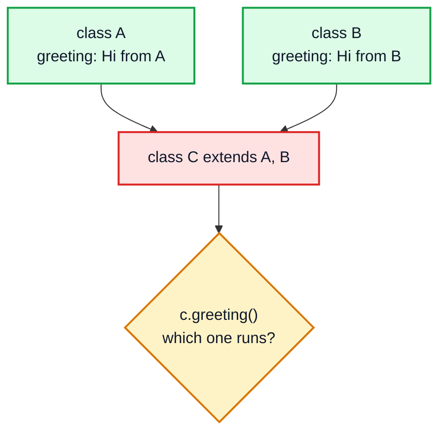

### Kunal's idea

What if the parents **don't give a body at all**? If `A` and `B` both just *declare* `greeting()` and say "the child decides", then there is nothing to conflict: `C` writes the one and only body. That idea, "declare now, implement later", is exactly what `abstract` methods and interfaces provide.

| Problem with multiple class inheritance | How abstraction avoids it |
|---|---|
| Two parent **bodies** for the same method | Parents give **no body**; the child writes one |
| Two copies of parent **state** (fields) | Interfaces have **no instance fields** |
| Ambiguous `super` call | Child must resolve explicitly (`A.super.m()` for default methods) |

---

## 2. Abstract Classes (1:08)

### Basics

An **abstract method** is a method with a signature but **no body**. It says "every child must provide this".

An **abstract class** is a class marked `abstract`. It may contain abstract methods **and** normal (concrete) methods, fields and constructors.

```java
abstract class Shape {
    abstract double area();        // no body, ends with ;

    void print() {                 // normal method: shared by all children
        System.out.println("Area = " + area());
    }
}

class Square extends Shape {
    double side = 4;
    @Override
    double area() { return side * side; }
}

// new Square().print();   // Area = 16.0
```

### The rules

| Rule | Example | Result |
|---|---|---|
| A class with **any** abstract method must itself be `abstract` | `class X { abstract void f(); }` | ❌ compile error |
| An abstract class may have **zero** abstract methods | `abstract class X { void f() {} }` | ✅ allowed (just can't be instantiated) |
| You **cannot** create an object of it | `new Shape()` | ❌ compile error |
| A concrete child must override **every** abstract method | `class Square extends Shape {}` | ❌ "Square is not abstract and does not override area()" |
| A child that doesn't implement them must be `abstract` too | `abstract class Polygon extends Shape {}` | ✅ |
| Abstract methods can't be `private`, `static` or `final` | `private abstract void f();` | ❌ (child can't override it) |

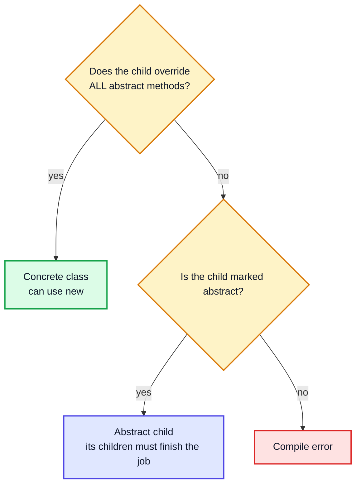

> [!TIP]
> Think of an abstract class as a **template** or a form with some blanks. The parent fills in what is common (`print()`); each child fills the blanks (`area()`). This is the *Template Method* design pattern.

---

## 3. Example of Abstract Classes (6:38)

Kunal's example is a `Parent` who wants their children to have a career and a partner, but can't decide *which* for them. So the parent declares the methods and each child implements them.

```java
abstract class Parent {
    int age;

    Parent(int age) { this.age = age; }

    abstract void career();
    abstract void partner();

    void normal() { System.out.println("This is a normal method"); }
}

class Son extends Parent {
    Son(int age) { super(age); }

    @Override
    void career() { System.out.println("I am going to be a doctor"); }

    @Override
    void partner() { System.out.println("I love Ananya"); }
}

class Daughter extends Parent {
    Daughter(int age) { super(age); }

    @Override
    void career() { System.out.println("I am going to be a coder"); }

    @Override
    void partner() { System.out.println("I love Rohan"); }
}

public class Main {
    public static void main(String[] args) {
        Son son = new Son(30);
        son.career();          // I am going to be a doctor
        son.normal();          // This is a normal method

        Parent daughter = new Daughter(28);   // reference of abstract type: allowed
        daughter.career();     // I am going to be a coder   (dynamic dispatch)
        daughter.partner();    // I love Rohan
        System.out.println(daughter.age);     // 28
    }
}
```

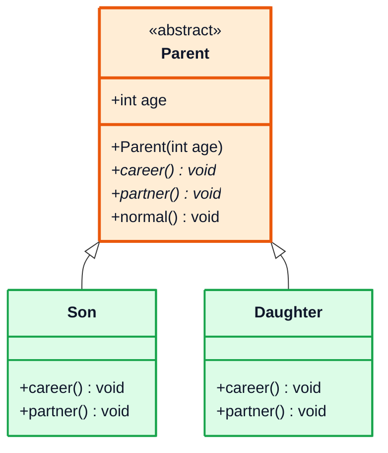

(In a class diagram, `*` after a method marks it abstract.)

### What the example shows

| Observation | Why |
|---|---|
| `Parent daughter = new Daughter(28)` works | A reference may be of an abstract type; only the **object** must be concrete |
| `daughter.career()` prints the Daughter version | Overriding + dynamic method dispatch (OOP 3) |
| `son.normal()` works | Concrete methods in an abstract class are inherited normally |
| `daughter.age` is 28 | Fields and constructors in the abstract class work as usual |

> [!NOTE]
> When is an abstract class the right tool? When the children are genuinely **the same kind of thing** (IS-A) and share **state or code**, but differ in a few steps. If they only share a capability, an interface is usually better.

---

## 4. Abstract Constructors (16:45)

A constructor **cannot** be marked `abstract`:

```java
abstract class Parent {
    // abstract Parent() { }   // ❌ compile error: modifier abstract not allowed here
}
```

Why: constructors are never inherited or overridden, so "the child will implement it" makes no sense. Every class writes its own constructors.

> [!IMPORTANT]
> "No abstract constructors" does **not** mean "no constructors in abstract classes". An abstract class can and often does have constructors (see `Parent(int age)` above). They run when a child object is created, through `super(...)`, to initialise the parent's part of the object.

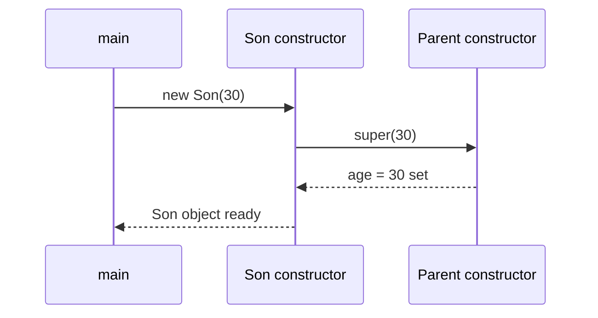

---

## 5. Object of an Abstract Class (17:15)

```java
Parent p = new Parent(40);   // ❌ compile error: Parent is abstract; cannot be instantiated
```

An abstract class is incomplete (it has methods with no body), so Java refuses to build one directly.

| Statement | Compiles? |
|---|---|
| `Parent p;` | ✅ declaring a reference is fine |
| `Parent p = new Son(30);` | ✅ object is concrete |
| `Parent p = new Parent(40);` | ❌ |
| `Parent p = new Parent(40) { /* implement both */ };` | ✅ anonymous subclass |

### Anonymous subclass

The last row looks like it creates a `Parent`, but it really creates an object of a nameless class that extends `Parent`:

```java
Parent guest = new Parent(50) {
    @Override void career()  { System.out.println("Pilot"); }
    @Override void partner() { System.out.println("Flying"); }
};
guest.career();                                   // Pilot
System.out.println(guest.getClass().getName());   // Main$1  (a compiler-generated name)
```

---

## 6. Abstract Static Methods (17:40)

```java
abstract class Parent {
    // abstract static void hello();  // ❌ illegal combination of modifiers: abstract and static
}
```

| `abstract` means | `static` means | Together |
|---|---|---|
| "a child object will override this" | "belongs to the class, no object involved, not overridden" | Contradiction ❌ |

Static methods are resolved at compile time from the class name; overriding is a runtime, object-based mechanism (OOP 3, section 21). An abstract method needs overriding to ever get a body, so it can never be static.

---

## 7. Static Methods in Abstract Classes (18:04)

A **normal** (non-abstract) static method is perfectly fine in an abstract class, and you call it with the class name, no object needed:

```java
abstract class Parent {
    static void hello() { System.out.println("Hey, static method in an abstract class"); }
}

public class Main {
    public static void main(String[] args) {
        Parent.hello();   // Hey, static method in an abstract class
    }
}
```

| Member in an abstract class | Allowed? |
|---|---|
| Instance fields | ✅ |
| `static` fields | ✅ |
| Constructors | ✅ (not `abstract`) |
| Concrete instance methods | ✅ |
| Concrete `static` methods | ✅ call via `ClassName.method()` |
| `abstract` instance methods | ✅ |
| `abstract static` methods | ❌ |
| `main` method | ✅ an abstract class can even be the program's entry point |

> [!TIP]
> Utility-style "you can't create me" classes are sometimes written as `abstract class` with only static methods. A clearer modern approach is a `final` class with a `private` constructor (like `java.lang.Math`), because `abstract` suggests "please extend me".

---

## 8. `final` Keyword in Abstract Class (21:52)

### `final` class + `abstract` = impossible

```java
// final abstract class Parent { }   // ❌ illegal combination of modifiers: abstract and final
```

`abstract` says "must be extended to be useful"; `final` says "cannot be extended". Together the class could never be used.

### `final` methods inside an abstract class = fine

A concrete method can be `final` so children **can't change** it, while abstract methods are still left for them:

```java
abstract class Parent {
    abstract void career();

    final void surname() {                 // children inherit, cannot override
        System.out.println("Sharma");
    }
}

class Son extends Parent {
    void career() { System.out.println("Doctor"); }
    // void surname() { }                 // ❌ cannot override final method
}
```

| Combination | Legal? | Reason |
|---|---|---|
| `abstract class` | ✅ | |
| `final class` | ✅ | |
| `abstract final class` | ❌ | can't extend, can't instantiate |
| `abstract` method | ✅ | |
| `final` method in abstract class | ✅ | fixed behaviour shared by all children |
| `abstract final` method | ❌ | must be overridden vs can't be overridden |
| `final` fields in abstract class | ✅ | set once in the constructor |

> [!NOTE]
> **Modern Java (17+):** if you want an abstract class that **only specific** classes may extend, use a **sealed** class: `abstract sealed class Shape permits Circle, Square {}`. It's the middle ground between open (`abstract`) and closed (`final`).

---

## 9. Multiple Inheritance using Abstract Classes (24:18)

Can abstract classes solve multiple inheritance? **No.**

```java
abstract class A { abstract void fun(); }
abstract class B { abstract void fun(); }
// class C extends A, B { }   // ❌ still one class only
```

An abstract class is still a **class**, and the "only one `extends`" rule applies to all classes. Abstract classes solve the "parent can't decide the body" problem, not the "two parents" problem.

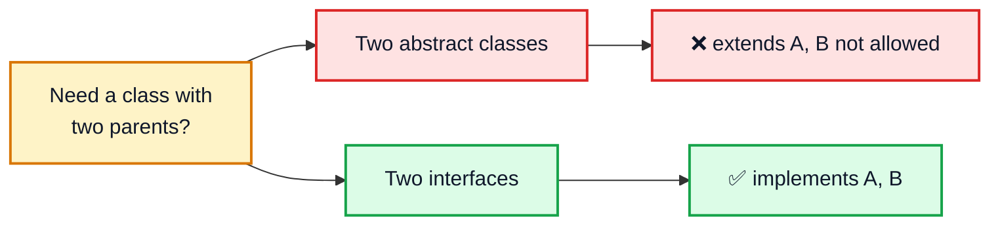

That's where interfaces come in.

---

## 10. Interfaces (25:10)

### Basics

An **interface** is a contract: a named list of method signatures that a class promises to implement. A class uses `implements` (not `extends`) and can implement **any number** of interfaces.

```java
interface Engine {
    void start();      // implicitly public abstract
    void stop();
}

class Car implements Engine {
    public void start() { System.out.println("Car starts"); }   // must be public
    public void stop()  { System.out.println("Car stops"); }
}
```

### What goes in an interface (implicit modifiers)

| You write | Java treats it as | Since |
|---|---|---|
| `void start();` | `public abstract void start();` | Java 1 |
| `int PRICE = 78000;` | `public static final int PRICE = 78000;` (a constant) | Java 1 |
| `default void info() { ... }` | `public` instance method **with** a body, inherited | Java 8 |
| `static void util() { ... }` | `public static` method, **not** inherited (section 16) | Java 8 |
| `private void helper() { ... }` | private helper for default/static methods | Java 9 |
| Instance fields, constructors | ❌ not allowed | — |

> [!WARNING]
> Interface methods are implicitly `public`, so implementations **must** be `public` too. Writing `void start() { }` in the class (package-private) is a compile error: "attempting to assign weaker access privileges".

> [!NOTE]
> **Video vs modern Java:** Kunal describes interfaces mostly as "only abstract methods + constants" (the classic definition). Since Java 8 they can also have `default` and `static` methods with bodies, and since Java 9 `private` methods. They still can't have **instance state**, which is the real reason multiple inheritance of interfaces is safe.

### Abstract class vs interface

| | **Abstract class** | **Interface** |
|---|---|---|
| Keyword to use it | `extends` (only **one**) | `implements` (**many**) |
| Instance fields (state) | ✅ any | ❌ only `public static final` constants |
| Constructors | ✅ | ❌ |
| Abstract methods | ✅ (must write `abstract`) | ✅ (implicit) |
| Concrete methods | ✅ any access level | `default` / `static` / `private` only |
| Method access | any | `public` (or `private` helpers) |
| Relationship | IS-A ("a Son is a Parent") | CAN-DO ("a Car can brake") |
| Multiple inheritance | ❌ | ✅ |
| Speed of calls | slightly faster in theory | negligible difference with modern JIT |
| Use when | Related classes share state/code | Unrelated classes share a capability |

> [!TIP]
> Interfaces describe **what** an object can do; abstract classes describe **what** it is and give a partial **how**. In real projects you often use both: `interface List` → `abstract class AbstractList implements List` → `class ArrayList extends AbstractList`.

### Why interfaces don't have the diamond problem

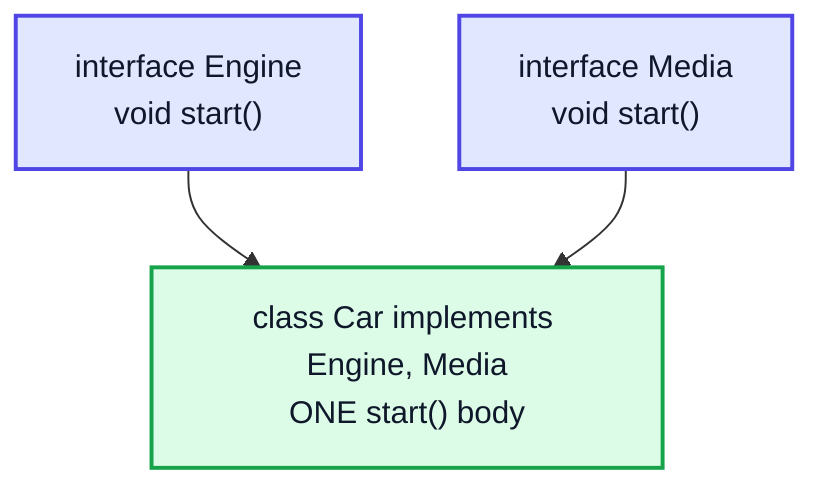

Both interfaces only declare `start()`; `Car` writes one body that satisfies both. And there are no instance fields to duplicate. The only possible conflict is two `default` methods with the same signature, and then the compiler **forces** you to override (see section 14).

---

## 11. Example of Interfaces (31:29)

Kunal models a car with three abilities:

```java
interface Engine {
    int PRICE = 78000;
    void start();
    void stop();
    void acc();
}

interface Brake {
    void brake();
}

interface Media {
    void start();
    void stop();
}

class Car implements Engine, Brake, Media {
    int a = 30;     // classes can have state; interfaces can't

    @Override public void brake() { System.out.println("I brake like a normal car"); }
    @Override public void start() { System.out.println("I start like a normal car"); }
    @Override public void stop()  { System.out.println("I stop like a normal car"); }
    @Override public void acc()   { System.out.println("I accelerate like a normal car"); }
}

public class Main {
    public static void main(String[] args) {
        Car car = new Car();
        car.acc();                          // I accelerate like a normal car
        car.start();                        // I start like a normal car
        car.brake();                        // I brake like a normal car
        System.out.println(Engine.PRICE);   // 78000
        System.out.println(Car.PRICE);      // 78000  (constants ARE inherited)
    }
}
```

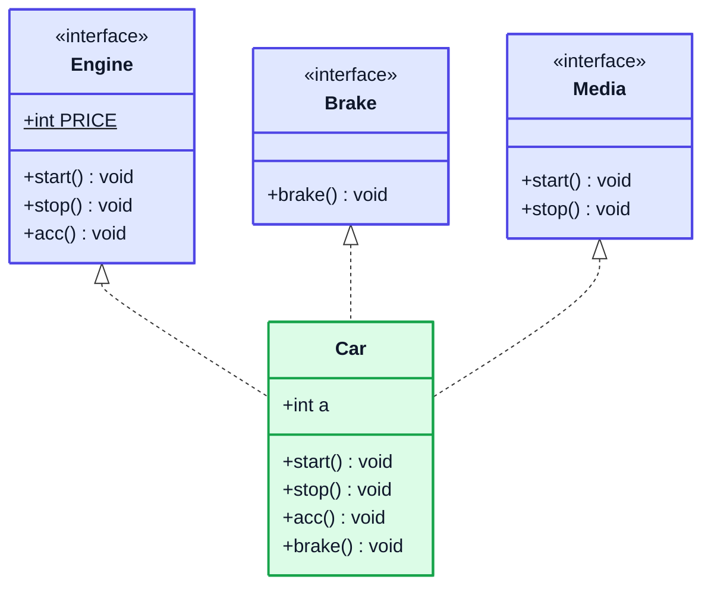

(Dotted arrow `<|..` = "implements". `$` = static.)

### The `start()` clash

`Engine` and `Media` both declare `start()` and `stop()`. `Car` provides **one** `start()`, which satisfies both contracts. That's fine for the compiler, but in design terms it's a smell: "start the engine" and "start the music" are different actions merged into one. Section 13 fixes it with composition.

> [!CAUTION]
> If two interfaces declare methods with the **same name and parameters but different return types** (e.g. `void start()` and `int start()`), no class can implement both. That's a compile error you can't work around.

---

## 12. Variable of Interface Type (43:41)

A reference can have an interface type. Just like a parent-class reference (OOP 3), **the reference type decides what you can call**, and **the object type decides which body runs**.

```java
Engine car = new Car();
car.acc();      // I accelerate like a normal car
car.start();    // I start like a normal car
// car.brake(); // ❌ compile error: cannot find symbol brake() in Engine

Media media = new Car();
media.stop();   // I stop like a normal car   (same Car.stop body)
```

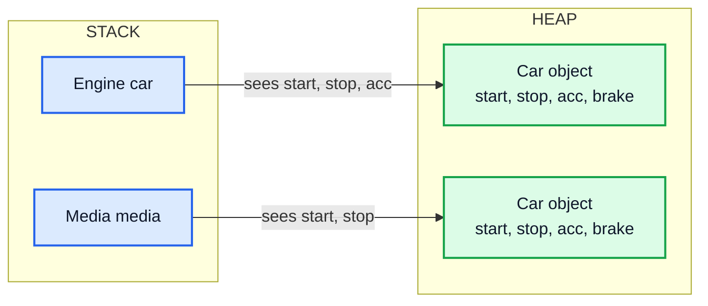

| Expression | Compile time check (reference) | Runtime choice (object) |
|---|---|---|
| `car.acc()` | `Engine` has `acc()` ✅ | `Car.acc()` runs |
| `car.brake()` | `Engine` has no `brake()` ❌ | — |
| `((Brake) car).brake()` | cast to `Brake` ✅ | `Car.brake()` runs |
| `car.a` | `Engine` has no field `a` ❌ | — |

### Why code against interfaces?

```java
List<Integer> list = new ArrayList<>();   // later swap to new LinkedList<>() with no other change
```

Callers only depend on the contract, so you can change the implementation freely. This is abstraction in practice.

> [!TIP]
> Before casting, check with pattern matching (Java 16+): `if (car instanceof Brake b) b.brake();`

---

## 13. Separate Classes in Same Interface (47:42)

Instead of one `Car` implementing everything, give each ability its **own implementing classes**, and let the car **hold** them (HAS-A, composition):

```java
class PowerEngine implements Engine {
    public void start() { System.out.println("Power engine starts"); }
    public void stop()  { System.out.println("Power engine stops"); }
    public void acc()   { System.out.println("Power engine accelerates"); }
}

class ElectricEngine implements Engine {
    public void start() { System.out.println("Electric engine starts"); }
    public void stop()  { System.out.println("Electric engine stops"); }
    public void acc()   { System.out.println("Electric engine accelerates"); }
}

class CDPlayer implements Media {
    public void start() { System.out.println("Music starts"); }
    public void stop()  { System.out.println("Music stops"); }
}

class NiceCar {
    private Engine engine;                 // typed by the interface, not the class
    private Media player = new CDPlayer();

    public NiceCar()              { engine = new PowerEngine(); }
    public NiceCar(Engine engine) { this.engine = engine; }

    public void start()      { engine.start(); }
    public void stop()       { engine.stop(); }
    public void startMusic() { player.start(); }
    public void stopMusic()  { player.stop(); }

    public void upgradeEngine() { engine = new ElectricEngine(); }
}

public class Main {
    public static void main(String[] args) {
        NiceCar car = new NiceCar();
        car.start();          // Power engine starts
        car.startMusic();     // Music starts
        car.upgradeEngine();
        car.start();          // Electric engine starts
    }
}
```

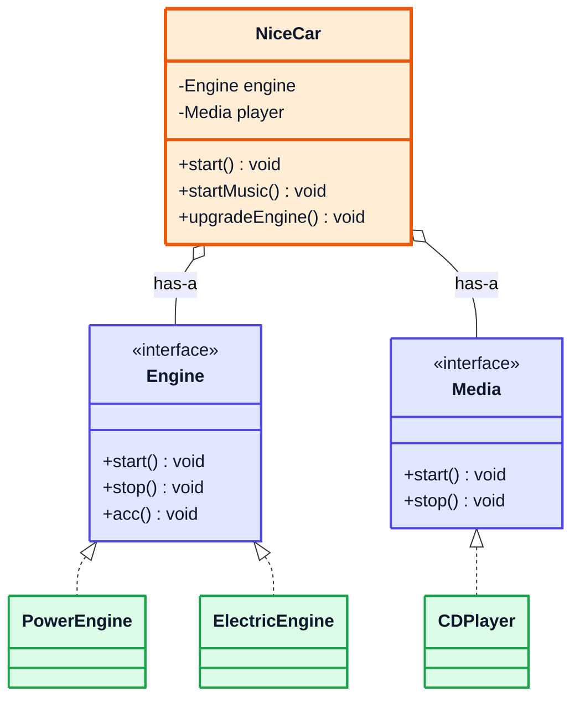

### Why this design is better

| Single `Car implements Engine, Media` | `NiceCar` with interface-typed fields |
|---|---|
| One `start()` for engine **and** music | Separate `start()` and `startMusic()` |
| Engine behaviour fixed at compile time | Engine **swappable at runtime** (`upgradeEngine`) |
| Adding a new engine type means editing `Car` | Add a new `class TurboEngine implements Engine`, `NiceCar` unchanged |
| Hard to test | Pass a fake `Engine` into the constructor for tests |

> [!IMPORTANT]
> This is the principle **"program to an interface, not an implementation"** and **"favour composition over inheritance"**. It's also the *Strategy* pattern: the engine is a pluggable strategy. Passing the engine into the constructor is **dependency injection**, the core idea behind frameworks like Spring.

---

## 14. Extending Interfaces (55:01)

An interface can `extends` **one or more** other interfaces. A class implementing the child interface must implement **all** methods from the whole chain.

```java
interface A {
    void fun();
}

interface B extends A {      // B now has fun() + greet()
    void greet();
}

class Main implements B {
    public void fun()   { System.out.println("fun from A"); }
    public void greet() { System.out.println("greet from B"); }

    public static void main(String[] args) {
        Main obj = new Main();
        obj.fun();     // fun from A
        obj.greet();   // greet from B
    }
}
```

| Relationship | Keyword | How many? |
|---|---|---|
| class → class | `extends` | 1 |
| class → interface | `implements` | many |
| interface → interface | `extends` | many (`interface C extends A, B`) |
| interface → class | — | ❌ not possible |

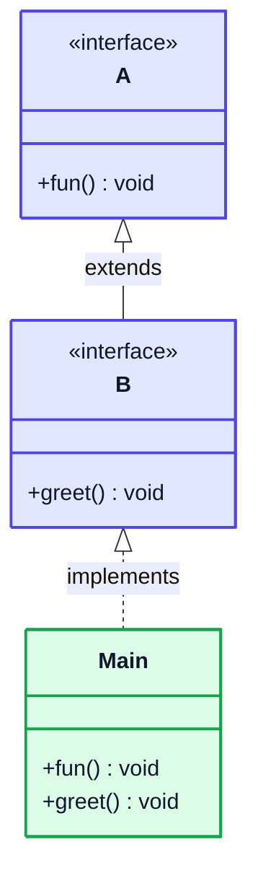

### `default` methods (Java 8+)

A `default` method has a body and is inherited by every implementing class, which can still override it. It was added so library authors could add methods to existing interfaces (like `List.forEach`) without breaking every class that already implemented them.

```java
interface A {
    void fun();
    default void info() { System.out.println("default info from A"); }
}

class Impl implements A {
    public void fun() { }
    // info() inherited, no need to write it
}
// new Impl().info();   // default info from A
```

### Diamond with default methods

If two interfaces give a `default` method with the same signature, the class **must** override it and may pick one with `Interface.super.method()`:

```java
interface X { default String m() { return "X"; } }
interface Y { default String m() { return "Y"; } }

class Z implements X, Y {
    @Override
    public String m() { return X.super.m() + Y.super.m(); }   // without this: compile error
}
// new Z().m()   ->  "XY"
```

> [!NOTE]
> Resolution rules when defaults collide: (1) a method from a **class** always wins over an interface default; (2) a more **specific** interface wins (if `B extends A`, `B`'s default beats `A`'s); (3) otherwise the class must override.

---

## 15. Annotations (57:18)

### Basics

An **annotation** is metadata attached to code with `@`. It doesn't change what the code does by itself; the **compiler**, **tools** or **frameworks** read it and act on it.

```java
class Son extends Parent {
    @Override                      // compiler checks this really overrides something
    void career() { System.out.println("Doctor"); }
}
```

### `@Override` catches bugs

```java
class Son extends Parent {
    @Override
    void carrer() { }   // ❌ typo: "method does not override or implement a method from a supertype"
}
```

Without `@Override`, the typo would silently create a **new** method and `career()` would stay unimplemented (or, for a non-abstract parent, the parent version would run). Always use it.

### Built-in annotations you'll meet

| Annotation | Used on | What it does |
|---|---|---|
| `@Override` | methods | Compile error if the method doesn't actually override/implement |
| `@Deprecated` | anything | Marks old API; callers get a warning (`forRemoval = true` for stronger warning) |
| `@SuppressWarnings("unchecked")` | anything | Silences a specific compiler warning (common with generics, see OOP 6) |
| `@FunctionalInterface` | interfaces | Compile error unless exactly **one** abstract method (lambdas, OOP 6) |
| `@SafeVarargs` | methods/constructors | Suppresses generic varargs warnings |

### Writing your own annotation

```java
import java.lang.annotation.*;

@Retention(RetentionPolicy.RUNTIME)   // keep it in the .class file and visible at runtime
@Target(ElementType.TYPE)             // may only be put on classes/interfaces
@interface Author {
    String name();
    int version() default 1;
}

@Author(name = "Kunal", version = 5)
class Notes { }

// Reading it with reflection:
Author a = Notes.class.getAnnotation(Author.class);
System.out.println(a.name() + " v" + a.version());   // Kunal v5
```

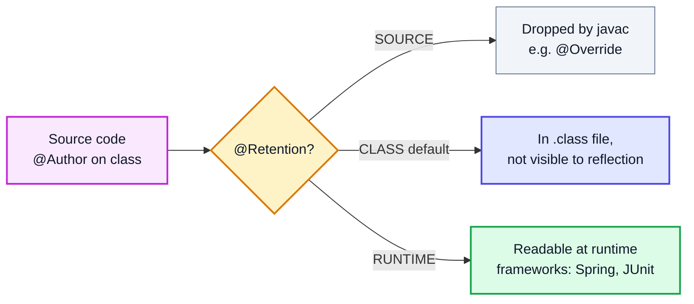

> [!TIP]
> Notice the syntax `@interface`: an annotation type is a special kind of interface. Frameworks are built on runtime annotations: JUnit's `@Test`, Spring's `@Autowired`, Jakarta's `@Entity`.

---

## 16. Important Point regarding Static Interface Methods (1:02:05)

Since Java 8, interfaces can have `static` methods. Three rules:

1. They **must have a body** (an abstract static method is impossible, as in section 6).
2. They are called **only through the interface name**: `A.greeting()`.
3. They are **not inherited** by implementing classes or sub-interfaces.

```java
interface A {
    static void greeting() { System.out.println("I am a static method in A"); }
}

class Main implements A {
    public static void main(String[] args) {
        A.greeting();        // ✅ I am a static method in A
        // Main.greeting();  // ❌ cannot find symbol
        // greeting();       // ❌ cannot find symbol (not inherited)
        // new Main().greeting(); // ❌
    }
}
```

| Kind of static method | Called via child class name? | Called via object? |
|---|---|---|
| `static` in a **class** | ✅ `Child.method()` (inherited, hidden if redeclared) | ✅ (with a warning) |
| `static` in an **interface** | ❌ | ❌ only `Interface.method()` |

**Why the difference?** A class can implement many interfaces. If two of them had `static void greeting()`, inheriting both would bring back the ambiguity interfaces were meant to avoid. Making them non-inherited keeps every static call unambiguous.

> [!NOTE]
> Real use: factory and helper methods that belong with an interface, e.g. `List.of(1, 2, 3)`, `Comparator.comparing(...)`, `Map.entry(k, v)`. Before Java 8 these lived in separate helper classes like `Collections`.

---

## 17. Nested Interfaces (1:06:17)

An interface can be declared **inside** a class or another interface.

```java
public class A {
    public interface NestedInterface {     // implicitly static
        boolean isOdd(int num);
    }
}

class B implements A.NestedInterface {
    @Override
    public boolean isOdd(int num) { return (num & 1) == 1; }
}

public class Main {
    public static void main(String[] args) {
        B obj = new B();
        System.out.println(obj.isOdd(6));   // false
        System.out.println(obj.isOdd(7));   // true
    }
}
```

| Where declared | Allowed access modifiers | Implicitly |
|---|---|---|
| Top-level interface (own file) | `public` or package-private only | — |
| Nested inside a **class** | `public`, `protected`, package-private, `private` | `static` |
| Nested inside an **interface** | `public` only | `public static` |

> [!TIP]
> Nest an interface when it only makes sense together with its outer type. Java's own example: `Map.Entry<K, V>` is an interface nested inside `Map`, used as `for (Map.Entry<String, Integer> e : map.entrySet())`.

Since a nested interface is static, you don't need an object of `A` to use it; just refer to it as `A.NestedInterface`.

---

## 18. Outro (1:09:31)

Recap: abstract classes (partial blueprints with constructors, state, and abstract methods), the forbidden combos (`abstract` + `static` / `final`, abstract constructors), interfaces as contracts that enable multiple inheritance, interface-typed references and composition with swappable implementations, extending interfaces and default methods, annotations, static interface methods and nested interfaces. Next, OOP 6 (video #42) covers **generics, a custom ArrayList, lambdas, exception handling and object cloning**.

---

## 🧩 Complete Example: Everything Together

```java
import java.lang.annotation.ElementType;
import java.lang.annotation.Retention;
import java.lang.annotation.RetentionPolicy;
import java.lang.annotation.Target;
import java.util.List;

// ═══════ ABSTRACT CLASS ═══════
abstract class Parent {
    protected final int age;
    static int created = 0;

    Parent(int age) {                     // abstract classes CAN have constructors
        this.age = age;
        created++;
    }

    abstract String career();             // no body: every child must implement
    abstract String partner();

    String intro() {                      // concrete method, shared by all children
        return getClass().getSimpleName() + " (age " + age + "): career = "
                + career() + ", partner = " + partner();
    }

    static String family() { return "Sharma family"; }  // static is fine
    final String surname() { return "Sharma"; }              // final method is fine
}

class Son extends Parent {
    Son(int age) { super(age); }
    @Override String career()  { return "Doctor"; }
    @Override String partner() { return "Ananya"; }
}

class Daughter extends Parent {
    Daughter(int age) { super(age); }
    @Override String career()  { return "Coder"; }
    @Override String partner() { return "Rohan"; }
}

// ═══════ INTERFACES ═══════
interface Engine {
    int PRICE = 78000;                    // public static final
    void start();
    void stop();
    void accelerate();
}

interface Brake {
    void brake();
}

interface Media {
    void start();                         // same signature as Engine.start()
    void stop();
}

class Car implements Engine, Brake, Media {
    @Override public void start()      { System.out.println("Car: start (one body serves Engine AND Media)"); }
    @Override public void stop()       { System.out.println("Car: stop"); }
    @Override public void accelerate() { System.out.println("Car: accelerate"); }
    @Override public void brake()      { System.out.println("Car: brake"); }
}

// ═══════ SEPARATE CLASSES, SAME INTERFACE ═══════
class PowerEngine implements Engine {
    @Override public void start()      { System.out.println("  Power engine starts (vroom)"); }
    @Override public void stop()       { System.out.println("  Power engine stops"); }
    @Override public void accelerate() { System.out.println("  Power engine accelerates"); }
}

class ElectricEngine implements Engine {
    @Override public void start()      { System.out.println("  Electric engine starts (silent)"); }
    @Override public void stop()       { System.out.println("  Electric engine stops"); }
    @Override public void accelerate() { System.out.println("  Electric engine accelerates"); }
}

class CDPlayer implements Media {
    @Override public void start() { System.out.println("  Music starts"); }
    @Override public void stop()  { System.out.println("  Music stops"); }
}

class NiceCar {
    private Engine engine;                    // HAS-A, typed by interface
    private final Media player = new CDPlayer();

    NiceCar()              { this(new PowerEngine()); }
    NiceCar(Engine engine) { this.engine = engine; }

    void start()         { engine.start(); }
    void stop()          { engine.stop(); }
    void startMusic()    { player.start(); }
    void upgradeEngine() { engine = new ElectricEngine(); }
}

// ═══════ EXTENDING INTERFACES + default/static ═══════
interface A {
    void fun();
    default String hello() { return "hello from A's default method"; }
    static String greet()  { return "A.greet() (static, call via A)"; }
}

interface B extends A {
    void greetB();
}

class Main2 implements B {
    @Override public void fun()    { System.out.println("fun() from A"); }
    @Override public void greetB() { System.out.println("greetB() from B"); }
}

// ═══════ ANNOTATIONS ═══════
@Retention(RetentionPolicy.RUNTIME)
@Target(ElementType.TYPE)
@interface Author {
    String name();
    int version() default 1;
}

@FunctionalInterface
interface Calculator {
    int apply(int a, int b);
}

@Author(name = "Kunal", version = 5)
class Notes {
    @Deprecated
    static String oldWay() { return "old"; }
}

// ═══════ NESTED INTERFACE ═══════
class Outer {
    public interface NestedInterface {     // implicitly static
        boolean isOdd(int n);
    }
}

class OddChecker implements Outer.NestedInterface {
    @Override public boolean isOdd(int n) { return (n & 1) == 1; }
}

public class Main {
    public static void main(String[] args) {
        System.out.println("=== Abstract classes ===");
        List<Parent> kids = List.of(new Son(30), new Daughter(28));
        for (Parent p : kids) System.out.println(p.intro());
        System.out.println(Parent.family() + ", surname " + kids.get(0).surname()
                + ", objects created = " + Parent.created);
        // Parent p = new Parent(40);  // compile error: Parent is abstract

        System.out.println("\n=== Anonymous subclass of an abstract class ===");
        Parent guest = new Parent(50) {
            @Override String career()  { return "Pilot"; }
            @Override String partner() { return "flying"; }
        };
        System.out.println(guest.career() + " / " + guest.partner());

        System.out.println("\n=== One class, many interfaces ===");
        Car car = new Car();
        car.start();
        car.accelerate();
        car.brake();
        System.out.println("Engine.PRICE = " + Engine.PRICE);

        System.out.println("\n=== Variable of interface type ===");
        Engine e = new Car();     // only Engine's methods are visible
        e.accelerate();
        // e.brake();             // compile error: Engine has no brake()
        Media m = car;
        m.stop();
        System.out.println("car instanceof Brake? " + (car instanceof Brake));

        System.out.println("\n=== Separate classes, same interface ===");
        NiceCar nice = new NiceCar();
        nice.start();
        nice.startMusic();
        nice.upgradeEngine();
        nice.start();
        nice.stop();

        System.out.println("\n=== Extending interfaces ===");
        Main2 obj = new Main2();
        obj.fun();
        obj.greetB();
        System.out.println(obj.hello());
        System.out.println(A.greet());
        // Main2.greet(); B.greet();  // compile error: static interface methods are not inherited

        System.out.println("\n=== Annotations ===");
        Author author = Notes.class.getAnnotation(Author.class);
        System.out.println("@Author name = " + author.name() + ", version = " + author.version());
        Calculator add = (x, y) -> x + y;
        Calculator mul = (x, y) -> x * y;
        System.out.println("add(3, 4) = " + add.apply(3, 4) + ", mul(3, 4) = " + mul.apply(3, 4));

        System.out.println("\n=== Nested interface ===");
        Outer.NestedInterface checker = new OddChecker();
        System.out.println("7 odd? " + checker.isOdd(7) + ", 10 odd? " + checker.isOdd(10));
    }
}
```

**Expected Output:**
```
=== Abstract classes ===
Son (age 30): career = Doctor, partner = Ananya
Daughter (age 28): career = Coder, partner = Rohan
Sharma family, surname Sharma, objects created = 2

=== Anonymous subclass of an abstract class ===
Pilot / flying

=== One class, many interfaces ===
Car: start (one body serves Engine AND Media)
Car: accelerate
Car: brake
Engine.PRICE = 78000

=== Variable of interface type ===
Car: accelerate
Car: stop
car instanceof Brake? true

=== Separate classes, same interface ===
  Power engine starts (vroom)
  Music starts
  Electric engine starts (silent)
  Electric engine stops

=== Extending interfaces ===
fun() from A
greetB() from B
hello from A's default method
A.greet() (static, call via A)

=== Annotations ===
@Author name = Kunal, version = 5
add(3, 4) = 7, mul(3, 4) = 12

=== Nested interface ===
7 odd? true, 10 odd? false
```

---

## Quick Reference Cheat Sheet

| Concept | One-Line Summary |
|---|---|
| **Abstract method** | Signature with no body; every concrete child must override it |
| **Abstract class** | `abstract class X`; may mix abstract + concrete methods, fields, constructors; can't `new` it |
| **Any abstract method ⇒** | the class must be `abstract` |
| **Abstract constructor** | ❌ not allowed; but abstract classes can have normal constructors (run via `super`) |
| **`new AbstractClass()`** | ❌; `AbstractClass ref = new ConcreteChild()` ✅; anonymous subclass ✅ |
| **`abstract static`** | ❌ contradiction; plain `static` methods in abstract classes ✅ |
| **`abstract final`** | ❌ for classes and methods; `final` concrete methods inside abstract class ✅ |
| **Multiple inheritance** | ❌ with classes (abstract or not); ✅ `implements A, B, C` |
| **Interface members** | methods `public abstract`, fields `public static final`; `default`/`static` (8+), `private` (9+) |
| **Implementing methods** | must be `public` |
| **Interface reference** | `Engine e = new Car();` only `Engine` methods visible; object's body runs |
| **Composition** | Field typed by interface (`Engine engine`) lets you swap implementations |
| **Interface extends** | `interface B extends A` (can extend many interfaces) |
| **Default conflict** | Must override; call `X.super.m()` to pick |
| **Static interface method** | Needs body; only `Interface.method()`; not inherited |
| **Nested interface** | Implicitly `static`; accessed as `Outer.Inner`; e.g. `Map.Entry` |
| **`@Override`** | Compiler verifies the override; catches typos |
| **`@FunctionalInterface`** | Exactly one abstract method; target for lambdas |
| **Custom annotation** | `@interface Name { ... }` + `@Retention(RUNTIME)` to read via reflection |
| **Abstract class vs interface** | IS-A + shared state/code vs CAN-DO capability, many allowed |
