# Generics, Custom ArrayList, Lambdas, Exception Handling & Object Cloning — Complete In-Depth Guide

**Video #42 of the Java + DSA playlist:** *OOP 6 | Generics, Custom ArrayList, Lambda Expressions, Exception Handling, Object Cloning* (1:31:52)

The sixth OOP lecture builds an `ArrayList` from scratch, makes it work for any type with **generics**, then covers comparing objects (`Comparable` / `Comparator`), **lambda expressions**, **exception handling** and **object cloning** (shallow vs deep copy). Interfaces and `@FunctionalInterface` come from OOP 5 ([java_41_video_abstract_classes_interfaces.md](java_41_video_abstract_classes_interfaces.md)); wrapper classes and references from OOP 1 ([java_37_video_oops.md](java_37_video_oops.md)).

---

## Table of Contents

| # | Topic | Timestamp |
|---|---|---|
| 0 | [Introduction](#0-introduction-000) | 0:00 |
| 1 | [Custom ArrayList](#1-custom-arraylist-148) | 1:48 |
| 2 | [Problem with Custom ArrayList](#2-problem-with-custom-arraylist-1509) | 15:09 |
| 3 | [Custom ArrayList using Generics](#3-custom-arraylist-using-generics-1717) | 17:17 |
| 4 | [Working with Generics](#4-working-with-generics-1932) | 19:32 |
| 5 | [Using Java Wildcards](#5-using-java-wildcards-3035) | 30:35 |
| 6 | [Comparing Objects](#6-comparing-objects-3355) | 33:55 |
| 7 | [Lambda Functions](#7-lambda-functions-4814) | 48:14 |
| 8 | [Exception Handling](#8-exception-handling-5645) | 56:45 |
| 9 | [Exception Handling Keywords](#9-exception-handling-keywords-10303) | 1:03:03 |
| 10 | [Creating Custom Exception](#10-creating-custom-exception-10944) | 1:09:44 |
| 11 | [Object Cloning](#11-object-cloning-11232) | 1:12:32 |
| 12 | [Shallow and Deep Copy](#12-shallow-and-deep-copy-12044) | 1:20:44 |
| 13 | [Explanation of Shallow Copying](#13-explanation-of-shallow-copying-12252) | 1:22:52 |
| 14 | [Explanation of Deep Copying](#14-explanation-of-deep-copying-12532) | 1:25:32 |
| 15 | [Outro](#15-outro-13044) | 1:30:44 |

---

## 0. Introduction (0:00)

This lecture is a toolbox of features you'll use constantly in DSA and real code:

1. **Generics**: write one class (like `ArrayList<T>`) that works safely for every type.
2. **Comparing objects**: teach Java how to sort *your* objects.
3. **Lambdas**: pass behaviour as a value (`(a, b) -> a + b`).
4. **Exceptions**: handle errors without crashing.
5. **Cloning**: copy objects, and the trap of shallow copies.

> [!IMPORTANT]
> Building a dynamic array by hand (section 1) is a classic interview task, and it's exactly how `java.util.ArrayList` works internally. The same resize trick appears again in stacks and queues.

---

## 1. Custom ArrayList (1:48)

### Basics

A normal array has a **fixed** size. An `ArrayList` feels unlimited because it keeps an internal array and, when that fills up, **creates a bigger one and copies everything over**.

| Field | Meaning |
|---|---|
| `data` | the internal array (the *capacity*) |
| `size` | how many slots are actually used; also the index of the next free slot |

### Kunal's version (for `int` only)

```java
import java.util.Arrays;

public class CustomArrayList {
    private int[] data;
    private static final int DEFAULT_SIZE = 10;
    private int size = 0;          // also works as the next free index

    public CustomArrayList() {
        this.data = new int[DEFAULT_SIZE];
    }

    public void add(int num) {
        if (isFull()) {
            resize();
        }
        data[size++] = num;
    }

    private boolean isFull() {
        return size == data.length;
    }

    private void resize() {
        int[] temp = new int[data.length * 2];
        for (int i = 0; i < data.length; i++) {   // copy current items
            temp[i] = data[i];
        }
        data = temp;                               // old array becomes garbage
    }

    public int remove() {          // removes the LAST element
        int removed = data[--size];
        return removed;
    }

    public int get(int index) { return data[index]; }

    public int size() { return size; }

    public void set(int index, int value) { data[index] = value; }

    @Override
    public String toString() {
        return "CustomArrayList{data=" + Arrays.toString(data) + ", size=" + size + "}";
    }

    public static void main(String[] args) {
        CustomArrayList list = new CustomArrayList();
        list.add(3);
        list.add(5);
        list.add(9);
        for (int i = 0; i < 14; i++) list.add(2 * i);
        System.out.println(list.size());   // 17
        System.out.println(list.get(4));   // 2
    }
}
```

### Dry run (capacity 2 to keep it short)

| Step | Call | `isFull()`? | Action | `data` | `size` |
|---|---|---|---|---|---|
| 1 | `add(3)` | 0 == 2 ❌ | store at 0 | `[3, _]` | 1 |
| 2 | `add(5)` | 1 == 2 ❌ | store at 1 | `[3, 5]` | 2 |
| 3 | `add(9)` | 2 == 2 ✅ 🟧 | resize to 4, store at 2 | `[3, 5, 9, _]` | 3 |
| 4 | `add(7)` | 3 == 4 ❌ | store at 3 | `[3, 5, 9, 7]` | 4 |
| 5 | `add(1)` | 4 == 4 ✅ 🟧 | resize to 8, store at 4 | `[3, 5, 9, 7, 1, _, _, _]` | 5 |
| 6 | `remove()` | — | `--size`, return `data[4]` = 1 | `[3, 5, 9, 7, 1, _, _, _]` | 4 |

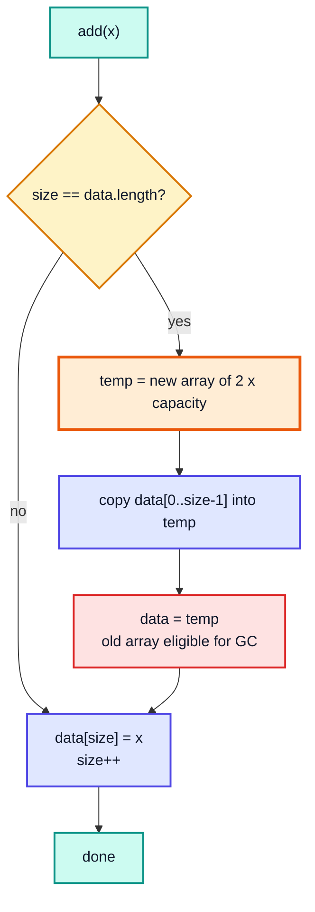

### Time & space complexity

| Operation | Time | Why |
|---|---|---|
| `get(i)` / `set(i, v)` | O(1) | direct array index |
| `add(x)` when not full | O(1) | one write |
| `add(x)` that triggers resize | O(n) | copies n items |
| `add(x)` **amortized** | **O(1)** | doubling means copies total 1 + 2 + 4 + ... + n < 2n over n adds |
| `remove()` (last) | O(1) | just `size--` |
| remove at index i | O(n) | must shift later items left |
| Space | O(n) | capacity is at most 2× the size |

> [!TIP]
> Why double instead of `+10`? Growing by a constant makes n adds cost O(n²) in total. Growing by a **factor** keeps the amortized cost O(1). The real `java.util.ArrayList` grows by **1.5×** (`newCapacity = old + old/2`) and starts with capacity 10 on the first add.

### Improvements over the video version

| Issue in the simple version | Better approach |
|---|---|
| `get(index)` accepts any index below capacity, returning stale/zero values | Check `index < 0 \|\| index >= size` and throw `IndexOutOfBoundsException` |
| `remove()` on empty list gives `ArrayIndexOutOfBoundsException` at `-1` | Check `size == 0` first |
| Manual copy loop | `Arrays.copyOf(data, data.length * 2)` or `System.arraycopy` |
| `toString` prints unused slots | Print `Arrays.copyOf(data, size)` |

---

## 2. Problem with Custom ArrayList (15:09)

The class above stores only `int`. To store `String`, `double` or `Student`, you'd have to copy-paste the whole class for each type.

The pre-generics workaround was to use `Object`, since every class extends it:

```java
class ObjectList {
    private Object[] data = new Object[10];
    private int size = 0;
    void add(Object o) { data[size++] = o; }
    Object get(int i)  { return data[i]; }
}

ObjectList list = new ObjectList();
list.add("Kunal");
list.add(42);                         // also accepted: no type safety

String s = (String) list.get(0);      // a cast every time
String t = (String) list.get(1);      // 💥 ClassCastException at RUNTIME
```

| Approach | Reuse for many types | Type checked at compile time | Casts needed |
|---|---|---|---|
| One class per type (`IntList`, `StringList`) | ❌ | ✅ | no |
| `Object`-based list | ✅ | ❌ | yes |
| **Generic list** `MyList<T>` | ✅ | ✅ | no |

Generics give you the best of both: one class, and the compiler stops you from putting a wrong type in.

---

## 3. Custom ArrayList using Generics (17:17)

Add a **type parameter** `<T>` to the class and use `T` wherever the element type appears:

```java
import java.util.Arrays;

public class CustomGenArrayList<T> {
    private Object[] data;                       // NOT T[] (see below)
    private static final int DEFAULT_SIZE = 10;
    private int size = 0;

    public CustomGenArrayList() {
        data = new Object[DEFAULT_SIZE];
    }

    public void add(T num) {
        if (isFull()) resize();
        data[size++] = num;
    }

    private boolean isFull() { return size == data.length; }

    private void resize() {
        data = Arrays.copyOf(data, data.length * 2);
    }

    @SuppressWarnings("unchecked")
    public T get(int index) {
        return (T) data[index];                  // safe: only T's ever go in
    }

    @SuppressWarnings("unchecked")
    public T remove() {
        T removed = (T) data[--size];
        data[size] = null;                       // avoid holding a stale reference
        return removed;
    }

    public int size() { return size; }

    public static void main(String[] args) {
        CustomGenArrayList<Integer> list = new CustomGenArrayList<>();
        for (int i = 0; i < 14; i++) list.add(2 * i);
        System.out.println(list.get(5));     // 10

        CustomGenArrayList<String> names = new CustomGenArrayList<>();
        names.add("Kunal");
        // names.add(42);                    // ❌ compile error: int cannot be converted to String
        String first = names.get(0);         // no cast needed
        System.out.println(first);           // Kunal
    }
}
```

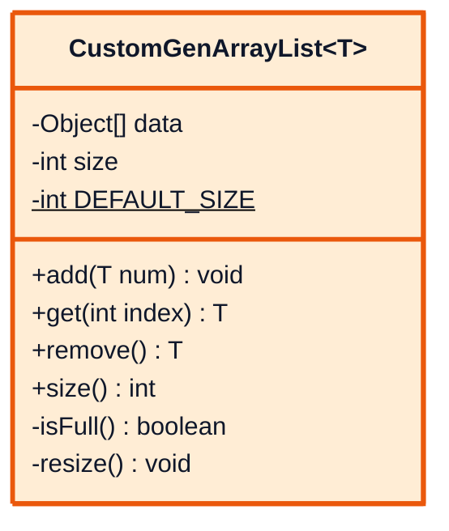

> [!WARNING]
> `private T[] data = new T[10];` does **not** compile ("generic array creation"). At runtime the JVM doesn't know what `T` is (type erasure, next section), so it can't build an array of it. Use `Object[]` and cast on the way out, which is exactly what `java.util.ArrayList` does (`Object[] elementData`).

> [!NOTE]
> Setting `data[size] = null` in `remove()` matters for object lists: otherwise the array keeps a reference to the removed object and the garbage collector can't free it (a small memory leak). With the `int` version it didn't matter.

---

## 4. Working with Generics (19:32)

### Syntax at a glance

| Form | Example | Meaning |
|---|---|---|
| Generic class | `class Box<T> { T value; }` | `T` is fixed per object |
| Several type params | `class Pair<K, V> { K key; V value; }` | |
| Using it | `Box<String> b = new Box<>();` | `<>` (diamond, Java 7+) infers the type |
| Generic method | `static <T> void printAll(T[] arr)` | `T` decided per call |
| Bounded type | `class Stats<T extends Number>` | only `Number` or its subclasses |
| Multiple bounds | `<T extends Number & Comparable<T>>` | class first, then interfaces |

Naming convention: `T` type, `E` element, `K` key, `V` value, `N` number, `R` result.

### Generic method

```java
static <T> void printAll(T[] items) {
    for (T item : items) System.out.print(item + " ");
    System.out.println();
}

printAll(new Integer[]{1, 2, 3});       // 1 2 3
printAll(new String[]{"a", "b"});       // a b
```

### Bounded types

Without a bound, you can only call `Object` methods on a `T`. With `T extends Number`, the compiler knows every `T` has `doubleValue()`:

```java
class NumberBox<T extends Number> {
    private final T value;
    NumberBox(T value) { this.value = value; }
    double doubled() { return value.doubleValue() * 2; }
}

new NumberBox<>(21).doubled();     // 42.0
new NumberBox<>(2.5).doubled();    // 5.0
// new NumberBox<>("hi");          // ❌ String is not a Number
```

A common DSA bound: `static <T extends Comparable<T>> T max(T a, T b) { return a.compareTo(b) >= 0 ? a : b; }`

### Type erasure: what really happens

Generics exist **only at compile time**. After checking types, `javac` erases `T` to its bound (`Object`, or `Number` for `T extends Number`) and inserts the casts for you.

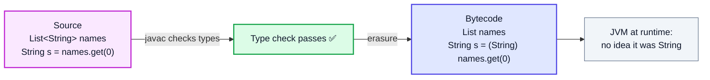

### Consequences / restrictions

| You can't... | Example | Why |
|---|---|---|
| Use primitives as type arguments | `List<int>` ❌ → `List<Integer>` | `T` erases to `Object`; primitives aren't objects (autoboxing does the conversion, OOP 1) |
| Create `new T()` or `new T[n]` | ❌ | `T` unknown at runtime |
| Use `instanceof List<String>` | ❌ (`instanceof List<?>` ✅) | type argument erased |
| Declare a `static T field` | ❌ | static is shared by all `Box<String>`, `Box<Integer>` objects |
| Overload on type argument | `f(List<String>)` + `f(List<Integer>)` ❌ | same erased signature |
| Extend `Throwable` generically | `class MyEx<T> extends Exception` ❌ | catch can't check `T` |

```java
List<String> a = new ArrayList<>();
List<Integer> b = new ArrayList<>();
System.out.println(a.getClass() == b.getClass());   // true: both are just ArrayList at runtime
```

> [!NOTE]
> Using a raw type (`ArrayList list = new ArrayList();`) still compiles for backward compatibility, but gives "unchecked" warnings and loses all safety. Always supply the type argument.

---

## 5. Using Java Wildcards (30:35)

### The problem wildcards solve

`Integer` is a subclass of `Number`, but `List<Integer>` is **not** a subtype of `List<Number>`:

```java
static double sum(List<Number> nums) { ... }

List<Integer> ints = List.of(1, 2, 3);
// sum(ints);   // ❌ compile error: List<Integer> cannot be converted to List<Number>
```

If it were allowed, `sum` could do `nums.add(3.14)` and put a `Double` into a list of `Integer`s. So Java says generics are **invariant**.

### The three wildcards

```java
static double sumAll(List<? extends Number> nums) {   // any list of Number or subclass
    double total = 0;
    for (Number n : nums) total += n.doubleValue();
    return total;
}

sumAll(List.of(1, 2, 3));     // 6.0
sumAll(List.of(1.5, 2.5));    // 4.0

static void addNumbers(List<? super Integer> list) {   // list of Integer or a superclass
    list.add(1);
    list.add(2);
}

static void printAny(List<?> list) {                  // any list at all
    for (Object o : list) System.out.print(o + " ");
}
```

| Wildcard | Accepts | Read items as | Can add? | Use for |
|---|---|---|---|---|
| `List<?>` | any `List<X>` | `Object` | only `null` | just reading / size / clearing |
| `List<? extends Number>` | `List<Number>`, `List<Integer>`, `List<Double>` | `Number` | ❌ (except `null`) | **producers**: you read from it |
| `List<? super Integer>` | `List<Integer>`, `List<Number>`, `List<Object>` | `Object` | ✅ `Integer`s | **consumers**: you write into it |

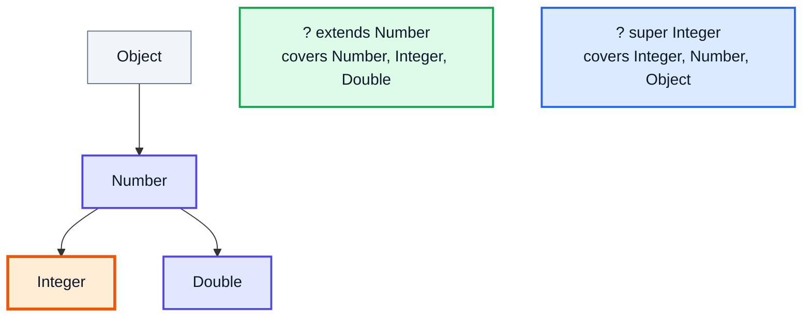

> [!TIP]
> Memory aid **PECS**: *Producer Extends, Consumer Super*. Example from the JDK: `Collections.copy(List<? super T> dest, List<? extends T> src)`.

| `<T extends Number>` (type parameter) | `<? extends Number>` (wildcard) |
|---|---|
| Declared on a class/method, gives the type a **name** you can reuse | Used in a parameter/variable type, **anonymous** |
| `static <T extends Number> T first(List<T> l)` can return `T` | `static Number first(List<? extends Number> l)` can only return `Number` |

---

## 6. Comparing Objects (33:55)

### The problem

```java
Student kunal = new Student(12, 89.76f);
Student rahul = new Student(5, 99.52f);
// if (kunal < rahul) { }       // ❌ operator < cannot be applied to Student
// Arrays.sort(studentsArray);  // 💥 ClassCastException: Student cannot be cast to Comparable
```

`<` works only on primitives, and `Arrays.sort` doesn't know what "smaller" means for a `Student`. You have to tell it.

### Option 1: `Comparable` (the class's natural order)

```java
class Student implements Comparable<Student> {
    int rollNo;
    float marks;

    Student(int rollNo, float marks) { this.rollNo = rollNo; this.marks = marks; }

    @Override
    public int compareTo(Student o) {
        return Float.compare(this.marks, o.marks);   // negative, 0 or positive
    }

    @Override
    public String toString() { return rollNo + ":" + marks; }
}

Student kunal = new Student(12, 89.76f);
Student rahul = new Student(5, 99.52f);
if (kunal.compareTo(rahul) < 0) System.out.println("Rahul has more marks");  // printed

Student[] list = { kunal, rahul, new Student(2, 75.5f) };
Arrays.sort(list);
System.out.println(Arrays.toString(list));   // [2:75.5, 12:89.76, 5:99.52]
```

| `a.compareTo(b)` returns | Meaning |
|---|---|
| negative | `a` comes **before** `b` |
| 0 | equal in ordering |
| positive | `a` comes **after** `b` |

> [!WARNING]
> Kunal writes `return (int)(this.marks - o.marks);`. That has two bugs: casting `0.24` to `int` gives `0` ("equal" when they aren't), and for `int` fields, `a - b` can **overflow** for large values and flip the sign. Use `Float.compare`, `Integer.compare`, etc.

### Option 2: `Comparator` (an external, swappable order)

```java
// anonymous class (the video's first version)
Arrays.sort(list, new Comparator<Student>() {
    @Override
    public int compare(Student a, Student b) {
        return Float.compare(b.marks, a.marks);   // descending by marks
    }
});

// same thing as a lambda
Arrays.sort(list, (a, b) -> Float.compare(b.marks, a.marks));

// modern helper methods (Java 8+)
Arrays.sort(list, Comparator.comparingDouble((Student s) -> s.marks)
                            .reversed()
                            .thenComparingInt(s -> s.rollNo));
```

| | `Comparable<T>` | `Comparator<T>` |
|---|---|---|
| Package | `java.lang` | `java.util` |
| Method | `int compareTo(T o)` | `int compare(T a, T b)` |
| Where written | **inside** the class | **outside**, separate object/lambda |
| How many orders | one ("natural order") | as many as you like |
| Used by | `Arrays.sort(arr)`, `Collections.sort(list)`, `TreeMap` keys | `Arrays.sort(arr, cmp)`, `list.sort(cmp)`, `new PriorityQueue<>(cmp)` |
| Can modify class? | needed | not needed (works for library classes too) |

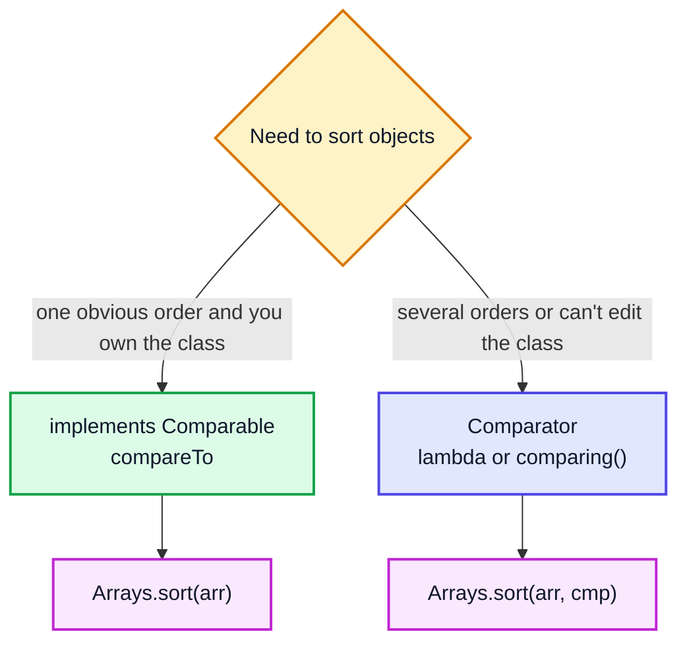

> [!NOTE]
> Sorting objects with `Arrays.sort` uses TimSort, which is **stable**: equal elements keep their original order. That's why chaining with `thenComparing` gives predictable results. Primitive arrays use dual-pivot quicksort (not stable, but stability doesn't matter for primitives).

---

## 7. Lambda Functions (48:14)

### Basics

A **lambda** is a short way to write an implementation of an interface that has **exactly one abstract method** (a *functional interface*, OOP 5 section 15). It's an anonymous function you can store in a variable or pass to a method.

```java
ArrayList<Integer> arr = new ArrayList<>();
for (int i = 0; i < 5; i++) arr.add(i + 1);

arr.forEach(item -> System.out.print(item * 2 + " "));   // 2 4 6 8 10
```

`forEach` takes a `Consumer<Integer>`, an interface with one method `void accept(Integer t)`. The lambda is that method's body.

### Syntax

| Form | Example |
|---|---|
| No parameters | `() -> System.out.println("hi")` |
| One parameter | `x -> x * 2` (parentheses optional) |
| Several parameters | `(a, b) -> a + b` |
| Explicit types | `(int a, int b) -> a + b` |
| Block body | `(a, b) -> { int s = a + b; return s; }` |

### Your own functional interface (Kunal's calculator)

```java
@FunctionalInterface
interface Operation {
    int operation(int a, int b);
}

public class LambdaFunctions {
    public static void main(String[] args) {
        Operation sum = (a, b) -> a + b;
        Operation prod = (a, b) -> a * b;
        Operation sub = (a, b) -> a - b;

        LambdaFunctions calc = new LambdaFunctions();
        System.out.println(calc.operate(5, 3, sum));    // 8
        System.out.println(calc.operate(5, 3, prod));   // 15
        System.out.println(calc.operate(5, 3, sub));    // 2
    }

    private int operate(int a, int b, Operation op) {
        return op.operation(a, b);
    }
}
```

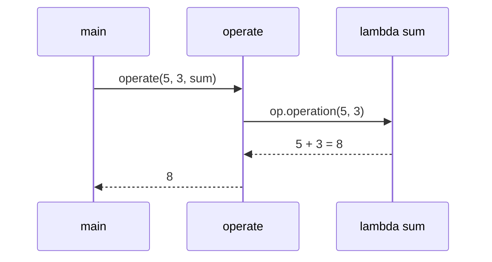

### Anonymous class vs lambda

```java
Operation sumOld = new Operation() {          // before Java 8
    @Override
    public int operation(int a, int b) { return a + b; }
};
Operation sumNew = (a, b) -> a + b;           // Java 8+
```

| | Anonymous class | Lambda |
|---|---|---|
| Works with | any interface or class | **functional** interfaces only |
| `this` refers to | the anonymous object | the enclosing object |
| Can have fields/state | ✅ | ❌ |
| Verbosity | high | low |

### Built-in functional interfaces (`java.util.function`)

| Interface | Method | Example |
|---|---|---|
| `Consumer<T>` | `void accept(T t)` | `x -> System.out.println(x)` |
| `Supplier<T>` | `T get()` | `() -> new ArrayList<>()` |
| `Function<T, R>` | `R apply(T t)` | `s -> s.length()` |
| `Predicate<T>` | `boolean test(T t)` | `n -> n % 2 == 0` |
| `BiFunction<T, U, R>` | `R apply(T t, U u)` | `(a, b) -> a + b` |
| `UnaryOperator<T>` / `BinaryOperator<T>` | `T apply(T)` / `T apply(T, T)` | `x -> x * x` / `Integer::sum` |
| `Comparator<T>` (in `java.util`) | `int compare(T a, T b)` | section 6 |

Kunal's `Operation` is really just `BinaryOperator<Integer>` or `IntBinaryOperator`.

### Method references

When a lambda only calls an existing method, you can name the method directly:

| Lambda | Method reference |
|---|---|
| `x -> System.out.println(x)` | `System.out::println` |
| `(a, b) -> Math.max(a, b)` | `Math::max` |
| `s -> s.toUpperCase()` | `String::toUpperCase` |
| `() -> new ArrayList<>()` | `ArrayList::new` |

> [!IMPORTANT]
> A lambda can read local variables from the surrounding method only if they are **effectively final** (never reassigned). `int count = 0; list.forEach(x -> count++);` is a compile error. Use a loop, an `int[]` holder, or a stream (`list.stream().count()`).

---

## 8. Exception Handling (56:45)

### Basics

An **exception** is an event that disrupts the normal flow of a program at runtime: dividing by zero, a missing file, a `null` reference. If nobody handles it, the program prints a stack trace and **terminates**.

```java
int a = 5, b = 0;
int c = a / b;   // 💥 Exception in thread "main" java.lang.ArithmeticException: / by zero
System.out.println("never reached");
```

### The hierarchy

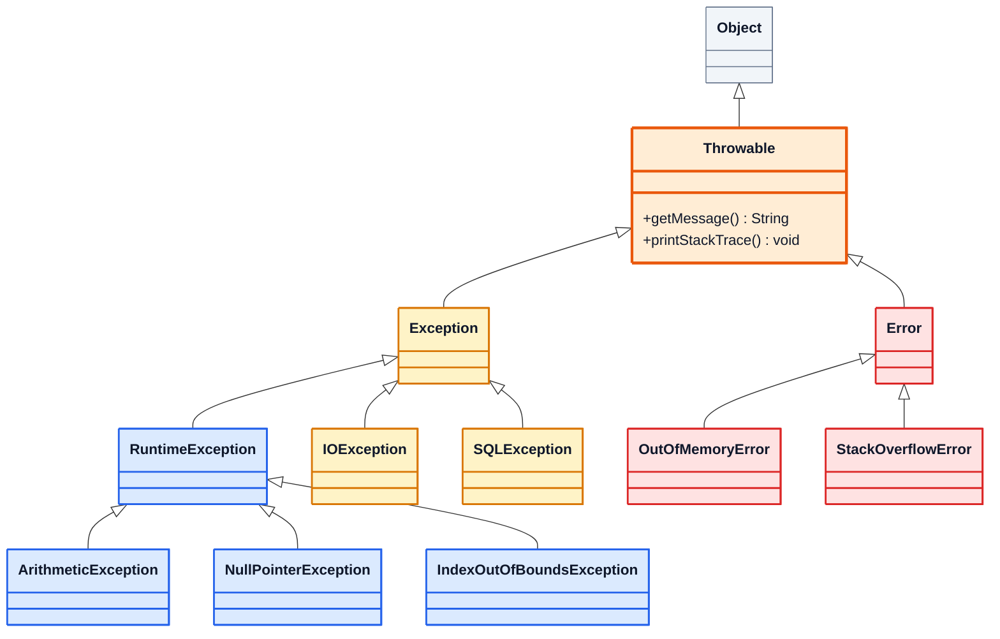

(Red = errors, amber = checked exceptions, blue = unchecked exceptions.)

### Error vs Exception

| | **Error** | **Exception** |
|---|---|---|
| Cause | Serious JVM / system problems | Problems in program logic or environment |
| Examples | `OutOfMemoryError`, `StackOverflowError` (infinite recursion!) | `IOException`, `ArithmeticException` |
| Should you catch it? | ❌ usually can't recover | ✅ handle where it makes sense |

### Checked vs unchecked

| | **Checked** | **Unchecked** |
|---|---|---|
| Which classes | `Exception` and subclasses **except** `RuntimeException` | `RuntimeException` and subclasses (+ `Error`) |
| Checked by | the **compiler** | nobody; only seen at runtime |
| Must handle or declare? | ✅ `try/catch` or `throws`, else compile error | optional |
| Typical cause | external things you can't control (file missing, network down) | bugs (null, bad index, bad cast) |
| Examples | `IOException`, `FileNotFoundException`, `SQLException`, `CloneNotSupportedException`, `InterruptedException` | `ArithmeticException`, `NullPointerException`, `ArrayIndexOutOfBoundsException`, `ClassCastException`, `NumberFormatException` |

> [!NOTE]
> Kunal calls them "compile-time" and "runtime" exceptions. Strictly, **all** exceptions happen at runtime; "checked" means the compiler **checks that you dealt with it**.

---

## 9. Exception Handling Keywords (1:03:03)

| Keyword | Where | Purpose |
|---|---|---|
| `try` | block | code that might throw |
| `catch (Type e)` | after `try` | handles a matching exception |
| `finally` | after `try`/`catch` | **always** runs (cleanup), exception or not |
| `throw` | statement | actually throws an exception object: `throw new X("msg");` |
| `throws` | method signature | declares "this method may throw X; caller deals with it" |

### `try` / `catch` / `finally`

```java
public class Main {
    public static void main(String[] args) {
        int a = 5, b = 0;
        try {
            int c = divide(a, b);
            System.out.println(c);                     // skipped
        } catch (ArithmeticException e) {
            System.out.println(e.getMessage());        // please do not divide by zero
        } catch (Exception e) {
            System.out.println("normal exception");
        } finally {
            System.out.println("this will always execute");
        }
    }

    static int divide(int a, int b) throws ArithmeticException {
        if (b == 0) {
            throw new ArithmeticException("please do not divide by zero");
        }
        return a / b;
    }
}
```

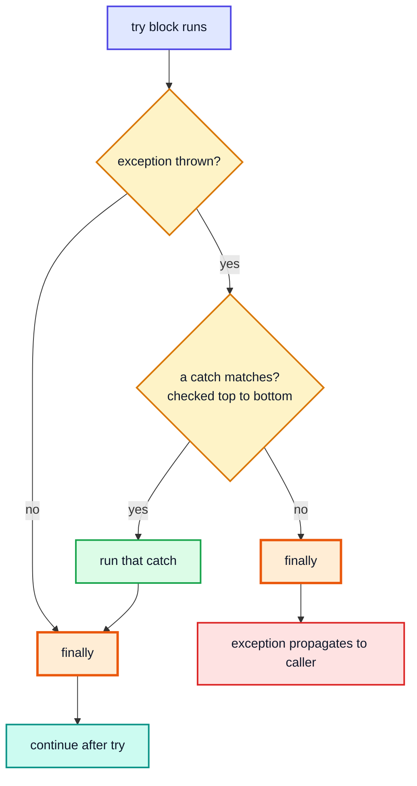

### Rules for `catch` blocks

1. **Order: specific → general.** A parent-type catch before a child-type catch makes the child unreachable, which is a compile error:

```java
try { ... }
catch (Exception e) { }             // catches everything...
catch (ArithmeticException e) { }   // ❌ "exception ArithmeticException has already been caught"
```

2. **Multi-catch** (Java 7+) for the same handling: `catch (NullPointerException | ClassCastException e)`. The types can't be parent/child of each other.
3. Only **one** catch block runs per exception.

### Propagation and the call stack

If a method doesn't catch an exception, it's thrown up to its caller, then that caller's caller, all the way to `main`, and then the JVM prints the stack trace and stops. With **unchecked** exceptions this happens automatically; with **checked** ones each method in the chain must catch or declare `throws`.

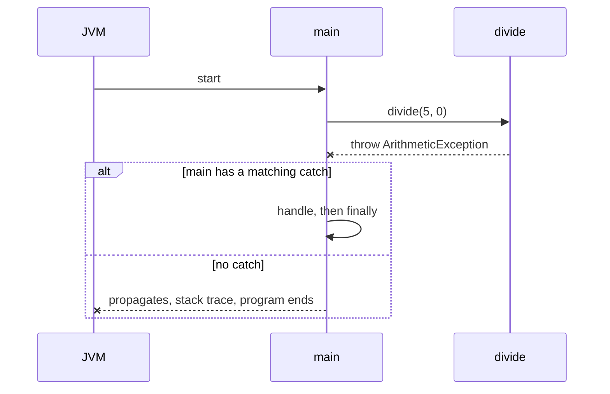

### `throw` vs `throws`

| `throw` | `throws` |
|---|---|
| Inside a method body | In the method signature |
| Followed by an **object**: `throw new MyException("x")` | Followed by **class names**: `throws IOException, MyException` |
| Throws exactly one exception | Can list several |
| Causes the exception | Only warns callers |

### `finally` details

- Runs even if the `try` or `catch` executes `return`.
- Skipped only if the JVM itself stops (`System.exit()`, crash).
- Don't `return` from `finally`: it silently discards any exception in flight.

### Modern alternative: try-with-resources (Java 7+)

For anything that must be closed (files, scanners, DB connections), let Java write the `finally` for you:

```java
try (Scanner sc = new Scanner(new File("input.txt"))) {   // AutoCloseable
    System.out.println(sc.nextLine());
} catch (FileNotFoundException e) {
    System.out.println("file missing");
}   // sc.close() is called automatically, even on exceptions
```

---

## 10. Creating Custom Exception (1:09:44)

Extend `Exception` for a **checked** custom exception, or `RuntimeException` for an **unchecked** one, and pass the message to `super`:

```java
class MyException extends Exception {
    public MyException(String message) {
        super(message);
    }
}

public class Main {
    public static void main(String[] args) {
        try {
            String name = "Kunal";
            if (name.equals("Kunal")) {
                throw new MyException("name is Kunal");
            }
        } catch (MyException e) {
            System.out.println(e.getMessage());   // name is Kunal
        } finally {
            System.out.println("this will always execute");
        }
    }
}
```

| Extend | Result | When |
|---|---|---|
| `Exception` | checked: callers **must** catch or declare | recoverable conditions the caller should think about (`InsufficientFundsException`) |
| `RuntimeException` | unchecked | programming errors / invalid arguments (`InvalidMarksException`) |

### A more realistic custom exception

```java
class InsufficientFundsException extends Exception {
    private final double shortBy;

    InsufficientFundsException(double shortBy) {
        super("Insufficient funds: short by " + shortBy);
        this.shortBy = shortBy;
    }

    double getShortBy() { return shortBy; }
}

void withdraw(double amount) throws InsufficientFundsException {
    if (amount > balance) throw new InsufficientFundsException(amount - balance);
    balance -= amount;
}
```

> [!TIP]
> Also provide a `(String message, Throwable cause)` constructor and call `super(message, cause)` when you wrap a lower-level exception. This keeps the original stack trace ("Caused by: ...") for debugging.

---

## 11. Object Cloning (1:12:32)

### Why cloning?

Assignment copies the **reference**, not the object (OOP 1):

```java
Human kunal = new Human(34, "Kunal");
Human twin = kunal;        // same object, two names
twin.age = 20;
System.out.println(kunal.age);   // 20 😬
```

Creating a copy with `new` and copying every field by hand works, but it's tedious and slow for big objects. `Object` provides a built-in field-by-field copy: `clone()`.

### How to make a class cloneable

```java
public class Human implements Cloneable {
    int age;
    String name;
    int[] arr;

    public Human(int age, String name) {
        this.age = age;
        this.name = name;
        this.arr = new int[]{3, 4, 5, 6, 9, 1};
    }

    @Override
    public Object clone() throws CloneNotSupportedException {
        return super.clone();          // Object.clone(): field-by-field copy
    }
}

public class Main {
    public static void main(String[] args) throws CloneNotSupportedException {
        Human kunal = new Human(34, "Kunal");
        Human twin = (Human) kunal.clone();
        System.out.println(twin.age + " " + twin.name);   // 34 Kunal
        System.out.println(kunal == twin);                // false: a new object
    }
}
```

### The three pieces

| Piece | Why it's needed |
|---|---|
| `implements Cloneable` | `Cloneable` is a **marker interface** (no methods). `Object.clone()` checks for it and throws `CloneNotSupportedException` if missing |
| Override `clone()` | `Object.clone()` is `protected`; overriding as `public` lets other classes call it |
| `throws CloneNotSupportedException` | it's a **checked** exception, so it must be declared or caught |

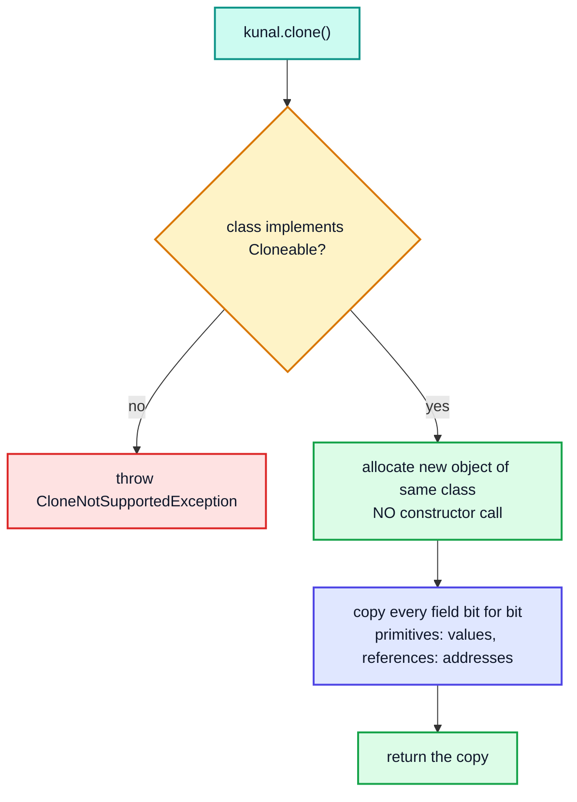

> [!TIP]
> Since Java 5 you can use a **covariant return type** so callers don't need a cast: `public Human clone() throws CloneNotSupportedException { return (Human) super.clone(); }`

> [!NOTE]
> Many experienced developers (including *Effective Java*) recommend avoiding `Cloneable` because of its odd design (marker interface, protected method, checked exception, no constructor call). The common alternatives are a **copy constructor** `Human(Human other)` or a static factory `Human.copyOf(other)`. Arrays are the exception: `arr.clone()` is simple and fine.

---

## 12. Shallow and Deep Copy (1:20:44)

`super.clone()` copies each field's **value**. For a primitive that's the number itself. For a reference field, the "value" is the address, so the copy points to the **same** inner object.

| | **Shallow copy** | **Deep copy** |
|---|---|---|
| Primitive fields | copied | copied |
| Reference fields | **address** copied: both share the inner object | inner objects **also** copied: each has its own |
| Change inner object via copy | affects the original ❌ | doesn't affect the original ✅ |
| Default `Object.clone()` | ✅ this one | needs extra code |
| Cost | cheap | more memory / time |

> [!IMPORTANT]
> Immutable objects like `String` can safely be shared, since nobody can change them. The danger is shared **mutable** objects: arrays, lists, other custom objects.

---

## 13. Explanation of Shallow Copying (1:22:52)

```java
Human kunal = new Human(34, "Kunal");
Human twin = (Human) kunal.clone();     // shallow: super.clone() only

twin.age = 20;                          // primitive: independent
twin.arr[0] = 100;                      // shared array!

System.out.println(kunal.age);                      // 34
System.out.println(Arrays.toString(kunal.arr));     // [100, 4, 5, 6, 9, 1]  😬
System.out.println(kunal.arr == twin.arr);          // true
```

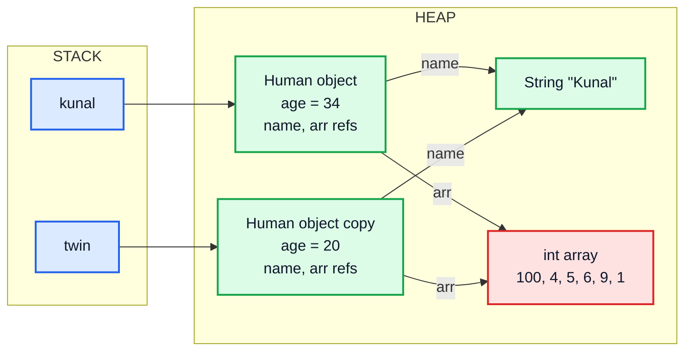

The two `Human` objects are different, but both `arr` fields point to the **same** array (red). Writing through one is visible through the other.

| Step | `kunal.age` | `twin.age` | `kunal.arr[0]` | `twin.arr[0]` |
|---|---|---|---|---|
| after clone | 34 | 34 | 3 | 3 |
| `twin.age = 20` | 34 | 20 ✅ | 3 | 3 |
| `twin.arr[0] = 100` | 34 | 20 | 100 🟥 | 100 |

---

## 14. Explanation of Deep Copying (1:25:32)

Fix: after `super.clone()`, replace each mutable reference field with a **copy** of the object it points to:

```java
@Override
public Human clone() throws CloneNotSupportedException {
    Human twin = (Human) super.clone();   // shallow copy first
    twin.arr = new int[twin.arr.length];  // brand-new array
    for (int i = 0; i < twin.arr.length; i++) {
        twin.arr[i] = this.arr[i];
    }
    // shorter: twin.arr = this.arr.clone();
    return twin;
}
```

```java
Human kunal = new Human(34, "Kunal");
Human twin = kunal.clone();      // deep
twin.arr[0] = 100;
System.out.println(Arrays.toString(kunal.arr));   // [3, 4, 5, 6, 9, 1]  ✅ untouched
System.out.println(Arrays.toString(twin.arr));    // [100, 4, 5, 6, 9, 1]
System.out.println(kunal.arr == twin.arr);        // false
```

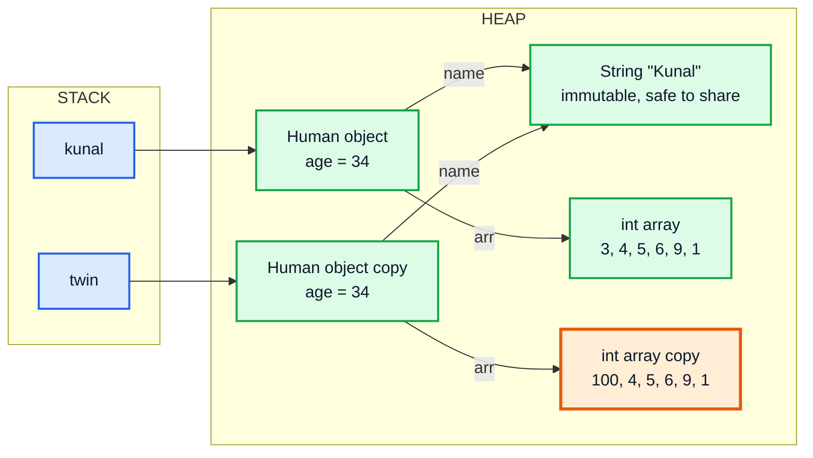

### Deep copy gets deeper

`arr.clone()` on an `int[]` is a full copy because `int`s are values. But for nested structures you must recurse:

| Field type | Deep copy with |
|---|---|
| `int[]` | `arr.clone()` ✅ complete |
| `int[][]` | `grid.clone()` copies only the outer array ❌; clone **each row** too |
| `Address address` (mutable object) | `address.clone()` or `new Address(address)` |
| `List<Student>` | new list **and** copy each `Student` |
| `String`, `Integer` (immutable) | just share the reference |

```java
int[][] grid = {{1, 2}, {3, 4}};
int[][] copy = new int[grid.length][];
for (int i = 0; i < grid.length; i++) copy[i] = grid[i].clone();   // true deep copy
```

> [!CAUTION]
> `int[][] copy = grid.clone();` is a classic DSA bug in backtracking / matrix problems: rows are still shared, so changing `copy[0][0]` changes `grid[0][0]`.

---

## 15. Outro (1:30:44)

Recap: a dynamic array built from scratch with amortized O(1) adds, generics (type parameters, bounded types, erasure, wildcards and PECS), `Comparable` vs `Comparator`, lambdas and functional interfaces, the exception hierarchy with `try`/`catch`/`finally`/`throw`/`throws` and custom exceptions, and object cloning with the shallow vs deep copy distinction. Next, OOP 7 covers **collections framework, vectors and enums**.

---

## 🧩 Complete Example: Everything Together

```java
import java.util.ArrayList;
import java.util.Arrays;
import java.util.Comparator;
import java.util.List;
import java.util.function.Consumer;

// ═══════ CUSTOM GENERIC ARRAYLIST ═══════
class CustomArrayList<T> {
    private static final int DEFAULT_SIZE = 4;
    private Object[] data = new Object[DEFAULT_SIZE];   // new T[...] is not allowed
    private int size = 0;

    public void add(T value) {
        if (isFull()) resize();
        data[size++] = value;
    }

    private boolean isFull() { return size == data.length; }

    private void resize() {
        Object[] temp = new Object[data.length * 2];
        for (int i = 0; i < data.length; i++) temp[i] = data[i];
        data = temp;
        System.out.println("  (resized to capacity " + data.length + ")");
    }

    @SuppressWarnings("unchecked")
    public T get(int index) {
        if (index < 0 || index >= size)
            throw new IndexOutOfBoundsException("Index " + index + " out of bounds for size " + size);
        return (T) data[index];
    }

    public void set(int index, T value) {
        get(index);                       // reuse the bounds check
        data[index] = value;
    }

    @SuppressWarnings("unchecked")
    public T remove() {
        T removed = (T) data[--size];
        data[size] = null;                // let GC reclaim it
        return removed;
    }

    public int size() { return size; }

    @Override
    public String toString() {
        return "CustomArrayList{data=" + Arrays.toString(Arrays.copyOf(data, size)) + ", size=" + size + "}";
    }
}

// Bounded type parameter: only numbers allowed
class NumberBox<T extends Number> {
    private final T value;
    NumberBox(T value) { this.value = value; }
    double doubled() { return value.doubleValue() * 2; }
}

// ═══════ COMPARING OBJECTS ═══════
class Student implements Comparable<Student> {
    final int rollNo;
    final float marks;

    Student(int rollNo, float marks) { this.rollNo = rollNo; this.marks = marks; }

    @Override
    public int compareTo(Student o) {         // natural order: by marks ascending
        return Float.compare(this.marks, o.marks);
    }

    @Override
    public String toString() { return "S" + rollNo + "(" + marks + ")"; }
}

// ═══════ LAMBDAS ═══════
@FunctionalInterface
interface Operation {
    int apply(int a, int b);
}

// ═══════ CUSTOM EXCEPTION ═══════
class MyException extends Exception {
    MyException(String message) { super(message); }
}

// ═══════ CLONING ═══════
class Human implements Cloneable {
    int age;
    String name;
    int[] arr;

    Human(int age, String name) {
        this.age = age;
        this.name = name;
        this.arr = new int[]{3, 4, 5, 6, 9, 1};
    }

    Human shallowCopy() throws CloneNotSupportedException {
        return (Human) super.clone();          // copies fields as-is: arr is SHARED
    }

    Human deepCopy() throws CloneNotSupportedException {
        Human twin = (Human) super.clone();
        twin.arr = arr.clone();                // new array for the copy
        return twin;
    }
}

public class Main {
    static double sumAll(List<? extends Number> nums) {   // wildcard: any list of numbers
        double total = 0;
        for (Number n : nums) total += n.doubleValue();
        return total;
    }

    static int divide(int a, int b) throws ArithmeticException {
        if (b == 0) throw new ArithmeticException("please do not divide by zero");
        return a / b;
    }

    static void checkName(String name) throws MyException {
        if (name.equals("Kunal")) throw new MyException("name is Kunal");
        System.out.println("  name ok: " + name);
    }

    public static void main(String[] args) throws CloneNotSupportedException {
        System.out.println("=== Custom generic ArrayList ===");
        CustomArrayList<Integer> list = new CustomArrayList<>();
        for (int i = 1; i <= 6; i++) list.add(i * 10);
        System.out.println(list);
        list.set(0, 99);
        System.out.println("get(0) = " + list.get(0) + ", removed = " + list.remove() + ", size = " + list.size());
        try {
            list.get(10);
        } catch (IndexOutOfBoundsException ex) {
            System.out.println("Caught: " + ex.getMessage());
        }
        CustomArrayList<String> names = new CustomArrayList<>();
        names.add("Kunal");
        names.add("Rahul");
        System.out.println(names + ", first length = " + names.get(0).length());

        System.out.println("\n=== Bounded types & wildcards ===");
        System.out.println("NumberBox<Integer>(21).doubled() = " + new NumberBox<>(21).doubled());
        System.out.println("sumAll(ints)    = " + sumAll(List.of(1, 2, 3)));
        System.out.println("sumAll(doubles) = " + sumAll(List.of(1.5, 2.5)));

        System.out.println("\n=== Comparing objects ===");
        Student[] students = {
            new Student(34, 89.76f), new Student(12, 99.52f),
            new Student(25, 75.5f),  new Student(7, 89.76f)
        };
        System.out.println("S34 vs S12 compareTo = " + students[0].compareTo(students[1]));
        Arrays.sort(students);                                   // uses compareTo
        System.out.println("by marks asc  : " + Arrays.toString(students));
        Arrays.sort(students, (a, b) -> Float.compare(b.marks, a.marks));   // lambda comparator
        System.out.println("by marks desc : " + Arrays.toString(students));
        Arrays.sort(students, Comparator.comparingDouble((Student s) -> s.marks).thenComparingInt(s -> s.rollNo));
        System.out.println("marks, roll   : " + Arrays.toString(students));

        System.out.println("\n=== Lambdas ===");
        ArrayList<Integer> nums = new ArrayList<>(List.of(1, 2, 3, 4));
        nums.forEach(n -> System.out.print(n * 2 + " "));
        System.out.println();
        Consumer<Integer> printer = n -> System.out.print("[" + n + "]");
        nums.forEach(printer);
        System.out.println();
        Operation sum = (a, b) -> a + b;
        Operation prod = (a, b) -> a * b;
        Operation sub = (a, b) -> a - b;
        System.out.println("sum=" + sum.apply(5, 3) + " prod=" + prod.apply(5, 3) + " sub=" + sub.apply(5, 3));
        Operation max = Math::max;                               // method reference
        System.out.println("max(5, 3) = " + max.apply(5, 3));

        System.out.println("\n=== Exception handling ===");
        try {
            System.out.println("  10 / 2 = " + divide(10, 2));
            System.out.println("  10 / 0 = " + divide(10, 0));
            System.out.println("  never printed");
        } catch (ArithmeticException ex) {
            System.out.println("  Caught ArithmeticException: " + ex.getMessage());
        } finally {
            System.out.println("  finally always runs");
        }
        try {
            checkName("Rahul");
            checkName("Kunal");
        } catch (MyException ex) {
            System.out.println("  Caught MyException: " + ex.getMessage());
        }
        try {
            Object o = "text";
            Integer bad = (Integer) o;
            System.out.println(bad);
        } catch (NullPointerException | ClassCastException ex) {
            System.out.println("  Multi-catch got " + ex.getClass().getSimpleName());
        }

        System.out.println("\n=== Cloning: shallow vs deep ===");
        Human kunal = new Human(34, "Kunal");
        Human shallow = kunal.shallowCopy();
        Human deep = kunal.deepCopy();
        shallow.arr[0] = 100;               // changes kunal.arr too (shared)
        deep.arr[1] = 200;                  // changes only deep's array
        shallow.age = 20;                   // primitives are copied, independent
        System.out.println("original arr = " + Arrays.toString(kunal.arr) + ", age = " + kunal.age);
        System.out.println("shallow  arr = " + Arrays.toString(shallow.arr) + ", age = " + shallow.age);
        System.out.println("deep     arr = " + Arrays.toString(deep.arr));
        System.out.println("kunal.arr == shallow.arr ? " + (kunal.arr == shallow.arr));
        System.out.println("kunal.arr == deep.arr    ? " + (kunal.arr == deep.arr));
        System.out.println("kunal == shallow ? " + (kunal == shallow) + ", same name String? " + (kunal.name == shallow.name));
    }
}
```

**Expected Output:**
```
=== Custom generic ArrayList ===
  (resized to capacity 8)
CustomArrayList{data=[10, 20, 30, 40, 50, 60], size=6}
get(0) = 99, removed = 60, size = 5
Caught: Index 10 out of bounds for size 5
CustomArrayList{data=[Kunal, Rahul], size=2}, first length = 5

=== Bounded types & wildcards ===
NumberBox<Integer>(21).doubled() = 42.0
sumAll(ints)    = 6.0
sumAll(doubles) = 4.0

=== Comparing objects ===
S34 vs S12 compareTo = -1
by marks asc  : [S25(75.5), S34(89.76), S7(89.76), S12(99.52)]
by marks desc : [S12(99.52), S34(89.76), S7(89.76), S25(75.5)]
marks, roll   : [S25(75.5), S7(89.76), S34(89.76), S12(99.52)]

=== Lambdas ===
2 4 6 8 
[1][2][3][4]
sum=8 prod=15 sub=2
max(5, 3) = 5

=== Exception handling ===
  10 / 2 = 5
  Caught ArithmeticException: please do not divide by zero
  finally always runs
  name ok: Rahul
  Caught MyException: name is Kunal
  Multi-catch got ClassCastException

=== Cloning: shallow vs deep ===
original arr = [100, 4, 5, 6, 9, 1], age = 34
shallow  arr = [100, 4, 5, 6, 9, 1], age = 20
deep     arr = [3, 200, 5, 6, 9, 1]
kunal.arr == shallow.arr ? true
kunal.arr == deep.arr    ? false
kunal == shallow ? false, same name String? true
```

Notice the stable sort: `S34` and `S7` have equal marks, so the ascending and descending sorts keep them in their previous relative order; only the explicit `thenComparingInt` puts `S7` first.

---

## Quick Reference Cheat Sheet

| Concept | One-Line Summary |
|---|---|
| **Dynamic array** | Internal array + `size`; when full, allocate 2× and copy; amortized O(1) `add` |
| **`java.util.ArrayList`** | Same idea with `Object[] elementData`, grows 1.5× |
| **Generic class** | `class Box<T>`; one class, compile-time type safety, no casts for the caller |
| **Generic method** | `static <T> void f(T x)` |
| **Bounded type** | `<T extends Number>` lets you call `Number` methods on `T` |
| **Type erasure** | Generics are compile-time only; `T` becomes `Object`/bound in bytecode |
| **Generic restrictions** | No primitives, no `new T()`/`new T[]`, no static `T` fields |
| **Invariance** | `List<Integer>` is **not** a `List<Number>` |
| **Wildcards** | `?` any; `? extends X` read (producer); `? super X` write (consumer): PECS |
| **`Comparable`** | `compareTo(T o)` inside the class; natural order; `Arrays.sort(arr)` |
| **`Comparator`** | `compare(a, b)` outside; many orders; `Comparator.comparing(...).thenComparing(...)` |
| **Compare numbers safely** | `Integer.compare` / `Float.compare`, not `a - b` |
| **Lambda** | `(params) -> body`; implements a functional interface (one abstract method) |
| **Method reference** | `System.out::println`, `Math::max`, `ArrayList::new` |
| **Effectively final** | Lambdas can only capture locals that are never reassigned |
| **Error vs Exception** | Error = JVM-level, don't catch; Exception = handle it |
| **Checked vs unchecked** | Checked must be caught/declared (`IOException`); unchecked = `RuntimeException` subclasses |
| **try / catch / finally** | Catch specific → general; `finally` always runs |
| **throw vs throws** | `throw new X()` in body vs `throws X` in signature |
| **Try-with-resources** | `try (Res r = ...) { }` auto-closes `AutoCloseable` |
| **Custom exception** | `extends Exception` (checked) or `RuntimeException` (unchecked); `super(message)` |
| **Cloning** | `implements Cloneable` + override `clone()` calling `super.clone()`; no constructor runs |
| **Shallow copy** | Primitives copied, references shared |
| **Deep copy** | Also copy every mutable referenced object (`arr.clone()`, per-row for 2D) |
| **Alternative to clone** | Copy constructor `Human(Human other)` |
