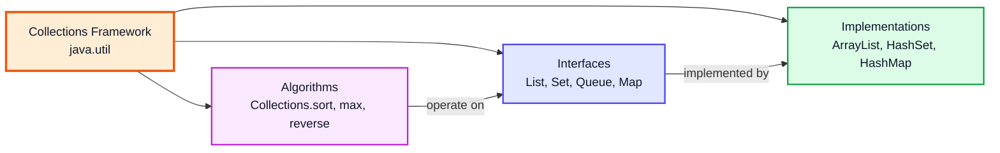
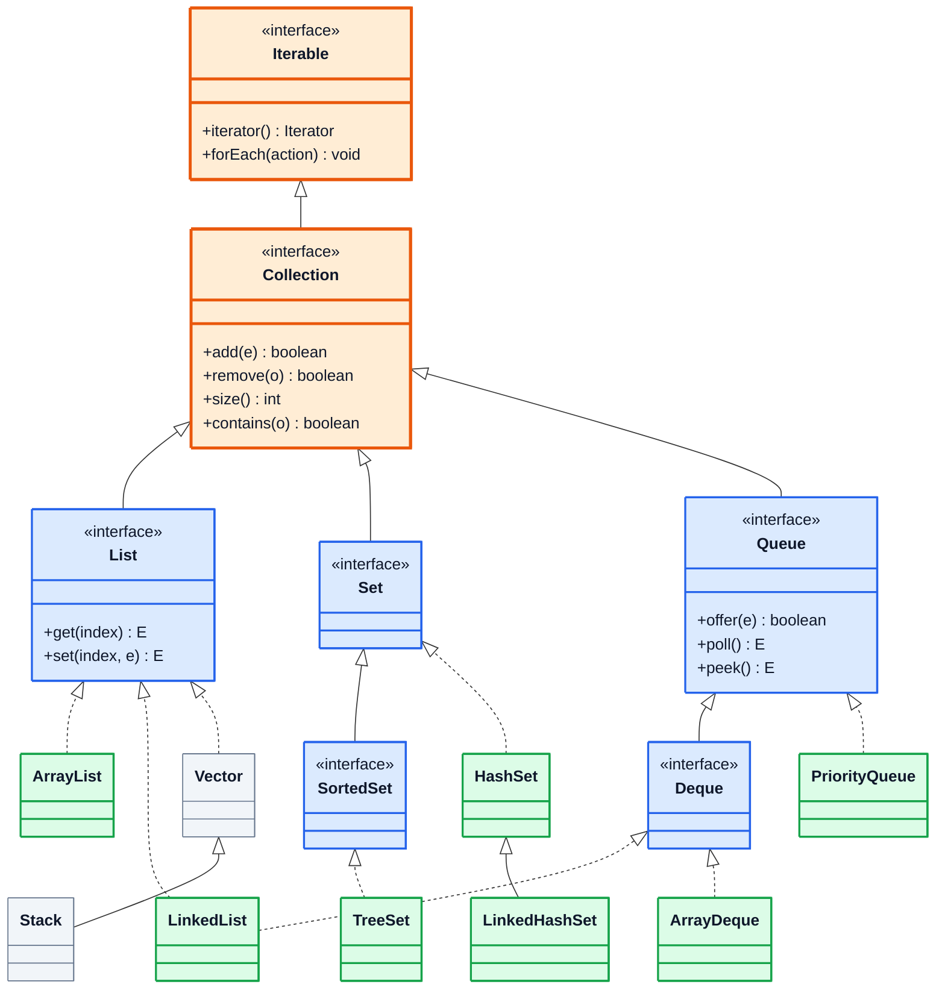
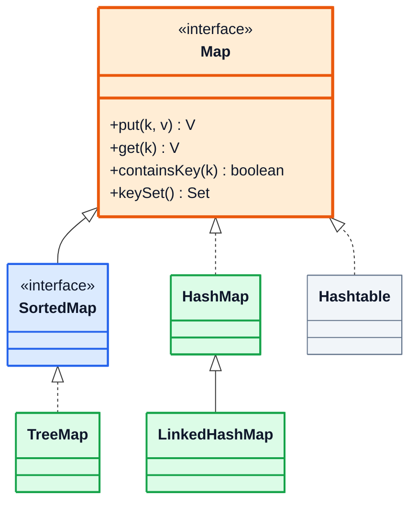
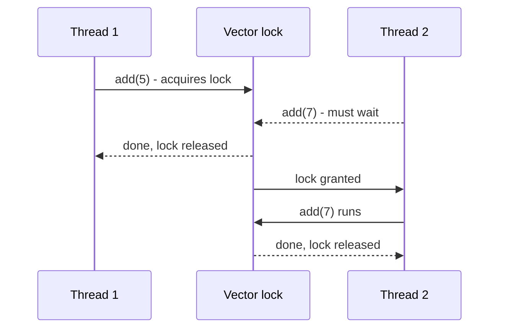
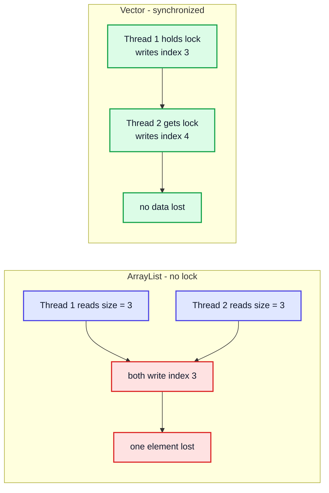
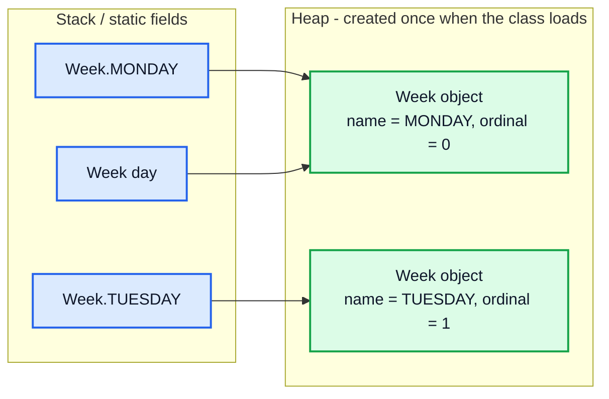
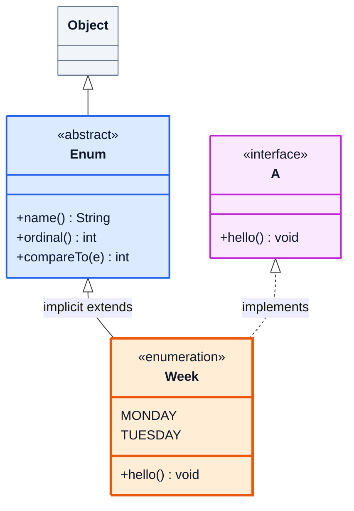

# Collections Framework, Vector Class & Enums — Complete In-Depth Guide

**Video #43 of the Java + DSA playlist:** *OOP 7 | Collections Framework, Vector Class, Enums in Java* (26:39)

The seventh OOP lecture is a short tour of three things you'll use constantly: the **Collections Framework** (the ready-made data structures in `java.util` and how its interfaces fit together), the legacy but thread-safe **`Vector`** class, and **enums**, Java's type-safe way to model a fixed set of constants (with fields, constructors, methods and interfaces). Generics and lambdas (video #42) are assumed; interfaces were covered in OOP 5 (video #41).

---

## Table of Contents

| # | Topic | Timestamp |
|---|---|---|
| 0 | [Introduction](#0-introduction-000) | 0:00 |
| 1 | [Collections Framework](#1-collections-framework-050) | 0:50 |
| 2 | [Need of Collection Framework in Java](#2-need-of-collection-framework-in-java-212) | 2:12 |
| 3 | [Understanding Collection Framework](#3-understanding-collection-framework-450) | 4:50 |
| 4 | [Vector Class](#4-vector-class-1110) | 11:10 |
| 5 | [Vector Synchronisation](#5-vector-synchronisation-1132) | 11:32 |
| 6 | [Vector Code Example](#6-vector-code-example-1337) | 13:37 |
| 7 | [Enums in Java](#7-enums-in-java-1504) | 15:04 |
| 8 | [Enum Inheritance](#8-enum-inheritance-2257) | 22:57 |
| 9 | [Outro](#9-outro-2618) | 26:18 |

---

## 0. Introduction (0:00)

So far in the bootcamp you've been using `ArrayList` without thinking much about where it comes from. This lecture zooms out:

1. **Collections Framework**: what it is, why Java has it, and the interface hierarchy (`Iterable → Collection → List / Set / Queue`, plus `Map` on the side).
2. **`Vector`**: an older cousin of `ArrayList` whose methods are **synchronized**, and what that means for multithreaded code.
3. **Enums**: named constants that are real objects, with their own fields, constructors and methods, and what kind of inheritance they allow.

> [!IMPORTANT]
> The upcoming DSA lectures (linked lists, stacks, queues, trees, hashmaps, heaps) each have a ready-made class in the Collections Framework. You will build them yourself first, but knowing the built-in versions lets you check your work and use them in interviews.

---

## 1. Collections Framework (0:50)

### Basics

A **collection** is simply an object that holds a group of other objects (its *elements*). The **Collections Framework** is the unified set of pieces in `java.util` for working with such groups:

| Piece | What it is | Examples |
|---|---|---|
| **Interfaces** | Abstract data types: *what* operations exist | `Collection`, `List`, `Set`, `Queue`, `Deque`, `Map` |
| **Implementations** | Concrete classes: *how* the data is stored | `ArrayList`, `LinkedList`, `HashSet`, `TreeSet`, `ArrayDeque`, `PriorityQueue`, `HashMap` |
| **Algorithms** | Reusable static methods that work on any collection | `Collections.sort`, `Collections.max`, `Collections.reverse`, `Collections.binarySearch` |



> [!NOTE]
> **Collection** (singular, interface) ≠ **Collections** (plural, utility class). `Collection<E>` is the root interface for lists/sets/queues; `Collections` is a class full of static helper methods like `sort` and `unmodifiableList`. Same pattern as `Array` vs `Arrays`.

### Collections only hold objects

Because collections are generic (`List<E>`), they store **references**, never primitives. That's why you write `List<Integer>`, not `List<int>`, and why autoboxing (video #37) matters:

```java
import java.util.*;

public class BoxingDemo {
    public static void main(String[] args) {
        List<Integer> nums = new ArrayList<>();
        nums.add(5);                 // autoboxed: Integer.valueOf(5)
        int first = nums.get(0);     // auto-unboxed
        System.out.println(first + 1);   // 6
        // List<int> bad;            // ❌ compile error: primitives not allowed
    }
}
```

---

## 2. Need of Collection Framework in Java (2:12)

### Life before the framework

Before Java 1.2 (1998), Java had only a few unrelated container classes: arrays, `Vector`, `Stack`, `Hashtable` and `Properties`. Each had its own method names and there was no common interface, so code written for one couldn't accept another.

| Problem with arrays / ad-hoc classes | What the framework gives you |
|---|---|
| Arrays have a **fixed size** | Resizable `ArrayList`, `LinkedList`, `HashSet`, ... |
| You write search, sort, insert-in-middle, resize logic yourself | Ready, tested, optimised methods (`add`, `remove`, `contains`, `sort`) |
| Different classes, different method names (`Vector.addElement`, `Hashtable.put`) | One consistent API: `add`, `remove`, `size`, `isEmpty`, `iterator` everywhere |
| Code tied to one concrete class | Code written against an **interface** (`List`) works with any implementation |
| No standard way to loop over different containers | Every collection is `Iterable`, so the for-each loop works on all of them |

### Programming to the interface

The biggest win is that you can write code against the interface and swap the implementation later:

```java
import java.util.*;

public class InterfaceDemo {
    static int total(Collection<Integer> c) {   // accepts ANY collection
        int sum = 0;
        for (int x : c) sum += x;
        return sum;
    }

    public static void main(String[] args) {
        List<Integer> a = new ArrayList<>(List.of(1, 2, 3));
        List<Integer> l = new LinkedList<>(List.of(4, 5));
        Set<Integer>  s = new HashSet<>(List.of(6, 6, 7));   // duplicates removed

        System.out.println(total(a));   // 6
        System.out.println(total(l));   // 9
        System.out.println(total(s));   // 13
    }
}
```

> [!TIP]
> Declare variables with the interface type: `List<String> names = new ArrayList<>();` rather than `ArrayList<String> names = ...`. If you later find you need a `LinkedList`, you change one word.

---

## 3. Understanding Collection Framework (4:50)

### The hierarchy

At the top sits `Iterable` (anything you can loop over). `Collection` extends it, and the three main branches extend `Collection`. `Map` is part of the framework but is **not** a `Collection`, because it stores key → value pairs rather than single elements.



*Legend: orange = root interfaces, blue = branch interfaces, green = classes you'll use, grey = legacy classes.* Solid arrows with a hollow head are `extends`; dotted ones are `implements`.

And the separate `Map` family:



> [!NOTE]
> **Modern Java (21+):** three new interfaces were slotted into this hierarchy: `SequencedCollection` (between `Collection` and `List`/`Deque`), `SequencedSet` and `SequencedMap`. They add `getFirst()`, `getLast()`, `addFirst()`, `removeLast()` and `reversed()` to every ordered collection, so `list.getLast()` now works on an `ArrayList`. Also, `SortedSet`/`SortedMap` have `NavigableSet`/`NavigableMap` subinterfaces that `TreeSet`/`TreeMap` actually implement. The video predates Java 21, so it doesn't show these.

### The three branches compared

| Interface | Order | Duplicates | Access by index | Main implementations |
|---|---|---|---|---|
| `List` | Insertion order kept | ✅ allowed | ✅ `get(i)` | `ArrayList`, `LinkedList`, `Vector` |
| `Set` | Depends (`HashSet` none, `LinkedHashSet` insertion, `TreeSet` sorted) | ❌ not allowed | ❌ | `HashSet`, `LinkedHashSet`, `TreeSet` |
| `Queue` / `Deque` | FIFO (or priority / both ends) | ✅ allowed | ❌ | `ArrayDeque`, `LinkedList`, `PriorityQueue` |
| `Map` | Depends (`HashMap` none, `LinkedHashMap` insertion, `TreeMap` sorted keys) | Keys unique, values may repeat | By key: `get(k)` | `HashMap`, `LinkedHashMap`, `TreeMap` |

### Time complexity of the common implementations

| Class | Underlying structure | add (end) | get(i) | contains | remove (middle) |
|---|---|---|---|---|---|
| `ArrayList` | Dynamic array | O(1) amortised | O(1) | O(n) | O(n) |
| `LinkedList` | Doubly linked list (video #44) | O(1) | O(n) | O(n) | O(1) once you're at the node, O(n) to find it |
| `HashSet` / `HashMap` | Hash table | O(1) average | n/a | O(1) average | O(1) average |
| `TreeSet` / `TreeMap` | Red-black tree | O(log n) | n/a | O(log n) | O(log n) |
| `PriorityQueue` | Binary heap | O(log n) | n/a | O(n) | O(log n) for `poll()` |
| `ArrayDeque` | Circular array | O(1) at both ends | n/a | O(n) | O(n) |

### Example: one of each

```java
import java.util.*;

public class FrameworkTour {
    public static void main(String[] args) {
        List<String> list = new ArrayList<>(List.of("b", "a", "c", "a"));
        Set<String> hash  = new HashSet<>(list);
        Set<String> tree  = new TreeSet<>(list);
        Queue<String> q   = new ArrayDeque<>(list);
        Map<String, Integer> freq = new TreeMap<>();
        for (String s : list) freq.put(s, freq.getOrDefault(s, 0) + 1);

        System.out.println(list);          // [b, a, c, a]
        System.out.println(hash.size());   // 3
        System.out.println(tree);          // [a, b, c]
        System.out.println(q.poll());      // b  (first in, first out)
        System.out.println(freq);          // {a=2, b=1, c=1}

        Collections.sort(list);
        System.out.println(list);          // [a, a, b, c]
        Collections.reverse(list);
        System.out.println(list);          // [c, b, a, a]
    }
}
```

> [!TIP]
> Need a stack? Use `ArrayDeque` with `push`/`pop`/`peek` rather than the legacy `Stack` class (which extends `Vector` and pays for synchronisation you don't need).

---

## 4. Vector Class (11:10)

### Basics

`Vector<E>` is a **resizable array**, almost identical in use to `ArrayList`. It has existed since Java 1.0 and was retrofitted to implement `List` in Java 1.2.

```java
import java.util.*;

public class VectorBasics {
    public static void main(String[] args) {
        Vector<Integer> v = new Vector<>();
        v.add(10);
        v.add(20);
        v.add(1, 15);                 // insert at index 1
        System.out.println(v);        // [10, 15, 20]
        System.out.println(v.get(2)); // 20
        v.remove(Integer.valueOf(10));
        System.out.println(v);        // [15, 20]
        System.out.println(v.size()); // 2
    }
}
```

### `Vector` vs `ArrayList`

| Feature | `Vector` | `ArrayList` |
|---|---|---|
| Introduced | Java 1.0 (legacy) | Java 1.2 |
| Thread-safe? | ✅ every public method is `synchronized` | ❌ not synchronised |
| Speed (single thread) | Slower: acquires a lock on every call | Faster |
| Growth when full | **Doubles** capacity (or grows by `capacityIncrement` if you set one) | Grows by **50%** (new = old + old/2) |
| Default initial capacity | 10 | 10 (allocated lazily on first `add`) |
| Extra legacy methods | `addElement`, `elementAt`, `capacity()`, `Enumeration elements()` | none |
| Used today? | Rarely, mostly old code | The default list choice |

### Capacity vs size

**Size** is how many elements are stored; **capacity** is how big the internal array is. When `size == capacity` and you add one more, `Vector` allocates a new array twice as large and copies everything across.

```java
import java.util.*;

public class VectorGrowth {
    public static void main(String[] args) {
        Vector<Integer> v = new Vector<>();
        System.out.println(v.capacity());              // 10
        for (int i = 0; i < 11; i++) v.add(i);
        System.out.println(v.size() + " " + v.capacity());   // 11 20

        Vector<Integer> w = new Vector<>(4, 3);        // initial 4, grow by 3
        for (int i = 0; i < 5; i++) w.add(i);
        System.out.println(w.capacity());              // 7
    }
}
```

| Adds so far | `Vector` capacity | `ArrayList` capacity (internal) |
|---|---|---|
| 0–10 | 10 | 10 |
| 11–15 | 🟧 20 | 🟧 15 |
| 16–20 | 20 | 🟧 22 |
| 21–22 | 🟧 40 | 22 |

> [!NOTE]
> `ArrayList` has no public `capacity()` method; its growth is an internal detail. You can pre-size either one with a constructor argument (`new ArrayList<>(1000)`) to avoid repeated copying.

---

## 5. Vector Synchronisation (11:32)

### Basics: what problem does it solve?

When **several threads** modify the same list at the same time, an unsynchronised list like `ArrayList` can get corrupted. Inside `add` there are roughly three steps: check capacity, write `elementData[size]`, then `size++`. If two threads interleave those steps, both may write to the same slot and one element is lost, or a resize can race and throw `ArrayIndexOutOfBoundsException`.

`Vector` makes every method `synchronized`: a thread must take the vector's **lock** (its monitor) before running `add`, `get`, `remove` and so on. Only one thread can hold the lock, so the others wait their turn.





### In depth: synchronised ≠ fully thread-safe

Each *single* call on a `Vector` is atomic, but a **sequence** of calls is not:

```java
// ❌ Still a race: another thread can remove the last element
//    between the isEmpty() check and the remove() call
if (!vec.isEmpty()) {
    vec.remove(vec.size() - 1);
}

// ✅ Lock the vector yourself for compound actions
synchronized (vec) {
    if (!vec.isEmpty()) vec.remove(vec.size() - 1);
}
```

Iterating is also a compound action: if another thread modifies the vector while you loop with an iterator, you get a `ConcurrentModificationException`.

> [!WARNING]
> Synchronising every call makes `Vector` noticeably slower when only one thread uses it, which is the common case. That's why `Vector` is considered legacy.

### Modern alternatives

| Need | Use instead of `Vector` |
|---|---|
| Single thread (most code) | `ArrayList` |
| Simple thread-safe list | `Collections.synchronizedList(new ArrayList<>())` (same locking idea as `Vector`, but works on any list) |
| Many reads, few writes, safe iteration | `CopyOnWriteArrayList` (from `java.util.concurrent`) |
| Thread-safe queue / producer-consumer | `ConcurrentLinkedQueue`, `ArrayBlockingQueue`, `LinkedBlockingQueue` |
| Thread-safe map (instead of `Hashtable`) | `ConcurrentHashMap` |

---

## 6. Vector Code Example (13:37)

Kunal starts two threads that add to the same list. With a `Vector`, the final size is always the total number of adds:

```java
import java.util.*;

public class VectorThreads {
    public static void main(String[] args) throws InterruptedException {
        Vector<Integer> vec = new Vector<>();

        Runnable task = () -> {
            for (int i = 0; i < 10_000; i++) vec.add(i);
        };

        Thread t1 = new Thread(task);
        Thread t2 = new Thread(task);
        t1.start();
        t2.start();
        t1.join();      // wait for t1 to finish
        t2.join();      // wait for t2 to finish

        System.out.println(vec.size());   // 20000, every time
    }
}
```

### What the pieces do

| Line | Meaning |
|---|---|
| `Runnable task = () -> {...}` | The job each thread runs (a lambda, video #42) |
| `new Thread(task)` | Creates a thread, not started yet |
| `t1.start()` | Starts it running **in parallel** with `main` |
| `t1.join()` | `main` waits until `t1` finishes; without it, `main` might print the size too early |

### Same code with `ArrayList`

Swap `Vector` for `ArrayList` and run it a few times. Typical results:

| Run | `ArrayList` result | `Vector` result |
|---|---|---|
| 1 | 🟥 17 342 | ✅ 20000 |
| 2 | 🟥 `ArrayIndexOutOfBoundsException` in a thread | ✅ 20000 |
| 3 | 🟥 19 887 | ✅ 20000 |

The `ArrayList` numbers are unpredictable: that unpredictability *is* the bug (a **race condition**). Sometimes it even prints 20000 by luck, which is why concurrency bugs are hard to find.

> [!TIP]
> To make the `ArrayList` version correct without `Vector`, wrap it: `List<Integer> list = Collections.synchronizedList(new ArrayList<>());`. The Complete Example below shows it also gives 20000.

---

## 7. Enums in Java (15:04)

### Basics

An **enum** (enumeration) is a special class with a **fixed set of named instances**. Use it whenever a variable can only take a few known values: days of the week, card suits, directions, order status, plan tiers.

```java
enum Week {
    MONDAY, TUESDAY, WEDNESDAY, THURSDAY, FRIDAY, SATURDAY, SUNDAY
}

public class EnumBasics {
    public static void main(String[] args) {
        Week day = Week.FRIDAY;
        System.out.println(day);              // FRIDAY
        System.out.println(day.ordinal());    // 4  (position, 0-based)
        for (Week w : Week.values()) {        // all constants, in order
            System.out.print(w + " ");
        }
        // MONDAY TUESDAY WEDNESDAY THURSDAY FRIDAY SATURDAY SUNDAY
        System.out.println();
        System.out.println(Week.valueOf("SUNDAY"));   // SUNDAY
    }
}
```

### Why not just use `int` or `String` constants?

```java
// ❌ Old style: "int enum pattern"
static final int MONDAY = 0, TUESDAY = 1;
void schedule(int day) { ... }
schedule(42);          // compiles! but 42 is not a day

// ✅ Enum
void schedule(Week day) { ... }
schedule(Week.MONDAY); // only real Week values compile
```

| | `int` / `String` constants | `enum` |
|---|---|---|
| Type-safe | ❌ any int/string is accepted | ✅ only declared constants |
| Readable when printed | ❌ prints `0` | ✅ prints `MONDAY` |
| Can list all values | ❌ manually | ✅ `values()` |
| Can carry data and behaviour | ❌ | ✅ fields, constructors, methods |
| Works in `switch` | ✅ | ✅ (and the compiler can check you covered every case) |
| Compare with `==` | ✅ for int, ❌ for String | ✅ always (each constant is a singleton) |

### What the compiler actually generates

An enum is a class in disguise. `enum Week { MONDAY, ... }` compiles to roughly:

```java
public final class Week extends java.lang.Enum<Week> {
    public static final Week MONDAY  = new Week("MONDAY", 0);
    public static final Week TUESDAY = new Week("TUESDAY", 1);
    // ...
    private Week(String name, int ordinal) { super(name, ordinal); }
    public static Week[] values()            { /* copy of all constants */ }
    public static Week valueOf(String name)  { /* lookup by name */ }
}
```



Key consequences:
- Every constant is **`public static final`**: you access it as `Week.MONDAY`, it can't be reassigned.
- Each constant is created **exactly once** when the enum class loads, so `==` is safe and correct for comparison.
- The constructor is **always private** (writing `public` is a compile error; leaving it out makes it private). You can never write `new Week(...)`.

### Fields, constructors and methods

Constants can be passed arguments, which go to the constructor:

```java
enum Planet {
    MERCURY(3.303e+23, 2.4397e6),
    EARTH(5.976e+24, 6.37814e6);           // ← semicolon needed before other members

    private final double mass;             // kg
    private final double radius;           // m

    Planet(double mass, double radius) {   // implicitly private
        this.mass = mass;
        this.radius = radius;
        System.out.println("Constructing " + this);
    }

    double surfaceGravity() {
        return 6.67300E-11 * mass / (radius * radius);
    }
}

public class PlanetDemo {
    public static void main(String[] args) {
        System.out.println("main starts");
        Planet p = Planet.EARTH;   // first use: enum class loads, ALL constants built
        System.out.printf("%.2f%n", p.surfaceGravity());
    }
}
// main starts
// Constructing MERCURY
// Constructing EARTH
// 9.80
```

> [!IMPORTANT]
> The constructor runs **once per constant**, the first time the enum is used, not each time you refer to a constant. That's the point Kunal demonstrates by printing inside the constructor.

### Useful built-in methods

| Method | Returns | Example |
|---|---|---|
| `values()` | Array of all constants in declaration order | `Week.values().length` → 7 |
| `valueOf(String)` | Constant with that exact name; throws `IllegalArgumentException` if none | `Week.valueOf("MONDAY")` |
| `name()` | Exact declared name (final, can't override) | `"MONDAY"` |
| `toString()` | Same as `name()` by default, but you **can** override it | `"Monday"` if overridden |
| `ordinal()` | 0-based position | `Week.FRIDAY.ordinal()` → 4 |
| `compareTo(e)` | Difference of ordinals | `WEDNESDAY.compareTo(FRIDAY)` → -2 |
| `getDeclaringClass()` | The enum's `Class` object | `Week.class` |

> [!CAUTION]
> Don't store or persist `ordinal()` values (in a database, file, etc.). Inserting a new constant in the middle shifts every ordinal after it. Store `name()` instead.

### Enums in `switch`

```java
static String type(Week d) {
    return switch (d) {          // Java 14+ switch expression
        case SATURDAY, SUNDAY -> "Weekend";
        default -> "Weekday";
    };
}
```

Inside `case` labels you write just `SATURDAY`, not `Week.SATURDAY` (since Java 21 the qualified form is also allowed). If a switch *expression* lists every constant, no `default` is needed and the compiler warns you if a new constant is added and not handled.

### `EnumSet` and `EnumMap`

The Collections Framework has two collections designed for enum keys. They are backed by a bit vector / array indexed by ordinal, so they are very fast.

```java
EnumSet<Week> weekend = EnumSet.of(Week.SATURDAY, Week.SUNDAY);
EnumSet<Week> workdays = EnumSet.complementOf(weekend);
EnumMap<Week, Integer> hours = new EnumMap<>(Week.class);
hours.put(Week.MONDAY, 8);
```

---

## 8. Enum Inheritance (22:57)

### Can an enum extend a class?

**No.** Every enum already, implicitly, `extends java.lang.Enum<E>`, and Java allows only one superclass. So `enum Week extends Something` is a compile error.

### Can a class extend an enum?

**No.** An enum is implicitly `final` (unless some constants have bodies, see below, and even then only the compiler can create those subclasses). Its constructor is private, so nothing outside could call it anyway.

### Can an enum implement interfaces?

**Yes**, as many as you like. This is how enums take part in polymorphism:

```java
interface A {
    void hello();
}

enum Week implements A {
    MONDAY, TUESDAY;

    @Override
    public void hello() {
        System.out.println("Hello from " + this);
    }
}

public class EnumInterface {
    public static void main(String[] args) {
        A a = Week.MONDAY;     // upcast to the interface
        a.hello();             // Hello from MONDAY
    }
}
```



### Constant-specific bodies (and abstract methods)

Each constant can override methods with its own body. If the enum declares an **abstract** method, every constant **must** implement it:

```java
enum Operation {
    PLUS  { int apply(int a, int b) { return a + b; } },
    MINUS { int apply(int a, int b) { return a - b; } },
    TIMES { int apply(int a, int b) { return a * b; } };

    abstract int apply(int a, int b);
}

public class OpDemo {
    public static void main(String[] args) {
        for (Operation op : Operation.values()) {
            System.out.println(op + " -> " + op.apply(6, 3));
        }
        // PLUS -> 9
        // MINUS -> 3
        // TIMES -> 18
    }
}
```

Under the hood each constant with a body becomes an **anonymous subclass** of the enum. So `Operation.PLUS.getClass()` is something like `Operation$1`, while `getDeclaringClass()` still gives `Operation`.

### Summary of what enums can and can't do

| Question | Answer |
|---|---|
| Extend another class? | ❌ already extends `java.lang.Enum` |
| Be extended by a class? | ❌ implicitly final / private constructor |
| Implement interfaces? | ✅ any number |
| Have fields, constructors, methods? | ✅ constructor must be private (or package-private-looking but treated as private) |
| Have `abstract` methods? | ✅ if every constant provides a body |
| Have `static` methods and a `main`? | ✅ |
| Be created with `new`? | ❌ never |
| Be declared inside a class? | ✅ a nested enum is implicitly `static` |

> [!TIP]
> Interview favourite: **"How do you make a thread-safe singleton?"** The simplest answer is a single-element enum: `enum Config { INSTANCE; ... }`. The JVM guarantees one instance, thread-safe creation, and it can't be broken by reflection or serialisation.

---

## 9. Outro (26:18)

That wraps up the OOP series' tour of the framework. From here the bootcamp goes back to DSA, starting with **linked lists** (video #44), where you'll build by hand the same structure that `java.util.LinkedList` gives you for free.

---

## 🧩 Complete Example: Everything Together

One program that walks through the framework's interfaces, `Vector` growth and synchronisation, and enums with fields, a constant-specific body, an interface, `EnumSet` and `EnumMap`.

```java
import java.util.*;

public class CollectionsEnumsDemo {

    // ═══════ ENUM with fields, constructor, methods, interface ═══════
    interface Describable {
        String describe();
    }

    enum Plan implements Describable {
        FREE(0, 1),
        PRO(499, 5),
        TEAM(1999, 25) {                       // constant-specific body
            @Override
            public String describe() {
                return "TEAM plan for up to " + seats + " seats (billed yearly)";
            }
        };

        final int pricePerMonth;               // rupees
        final int seats;

        Plan(int pricePerMonth, int seats) {   // implicitly private
            this.pricePerMonth = pricePerMonth;
            this.seats = seats;
        }

        @Override
        public String describe() {
            return name() + " plan: Rs." + pricePerMonth + "/month, " + seats + " seat(s)";
        }

        boolean isPaid() {
            return pricePerMonth > 0;
        }
    }

    enum Day { MON, TUE, WED, THU, FRI, SAT, SUN }

    static String typeOfDay(Day d) {
        return switch (d) {                    // modern switch expression
            case SAT, SUN -> "weekend";
            default -> "weekday";
        };
    }

    public static void main(String[] args) throws InterruptedException {

        // ═══════ COLLECTIONS: one interface, many implementations ═══════
        System.out.println("=== Collections Framework ===");
        List<Integer> list = new ArrayList<>(List.of(30, 10, 20, 10));
        Set<Integer> set = new HashSet<>(list);           // removes duplicate 10
        Set<Integer> sorted = new TreeSet<>(list);        // sorted, unique
        Queue<Integer> queue = new ArrayDeque<>(list);    // FIFO
        Map<String, Integer> map = new TreeMap<>();
        map.put("apple", 3);
        map.put("banana", 5);

        System.out.println("List      : " + list);
        System.out.println("Set size  : " + set.size());
        System.out.println("TreeSet   : " + sorted);
        System.out.println("Queue poll: " + queue.poll());
        System.out.println("Map       : " + map);
        Collections.sort(list);
        System.out.println("Sorted    : " + list + ", max = " + Collections.max(list));

        // ═══════ VECTOR: growth + synchronisation ═══════
        System.out.println("\n=== Vector ===");
        Vector<Integer> vec = new Vector<>();
        System.out.println("Initial capacity: " + vec.capacity());
        for (int i = 1; i <= 11; i++) vec.add(i);
        System.out.println("After 11 adds  : size=" + vec.size() + ", capacity=" + vec.capacity());

        Vector<Integer> shared = new Vector<>();
        Runnable task = () -> {
            for (int i = 0; i < 10_000; i++) shared.add(i);
        };
        Thread t1 = new Thread(task);
        Thread t2 = new Thread(task);
        t1.start(); t2.start();
        t1.join();  t2.join();
        System.out.println("Two threads x 10000 adds -> size = " + shared.size());

        List<Integer> syncList = Collections.synchronizedList(new ArrayList<>());
        Thread t3 = new Thread(() -> { for (int i = 0; i < 10_000; i++) syncList.add(i); });
        Thread t4 = new Thread(() -> { for (int i = 0; i < 10_000; i++) syncList.add(i); });
        t3.start(); t4.start();
        t3.join();  t4.join();
        System.out.println("synchronizedList size = " + syncList.size());

        // ═══════ ENUM basics ═══════
        System.out.println("\n=== Enums ===");
        for (Day d : Day.values()) {
            System.out.print(d + "(" + d.ordinal() + ") ");
        }
        System.out.println();
        Day today = Day.valueOf("SAT");
        System.out.println(today + " is a " + typeOfDay(today));
        System.out.println("WED compareTo FRI = " + Day.WED.compareTo(Day.FRI));
        System.out.println("today == Day.SAT ? " + (today == Day.SAT));

        // ═══════ ENUM with state + interface ═══════
        for (Plan p : Plan.values()) {
            System.out.println(p.describe() + (p.isPaid() ? "  [paid]" : "  [free]"));
        }
        Describable d = Plan.PRO;              // enum used through the interface
        System.out.println("Via interface: " + d.describe());
        System.out.println("Declaring class of TEAM: " + Plan.TEAM.getDeclaringClass().getSimpleName());
        System.out.println("Superclass of Plan: " + Plan.class.getSuperclass().getName());

        // ═══════ EnumSet / EnumMap ═══════
        EnumSet<Day> weekend = EnumSet.of(Day.SAT, Day.SUN);
        EnumSet<Day> weekdays = EnumSet.complementOf(weekend);
        System.out.println("Weekdays: " + weekdays);
        EnumMap<Day, Integer> hours = new EnumMap<>(Day.class);
        hours.put(Day.FRI, 6);
        hours.put(Day.MON, 8);
        System.out.println("Study hours: " + hours);
    }
}
```

**Expected Output:**
```
=== Collections Framework ===
List      : [30, 10, 20, 10]
Set size  : 3
TreeSet   : [10, 20, 30]
Queue poll: 30
Map       : {apple=3, banana=5}
Sorted    : [10, 10, 20, 30], max = 30

=== Vector ===
Initial capacity: 10
After 11 adds  : size=11, capacity=20
Two threads x 10000 adds -> size = 20000
synchronizedList size = 20000

=== Enums ===
MON(0) TUE(1) WED(2) THU(3) FRI(4) SAT(5) SUN(6) 
SAT is a weekend
WED compareTo FRI = -2
today == Day.SAT ? true
FREE plan: Rs.0/month, 1 seat(s)  [free]
PRO plan: Rs.499/month, 5 seat(s)  [paid]
TEAM plan for up to 25 seats (billed yearly)  [paid]
Via interface: PRO plan: Rs.499/month, 5 seat(s)
Declaring class of TEAM: Plan
Superclass of Plan: java.lang.Enum
Weekdays: [MON, TUE, WED, THU, FRI]
Study hours: {MON=8, FRI=6}
```

Note that `EnumMap` prints in **ordinal order** (`MON` before `FRI`) regardless of insertion order.

---

## Quick Reference Cheat Sheet

| Concept | One-Line Summary |
|---|---|
| **Collections Framework** | Interfaces + implementations + algorithms in `java.util` for storing groups of objects |
| **`Collection` vs `Collections`** | Root interface vs utility class of static helpers (`sort`, `max`, `reverse`) |
| **Hierarchy** | `Iterable → Collection → List / Set / Queue (→ Deque)`; `Map` is separate |
| **`List`** | Ordered, duplicates OK, index access: `ArrayList`, `LinkedList` |
| **`Set`** | No duplicates: `HashSet` (no order), `LinkedHashSet` (insertion), `TreeSet` (sorted) |
| **`Queue` / `Deque`** | FIFO / both ends: `ArrayDeque`, `PriorityQueue`, `LinkedList` |
| **`Map`** | Key → value, keys unique: `HashMap`, `LinkedHashMap`, `TreeMap` |
| **Program to the interface** | `List<T> x = new ArrayList<>();` so the implementation can change |
| **`Vector`** | Legacy resizable array; all methods `synchronized`; doubles capacity |
| **Synchronisation** | Only one thread holds the lock at a time; single calls safe, compound actions still need `synchronized (v)` |
| **Instead of `Vector`** | `ArrayList` (1 thread), `Collections.synchronizedList`, `CopyOnWriteArrayList` |
| **`start()` / `join()`** | Run a thread in parallel / wait for it to finish |
| **Enum** | Class with a fixed set of `public static final` singleton instances |
| **Enum constructor** | Always private, runs once per constant when the enum first loads |
| **`values()` / `valueOf()` / `ordinal()`** | All constants / lookup by name / 0-based position |
| **Enum comparison** | Use `==`; never persist `ordinal()` |
| **Enum inheritance** | Implicitly extends `java.lang.Enum`; can't extend or be extended; **can** implement interfaces |
| **Constant-specific body** | Each constant can override methods; abstract enum methods must be implemented by all |
| **`EnumSet` / `EnumMap`** | Fast, ordinal-ordered collections for enum values / keys |
