# Linked Lists: Singly, Doubly & Circular — Complete In-Depth Guide

**Video #44 of the Java + DSA playlist:** *Linked List Tutorial - Singly + Doubly + Circular (Theory + Code + Implementation)* (1:55:57)

This lecture builds all three kinds of linked list from scratch: the theory of nodes and references, then insertion, display and deletion for **singly**, **doubly** and **circular** lists, with every pointer change drawn out. Recursion-based insertion and the interview questions (reverse, cycle detection, merge, middle node) come in the following videos.

---

## Table of Contents

| # | Topic | Timestamp |
|---|---|---|
| 0 | [Introduction](#0-introduction-000) | 0:00 |
| 1 | [Limitations of Array/ArrayList](#1-limitations-of-arrayarraylist-235) | 2:35 |
| 2 | [Working of LinkedList](#2-working-of-linkedlist-408) | 4:08 |
| 3 | [Singly LinkedList](#3-singly-linkedlist-618) | 6:18 |
| 4 | [Insertion in Singly LinkedList](#4-insertion-in-singly-linkedlist-1625) | 16:25 |
| 5 | [Display Singly LinkedList](#5-display-singly-linkedlist-2241) | 22:41 |
| 6 | [Insertion in Singly LinkedList [Continuation]](#6-insertion-in-singly-linkedlist-continuation-2928) | 29:28 |
| 7 | [Deletion in Singly LinkedList](#7-deletion-in-singly-linkedlist-4004) | 40:04 |
| 8 | [Some Common Doubts](#8-some-common-doubts-5448) | 54:48 |
| 9 | [Doubly LinkedList](#9-doubly-linkedlist-10046) | 1:00:46 |
| 10 | [Insertion in Doubly LinkedList](#10-insertion-in-doubly-linkedlist-10852) | 1:08:52 |
| 11 | [Display Doubly LinkedList](#11-display-doubly-linkedlist-11030) | 1:10:30 |
| 12 | [Reversal of LinkedList](#12-reversal-of-linkedlist-11312) | 1:13:12 |
| 13 | [Insertion in Doubly LinkedList [Continuation]](#13-insertion-in-doubly-linkedlist-continuation-11607) | 1:16:07 |
| 14 | [Circular LinkedList](#14-circular-linkedlist-13735) | 1:37:35 |
| 15 | [Insertion in Circular LinkedList](#15-insertion-in-circular-linkedlist-14246) | 1:42:46 |
| 16 | [Display Circular LinkedList](#16-display-circular-linkedlist-14349) | 1:43:49 |
| 17 | [Deletion in Circular LinkedList](#17-deletion-in-circular-linkedlist-14728) | 1:47:28 |
| 18 | [Outro](#18-outro-15421) | 1:54:21 |

Sections 3–8 are the **Singly LinkedList** part, 9–13 the **Doubly LinkedList** part, and 14–17 the **Circular LinkedList** part.

---

## 0. Introduction (0:00)

A **linked list** is a linear data structure where elements are **not** stored next to each other in memory. Each element lives in its own **node** object, and every node holds a reference to the next one. You reach any element by starting at the first node (`head`) and following the links.

This video covers:

1. Why arrays and `ArrayList` aren't always enough
2. How nodes and references form a chain in heap memory
3. A full singly linked list class: `insertFirst`, `insertLast`, `insert(index)`, `display`, `deleteFirst`, `deleteLast`, `delete(index)`, `get`, `find`
4. A doubly linked list: `prev` pointers, display forwards and backwards, insert after a value
5. A circular linked list: insert, display with `do-while`, delete by value

> [!IMPORTANT]
> Linked list questions are among the most common in interviews because they test whether you can **manipulate references without losing nodes**. The single most useful habit: **draw the boxes and arrows before you write the code**, then change the arrows in the right order.

---

## 1. Limitations of Array/ArrayList (2:35)

### Arrays

An array is one **contiguous** block of memory with a fixed size decided at creation:

```java
int[] arr = new int[5];   // exactly 5 slots, forever
```

| Limitation | Why |
|---|---|
| Fixed size | The block can't grow in place; something else may live right after it in memory |
| Insert / delete in the middle is O(n) | Every element after the position must shift by one |
| Needs one large free block | A big array may fail to allocate even if enough *total* memory is free in smaller pieces |

### ArrayList

`ArrayList` hides the fixed size: when its internal array is full, it creates a bigger one (about 1.5×) and **copies everything** over.

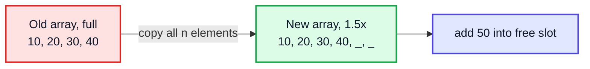

That copy is O(n). It's rare enough that appending is O(1) **amortised**, but inserting at the front or middle is still O(n) every time because of shifting, and the spare capacity is wasted memory.

> [!NOTE]
> A linked list fixes exactly these points: it grows one node at a time with no copying, and inserting at the head (or anywhere you already hold a reference to) is O(1). The price: no random access, so `get(i)` becomes O(n).

---

## 2. Working of LinkedList (4:08)

### Nodes scattered in the heap

Every element is wrapped in a `Node` object created with `new`, so nodes end up wherever the heap has room. The only thing tying them together is that each node stores the **reference** (address) of the next node.

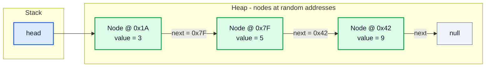

### Array vs linked list in memory

| | Array | Linked list |
|---|---|---|
| Memory layout | Contiguous | Scattered, linked by references |
| Size | Fixed (ArrayList: resized by copying) | Grows/shrinks one node at a time |
| Access `i`-th element | O(1): `base + i × size` | O(n): walk `i` links from head |
| Insert/delete at front | O(n) shift | O(1) |
| Insert/delete in middle | O(n) shift | O(1) once you're at the node, O(n) to get there |
| Extra memory | none (ArrayList: unused capacity) | one reference per node (two for doubly) + object header |
| Cache-friendliness | Excellent | Poor (nodes not adjacent) |

> [!TIP]
> In practice `ArrayList` usually wins on speed because of CPU caching, even for operations where linked lists have better big-O. Linked lists shine when you insert/delete at the ends or at positions you already hold, and they are the foundation for stacks, queues, hash-map buckets, LRU caches and graphs (adjacency lists).

---

**Singly LinkedList**

## 3. Singly LinkedList (6:18)

### The `Node`

Each node has two parts: the **data** and a reference to the **next node**. The last node's `next` is `null`.

```java
class Node {
    int value;
    Node next;            // reference to an object of the same class

    Node(int value) {
        this.value = value;
    }

    Node(int value, Node next) {
        this.value = value;
        this.next = next;
    }
}
```

A class that holds a reference to its own type is called **self-referential**. `Node next` doesn't contain another node, it contains just an address (or `null`), so there's no infinite size problem.

### The list class: `head`, `tail`, `size`

Kunal's `LL` class keeps three fields:

```java
public class LL {
    private Node head;    // first node
    private Node tail;    // last node: makes insertLast O(1)
    private int size;     // number of nodes: makes size() O(1)

    public LL() {
        this.size = 0;
    }

    private class Node { /* as above */ }
}
```

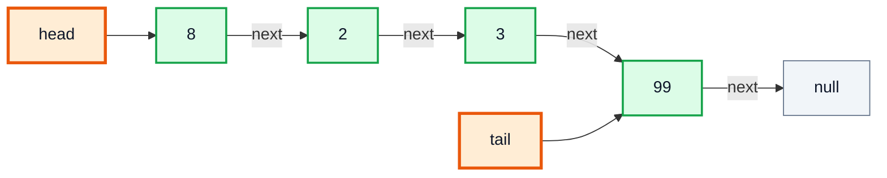

| Field | Without it | With it |
|---|---|---|
| `head` | Impossible: nothing points into the list | Entry point for every operation |
| `tail` | `insertLast` must walk to the end: O(n) | `insertLast` is O(1) |
| `size` | Counting means walking the list: O(n) | O(1), and easy index checks |

> [!NOTE]
> `Node` is a **private inner class** of `LL`: users of the list call `list.insertFirst(5)` and never see nodes. That's encapsulation (OOP 3). It could also be `private static class Node` since it doesn't need the outer `LL` instance; that saves one hidden reference per node. Both work.

---

## 4. Insertion in Singly LinkedList (16:25)

### `insertFirst`: add at the head

Steps:
1. Create the new node.
2. Point its `next` at the current `head`.
3. Move `head` to the new node.
4. If the list was empty, `tail` must also point to it.

```java
public void insertFirst(int val) {
    Node node = new Node(val);
    node.next = head;
    head = node;

    if (tail == null) {    // first node ever: it is also the last
        tail = head;
    }
    size += 1;
}
```

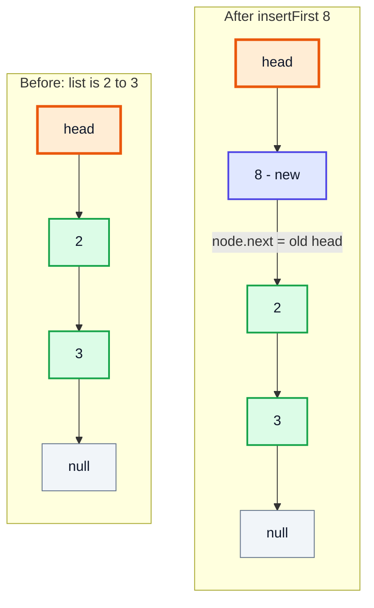

> [!WARNING]
> Order matters. If you write `head = node;` **before** `node.next = head;`, then `node.next` points to itself and the rest of the list is lost (and becomes garbage).

### Dry run

| Call | Step | `head` | `tail` | List | `size` |
|---|---|---|---|---|---|
| start | | null | null | (empty) | 0 |
| `insertFirst(3)` | tail was null → tail = head | 3 | 3 | 3 → END | 1 |
| `insertFirst(2)` | | 2 | 3 | 2 → 3 → END | 2 |
| `insertFirst(8)` | | 8 | 3 | 8 → 2 → 3 → END | 3 |

**Complexity:** O(1) time, O(1) extra space.

---

## 5. Display Singly LinkedList (22:41)

Walk from `head` with a temporary reference until it becomes `null`:

```java
public void display() {
    Node temp = head;
    while (temp != null) {
        System.out.print(temp.value + " -> ");
        temp = temp.next;
    }
    System.out.println("END");
}
```

```java
LL list = new LL();
list.insertFirst(3);
list.insertFirst(2);
list.insertFirst(8);
list.display();     // 8 -> 2 -> 3 -> END
```

| Iteration | `temp` points to | Printed so far |
|---|---|---|
| 1 | 8 | `8 -> ` |
| 2 | 2 | `8 -> 2 -> ` |
| 3 | 3 | `8 -> 2 -> 3 -> ` |
| 4 | null 🟥 loop ends | `8 -> 2 -> 3 -> END` |

> [!IMPORTANT]
> Use a **temporary** reference (`temp`), never move `head` itself while displaying. If you wrote `head = head.next` in the loop, after printing, `head` would be `null` and the whole list would be unreachable (garbage collected).

**Complexity:** O(n) time, O(1) space.

> [!TIP]
> In real classes, override `toString()` instead of printing directly (use a `StringBuilder`). Then `System.out.println(list)` works and you can test the output.

---

## 6. Insertion in Singly LinkedList [Continuation] (29:28)

### `insertLast`: add at the tail

Thanks to `tail`, no traversal is needed:

```java
public void insertLast(int val) {
    if (tail == null) {        // empty list: same as inserting first
        insertFirst(val);
        return;
    }
    Node node = new Node(val);
    tail.next = node;
    tail = node;
    size++;
}
```

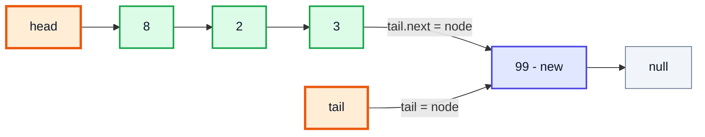

**Complexity:** O(1). Without a `tail` field it would be O(n) (walk to the last node first).

### `insert(val, index)`: add at any position

**Approach:** to insert at `index`, you need the node **just before** it (at `index - 1`), because that's the node whose `next` must change.

1. `index == 0` → `insertFirst`. `index == size` → `insertLast`.
2. Walk `temp` from `head` forward `index - 1` times.
3. New node's `next` = `temp.next`; then `temp.next` = new node.

```java
public void insert(int val, int index) {
    if (index == 0) {
        insertFirst(val);
        return;
    }
    if (index == size) {
        insertLast(val);
        return;
    }

    Node temp = head;
    for (int i = 1; i < index; i++) {
        temp = temp.next;              // stops at index - 1
    }

    Node node = new Node(val, temp.next);   // new node -> old node at index
    temp.next = node;                        // previous node -> new node
    size++;
}
```

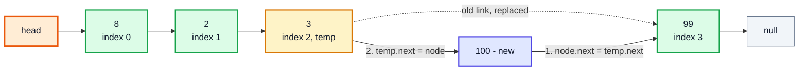

### Dry run: `insert(100, 3)` on `8 -> 2 -> 3 -> 99`

| Step | `i` | `temp` | Action |
|---|---|---|---|
| init | | 8 | `index (3) ≠ 0`, `≠ size (4)` |
| loop | 1 | 8 → 2 | `1 < 3` ✅ move |
| loop | 2 | 2 → 3 | `2 < 3` ✅ move |
| loop | 3 | 3 | `3 < 3` ❌ stop: 🟧 `temp` = node at index 2 |
| link | | 3 | `node = new Node(100, temp.next)` → 100 → 99 |
| link | | 3 | `temp.next = node` → 3 → 100 |

Result: `8 -> 2 -> 3 -> 100 -> 99 -> END`, `size = 5`.

| Operation | Time | Space |
|---|---|---|
| `insertFirst` | O(1) | O(1) |
| `insertLast` (with `tail`) | O(1) | O(1) |
| `insert(val, index)` | O(index), worst O(n) | O(1) |

> [!CAUTION]
> Kunal's version doesn't validate `index`. In real code add `if (index < 0 || index > size) throw new IndexOutOfBoundsException(...)`, otherwise a large index causes a `NullPointerException` deep inside the loop. The Complete Example includes the check.

---

## 7. Deletion in Singly LinkedList (40:04)

Deleting a node means making the list **skip** it. Once nothing references the removed node, the garbage collector frees it; no manual `free`/`delete` is needed in Java.

### `deleteFirst`

```java
public int deleteFirst() {
    int val = head.value;
    head = head.next;
    if (head == null) {    // list became empty
        tail = null;
    }
    size--;
    return val;
}
```

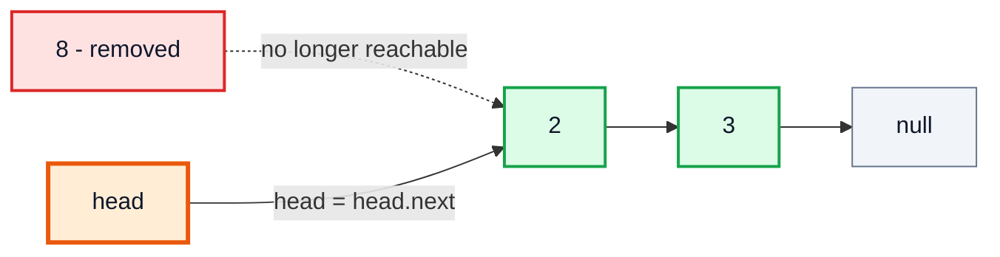

### `get(index)`: a helper that returns the node

```java
public Node get(int index) {
    Node node = head;
    for (int i = 0; i < index; i++) {
        node = node.next;
    }
    return node;
}
```

### `deleteLast`

In a **singly** list you can't go backwards from `tail`, so you have to find the **second-last** node (index `size - 2`) and make it the new tail:

```java
public int deleteLast() {
    if (size <= 1) {
        return deleteFirst();
    }
    Node secondLast = get(size - 2);
    int val = tail.value;
    tail = secondLast;
    tail.next = null;
    size--;
    return val;
}
```

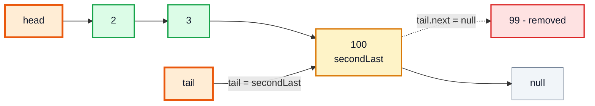

> [!NOTE]
> Even with a `tail` pointer, `deleteLast` on a singly linked list is **O(n)**. This is one of the main reasons doubly linked lists exist (and why `java.util.LinkedList` is doubly linked).

### `delete(index)`

Same idea as `insert`: go to the node **before** the target and bypass the target.

```java
public int delete(int index) {
    if (index == 0) {
        return deleteFirst();
    }
    if (index == size - 1) {
        return deleteLast();
    }

    Node prev = get(index - 1);
    int val = prev.next.value;
    prev.next = prev.next.next;    // skip over the node at index
    size--;
    return val;
}
```

### Dry run: `delete(1)` on `2 -> 3 -> 100`

| Step | Value | Notes |
|---|---|---|
| `index == 0`? | ❌ | |
| `index == size - 1` (2)? | ❌ | |
| `prev = get(0)` | 🟧 node 2 | |
| `val = prev.next.value` | 3 | the node to remove |
| `prev.next = prev.next.next` | 2 → 100 | 🟥 node 3 now unreachable |
| result | `2 -> 100 -> END` | returns 3, size 2 |

### `find(value)`

```java
public Node find(int value) {
    Node node = head;
    while (node != null) {
        if (node.value == value) {
            return node;
        }
        node = node.next;
    }
    return null;
}
```

| Operation | Time | Why |
|---|---|---|
| `deleteFirst` | O(1) | Just move `head` |
| `deleteLast` | O(n) | Must find the second-last node |
| `delete(index)` | O(index) | Walk to `index - 1` |
| `get(index)` | O(index) | No random access |
| `find(value)` | O(n) | Linear search |

> [!WARNING]
> `deleteFirst` on an empty list throws `NullPointerException` at `head.value`. Kunal's code assumes the list isn't empty; a production version should check `if (head == null)` and throw a clearer exception or return a sentinel.

### Practice

The full set of operations above is exactly **LeetCode 707 – Design Linked List**. Building it yourself is a good test that you've understood this section.

---

## 8. Some Common Doubts (54:48)

**Q: Why use `temp` instead of moving `head`?**
`head` is the only way into the list. Move it and every node before its new position becomes unreachable. Temporary references are free to move.

**Q: What happens to a deleted node?**
Nothing points to it any more, so it becomes eligible for **garbage collection** (video #5). You don't need to set its `next` to `null`, though doing so can help the GC in some cases and makes debugging clearer.

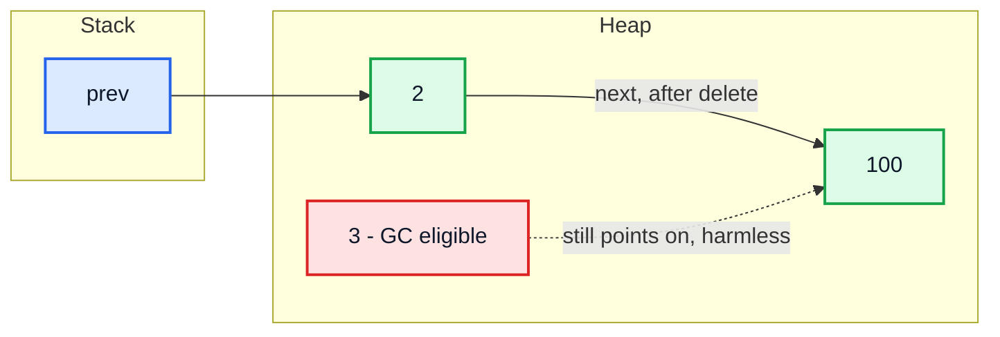

A node pointing *out* doesn't keep it alive; only references *into* it from reachable objects do.

**Q: Why is `Node` declared inside `LL`?**
It's an implementation detail. Making it `private` means no outside code can create broken chains. Questions on LeetCode give you a public `ListNode` class instead, because there they want you to touch nodes directly.

**Q: Why do we need `size` and `tail`? They aren't part of the definition.**
They're optimisations. A "pure" linked list only needs `head`. `tail` makes appending O(1) and `size` makes length O(1), at the cost of keeping them updated in every method. Forgetting to update them is the most common bug.

**Q: `node.next.next`: what does it mean?**
Read it left to right: the node after the node after `node`. It's `null`-unsafe: if `node.next` is `null`, you get a `NullPointerException`. Always know your list has enough nodes first.

**Q: Is `java.util.LinkedList` singly or doubly linked?**
**Doubly**, and it keeps both `first` and `last`. It implements `List` and `Deque`, so it doubles as a queue/stack.

```java
import java.util.LinkedList;

public class BuiltIn {
    public static void main(String[] args) {
        LinkedList<Integer> ll = new LinkedList<>();
        ll.addFirst(3);
        ll.addFirst(2);
        ll.addLast(99);
        ll.add(2, 100);
        System.out.println(ll);              // [2, 3, 100, 99]
        System.out.println(ll.getFirst());   // 2
        System.out.println(ll.removeLast()); // 99  (O(1), thanks to prev links)
    }
}
```

**Q: Should I use `LinkedList` instead of `ArrayList` in practice?**
Almost never for a plain list: `ArrayList` is faster for most real workloads. For a queue/stack, `ArrayDeque` is usually faster than `LinkedList` too. Learn linked lists for the concepts and the interview problems.

---

**Doubly LinkedList**

## 9. Doubly LinkedList (1:00:46)

### Basics

Each node has **two** references: `next` (forward) and `prev` (backward). The first node's `prev` and the last node's `next` are `null`.

```java
private class Node {
    int val;
    Node next;
    Node prev;

    Node(int val) {
        this.val = val;
    }

    Node(int val, Node next, Node prev) {
        this.val = val;
        this.next = next;
        this.prev = prev;
    }
}
```

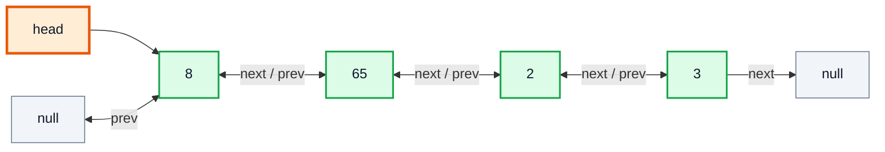

### Singly vs doubly

| | Singly | Doubly |
|---|---|---|
| References per node | 1 (`next`) | 2 (`next`, `prev`) |
| Traverse backwards | ❌ | ✅ |
| Delete a node you hold a reference to | O(n): need the previous node | **O(1)**: `node.prev` is right there |
| `deleteLast` with `tail` | O(n) | **O(1)** |
| Insert before a given node | O(n) | O(1) |
| Memory | Less | One extra reference per node |
| Code complexity | Simpler | Every operation updates up to 4 links |

> [!TIP]
> The "update up to 4 links" rule is how you check a doubly linked list operation: for an insert between `p` and `q`, you need `node.prev = p`, `node.next = q`, `p.next = node`, `q.prev = node`. Count them in your code.

---

## 10. Insertion in Doubly LinkedList (1:08:52)

### `insertFirst`

```java
public void insertFirst(int val) {
    Node node = new Node(val);
    node.next = head;
    node.prev = null;
    if (head != null) {
        head.prev = node;   // old head points back to the new node
    }
    head = node;
}
```

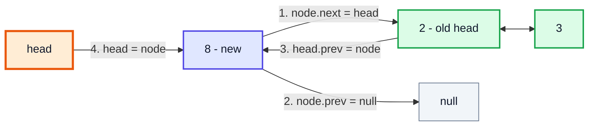

> [!WARNING]
> The `if (head != null)` check is essential: on an empty list, `head.prev = node` would throw `NullPointerException`.

**Complexity:** O(1).

---

## 11. Display Doubly LinkedList (1:10:30)

Forward display is the same as for a singly list:

```java
public void display() {
    Node node = head;
    while (node != null) {
        System.out.print(node.val + " -> ");
        node = node.next;
    }
    System.out.println("END");
}
```

```java
DLL list = new DLL();
list.insertFirst(3);
list.insertFirst(2);
list.insertFirst(8);
list.display();          // 8 -> 2 -> 3 -> END
```

---

## 12. Reversal of LinkedList (1:13:12)

### Printing in reverse with `prev`

In this section Kunal prints the doubly list **backwards**. While walking forward, remember the last non-null node; then walk back along `prev`:

```java
public void display() {
    Node node = head;
    Node last = null;
    while (node != null) {
        System.out.print(node.val + " -> ");
        last = node;            // remember the most recent node
        node = node.next;
    }
    System.out.println("END");

    System.out.println("Print in reverse");
    while (last != null) {
        System.out.print(last.val + " -> ");
        last = last.prev;
    }
    System.out.println("START");
}
// 8 -> 2 -> 3 -> END
// Print in reverse
// 3 -> 2 -> 8 -> START
```

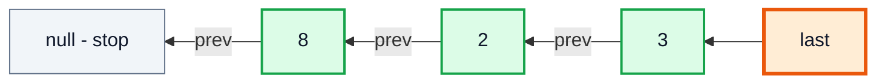

> [!NOTE]
> Why `last` and not `node`? When the forward loop ends, `node` is `null`, and you can't go backwards from `null`. `last` holds the final real node. If the class kept a `tail` field, you'd start from `tail` directly.

### Actually reversing a list (preview)

Printing in reverse doesn't change the list. **Reversing** it in place, flipping every link, is a classic interview problem (**LeetCode 206 – Reverse Linked List**) that Kunal solves in the linked list questions videos. The iterative idea for a singly list uses three pointers:

```java
// Reverse a singly linked list in place: O(n) time, O(1) space
Node prev = null, curr = head;
while (curr != null) {
    Node next = curr.next;   // save the rest
    curr.next = prev;        // flip the link
    prev = curr;             // advance prev
    curr = next;             // advance curr
}
head = prev;
```

| Step | `prev` | `curr` | List state (8 → 2 → 3) |
|---|---|---|---|
| start | null | 8 | 8 → 2 → 3 |
| 1 | 8 | 2 | null ← 8, 2 → 3 |
| 2 | 2 | 3 | null ← 8 ← 2, 3 |
| 3 | 3 | null | null ← 8 ← 2 ← 3 ✅ |

For a **doubly** list, reversing means swapping `next` and `prev` in every node and moving `head` to the old last node.

---

## 13. Insertion in Doubly LinkedList [Continuation] (1:16:07)

### `insertLast` (no `tail` field)

Kunal's DLL keeps only `head`, so he walks to the last node first:

```java
public void insertLast(int val) {
    Node node = new Node(val);
    Node last = head;
    node.next = null;

    if (head == null) {          // empty list
        node.prev = null;
        head = node;
        return;
    }

    while (last.next != null) {
        last = last.next;
    }
    last.next = node;
    node.prev = last;
}
```

**Complexity:** O(n) here; add a `tail` field (and maintain it everywhere) to make it O(1), like the singly list.

### `find` and `insert(after, val)`

Insert a new node right after the node holding value `after`:

```java
public Node find(int value) {
    Node node = head;
    while (node != null) {
        if (node.val == value) {
            return node;
        }
        node = node.next;
    }
    return null;
}

public void insert(int after, int val) {
    Node p = find(after);
    if (p == null) {
        System.out.println("does not exist");
        return;
    }

    Node node = new Node(val);
    node.next = p.next;          // 1
    p.next = node;               // 2
    node.prev = p;               // 3
    if (node.next != null) {     // not inserting at the end
        node.next.prev = node;   // 4
    }
}
```

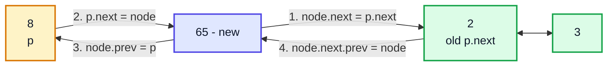

### Dry run: `insert(8, 65)` on `8 <-> 2 <-> 3`

| Step | Code | Effect |
|---|---|---|
| find | `p = find(8)` | 🟧 p = node 8 |
| 1 | `node.next = p.next` | 65 → 2 |
| 2 | `p.next = node` | 8 → 65 |
| 3 | `node.prev = p` | 65 ← 8 (back link) |
| 4 | `node.next.prev = node` | 2's prev = 65 |
| result | | `8 <-> 65 <-> 2 <-> 3` ✅ |

> [!CAUTION]
> Step 1 must happen **before** step 2. If you do `p.next = node` first, you've lost the only reference to the old `p.next` (node 2) and the rest of the list.

> [!IMPORTANT]
> Step 4's `if` handles insertion after the **last** node: there is no next node whose `prev` needs fixing. Forgetting it gives a `NullPointerException` at the end of the list.

### Doubly list operations at a glance

| Operation | Time (head only) | Time (head + tail) |
|---|---|---|
| `insertFirst` | O(1) | O(1) |
| `insertLast` | O(n) | O(1) |
| `insert(after, val)` | O(n) to find, O(1) to link | same |
| `deleteFirst` / `deleteLast` | O(1) / O(n) | O(1) / O(1) |
| delete a node you hold | O(1) | O(1) |
| display forward / backward | O(n) | O(n) |

---

**Circular LinkedList**

## 14. Circular LinkedList (1:37:35)

### Basics

In a **circular** linked list, the last node's `next` points back to the **first** node instead of `null`. There is no end: starting anywhere, following `next` brings you back around.

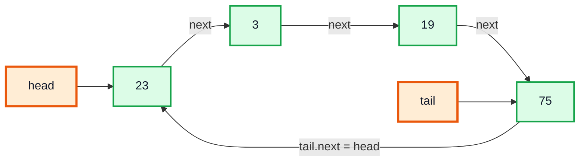

| Kind | Last node's `next` | Example uses |
|---|---|---|
| Singly | `null` | Simple lists, stacks |
| Doubly | `null` (first's `prev` also `null`) | Browser history, LRU cache, `java.util.LinkedList` |
| Circular singly | `head` | Round-robin CPU scheduling, multiplayer turn order, circular buffers |
| Circular doubly | `head`, and `head.prev = tail` | Music playlist "repeat all", Fibonacci heap internals |

> [!NOTE]
> With a circular list, keeping just `tail` is enough: `tail.next` **is** the head. Kunal keeps both `head` and `tail` for clarity.

### Why you can't use `while (node != null)`

No node's `next` is ever `null`, so a `null`-terminated loop runs forever. Instead, stop when you get **back to `head`**.

---

## 15. Insertion in Circular LinkedList (1:42:46)

Insert at the end (after `tail`), then close the circle:

```java
public void insert(int val) {
    Node node = new Node(val);
    if (head == null) {
        head = node;
        tail = node;
        node.next = node;     // a single node points to itself
        return;
    }
    tail.next = node;         // old tail -> new node
    node.next = head;         // new node -> head (closes the circle)
    tail = node;              // new node is the tail
}
```

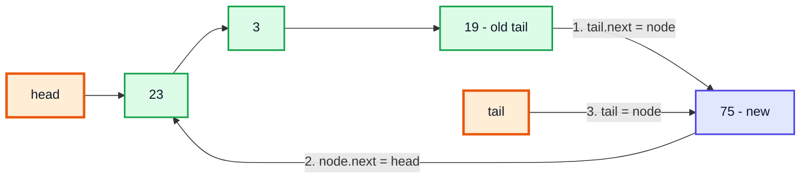

> [!WARNING]
> In the video's version, the first inserted node keeps `next = null` until a second node arrives. If you display a one-node list at that point, the `do-while` in the next section follows `null` and throws `NullPointerException`. Setting `node.next = node` for the first node (as above) keeps the list truly circular at every size.

**Complexity:** O(1) thanks to `tail`.

---

## 16. Display Circular LinkedList (1:43:49)

Use a **`do-while`** loop: the body must run at least once, because the very first check `node != head` would be false immediately with a normal `while`.

```java
public void display() {
    Node node = head;
    if (head != null) {
        do {
            System.out.print(node.val + " -> ");
            node = node.next;
        } while (node != head);
    }
    System.out.println("HEAD");
}
```

```java
CLL list = new CLL();
list.insert(23);
list.insert(3);
list.insert(19);
list.insert(75);
list.display();   // 23 -> 3 -> 19 -> 75 -> HEAD
```

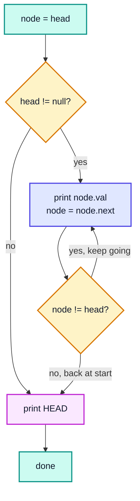

| Iteration | `node` before | Printed | `node` after | `node != head`? |
|---|---|---|---|---|
| 1 | 23 | `23 -> ` | 3 | ✅ |
| 2 | 3 | `3 -> ` | 19 | ✅ |
| 3 | 19 | `19 -> ` | 75 | ✅ |
| 4 | 75 | `75 -> ` | 23 | ❌ stop |

---

## 17. Deletion in Circular LinkedList (1:47:28)

Delete the first node whose value matches.

**Approach:**
1. Empty list → nothing to do.
2. If `head` holds the value: move `head` forward and re-close the circle with `tail.next = head`.
3. Otherwise walk with `node`, looking at `node.next`. When `node.next` holds the value, bypass it: `node.next = node.next.next`. Stop once you've gone all the way round.

```java
public void delete(int val) {
    Node node = head;
    if (node == null) {
        return;
    }

    if (node.val == val) {
        if (head == tail) {          // only one node
            head = null;
            tail = null;
            return;
        }
        head = head.next;
        tail.next = head;
        return;
    }

    do {
        Node n = node.next;
        if (n.val == val) {
            node.next = n.next;
            if (n == tail) {         // removed the last node
                tail = node;
            }
            break;
        }
        node = node.next;
    } while (node != head);
}
```

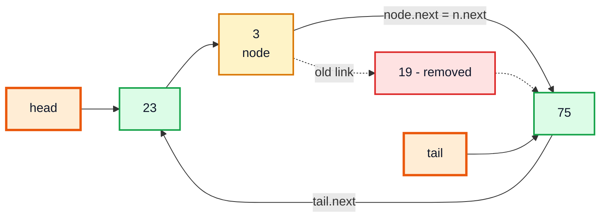

### Dry run: `delete(19)` on `23 -> 3 -> 19 -> 75 -> (head)`

| Iteration | `node` | `n = node.next` | `n.val == 19`? | Action |
|---|---|---|---|---|
| head check | 23 | | ❌ (23) | go to loop |
| 1 | 23 | 3 | ❌ | `node = 3` |
| 2 | 3 | 19 | ✅ | `3.next = 75` 🟥 19 removed, break |

Result: `23 -> 3 -> 75 -> HEAD`.

> [!NOTE]
> Two edge cases the video's code doesn't handle, both fixed above:
> - **Deleting the tail:** without `if (n == tail) tail = node;`, `tail` still points at the removed node, so the next `insert` would attach to a node that's no longer in the circle.
> - **Deleting the only node:** `head = head.next` would just point `head` back at the same node. The list must become empty instead.

| Operation | Time | Space |
|---|---|---|
| `insert` (at tail) | O(1) | O(1) |
| `display` | O(n) | O(1) |
| `delete(val)` | O(n) | O(1) |

---

## 18. Outro (1:54:21)

You now have working singly, doubly and circular linked lists and, more importantly, the habit of drawing every pointer change. Next comes recursion on linked lists and the interview questions: detecting a cycle (LeetCode 141), finding the middle (876), merging two sorted lists (21), reversing (206) and more.

> [!TIP]
> Before each practice problem, ask the four edge-case questions: **What if the list is empty? Has one node? Is the change at the head? At the tail?** Most linked list bugs live in exactly those four places.

---

## 🧩 Complete Example: Everything Together

One program with all three list types (including the bounds checks and circular-list edge cases discussed above), plus `java.util.LinkedList` for comparison.

```java
import java.util.LinkedList;

public class LinkedListDemo {

    // ═══════════════ SINGLY LINKED LIST ═══════════════
    static class LL {
        private Node head;
        private Node tail;
        private int size;

        private class Node {
            int value;
            Node next;
            Node(int value) { this.value = value; }
            Node(int value, Node next) { this.value = value; this.next = next; }
        }

        void insertFirst(int val) {
            Node node = new Node(val);
            node.next = head;
            head = node;
            if (tail == null) tail = head;
            size++;
        }

        void insertLast(int val) {
            if (tail == null) { insertFirst(val); return; }
            Node node = new Node(val);
            tail.next = node;
            tail = node;
            size++;
        }

        void insert(int val, int index) {
            if (index < 0 || index > size) throw new IndexOutOfBoundsException("index " + index);
            if (index == 0)    { insertFirst(val); return; }
            if (index == size) { insertLast(val);  return; }
            Node temp = head;
            for (int i = 1; i < index; i++) temp = temp.next;   // stop at index-1
            temp.next = new Node(val, temp.next);
            size++;
        }

        int deleteFirst() {
            if (head == null) throw new IllegalStateException("empty list");
            int val = head.value;
            head = head.next;
            if (head == null) tail = null;
            size--;
            return val;
        }

        Node get(int index) {
            Node node = head;
            for (int i = 0; i < index; i++) node = node.next;
            return node;
        }

        int deleteLast() {
            if (size <= 1) return deleteFirst();
            Node secondLast = get(size - 2);
            int val = tail.value;
            tail = secondLast;
            tail.next = null;
            size--;
            return val;
        }

        int delete(int index) {
            if (index < 0 || index >= size) throw new IndexOutOfBoundsException("index " + index);
            if (index == 0)        return deleteFirst();
            if (index == size - 1) return deleteLast();
            Node prev = get(index - 1);
            int val = prev.next.value;
            prev.next = prev.next.next;
            size--;
            return val;
        }

        int find(int value) {          // returns index, -1 if absent
            Node node = head;
            int i = 0;
            while (node != null) {
                if (node.value == value) return i;
                node = node.next;
                i++;
            }
            return -1;
        }

        void display() {
            StringBuilder sb = new StringBuilder();
            for (Node t = head; t != null; t = t.next) sb.append(t.value).append(" -> ");
            System.out.println(sb.append("END").append("   (size=").append(size)
                    .append(", head=").append(head == null ? "null" : head.value)
                    .append(", tail=").append(tail == null ? "null" : tail.value).append(")"));
        }
    }

    // ═══════════════ DOUBLY LINKED LIST ═══════════════
    static class DLL {
        private Node head;

        private class Node {
            int val;
            Node next, prev;
            Node(int val) { this.val = val; }
        }

        void insertFirst(int val) {
            Node node = new Node(val);
            node.next = head;
            if (head != null) head.prev = node;
            head = node;
        }

        void insertLast(int val) {
            Node node = new Node(val);
            if (head == null) { head = node; return; }
            Node last = head;
            while (last.next != null) last = last.next;
            last.next = node;
            node.prev = last;
        }

        Node find(int value) {
            for (Node n = head; n != null; n = n.next) if (n.val == value) return n;
            return null;
        }

        void insertAfter(int after, int val) {
            Node p = find(after);
            if (p == null) { System.out.println(after + " does not exist"); return; }
            Node node = new Node(val);
            node.next = p.next;
            node.prev = p;
            p.next = node;
            if (node.next != null) node.next.prev = node;
        }

        void display() {
            StringBuilder fwd = new StringBuilder();
            Node last = null;
            for (Node n = head; n != null; n = n.next) { fwd.append(n.val).append(" <-> "); last = n; }
            System.out.println("Forward : " + fwd + "END");
            StringBuilder rev = new StringBuilder();
            for (Node n = last; n != null; n = n.prev) rev.append(n.val).append(" <-> ");
            System.out.println("Backward: " + rev + "START");
        }
    }

    // ═══════════════ CIRCULAR LINKED LIST ═══════════════
    static class CLL {
        private Node head, tail;

        private class Node {
            int val;
            Node next;
            Node(int val) { this.val = val; }
        }

        void insert(int val) {
            Node node = new Node(val);
            if (head == null) {
                head = tail = node;
                node.next = node;          // a single node points to itself
                return;
            }
            tail.next = node;
            node.next = head;
            tail = node;
        }

        void delete(int val) {
            if (head == null) return;
            if (head.val == val) {
                if (head == tail) { head = tail = null; return; }   // only node
                head = head.next;
                tail.next = head;
                return;
            }
            Node node = head;
            do {
                Node n = node.next;
                if (n.val == val) {
                    node.next = n.next;
                    if (n == tail) tail = node;
                    return;
                }
                node = n;
            } while (node != head);
        }

        void display() {
            StringBuilder sb = new StringBuilder();
            if (head != null) {
                Node node = head;
                do { sb.append(node.val).append(" -> "); node = node.next; } while (node != head);
            }
            System.out.println(sb.append("HEAD").append(head == null ? "" : "   (tail.next=" + tail.next.val + ")"));
        }
    }

    public static void main(String[] args) {
        System.out.println("===== Singly Linked List =====");
        LL list = new LL();
        list.insertFirst(3);
        list.insertFirst(2);
        list.insertFirst(8);
        list.insertLast(99);
        list.display();
        list.insert(100, 3);
        list.display();
        System.out.println("deleteFirst -> " + list.deleteFirst());
        System.out.println("deleteLast  -> " + list.deleteLast());
        list.display();
        System.out.println("delete(1)   -> " + list.delete(1));
        list.display();
        System.out.println("find(100) at index " + list.find(100) + ", find(42) -> " + list.find(42));

        System.out.println("\n===== Doubly Linked List =====");
        DLL dll = new DLL();
        dll.insertFirst(3);
        dll.insertFirst(2);
        dll.insertFirst(8);
        dll.insertLast(99);
        dll.insertAfter(8, 65);
        dll.insertAfter(99, 7);
        dll.insertAfter(42, 1);
        dll.display();

        System.out.println("\n===== Circular Linked List =====");
        CLL cll = new CLL();
        cll.insert(23);
        cll.display();
        cll.insert(3);
        cll.insert(19);
        cll.insert(75);
        cll.display();
        cll.delete(19);
        cll.display();
        cll.delete(75);                   // deleting the tail updates tail
        cll.display();
        cll.delete(23);                   // deleting the head
        cll.display();
        cll.delete(3);                    // deleting the only node
        cll.display();

        System.out.println("\n===== java.util.LinkedList =====");
        LinkedList<Integer> jll = new LinkedList<>();
        jll.addFirst(3);
        jll.addFirst(2);
        jll.addLast(99);
        jll.add(2, 100);
        System.out.println(jll + " first=" + jll.getFirst() + " last=" + jll.getLast());
        jll.removeFirst();
        jll.removeLast();
        System.out.println(jll + " reversed=" + jll.reversed());
    }
}
```

**Expected Output:**
```
===== Singly Linked List =====
8 -> 2 -> 3 -> 99 -> END   (size=4, head=8, tail=99)
8 -> 2 -> 3 -> 100 -> 99 -> END   (size=5, head=8, tail=99)
deleteFirst -> 8
deleteLast  -> 99
2 -> 3 -> 100 -> END   (size=3, head=2, tail=100)
delete(1)   -> 3
2 -> 100 -> END   (size=2, head=2, tail=100)
find(100) at index 1, find(42) -> -1

===== Doubly Linked List =====
42 does not exist
Forward : 8 <-> 65 <-> 2 <-> 3 <-> 99 <-> 7 <-> END
Backward: 7 <-> 99 <-> 3 <-> 2 <-> 65 <-> 8 <-> START

===== Circular Linked List =====
23 -> HEAD   (tail.next=23)
23 -> 3 -> 19 -> 75 -> HEAD   (tail.next=23)
23 -> 3 -> 75 -> HEAD   (tail.next=23)
23 -> 3 -> HEAD   (tail.next=23)
3 -> HEAD   (tail.next=3)
HEAD

===== java.util.LinkedList =====
[2, 3, 100, 99] first=2 last=99
[3, 100] reversed=[100, 3]
```

> [!NOTE]
> `jll.reversed()` needs **Java 21+** (it comes from the `SequencedCollection` interface). On older versions, use `Collections.reverse(new LinkedList<>(jll))` or `jll.descendingIterator()`.

---

## Quick Reference Cheat Sheet

| Concept | One-Line Summary |
|---|---|
| **Linked list** | Chain of node objects in the heap, each holding a value and a reference to the next |
| **Node** | Self-referential class: `int value; Node next;` (plus `Node prev` for doubly) |
| **`head` / `tail` / `size`** | Entry point / O(1) append / O(1) length; keep all three updated in every method |
| **vs array** | No fixed size, O(1) insert at known spot; but O(n) `get(i)` and more memory |
| **Traverse** | `for (Node t = head; t != null; t = t.next)`; never move `head` itself |
| **insertFirst** | `node.next = head; head = node;` (set `tail` if list was empty), O(1) |
| **insertLast** | `tail.next = node; tail = node;`, O(1) with `tail` |
| **insert(index)** | Walk to `index - 1`, then `node.next = temp.next; temp.next = node;`, O(n) |
| **deleteFirst** | `head = head.next;` (clear `tail` if now empty), O(1) |
| **deleteLast (singly)** | Find second-last with `get(size - 2)`, make it `tail`, O(n) |
| **delete(index)** | `prev = get(index - 1); prev.next = prev.next.next;`, O(n) |
| **Deleted nodes** | Unreachable → garbage collected automatically |
| **Doubly linked** | `next` + `prev`; O(1) delete of a held node; update up to 4 links per insert |
| **Reverse print (doubly)** | Remember `last` while going forward, then follow `prev` |
| **Reverse in place** | `prev`/`curr`/`next` three-pointer loop, O(n) time, O(1) space (LeetCode 206) |
| **Circular** | `tail.next = head`; no `null` end; loop with `do { ... } while (node != head)` |
| **Circular edge cases** | First node points to itself; deleting tail updates `tail`; deleting the only node empties the list |
| **`java.util.LinkedList`** | Doubly linked, implements `List` + `Deque`; `addFirst`, `addLast`, `removeLast` O(1) |
| **Edge-case checklist** | Empty list? One node? Change at head? Change at tail? |
