# Linked List Interview Questions — Complete In-Depth Guide

**Video #45 of the Java + DSA playlist:** *Linked List Interview Questions - Google, Facebook, Amazon, Microsoft* (3:08:10)

A problem-by-problem walkthrough of the 17 linked list questions solved in the video: recursion on lists, removing duplicates, merging, the fast & slow pointer family (cycle detection, cycle length, cycle start, happy number, middle node), sorting a list, and the in-place reversal family (full, partial, k-groups, alternate k-groups, palindrome, reorder, rotate). Every solution has a pointer diagram, code, dry-run and complexity analysis.

---

## Table of Contents

| # | Topic | Timestamp |
|---|---|---|
| 0 | [Introduction](#0-introduction-000) | 0:00 |
| 1 | [Q-01: Recursive Insertion in LinkedList](#1-q-01-recursive-insertion-in-linkedlist-421) | 4:21 |
| 2 | [Q-02: Remove Duplicates from Sorted LinkedList](#2-q-02-remove-duplicates-from-sorted-linkedlist-2445) | 24:45 |
| 3 | [Q-03: Merge Two Sorted LinkedLists](#3-q-03-merge-two-sorted-linkedlists-3530) | 35:30 |
| 4 | [Q-04: LinkedList Cycle](#4-q-04-linkedlist-cycle-4523) | 45:23 |
| 5 | [Q-05: Length of LinkedList Cycle](#5-q-05-length-of-linkedlist-cycle-5930) | 59:30 |
| 6 | [Q-06: LinkedList Cycle II](#6-q-06-linkedlist-cycle-ii-10353) | 1:03:53 |
| 7 | [Q-07: Happy Number](#7-q-07-happy-number-11557) | 1:15:57 |
| 8 | [Q-08: Middle of the LinkedList](#8-q-08-middle-of-the-linkedlist-12727) | 1:27:27 |
| 9 | [Q-09: Sort LinkedList](#9-q-09-sort-linkedlist-13109) | 1:31:09 |
| 10 | [Q-10: Reverse LinkedList (Recursive)](#10-q-10-reverse-linkedlist-recursive-14726) | 1:47:26 |
| 11 | [Q-11: Reverse LinkedList (Iterative)](#11-q-11-reverse-linkedlist-iterative-15612) | 1:56:12 |
| 12 | [Q-12: Reverse LinkedList II](#12-q-12-reverse-linkedlist-ii-20536) | 2:05:36 |
| 13 | [Q-13: Palindrome LinkedList](#13-q-13-palindrome-linkedlist-21814) | 2:18:14 |
| 14 | [Q-14: Reorder LinkedList](#14-q-14-reorder-linkedlist-22714) | 2:27:14 |
| 15 | [Q-15: Reverse k-Nodes in LinkedList](#15-q-15-reverse-k-nodes-in-linkedlist-23852) | 2:38:52 |
| 16 | [Q-16: Reverse Alternate k-Nodes in LinkedList](#16-q-16-reverse-alternate-k-nodes-in-linkedlist-25100) | 2:51:00 |
| 17 | [Q-17: Rotate LinkedList](#17-q-17-rotate-linkedlist-25336) | 2:53:36 |
| 18 | [Outro](#18-outro-30744) | 3:07:44 |

---

## 0. Introduction (0:00)

This video follows the linked list theory lecture (#44) and turns it into **interview skill**. Almost every linked list question is a combination of a handful of patterns:

| Pattern | Questions in this video |
|---|---|
| **Recursion on nodes** | Q-01, Q-10 |
| **Single-pass pointer manipulation** | Q-02, Q-03 |
| **Fast & slow pointers** (Floyd / tortoise-hare) | Q-04, Q-05, Q-06, Q-07, Q-08 |
| **Divide & conquer** | Q-09 |
| **In-place reversal** | Q-11, Q-12, Q-13, Q-14, Q-15, Q-16 |
| **Make it circular, then cut** | Q-17 |

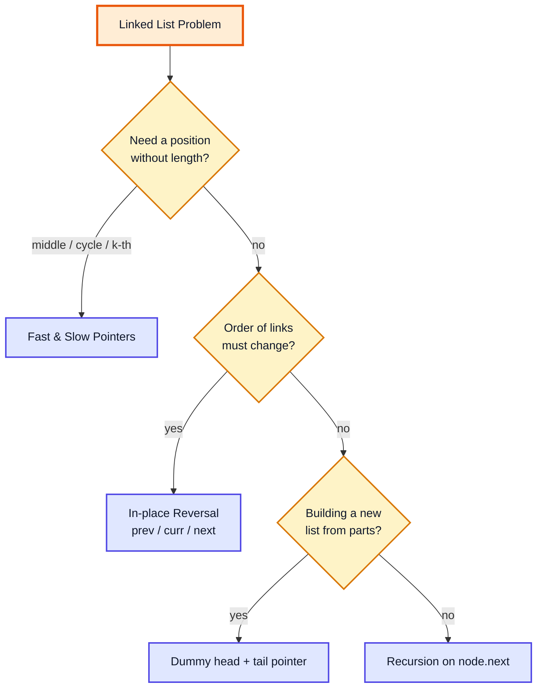

All LeetCode solutions below use the standard node class:

```java
public class ListNode {
    int val;
    ListNode next;
    ListNode(int val) { this.val = val; }
}
```

> [!IMPORTANT]
> Most linked list bugs are one of three things: dereferencing `null` (`fast.next.next` when `fast.next == null`), **losing** the rest of the list (overwriting `curr.next` before saving it), or forgetting to **terminate** the new tail (`tail.next = null`), which creates an accidental cycle. Draw the boxes and arrows before you code.

> [!TIP]
> Interview approach: (1) draw 4–5 nodes, (2) list the pointers you need, (3) write the loop body so it moves every pointer exactly one step, (4) check the edge cases — empty list, one node, two nodes, odd vs even length.

---

## 1. Q-01: Recursive Insertion in LinkedList (4:21)

### Problem

Insert a value at a given index in the custom `LL` class from the previous video — **without a loop**, using recursion.

### Approach

Think of the list as `node` + "the rest of the list". To insert at `index` in the list starting at `node`:

- **Base case:** `index == 0` → the new node goes *here*. Create it, point it at `node`, and return it as the new start of this sub-list.
- **Recursive case:** insert at `index - 1` in `node.next`, and **re-attach** whatever comes back: `node.next = insertRec(...)`.

The trick is that every call **returns the head of its sub-list**, so the parent can re-link it. This "return the new sub-list head" style is used again in Q-10, Q-09 and in trees.

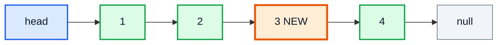

### Code (inside the custom `LL` class)

```java
public void insertRec(int val, int index) {
    head = insertRec(val, index, head);
}

private Node insertRec(int val, int index, Node node) {
    if (index == 0) {
        Node temp = new Node(val, node);   // new node points to the current one
        size++;
        return temp;
    }
    node.next = insertRec(val, index - 1, node.next);
    return node;
}
```

### Call stack for `insertRec(3, 2)` on `1 → 2 → 4`

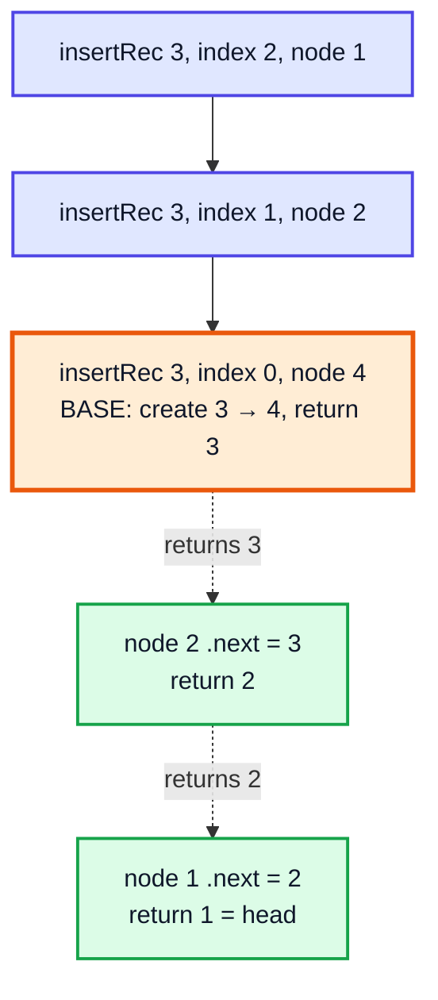

| Call | `index` | `node` | Action | Returns |
|---|---|---|---|---|
| 1 | 2 | 1 | recurse on `1.next` | 1 |
| 2 | 1 | 2 | recurse on `2.next` | 2 |
| 3 | 0 | 4 | 🟧 create `3 → 4` | 3 |

**Complexity:** Time **O(index)**, Space **O(index)** for the recursion stack (the iterative version uses O(1) space).

> [!NOTE]
> Inserting at `index == size` works too: the last call receives `node == null` with `index == 0` and creates a node pointing to `null`. An index larger than `size` throws a `NullPointerException` — validate it in real code.

---

## 2. Q-02: Remove Duplicates from Sorted LinkedList (24:45)

**LeetCode 83 — Remove Duplicates from Sorted List** (Easy)

### Problem

Given the head of a **sorted** list, delete duplicates so each value appears once. `1 → 1 → 2 → 3 → 3` becomes `1 → 2 → 3`.

### Approach

Because the list is sorted, duplicates are **adjacent**. Walk with one pointer `node`:

- If `node.val == node.next.val` → skip the next node: `node.next = node.next.next` (**don't move** `node` — there may be a third copy).
- Otherwise → move `node` forward.

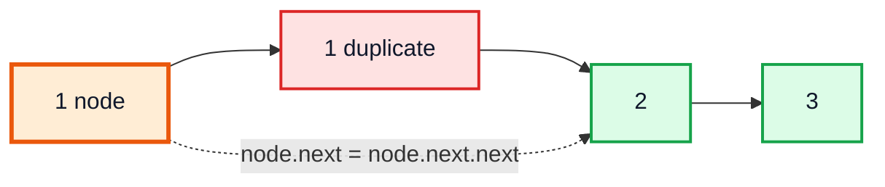

### Code

```java
public ListNode deleteDuplicates(ListNode head) {
    ListNode node = head;
    while (node != null && node.next != null) {
        if (node.val == node.next.val) {
            node.next = node.next.next;   // unlink the duplicate
        } else {
            node = node.next;
        }
    }
    return head;
}
// 1 -> 1 -> 2 -> 3 -> 3 -> 3  ==>  1 -> 2 -> 3
```

### Dry run on `1 → 1 → 2 → 3 → 3 → 3`

| Step | `node` | `node.next` | Equal? | Action | List |
|---|---|---|---|---|---|
| 1 | 1 | 1 | ✅ | skip | 1→2→3→3→3 |
| 2 | 1 | 2 | ❌ | move | 1→2→3→3→3 |
| 3 | 2 | 3 | ❌ | move | — |
| 4 | 3 | 3 | ✅ | skip | 1→2→3→3 |
| 5 | 3 | 3 | ✅ | skip | 1→2→3 |
| 6 | 3 | null | — | loop ends | 1→2→3 |

**Complexity:** Time **O(n)**, Space **O(1)**.

> [!NOTE]
> In the video Kunal writes this inside his own `LL` class and also fixes `tail` at the end (`tail = node; tail.next = null`). On LeetCode there is no `tail` field, so it isn't needed.

**Related:** LC 82 (*Remove Duplicates from Sorted List II*) deletes **all** copies of duplicated values — use a dummy node and skip whole runs.

---

## 3. Q-03: Merge Two Sorted LinkedLists (35:30)

**LeetCode 21 — Merge Two Sorted Lists** (Easy) — asked at Amazon, Microsoft, Apple.

### Problem

Merge two sorted lists into one sorted list by **splicing nodes together** (no new value nodes).

### Approach — dummy head + tail

This is exactly the merge step of merge sort, on nodes. A **dummy** node removes the "is the result empty yet?" special case: always append to `tail.next`, then return `dummy.next`.

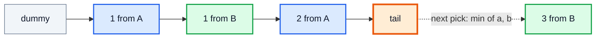

### Code

```java
public ListNode mergeTwoLists(ListNode a, ListNode b) {
    ListNode dummy = new ListNode(0);
    ListNode tail = dummy;
    while (a != null && b != null) {
        if (a.val <= b.val) { tail.next = a; a = a.next; }
        else                { tail.next = b; b = b.next; }
        tail = tail.next;
    }
    tail.next = (a != null) ? a : b;   // attach the leftover part in one step
    return dummy.next;
}
// [1,2,4] + [1,3,4] -> 1 -> 1 -> 2 -> 3 -> 4 -> 4
```

### Dry run `A = 1→2→4`, `B = 1→3→4`

| Step | `a` | `b` | Picked | Result so far |
|---|---|---|---|---|
| 1 | 1 | 1 | a (≤ keeps it stable) | 1 |
| 2 | 2 | 1 | b | 1→1 |
| 3 | 2 | 3 | a | 1→1→2 |
| 4 | 4 | 3 | b | 1→1→2→3 |
| 5 | 4 | 4 | a | 1→1→2→3→4 |
| 6 | null | 4 | attach rest | 1→1→2→3→4→4 |

**Complexity:** Time **O(n + m)**, Space **O(1)** (only pointers re-linked).

### Alternative: recursive merge

```java
public ListNode mergeRec(ListNode a, ListNode b) {
    if (a == null) return b;
    if (b == null) return a;
    if (a.val <= b.val) { a.next = mergeRec(a.next, b); return a; }
    b.next = mergeRec(a, b.next);
    return b;
}
```

Shorter, but uses **O(n + m)** stack space — a very long list can cause `StackOverflowError`.

---

## 4. Q-04: LinkedList Cycle (45:23)

**LeetCode 141 — Linked List Cycle** (Easy) — asked at Amazon, Microsoft, Google.

### Problem

Return `true` if some node's `next` points back to an earlier node (the list never reaches `null`).

### Approach — Floyd's tortoise and hare

Move `slow` by **1** and `fast` by **2**.
- **No cycle:** `fast` reaches `null` first.
- **Cycle:** once both are inside the loop, the gap between them shrinks by **1 each step**, so `fast` must land exactly on `slow` — it can't "jump over" it.

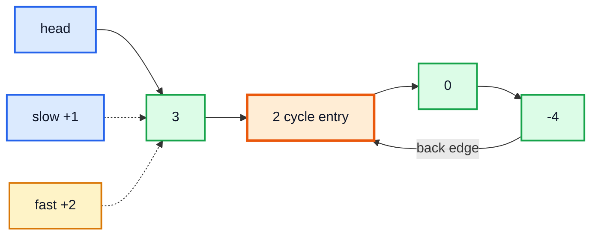

### Code

```java
public boolean hasCycle(ListNode head) {
    ListNode slow = head, fast = head;
    while (fast != null && fast.next != null) {
        slow = slow.next;
        fast = fast.next.next;
        if (slow == fast) return true;   // compare REFERENCES, not values
    }
    return false;
}
```

### Dry run on `3 → 2 → 0 → -4 → (back to 2)`

| Step | `slow` | `fast` | Same node? |
|---|---|---|---|
| 0 | 3 | 3 | start |
| 1 | 2 | 0 | ❌ |
| 2 | 0 | 2 | ❌ |
| 3 | -4 | -4 | ✅ cycle |

**Complexity:** Time **O(n)**, Space **O(1)**.

| Approach | Time | Space | Note |
|---|---|---|---|
| `HashSet<ListNode>` of visited nodes | O(n) | O(n) | Simple; first repeat = cycle |
| **Fast & slow** | O(n) | **O(1)** | Expected interview answer |

> [!WARNING]
> Check `fast != null && fast.next != null` in that order. Short-circuit `&&` stops before `fast.next` is read when `fast` is `null`.

---

## 5. Q-05: Length of LinkedList Cycle (59:30)

### Problem

If the list has a cycle, return the number of nodes in the cycle (0 if none). Commonly asked as a follow-up to Q-04.

### Approach

1. Detect the meeting point with fast & slow (Q-04). The meeting node is **guaranteed to be inside the cycle**.
2. Freeze one pointer; walk another from it until it comes back, counting steps.

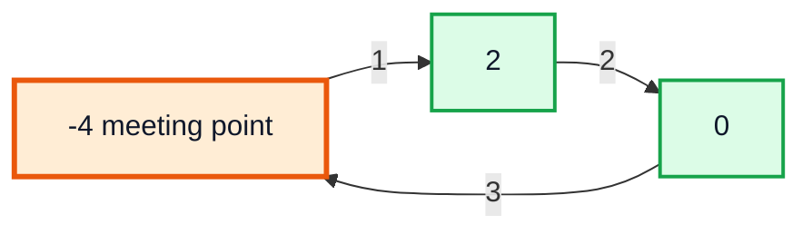

### Code

```java
public int lengthOfCycle(ListNode head) {
    ListNode slow = head, fast = head;
    while (fast != null && fast.next != null) {
        slow = slow.next;
        fast = fast.next.next;
        if (slow == fast) {
            int length = 0;
            ListNode temp = slow;
            do {
                temp = temp.next;
                length++;
            } while (temp != slow);
            return length;
        }
    }
    return 0;
}
// 3 -> 2 -> 0 -> -4 -> (2)  ==>  3
```

**Complexity:** Time **O(n)**, Space **O(1)**.

> [!TIP]
> `do-while` is the natural loop here: you must step at least once before checking "am I back?", otherwise the condition is true immediately.

---

## 6. Q-06: LinkedList Cycle II (1:03:53)

**LeetCode 142 — Linked List Cycle II** (Medium)

### Problem

Return the node where the cycle **begins**, or `null` if there is no cycle.

### Approach 1 (shown in the video) — use the cycle length

1. Find the cycle length `L` (Q-05).
2. Move `second` pointer `L` steps ahead of `first` (both start at `head`).
3. Move both one step at a time. When `second` has gone round the loop exactly once more than `first`, they meet — **at the start of the cycle**.

### Approach 2 — Floyd's maths (no length needed)

Let `a` = distance head → cycle start, `b` = start → meeting point, `c` = cycle length.
When they meet, `fast` has travelled twice as far as `slow`:
`2(a + b) = a + b + k·c` → `a + b = k·c` → **`a = k·c − b`**.
So a pointer from `head` and a pointer from the meeting point, both moving 1 step, meet after `a` steps **at the cycle start**.

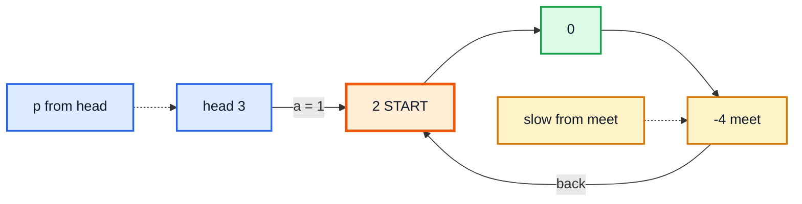

### Code (Approach 1, as in the video)

```java
public ListNode detectCycle(ListNode head) {
    int length = lengthOfCycle(head);       // from Q-05
    if (length == 0) return null;

    ListNode first = head, second = head;
    while (length > 0) {                    // give second a head start of L nodes
        second = second.next;
        length--;
    }
    while (first != second) {
        first = first.next;
        second = second.next;
    }
    return first;
}
```

### Code (Approach 2, Floyd)

```java
public ListNode detectCycle(ListNode head) {
    ListNode slow = head, fast = head;
    while (fast != null && fast.next != null) {
        slow = slow.next;
        fast = fast.next.next;
        if (slow == fast) {
            ListNode p = head;
            while (p != slow) { p = p.next; slow = slow.next; }
            return p;
        }
    }
    return null;
}
```

| Step (phase 2) | `p` | `slow` |
|---|---|---|
| 0 | 3 | -4 |
| 1 | 2 | 2 ✅ start |

**Complexity:** Both approaches — Time **O(n)**, Space **O(1)**.

---

## 7. Q-07: Happy Number (1:15:57)

**LeetCode 202 — Happy Number** (Easy) — asked at Google.

### Problem

Replace `n` with the sum of the squares of its digits, repeatedly. `n` is **happy** if this reaches `1`; otherwise it loops forever in a cycle that doesn't include 1.
`19 → 82 → 68 → 100 → 1` ✅ happy. `2 → 4 → 16 → 37 → 58 → 89 → 145 → 42 → 20 → 4 …` ❌ cycle.

### Approach

There is no linked list here — but the sequence **is** an implicit linked list where `next(n) = squareSum(n)`. "Loops forever" = "has a cycle", so use fast & slow. Stop when they meet; the number is happy if they met at **1** (1 → 1 is a self-loop).

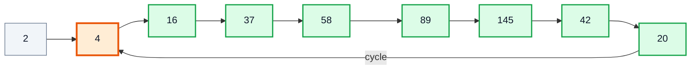

### Code

```java
public boolean isHappy(int n) {
    int slow = n, fast = n;
    do {
        slow = squareSum(slow);
        fast = squareSum(squareSum(fast));
    } while (slow != fast);
    return slow == 1;
}

private int squareSum(int n) {
    int sum = 0;
    while (n > 0) {
        int digit = n % 10;
        sum += digit * digit;
        n /= 10;
    }
    return sum;
}
// isHappy(19) -> true, isHappy(2) -> false
```

### Dry run `n = 19`

| Iteration | `slow` | `fast` |
|---|---|---|
| 1 | 82 | 68 |
| 2 | 68 | 1 |
| 3 | 100 | 1 |
| 4 | 1 | 1 ✅ → happy |

**Complexity:** Time **O(log n)** per step; the number of steps is small (any number quickly drops below 243, since a 3-digit number's square sum is at most 3·81). Space **O(1)**.

**Alternative:** store seen numbers in a `HashSet<Integer>` — O(log n) extra space but very readable.

---

## 8. Q-08: Middle of the LinkedList (1:27:27)

**LeetCode 876 — Middle of the Linked List** (Easy)

### Problem

Return the middle node. With two middles (even length), return the **second** one.

### Approach

`fast` moves 2, `slow` moves 1. When `fast` reaches the end, `slow` has done half the distance → it's at the middle. One pass, no length needed.

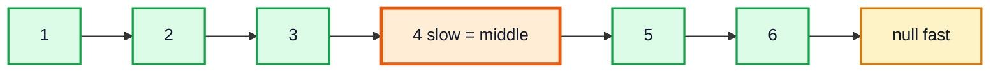

### Code

```java
public ListNode middleNode(ListNode head) {
    ListNode slow = head, fast = head;
    while (fast != null && fast.next != null) {
        slow = slow.next;
        fast = fast.next.next;
    }
    return slow;
}
// [1,2,3,4,5] -> 3     [1,2,3,4,5,6] -> 4
```

| Step | `slow` | `fast` (1..6) |
|---|---|---|
| 0 | 1 | 1 |
| 1 | 2 | 3 |
| 2 | 3 | 5 |
| 3 | 4 | null → stop |

**Complexity:** Time **O(n)**, Space **O(1)**.

> [!TIP]
> Want the **first** middle for even lengths (needed when splitting for merge sort)? Use `while (fast.next != null && fast.next.next != null)`, or track `prev` of `slow` as in Q-09.

---

## 9. Q-09: Sort LinkedList (1:31:09)

**LeetCode 148 — Sort List** (Medium) — asked at Google, Facebook, Microsoft. Follow-up: O(n log n) time.

### Why merge sort?

| Algorithm | On arrays | On linked lists |
|---|---|---|
| Quick sort | Fast (random access, in place) | Awkward partitioning, worst case O(n²) |
| **Merge sort** | Needs O(n) extra array | ✅ **Merging needs no extra space**, just re-linking |
| Bubble sort | O(n²) | O(n²) — the video also shows it, recursively, on the custom `LL` |

### Approach

1. **Split** at the middle (fast & slow), cutting `prev.next = null`.
2. **Sort** each half recursively.
3. **Merge** the two sorted halves (Q-03).

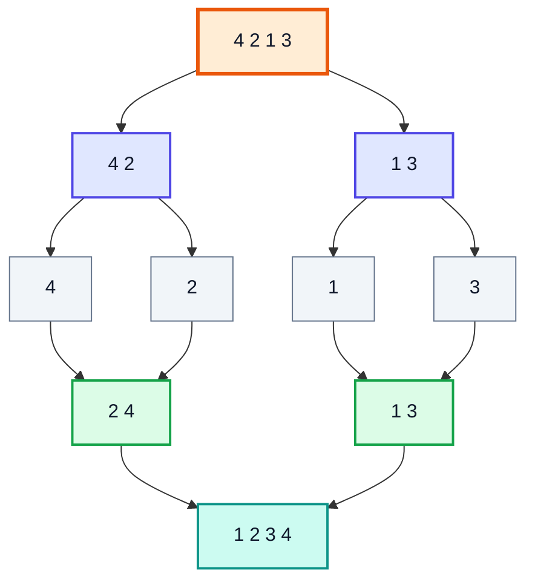

### Code

```java
public ListNode sortList(ListNode head) {
    if (head == null || head.next == null) return head;
    ListNode mid = getMidAndSplit(head);
    ListNode left = sortList(head);
    ListNode right = sortList(mid);
    return mergeTwoLists(left, right);          // from Q-03
}

private ListNode getMidAndSplit(ListNode head) {
    ListNode prev = null, slow = head, fast = head;
    while (fast != null && fast.next != null) {
        prev = slow;
        slow = slow.next;
        fast = fast.next.next;
    }
    prev.next = null;                           // cut: [head..prev] and [slow..end]
    return slow;
}
// [4,2,1,3,-1,5] -> -1 -> 1 -> 2 -> 3 -> 4 -> 5
```

> [!CAUTION]
> If you split with the **second** middle and *don't* cut, a 2-node list `[a, b]` splits into `[a, b]` and `[b]` forever → `StackOverflowError`. Always disconnect the halves.

### Bubble sort on the custom `LL` (also in the video)

Kunal sorts by **swapping nodes** recursively, with `row` = pass number and `col` = position, handling three cases: the swap involves `head`, the swap involves `tail`, or it's in the middle. It's a good pointer exercise, but O(n²) — use merge sort in interviews.

```java
// Simpler value-swapping version of the same idea
public void bubbleSort(ListNode head) {
    for (boolean swapped = true; swapped; ) {
        swapped = false;
        for (ListNode n = head; n != null && n.next != null; n = n.next) {
            if (n.val > n.next.val) {
                int t = n.val; n.val = n.next.val; n.next.val = t;
                swapped = true;
            }
        }
    }
}
```

**Complexity (merge sort):** Time **O(n log n)**, Space **O(log n)** recursion stack. A bottom-up iterative merge sort achieves O(1) extra space.

---

## 10. Q-10: Reverse LinkedList (Recursive) (1:47:26)

### Problem

Reverse the list using recursion.

### Approach — "trust the recursion"

Reverse everything **after** `head`; the old second node is now the **last** node of that reversed part. Hook `head` behind it and cut `head`'s own link.

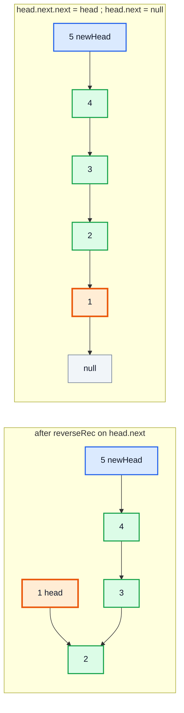

### Code (LeetCode style)

```java
public ListNode reverseList(ListNode head) {
    if (head == null || head.next == null) return head;   // last node is the new head
    ListNode newHead = reverseList(head.next);
    head.next.next = head;    // the node after head now points back to head
    head.next = null;         // head becomes the tail (for now)
    return newHead;
}
```

### Version from the video (custom `LL` with `head` and `tail`)

```java
private void reverse(Node node) {
    if (node == tail) {
        head = tail;
        return;
    }
    reverse(node.next);
    tail.next = node;
    tail = node;
    tail.next = null;
}
```

| Unwinding call | Action | Reversed part |
|---|---|---|
| node = 5 | base: newHead = 5 | 5 |
| node = 4 | 5 → 4 | 5→4 |
| node = 3 | 4 → 3 | 5→4→3 |
| node = 2 | 3 → 2 | 5→4→3→2 |
| node = 1 | 2 → 1, 1 → null | 5→4→3→2→1 |

**Complexity:** Time **O(n)**, Space **O(n)** stack.

---

## 11. Q-11: Reverse LinkedList (Iterative) (1:56:12)

**LeetCode 206 — Reverse Linked List** (Easy) — one of the most asked questions at every big tech company.

### Approach — three pointers

Keep `prev` (reversed part), `present` (node being flipped) and `next` (saved rest of the list). Each step flips **one arrow**.

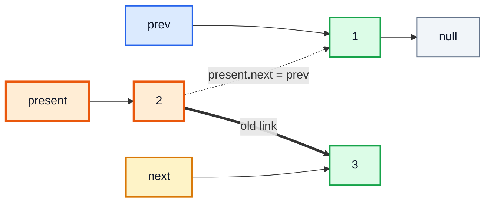

### Code

```java
public ListNode reverseList(ListNode head) {
    ListNode prev = null;
    ListNode present = head;
    while (present != null) {
        ListNode next = present.next;   // 1. save the rest
        present.next = prev;            // 2. flip the arrow
        prev = present;                 // 3. advance prev
        present = next;                 // 4. advance present
    }
    return prev;                        // prev is the new head
}
// 1 -> 2 -> 3 -> 4 -> 5  ==>  5 -> 4 -> 3 -> 2 -> 1
```

> [!NOTE]
> Kunal's version declares `next = present.next` before the loop and updates it with `if (next != null) next = next.next`. Declaring `next` inside the loop (above) is equivalent and avoids the null check.

### Dry run `1 → 2 → 3`

| Step | `prev` | `present` | `next` | Reversed part |
|---|---|---|---|---|
| 0 | null | 1 | — | — |
| 1 | 1 | 2 | 2 | 1 |
| 2 | 2 | 3 | 3 | 2→1 |
| 3 | 3 | null | null | 3→2→1 ✅ |

**Complexity:** Time **O(n)**, Space **O(1)**.

---

## 12. Q-12: Reverse LinkedList II (2:05:36)

**LeetCode 92 — Reverse Linked List II** (Medium) — Facebook, Microsoft, Amazon.

### Problem

Reverse only positions `left..right` (1-indexed). `[1,2,3,4,5]`, `left = 2`, `right = 4` → `[1,4,3,2,5]`.

### Approach from the video

1. Walk `left − 1` steps so `present` is the `left`-th node and `prev` is just before it.
2. Remember `last = prev` (the node before the window) and `newEnd = present` (will become the end of the reversed window).
3. Reverse `right − left + 1` nodes with the Q-11 loop.
4. Reconnect: `last.next = prev` (new window head) — or `head = prev` if `last == null` — and `newEnd.next = present` (node after the window).

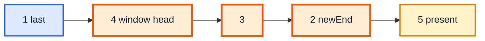

### Code (video approach)

```java
public ListNode reverseBetween(ListNode head, int left, int right) {
    if (left == right) return head;

    ListNode prev = null, present = head;
    for (int i = 0; present != null && i < left - 1; i++) {
        prev = present;
        present = present.next;
    }
    ListNode last = prev;
    ListNode newEnd = present;

    ListNode next = present.next;
    for (int i = 0; present != null && i < right - left + 1; i++) {
        present.next = prev;
        prev = present;
        present = next;
        if (next != null) next = next.next;
    }

    if (last != null) last.next = prev;
    else head = prev;
    newEnd.next = present;
    return head;
}
```

### Alternative: dummy node + "move to front"

Keep `before` fixed and repeatedly move the node after `curr` to the front of the window. No special case for `left == 1`.

```java
public ListNode reverseBetween(ListNode head, int left, int right) {
    ListNode dummy = new ListNode(0);
    dummy.next = head;
    ListNode before = dummy;
    for (int i = 1; i < left; i++) before = before.next;
    ListNode curr = before.next;
    for (int i = 0; i < right - left; i++) {
        ListNode move = curr.next;
        curr.next = move.next;
        move.next = before.next;
        before.next = move;
    }
    return dummy.next;
}
```

| Step | List after step |
|---|---|
| start | 1 → **2** → 3 → 4 → 5 |
| move 3 to front | 1 → 3 → **2** → 4 → 5 |
| move 4 to front | 1 → 4 → 3 → **2** → 5 ✅ |

**Complexity:** Time **O(n)**, Space **O(1)**.

---

## 13. Q-13: Palindrome LinkedList (2:18:14)

**LeetCode 234 — Palindrome Linked List** (Easy) — Amazon, Facebook, Microsoft, Apple. Follow-up: O(1) space.

### Approach — combine three patterns

1. **Middle** (Q-08).
2. **Reverse** the second half (Q-11).
3. **Compare** the first half and the reversed second half node by node.
4. **Re-reverse** the second half to restore the input (good practice — callers don't expect their data mutated).

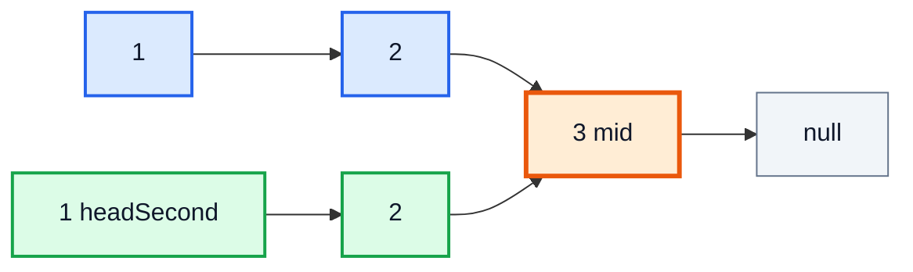

### Code

```java
public boolean isPalindrome(ListNode head) {
    ListNode mid = middleNode(head);
    ListNode headSecond = reverseList(mid);
    ListNode rereverseHead = headSecond;

    while (head != null && headSecond != null) {
        if (head.val != headSecond.val) break;
        head = head.next;
        headSecond = headSecond.next;
    }
    reverseList(rereverseHead);              // restore the original list

    return head == null || headSecond == null;
}
// [1,2,3,2,1] -> true    [1,2] -> false
```

| Compare | first half | second half (reversed) | Equal |
|---|---|---|---|
| 1 | 1 | 1 | ✅ |
| 2 | 2 | 2 | ✅ |
| 3 | 3 | 3 (shared mid) | ✅ |

**Complexity:** Time **O(n)**, Space **O(1)**.

| Alternative | Space | Note |
|---|---|---|
| Copy values into `ArrayList`, two pointers | O(n) | Easiest to get right |
| Push all values on a stack, compare while popping | O(n) | Links to video #46 |
| Recursion with a "front" pointer | O(n) stack | Elegant, not O(1) |

---

## 14. Q-14: Reorder LinkedList (2:27:14)

**LeetCode 143 — Reorder List** (Medium) — Amazon, Facebook, Microsoft.

### Problem

`L0 → L1 → … → Ln` becomes `L0 → Ln → L1 → Ln-1 → L2 → …`. `[1,2,3,4,5]` → `[1,5,2,4,3]`.

### Approach

Same first two steps as Q-13 — find the middle, reverse the second half — then **interleave** (zip) the two halves.

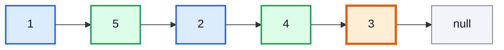

(Blue = first half, green = reversed second half, orange = middle.)

### Code

```java
public void reorderList(ListNode head) {
    if (head == null || head.next == null) return;

    ListNode mid = middleNode(head);
    ListNode hs = reverseList(mid);     // head of second half
    ListNode hf = head;                 // head of first half

    while (hf != null && hs != null) {
        ListNode temp = hf.next;
        hf.next = hs;
        hf = temp;

        temp = hs.next;
        hs.next = hf;
        hs = temp;
    }
    if (hf != null) hf.next = null;     // terminate — prevents a self-loop at the middle
}
```

| Iteration | Link made | `hf` → | `hs` → |
|---|---|---|---|
| 1 | 1→5, 5→2 | 2 | 4 |
| 2 | 2→4, 4→3 | 3 | 3 |
| 3 | 3→3 (temporary), then 3→null | null | null |

**Complexity:** Time **O(n)**, Space **O(1)**.

> [!WARNING]
> Forgetting the final `hf.next = null` leaves a node pointing at itself (or back into the list), and printing the result loops forever. This is the classic "accidental cycle" bug.

---

## 15. Q-15: Reverse k-Nodes in LinkedList (2:38:52)

**LeetCode 25 — Reverse Nodes in k-Group** (Hard) — Microsoft, Amazon, Facebook, Google.

### Problem

Reverse every consecutive group of `k` nodes; a final group with **fewer than k** nodes stays as is. `[1..8]`, `k = 3` → `[3,2,1,6,5,4,7,8]`.

### Approach

Repeat Q-12 on windows of size `k`:
- Before reversing, check that **k nodes exist** ahead; if not, stop.
- Reverse the window with prev/curr/next.
- Connect the previous group's tail to the new window head, and the window's new tail to the next group.

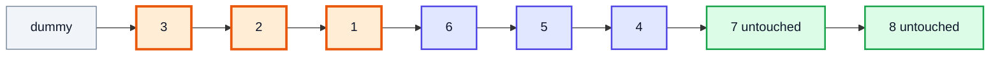

### Code

```java
public ListNode reverseKGroup(ListNode head, int k) {
    ListNode dummy = new ListNode(0);
    dummy.next = head;
    ListNode groupPrev = dummy;

    while (true) {
        ListNode kth = groupPrev;
        for (int i = 0; i < k && kth != null; i++) kth = kth.next;
        if (kth == null) break;                 // fewer than k nodes left

        ListNode groupNext = kth.next;
        ListNode prev = groupNext, curr = groupPrev.next;
        while (curr != groupNext) {             // reverse the window
            ListNode nxt = curr.next;
            curr.next = prev;
            prev = curr;
            curr = nxt;
        }
        ListNode oldFirst = groupPrev.next;     // becomes the window's tail
        groupPrev.next = kth;
        groupPrev = oldFirst;
    }
    return dummy.next;
}
```

> [!TIP]
> Starting `prev` at `groupNext` (instead of `null`) makes the reversed window's tail point at the next group automatically — one less reconnection.

> [!NOTE]
> Kunal's version in the video first computes the length, then reverses `length / k` groups using the Q-12 reconnection logic (`last`, `newEnd`). Both are O(n); the version above checks "k nodes ahead?" on the fly.

**Complexity:** Time **O(n)** (each node is visited twice at most), Space **O(1)**. A recursive solution is shorter but uses O(n/k) stack.

---

## 16. Q-16: Reverse Alternate k-Nodes in LinkedList (2:51:00)

A GeeksforGeeks / Google-style variant of Q-15.

### Problem

Reverse the first `k` nodes, **skip** the next `k`, reverse the next `k`, and so on. A short final group is still reversed if it lands on a "reverse" turn. `[1..9]`, `k = 2` → `[2,1,3,4,6,5,7,8,9]`.

### Approach

Same loop as Q-15 with a boolean that flips each group: on a reverse turn do the window reversal; on a skip turn just advance `groupPrev` by `k` nodes.

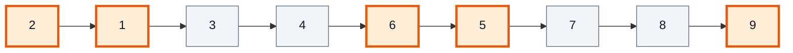

(Orange = reversed groups, grey = skipped groups.)

### Code

```java
public ListNode reverseAlternateK(ListNode head, int k) {
    ListNode dummy = new ListNode(0);
    dummy.next = head;
    ListNode groupPrev = dummy;
    boolean doReverse = true;

    while (groupPrev.next != null) {
        if (doReverse) {
            ListNode first = groupPrev.next, prev = null, curr = first;
            for (int count = 0; curr != null && count < k; count++) {
                ListNode nxt = curr.next;
                curr.next = prev;
                prev = curr;
                curr = nxt;
            }
            groupPrev.next = prev;   // new head of this group
            first.next = curr;       // old first is now the tail
            groupPrev = first;
        } else {
            for (int i = 0; i < k && groupPrev.next != null; i++) groupPrev = groupPrev.next;
        }
        doReverse = !doReverse;
    }
    return dummy.next;
}
```

**Complexity:** Time **O(n)**, Space **O(1)**.

---

## 17. Q-17: Rotate LinkedList (2:53:36)

**LeetCode 61 — Rotate List** (Medium) — Microsoft, Amazon, LinkedIn.

### Problem

Rotate the list to the right by `k` places. `[1,2,3,4,5]`, `k = 2` → `[4,5,1,2,3]`.

### Approach — make it circular, then cut

1. Find the `length` and the `last` node in one pass.
2. `k = k % length` (rotating by `length` is a no-op — `k` can be up to 2·10⁹).
3. Connect `last.next = head` → a circle.
4. The new last node is at position `length − k` (1-indexed). Its `next` is the new head; set its `next = null`.

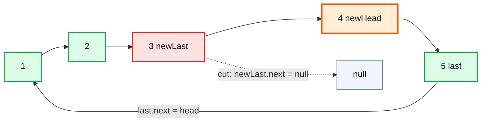

### Code

```java
public ListNode rotateRight(ListNode head, int k) {
    if (head == null || head.next == null || k == 0) return head;

    int length = 1;
    ListNode last = head;
    while (last.next != null) { last = last.next; length++; }

    int rotations = k % length;
    if (rotations == 0) return head;

    last.next = head;                                  // make it circular
    ListNode newLast = head;
    for (int i = 0; i < length - rotations - 1; i++) newLast = newLast.next;

    ListNode newHead = newLast.next;
    newLast.next = null;                               // break the circle
    return newHead;
}
```

| `length` | `k` | `rotations` | steps to `newLast` | `newLast` | `newHead` |
|---|---|---|---|---|---|
| 5 | 2 | 2 | 2 | 3 | 4 |
| 3 | 4 | 1 | 1 | 2 | 3 |

**Complexity:** Time **O(n)**, Space **O(1)**.

---

## 18. Outro (3:07:44)

The video ends with a recap and practice suggestions. The key takeaway: **you don't memorise 17 solutions — you learn ~5 patterns** and combine them. Palindrome = middle + reverse + compare. Reorder = middle + reverse + interleave. Sort = middle + recursion + merge.

**Practice next (same patterns):**

| Problem | Pattern |
|---|---|
| LC 19 Remove Nth Node From End | Two pointers with a gap of n |
| LC 160 Intersection of Two Linked Lists | Two pointers switching lists |
| LC 2 Add Two Numbers | Dummy head + carry |
| LC 328 Odd Even Linked List | Two tails |
| LC 23 Merge k Sorted Lists | Merge + heap / divide & conquer |
| LC 138 Copy List with Random Pointer | Interleaving or `HashMap` |

> [!TIP]
> The assignments for this lecture are in the `DSA-Bootcamp-Java` GitHub repo — solve them before moving on to stacks & queues (video #46).

---

## 🧩 Complete Example: Everything Together

One program with all 17 solutions, run on hard-coded inputs.

```java
public class LinkedListInterview {

    // ---------- Node used by every LeetCode-style problem ----------
    static class ListNode {
        int val;
        ListNode next;
        ListNode(int val) { this.val = val; }
    }

    static ListNode build(int... values) {
        ListNode dummy = new ListNode(0), tail = dummy;
        for (int v : values) { tail.next = new ListNode(v); tail = tail.next; }
        return dummy.next;
    }

    static String str(ListNode head) {
        StringBuilder sb = new StringBuilder();
        for (ListNode n = head; n != null; n = n.next) sb.append(n.val).append(" -> ");
        return sb.append("END").toString();
    }

    // Q-01: recursive insertion at an index
    static ListNode insertRec(ListNode node, int val, int index) {
        if (index == 0) {
            ListNode created = new ListNode(val);
            created.next = node;
            return created;
        }
        node.next = insertRec(node.next, val, index - 1);
        return node;
    }

    // Q-02: LC 83
    static ListNode deleteDuplicates(ListNode head) {
        ListNode node = head;
        while (node != null && node.next != null) {
            if (node.val == node.next.val) node.next = node.next.next;
            else node = node.next;
        }
        return head;
    }

    // Q-03: LC 21
    static ListNode mergeTwoLists(ListNode a, ListNode b) {
        ListNode dummy = new ListNode(0), tail = dummy;
        while (a != null && b != null) {
            if (a.val <= b.val) { tail.next = a; a = a.next; }
            else { tail.next = b; b = b.next; }
            tail = tail.next;
        }
        tail.next = (a != null) ? a : b;
        return dummy.next;
    }

    // Q-04: LC 141
    static boolean hasCycle(ListNode head) {
        ListNode slow = head, fast = head;
        while (fast != null && fast.next != null) {
            slow = slow.next;
            fast = fast.next.next;
            if (slow == fast) return true;
        }
        return false;
    }

    // Q-05: length of the cycle
    static int cycleLength(ListNode head) {
        ListNode slow = head, fast = head;
        while (fast != null && fast.next != null) {
            slow = slow.next;
            fast = fast.next.next;
            if (slow == fast) {
                int length = 0;
                ListNode temp = slow;
                do { temp = temp.next; length++; } while (temp != slow);
                return length;
            }
        }
        return 0;
    }

    // Q-06: LC 142
    static ListNode detectCycle(ListNode head) {
        ListNode slow = head, fast = head;
        while (fast != null && fast.next != null) {
            slow = slow.next;
            fast = fast.next.next;
            if (slow == fast) {
                ListNode p = head;
                while (p != slow) { p = p.next; slow = slow.next; }
                return p;
            }
        }
        return null;
    }

    // Q-07: LC 202
    static int squareSum(int n) {
        int sum = 0;
        while (n > 0) { int d = n % 10; sum += d * d; n /= 10; }
        return sum;
    }

    static boolean isHappy(int n) {
        int slow = n, fast = n;
        do {
            slow = squareSum(slow);
            fast = squareSum(squareSum(fast));
        } while (slow != fast);
        return slow == 1;
    }

    // Q-08: LC 876
    static ListNode middleNode(ListNode head) {
        ListNode slow = head, fast = head;
        while (fast != null && fast.next != null) {
            slow = slow.next;
            fast = fast.next.next;
        }
        return slow;
    }

    // Q-09: LC 148 (merge sort)
    static ListNode sortList(ListNode head) {
        if (head == null || head.next == null) return head;
        ListNode mid = splitMiddle(head);
        return mergeTwoLists(sortList(head), sortList(mid));
    }

    static ListNode splitMiddle(ListNode head) {
        ListNode prev = null, slow = head, fast = head;
        while (fast != null && fast.next != null) {
            prev = slow;
            slow = slow.next;
            fast = fast.next.next;
        }
        prev.next = null;              // cut the list in two
        return slow;
    }

    // Q-10: reverse recursively
    static ListNode reverseRec(ListNode head) {
        if (head == null || head.next == null) return head;
        ListNode newHead = reverseRec(head.next);
        head.next.next = head;
        head.next = null;
        return newHead;
    }

    // Q-11: LC 206 (iterative)
    static ListNode reverse(ListNode head) {
        ListNode prev = null, present = head;
        while (present != null) {
            ListNode next = present.next;
            present.next = prev;
            prev = present;
            present = next;
        }
        return prev;
    }

    // Q-12: LC 92
    static ListNode reverseBetween(ListNode head, int left, int right) {
        ListNode dummy = new ListNode(0);
        dummy.next = head;
        ListNode before = dummy;
        for (int i = 1; i < left; i++) before = before.next;
        ListNode curr = before.next;
        for (int i = 0; i < right - left; i++) {
            ListNode move = curr.next;
            curr.next = move.next;
            move.next = before.next;
            before.next = move;
        }
        return dummy.next;
    }

    // Q-13: LC 234
    static boolean isPalindrome(ListNode head) {
        ListNode mid = middleNode(head);
        ListNode secondHead = reverse(mid);
        ListNode rereverse = secondHead;
        boolean ok = true;
        for (ListNode a = head, b = secondHead; b != null; a = a.next, b = b.next) {
            if (a.val != b.val) { ok = false; break; }
        }
        reverse(rereverse);            // restore the list
        return ok;
    }

    // Q-14: LC 143
    static void reorderList(ListNode head) {
        if (head == null || head.next == null) return;
        ListNode mid = middleNode(head);
        ListNode hs = reverse(mid);
        ListNode hf = head;
        while (hf != null && hs != null) {
            ListNode t = hf.next;
            hf.next = hs;
            hf = t;
            t = hs.next;
            hs.next = hf;
            hs = t;
        }
        if (hf != null) hf.next = null;
    }

    // Q-15: LC 25
    static ListNode reverseKGroup(ListNode head, int k) {
        ListNode dummy = new ListNode(0);
        dummy.next = head;
        ListNode groupPrev = dummy;
        while (true) {
            ListNode kth = groupPrev;
            for (int i = 0; i < k && kth != null; i++) kth = kth.next;
            if (kth == null) break;                 // fewer than k nodes left
            ListNode groupNext = kth.next;
            ListNode prev = groupNext, curr = groupPrev.next;
            while (curr != groupNext) {
                ListNode nxt = curr.next;
                curr.next = prev;
                prev = curr;
                curr = nxt;
            }
            ListNode oldFirst = groupPrev.next;
            groupPrev.next = kth;
            groupPrev = oldFirst;
        }
        return dummy.next;
    }

    // Q-16: reverse alternate k nodes
    static ListNode reverseAlternateK(ListNode head, int k) {
        ListNode dummy = new ListNode(0);
        dummy.next = head;
        ListNode groupPrev = dummy;
        boolean doReverse = true;
        while (groupPrev.next != null) {
            if (doReverse) {
                ListNode first = groupPrev.next, prev = null, curr = first;
                int count = 0;
                while (curr != null && count < k) {
                    ListNode nxt = curr.next;
                    curr.next = prev;
                    prev = curr;
                    curr = nxt;
                    count++;
                }
                groupPrev.next = prev;
                first.next = curr;
                groupPrev = first;
            } else {
                for (int i = 0; i < k && groupPrev.next != null; i++) groupPrev = groupPrev.next;
            }
            doReverse = !doReverse;
        }
        return dummy.next;
    }

    // Q-17: LC 61
    static ListNode rotateRight(ListNode head, int k) {
        if (head == null || head.next == null || k == 0) return head;
        int length = 1;
        ListNode last = head;
        while (last.next != null) { last = last.next; length++; }
        int rotations = k % length;
        if (rotations == 0) return head;
        last.next = head;                            // make it circular
        ListNode newLast = head;
        for (int i = 0; i < length - rotations - 1; i++) newLast = newLast.next;
        ListNode newHead = newLast.next;
        newLast.next = null;                         // break the circle
        return newHead;
    }

    public static void main(String[] args) {
        System.out.println("Q01 insertRec      : " + str(insertRec(build(1, 2, 4), 3, 2)));
        System.out.println("Q02 removeDup      : " + str(deleteDuplicates(build(1, 1, 2, 3, 3, 3))));
        System.out.println("Q03 mergeTwo       : " + str(mergeTwoLists(build(1, 2, 4), build(1, 3, 4))));

        ListNode cyc = build(3, 2, 0, -4);
        cyc.next.next.next.next = cyc.next;          // -4 points back to 2
        System.out.println("Q04 hasCycle       : " + hasCycle(cyc) + " / " + hasCycle(build(1, 2)));
        System.out.println("Q05 cycleLength    : " + cycleLength(cyc));
        System.out.println("Q06 cycleStart     : " + detectCycle(cyc).val);
        System.out.println("Q07 isHappy        : 19=" + isHappy(19) + ", 2=" + isHappy(2));
        System.out.println("Q08 middle         : " + middleNode(build(1, 2, 3, 4, 5, 6)).val);
        System.out.println("Q09 sortList       : " + str(sortList(build(4, 2, 1, 3, -1, 5))));
        System.out.println("Q10 reverseRec     : " + str(reverseRec(build(1, 2, 3, 4, 5))));
        System.out.println("Q11 reverseIter    : " + str(reverse(build(1, 2, 3, 4, 5))));
        System.out.println("Q12 reverseBetween : " + str(reverseBetween(build(1, 2, 3, 4, 5), 2, 4)));
        System.out.println("Q13 isPalindrome   : " + isPalindrome(build(1, 2, 3, 2, 1)) + " / " + isPalindrome(build(1, 2)));
        ListNode r = build(1, 2, 3, 4, 5);
        reorderList(r);
        System.out.println("Q14 reorder        : " + str(r));
        System.out.println("Q15 reverseKGroup  : " + str(reverseKGroup(build(1, 2, 3, 4, 5, 6, 7, 8), 3)));
        System.out.println("Q16 reverseAltK    : " + str(reverseAlternateK(build(1, 2, 3, 4, 5, 6, 7, 8, 9), 2)));
        System.out.println("Q17 rotateRight    : " + str(rotateRight(build(1, 2, 3, 4, 5), 2)));
    }
}
```

**Expected Output:**
```
Q01 insertRec      : 1 -> 2 -> 3 -> 4 -> END
Q02 removeDup      : 1 -> 2 -> 3 -> END
Q03 mergeTwo       : 1 -> 1 -> 2 -> 3 -> 4 -> 4 -> END
Q04 hasCycle       : true / false
Q05 cycleLength    : 3
Q06 cycleStart     : 2
Q07 isHappy        : 19=true, 2=false
Q08 middle         : 4
Q09 sortList       : -1 -> 1 -> 2 -> 3 -> 4 -> 5 -> END
Q10 reverseRec     : 5 -> 4 -> 3 -> 2 -> 1 -> END
Q11 reverseIter    : 5 -> 4 -> 3 -> 2 -> 1 -> END
Q12 reverseBetween : 1 -> 4 -> 3 -> 2 -> 5 -> END
Q13 isPalindrome   : true / false
Q14 reorder        : 1 -> 5 -> 2 -> 4 -> 3 -> END
Q15 reverseKGroup  : 3 -> 2 -> 1 -> 6 -> 5 -> 4 -> 7 -> 8 -> END
Q16 reverseAltK    : 2 -> 1 -> 3 -> 4 -> 6 -> 5 -> 7 -> 8 -> 9 -> END
Q17 rotateRight    : 4 -> 5 -> 1 -> 2 -> 3 -> END
```

---

## Quick Reference Cheat Sheet

| # | Problem | LeetCode | Key Idea | Time | Space |
|---|---|---|---|---|---|
| 1 | Recursive insertion | — | Return new sub-list head, re-link `node.next` | O(i) | O(i) |
| 2 | Remove duplicates (sorted) | 83 | Skip `node.next` while equal, else move | O(n) | O(1) |
| 3 | Merge two sorted lists | 21 | Dummy head + tail, attach leftover | O(n+m) | O(1) |
| 4 | Linked list cycle | 141 | Fast +2, slow +1, meet ⇒ cycle | O(n) | O(1) |
| 5 | Length of cycle | — | From meeting point, count until back | O(n) | O(1) |
| 6 | Cycle start | 142 | Restart one pointer at head, both +1 | O(n) | O(1) |
| 7 | Happy number | 202 | Number sequence = implicit list, Floyd | O(log n) per step | O(1) |
| 8 | Middle of list | 876 | Slow when fast hits end | O(n) | O(1) |
| 9 | Sort list | 148 | Merge sort: split at middle, merge | O(n log n) | O(log n) |
| 10 | Reverse (recursive) | 206 | `head.next.next = head; head.next = null` | O(n) | O(n) |
| 11 | Reverse (iterative) | 206 | prev / present / next | O(n) | O(1) |
| 12 | Reverse between | 92 | Reverse window, reconnect `last` and `newEnd` | O(n) | O(1) |
| 13 | Palindrome list | 234 | Middle + reverse 2nd half + compare + restore | O(n) | O(1) |
| 14 | Reorder list | 143 | Middle + reverse + interleave, end with `null` | O(n) | O(1) |
| 15 | Reverse k-group | 25 | Check k nodes ahead, reverse window | O(n) | O(1) |
| 16 | Reverse alternate k | — | Same as 15, toggle reverse/skip | O(n) | O(1) |
| 17 | Rotate list | 61 | `k % len`, make circular, cut at `len − k` | O(n) | O(1) |
