# Stacks and Queues — Complete In-Depth Guide

**Video #46 of the Java + DSA playlist:** *Stacks and Queues Complete Tutorial - Theory + Implementation + Types (Dynamic, Circular)* (1:30:46)

Stacks (LIFO) and queues (FIFO) from theory to implementation: Java's built-in `Stack`, `Queue`, `Deque` and `ArrayDeque`, then building a fixed-size stack, custom exceptions, a dynamic (resizing) stack, an array queue, a circular queue and a dynamic circular queue from scratch — each with its complexity analysis.

---

## Table of Contents

| # | Topic | Timestamp |
|---|---|---|
| 0 | [Introduction](#0-introduction-000) | 0:00 |
| 1 | [Stacks Introduction](#1-stacks-introduction-053) | 0:53 |
| 2 | [Stack Example](#2-stack-example-434) | 4:34 |
| 3 | [Push and Pop](#3-push-and-pop-628) | 6:28 |
| 4 | [Queues Introduction](#4-queues-introduction-749) | 7:49 |
| 5 | [Queue Example](#5-queue-example-755) | 7:55 |
| 6 | [Stack Data Structure](#6-stack-data-structure-1124) | 11:24 |
| 7 | [Queue Data Structure](#7-queue-data-structure-1841) | 18:41 |
| 8 | [When do we use Stacks & Queues?](#8-when-do-we-use-stacks--queues-2345) | 23:45 |
| 9 | [Java Deque (Deck)](#9-java-deque-deck-2502) | 25:02 |
| 10 | [ArrayDeque](#10-arraydeque-2820) | 28:20 |
| 11 | [Custom Stack Implementation](#11-custom-stack-implementation-3201) | 32:01 |
| 12 | [Stack Exception Handling](#12-stack-exception-handling-4412) | 44:12 |
| 13 | [Dynamic Stack Implementation](#13-dynamic-stack-implementation-4725) | 47:25 |
| 14 | [Complexity Analysis](#14-complexity-analysis-5444) | 54:44 |
| 15 | [Custom Queue Implementation](#15-custom-queue-implementation-5521) | 55:21 |
| 16 | [Complexity Analysis](#16-complexity-analysis-10644) | 1:06:44 |
| 17 | [Circular Queue Implementation](#17-circular-queue-implementation-10659) | 1:06:59 |
| 18 | [Dynamic Queue Implementation](#18-dynamic-queue-implementation-12256) | 1:22:56 |
| 19 | [Outro](#19-outro-12818) | 1:28:18 |

---

## 0. Introduction (0:00)

Stacks and queues are **linear data structures with restricted access**: unlike an array, you can't touch any element you like — you may only add and remove at specific ends. That restriction is exactly what makes them useful.

The video has two halves:

1. **Theory + Java's library classes** — `Stack`, `Queue`, `Deque`, `ArrayDeque`.
2. **Building them yourself** — on top of arrays, with exceptions, resizing and the circular-queue trick.

> [!IMPORTANT]
> Stacks power recursion (the call stack from video #23), undo, bracket matching and expression evaluation. Queues power BFS (trees and graphs), scheduling and buffering. You will use both in almost every later topic.

---

## 1. Stacks Introduction (0:53)

### What is a Stack?

A **stack** is a collection where the **last element added is the first one removed** — **LIFO** (Last In, First Out). All work happens at one end, called the **top**.

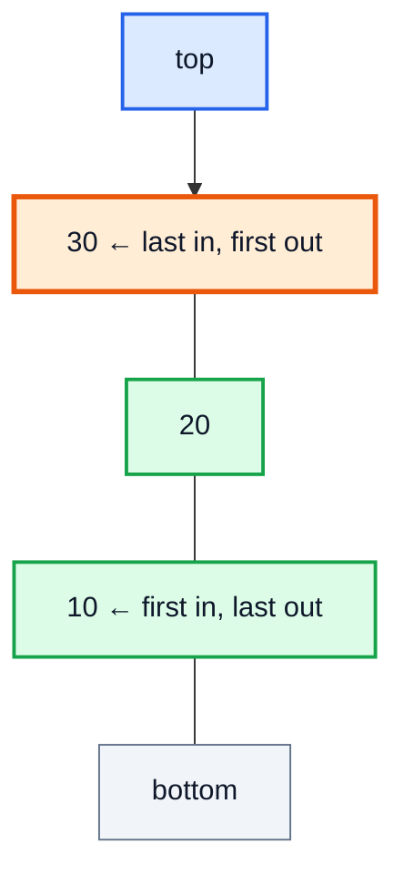

| Operation | Meaning |
|---|---|
| `push(x)` | Put `x` on the top |
| `pop()` | Remove and return the top |
| `peek()` | Look at the top without removing |
| `isEmpty()` | Is there anything left? |

### Where you've already seen it

The **function call stack**: when `main` calls `f`, which calls `g`, the frames are pushed `main → f → g`, and `g` must finish (pop) before `f` can continue.

---

## 2. Stack Example (4:34)

Real-world analogies:

| Analogy | Why it's a stack |
|---|---|
| Stack of plates / books | You take the one you placed last |
| Browser back button | The page you visited last is the first you return to |
| Undo (Ctrl+Z) | Undoes the most recent action first |
| Pringles tube | Only one open end |

### Programming examples

```java
import java.util.Stack;

public class StackExample {
    public static void main(String[] args) {
        // Reverse a word using a stack
        Stack<Character> st = new Stack<>();
        for (char c : "KUNAL".toCharArray()) st.push(c);

        StringBuilder reversed = new StringBuilder();
        while (!st.isEmpty()) reversed.append(st.pop());
        System.out.println(reversed);   // LANUK
    }
}
```

> [!TIP]
> Whenever a problem says "most recent", "matching", "nearest previous/next greater", or "undo", think **stack**.

---

## 3. Push and Pop (6:28)

`push` and `pop` are the two core operations, and both happen at the **top**.

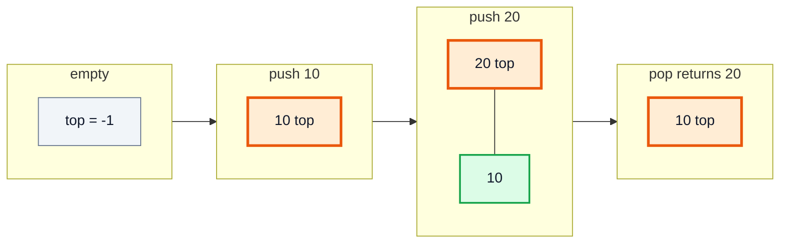

| Error | When | Name |
|---|---|---|
| Push on a full (fixed-size) stack | No room left | **Stack overflow** |
| Pop / peek on an empty stack | Nothing to remove | **Stack underflow** |

Java's `java.util.Stack` throws `EmptyStackException` on underflow. Our custom stack (section 11) will handle both cases explicitly.

---

## 4. Queues Introduction (7:49)

A **queue** is a collection where the **first element added is the first one removed** — **FIFO** (First In, First Out). Elements enter at the **rear** (end) and leave from the **front**.

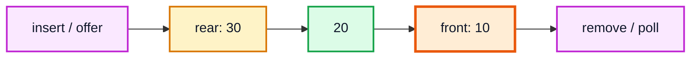

| | **Stack** | **Queue** |
|---|---|---|
| Order | LIFO | FIFO |
| Add | `push` at top | `add`/`offer` at rear |
| Remove | `pop` from top | `remove`/`poll` from front |
| Ends used | One | Two |

---

## 5. Queue Example (7:55)

| Analogy | Why it's a queue |
|---|---|
| Ticket counter line | First person in line is served first |
| Printer jobs | Printed in the order sent |
| CPU / task scheduling | Processes wait in a ready queue |
| Messages in a chat server | Delivered in arrival order |

```java
import java.util.LinkedList;
import java.util.Queue;

public class QueueExample {
    public static void main(String[] args) {
        Queue<String> line = new LinkedList<>();
        line.offer("Alice");
        line.offer("Bob");
        line.offer("Charlie");
        while (!line.isEmpty()) {
            System.out.println("Serving " + line.poll());
        }
        // Serving Alice
        // Serving Bob
        // Serving Charlie
    }
}
```

---

## 6. Stack Data Structure (11:24)

### `java.util.Stack` in Java

`Stack<E>` is a class that **extends `Vector<E>`** — it's backed by a resizable array and every method is `synchronized`.

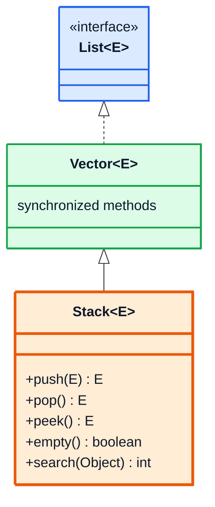

```java
import java.util.Stack;

public class StackDemo {
    public static void main(String[] args) {
        Stack<Integer> stack = new Stack<>();
        stack.push(34);
        stack.push(45);
        stack.push(2);

        System.out.println(stack);          // [34, 45, 2]  (bottom ... top)
        System.out.println(stack.peek());   // 2
        System.out.println(stack.pop());    // 2
        System.out.println(stack.pop());    // 45
        System.out.println(stack.pop());    // 34
        System.out.println(stack.pop());    // throws java.util.EmptyStackException
    }
}
```

| Method | Returns | On empty stack |
|---|---|---|
| `push(e)` | the pushed element | — |
| `pop()` | removes & returns top | `EmptyStackException` |
| `peek()` | top, not removed | `EmptyStackException` |
| `empty()` / `isEmpty()` | boolean | `true` |
| `search(o)` | 1-based distance from top, or −1 | −1 |

> [!WARNING]
> Because `Stack` extends `Vector`, it also inherits `get(i)`, `add(i, e)`, `remove(i)` — methods that **break** the LIFO rule. It's a legacy class (Java 1.0). The Javadoc recommends `Deque<Integer> stack = new ArrayDeque<>();` instead (section 10).

---

## 7. Queue Data Structure (18:41)

### `Queue` is an interface

`Queue<E>` is an **interface** in `java.util`; you can't write `new Queue<>()`. Common implementations: `LinkedList`, `ArrayDeque`, `PriorityQueue` (a heap — ordered by priority, not FIFO).

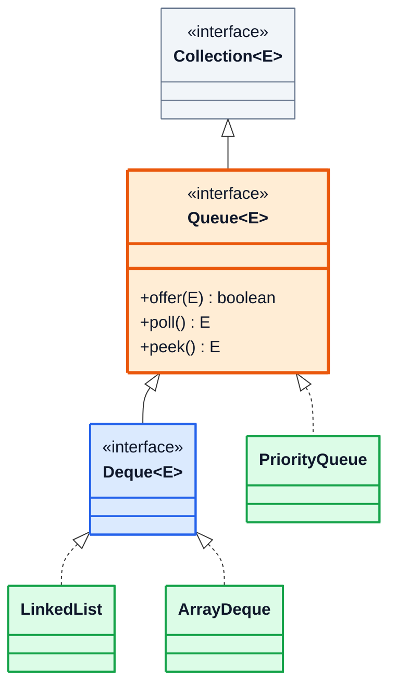

### Two families of methods

| Operation | Throws exception on failure | Returns special value |
|---|---|---|
| Insert at rear | `add(e)` → `IllegalStateException` if full | `offer(e)` → `false` |
| Remove front | `remove()` → `NoSuchElementException` | `poll()` → `null` |
| Look at front | `element()` → `NoSuchElementException` | `peek()` → `null` |

```java
import java.util.LinkedList;
import java.util.Queue;

public class QueueDemo {
    public static void main(String[] args) {
        Queue<Integer> queue = new LinkedList<>();
        queue.add(3);
        queue.add(6);
        queue.add(5);

        System.out.println(queue);           // [3, 6, 5]
        System.out.println(queue.peek());    // 3
        System.out.println(queue.remove());  // 3
        System.out.println(queue.poll());    // 6
        System.out.println(queue.poll());    // 5
        System.out.println(queue.poll());    // null  (no exception)
    }
}
```

> [!TIP]
> In competitive code prefer `offer` / `poll` / `peek` — they return `false`/`null` instead of throwing, so an empty queue check is just `== null`.

---

## 8. When do we use Stacks & Queues? (23:45)

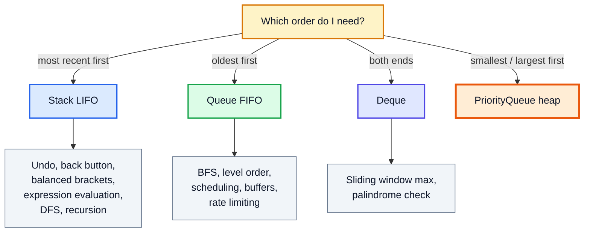

### Classic example: balanced brackets (LeetCode 20 — Valid Parentheses)

```java
import java.util.ArrayDeque;
import java.util.Deque;

public class ValidParentheses {
    static boolean isValid(String s) {
        Deque<Character> stack = new ArrayDeque<>();
        for (char c : s.toCharArray()) {
            if (c == '(' || c == '[' || c == '{') {
                stack.push(c);
            } else {
                if (stack.isEmpty()) return false;
                char open = stack.pop();
                if ((c == ')' && open != '(') || (c == ']' && open != '[') || (c == '}' && open != '{'))
                    return false;
            }
        }
        return stack.isEmpty();
    }

    public static void main(String[] args) {
        System.out.println(isValid("{[()]}"));  // true
        System.out.println(isValid("([)]"));    // false
    }
}
```

Stack questions get their own video (#47) right after this one.

---

## 9. Java Deque (Deck) (25:02)

A **Deque** ("double-ended queue", pronounced *deck*) allows insert and remove at **both** ends. It can act as a stack *and* as a queue.

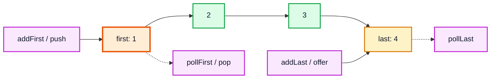

| | First (head) | Last (tail) |
|---|---|---|
| Insert (throws) | `addFirst(e)` | `addLast(e)` |
| Insert (special value) | `offerFirst(e)` | `offerLast(e)` |
| Remove (throws) | `removeFirst()` | `removeLast()` |
| Remove (null if empty) | `pollFirst()` | `pollLast()` |
| Examine | `getFirst()` / `peekFirst()` | `getLast()` / `peekLast()` |

### Deque as a stack vs as a queue

| Use as | Methods | Maps to |
|---|---|---|
| **Stack** | `push`, `pop`, `peek` | `addFirst`, `removeFirst`, `peekFirst` |
| **Queue** | `offer`, `poll`, `peek` | `offerLast`, `pollFirst`, `peekFirst` |

---

## 10. ArrayDeque (28:20)

`ArrayDeque` is the resizable-array implementation of `Deque` — internally a **circular buffer** (the same idea we build in section 17).

```java
import java.util.ArrayDeque;
import java.util.Deque;

public class ArrayDequeDemo {
    public static void main(String[] args) {
        Deque<Integer> deque = new ArrayDeque<>();
        deque.add(89);           // addLast
        deque.addLast(78);
        deque.addFirst(12);
        deque.push(5);           // addFirst
        System.out.println(deque);              // [5, 12, 89, 78]
        System.out.println(deque.pollFirst());  // 5
        System.out.println(deque.pollLast());   // 78
        System.out.println(deque);              // [12, 89]
    }
}
```

| | `Stack` | `LinkedList` | `ArrayDeque` |
|---|---|---|---|
| Backed by | Array (`Vector`) | Doubly linked nodes | Circular array |
| Synchronized | Yes (slower) | No | No |
| Allows `null` | Yes | Yes | ❌ No (`NullPointerException`) |
| Memory per element | Low | High (node + 2 pointers) | Low |
| Recommended for | Legacy code only | Need `List` + `Deque` | ✅ **Stacks and queues** |

> [!NOTE]
> Modern Java: use `Deque<T> stack = new ArrayDeque<>()` for stacks and `Queue<T> q = new ArrayDeque<>()` for queues. Note `ArrayDeque.toString()` prints from **first to last**, so a stack prints top-first — the opposite of `Stack.toString()`.

**Complexity:** amortised **O(1)** for all add/remove/peek operations at either end.

---

## 11. Custom Stack Implementation (32:01)

### Design

Use an `int[] data` and a pointer `ptr` = **index of the top element**. Empty stack ⇒ `ptr = -1`.

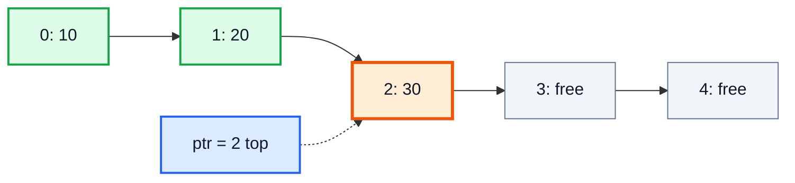

| Operation | Logic |
|---|---|
| `push(x)` | if full → fail; else `data[++ptr] = x` |
| `pop()` | if empty → error; else `return data[ptr--]` |
| `peek()` | `return data[ptr]` |
| `isFull()` | `ptr == data.length - 1` |
| `isEmpty()` | `ptr == -1` |

### Code

```java
public class CustomStack {
    protected int[] data;                    // protected: subclasses (DynamicStack) need it
    private static final int DEFAULT_SIZE = 10;
    protected int ptr = -1;

    public CustomStack() {
        this(DEFAULT_SIZE);
    }

    public CustomStack(int size) {
        this.data = new int[size];
    }

    public boolean push(int item) {
        if (isFull()) {
            System.out.println("Stack is full!!");
            return false;
        }
        ptr++;
        data[ptr] = item;
        return true;
    }

    public int pop() throws StackException {
        if (isEmpty()) {
            throw new StackException("Cannot pop from an empty stack!!");
        }
        return data[ptr--];   // return, then decrement
    }

    public int peek() throws StackException {
        if (isEmpty()) {
            throw new StackException("Cannot peek from an empty stack!!");
        }
        return data[ptr];
    }

    public boolean isFull()  { return ptr == data.length - 1; }
    public boolean isEmpty() { return ptr == -1; }
}
```

> [!NOTE]
> `pop` doesn't erase `data[ptr]` — moving the pointer is enough; the slot is overwritten on the next push. For a stack of **objects** you should set `data[ptr] = null` before decrementing, so the popped object can be garbage-collected (otherwise it's a memory leak, called *loitering*).

### Trace — capacity 3

| Call | `ptr` before | Action | `ptr` after | Result |
|---|---|---|---|---|
| `push(10)` | -1 | `data[0] = 10` | 0 | true |
| `push(20)` | 0 | `data[1] = 20` | 1 | true |
| `push(30)` | 1 | `data[2] = 30` | 2 | true |
| `push(40)` | 2 | 🟥 full | 2 | false |
| `pop()` | 2 | return `data[2]` | 1 | 30 |
| `peek()` | 1 | return `data[1]` | 1 | 20 |

---

## 12. Stack Exception Handling (44:12)

Instead of returning a magic value like `-1` from `pop()` (which could be a real element!), throw an **exception**.

### A custom checked exception

```java
public class StackException extends Exception {
    public StackException(String message) {
        super(message);
    }
}
```

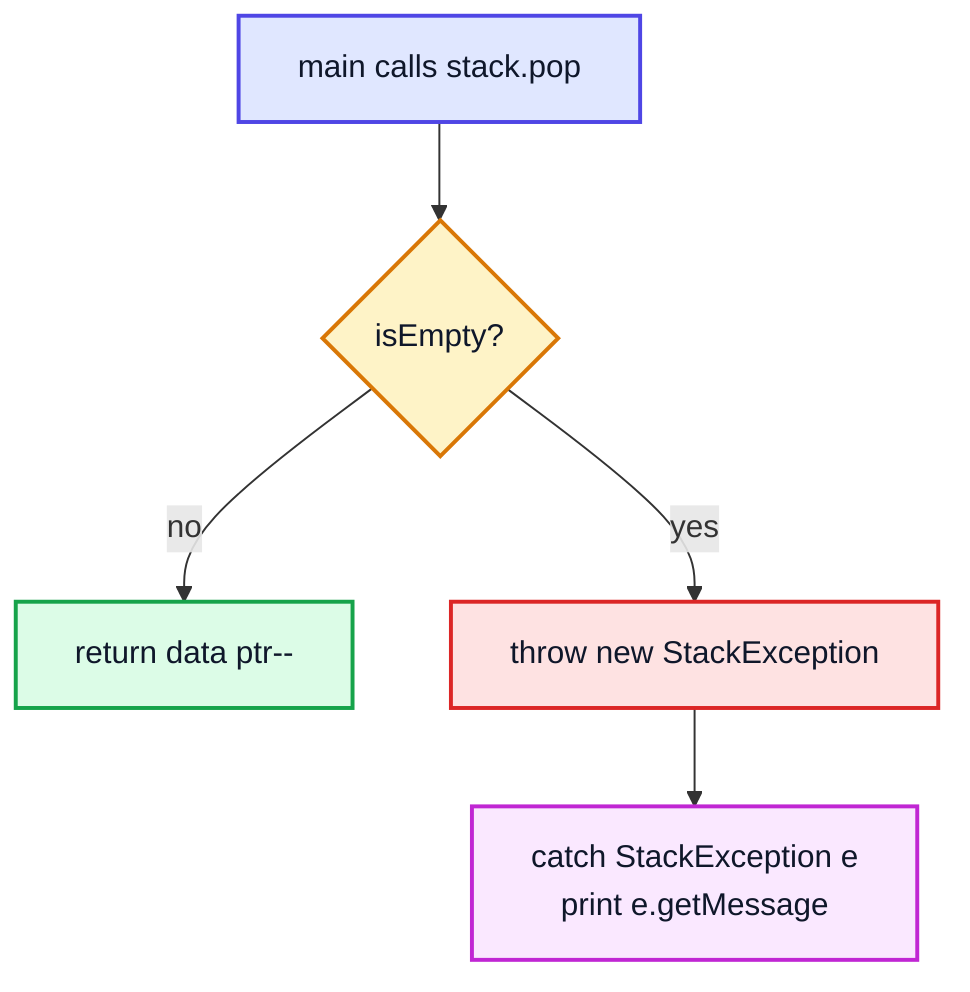

```java
public class Main {
    public static void main(String[] args) {
        CustomStack stack = new CustomStack(2);
        stack.push(1);
        try {
            System.out.println(stack.pop());   // 1
            System.out.println(stack.pop());   // throws
        } catch (StackException e) {
            System.out.println("Caught: " + e.getMessage());
        }
    }
}
// 1
// Caught: Cannot pop from an empty stack!!
```

| | Checked (`extends Exception`) | Unchecked (`extends RuntimeException`) |
|---|---|---|
| Must declare `throws` / catch? | ✅ Yes, compiler enforces | ❌ No |
| Used in the video | `StackException` | — |
| Java's own choice | — | `EmptyStackException`, `NoSuchElementException` |

> [!TIP]
> Java's library uses **unchecked** exceptions for empty-collection errors because they indicate a programming bug (you should have called `isEmpty()` first). Making `StackException` extend `RuntimeException` would remove the `throws` clutter — either is acceptable; the video uses a checked one to practise exception handling.

---

## 13. Dynamic Stack Implementation (47:25)

A fixed-size stack fails when full. A **dynamic stack** grows instead — the same idea as `ArrayList`.

### Approach

Extend `CustomStack` and **override** `push`: if full, allocate an array **twice** the size, copy everything, then let the parent push.

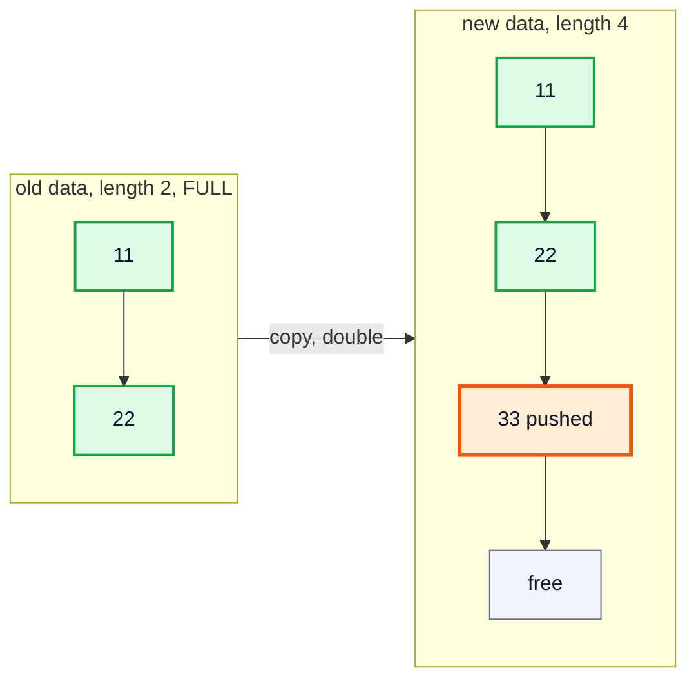

```java
public class DynamicStack extends CustomStack {

    public DynamicStack() { super(); }

    public DynamicStack(int size) { super(size); }

    @Override
    public boolean push(int item) {
        if (this.isFull()) {
            int[] temp = new int[data.length * 2];
            for (int i = 0; i < data.length; i++) {
                temp[i] = data[i];
            }
            data = temp;               // or: data = Arrays.copyOf(data, data.length * 2);
        }
        // now there is room — reuse the parent's logic
        return super.push(item);
    }
}
```

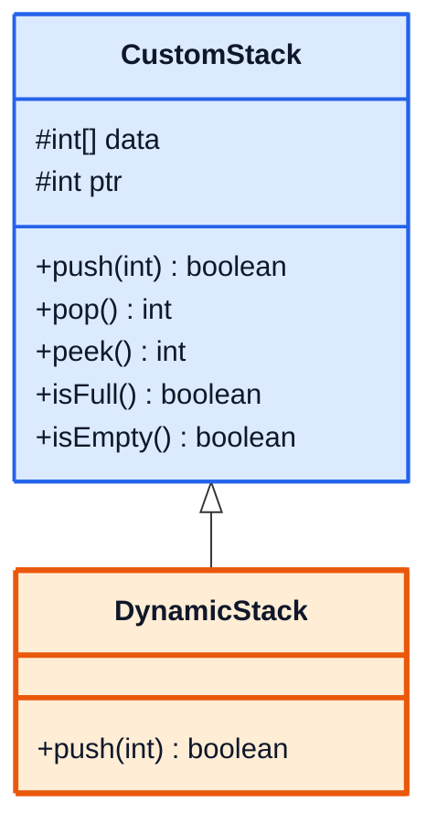

| Push # | Capacity before | Resize? | Capacity after |
|---|---|---|---|
| 1 | 2 | — | 2 |
| 2 | 2 | — | 2 |
| 3 | 2 | ✅ copy 2 | 4 |
| 4 | 4 | — | 4 |
| 5 | 4 | ✅ copy 4 | 8 |

> [!NOTE]
> This is a direct application of the OOP videos: **inheritance** (reuse `pop`, `peek`), **overriding** (`push`), `super.push(...)`, and `protected` fields so the subclass can replace `data`.

---

## 14. Complexity Analysis (54:44)

### Stack operations

| Operation | Fixed stack | Dynamic stack |
|---|---|---|
| `push` | O(1) | **O(1) amortised**, O(n) on a resize |
| `pop` | O(1) | O(1) |
| `peek` | O(1) | O(1) |
| `isEmpty` / `isFull` | O(1) | O(1) |
| Space | O(capacity) | O(n), up to 2n slots |

### Why doubling gives amortised O(1)

Pushing n items costs n writes plus copies of 1 + 2 + 4 + … + n/2 < n elements during resizes. Total < **3n** → **O(1) per push** on average.

> [!WARNING]
> Growing by a **constant** (e.g. +10 slots) instead of doubling makes the copies 10 + 20 + 30 + … = O(n²) in total, i.e. O(n) per push. Always grow **geometrically** (×2, or ×1.5 like `ArrayList`).

---

## 15. Custom Queue Implementation (55:21)

### Design (simple version)

Front is **always index 0**; `end` = the next free slot (also the size).

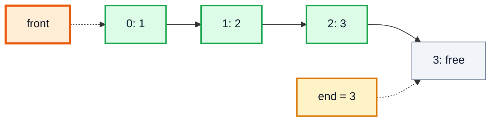

### Code

```java
public class CustomQueue {
    private final int[] data;
    private static final int DEFAULT_SIZE = 10;
    private int end = 0;

    public CustomQueue() { this(DEFAULT_SIZE); }

    public CustomQueue(int size) { this.data = new int[size]; }

    public boolean isFull()  { return end == data.length; }
    public boolean isEmpty() { return end == 0; }

    public boolean insert(int item) {
        if (isFull()) return false;
        data[end++] = item;
        return true;
    }

    public int remove() throws Exception {
        if (isEmpty()) throw new Exception("Queue is empty");
        int removed = data[0];
        for (int i = 1; i < end; i++) {   // shift everything one step left
            data[i - 1] = data[i];
        }
        end--;
        return removed;
    }

    public int front() throws Exception {
        if (isEmpty()) throw new Exception("Queue is empty");
        return data[0];
    }

    public void display() {
        for (int i = 0; i < end; i++) System.out.print(data[i] + " <- ");
        System.out.println("END");
    }
}
```

### Trace of `remove()` on `[1, 2, 3]`

| Step | Array | `end` |
|---|---|---|
| before | 🟧1 2 3 _ | 3 |
| save `removed = 1` | 1 2 3 _ | 3 |
| shift i=1 | 2 2 3 _ | 3 |
| shift i=2 | 2 3 3 _ | 3 |
| `end--` | 2 3 _ _ | 2 |

---

## 16. Complexity Analysis (1:06:44)

| Operation | Simple array queue |
|---|---|
| `insert` | O(1) |
| `remove` | 🟥 **O(n)** — shifts every element |
| `front` | O(1) |
| Space | O(capacity) |

Why not just move a `front` pointer forward instead of shifting? Because then the slots **before** `front` are wasted forever: after enough inserts and removes the queue reports "full" even though the array is mostly empty. The fix is to **wrap around** — the circular queue.

---

## 17. Circular Queue Implementation (1:06:59)

### Idea

Treat the array as a ring. Two pointers move forward and **wrap** with `% length`:
- `front` — index of the first element (where we remove)
- `end` — index of the next free slot (where we insert)
- `size` — number of elements (distinguishes full from empty, since in both cases `front == end`)

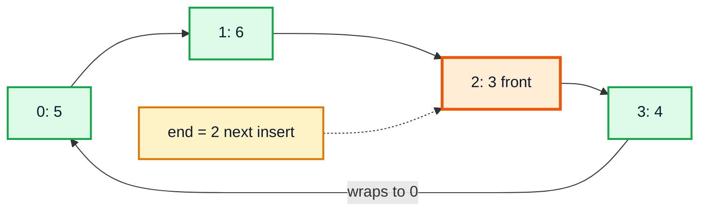

(Logical order `3 ← 4 ← 5 ← 6`; the queue is full here, so `end == front`.)

### Code

```java
public class CircularQueue {
    protected int[] data;
    private static final int DEFAULT_SIZE = 10;
    protected int front = 0;
    protected int end = 0;
    protected int size = 0;

    public CircularQueue() { this(DEFAULT_SIZE); }

    public CircularQueue(int capacity) { this.data = new int[capacity]; }

    public boolean isFull()  { return size == data.length; }
    public boolean isEmpty() { return size == 0; }

    public boolean insert(int item) {
        if (isFull()) return false;
        data[end++] = item;
        end = end % data.length;     // wrap around
        size++;
        return true;
    }

    public int remove() throws Exception {
        if (isEmpty()) throw new Exception("Queue is empty");
        int removed = data[front++];
        front = front % data.length; // wrap around
        size--;
        return removed;
    }

    public int front() throws Exception {
        if (isEmpty()) throw new Exception("Queue is empty");
        return data[front];
    }

    public void display() {
        if (isEmpty()) { System.out.println("Empty"); return; }
        int i = front;
        do {
            System.out.print(data[i] + " <- ");
            i = (i + 1) % data.length;
        } while (i != end);
        System.out.println("END");
    }
}
```

### Trace — capacity 4

| Operation | `front` | `end` | `size` | Raw array | Logical queue |
|---|---|---|---|---|---|
| insert 1,2,3,4 | 0 | 0 | 4 | [1,2,3,4] | 1 2 3 4 |
| remove → 1 | 1 | 0 | 3 | [1,2,3,4] | 2 3 4 |
| remove → 2 | 2 | 0 | 2 | [1,2,3,4] | 3 4 |
| insert 5 | 2 | 1 | 3 | [🟧5,2,3,4] | 3 4 5 |
| insert 6 | 2 | 2 | 4 | [5,🟧6,3,4] | 3 4 5 6 |

> [!IMPORTANT]
> `do-while` in `display()` matters: when the queue is full, `front == end`, so a plain `while (i != end)` loop would print nothing. Alternatively loop `size` times over `(front + k) % length`.

**Complexity:** `insert`, `remove`, `front` — all **O(1)**. Space O(capacity).

> [!NOTE]
> Without a `size` field, the classic alternative is to keep one slot always empty: full ⇔ `(end + 1) % length == front`, empty ⇔ `front == end`. LeetCode 622 *Design Circular Queue* asks for exactly this structure.

---

## 18. Dynamic Queue Implementation (1:22:56)

### Approach

Extend `CircularQueue` and override `insert`. When full, allocate a double-size array and copy the elements **in logical order** (starting at `front`, wrapping), so the new array starts at index 0. Then reset `front = 0`, `end = size`.

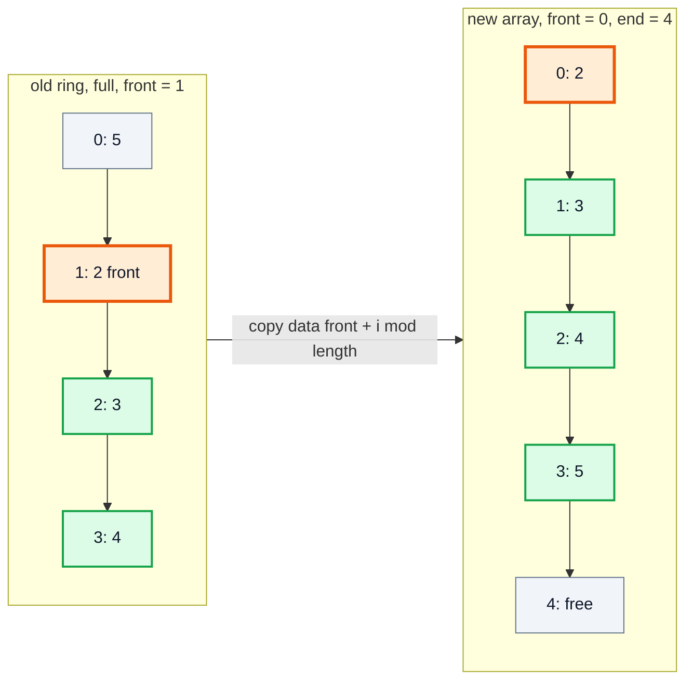

### Code

```java
public class DynamicQueue extends CircularQueue {

    public DynamicQueue() { super(); }

    public DynamicQueue(int capacity) { super(capacity); }

    @Override
    public boolean insert(int item) {
        if (this.isFull()) {
            int[] temp = new int[data.length * 2];
            for (int i = 0; i < data.length; i++) {
                temp[i] = data[(front + i) % data.length];   // unroll the ring
            }
            front = 0;
            end = data.length;
            data = temp;
        }
        return super.insert(item);
    }
}
```

> [!CAUTION]
> Copying with `temp[i] = data[i]` (a plain copy) is **wrong** for a circular queue: if `front != 0`, the elements end up out of order and the old wrap-around point is now in the middle of the new array. Always copy starting from `front`.

**Complexity:** `insert` amortised **O(1)** (O(n) on resize), `remove` and `front` O(1). This is essentially how `java.util.ArrayDeque` works internally.

---

## 19. Outro (1:28:18)

Summary of what was built:

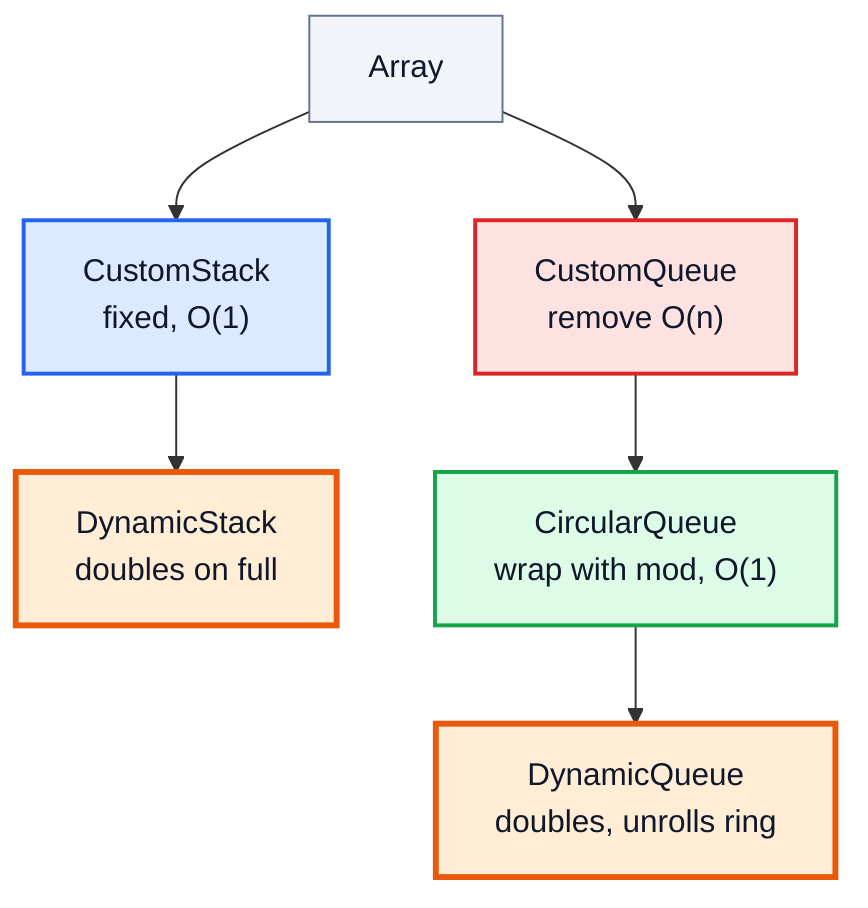

Next up: stack & queue interview questions (video #47). A good warm-up: implement a stack and a queue **using a linked list** (push/pop at `head` for a stack; insert at `tail`, remove at `head` for a queue) — no resizing needed at all.

---

## 🧩 Complete Example: Everything Together

```java
import java.util.ArrayDeque;
import java.util.Arrays;
import java.util.Deque;
import java.util.LinkedList;
import java.util.Queue;
import java.util.Stack;

public class StacksQueuesDemo {

    // ---------- Custom checked exception ----------
    static class StackException extends Exception {
        StackException(String message) { super(message); }
    }

    // ---------- Fixed-size stack ----------
    static class CustomStack {
        protected int[] data;
        private static final int DEFAULT_SIZE = 10;
        protected int ptr = -1;                     // index of the top element

        CustomStack() { this(DEFAULT_SIZE); }
        CustomStack(int size) { this.data = new int[size]; }

        public boolean push(int item) {
            if (isFull()) {
                System.out.println("Stack is full!!");
                return false;
            }
            data[++ptr] = item;
            return true;
        }

        public int pop() throws StackException {
            if (isEmpty()) throw new StackException("Cannot pop from an empty stack!!");
            return data[ptr--];
        }

        public int peek() throws StackException {
            if (isEmpty()) throw new StackException("Cannot peek from an empty stack!!");
            return data[ptr];
        }

        public boolean isFull() { return ptr == data.length - 1; }
        public boolean isEmpty() { return ptr == -1; }
    }

    // ---------- Stack that doubles when full ----------
    static class DynamicStack extends CustomStack {
        DynamicStack() { super(); }
        DynamicStack(int size) { super(size); }

        @Override
        public boolean push(int item) {
            if (isFull()) {
                data = Arrays.copyOf(data, data.length * 2);
            }
            return super.push(item);
        }

        int capacity() { return data.length; }
    }

    // ---------- Simple array queue (remove is O(n)) ----------
    static class CustomQueue {
        private final int[] data;
        private int end = 0;                        // next free slot

        CustomQueue(int size) { data = new int[size]; }

        boolean isFull() { return end == data.length; }
        boolean isEmpty() { return end == 0; }

        boolean insert(int item) {
            if (isFull()) return false;
            data[end++] = item;
            return true;
        }

        int remove() throws Exception {
            if (isEmpty()) throw new Exception("Queue is empty");
            int removed = data[0];
            for (int i = 1; i < end; i++) data[i - 1] = data[i];   // shift left
            end--;
            return removed;
        }

        int front() throws Exception {
            if (isEmpty()) throw new Exception("Queue is empty");
            return data[0];
        }

        void display() {
            StringBuilder sb = new StringBuilder();
            for (int i = 0; i < end; i++) sb.append(data[i]).append(" <- ");
            System.out.println(sb.append("END"));
        }
    }

    // ---------- Circular queue (all ops O(1)) ----------
    static class CircularQueue {
        protected int[] data;
        protected int front = 0, end = 0, size = 0;

        CircularQueue(int capacity) { data = new int[capacity]; }

        boolean isFull() { return size == data.length; }
        boolean isEmpty() { return size == 0; }

        public boolean insert(int item) {
            if (isFull()) return false;
            data[end++] = item;
            end %= data.length;
            size++;
            return true;
        }

        public int remove() throws Exception {
            if (isEmpty()) throw new Exception("Queue is empty");
            int removed = data[front++];
            front %= data.length;
            size--;
            return removed;
        }

        public int front() throws Exception {
            if (isEmpty()) throw new Exception("Queue is empty");
            return data[front];
        }

        void display() {
            StringBuilder sb = new StringBuilder();
            for (int i = 0; i < size; i++) sb.append(data[(front + i) % data.length]).append(" <- ");
            System.out.println(sb.append("END") + "   [front=" + front + ", end=" + end + ", size=" + size + "]");
        }
    }

    // ---------- Circular queue that doubles when full ----------
    static class DynamicQueue extends CircularQueue {
        DynamicQueue(int capacity) { super(capacity); }

        @Override
        public boolean insert(int item) {
            if (isFull()) {
                int[] temp = new int[data.length * 2];
                for (int i = 0; i < size; i++) temp[i] = data[(front + i) % data.length];
                front = 0;
                end = size;
                data = temp;
            }
            return super.insert(item);
        }

        int capacity() { return data.length; }
    }

    public static void main(String[] args) throws Exception {
        System.out.println("=== java.util.Stack ===");
        Stack<Integer> stack = new Stack<>();
        stack.push(34); stack.push(45); stack.push(2);
        System.out.println("stack = " + stack + ", peek = " + stack.peek());
        System.out.println("pop = " + stack.pop() + ", pop = " + stack.pop() + ", left = " + stack);

        System.out.println("\n=== Queue via LinkedList ===");
        Queue<Integer> queue = new LinkedList<>();
        queue.add(3); queue.add(6); queue.add(5);
        System.out.println("queue = " + queue + ", peek = " + queue.peek());
        System.out.println("remove = " + queue.remove() + ", poll = " + queue.poll() + ", left = " + queue);
        queue.clear();
        System.out.println("poll on empty = " + queue.poll());

        System.out.println("\n=== ArrayDeque (both ends) ===");
        Deque<Integer> deque = new ArrayDeque<>();
        deque.addFirst(2); deque.addLast(3); deque.addFirst(1); deque.push(0);
        System.out.println("deque = " + deque);
        System.out.println("pollFirst = " + deque.pollFirst() + ", pollLast = " + deque.pollLast() + ", left = " + deque);

        System.out.println("\n=== CustomStack (size 3) ===");
        CustomStack cs = new CustomStack(3);
        cs.push(10); cs.push(20); cs.push(30);
        cs.push(40);
        System.out.println("pop = " + cs.pop() + ", peek = " + cs.peek());
        cs.pop(); cs.pop();
        try {
            cs.pop();
        } catch (StackException e) {
            System.out.println("Caught: " + e.getMessage());
        }

        System.out.println("\n=== DynamicStack (start size 2) ===");
        DynamicStack ds = new DynamicStack(2);
        for (int i = 1; i <= 5; i++) ds.push(i * 11);
        System.out.println("capacity = " + ds.capacity() + ", peek = " + ds.peek());
        StringBuilder popped = new StringBuilder();
        while (!ds.isEmpty()) popped.append(ds.pop()).append(" ");
        System.out.println("popped (LIFO) = " + popped.toString().trim());

        System.out.println("\n=== CustomQueue (size 4) ===");
        CustomQueue cq = new CustomQueue(4);
        cq.insert(1); cq.insert(2); cq.insert(3); cq.insert(4);
        System.out.println("insert into full = " + cq.insert(5));
        cq.display();
        System.out.println("remove = " + cq.remove() + ", front = " + cq.front());
        cq.display();

        System.out.println("\n=== CircularQueue (capacity 4) ===");
        CircularQueue circ = new CircularQueue(4);
        circ.insert(1); circ.insert(2); circ.insert(3); circ.insert(4);
        circ.display();
        System.out.println("remove = " + circ.remove() + ", remove = " + circ.remove());
        circ.insert(5); circ.insert(6);
        circ.display();
        System.out.println("raw array = " + Arrays.toString(circ.data));

        System.out.println("\n=== DynamicQueue (start capacity 2) ===");
        DynamicQueue dq = new DynamicQueue(2);
        dq.insert(1); dq.insert(2);
        dq.remove();
        dq.insert(3); dq.insert(4); dq.insert(5);
        dq.display();
        System.out.println("capacity = " + dq.capacity() + ", raw array = " + Arrays.toString(dq.data));
    }
}
```

**Expected Output:**
```
=== java.util.Stack ===
stack = [34, 45, 2], peek = 2
pop = 2, pop = 45, left = [34]

=== Queue via LinkedList ===
queue = [3, 6, 5], peek = 3
remove = 3, poll = 6, left = [5]
poll on empty = null

=== ArrayDeque (both ends) ===
deque = [0, 1, 2, 3]
pollFirst = 0, pollLast = 3, left = [1, 2]

=== CustomStack (size 3) ===
Stack is full!!
pop = 30, peek = 20
Caught: Cannot pop from an empty stack!!

=== DynamicStack (start size 2) ===
capacity = 8, peek = 55
popped (LIFO) = 55 44 33 22 11

=== CustomQueue (size 4) ===
insert into full = false
1 <- 2 <- 3 <- 4 <- END
remove = 1, front = 2
2 <- 3 <- 4 <- END

=== CircularQueue (capacity 4) ===
1 <- 2 <- 3 <- 4 <- END   [front=0, end=0, size=4]
remove = 1, remove = 2
3 <- 4 <- 5 <- 6 <- END   [front=2, end=2, size=4]
raw array = [5, 6, 3, 4]

=== DynamicQueue (start capacity 2) ===
2 <- 3 <- 4 <- 5 <- END   [front=0, end=0, size=4]
capacity = 4, raw array = [2, 3, 4, 5]
```

---

## Quick Reference Cheat Sheet

| Concept | One-Line Summary |
|---|---|
| **Stack** | LIFO; push/pop/peek at the top |
| **Queue** | FIFO; insert at rear, remove from front |
| **Deque** | Insert/remove at both ends; can be a stack or a queue |
| **`java.util.Stack`** | Legacy, extends `Vector`, synchronized; prefer `ArrayDeque` |
| **`Queue` interface** | `offer`/`poll`/`peek` return `false`/`null`; `add`/`remove`/`element` throw |
| **`ArrayDeque`** | Circular resizable array; O(1) amortised at both ends; no `null`s |
| **Custom stack** | `ptr = -1` empty; `data[++ptr] = x`; `return data[ptr--]` |
| **Stack overflow / underflow** | Push on full / pop on empty |
| **Custom exception** | `class StackException extends Exception` + `throws` + `try/catch` |
| **Dynamic stack** | Override `push`: double the array when full, then `super.push` |
| **Simple array queue** | `remove` shifts left → O(n) |
| **Circular queue** | `front`, `end`, `size`; advance with `% length` → all O(1) |
| **Dynamic queue** | Double and copy `data[(front + i) % len]`, reset `front = 0`, `end = size` |
| **Amortised O(1)** | Doubling makes total copy work < 2n over n pushes |
