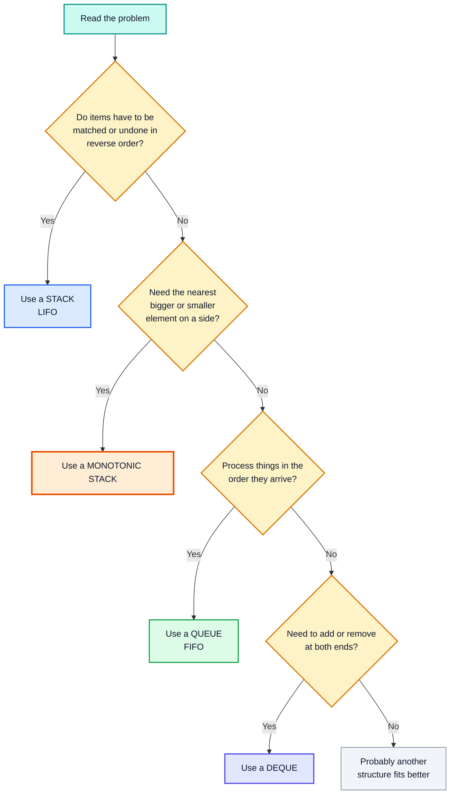
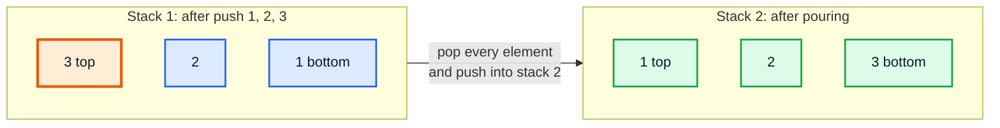
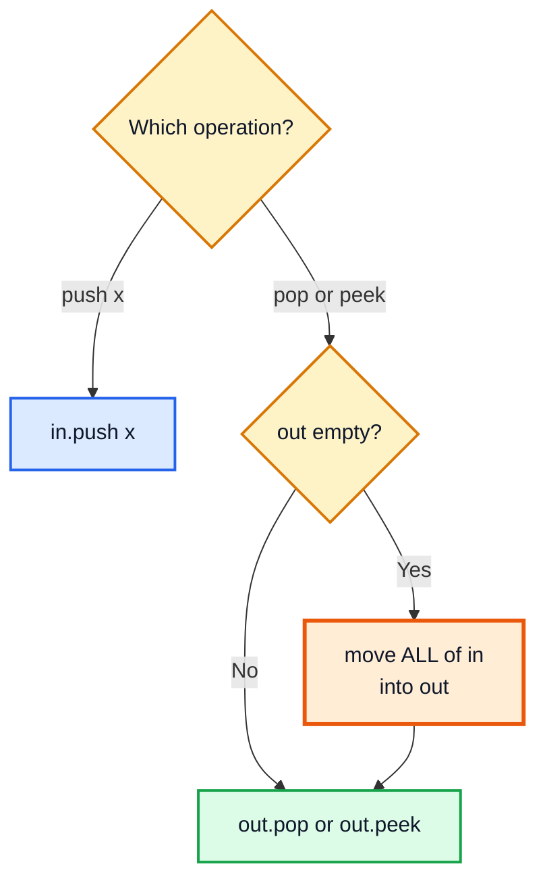
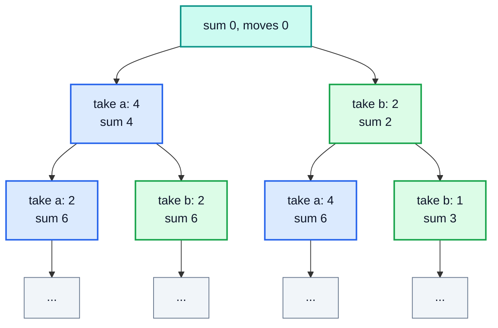
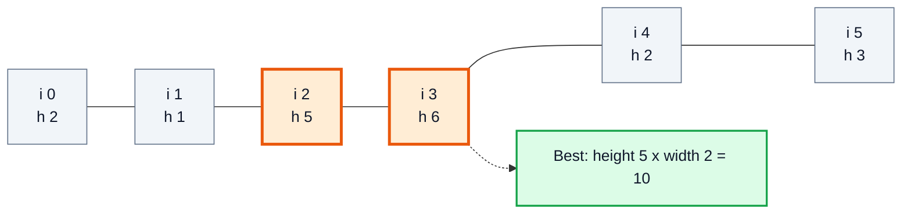
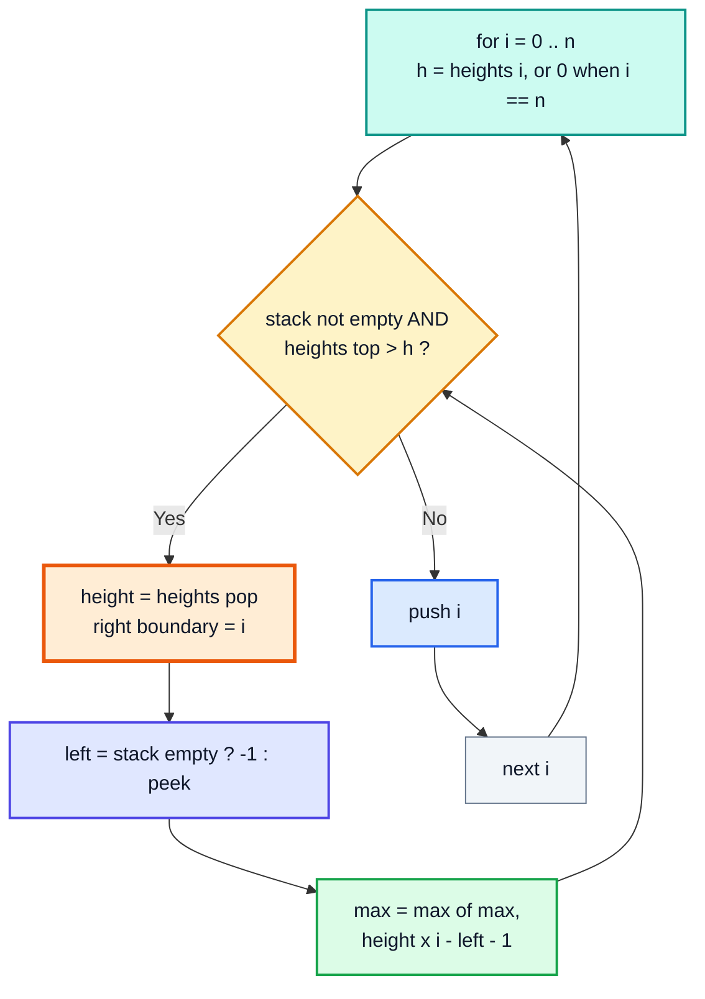
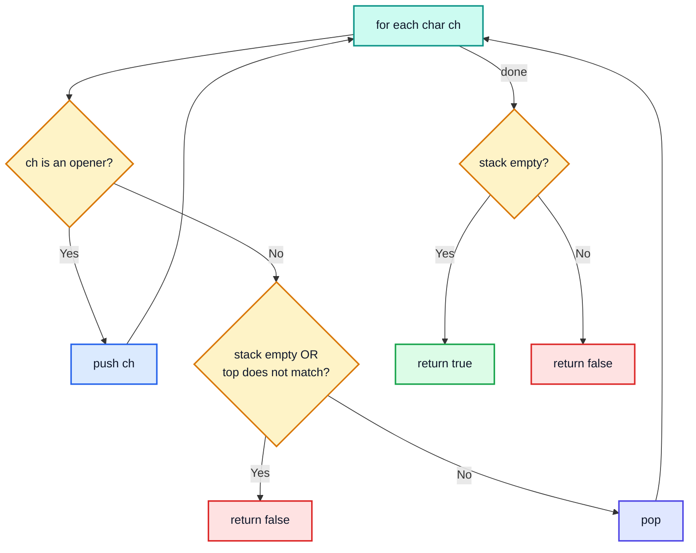
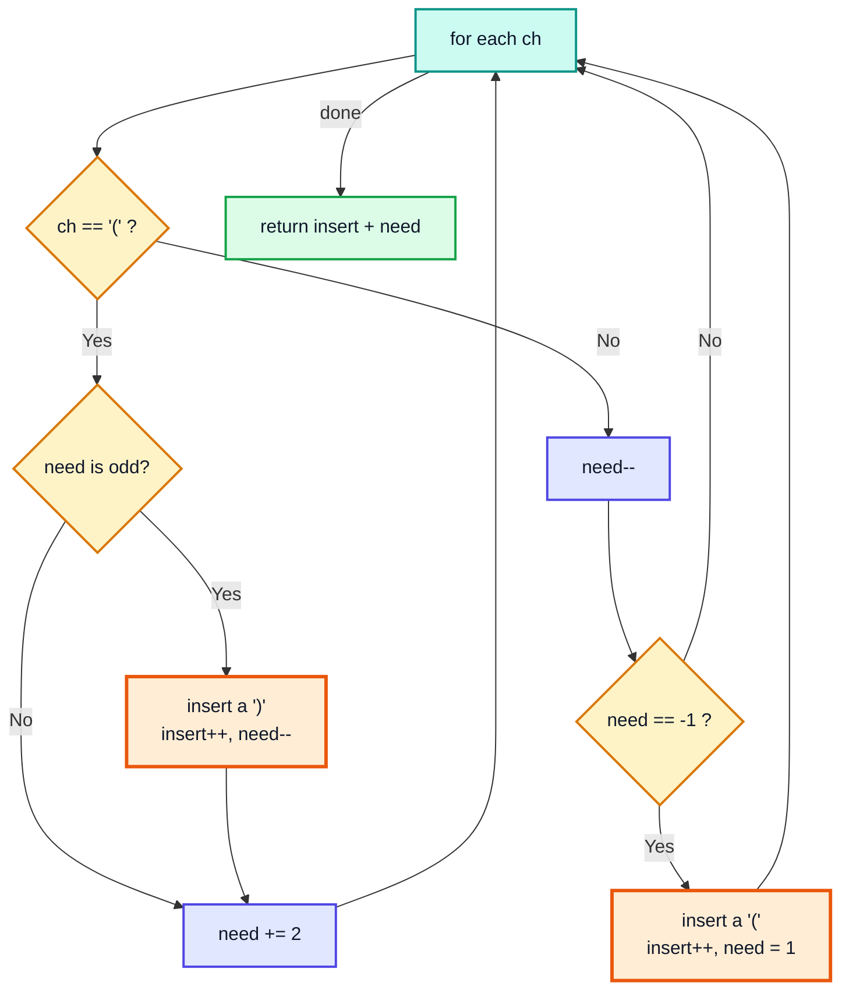

# Stacks and Queues Interview Questions — Complete In-Depth Guide

**Video #47 of the Java + DSA playlist:** *Stacks and Queues Interview Questions - Google, Facebook, Amazon, Microsoft* (2:24:21)

Six classic stack and queue interview problems, from LeetCode easy to hard: building a queue out of stacks, the Game of Two Stacks, the Largest Rectangle in a Histogram, and three bracket-balancing problems. For each one you get the thought process, Java code, a dry-run trace, the time and space complexity, and the faster or simpler alternatives interviewers expect.

---

## Table of Contents

| # | Topic | Timestamp |
|---|---|---|
| 0 | [Introduction](#0-introduction-000) | 0:00 |
| 1 | [Thought process for questions](#1-thought-process-for-questions-421) | 4:21 |
| 2 | [Q: Implement queue using stacks](#2-q-implement-queue-using-stacks-845) | 8:45 |
| 3 | [Q: Game of two stacks](#3-q-game-of-two-stacks-3727) | 37:27 |
| 4 | [Q: Largest rectangle in histogram](#4-q-largest-rectangle-in-histogram-10559) | 1:05:59 |
| 5 | [Q: Valid parentheses](#5-q-valid-parentheses-20155) | 2:01:55 |
| 6 | [Q: Minimum add to make parentheses valid](#6-q-minimum-add-to-make-parentheses-valid-21222) | 2:12:22 |
| 7 | [Q: Minimum insertions to balance a parentheses string](#7-q-minimum-insertions-to-balance-a-parentheses-string-22052) | 2:20:52 |
| 8 | [Outro](#8-outro-22250) | 2:22:50 |

---

## 0. Introduction (0:00)

This video follows **#46 (Stacks and Queues: theory and implementation)**. There you built `CustomStack`, `DynamicStack`, `CustomQueue` and `CircularQueue` from arrays. Now you use stacks and queues to **solve problems**.

| # | Question | Source | Difficulty |
|---|---|---|---|
| 1 | Implement Queue using Stacks | [LeetCode 232](https://leetcode.com/problems/implement-queue-using-stacks/) | Easy |
| 2 | Game of Two Stacks | [HackerRank](https://www.hackerrank.com/challenges/game-of-two-stacks/problem) | Medium |
| 3 | Largest Rectangle in Histogram | [LeetCode 84](https://leetcode.com/problems/largest-rectangle-in-histogram/) | Hard |
| 4 | Valid Parentheses | [LeetCode 20](https://leetcode.com/problems/valid-parentheses/) | Easy |
| 5 | Minimum Add to Make Parentheses Valid | [LeetCode 921](https://leetcode.com/problems/minimum-add-to-make-parentheses-valid/) | Medium |
| 6 | Minimum Insertions to Balance a Parentheses String | [LeetCode 1541](https://leetcode.com/problems/minimum-insertions-to-balance-a-parentheses-string/) | Medium |

> [!IMPORTANT]
> Kunal uses `java.util.Stack` and `LinkedList` as a `Queue` in the video. That works, but in modern Java the recommended type for **both** is `ArrayDeque` (through the `Deque` interface). `Stack` extends `Vector`, so every call is `synchronized` (slower), and it lets you `get(i)` from the middle, which breaks the idea of a stack. These notes use `Deque<Integer> stack = new ArrayDeque<>()`.

| Operation | `Stack<E>` (legacy) | `Deque<E>` as a stack | `Deque<E>` as a queue |
|---|---|---|---|
| Add | `push(x)` | `push(x)` (adds to front) | `offer(x)` (adds to back) |
| Remove | `pop()` | `pop()` (from front) | `poll()` (from front) |
| Look | `peek()` | `peek()` | `peek()` |
| Empty? | `isEmpty()` / `empty()` | `isEmpty()` | `isEmpty()` |
| Empty remove | throws `EmptyStackException` | `pop()` throws `NoSuchElementException` | `poll()` returns `null` |

---

## 1. Thought process for questions (4:21)

### How Do You Know a Problem Needs a Stack or a Queue?

You almost never get told "use a stack". You spot it from the **shape** of the problem.

| Clue in the problem | Data structure | Why |
|---|---|---|
| Matching pairs (brackets, tags, open/close) | Stack | The **most recent** unmatched opener must close first |
| "Next greater / next smaller element" | Monotonic stack | Elements waiting for an answer are kept in order |
| Undo / back button / reverse something | Stack | Last action is undone first |
| Nested structures, recursion you want to make iterative | Stack | The call stack *is* a stack |
| Process in arrival order, scheduling, buffering | Queue | First in, first out |
| Level-by-level traversal (BFS), shortest path in unweighted graph | Queue | Nearest items are handled first |
| Sliding window max / min | Deque | Need both ends |



### The General Method Kunal Follows

1. **Understand the question** with a small example and draw it.
2. **Brute force first**: what is the simplest correct answer, even if slow?
3. **Find the repeated work** in the brute force. Ask: "what do I keep recomputing?"
4. **Pick the data structure** that remembers exactly that information.
5. **Dry-run** the improved idea by hand before writing code.
6. Write the code, then state **time and space complexity**.

> [!TIP]
> In an interview, say the brute force out loud even if you know the optimal answer. It shows you understand the problem, and it gives you something correct to fall back on.

---

## 2. Q: Implement queue using stacks (8:45)

**LeetCode 232. Implement Queue using Stacks.** Build a FIFO queue with `push`, `pop`, `peek` and `empty`, using only stack operations (`push`, `pop`, `peek`, `isEmpty`).

### The Core Idea

A stack reverses order. Reversing **twice** gives the original order back. So if you pour stack 1 into stack 2, the element that went in **first** ends up on **top** of stack 2.



The video shows **two** simple versions, each fast at one operation, and then the interview-standard version is the amortized one.

### Version A: Insert Efficient (push `O(1)`, pop `O(n)`)

`push` goes straight into `first`. To `remove`, pour everything into `second`, take the top, then pour everything **back**.

```java
import java.util.ArrayDeque;
import java.util.Deque;

public class QueueUsingStackInsert {
    private final Deque<Integer> first = new ArrayDeque<>();
    private final Deque<Integer> second = new ArrayDeque<>();

    public void add(int item) {                 // O(1)
        first.push(item);
    }

    public int remove() {                       // O(n)
        while (!first.isEmpty()) second.push(first.pop());
        int removed = second.pop();
        while (!second.isEmpty()) first.push(second.pop());
        return removed;
    }

    public int peek() {                         // O(n)
        while (!first.isEmpty()) second.push(first.pop());
        int peeked = second.peek();
        while (!second.isEmpty()) first.push(second.pop());
        return peeked;
    }

    public boolean isEmpty() {
        return first.isEmpty();
    }

    public static void main(String[] args) {
        QueueUsingStackInsert q = new QueueUsingStackInsert();
        q.add(1); q.add(2); q.add(3);
        System.out.println(q.remove());   // 1
        System.out.println(q.peek());     // 2
        q.add(4);
        System.out.println(q.remove());   // 2
        System.out.println(q.remove());   // 3
        System.out.println(q.remove());   // 4
    }
}
```

### Version B: Remove Efficient (push `O(n)`, pop `O(1)`)

Keep `first` **always in queue order** (oldest on top). To add, move everything out, push the new item at the bottom, move everything back.

```java
import java.util.ArrayDeque;
import java.util.Deque;

public class QueueUsingStackRemove {
    private final Deque<Integer> first = new ArrayDeque<>();
    private final Deque<Integer> second = new ArrayDeque<>();

    public void add(int item) {                 // O(n)
        while (!first.isEmpty()) second.push(first.pop());
        first.push(item);                       // new item goes to the bottom
        while (!second.isEmpty()) first.push(second.pop());
    }

    public int remove() { return first.pop(); } // O(1): oldest is on top
    public int peek()   { return first.peek(); }
    public boolean isEmpty() { return first.isEmpty(); }

    public static void main(String[] args) {
        QueueUsingStackRemove q = new QueueUsingStackRemove();
        q.add(1); q.add(2); q.add(3);
        System.out.println(q.remove());   // 1
        System.out.println(q.peek());     // 2
    }
}
```

### Version C: Amortized `O(1)` (the LeetCode answer)

The trick: **never pour back**. Use `in` for pushes and `out` for pops. Only refill `out` when it is **empty**.



```java
import java.util.ArrayDeque;
import java.util.Deque;

class MyQueue {
    private final Deque<Integer> in = new ArrayDeque<>();
    private final Deque<Integer> out = new ArrayDeque<>();

    public void push(int x) { in.push(x); }

    public int pop()  { shift(); return out.pop(); }

    public int peek() { shift(); return out.peek(); }

    public boolean empty() { return in.isEmpty() && out.isEmpty(); }

    private void shift() {
        if (out.isEmpty()) {
            while (!in.isEmpty()) out.push(in.pop());
        }
    }
}
```

### Dry-Run Trace

| Step | Operation | `in` (top on right) | `out` (top on right) | Returns |
|---|---|---|---|---|
| 1 | `push(1)` | `[1]` | `[]` | — |
| 2 | `push(2)` | `[1, 2]` | `[]` | — |
| 3 | `push(3)` | `[1, 2, 3]` | `[]` | — |
| 4 | `peek()` 🟧 pour | `[]` | `[3, 2, 1]` | `1` |
| 5 | `pop()` | `[]` | `[3, 2]` | `1` |
| 6 | `push(4)` | `[4]` | `[3, 2]` | — |
| 7 | `pop()` (no pour, `out` not empty) | `[4]` | `[3]` | `2` |
| 8 | `pop()` | `[4]` | `[]` | `3` |
| 9 | `pop()` 🟧 pour | `[]` | `[]` | `4` |

### Complexity

| Version | `push` | `pop` / `peek` | Space |
|---|---|---|---|
| A: insert efficient | `O(1)` | `O(n)` | `O(n)` |
| B: remove efficient | `O(n)` | `O(1)` | `O(n)` |
| C: two stacks, lazy pour | `O(1)` | **amortized `O(1)`**, worst `O(n)` | `O(n)` |

> [!NOTE]
> **Why amortized `O(1)`?** Each element is pushed onto `in` once, moved to `out` once, and popped from `out` once. That is at most 3 stack operations per element over its whole life, no matter how the calls are mixed. One single `pop` can cost `O(n)`, but `n` operations never cost more than `O(n)` in total.

> [!TIP]
> The mirror question is **LeetCode 225. Implement Stack using Queues**: push into a queue, then rotate the queue `size − 1` times so the newest element is at the front. Push is `O(n)`, pop is `O(1)`.

---

## 3. Q: Game of two stacks (37:27)

**HackerRank: Game of Two Stacks.** You have two stacks of non-negative integers `a` and `b` (index 0 is the top) and a limit `maxSum`. Each move, remove the top of **either** stack and add it to your running sum. The game ends when the next removal would make the sum go over `maxSum`. Return the **maximum number of moves** possible.

Example: `maxSum = 10`, `a = [4, 2, 4, 6, 1]`, `b = [2, 1, 8, 5]` → answer **4** (take `4, 2` from `a` and `2, 1` from `b`, sum `9`).

> [!WARNING]
> Greedy "always take the smaller top" is **wrong**. The small number might hide a huge number below it, while the bigger top hides many tiny ones. You must consider combinations.

### Approach 1: Recursion (what the video builds)

At every step there are two choices: take from `a` or take from `b`. Explore both and keep the best. This is the same "choose / recurse" pattern from the recursion videos.



Use **indices** instead of copying arrays (copying with `Arrays.copyOfRange` on every call adds `O(n)` work and memory per call).

```java
public class TwoStacksRecursive {
    static int twoStacks(int maxSum, int[] a, int[] b) {
        return helper(maxSum, a, b, 0, 0, 0);
    }

    // i = how many taken from a, j = how many taken from b
    static int helper(int maxSum, int[] a, int[] b, int i, int j, int sum) {
        int best = i + j;                                   // stop here
        if (i < a.length && sum + a[i] <= maxSum) {         // take from a
            best = Math.max(best, helper(maxSum, a, b, i + 1, j, sum + a[i]));
        }
        if (j < b.length && sum + b[j] <= maxSum) {         // take from b
            best = Math.max(best, helper(maxSum, a, b, i, j + 1, sum + b[j]));
        }
        return best;
    }

    public static void main(String[] args) {
        System.out.println(twoStacks(10, new int[]{4, 2, 4, 6, 1}, new int[]{2, 1, 8, 5}));
        // 4
    }
}
```

> [!CAUTION]
> Two easy bugs in this recursion:
> 1. **Base case "stop when either stack is empty"** is wrong: when `a` runs out you can still keep taking from `b`. Check each stack separately, as above.
> 2. **Counting the move that broke the limit.** If you add first and check `sum > maxSum` afterwards, the last call has counted one move too many, so you must return `count − 1`. Checking `sum + next <= maxSum` *before* moving avoids the off-by-one.

**Complexity:** every call branches twice and the depth can reach `n + m`, so time is `O(2^(n+m))` in the worst case; space is `O(n + m)` for the recursion stack. This passes small tests but **times out** on HackerRank (stacks up to 10⁵ elements).

### Approach 2: Two Pointers / Sliding Window (optimal)

Key observation: whatever you take from `a` is always a **prefix** of `a`, and the same for `b`. So the answer is the best pair `(i, j)` with `prefixA(i) + prefixB(j) ≤ maxSum`, maximizing `i + j`.

1. Take as many as possible from `a` alone. That is the starting `i`.
2. Now add elements of `b` one by one. Whenever the sum goes over, **give back** elements from the end of the `a` prefix.
3. After each step, record `i + j`.

```java
public class TwoStacksOptimal {
    static int twoStacks(int maxSum, int[] a, int[] b) {
        int sum = 0, i = 0;
        while (i < a.length && sum + a[i] <= maxSum) sum += a[i++];   // greedy from a
        int best = i, j = 0;
        while (j < b.length) {
            sum += b[j++];                                // take one more from b
            while (sum > maxSum && i > 0) sum -= a[--i];  // give back from a
            if (sum > maxSum) break;                      // even with i = 0 it does not fit
            best = Math.max(best, i + j);
        }
        return best;
    }

    public static void main(String[] args) {
        System.out.println(twoStacks(10, new int[]{4, 2, 4, 6, 1}, new int[]{2, 1, 8, 5}));
        // 4
    }
}
```

### Dry-Run Trace (`maxSum = 10`, `a = [4,2,4,6,1]`, `b = [2,1,8,5]`)

| Step | Action | `i` (from a) | `j` (from b) | `sum` | `best` |
|---|---|---|---|---|---|
| 1 | Take `4, 2, 4` from a; `6` would make 16 | 3 | 0 | 10 | 3 |
| 2 | Add `b[0] = 2` → 12 🟥, give back `a[2] = 4` | 2 | 1 | 8 | 3 |
| 3 | Add `b[1] = 1` → 9 ✅ | 2 | 2 | 9 | **4** 🟩 |
| 4 | Add `b[2] = 8` → 17 🟥, give back `2`, then `4` → 11, `i = 0` still too big | 0 | 3 | 11 | stop |

### Complexity

| Approach | Time | Space |
|---|---|---|
| Recursion (both choices) | `O(2^(n+m))` | `O(n + m)` stack |
| Two pointers | `O(n + m)` (each pointer moves at most once over its array) | `O(1)` |
| Prefix sums + binary search on `b` for each `i` | `O(n log m)` | `O(m)` |

---

## 4. Q: Largest rectangle in histogram (1:05:59)

**LeetCode 84. Largest Rectangle in Histogram.** Given bar heights (each bar has width 1), return the area of the largest rectangle that fits inside the histogram.

Example: `heights = [2, 1, 5, 6, 2, 3]` → **10** (bars of height 5 and 6, rectangle of height 5 and width 2).



### Step 1: Brute Force

Every rectangle's height is set by its **shortest** bar. So for each bar `i`, treat `heights[i]` as the height and stretch left and right while bars are at least as tall.

```java
static int brute(int[] h) {
    int max = 0;
    for (int i = 0; i < h.length; i++) {
        int left = i, right = i;
        while (left > 0 && h[left - 1] >= h[i]) left--;
        while (right < h.length - 1 && h[right + 1] >= h[i]) right++;
        max = Math.max(max, h[i] * (right - left + 1));
    }
    return max;
}
// brute(new int[]{2, 1, 5, 6, 2, 3}) -> 10
```

Time `O(n²)`, space `O(1)`. With `n` up to 10⁵ on LeetCode this times out.

### Step 2: What Are We Recomputing?

For each bar we only need two numbers:

- **left boundary:** index of the nearest bar on the left that is **shorter**
- **right boundary:** index of the nearest bar on the right that is **shorter**

Then `area(i) = heights[i] × (right − left − 1)`. "Nearest smaller element on each side" is exactly the **monotonic stack** pattern.

### Step 3: Monotonic Increasing Stack (one pass)

Keep a stack of **indices** whose heights are **increasing** from bottom to top.

- When the current bar is **shorter** than the bar on top of the stack, the top bar has just found its **right boundary** (the current index). Its **left boundary** is the element under it in the stack. Pop it and compute its area.
- Repeat until the top is not taller, then push the current index.
- At the end, pretend there is a bar of height `0` at index `n`, which flushes everything left in the stack.



```java
import java.util.ArrayDeque;
import java.util.Deque;

public class LargestRectangle {
    static int largestRectangleArea(int[] heights) {
        Deque<Integer> stack = new ArrayDeque<>();    // indices, heights increasing
        int max = 0, n = heights.length;
        for (int i = 0; i <= n; i++) {
            int h = (i == n) ? 0 : heights[i];        // sentinel 0 flushes the stack
            while (!stack.isEmpty() && heights[stack.peek()] > h) {
                int height = heights[stack.pop()];
                int left = stack.isEmpty() ? -1 : stack.peek();
                max = Math.max(max, height * (i - left - 1));
            }
            stack.push(i);
        }
        return max;
    }

    public static void main(String[] args) {
        System.out.println(largestRectangleArea(new int[]{2, 1, 5, 6, 2, 3}));  // 10
        System.out.println(largestRectangleArea(new int[]{2, 4}));              // 4
        System.out.println(largestRectangleArea(new int[]{1, 1, 1, 1}));        // 4
    }
}
```

### Dry-Run Trace (`[2, 1, 5, 6, 2, 3]`)

| `i` | `h` | Popped (height) | `left` | Width `i − left − 1` | Area | Stack after (indices) | `max` |
|---|---|---|---|---|---|---|---|
| 0 | 2 | — | — | — | — | `[0]` | 0 |
| 1 | 1 | idx 0 (2) | −1 | 1 | 2 | `[1]` | 2 |
| 2 | 5 | — | — | — | — | `[1, 2]` | 2 |
| 3 | 6 | — | — | — | — | `[1, 2, 3]` | 2 |
| 4 | 2 | idx 3 (6) | 2 | 1 | 6 | | 6 |
| 4 | 2 | idx 2 (5) 🟩 | 1 | 2 | **10** | `[1, 4]` | **10** |
| 5 | 3 | — | — | — | — | `[1, 4, 5]` | 10 |
| 6 | 0 | idx 5 (3) | 4 | 1 | 3 | | 10 |
| 6 | 0 | idx 4 (2) | 1 | 4 | 8 | | 10 |
| 6 | 0 | idx 1 (1) | −1 | 6 | 6 | `[6]` | 10 |

> [!NOTE]
> The video's version handles the leftover bars with a **second loop** after the main loop, using `heights.length` as the right boundary. The sentinel `i == n` trick above does exactly the same thing inside one loop. Both are correct.

### Complexity

| Approach | Time | Space |
|---|---|---|
| Brute force (expand from each bar) | `O(n²)` | `O(1)` |
| Divide and conquer (split at the minimum bar) | `O(n log n)` average, `O(n²)` sorted input | `O(n)` stack |
| Two arrays of nearest-smaller (two monotonic passes) | `O(n)` | `O(n)` |
| **One-pass monotonic stack** | **`O(n)`**: each index is pushed once and popped once | `O(n)` |

> [!TIP]
> This exact function is the building block for **LeetCode 85. Maximal Rectangle**: treat each row of a binary matrix as the floor of a histogram (heights = number of consecutive 1s above), and call `largestRectangleArea` once per row.

---

## 5. Q: Valid parentheses (2:01:55)

**LeetCode 20. Valid Parentheses.** A string contains only `()[]{}`. It is valid if every opener is closed by the **same type** and in the **correct order**.

| Input | Valid? | Why |
|---|---|---|
| `"()[]{}"` | ✅ | Each pair closes immediately |
| `"{[]}"` | ✅ | Properly nested |
| `"([)]"` | ❌ | `)` arrives while `[` is the most recent opener |
| `"(("` | ❌ | Openers left over |
| `"]"` | ❌ | Closer with nothing to match |

### Approach

The **most recently opened** bracket must be the **first** to close: that is LIFO, so use a stack.

1. Opener → push it.
2. Closer → the stack must not be empty, and its top must be the matching opener. Pop it.
3. At the end the stack must be **empty**.



```java
import java.util.ArrayDeque;
import java.util.Deque;

public class ValidParentheses {
    static boolean isValid(String s) {
        Deque<Character> stack = new ArrayDeque<>();
        for (char ch : s.toCharArray()) {
            if (ch == '(' || ch == '{' || ch == '[') {
                stack.push(ch);
            } else {
                if (stack.isEmpty()) return false;     // closer with no opener
                char top = stack.pop();
                if (ch == ')' && top != '(') return false;
                if (ch == '}' && top != '{') return false;
                if (ch == ']' && top != '[') return false;
            }
        }
        return stack.isEmpty();                        // leftover openers -> invalid
    }

    public static void main(String[] args) {
        System.out.println(isValid("()[]{}"));  // true
        System.out.println(isValid("([)]"));    // false
        System.out.println(isValid("{[]}"));    // true
        System.out.println(isValid("(("));      // false
        System.out.println(isValid("]"));       // false
    }
}
```

### A Shorter Modern Version: Push the Expected Closer

Instead of pushing the opener, push the closer you **expect** to see. Then a closer just has to equal the popped value. Uses a Java 14+ arrow `switch`.

```java
static boolean isValid(String s) {
    Deque<Character> stack = new ArrayDeque<>();
    for (char ch : s.toCharArray()) {
        switch (ch) {
            case '(' -> stack.push(')');
            case '[' -> stack.push(']');
            case '{' -> stack.push('}');
            default -> {
                if (stack.isEmpty() || stack.pop() != ch) return false;
            }
        }
    }
    return stack.isEmpty();
}
```

### Dry-Run Trace (`"{[]}"` and `"([)]"`)

| Input | `ch` | Action | Stack (top on right) |
|---|---|---|---|
| `{[]}` | `{` | push | `{` |
| | `[` | push | `{ [` |
| | `]` | top `[` matches ✅ pop | `{` |
| | `}` | top `{` matches ✅ pop | empty → **true** 🟩 |
| `([)]` | `(` | push | `(` |
| | `[` | push | `( [` |
| | `)` | top is `[` ❌ | **false** 🟥 |

### Complexity

Time `O(n)`, space `O(n)` (a string of all openers fills the stack).

> [!TIP]
> Quick early exit: if `s.length()` is **odd**, it can never be valid.

> [!NOTE]
> If there is only **one** bracket type, you do not need a stack at all: a counter `open` (++ on `(`, −− on `)`, never below 0, must end at 0) is enough. The stack is needed only to remember **which type** was opened. The next two questions use this counter idea.

---

## 6. Q: Minimum add to make parentheses valid (2:12:22)

**LeetCode 921. Minimum Add to Make Parentheses Valid.** A string of `(` and `)`. In one move you can insert one bracket anywhere. Return the minimum number of insertions to make it valid.

| Input | Answer | Insertions |
|---|---|---|
| `"())"` | 1 | one `(` at the start |
| `"((("` | 3 | three `)` at the end |
| `"()))(("` | 4 | two `(` for the extra `)`, two `)` for the trailing `((` |

### Approach 1: Stack (video)

Push `(`. On `)`, if the top is `(`, pop it (a matched pair disappears). Otherwise push the `)` too, since it can never be matched. Whatever is left in the stack is **unmatched**, and each needs exactly one insertion.

```java
import java.util.ArrayDeque;
import java.util.Deque;

public class MinAddToMakeValid {
    static int minAddToMakeValid(String s) {
        Deque<Character> stack = new ArrayDeque<>();
        for (char ch : s.toCharArray()) {
            if (ch == ')' && !stack.isEmpty() && stack.peek() == '(') {
                stack.pop();                  // matched pair cancels out
            } else {
                stack.push(ch);               // unmatched for now
            }
        }
        return stack.size();
    }

    public static void main(String[] args) {
        System.out.println(minAddToMakeValid("())"));     // 1
        System.out.println(minAddToMakeValid("((("));     // 3
        System.out.println(minAddToMakeValid("()))(("));  // 4
    }
}
```

### Approach 2: Two Counters, `O(1)` Space

The stack only ever holds `)`s at the bottom and `(`s at the top, so you just need to count them:

- `open`: unmatched `(` seen so far
- `add`: `)` that had nothing to match (each needs an inserted `(`)

```java
static int minAddToMakeValid(String s) {
    int open = 0, add = 0;
    for (char ch : s.toCharArray()) {
        if (ch == '(') open++;
        else if (open > 0) open--;   // match with an earlier '('
        else add++;                  // stray ')': must insert a '('
    }
    return add + open;               // leftover '(' each need a ')'
}
```

### Dry-Run Trace (`"()))(("`)

| `ch` | `open` | `add` | Note |
|---|---|---|---|
| `(` | 1 | 0 | |
| `)` | 0 | 0 | matched ✅ |
| `)` | 0 | 1 | stray 🟥 |
| `)` | 0 | 2 | stray 🟥 |
| `(` | 1 | 2 | |
| `(` | 2 | 2 | |
| end | | | answer `2 + 2 = 4` 🟩 |

### Complexity

| Approach | Time | Space |
|---|---|---|
| Stack | `O(n)` | `O(n)` |
| Counters | `O(n)` | `O(1)` |

---

## 7. Q: Minimum insertions to balance a parentheses string (2:20:52)

**LeetCode 1541. Minimum Insertions to Balance a Parentheses String.** Same idea as #921, but now every `(` must be closed by **two consecutive** `))`. Return the minimum insertions.

| Input | Answer | Why |
|---|---|---|
| `"(()))"` | 1 | Second `(` gets `))`, first `(` has only one `)` left → add one `)` |
| `"())"` | 0 | Already balanced |
| `"))())("` | 3 | Leading `))` needs a `(` (1); `())` is fine; trailing `(` needs `))` (2) |
| `"(((((("` | 12 | Each `(` needs `))` |
| `")))))))"` | 5 | 7 `)`: three `))` pairs need 3 `(`, the last lone `)` needs a `(` and a `)` |

> [!NOTE]
> This section of the video is short and is mainly left as practice. The full solution is below.

### Approach: Track How Many `)` You Still Need

Let `need` = number of `)` still required to close all open `(`. Let `insert` = insertions made so far.

1. On `(`: if `need` is **odd**, a single `)` is waiting for its partner, but a new `(` has interrupted the `))` pair. Insert one `)` right now (`insert++`, `need--`). Then add `2` to `need`.
2. On `)`: `need--`. If `need` becomes `−1`, this `)` had no `(` before it. Insert a `(` (`insert++`), and now that `(` needs one more `)`, so `need = 1`.
3. At the end, every remaining `need` is an insertion: answer = `insert + need`.



```java
public class MinInsertions {
    static int minInsertions(String s) {
        int need = 0, insert = 0;
        for (char ch : s.toCharArray()) {
            if (ch == '(') {
                if (need % 2 == 1) {      // a lone ')' is waiting: complete it first
                    insert++;
                    need--;
                }
                need += 2;
            } else {
                need--;
                if (need < 0) {           // ')' with no '(' before it
                    insert++;             // insert '('
                    need = 1;             // that '(' still needs one more ')'
                }
            }
        }
        return insert + need;
    }

    public static void main(String[] args) {
        System.out.println(minInsertions("(()))"));    // 1
        System.out.println(minInsertions("())"));      // 0
        System.out.println(minInsertions("))())("));   // 3
        System.out.println(minInsertions("(((((("));   // 12
        System.out.println(minInsertions(")))))))"));  // 5
    }
}
```

### Dry-Run Trace (`"))())("`)

| `ch` | Before `need` | Action | `need` | `insert` |
|---|---|---|---|---|
| `)` | 0 | `need = −1` → insert `(` 🟧, `need = 1` | 1 | 1 |
| `)` | 1 | `need--` | 0 | 1 |
| `(` | 0 | even, `need += 2` | 2 | 1 |
| `)` | 2 | `need--` | 1 | 1 |
| `)` | 1 | `need--` | 0 | 1 |
| `(` | 0 | even, `need += 2` | 2 | 1 |
| end | | `insert + need = 1 + 2` | | **3** 🟩 |

### Stack Version (for comparison)

You can also do it with a stack of `(`: on `)`, look at the next character. If it is also `)`, consume both; otherwise insert one `)`. Then pop a `(` if there is one, or insert a `(`. At the end each leftover `(` costs 2. It is the same `O(n)` time, but `O(n)` space instead of `O(1)`.

### Complexity

Time `O(n)`, space `O(1)`.

---

## 8. Outro (2:22:50)

- Every question in this video came down to **one question**: "what do I need to remember about the past?" A stack remembers the most recent unresolved thing; a counter is enough when only the *number* of unresolved things matters.
- Practise more with the assignments in the course repo. Good next problems: **LeetCode 155** (Min Stack), **496 / 503** (Next Greater Element I and II), **739** (Daily Temperatures), **85** (Maximal Rectangle), **32** (Longest Valid Parentheses), **225** (Stack using Queues).

---

## 🧩 Complete Example: Everything Together

All six solutions in one program with fixed inputs.

```java
import java.util.ArrayDeque;
import java.util.Deque;

public class StackQueueQuestions {

    // ---------- Q1: Queue using two stacks (amortized O(1)) ----------
    static class MyQueue {
        private final Deque<Integer> in = new ArrayDeque<>();
        private final Deque<Integer> out = new ArrayDeque<>();

        void push(int x) { in.push(x); }

        int pop() { shift(); return out.pop(); }

        int peek() { shift(); return out.peek(); }

        boolean empty() { return in.isEmpty() && out.isEmpty(); }

        private void shift() {
            if (out.isEmpty()) {
                while (!in.isEmpty()) out.push(in.pop());
            }
        }
    }

    // ---------- Q2: Game of Two Stacks (sliding window, O(n + m)) ----------
    static int twoStacks(int maxSum, int[] a, int[] b) {
        int sum = 0, i = 0;
        while (i < a.length && sum + a[i] <= maxSum) sum += a[i++];
        int best = i, j = 0;
        while (j < b.length) {
            sum += b[j++];
            while (sum > maxSum && i > 0) sum -= a[--i];
            if (sum > maxSum) break;
            best = Math.max(best, i + j);
        }
        return best;
    }

    // ---------- Q3: Largest Rectangle in Histogram (monotonic stack) ----------
    static int largestRectangleArea(int[] heights) {
        Deque<Integer> stack = new ArrayDeque<>();
        int max = 0, n = heights.length;
        for (int i = 0; i <= n; i++) {
            int h = (i == n) ? 0 : heights[i];
            while (!stack.isEmpty() && heights[stack.peek()] > h) {
                int height = heights[stack.pop()];
                int left = stack.isEmpty() ? -1 : stack.peek();
                max = Math.max(max, height * (i - left - 1));
            }
            stack.push(i);
        }
        return max;
    }

    // ---------- Q4: Valid Parentheses ----------
    static boolean isValid(String s) {
        Deque<Character> stack = new ArrayDeque<>();
        for (char ch : s.toCharArray()) {
            switch (ch) {
                case '(' -> stack.push(')');
                case '[' -> stack.push(']');
                case '{' -> stack.push('}');
                default -> {
                    if (stack.isEmpty() || stack.pop() != ch) return false;
                }
            }
        }
        return stack.isEmpty();
    }

    // ---------- Q5: Minimum Add to Make Parentheses Valid ----------
    static int minAddToMakeValid(String s) {
        int open = 0, add = 0;
        for (char ch : s.toCharArray()) {
            if (ch == '(') open++;
            else if (open > 0) open--;
            else add++;
        }
        return add + open;
    }

    // ---------- Q6: Minimum Insertions to Balance ( -> )) ----------
    static int minInsertions(String s) {
        int need = 0, insert = 0;          // need = ')' still required
        for (char ch : s.toCharArray()) {
            if (ch == '(') {
                if (need % 2 == 1) {       // odd need: a lone ')' is waiting for its pair
                    insert++;
                    need--;
                }
                need += 2;
            } else {
                need--;
                if (need < 0) {            // ')' with no '(' before it
                    insert++;
                    need = 1;
                }
            }
        }
        return insert + need;
    }

    public static void main(String[] args) {
        System.out.println("=== Q1: Queue using Stacks ===");
        MyQueue q = new MyQueue();
        q.push(1); q.push(2); q.push(3);
        System.out.println("peek  = " + q.peek());
        System.out.println("pop   = " + q.pop());
        q.push(4);
        System.out.print("drain =");
        while (!q.empty()) System.out.print(" " + q.pop());
        System.out.println();

        System.out.println("\n=== Q2: Game of Two Stacks ===");
        System.out.println("max moves = " + twoStacks(10, new int[]{4, 2, 4, 6, 1}, new int[]{2, 1, 8, 5}));

        System.out.println("\n=== Q3: Largest Rectangle in Histogram ===");
        System.out.println("[2,1,5,6,2,3] -> " + largestRectangleArea(new int[]{2, 1, 5, 6, 2, 3}));
        System.out.println("[2,4]         -> " + largestRectangleArea(new int[]{2, 4}));

        System.out.println("\n=== Q4: Valid Parentheses ===");
        for (String s : new String[]{"()[]{}", "([)]", "{[]}", "(("}) {
            System.out.printf("%-8s -> %b%n", s, isValid(s));
        }

        System.out.println("\n=== Q5: Minimum Add to Make Valid ===");
        for (String s : new String[]{"())", "(((", "()))(("}) {
            System.out.printf("%-8s -> %d%n", s, minAddToMakeValid(s));
        }

        System.out.println("\n=== Q6: Minimum Insertions to Balance ===");
        for (String s : new String[]{"(()))", "())", "))())(", "((((((", ")))))))"}) {
            System.out.printf("%-8s -> %d%n", s, minInsertions(s));
        }
    }
}
```

**Expected Output:**

```
=== Q1: Queue using Stacks ===
peek  = 1
pop   = 1
drain = 2 3 4

=== Q2: Game of Two Stacks ===
max moves = 4

=== Q3: Largest Rectangle in Histogram ===
[2,1,5,6,2,3] -> 10
[2,4]         -> 4

=== Q4: Valid Parentheses ===
()[]{}   -> true
([)]     -> false
{[]}     -> true
((       -> false

=== Q5: Minimum Add to Make Valid ===
())      -> 1
(((      -> 3
()))((   -> 4

=== Q6: Minimum Insertions to Balance ===
(()))    -> 1
())      -> 0
))())(   -> 3
((((((   -> 12
)))))))  -> 5
```

(Compiled and run with `javac`/`java` 21.)

---

## Quick Reference Cheat Sheet

| Concept | One-Line Summary |
|---|---|
| **Which type to use** | `Deque<E> d = new ArrayDeque<>()` for both stacks and queues; avoid legacy `Stack` |
| **Spot a stack** | Matching pairs, undo, "nearest smaller/greater", nested structure |
| **Spot a queue** | Arrival order, BFS, level by level |
| **Queue via stacks (LC 232)** | `in` for push, `out` for pop; pour only when `out` is empty → amortized `O(1)` |
| **Insert vs remove efficient** | Pour there and back on every remove (or every add) → `O(n)` for that operation |
| **Game of Two Stacks** | Recursion is `O(2^(n+m))`; take max prefix of `a`, then add `b` and give back from `a` → `O(n + m)` |
| **Largest Rectangle (LC 84)** | Increasing stack of indices; on a shorter bar pop and compute `h × (i − left − 1)`; sentinel 0 at the end |
| **Histogram complexity** | `O(n)` time, each index pushed and popped once; `O(n)` space |
| **Valid Parentheses (LC 20)** | Push opener (or expected closer); closer must match the top; stack empty at end |
| **One bracket type** | A counter replaces the stack |
| **Min Add (LC 921)** | `open` and `add` counters; answer `add + open`; `O(1)` space |
| **Min Insertions (LC 1541)** | Track `need`; odd `need` on `(` → insert `)`; `need < 0` → insert `(` and set `need = 1`; answer `insert + need` |
| **Amortized analysis** | Count total work per element over its lifetime, not the worst single call |
