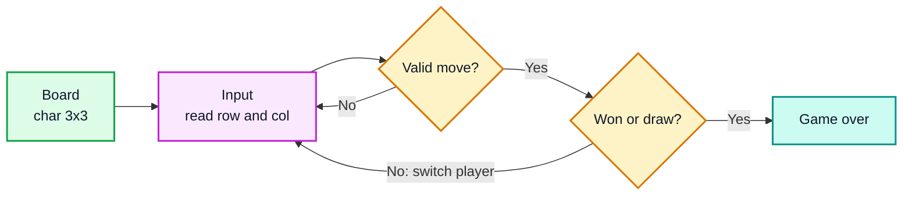
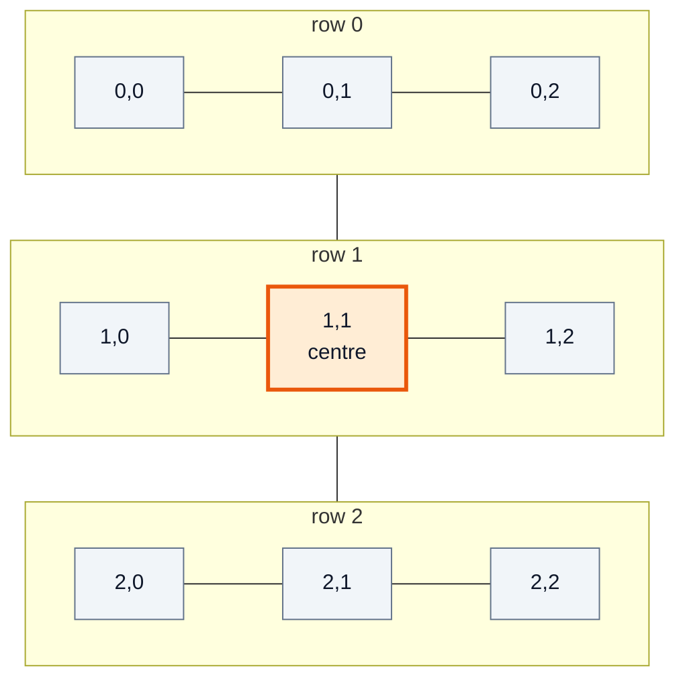
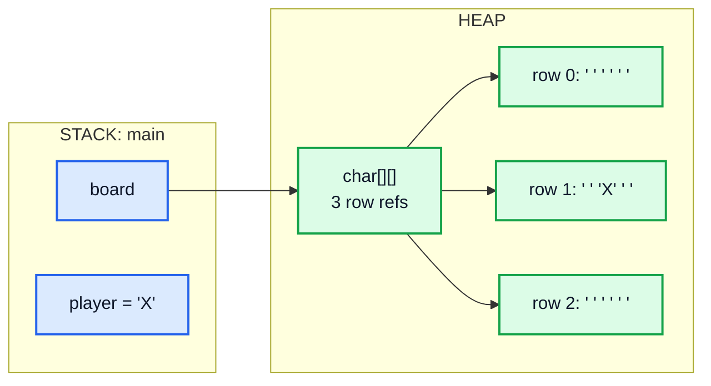
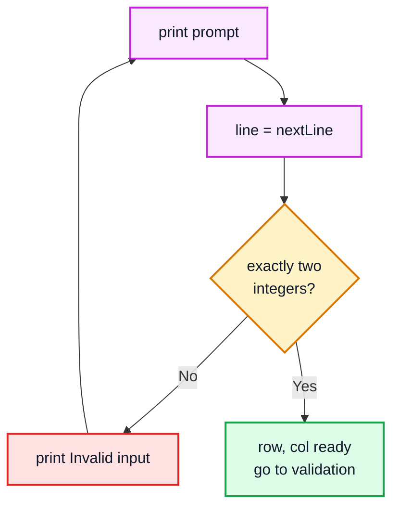
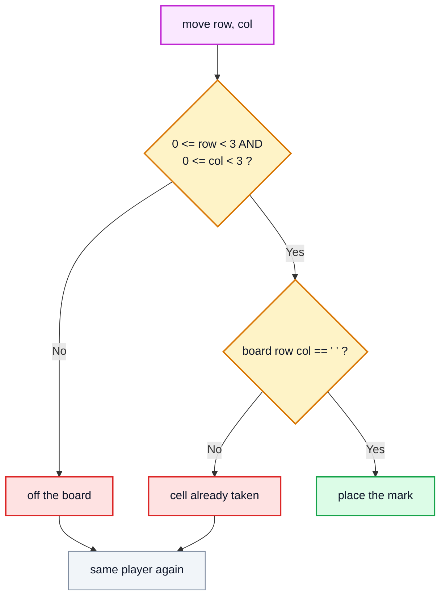
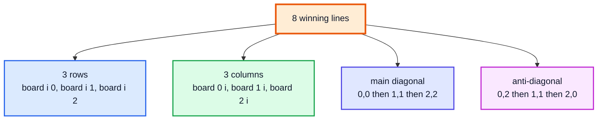
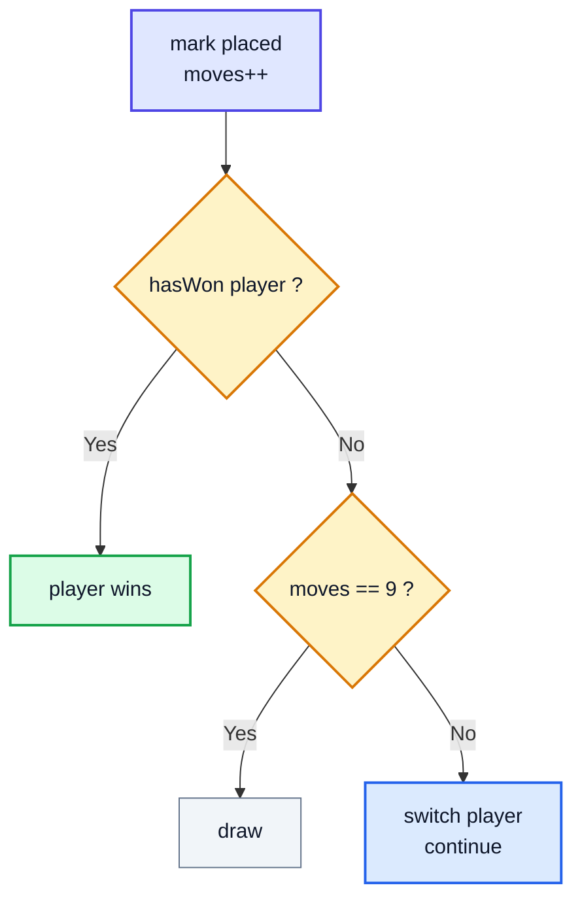
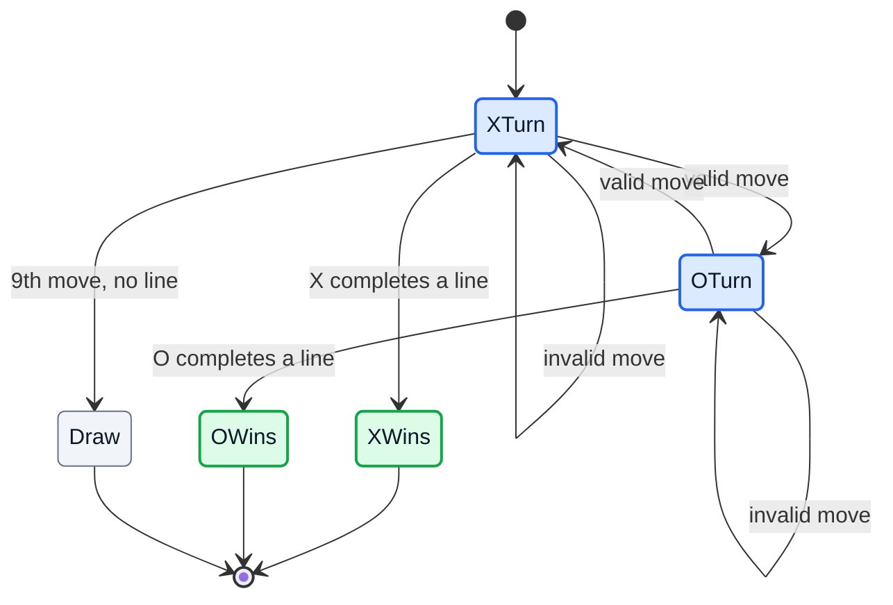
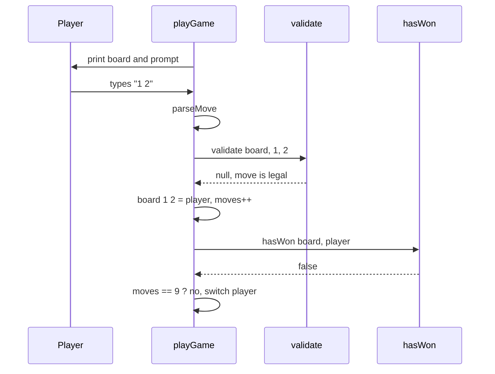

# Tic Tac Toe Game in Java — Complete In-Depth Guide

**Video #48 of the Java + DSA playlist:** *Tic Tac Toe Java Game in Under 15 Minutes* (17:15)

A short, fun project video: build a two-player Tic Tac Toe game that runs in the terminal, using a 2D `char` array, a `Scanner` input loop, move checks and a win checker. These notes rebuild the game piece by piece, fix the gaps in the minimal version (no draw, crashes on bad input), and end with a full playable game.

> [!NOTE]
> This video's description has **no timestamps**. The sections below are organised by topic (board, input, validation, win check, draw, game loop) in the order you would build the game, and use **(—)** in place of a time.

---

## Table of Contents

| # | Topic | Timestamp |
|---|---|---|
| 0 | [Introduction](#0-introduction-) | — |
| 1 | [Board Representation](#1-board-representation-) | — |
| 2 | [Input Loop](#2-input-loop-) | — |
| 3 | [Move Validation](#3-move-validation-) | — |
| 4 | [Win Checking: Rows, Columns, Diagonals](#4-win-checking-rows-columns-diagonals-) | — |
| 5 | [Draw Detection](#5-draw-detection-) | — |
| 6 | [Game Loop](#6-game-loop-) | — |

---

## 0. Introduction (—)

**Rules of Tic Tac Toe:** two players, `X` and `O`, take turns marking empty cells of a 3 × 3 grid. The first player with **three marks in a line** (a row, a column or a diagonal) wins. If all 9 cells fill up with no line, the game is a **draw**.

The program needs five pieces:



| Concept used | Learned in |
|---|---|
| 2D arrays | #12 Arrays and ArrayList |
| `Scanner` input, `while` loops, `if` | #8 First Java Program, #9 Conditionals and Loops |
| Methods with parameters and return values | #11 Functions / Methods |
| Ternary operator | #9 Conditionals |

> [!TIP]
> This is a good first "real program": small, but it has state (the board), a loop driven by user input, and rules that must be checked. The same structure works for Connect Four, Snake, or any turn-based board game.

---

## 1. Board Representation (—)

### The Basics

The board is a **2D `char` array**: 3 rows, 3 columns. Each cell holds `'X'`, `'O'`, or `' '` (a space for empty).

```java
char[][] board = new char[3][3];
for (int row = 0; row < board.length; row++) {
    for (int col = 0; col < board[row].length; col++) {
        board[row][col] = ' ';
    }
}
```

> [!IMPORTANT]
> A new `char` array is filled with `'\u0000'` (the null character), **not** a space. If you skip the fill loop, the empty check `board[r][c] == ' '` fails for every cell and the board prints garbage. Either fill with `' '`, or compare with `'\u0000'` everywhere. Filling is clearer.

The modern one-liner for the fill uses `Arrays.fill` on each row:

```java
for (char[] row : board) java.util.Arrays.fill(row, ' ');
```

### Cell Coordinates

Every cell is addressed as `board[row][col]`, both from 0 to 2.



### In Memory

A 2D array in Java is an **array of arrays**. `board` is a reference on the stack pointing to an array of 3 references, each pointing to its own `char[3]` row on the heap.



This is why passing `board` to a method like `printBoard(board)` or `hasWon(board, player)` does **not** copy it: the method gets a copy of the **reference** and sees the same cells.

### Printing the Board

```java
static void printBoard(char[][] board) {
    for (int row = 0; row < board.length; row++) {
        for (int col = 0; col < board[row].length; col++) {
            System.out.print(board[row][col] + " | ");
        }
        System.out.println();
    }
}
// After X plays the centre:
//   |   |   |
//   | X |   |
//   |   |   |
```

A slightly nicer version adds row and column numbers, so players know what to type:

```java
static void printBoard(char[][] board) {
    System.out.println("    0   1   2");
    for (int r = 0; r < 3; r++) {
        System.out.println(r + "   " + board[r][0] + " | " + board[r][1] + " | " + board[r][2]);
        if (r < 2) System.out.println("   ---+---+---");
    }
}
// Output:
//     0   1   2
// 0     |   |
//    ---+---+---
// 1     | X |
//    ---+---+---
// 2     |   |
```

### Other Ways to Store the Board

| Representation | Example | Pros | Cons |
|---|---|---|---|
| `char[3][3]` (video) | `board[1][1] = 'X'` | Matches how you think about the grid | Fixed to `char` symbols |
| `char[9]` (1D) | index `= row * 3 + col` | One loop for "is full", easy to list all 8 lines as index triples | Need to convert row/col |
| `enum Cell { EMPTY, X, O }` 2D array | `board[r][c] = Cell.X` | Type safe, no typos like `'x'` | More code |
| Two 9-bit `int` masks | `xMask \|= 1 << (r*3 + c)` | Win check is 8 bit comparisons; used in game AI | Harder to read |

---

## 2. Input Loop (—)

### The Basics

Read the move with a `Scanner`. The player types the row and the column.

```java
import java.util.Scanner;

Scanner scanner = new Scanner(System.in);
char player = 'X';
System.out.print("Player " + player + " enter row and column: ");
int row = scanner.nextInt();
int col = scanner.nextInt();
```

`nextInt()` skips spaces and newlines, so both `1 2` on one line and `1` then `2` on two lines work.

### What Breaks: Non-Numeric Input

If the user types `two`, `nextInt()` throws `InputMismatchException` and the game crashes. Worse, the bad token stays in the scanner, so if you just catch the exception and loop, you get an **infinite loop** reading the same bad token.

| Input style | Typed `two 2` | Typed `1` only | Typed `1 2 3` |
|---|---|---|---|
| `nextInt()` twice | 💥 `InputMismatchException` | waits for more input | `3` becomes the next player's row 🟥 |
| `hasNextInt()` guard, then `next()` to discard | recovers, but `2` is left over for the next read 🟧 | waits | leftover `3` 🟧 |
| **Read a whole line, then parse** | rejected cleanly ✅ | rejected cleanly ✅ | rejected cleanly ✅ |

### The Robust Way: Line-Based Input

Read one line per move with `nextLine()`, split on whitespace, and parse. Any line that is not exactly two integers is rejected without leaving junk behind.

```java
/** "1 2" -> {1, 2}; anything else -> null. */
static int[] parseMove(String line) {
    String[] parts = line.trim().split("\\s+");
    if (parts.length != 2) return null;
    try {
        return new int[]{Integer.parseInt(parts[0]), Integer.parseInt(parts[1])};
    } catch (NumberFormatException e) {
        return null;
    }
}
// parseMove("1 2")   -> [1, 2]
// parseMove(" 0  0") -> [0, 0]
// parseMove("two 2") -> null
// parseMove("1")     -> null
```



> [!WARNING]
> Do not mix `nextInt()` and `nextLine()` on the same scanner without care. `nextInt()` leaves the newline behind, so the next `nextLine()` returns an empty string. Pick one style. This guide uses `nextLine()` everywhere, including for the "Play again?" question.

> [!NOTE]
> Create **one** `Scanner` for `System.in` and reuse it. Do not close it in the middle of the program: closing a `Scanner` also closes `System.in`, and it cannot be reopened.

---

## 3. Move Validation (—)

### The Basics

A move `(row, col)` is legal only if:

1. The cell is **on the board**: `0 ≤ row < 3` and `0 ≤ col < 3`.
2. The cell is **empty**: `board[row][col] == ' '`.

If either fails, print a message and let the **same player** try again (do not switch turns).



The video checks only "is the cell empty?". Typing `3 0` then crashes with `ArrayIndexOutOfBoundsException`. Always check the **bounds first**: thanks to `||` short-circuiting, the array is never indexed if the bounds check already failed.

```java
/** Returns null if the move is legal, otherwise the reason it is not. */
static String validate(char[][] board, int row, int col) {
    if (row < 0 || row >= 3 || col < 0 || col >= 3)
        return "cell (" + row + "," + col + ") is off the board";
    if (board[row][col] != ' ')
        return "cell (" + row + "," + col + ") is taken by " + board[row][col];
    return null;
}
```

| Move | Bounds ok? | Empty? | Result |
|---|---|---|---|
| `1 1` on empty board | ✅ | ✅ | placed 🟩 |
| `1 1` again | ✅ | ❌ (X) | "taken by X" 🟥 |
| `3 0` | ❌ | not checked | "off the board" 🟥 |
| `-1 2` | ❌ | not checked | "off the board" 🟥 |

> [!TIP]
> Returning a **reason string** (or `null` for OK) instead of a plain `boolean` lets the caller show a helpful message. In bigger programs you might return an `enum MoveResult { OK, OFF_BOARD, TAKEN }` instead.

---

## 4. Win Checking: Rows, Columns, Diagonals (—)

### The Basics

There are exactly **8 winning lines**: 3 rows, 3 columns, 2 diagonals. After a player moves, check whether **that player** owns any of them.



| Line | Cells | Rule |
|---|---|---|
| Row `i` | `(i,0) (i,1) (i,2)` | row index fixed |
| Column `i` | `(0,i) (1,i) (2,i)` | column index fixed |
| Main diagonal | `(0,0) (1,1) (2,2)` | `row == col` |
| Anti-diagonal | `(0,2) (1,1) (2,0)` | `row + col == 2` |

### The Code

```java
static boolean hasWon(char[][] board, char p) {
    // rows and columns in the same loop
    for (int i = 0; i < 3; i++) {
        if (board[i][0] == p && board[i][1] == p && board[i][2] == p) return true;   // row i
        if (board[0][i] == p && board[1][i] == p && board[2][i] == p) return true;   // column i
    }
    // diagonals
    if (board[0][0] == p && board[1][1] == p && board[2][2] == p) return true;
    return board[0][2] == p && board[1][1] == p && board[2][0] == p;
}
```

> [!IMPORTANT]
> Check for the **player who just moved**, and compare to that player's symbol, not just "three equal cells". Three **empty** cells are also equal: `board[0][0] == board[0][1] && board[0][1] == board[0][2]` is `true` on an empty row, which would declare a winner on move 1. If you use the "all equal" style, add `board[0][0] != ' '`.

### Example Check

Board after X plays `(0,2)`:

| | col 0 | col 1 | col 2 |
|---|---|---|---|
| **row 0** | O | | 🟩 X |
| **row 1** | O | 🟩 X | |
| **row 2** | 🟩 X | | |

| Line checked | Cells | All X? |
|---|---|---|
| Rows 0, 1, 2 | `O _ X`, `O X _`, `X _ _` | ❌ |
| Columns 0, 1, 2 | `O O X`, `_ X _`, `X _ _` | ❌ |
| Main diagonal | `O X _` | ❌ |
| Anti-diagonal | `X X X` | ✅ **X wins** |

### General N × N Version

For a bigger board where you need the full row/column/diagonal, loop instead of writing cells by hand:

```java
static boolean hasWonN(char[][] b, char p) {
    int n = b.length;
    boolean diag = true, anti = true;
    for (int i = 0; i < n; i++) {
        boolean row = true, col = true;
        for (int j = 0; j < n; j++) {
            if (b[i][j] != p) row = false;
            if (b[j][i] != p) col = false;
        }
        if (row || col) return true;
        if (b[i][i] != p) diag = false;
        if (b[i][n - 1 - i] != p) anti = false;
    }
    return diag || anti;
}
```

### Faster: `O(1)` Check After Each Move

A move at `(r, c)` can only complete **its own** row, column, and at most two diagonals. Keep running sums: `+1` for X, `−1` for O. A line is won when its sum reaches `+n` or `−n`.

```java
public class FastWinCheck {
    static int n = 3;
    static int[] rows = new int[n], cols = new int[n];
    static int diag = 0, anti = 0;

    /** Returns true if this move wins. */
    static boolean move(int r, int c, char p) {
        int v = (p == 'X') ? 1 : -1;
        rows[r] += v;
        cols[c] += v;
        if (r == c) diag += v;
        if (r + c == n - 1) anti += v;
        return Math.abs(rows[r]) == n || Math.abs(cols[c]) == n
            || Math.abs(diag) == n || Math.abs(anti) == n;
    }

    public static void main(String[] args) {
        System.out.println(move(1, 1, 'X'));  // false
        System.out.println(move(0, 0, 'O'));  // false
        System.out.println(move(2, 0, 'X'));  // false
        System.out.println(move(1, 0, 'O'));  // false
        System.out.println(move(0, 2, 'X'));  // true  (anti-diagonal)
    }
}
```

| Method | Time per move | Extra space |
|---|---|---|
| Check all 8 lines (video) | `O(1)` for 3 × 3; `O(n²)` for n × n | `O(1)` |
| Check only the moved cell's lines | `O(n)` | `O(1)` |
| Running sums | `O(1)` | `O(n)` |

> [!TIP]
> Related LeetCode problems: **1275. Find Winner on a Tic Tac Toe Game**, **794. Valid Tic-Tac-Toe State**, and **348. Design Tic-Tac-Toe** (premium; the running-sums idea above is its intended solution).

---

## 5. Draw Detection (—)

### The Basics

A draw happens when **all 9 cells are full** and **nobody has won**. The minimal game in the video does not check for this: once the board is full, every cell is "taken", so the loop keeps asking for a move forever.

> [!CAUTION]
> Without draw detection the game gets stuck on a full board: every input is rejected as "Invalid move", and there is no way out except killing the program. Always add a draw check.

### Two Ways to Detect It

| Way | How | Cost |
|---|---|---|
| Scan the board | Return `false` as soon as you see a `' '` | `O(9)` per move |
| **Count moves** | `moves++` after each placed mark; draw when `moves == 9` | `O(1)` |

```java
static boolean isFull(char[][] board) {
    for (char[] row : board)
        for (char cell : row)
            if (cell == ' ') return false;
    return true;
}
```

### Order Matters: Win First, Then Draw

The **9th move can win**. If you check "board full" first, you would call a winning game a draw.



Example where the last move wins, so it must **not** be a draw (X plays `(2,2)` as move 9):

| | col 0 | col 1 | col 2 |
|---|---|---|---|
| **row 0** | X | O | X |
| **row 1** | O | O | X |
| **row 2** | O | X | 🟩 X |

Column 2 is `X X X`: X wins on the last move.

> [!NOTE]
> **Early draw:** a game is already a draw when every one of the 8 lines contains both an X and an O, even if cells remain. Detecting this is optional; most simple versions just play until the board is full.

---

## 6. Game Loop (—)

### The Basics

Put it all together in a loop that runs until the game is over:

1. Print the board.
2. Read a move for the current player.
3. If invalid, print why and go back to step 1 (same player).
4. Place the mark, count the move.
5. Won? Announce the winner and stop. Board full? Announce a draw and stop.
6. Switch the player: `player = (player == 'X') ? 'O' : 'X';`



> [!NOTE]
> Only X can draw, because X moves first and makes moves 1, 3, 5, 7 and **9**. O makes at most 4 moves, so the board is never filled on O's turn.

### The Minimal Version (the shape of the video's code)

```java
import java.util.Scanner;

public class TicTacToeMinimal {
    public static void main(String[] args) {
        char[][] board = new char[3][3];
        for (char[] row : board) java.util.Arrays.fill(row, ' ');

        char player = 'X';
        boolean gameOver = false;
        Scanner scanner = new Scanner(System.in);

        while (!gameOver) {
            printBoard(board);
            System.out.print("Player " + player + " enter: ");
            int row = scanner.nextInt();
            int col = scanner.nextInt();

            if (board[row][col] == ' ') {
                board[row][col] = player;              // place
                gameOver = hasWon(board, player);
                if (gameOver) {
                    System.out.println("Player " + player + " has won!");
                } else {
                    player = (player == 'X') ? 'O' : 'X';   // switch
                }
            } else {
                System.out.println("Invalid move. Try again!");
            }
        }
        printBoard(board);
    }

    static boolean hasWon(char[][] b, char p) {
        for (int i = 0; i < 3; i++) {
            if (b[i][0] == p && b[i][1] == p && b[i][2] == p) return true;
            if (b[0][i] == p && b[1][i] == p && b[2][i] == p) return true;
        }
        return (b[0][0] == p && b[1][1] == p && b[2][2] == p)
            || (b[0][2] == p && b[1][1] == p && b[2][0] == p);
    }

    static void printBoard(char[][] board) {
        for (char[] row : board) {
            for (char cell : row) System.out.print(cell + " | ");
            System.out.println();
        }
    }
}
```

### Gaps in the Minimal Version and Their Fixes

| Problem | What happens | Fix (used in the complete example) |
|---|---|---|
| Out-of-range move like `3 0` | 💥 `ArrayIndexOutOfBoundsException` | Bounds check in `validate` |
| Non-number like `two` | 💥 `InputMismatchException` | `nextLine()` + `parseMove` |
| Board full, no winner | Stuck forever | `moves == 9` → draw |
| One game per run | Must restart program | "Play again?" outer loop |
| Everything in `main` | Hard to test | `playGame` returns the winner (`'X'`, `'O'`, or `' '` for draw) |

### Sequence of One Turn



### Complexity

| Part | Time | Space |
|---|---|---|
| Print board | `O(9)` = `O(1)` | `O(1)` |
| Validate move | `O(1)` | `O(1)` |
| Win check (8 lines) | `O(1)` for 3 × 3 | `O(1)` |
| Whole game | At most 9 placed moves (plus any rejected inputs) | `O(1)`: the 3 × 3 board |

> [!TIP]
> **Next steps:** add a computer opponent. A simple one picks a random empty cell; a perfect one uses the **minimax** algorithm (recursion + backtracking from videos #23 and #35): try every empty cell, recurse for the other player, undo the move, and pick the move with the best score. Tic Tac Toe is small enough (at most 9! move orders) for minimax to search the whole game tree.

---

## 🧩 Complete Example: Everything Together

A full, playable two-player game: bounds and occupied-cell checks, safe line-based input, win and draw detection, and a "Play again?" loop. Run it normally to play in the terminal. For a scripted run, put the moves in a file and pass `--echo` so each move is printed after its prompt.

```java
import java.util.Arrays;
import java.util.Scanner;

public class TicTacToe {
    static final int SIZE = 3;
    static final char EMPTY = ' ';
    // Run with --echo when feeding moves from a file, so each typed move appears in the output.
    static boolean echo = false;

    public static void main(String[] args) {
        echo = args.length > 0 && args[0].equals("--echo");
        Scanner in = new Scanner(System.in);
        int game = 1;

        while (true) {
            System.out.println("===== Game " + game + " =====");
            char winner = playGame(in);
            if (winner == EMPTY) System.out.println("It's a draw!");
            else System.out.println("Player " + winner + " has won!");

            System.out.print("Play again? (y/n): ");
            String answer = in.hasNextLine() ? in.nextLine().trim() : "n";
            if (echo) System.out.println(answer);
            if (!answer.equalsIgnoreCase("y")) break;
            System.out.println();
            game++;
        }
        System.out.println("Thanks for playing!");
    }

    /** Plays one game. Returns the winner ('X' or 'O'), or EMPTY for a draw. */
    static char playGame(Scanner in) {
        char[][] board = newBoard();
        char player = 'X';
        int moves = 0;

        while (true) {
            printBoard(board);
            System.out.print("Player " + player + ", enter row and column (0-2): ");
            if (!in.hasNextLine()) throw new IllegalStateException("Input ended mid-game");
            String line = in.nextLine().trim();
            if (echo) System.out.println(line);

            int[] move = parseMove(line);
            if (move == null) {
                System.out.println("Invalid input: type two numbers like \"1 2\". Try again!");
                continue;                                  // same player goes again
            }
            int row = move[0], col = move[1];

            String error = validate(board, row, col);
            if (error != null) {
                System.out.println("Invalid move: " + error + ". Try again!");
                continue;                                  // same player goes again
            }

            board[row][col] = player;
            moves++;

            if (hasWon(board, player)) {
                printBoard(board);
                return player;
            }
            if (moves == SIZE * SIZE) {                    // board full, nobody won
                printBoard(board);
                return EMPTY;
            }
            player = (player == 'X') ? 'O' : 'X';          // switch turns
        }
    }

    static char[][] newBoard() {
        char[][] board = new char[SIZE][SIZE];
        for (char[] row : board) Arrays.fill(row, EMPTY);
        return board;
    }

    /** "1 2" -> {1, 2}; anything else -> null. */
    static int[] parseMove(String line) {
        String[] parts = line.split("\\s+");
        if (parts.length != 2) return null;
        try {
            return new int[]{Integer.parseInt(parts[0]), Integer.parseInt(parts[1])};
        } catch (NumberFormatException e) {
            return null;
        }
    }

    /** Returns null if the move is legal, otherwise a reason. */
    static String validate(char[][] board, int row, int col) {
        if (row < 0 || row >= SIZE || col < 0 || col >= SIZE)
            return "cell (" + row + "," + col + ") is off the board";
        if (board[row][col] != EMPTY)
            return "cell (" + row + "," + col + ") is taken by " + board[row][col];
        return null;
    }

    static boolean hasWon(char[][] board, char p) {
        for (int i = 0; i < SIZE; i++) {
            if (board[i][0] == p && board[i][1] == p && board[i][2] == p) return true;   // row i
            if (board[0][i] == p && board[1][i] == p && board[2][i] == p) return true;   // column i
        }
        if (board[0][0] == p && board[1][1] == p && board[2][2] == p) return true;       // main diagonal
        return board[0][2] == p && board[1][1] == p && board[2][0] == p;                 // anti-diagonal
    }

    static void printBoard(char[][] board) {
        System.out.println();
        System.out.println("    0   1   2");
        for (int r = 0; r < SIZE; r++) {
            System.out.println(r + "   " + board[r][0] + " | " + board[r][1] + " | " + board[r][2]);
            if (r < SIZE - 1) System.out.println("   ---+---+---");
        }
        System.out.println();
    }
}
```

### Scripted Run

The moves file `moves.txt` contains one line per input. Game 1 tests every kind of bad input and ends with X winning on the anti-diagonal; game 2 is a full-board draw.

```
1 1
1 1
0 0
3 0
two 2
1
2 0
1 0
0 2
y
0 0
1 1
2 2
0 1
2 1
2 0
0 2
1 2
1 0
n
```

| Line(s) | Input | Purpose |
|---|---|---|
| 1 | `1 1` | X takes the centre |
| 2 | `1 1` | O tries a taken cell 🟥 |
| 3 | `0 0` | O plays a corner |
| 4 | `3 0` | X goes off the board 🟥 |
| 5 | `two 2` | X types a word 🟥 |
| 6 | `1` | X types only one number 🟥 |
| 7–9 | `2 0`, `1 0`, `0 2` | X completes `(0,2) (1,1) (2,0)` 🟩 |
| 10 | `y` | Play again |
| 11–19 | nine moves | Board fills with no line: draw |
| 20 | `n` | Quit |

```
javac TicTacToe.java
java TicTacToe --echo < moves.txt
```

**Expected Output:**

```
===== Game 1 =====

    0   1   2
0     |   |  
   ---+---+---
1     |   |  
   ---+---+---
2     |   |  

Player X, enter row and column (0-2): 1 1

    0   1   2
0     |   |  
   ---+---+---
1     | X |  
   ---+---+---
2     |   |  

Player O, enter row and column (0-2): 1 1
Invalid move: cell (1,1) is taken by X. Try again!

    0   1   2
0     |   |  
   ---+---+---
1     | X |  
   ---+---+---
2     |   |  

Player O, enter row and column (0-2): 0 0

    0   1   2
0   O |   |  
   ---+---+---
1     | X |  
   ---+---+---
2     |   |  

Player X, enter row and column (0-2): 3 0
Invalid move: cell (3,0) is off the board. Try again!

    0   1   2
0   O |   |  
   ---+---+---
1     | X |  
   ---+---+---
2     |   |  

Player X, enter row and column (0-2): two 2
Invalid input: type two numbers like "1 2". Try again!

    0   1   2
0   O |   |  
   ---+---+---
1     | X |  
   ---+---+---
2     |   |  

Player X, enter row and column (0-2): 1
Invalid input: type two numbers like "1 2". Try again!

    0   1   2
0   O |   |  
   ---+---+---
1     | X |  
   ---+---+---
2     |   |  

Player X, enter row and column (0-2): 2 0

    0   1   2
0   O |   |  
   ---+---+---
1     | X |  
   ---+---+---
2   X |   |  

Player O, enter row and column (0-2): 1 0

    0   1   2
0   O |   |  
   ---+---+---
1   O | X |  
   ---+---+---
2   X |   |  

Player X, enter row and column (0-2): 0 2

    0   1   2
0   O |   | X
   ---+---+---
1   O | X |  
   ---+---+---
2   X |   |  

Player X has won!
Play again? (y/n): y

===== Game 2 =====

    0   1   2
0     |   |  
   ---+---+---
1     |   |  
   ---+---+---
2     |   |  

Player X, enter row and column (0-2): 0 0

    0   1   2
0   X |   |  
   ---+---+---
1     |   |  
   ---+---+---
2     |   |  

Player O, enter row and column (0-2): 1 1

    0   1   2
0   X |   |  
   ---+---+---
1     | O |  
   ---+---+---
2     |   |  

Player X, enter row and column (0-2): 2 2

    0   1   2
0   X |   |  
   ---+---+---
1     | O |  
   ---+---+---
2     |   | X

Player O, enter row and column (0-2): 0 1

    0   1   2
0   X | O |  
   ---+---+---
1     | O |  
   ---+---+---
2     |   | X

Player X, enter row and column (0-2): 2 1

    0   1   2
0   X | O |  
   ---+---+---
1     | O |  
   ---+---+---
2     | X | X

Player O, enter row and column (0-2): 2 0

    0   1   2
0   X | O |  
   ---+---+---
1     | O |  
   ---+---+---
2   O | X | X

Player X, enter row and column (0-2): 0 2

    0   1   2
0   X | O | X
   ---+---+---
1     | O |  
   ---+---+---
2   O | X | X

Player O, enter row and column (0-2): 1 2

    0   1   2
0   X | O | X
   ---+---+---
1     | O | O
   ---+---+---
2   O | X | X

Player X, enter row and column (0-2): 1 0

    0   1   2
0   X | O | X
   ---+---+---
1   X | O | O
   ---+---+---
2   O | X | X

It's a draw!
Play again? (y/n): n
Thanks for playing!
```

(Compiled with `javac` 21 and run with `java TicTacToe --echo < moves.txt`; the output above is the real program output.)

---

## Quick Reference Cheat Sheet

| Concept | One-Line Summary |
|---|---|
| **Board** | `char[3][3]`, filled with `' '` (a new `char` array is full of `'\u0000'`, not spaces) |
| **2D array in memory** | Array of row references; methods share the same board |
| **Input** | One `Scanner`; read a whole line, split on `\\s+`, parse two ints |
| **Bad input** | Reject and let the same player retry; never switch turns on an invalid move |
| **Validation order** | Bounds check **before** indexing, then "is empty" |
| **Winning lines** | 3 rows + 3 columns + 2 diagonals = 8 |
| **Diagonal rules** | Main: `row == col`; anti: `row + col == n − 1` |
| **Win check pitfall** | Compare to the player's symbol, or three empty cells count as a "win" |
| **Draw** | `moves == 9` and no winner; check win **first** |
| **Switch turns** | `player = (player == 'X') ? 'O' : 'X';` |
| **O(1) win check** | Running sums per row/col/diagonal: `+1` for X, `−1` for O, win at `±n` |
| **Game loop** | print → read → validate → place → win? → draw? → switch |
| **Extensions** | N × N board, play again, minimax AI (recursion + backtracking) |
