# Binary Trees & Binary Search Trees — Complete In-Depth Guide

**Video #49 of the Java + DSA playlist:** *Binary Trees Tutorial - Introduction + Traversals + Code | Binary Search Trees (BST)* (2:52:42)

The first lecture of the trees series: why trees exist, where they are used, the vocabulary (root, leaf, height, depth...), the types and mathematical properties of binary trees, a from-scratch Java implementation of a binary tree and a binary search tree, and the three depth-first traversals (pre-order, in-order, post-order). Self-balancing trees continue in the next video ([java_50_video_avl_trees.md](java_50_video_avl_trees.md)).

---

## Table of Contents

| # | Topic | Timestamp |
|---|---|---|
| 0 | [Introduction](#0-introduction-000) | 0:00 |
| 1 | [Why Trees?](#1-why-trees-753) | 7:53 |
| 2 | [Where Is It Used?](#2-where-is-it-used-2035) | 20:35 |
| 3 | [Terminologies](#3-terminologies-2445) | 24:45 |
| 4 | [Types of Binary Trees](#4-types-of-binary-trees-3515) | 35:15 |
| 5 | [Properties](#5-properties-4246) | 42:46 |
| 6 | [Implementation - Binary Trees](#6-implementation---binary-trees-5537) | 55:37 |
| 7 | [Binary Search Trees](#7-binary-search-trees-13914) | 1:39:14 |
| 8 | [Traversals](#8-traversals-23000) | 2:30:00 |
| 9 | [Outro](#9-outro-25053) | 2:50:53 |

---

## 0. Introduction (0:00)

So far every data structure in the course has been **linear**: arrays, ArrayLists, linked lists, stacks and queues all store elements one after another. A **tree** is the first **hierarchical** (non-linear) data structure: each element can point to *several* next elements.

What this video builds up:

1. The **motivation**: what linear structures are bad at.
2. The **vocabulary** and **types** of binary trees.
3. The **maths** (how many nodes, how tall) that explains why trees are fast.
4. **Code**: a binary tree and a binary search tree written from scratch.
5. **Traversals**: the three recursive ways to visit every node.

> [!IMPORTANT]
> Trees are recursion in data-structure form: **every subtree is itself a tree**. If the recursion videos (#23 onwards) felt shaky, revise them — almost every tree method in this video is "do something with this node, then recurse left and right".

---

## 1. Why Trees? (7:53)

### What linear structures cost you

Each linear structure is good at *something* and bad at something else:

| Operation | Unsorted array | Sorted array | Linked list | **Balanced BST** |
|---|---|---|---|---|
| Search | O(n) | O(log n) (binary search) | O(n) | **O(log n)** |
| Insert | O(1) at end (amortised) | O(n) — shift elements | O(1) at head, O(n) in order | **O(log n)** |
| Delete | O(n) | O(n) — shift elements | O(n) to find it | **O(log n)** |
| Keeps data ordered? | ❌ | ✅ | only if you work for it | ✅ |
| Memory | contiguous, fixed size | contiguous, fixed size | node + 1 pointer | node + 2 pointers |

- A **sorted array** gives fast search but slow insertion: inserting in the middle shifts every element after it.
- A **linked list** gives cheap insertion once you are at the spot, but finding the spot is a linear walk — no binary search, because there is no random access.

A **binary search tree** combines the two: like a linked list it is made of nodes linked by references (so insertion doesn't shift anything), and like binary search it halves the remaining candidates at each step.

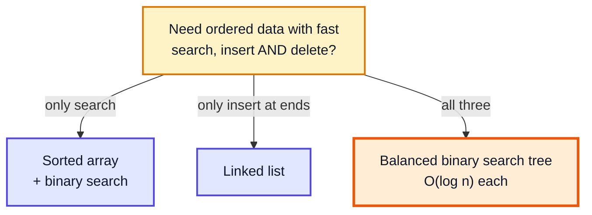

### Why "log n" is such a big deal

Each comparison in a balanced tree discards about half of what's left, so the number of steps is about log₂(n):

| n (elements) | Linear search (worst) | Balanced tree (≈ log₂ n) |
|---|---|---|
| 1,000 | 1,000 | 10 |
| 1,000,000 | 1,000,000 | 20 |
| 1,000,000,000 | 1,000,000,000 | 30 |

### The idea in one picture

A linked list is a tree where every node has **one** child. Allow **two** children and the "chain" becomes a branching structure whose depth grows logarithmically, not linearly.

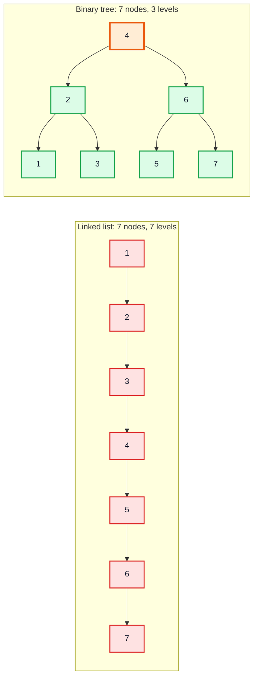

> [!NOTE]
> The tree's speed depends on it staying **balanced**. If you insert sorted data into a plain BST you get the left picture again (a "skewed" tree) and every operation degrades to O(n). Fixing that is the subject of the AVL video (#50).

---

## 2. Where Is It Used? (20:35)

Trees appear wherever data is naturally **hierarchical** or must be kept **ordered and searchable**.

| Where | Tree used | Why |
|---|---|---|
| File systems | General (n-ary) tree | Folders contain folders/files |
| HTML / XML / JSON | DOM tree | Elements nest inside elements |
| Databases & file indexes | B-tree / B+ tree | Few disk reads per lookup; range queries |
| `java.util.TreeMap`, `TreeSet` | Red-black tree (self-balancing BST) | Sorted keys, O(log n) operations |
| `java.util.PriorityQueue` | Binary heap (complete binary tree in an array) | Fast min/max |
| Compilers | Abstract syntax tree (AST) | Expressions and statements nest |
| Autocomplete, spell check | Trie (prefix tree) | Share common prefixes |
| Compression (ZIP, JPEG parts) | Huffman tree | Shorter codes for frequent symbols |
| Networking | Routing / spanning trees | Loop-free paths |
| Machine learning | Decision trees, random forests | Sequence of yes/no splits |
| Games / AI | Game tree (minimax) | Each move branches into replies |

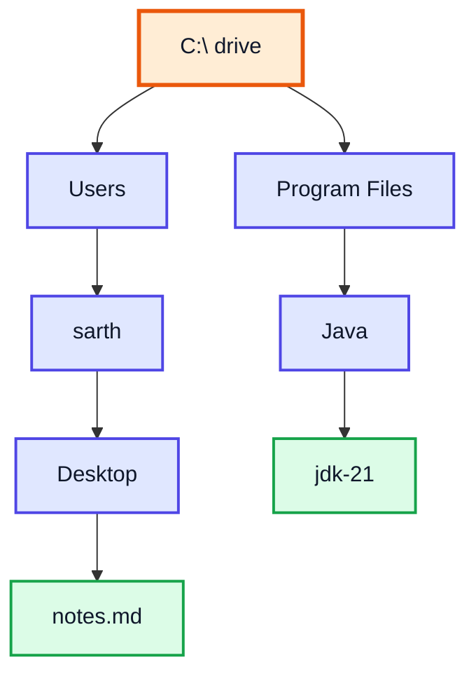

> [!TIP]
> You already use trees in Java every day: `TreeMap`/`TreeSet` are red-black trees and `HashMap` converts long bucket chains into small red-black trees (since Java 8) when many keys collide.

---

## 3. Terminologies (24:45)

We'll use this binary tree throughout the section:

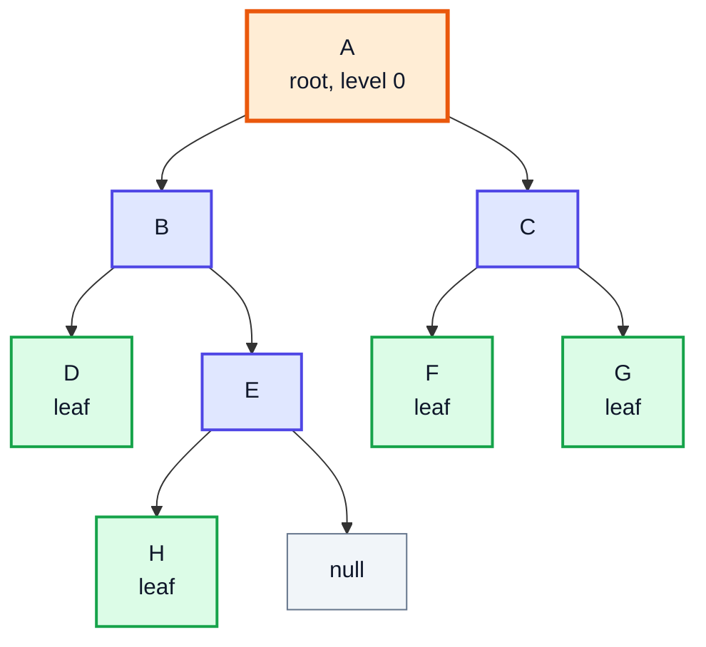

| Term | Meaning | In the example |
|---|---|---|
| **Node** | One element: a value + references to children | A, B, ..., H (8 nodes) |
| **Root** | The only node with no parent | A |
| **Edge** | The link between parent and child; n nodes → n − 1 edges | 7 edges |
| **Parent / Child** | A node directly above / below another | B is the parent of D and E |
| **Siblings** | Children of the same parent | D and E; F and G |
| **Leaf (external node)** | Node with no children | D, F, G, H |
| **Internal node** | Node with at least one child | A, B, C, E |
| **Ancestor / Descendant** | Any node on the path up to the root / any node below | A, B, E are ancestors of H |
| **Subtree** | A node together with all its descendants | B, D, E, H form B's subtree |
| **Degree** | Number of children of a node (≤ 2 in a binary tree) | deg(A)=2, deg(E)=1, deg(D)=0 |
| **Level / Depth** | Number of edges from the root down to the node | depth(A)=0, depth(H)=3 |
| **Height of a node** | Number of edges on the longest path from the node down to a leaf | height(B)=2, height(D)=0 |
| **Height of the tree** | Height of the root | 3 |
| **Size** | Total number of nodes | 8 |
| **Path** | Sequence of nodes connected by edges | A → B → E → H |

### Depth vs height — the most-confused pair

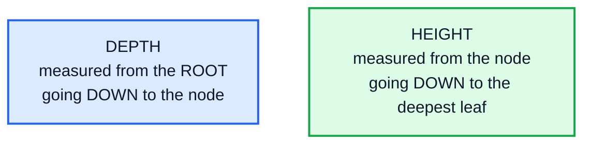

> [!WARNING]
> Books disagree on whether height counts **edges** or **nodes**. Counting edges, a single node has height 0 and an empty tree has height −1; counting nodes, they are 1 and 0. LeetCode's "Maximum Depth" (104) counts **nodes**. The BST code in this video uses the edge convention (`height(null) = -1`). Always state which one you mean in an interview.

### What a binary tree is

A **binary tree** is a tree in which every node has **at most two** children, called **left** and **right**. The order matters: a node with only a left child is a different tree from the same node with only a right child.

---

## 4. Types of Binary Trees (35:15)

| Type | Rule | Example shape |
|---|---|---|
| **Full / strict** | Every node has **0 or 2** children | no node with a single child |
| **Complete** | All levels full except possibly the last, which fills **left to right** | heaps |
| **Perfect** | All internal nodes have 2 children **and** all leaves on the same level | a full "triangle" |
| **Height-balanced** | For every node, \|height(left) − height(right)\| ≤ 1 | AVL trees |
| **Skewed (degenerate)** | Every node has only one child | basically a linked list |
| **Ordered (BST)** | left subtree < node < right subtree, at every node | Section 7 |

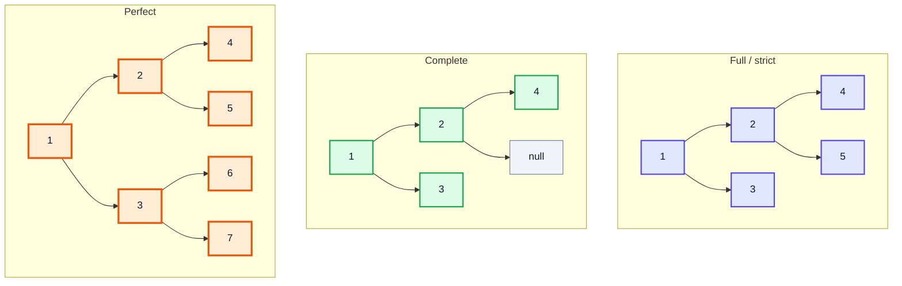

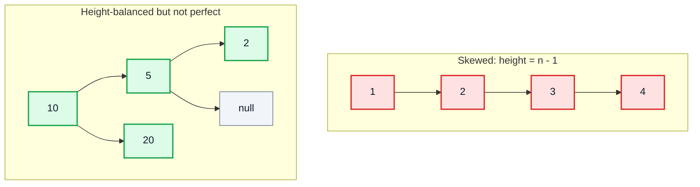

### How the types relate

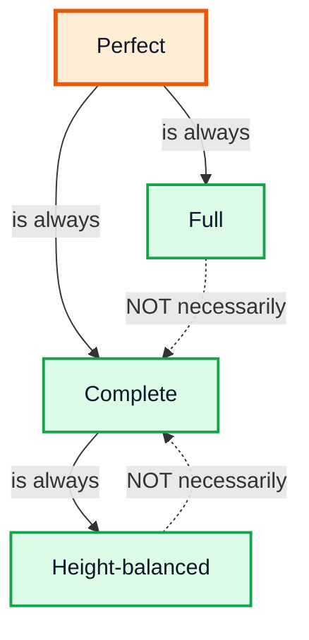

> [!NOTE]
> A **complete** tree can be stored in a plain array with no pointers: the node at index `i` has children at `2i + 1` and `2i + 2` and its parent at `(i - 1) / 2`. That is exactly how `PriorityQueue` (a binary heap) works — you'll see it in the heaps video.

---

## 5. Properties (42:46)

These formulas explain *why* trees are fast. Heights here count **edges** (root at level 0).

| # | Property | Formula |
|---|---|---|
| 1 | Max nodes at level L | 2^L |
| 2 | Max nodes in a tree of height h (a perfect tree) | 2^(h+1) − 1 |
| 3 | Leaves in a perfect tree of height h | 2^h (about half of all nodes) |
| 4 | Min height of a tree with n nodes | ⌈log₂(n + 1)⌉ − 1 |
| 5 | Min levels to hold N leaves | ⌈log₂ N⌉ + 1 |
| 6 | In any binary tree: leaves = (nodes with 2 children) + 1 | n₀ = n₂ + 1 |
| 7 | Full/strict tree with N leaves has N − 1 internal nodes | total = 2N − 1 |
| 8 | Edges in any tree with n nodes | n − 1 |

### Why property 2 holds

Each level doubles: 1 + 2 + 4 + ... + 2^h. That geometric series sums to 2^(h+1) − 1.

| Level | Nodes at this level | Running total |
|---|---|---|
| 0 | 1 | 1 |
| 1 | 2 | 3 |
| 2 | 4 | 7 |
| 3 | 8 | 15 |
| h | 2^h | 2^(h+1) − 1 |

Rearranging gives the key result: a tree with **n** nodes needs a height of only about **log₂ n** if it's balanced. That's where every O(log n) in tree algorithms comes from.

### Why property 6 holds (n₀ = n₂ + 1)

Count edges two ways. Every node except the root has exactly one parent edge, so edges = n − 1 = n₀ + n₁ + n₂ − 1. Every node with k children contributes k edges, so edges = n₁ + 2n₂. Setting these equal: n₀ + n₁ + n₂ − 1 = n₁ + 2n₂, which gives **n₀ = n₂ + 1**. Nodes with one child don't affect the count.

```java
public class TreeMath {
    static int maxNodesAtLevel(int level)   { return 1 << level; }            // 2^L
    static int maxNodes(int height)         { return (1 << (height + 1)) - 1; } // 2^(h+1) - 1
    static int minHeight(int n) {                                               // ceil(log2(n+1)) - 1
        return (int) Math.ceil(Math.log(n + 1) / Math.log(2)) - 1;
    }

    public static void main(String[] args) {
        System.out.println(maxNodesAtLevel(3));   // 8
        System.out.println(maxNodes(3));          // 15
        System.out.println(minHeight(7));         // 2  (perfect tree of 7 nodes)
        System.out.println(minHeight(8));         // 3  (8th node needs a new level)
        System.out.println(minHeight(1_000_000)); // 19
    }
}
```

> [!TIP]
> In a perfect tree, the last level holds **more than half** of all nodes (2^h out of 2^(h+1) − 1). That's why algorithms that do O(1) work per leaf are still O(n) overall.

---

## 6. Implementation - Binary Trees (55:37)

### The Node

A binary tree node is a linked-list node with **two** next pointers:

```java
class Node {
    int value;
    Node left;    // reference to left child (null if absent)
    Node right;   // reference to right child (null if absent)

    Node(int value) {
        this.value = value;
    }
}
```

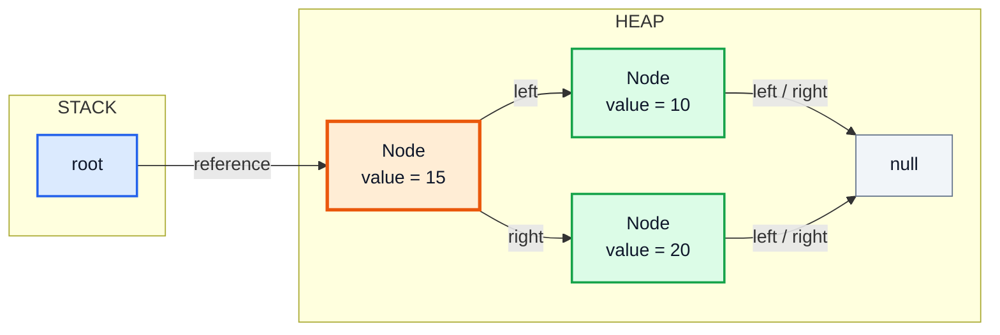

The tree class only holds a reference to the **root**; everything else is reached by following `left`/`right`. Making `Node` a `private static` nested class hides it from users of the tree (encapsulation from the OOP videos).

### Populating a tree from user input

A plain binary tree has **no ordering rule**, so the program can't decide where a value goes — it has to ask. The video does this recursively: for each node, ask "left?" and "right?", and recurse into whichever child was created.

```java
import java.util.Scanner;

public class BinaryTree {
    private static class Node {
        int value;
        Node left, right;
        Node(int value) { this.value = value; }
    }

    private Node root;

    public void populate(Scanner sc) {
        System.out.println("Enter the root node:");
        root = new Node(sc.nextInt());
        populate(sc, root);
    }

    private void populate(Scanner sc, Node node) {
        System.out.println("Left of " + node.value + "? (true/false)");
        if (sc.nextBoolean()) {
            System.out.println("Value for left of " + node.value + ":");
            node.left = new Node(sc.nextInt());
            populate(sc, node.left);          // build the whole left subtree first
        }
        System.out.println("Right of " + node.value + "? (true/false)");
        if (sc.nextBoolean()) {
            System.out.println("Value for right of " + node.value + ":");
            node.right = new Node(sc.nextInt());
            populate(sc, node.right);
        }
    }
}
```

Feeding it `15 true 10 true 8 false false false true 20 false false` builds:

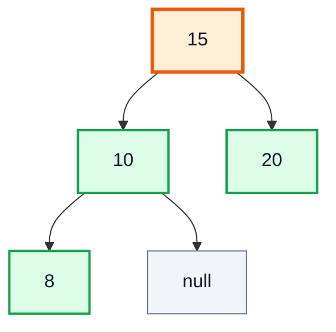

The order of questions follows the recursion — the full left subtree of a node is built before its right side is even asked about:

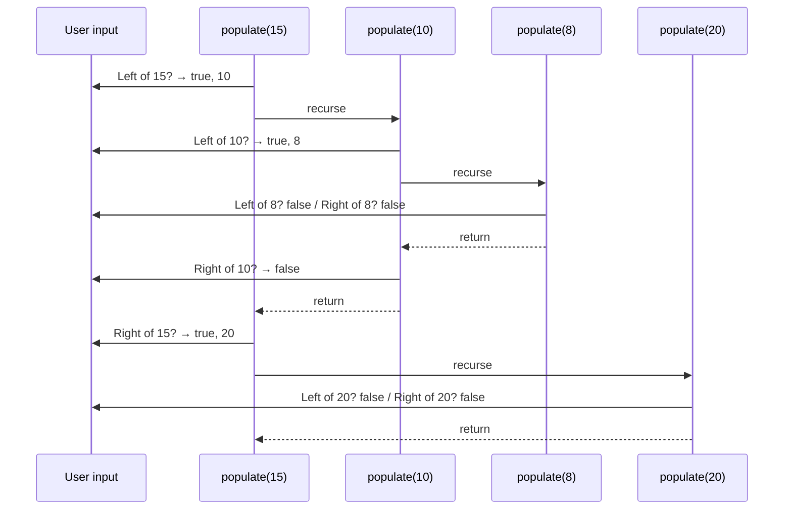

> [!TIP]
> `new Scanner(String)` reads from a string exactly like `new Scanner(System.in)` reads from the keyboard. It's the easiest way to test input-driven code with fixed input — the complete example below does this.

### Displaying the tree

**Simple display** — print the node, then its children with one more tab of indent (this is a pre-order traversal, Section 8):

```java
public void display() { display(root, ""); }

private void display(Node node, String indent) {
    if (node == null) return;
    System.out.println(indent + node.value);
    display(node.left, indent + "\t");
    display(node.right, indent + "\t");
}
// 15
//     10
//         8
//     20
```

**Pretty display** — print the **right** subtree first, then the node, then the left subtree. Turn your head 90° left and the output looks like the tree:

```java
public void prettyDisplay() { prettyDisplay(root, 0); }

private void prettyDisplay(Node node, int level) {
    if (node == null) return;
    prettyDisplay(node.right, level + 1);
    if (level != 0) {
        System.out.println("|\t".repeat(level - 1) + "|------->" + node.value);
    } else {
        System.out.println(node.value);
    }
    prettyDisplay(node.left, level + 1);
}
// |------->20
// 15
// |------->10
// |	|------->8
```

> [!NOTE]
> The video builds the indent with a `for` loop that prints `"|\t"` several times. `String.repeat(n)` (Java 11+) does the same in one call.

### Common recursive helpers

Almost every tree method has the same shape: **base case for `null`, combine answers from left and right.**

```java
int size(Node node) {                       // number of nodes
    if (node == null) return 0;
    return 1 + size(node.left) + size(node.right);
}

int height(Node node) {                     // edges on the longest root-to-leaf path
    if (node == null) return -1;
    return 1 + Math.max(height(node.left), height(node.right));
}

int countLeaves(Node node) {
    if (node == null) return 0;
    if (node.left == null && node.right == null) return 1;
    return countLeaves(node.left) + countLeaves(node.right);
}

int sum(Node node) {
    if (node == null) return 0;
    return node.value + sum(node.left) + sum(node.right);
}
```

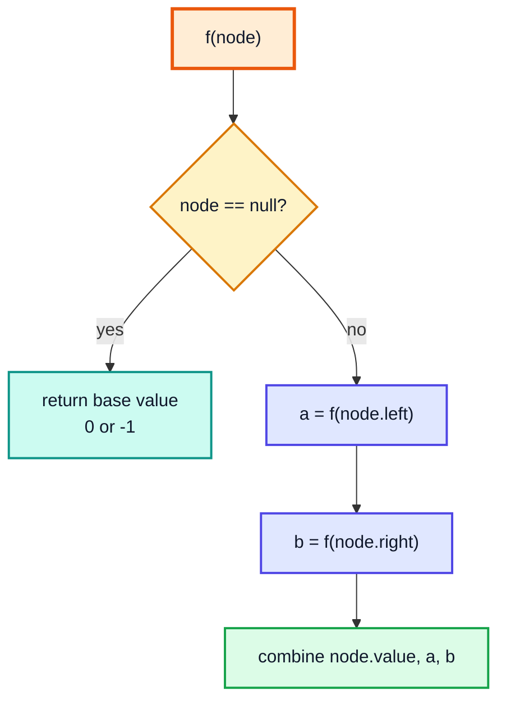

| Helper | Time | Space (recursion stack) |
|---|---|---|
| size / height / countLeaves / sum | O(n) — each node visited once | O(h): O(log n) balanced, O(n) skewed |

> [!CAUTION]
> Recursion depth equals tree height. A skewed tree of 100,000 nodes can throw `StackOverflowError`. Production code (and the AVL example in video #50) keeps trees balanced or uses an explicit stack.

---

## 7. Binary Search Trees (1:39:14)

### The rule

A **binary search tree (BST)** is a binary tree where, for **every** node:

- every value in its **left** subtree is **smaller**, and
- every value in its **right** subtree is **larger**.

(Duplicates are either disallowed — as here — or consistently sent to one side.)

Inserting `15, 10, 25, 5, 12, 20, 30, 11` gives:

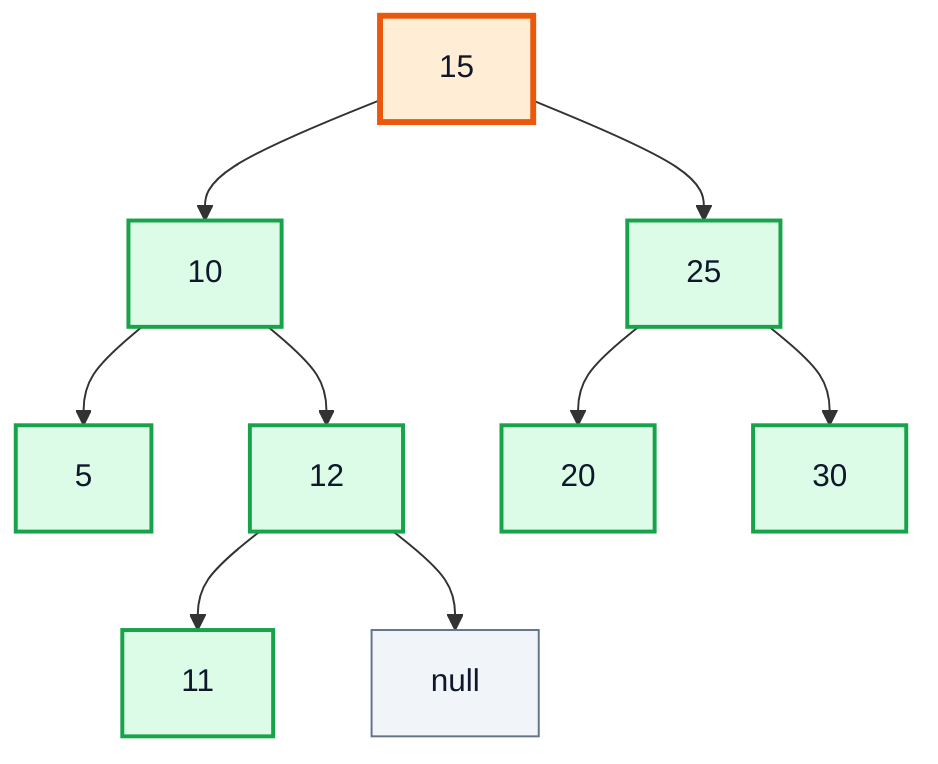

> [!WARNING]
> Checking only "left child < node < right child" is **not enough**. In the tree 10 → right 15 → left 6, every parent/child pair looks fine, but 6 is in 10's *right* subtree, so it isn't a BST. A real check passes down a valid (min, max) range — LeetCode 98, *Validate Binary Search Tree*.

### Node with a height field

The video stores each node's height so that "is it balanced?" can be answered without recomputing heights every time — and it prepares for AVL trees next video.

```java
public class BST {
    private static class Node {
        int value;
        int height;            // leaf = 0
        Node left, right;
        Node(int value) { this.value = value; }
    }

    private Node root;

    private int height(Node node) {
        return node == null ? -1 : node.height;
    }

    public int height() { return height(root); }
    public boolean isEmpty() { return root == null; }
}
```

### Insert (LeetCode 701: *Insert into a Binary Search Tree*)

**Approach:** compare with the current node; go left if smaller, right if larger; when you reach `null`, that's the empty slot — create the node there. Returning the (possibly new) node from each call lets the parent re-attach it, which avoids "which side was I?" bookkeeping.

```java
public void insert(int value) {
    root = insert(value, root);
}

private Node insert(int value, Node node) {
    if (node == null) {
        return new Node(value);              // found the empty slot
    }
    if (value < node.value) node.left  = insert(value, node.left);
    if (value > node.value) node.right = insert(value, node.right);

    node.height = Math.max(height(node.left), height(node.right)) + 1;  // update on the way back up
    return node;
}
```

**Dry run — inserting 11** into the tree above (before 11 existed):

| Step | Current node | Compare | Go | Height update on return |
|---|---|---|---|---|
| 1 | 15 | 11 < 15 | left | 15: max(2, 1) + 1 = 3 |
| 2 | 10 | 11 > 10 | right | 10: max(0, 1) + 1 = 2 |
| 3 | 12 | 11 < 12 | left | 12: max(0, −1) + 1 = 1 |
| 4 | null | — | create 11 (height 0) | — |

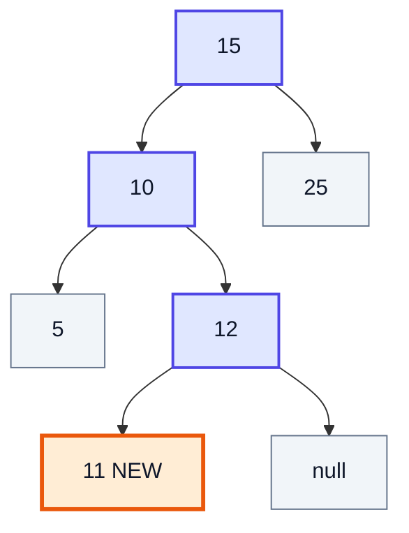

### Search (LeetCode 700: *Search in a Binary Search Tree*)

Same walk as insert, but stop when found. It doesn't need recursion at all:

```java
public boolean contains(int target) {
    Node cur = root;
    while (cur != null) {
        if (target == cur.value) return true;
        cur = target < cur.value ? cur.left : cur.right;
    }
    return false;
}
// contains(12) -> true, contains(13) -> false
```

Min and max are just "walk left as far as possible" / "walk right as far as possible".

### Populate from an array, and the sorted-array trap

```java
public void populate(int[] nums) {
    for (int n : nums) insert(n);
}
```

If `nums` is already sorted (1, 2, 3, ..., 7), each new value is bigger than everything before it, so it always goes **right** — the BST degenerates into a linked list:

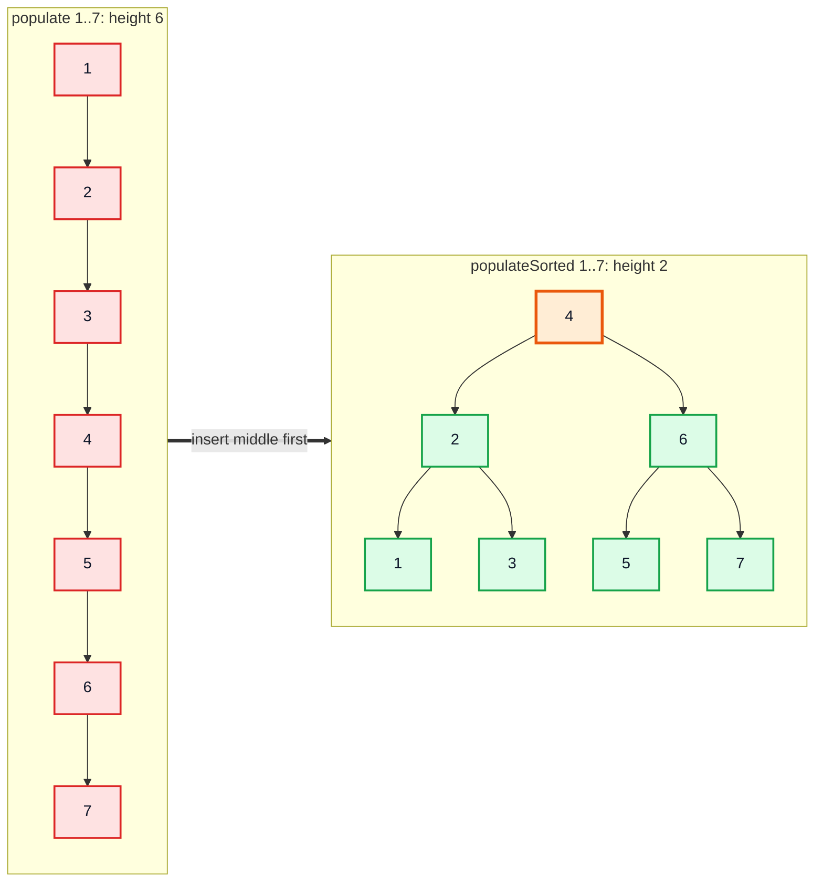

**Fix for sorted input (LeetCode 108: *Convert Sorted Array to Binary Search Tree*):** insert the **middle** element first, then recursively do the same for the left half and right half — the same split as binary search.

```java
public void populateSorted(int[] nums) {
    populateSorted(nums, 0, nums.length);    // end is exclusive
}

private void populateSorted(int[] nums, int start, int end) {
    if (start >= end) return;
    int mid = start + (end - start) / 2;
    insert(nums[mid]);
    populateSorted(nums, start, mid);
    populateSorted(nums, mid + 1, end);
}
```

| Call (start, end) | mid | Inserts |
|---|---|---|
| (0, 7) | 3 | 4 |
| (0, 3) | 1 | 2 |
| (0, 1) | 0 | 1 |
| (2, 3) | 2 | 3 |
| (4, 7) | 5 | 6 |
| (4, 5) | 4 | 5 |
| (6, 7) | 6 | 7 |

- **Time:** O(n log n) as written (n inserts, each O(log n)). Building the nodes directly (`node.left = build(start, mid)`) instead of calling `insert` makes it O(n).
- **Space:** O(log n) recursion.

> [!NOTE]
> `populateSorted` only helps when you have **all the data up front**. If values arrive one by one in sorted order (e.g., auto-incrementing IDs), you need a tree that rebalances itself after every insert — an AVL or red-black tree (video #50).

### Is it balanced? (LeetCode 110: *Balanced Binary Tree*)

```java
public boolean balanced() { return balanced(root); }

private boolean balanced(Node node) {
    if (node == null) return true;
    return Math.abs(height(node.left) - height(node.right)) <= 1
            && balanced(node.left)
            && balanced(node.right);
}
```

Because heights are stored in each node, this is O(n). Without the stored field, recomputing height at every node makes the naive version O(n²) on skewed trees; the LeetCode-standard fix is a single post-order pass returning −1 for "unbalanced".

### Delete (beyond the video)

The video stops at insert/search/balance; deletion is the remaining BST operation (LeetCode 450, *Delete Node in a BST*):

| Case | Action |
|---|---|
| Node is a leaf | Remove it (return `null`) |
| One child | Replace the node with that child |
| Two children | Copy the **in-order successor** (smallest in right subtree) into the node, then delete the successor from the right subtree |

```java
private Node delete(Node node, int value) {
    if (node == null) return null;
    if (value < node.value)      node.left  = delete(node.left, value);
    else if (value > node.value) node.right = delete(node.right, value);
    else {
        if (node.left == null)  return node.right;
        if (node.right == null) return node.left;
        Node s = node.right;
        while (s.left != null) s = s.left;    // in-order successor
        node.value = s.value;
        node.right = delete(node.right, s.value);
    }
    return node;
}
// Deleting 10 from 15(10(5,12(11)),25(20,30)):
// in-order  -> [5, 11, 12, 15, 20, 25, 30]
// pre-order -> [15, 11, 5, 12, 25, 20, 30]   (11 replaced 10)
```

### Complexity summary

| Operation | Balanced BST | Skewed BST |
|---|---|---|
| Search | O(log n) | O(n) |
| Insert | O(log n) | O(n) |
| Delete | O(log n) | O(n) |
| Min / Max | O(log n) | O(n) |
| Space | O(n) nodes | O(n) nodes |

---

## 8. Traversals (2:30:00)

A **traversal** visits every node exactly once. The three depth-first traversals differ only in **when the node itself is processed** relative to its subtrees:

| Traversal | Order | Mnemonic | Typical use |
|---|---|---|---|
| **Pre-order** | Node → Left → Right | node **pre**(before) children | Copy / serialize a tree, print structure (the `display` method), prefix expressions |
| **In-order** | Left → Node → Right | node **in** the middle | BST → values in **sorted** order; validating a BST |
| **Post-order** | Left → Right → Node | node **post**(after) children | Delete/free a tree, compute heights/sizes, evaluate expression trees |

```java
void preOrder(Node node) {
    if (node == null) return;
    System.out.print(node.value + " ");
    preOrder(node.left);
    preOrder(node.right);
}

void inOrder(Node node) {
    if (node == null) return;
    inOrder(node.left);
    System.out.print(node.value + " ");
    inOrder(node.right);
}

void postOrder(Node node) {
    if (node == null) return;
    postOrder(node.left);
    postOrder(node.right);
    System.out.print(node.value + " ");
}
```

On the BST from Section 7:

| Traversal | Output |
|---|---|
| Pre-order | 15 10 5 12 11 25 20 30 |
| In-order | 5 10 11 12 15 20 25 30 ✅ sorted |
| Post-order | 5 11 12 10 20 30 25 15 |

### Visualising pre-order

Numbers show the visit order; the orange node is where pre-order is right now (step 4, visiting 12, after 15, 10, 5):

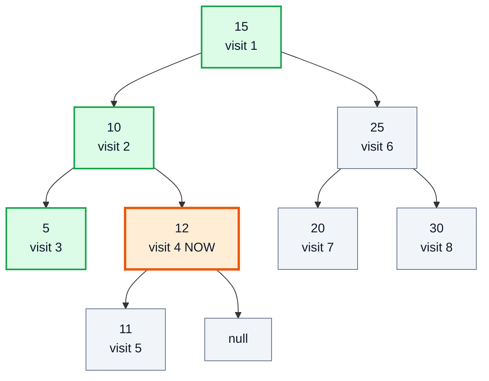

### Dry run of in-order (call stack view)

| Step | Call stack (top on right) | Action | Output so far |
|---|---|---|---|
| 1 | 15 | go left | |
| 2 | 15, 10 | go left | |
| 3 | 15, 10, 5 | left null → **print 5** → right null → return | 5 |
| 4 | 15, 10 | **print 10** → go right | 5 10 |
| 5 | 15, 10, 12 | go left | 5 10 |
| 6 | 15, 10, 12, 11 | **print 11** → return | 5 10 11 |
| 7 | 15, 10, 12 | **print 12** → right null → return | 5 10 11 12 |
| 8 | 15 | 10 done → **print 15** → go right | 5 10 11 12 15 |
| 9 | 15, 25, 20 | **print 20** | ... 15 20 |
| 10 | 15, 25 | **print 25** → go right | ... 20 25 |
| 11 | 15, 25, 30 | **print 30** | 5 10 11 12 15 20 25 30 |

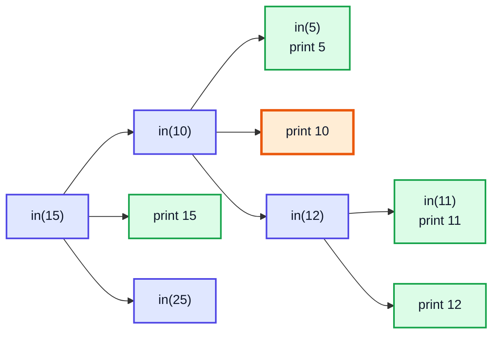

### Complexity

| | Time | Space |
|---|---|---|
| Any of the three | O(n) — each node visited once | O(h) recursion stack: O(log n) balanced, O(n) skewed |

### Alternative: iterative in-order with an explicit stack

Useful when the tree may be too deep for recursion (LeetCode 94, *Binary Tree Inorder Traversal*, asks for this as the follow-up):

```java
List<Integer> inOrderIterative(Node root) {
    List<Integer> result = new ArrayList<>();
    Deque<Node> stack = new ArrayDeque<>();
    Node cur = root;
    while (cur != null || !stack.isEmpty()) {
        while (cur != null) {          // go as far left as possible
            stack.push(cur);
            cur = cur.left;
        }
        cur = stack.pop();             // leftmost unvisited node
        result.add(cur.value);
        cur = cur.right;               // then its right subtree
    }
    return result;
}
// [5, 10, 11, 12, 15, 20, 25, 30]
```

> [!TIP]
> Practice problems: LeetCode **144** (pre-order), **94** (in-order), **145** (post-order), **104** (maximum depth), **230** (k-th smallest in a BST — an in-order traversal that stops at k). **Level-order** (breadth-first, LeetCode 102) uses a queue instead of recursion and comes later in the trees series.

> [!NOTE]
> Use `ArrayDeque` rather than the legacy `Stack` class for stacks in modern Java — `Stack` is synchronized and extends `Vector`.

---

## 9. Outro (2:50:53)

Recap of the lecture:

- Trees fix the search/insert trade-off of arrays and linked lists — **if** they stay balanced.
- A BST orders values so each comparison halves the search space; in-order traversal reads them back sorted.
- Sorted input ruins a plain BST. `populateSorted` fixes it for known data; **self-balancing trees** (AVL, next video) fix it for any insertion order.

Kunal's suggestion: write every method here yourself (populate, display, insert, balanced, traversals) before moving on — the next videos build on this exact `Node` with a `height` field.

---

## 🧩 Complete Example: Everything Together

One program that builds a binary tree from (simulated) user input, displays it two ways, builds a BST, runs all three traversals and the helper methods, and shows the sorted-input problem and its fix:

```java
import java.util.ArrayList;
import java.util.List;
import java.util.Scanner;

// ═══════ 1. A plain BINARY TREE built from "user input" ═══════
class BinaryTree {
    private static class Node {
        int value;
        Node left, right;
        Node(int value) { this.value = value; }
    }

    private Node root;

    // Same recursive Q&A idea as the video, but input comes from any Scanner
    public void populate(Scanner sc) {
        System.out.println("Enter the root node:");
        root = new Node(sc.nextInt());
        populate(sc, root);
    }

    private void populate(Scanner sc, Node node) {
        System.out.println("Left of " + node.value + "? (true/false)");
        if (sc.nextBoolean()) {
            System.out.println("Value for left of " + node.value + ":");
            node.left = new Node(sc.nextInt());
            populate(sc, node.left);
        }
        System.out.println("Right of " + node.value + "? (true/false)");
        if (sc.nextBoolean()) {
            System.out.println("Value for right of " + node.value + ":");
            node.right = new Node(sc.nextInt());
            populate(sc, node.right);
        }
    }

    public void display() { display(root, ""); }

    private void display(Node node, String indent) {
        if (node == null) return;
        System.out.println(indent + node.value);
        display(node.left, indent + "\t");
        display(node.right, indent + "\t");
    }

    public void prettyDisplay() { prettyDisplay(root, 0); }

    // Right subtree first -> tree appears rotated 90 degrees anticlockwise
    private void prettyDisplay(Node node, int level) {
        if (node == null) return;
        prettyDisplay(node.right, level + 1);
        if (level != 0) {
            System.out.println("|\t".repeat(level - 1) + "|------->" + node.value);
        } else {
            System.out.println(node.value);
        }
        prettyDisplay(node.left, level + 1);
    }
}

// ═══════ 2. A BINARY SEARCH TREE ═══════
class BST {
    private static class Node {
        int value, height;
        Node left, right;
        Node(int value) { this.value = value; }
    }

    private Node root;

    private int height(Node node) { return node == null ? -1 : node.height; }

    public int height() { return height(root); }

    public void insert(int value) { root = insert(value, root); }

    private Node insert(int value, Node node) {
        if (node == null) return new Node(value);
        if (value < node.value) node.left = insert(value, node.left);
        if (value > node.value) node.right = insert(value, node.right);
        node.height = Math.max(height(node.left), height(node.right)) + 1;
        return node;
    }

    public void populate(int[] nums) {
        for (int n : nums) insert(n);
    }

    // Sorted array -> balanced tree: insert the middle first
    public void populateSorted(int[] nums) { populateSorted(nums, 0, nums.length); }

    private void populateSorted(int[] nums, int start, int end) {
        if (start >= end) return;
        int mid = start + (end - start) / 2;
        insert(nums[mid]);
        populateSorted(nums, start, mid);
        populateSorted(nums, mid + 1, end);
    }

    public boolean contains(int target) {
        Node cur = root;
        while (cur != null) {
            if (target == cur.value) return true;
            cur = target < cur.value ? cur.left : cur.right;
        }
        return false;
    }

    public boolean balanced() { return balanced(root); }

    private boolean balanced(Node node) {
        if (node == null) return true;
        return Math.abs(height(node.left) - height(node.right)) <= 1
                && balanced(node.left) && balanced(node.right);
    }

    public int size() { return size(root); }

    private int size(Node node) { return node == null ? 0 : 1 + size(node.left) + size(node.right); }

    public int min() {
        Node cur = root;
        while (cur.left != null) cur = cur.left;
        return cur.value;
    }

    public int max() {
        Node cur = root;
        while (cur.right != null) cur = cur.right;
        return cur.value;
    }

    // ═══════ 3. TRAVERSALS ═══════
    public List<Integer> preOrder()  { List<Integer> r = new ArrayList<>(); pre(root, r);  return r; }
    public List<Integer> inOrder()   { List<Integer> r = new ArrayList<>(); in(root, r);   return r; }
    public List<Integer> postOrder() { List<Integer> r = new ArrayList<>(); post(root, r); return r; }

    private void pre(Node n, List<Integer> r)  { if (n == null) return; r.add(n.value); pre(n.left, r); pre(n.right, r); }
    private void in(Node n, List<Integer> r)   { if (n == null) return; in(n.left, r); r.add(n.value); in(n.right, r); }
    private void post(Node n, List<Integer> r) { if (n == null) return; post(n.left, r); post(n.right, r); r.add(n.value); }
}

public class Main {
    public static void main(String[] args) {
        // ── Binary tree from simulated user input ──
        String input = "15 true 10 true 8 false false false true 20 false false";
        BinaryTree tree = new BinaryTree();
        tree.populate(new Scanner(input));
        System.out.println("--- display ---");
        tree.display();
        System.out.println("--- prettyDisplay ---");
        tree.prettyDisplay();

        // ── BST from an unsorted array ──
        BST bst = new BST();
        bst.populate(new int[]{15, 10, 25, 5, 12, 20, 30, 11});
        System.out.println("--- BST ---");
        System.out.println("Pre-order : " + bst.preOrder());
        System.out.println("In-order  : " + bst.inOrder());
        System.out.println("Post-order: " + bst.postOrder());
        System.out.println("Size=" + bst.size() + " Height=" + bst.height()
                + " Min=" + bst.min() + " Max=" + bst.max());
        System.out.println("contains(12)=" + bst.contains(12) + " contains(13)=" + bst.contains(13));
        System.out.println("Balanced? " + bst.balanced());

        // ── Skewed vs balanced from sorted data ──
        int[] sorted = {1, 2, 3, 4, 5, 6, 7};
        BST skewed = new BST();
        skewed.populate(sorted);
        BST balanced = new BST();
        balanced.populateSorted(sorted);
        System.out.println("--- Sorted input 1..7 ---");
        System.out.println("populate      -> height " + skewed.height() + ", balanced? " + skewed.balanced());
        System.out.println("populateSorted-> height " + balanced.height() + ", balanced? " + balanced.balanced());
        System.out.println("Balanced pre-order: " + balanced.preOrder());
    }
}
```

**Expected Output:**
```
Enter the root node:
Left of 15? (true/false)
Value for left of 15:
Left of 10? (true/false)
Value for left of 10:
Left of 8? (true/false)
Right of 8? (true/false)
Right of 10? (true/false)
Right of 15? (true/false)
Value for right of 15:
Left of 20? (true/false)
Right of 20? (true/false)
--- display ---
15
	10
		8
	20
--- prettyDisplay ---
|------->20
15
|------->10
|	|------->8
--- BST ---
Pre-order : [15, 10, 5, 12, 11, 25, 20, 30]
In-order  : [5, 10, 11, 12, 15, 20, 25, 30]
Post-order: [5, 11, 12, 10, 20, 30, 25, 15]
Size=8 Height=3 Min=5 Max=30
contains(12)=true contains(13)=false
Balanced? true
--- Sorted input 1..7 ---
populate      -> height 6, balanced? false
populateSorted-> height 2, balanced? true
Balanced pre-order: [4, 2, 1, 3, 6, 5, 7]
```

---

## Quick Reference Cheat Sheet

| Concept | One-Line Summary |
|---|---|
| **Tree** | Hierarchical structure: nodes linked parent → children, one root, no cycles |
| **Binary tree** | Each node has at most two children: left and right |
| **Leaf / internal node** | No children / at least one child |
| **Depth vs height** | Edges from the root down to a node / edges from a node down to its deepest leaf |
| **Full / complete / perfect** | 0 or 2 children / levels filled left to right / every level completely full |
| **Height-balanced** | Every node: \|h(left) − h(right)\| ≤ 1 |
| **Skewed tree** | Each node has one child → behaves like a linked list, O(n) operations |
| **Max nodes, height h** | 2^(h+1) − 1; so n nodes need height ≈ log₂ n |
| **Leaves vs 2-child nodes** | n₀ = n₂ + 1 in any binary tree |
| **BST rule** | Everything left < node < everything right, at every node |
| **BST insert/search** | Go left if smaller, right if larger; O(h) |
| **Sorted input** | Plain insert makes a skewed tree; insert the middle first (`populateSorted`) |
| **Balanced check** | Compare stored heights of children at every node; O(n) |
| **BST delete** | Leaf: remove; one child: replace; two children: copy in-order successor |
| **Pre-order** | Node, Left, Right — copy/serialize/print structure |
| **In-order** | Left, Node, Right — BST gives sorted output |
| **Post-order** | Left, Right, Node — delete tree, compute heights |
| **Traversal cost** | O(n) time, O(h) stack space |
