# AVL Trees (Self-Balancing BSTs) — Complete In-Depth Guide

**Video #50 of the Java + DSA playlist:** *AVL Trees Tutorial | Self Balancing Binary Search Trees* (1:06:14)

The second trees lecture: why a plain BST can collapse into a linked list, what "self-balancing" means, how an AVL tree detects imbalance with heights and fixes it with four rotation cases (LL, LR, RR, RL), a full walkthrough, the complexity, and the Java code built on top of the BST from the previous video ([java_49_video_binary_trees_bst.md](java_49_video_binary_trees_bst.md)).

---

## Table of Contents

| # | Topic | Timestamp |
|---|---|---|
| 0 | [Introduction](#0-introduction-000) | 0:00 |
| 1 | [Problem with BST](#1-problem-with-bst-315) | 3:15 |
| 2 | [Self Balancing Binary Trees](#2-self-balancing-binary-trees-1248) | 12:48 |
| 3 | [AVL Trees Theory + Algorithm](#3-avl-trees-theory--algorithm-1531) | 15:31 |
| 4 | [Example Walkthrough](#4-example-walkthrough-3436) | 34:36 |
| 5 | [Time Complexity](#5-time-complexity-4057) | 40:57 |
| 6 | [Code](#6-code-4222) | 42:22 |
| 7 | [Closing Remarks](#7-closing-remarks-10424) | 1:04:24 |

---

## 0. Introduction (0:00)

The previous video ended with a problem: a BST is only O(log n) when it is **balanced**, and nothing in plain BST insertion keeps it balanced. This video adds the missing piece — a BST that **checks its own balance after every insert and repairs it locally** using rotations.

You need from the last video:

- the `Node` with `value`, `left`, `right` **and `height`** (leaf = 0, `null` = −1),
- recursive `insert` that returns the subtree's (possibly new) root,
- the `balanced()` check.

> [!IMPORTANT]
> The AVL code is the BST code plus **one extra line** in `insert` — `return rotate(node);` — and three short methods (`rotate`, `leftRotate`, `rightRotate`). Understanding *why* those rotations keep the BST order is the real lesson.

---

## 1. Problem with BST (3:15)

### Same values, different shapes

A BST's shape depends entirely on **insertion order**. Insert 1, 2, 3, 4, 5 and every value is larger than all the previous ones, so it always goes right:

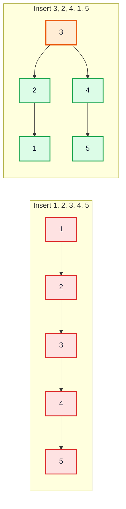

| | Skewed (left) | Balanced (right) |
|---|---|---|
| Height | n − 1 = 4 | ⌊log₂ n⌋ = 2 |
| Search for 5 | 5 comparisons | 3 comparisons |
| Search cost in general | **O(n)** | **O(log n)** |

### Why this happens in real life

Sorted or nearly-sorted data is common: auto-increment IDs, timestamps, alphabetical names, data read from an already-sorted file. A plain BST fed such data is just a slower linked list (extra pointer per node, same O(n) search).

> [!WARNING]
> The worst case isn't only "perfectly sorted". Zig-zag sequences like 1, 100, 2, 99, 3, 98, ... also give height n − 1. Any BST without rebalancing has **O(n) worst-case** operations.

### The fix from last video isn't enough

`populateSorted` (insert the middle first) works only if you have **all the data up front**. When values arrive one at a time, the tree must rebalance **as it goes**.

---

## 2. Self Balancing Binary Trees (12:48)

A **self-balancing BST** guarantees its height stays **O(log n)** no matter the insertion order, by doing a small amount of repair work after each insert/delete.

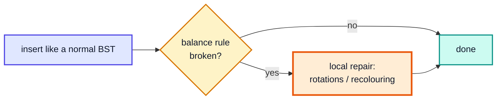

| Tree | Balance rule | Where you meet it |
|---|---|---|
| **AVL** (Adelson-Velsky & Landis, 1962) | Every node: \|h(left) − h(right)\| ≤ 1 | This video; read-heavy in-memory indexes |
| **Red-black** | Colour rules; no root-to-leaf path is more than 2× another | `java.util.TreeMap`, `TreeSet`, `HashMap` buckets, Linux scheduler |
| **B-tree / B+ tree** | All leaves at the same depth; many keys per node | Databases and file systems |
| **Splay tree** | No strict rule; recently used nodes moved to the root | Caches |
| **Treap** | BST on keys + heap on random priorities | Randomised balancing |

> [!NOTE]
> "Balanced" never means *perfect*. Keeping a tree perfectly balanced would need O(n) rework per insert. AVL allows a difference of 1 at every node, which is enough to guarantee O(log n) height.

---

## 3. AVL Trees Theory + Algorithm (15:31)

### Balance factor

For every node:

**balance factor = height(left) − height(right)**

| Balance factor | Meaning |
|---|---|
| −1, 0, +1 | ✅ balanced |
| ≥ +2 | 🟥 left-heavy — needs a rotation |
| ≤ −2 | 🟥 right-heavy — needs a rotation |

### The algorithm (insert)

1. Insert the value exactly as in a BST.
2. On the way back up the recursion, **update the height** of each node on the path.
3. The **first** node found unbalanced (closest to the new node) is called **p** (the parent / pivot). Its taller child is **c**, and c's taller child is **g** (grandchild).
4. The positions of c and g relative to p decide the case — **LL, LR, RR or RL** — and the rotation(s) to apply.

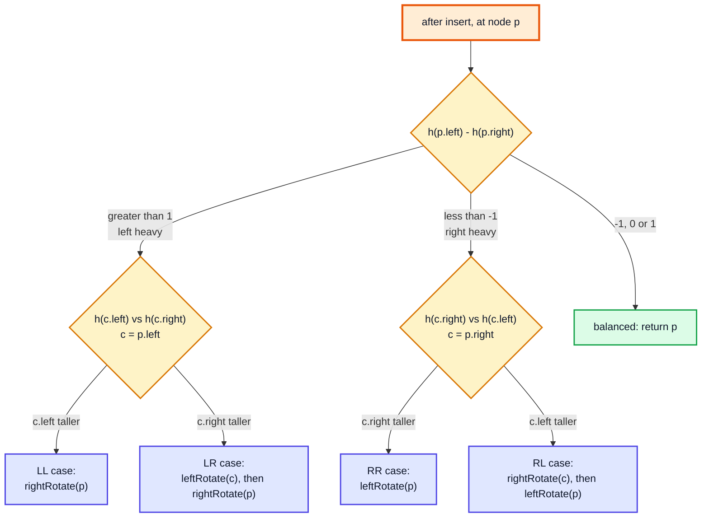

| Case | Shape (p → c → g) | Fix |
|---|---|---|
| **LL** | left, then left | one **right** rotation at p |
| **RR** | right, then right | one **left** rotation at p |
| **LR** | left, then right (zig-zag) | **left** rotate c → becomes LL → **right** rotate p |
| **RL** | right, then left (zig-zag) | **right** rotate c → becomes RR → **left** rotate p |

### Right rotation (fixes LL)

p's left child c moves up; p moves down to become c's right child. c's old right subtree **T2** (values between c and p) is re-attached as p's new left subtree.

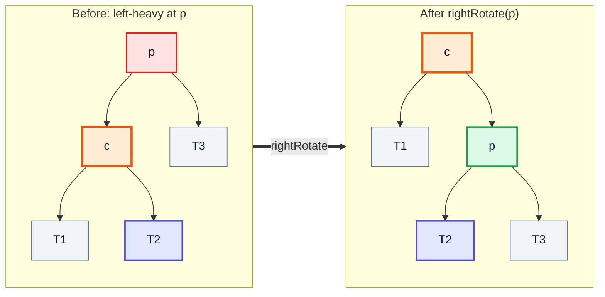

**Why the BST order survives:** in-order before = T1, c, T2, p, T3. In-order after = T1, c, T2, p, T3. Identical — rotations only change the **shape**, never the sorted order.

### Left rotation (fixes RR) — the mirror image

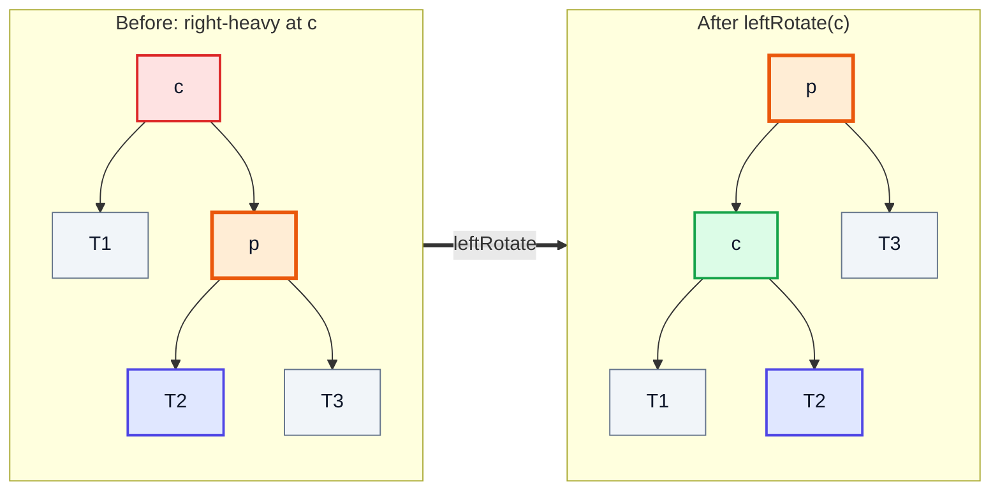

> [!NOTE]
> The video names the nodes for a left rotation the other way round (the node going **down** is `c`, the node coming **up** is `p`), matching the code in Section 6. Names don't matter — what matters is: the child on the heavy side comes up, the old root goes down, and the "middle" subtree changes parent.

### The zig-zag cases need two rotations

In **LR**, g sits between c and p in value. One right rotation at p would just move the zig-zag to the other side. So first **left-rotate c** to straighten the path into an LL shape, then **right-rotate p**:

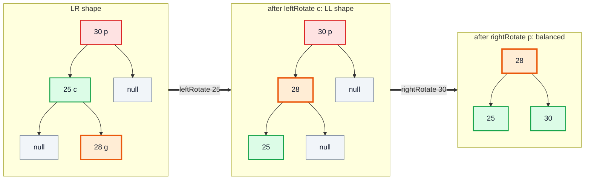

RL is the exact mirror: right-rotate c, then left-rotate p.

> [!TIP]
> Quick way to remember: in every case **the middle value of p, c, g ends up as the new subtree root**, with the smaller one on its left and the larger on its right.

---

## 4. Example Walkthrough (34:36)

Insert **10, 20, 30, 25, 28, 5, 3, 12, 11** into an empty AVL tree. These nine values trigger all four cases (verified by the complete example's log).

### Inserts 10, 20, 30 → RR at 10

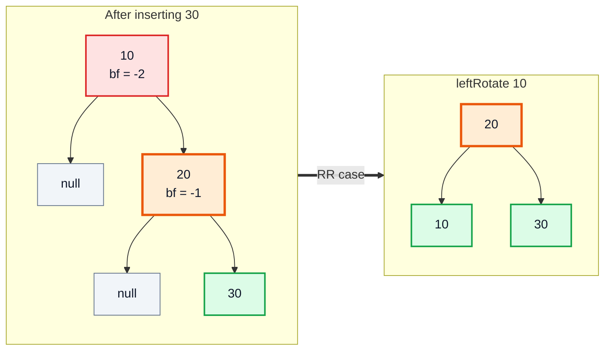

### Inserts 25, 28 → LR at 30

25 goes 20 → right → 30 → left. 28 goes 20 → 30 → 25 → right. Walking back up: 25 is fine (bf −1), **30 has bf +2** with its left child 25 right-heavy → **LR**. (20 would be bf −2 too, but we fix the *lowest* unbalanced node first, and that repairs 20 as well.)

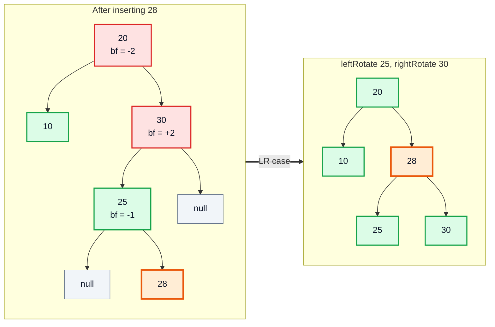

### Inserts 5, 3 → LL at 10

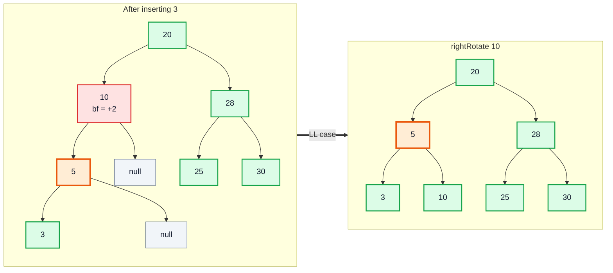

### Inserts 12, 11 → RL at 10

12 goes 20 → 5 → 10 → right. 11 goes 20 → 5 → 10 → 12 → left. Now **10 has bf −2** and its right child 12 is left-heavy → **RL**: right-rotate 12, then left-rotate 10.

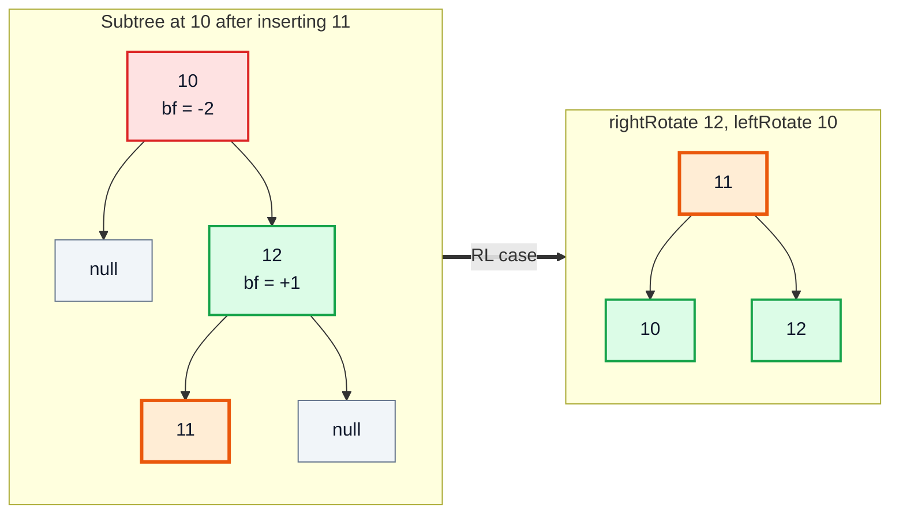

### Final tree

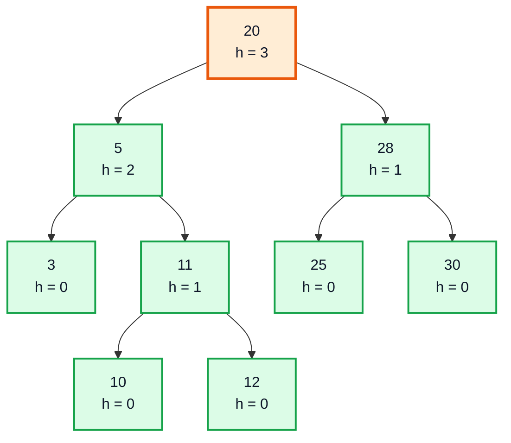

### Summary table

| Insert | Path from root | First unbalanced node | Case | Rotations | Root after |
|---|---|---|---|---|---|
| 10 | — | — | — | — | 10 |
| 20 | 10 R | — | — | — | 10 |
| 30 | 10 R, 20 R | 10 (bf −2) | 🟧 RR | left(10) | 20 |
| 25 | 20 R, 30 L | — | — | — | 20 |
| 28 | 20 R, 30 L, 25 R | 30 (bf +2) | 🟧 LR | left(25), right(30) | 20 |
| 5 | 20 L, 10 L | — | — | — | 20 |
| 3 | 20 L, 10 L, 5 L | 10 (bf +2) | 🟧 LL | right(10) | 20 |
| 12 | 20 L, 5 R, 10 R | — | — | — | 20 |
| 11 | 20 L, 5 R, 10 R, 12 L | 10 (bf −2) | 🟧 RL | right(12), left(10) | 20 |

Final pre-order: 20, 5, 3, 11, 10, 12, 28, 25, 30 — in-order is still sorted: 3, 5, 10, 11, 12, 20, 25, 28, 30 ✅.

---

## 5. Time Complexity (40:57)

### Height is guaranteed O(log n)

Let N(h) be the **minimum** number of nodes an AVL tree of height h can have. The sparsest such tree has one subtree of height h − 1 and the other of height h − 2:

**N(h) = N(h − 1) + N(h − 2) + 1**, with N(0) = 1, N(1) = 2.

| h | 0 | 1 | 2 | 3 | 4 | 5 | 6 | 10 |
|---|---|---|---|---|---|---|---|---|
| min nodes N(h) | 1 | 2 | 4 | 7 | 12 | 20 | 33 | 232 |

That's Fibonacci-like growth (≈ 1.618^h), so h ≤ about **1.44 · log₂ n**. A perfectly balanced tree has height ≈ log₂ n, so AVL is at most ~44% taller than ideal.

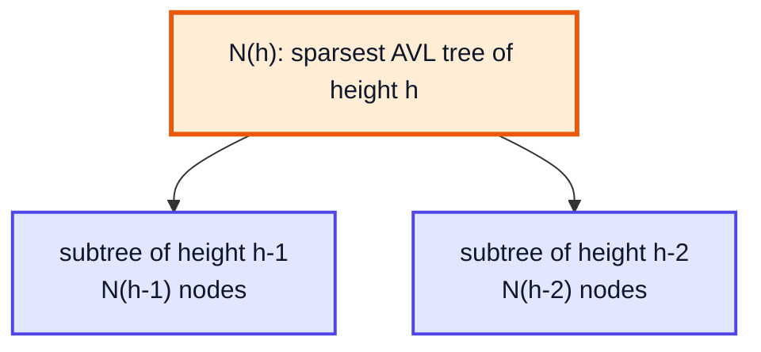

### Cost of each operation

| Operation | Plain BST (worst) | AVL tree | Why |
|---|---|---|---|
| Search | O(n) | **O(log n)** | Walks one root-to-leaf path |
| Insert | O(n) | **O(log n)** | O(log n) descent + height updates; at most **one** single or double rotation |
| Delete | O(n) | **O(log n)** | Descent + up to O(log n) rotations on the way back |
| Rotation | — | **O(1)** | Only 3 pointers and 2 heights change |
| Min / Max | O(n) | **O(log n)** | Walk to the far left / right |
| Space | O(n) | O(n) | One extra `int height` per node |

> [!NOTE]
> Inserting 1..1000 in sorted order (complete example below): plain BST height **999**, AVL height **9** — log₂ 1000 ≈ 9.97.

### AVL vs red-black

| | AVL | Red-black |
|---|---|---|
| Balance | Stricter (diff ≤ 1) | Looser (longest path ≤ 2 × shortest) |
| Max height | ≈ 1.44 log₂ n | ≈ 2 log₂ n |
| Lookups | Slightly faster | Slightly slower |
| Inserts/deletes | More rotations | Fewer rotations |
| Used by Java | — (write your own) | `TreeMap`, `TreeSet` |

---

## 6. Code (42:22)

Starting from the BST of video #49, the changes are: `insert` ends with `return rotate(node)`, plus `rotate`, `rightRotate` and `leftRotate`.

### Node and helpers

```java
public class AVL {
    private static class Node {
        int value;
        int height;            // leaf = 0
        Node left, right;
        Node(int value) { this.value = value; }
    }

    private Node root;

    private int height(Node node) {
        return node == null ? -1 : node.height;
    }

    public int height() { return height(root); }

    private void updateHeight(Node node) {
        node.height = Math.max(height(node.left), height(node.right)) + 1;
    }
}
```

### Insert — one new line

```java
public void insert(int value) {
    root = insert(value, root);
}

private Node insert(int value, Node node) {
    if (node == null) return new Node(value);
    if (value < node.value)      node.left  = insert(value, node.left);
    else if (value > node.value) node.right = insert(value, node.right);
    else return node;                         // duplicate: ignore

    updateHeight(node);
    return rotate(node);                      // ⭐ the only change from the BST
}
```

Because every recursive call returns the root of its subtree, a rotation at any level is automatically re-attached to the parent (`node.left = insert(...)` receives the new root c instead of p). Rotations at the very top replace `root` the same way.

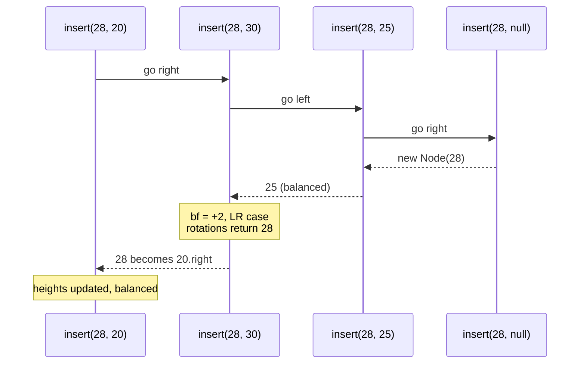

### rotate — detect the case

```java
private Node rotate(Node node) {
    int balance = height(node.left) - height(node.right);

    if (balance > 1) {                                            // left heavy
        if (height(node.left.left) >= height(node.left.right)) {
            return rightRotate(node);                             // LL
        }
        node.left = leftRotate(node.left);                        // LR
        return rightRotate(node);
    }

    if (balance < -1) {                                           // right heavy
        if (height(node.right.right) >= height(node.right.left)) {
            return leftRotate(node);                              // RR
        }
        node.right = rightRotate(node.right);                     // RL
        return leftRotate(node);
    }

    return node;                                                  // already balanced
}
```

> [!NOTE]
> The video tests `height(node.left.left) - height(node.left.right) > 0` for LL and `< 0` for LR. After an **insert** the child is never exactly balanced, so either form works. Using `>=` (as above) also handles the "child balanced" situation that occurs after a **delete**, where a single rotation is correct.

### rightRotate and leftRotate

```java
private Node rightRotate(Node p) {
    Node c = p.left;
    Node t = c.right;      // the "middle" subtree that changes parent

    c.right = p;
    p.left = t;

    updateHeight(p);       // p is now BELOW c -> update it first
    updateHeight(c);
    return c;              // new subtree root
}

private Node leftRotate(Node c) {
    Node p = c.right;
    Node t = p.left;

    p.left = c;
    c.right = t;

    updateHeight(c);       // c is now below p
    updateHeight(p);
    return p;
}
```

| Line in `rightRotate` | Before (p → c → t) | Effect |
|---|---|---|
| `c = p.left` | | remember the node coming up |
| `t = c.right` | | save the middle subtree before overwriting |
| `c.right = p` | | p hangs under c |
| `p.left = t` | | middle subtree re-attached under p |
| update p, then c | | c's height depends on p's new height |

> [!CAUTION]
> Updating heights in the wrong order (c before p) computes c's height from p's **stale** height. The tree still looks fine in small tests but the stored heights drift, and later rotations are chosen wrongly. Always update the node that moved **down** first.

### Verifying it works

The video's test: insert many sorted numbers and print the height. A plain BST gives n − 1; the AVL tree gives about log₂ n. Pair it with the `balanced()` method from video #49 to check every node.

```java
AVL tree = new AVL();
for (int i = 1; i <= 1000; i++) tree.insert(i);
System.out.println(tree.height());    // 9
```

### Alternatives and practice

- **`TreeMap` / `TreeSet`** — use these in real Java code; they're red-black trees with the same O(log n) guarantees.
- **Delete in AVL** — BST delete (successor replacement, from video #49) followed by `updateHeight` + `rotate` on the way back up, exactly like insert.
- LeetCode **110** *Balanced Binary Tree*, **108** *Convert Sorted Array to BST*, **1382** *Balance a Binary Search Tree*.

---

## 7. Closing Remarks (1:04:24)

- A plain BST's speed depends on luck (insertion order); an AVL tree's doesn't.
- AVL = BST + height per node + check balance factor on the way back up + rotate. Four cases, two rotation methods.
- Rotations are O(1) and preserve in-order (sorted) order, so the tree stays a valid BST.
- Next in the trees series: **segment trees**, then **heaps** and more tree problems.

---

## 🧩 Complete Example: Everything Together

One program that inserts values covering all four rotation cases (logging each rotation), checks the result, then compares a plain BST and an AVL tree on 1,000 sorted inserts:

```java
import java.util.ArrayList;
import java.util.List;

// ═══════ Plain BST (for comparison) ═══════
class BST {
    private static class Node {
        int value, height;
        Node left, right;
        Node(int value) { this.value = value; }
    }
    private Node root;

    private int height(Node n) { return n == null ? -1 : n.height; }
    public int height() { return height(root); }

    // Iterative insert so 1000 sorted values don't overflow the stack
    public void insert(int value) {
        Node fresh = new Node(value);
        if (root == null) { root = fresh; return; }
        List<Node> path = new ArrayList<>();
        Node cur = root;
        while (true) {
            path.add(cur);
            if (value < cur.value) {
                if (cur.left == null) { cur.left = fresh; break; }
                cur = cur.left;
            } else if (value > cur.value) {
                if (cur.right == null) { cur.right = fresh; break; }
                cur = cur.right;
            } else return;
        }
        for (int i = path.size() - 1; i >= 0; i--) {
            Node n = path.get(i);
            n.height = Math.max(height(n.left), height(n.right)) + 1;
        }
    }
}

// ═══════ AVL tree: BST + height + rotations ═══════
class AVL {
    private static class Node {
        int value, height;
        Node left, right;
        Node(int value) { this.value = value; }
    }
    private Node root;
    private boolean verbose;
    private int rotations;

    AVL(boolean verbose) { this.verbose = verbose; }

    private int height(Node n) { return n == null ? -1 : n.height; }
    public int height() { return height(root); }
    public int rotations() { return rotations; }

    private void update(Node n) { n.height = Math.max(height(n.left), height(n.right)) + 1; }

    public void insert(int value) { root = insert(value, root); }

    private Node insert(int value, Node node) {
        if (node == null) return new Node(value);
        if (value < node.value) node.left = insert(value, node.left);
        else if (value > node.value) node.right = insert(value, node.right);
        else return node;                         // ignore duplicates
        update(node);
        return rotate(node);
    }

    private Node rotate(Node node) {
        int balance = height(node.left) - height(node.right);
        if (balance > 1) {                                        // left heavy
            if (height(node.left.left) >= height(node.left.right)) {
                log("LL at " + node.value + " -> right rotate");
                return rightRotate(node);
            }
            log("LR at " + node.value + " -> left rotate " + node.left.value + ", right rotate " + node.value);
            node.left = leftRotate(node.left);
            return rightRotate(node);
        }
        if (balance < -1) {                                       // right heavy
            if (height(node.right.right) >= height(node.right.left)) {
                log("RR at " + node.value + " -> left rotate");
                return leftRotate(node);
            }
            log("RL at " + node.value + " -> right rotate " + node.right.value + ", left rotate " + node.value);
            node.right = rightRotate(node.right);
            return leftRotate(node);
        }
        return node;
    }

    private Node rightRotate(Node p) {
        Node c = p.left;
        Node t = c.right;
        c.right = p;
        p.left = t;
        update(p);          // p is now lower -> update it first
        update(c);
        rotations++;
        return c;
    }

    private Node leftRotate(Node c) {
        Node p = c.right;
        Node t = p.left;
        p.left = c;
        c.right = t;
        update(c);
        update(p);
        rotations++;
        return p;
    }

    private void log(String msg) { if (verbose) System.out.println("   " + msg); }

    public boolean balanced() { return balanced(root); }
    private boolean balanced(Node n) {
        if (n == null) return true;
        return Math.abs(height(n.left) - height(n.right)) <= 1 && balanced(n.left) && balanced(n.right);
    }

    public List<Integer> inOrder() { List<Integer> r = new ArrayList<>(); in(root, r); return r; }
    private void in(Node n, List<Integer> r) { if (n == null) return; in(n.left, r); r.add(n.value); in(n.right, r); }

    public List<Integer> preOrder() { List<Integer> r = new ArrayList<>(); pre(root, r); return r; }
    private void pre(Node n, List<Integer> r) { if (n == null) return; r.add(n.value); pre(n.left, r); pre(n.right, r); }
}

public class Main {
    public static void main(String[] args) {
        // ── All four rotation cases, logged as they happen ──
        int[] values = {10, 20, 30, 25, 28, 5, 3, 12, 11};
        AVL avl = new AVL(true);
        for (int v : values) {
            System.out.println("insert " + v);
            avl.insert(v);
        }
        System.out.println("Pre-order : " + avl.preOrder());
        System.out.println("In-order  : " + avl.inOrder());
        System.out.println("Height=" + avl.height() + " Balanced? " + avl.balanced());

        // ── Sorted input: plain BST vs AVL ──
        BST bst = new BST();
        AVL big = new AVL(false);
        for (int i = 1; i <= 1000; i++) {
            bst.insert(i);
            big.insert(i);
        }
        System.out.println("--- Inserting 1..1000 in sorted order ---");
        System.out.println("Plain BST height: " + bst.height());
        System.out.println("AVL height      : " + big.height());
        System.out.println("AVL rotations   : " + big.rotations());
        System.out.println("AVL balanced?   " + big.balanced());
        System.out.printf("log2(1000) = %.2f%n", Math.log(1000) / Math.log(2));
    }
}
```

**Expected Output:**
```
insert 10
insert 20
insert 30
   RR at 10 -> left rotate
insert 25
insert 28
   LR at 30 -> left rotate 25, right rotate 30
insert 5
insert 3
   LL at 10 -> right rotate
insert 12
insert 11
   RL at 10 -> right rotate 12, left rotate 10
Pre-order : [20, 5, 3, 11, 10, 12, 28, 25, 30]
In-order  : [3, 5, 10, 11, 12, 20, 25, 28, 30]
Height=3 Balanced? true
--- Inserting 1..1000 in sorted order ---
Plain BST height: 999
AVL height      : 9
AVL rotations   : 990
AVL balanced?   true
log2(1000) = 9.97
```

---

## Quick Reference Cheat Sheet

| Concept | One-Line Summary |
|---|---|
| **Problem with BST** | Insertion order decides shape; sorted input → height n − 1 → O(n) |
| **Self-balancing BST** | Repairs itself after each insert/delete so height stays O(log n) |
| **AVL rule** | Every node: \|h(left) − h(right)\| ≤ 1 |
| **Balance factor** | h(left) − h(right); ≥ 2 left-heavy, ≤ −2 right-heavy |
| **p, c, g** | Lowest unbalanced node, its taller child, that child's taller child |
| **LL** | rightRotate(p) |
| **RR** | leftRotate(p) |
| **LR** | leftRotate(c), then rightRotate(p) |
| **RL** | rightRotate(c), then leftRotate(p) |
| **Rotation** | O(1) pointer swap; in-order (sorted) order unchanged |
| **Height update order** | Node that moved down first, then the new subtree root |
| **Code change vs BST** | `insert` returns `rotate(node)` after updating height |
| **AVL height bound** | ≤ ≈ 1.44 log₂ n (min nodes grow like Fibonacci) |
| **Complexity** | Search / insert / delete O(log n); space O(n) |
| **In Java libraries** | `TreeMap`/`TreeSet` use red-black trees (looser balance, fewer rotations) |
