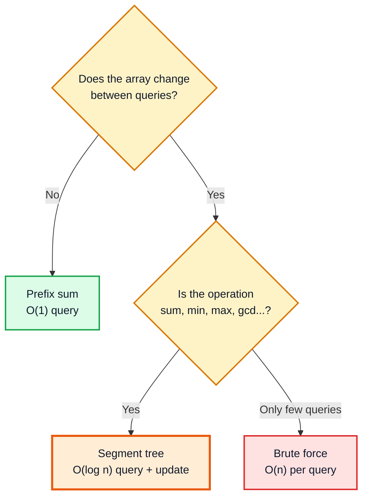
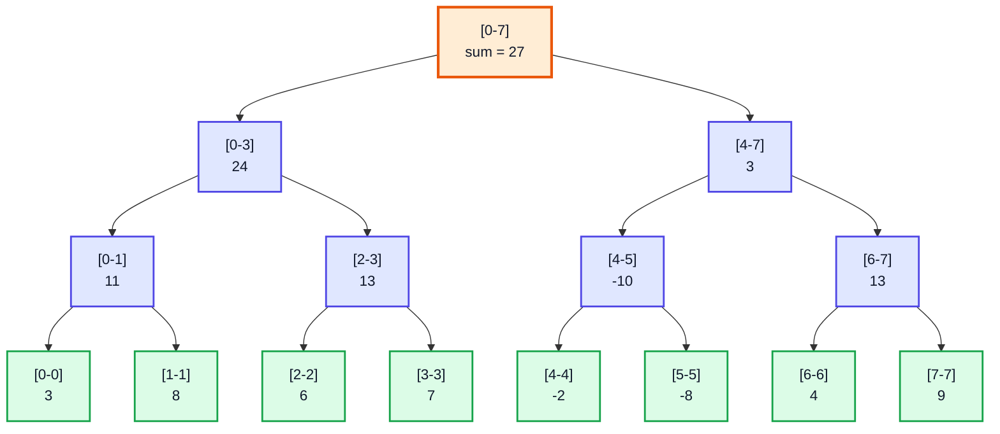
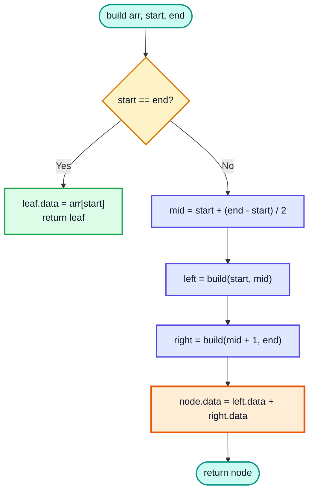
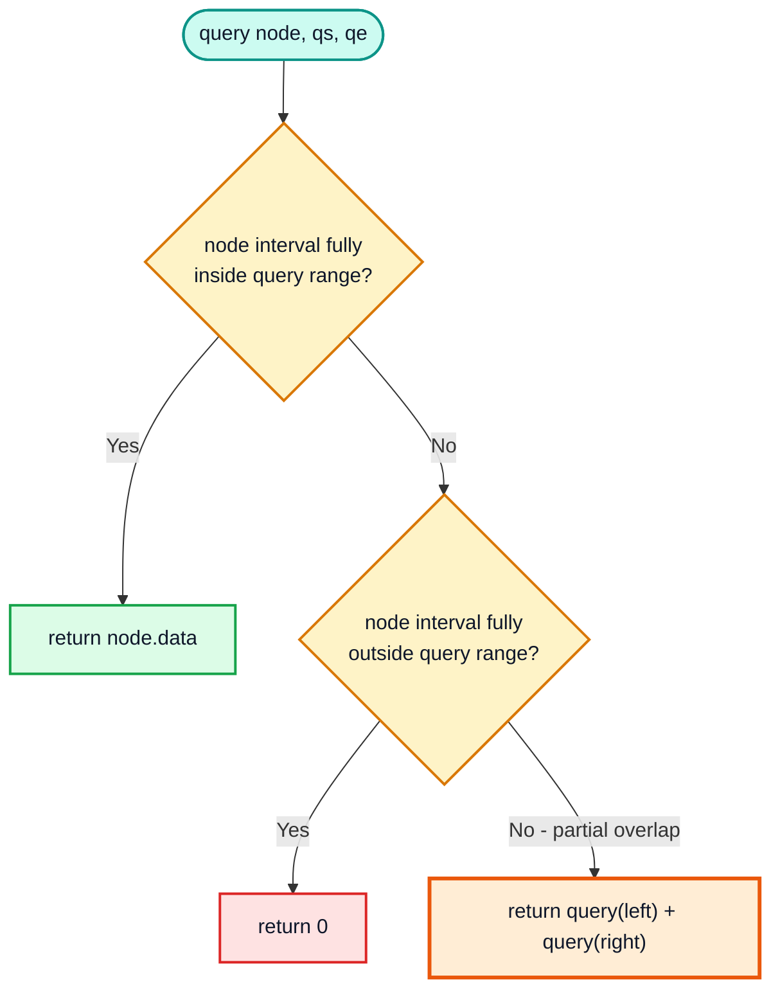
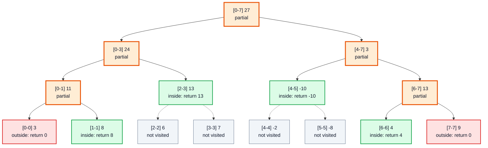
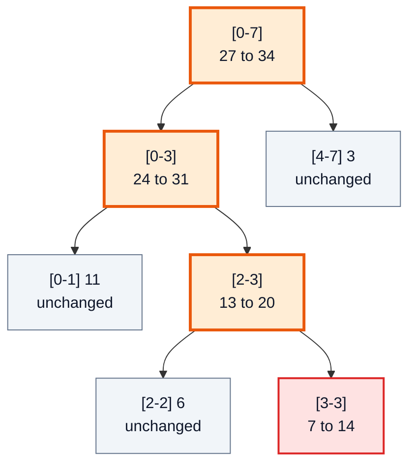
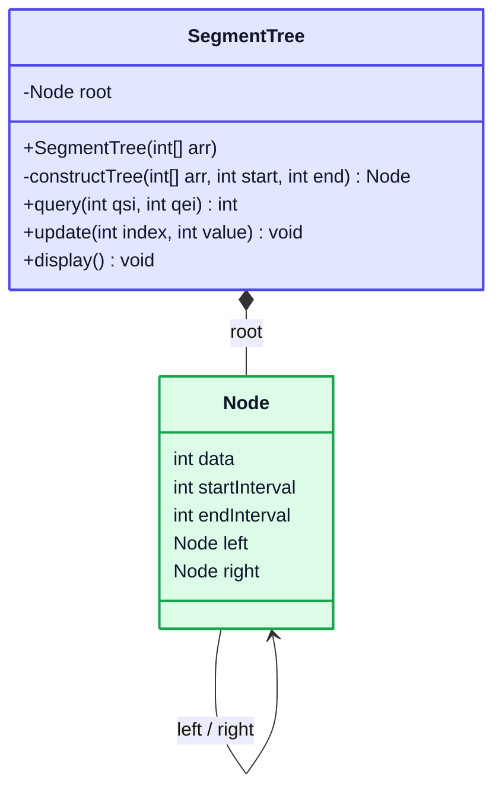
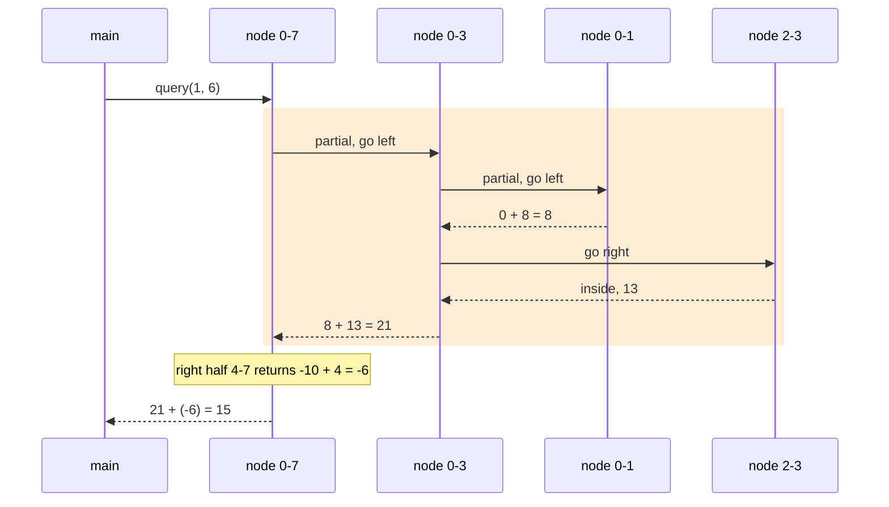

# Segment Trees — Complete In-Depth Guide

**Video #51 of the Java + DSA playlist:** *Segment Trees Tutorial | Range Queries | Interview Questions* (1:13:23)

How to answer range queries (sum, min, max, ...) on an array that keeps changing, in `O(log n)` per query **and** per update — the theory, the three overlap cases, point updates, and a full node-based Java implementation built from scratch.

---

## Table of Contents

| # | Topic | Timestamp |
|---|---|---|
| 0 | [About the lecture](#0-about-the-lecture-000) | 0:00 |
| 1 | [Why use segment trees?](#1-why-use-segment-trees-119) | 1:19 |
| 2 | [Segment trees theory + example](#2-segment-trees-theory--example-404) | 4:04 |
| 3 | [Solving queries in segment trees](#3-solving-queries-in-segment-trees-1610) | 16:10 |
| 4 | [Updating elements in segment trees](#4-updating-elements-in-segment-trees-3130) | 31:30 |
| 5 | [Code](#5-code-3928) | 39:28 |
| 6 | [Closing remarks](#6-closing-remarks-11107) | 1:11:07 |

---

## 0. About the lecture (0:00)

This is the **third lecture of the Trees series** (after Introduction to Trees / BST and AVL trees). It introduces a tree that is not used to store a set of keys, but to store **pre-computed answers about ranges of an array**.

What you need before this video:

1. **Recursion** — every segment tree operation is a recursive split into left half and right half.
2. **Binary trees** — node, left child, right child, height.
3. **Time complexity** — the whole point is going from `O(n)` to `O(log n)`.

> [!IMPORTANT]
> Segment trees are a classic interview and competitive-programming topic. Once you understand the **three overlap cases** (Section 3), every variant — sum, min, max, GCD, XOR, count — uses the exact same code with one line changed.

---

## 1. Why use segment trees? (1:19)

### The problem: range queries

You are given an array and two kinds of operations, mixed in any order, possibly millions of times:

| Operation | Example | Meaning |
|---|---|---|
| **Query** | `sum(1, 6)` | Sum of `arr[1] + arr[2] + ... + arr[6]` |
| **Update** | `update(3, 14)` | Set `arr[3] = 14` |

A **range query** asks for an aggregate (sum, min, max, product, GCD, ...) over a contiguous index range `[l, r]`.

```java
int[] arr = {3, 8, 6, 7, -2, -8, 4, 9};
// sum(1, 6) = 8 + 6 + 7 + (-2) + (-8) + 4 = 15
```

### Approach 1: Brute force

Loop from `l` to `r` every time.

```java
static int bruteSum(int[] arr, int l, int r) {
    int sum = 0;
    for (int i = l; i <= r; i++) {
        sum += arr[i];
    }
    return sum;
}
// bruteSum(arr, 1, 6) -> 15
```

- Query: `O(n)` — the range can be the whole array.
- Update: `O(1)` — just `arr[i] = value`.

With `q` queries this is `O(n * q)`. For `n = q = 10^5` that is `10^10` operations — far too slow.

### Approach 2: Prefix sums

Pre-compute `prefix[i] = arr[0] + ... + arr[i-1]`. Then `sum(l, r) = prefix[r + 1] - prefix[l]`.

```java
int[] prefix = new int[arr.length + 1];
for (int i = 0; i < arr.length; i++) {
    prefix[i + 1] = prefix[i] + arr[i];
}
int ans = prefix[6 + 1] - prefix[1];   // 15
```

- Query: `O(1)`
- Update: `O(n)` — changing `arr[3]` changes every `prefix[i]` for `i > 3`.

### Approach 3: Segment tree — the balance

| Approach | Build | Query | Update | Good when |
|---|---|---|---|---|
| Brute force | — | `O(n)` ❌ | `O(1)` ✅ | Very few queries |
| Prefix sum | `O(n)` | `O(1)` ✅ | `O(n)` ❌ | Array never changes (LeetCode 303) |
| **Segment tree** | `O(n)` | `O(log n)` ✅ | `O(log n)` ✅ | Many queries **and** many updates (LeetCode 307) |



> [!TIP]
> Interview signal: the problem statement says "**range**" + "**update**" (or "mutable"), with constraints around `10^5`. That combination almost always means segment tree (or Fenwick tree).

---

## 2. Segment trees theory + example (4:04)

### What is a segment tree?

A **segment tree** is a **binary tree** where:

- Every node represents an **interval** (segment) `[start, end]` of the array.
- Every node stores the **answer** for its interval (e.g. the sum of `arr[start..end]`).
- The **root** represents the whole array `[0, n-1]`.
- A node `[s, e]` with `s < e` has two children: `[s, mid]` and `[mid+1, e]`, where `mid = s + (e - s) / 2`.
- A **leaf** is a node with `s == e` — a single element, so its answer is just `arr[s]`.
- An internal node's answer is **combined** from its two children: `node.data = left.data + right.data`.

### Example: `arr = {3, 8, 6, 7, -2, -8, 4, 9}` (sum tree)



(Green = leaves = original array elements; blue = internal nodes holding pre-computed sums; orange = root.)

### How the tree is built (bottom-up via recursion)

1. Recursively build the left half and the right half.
2. When you reach a single element, the leaf stores `arr[i]`.
3. While the recursion returns, each parent stores `left + right`.



### Key properties

| Property | Value | Why |
|---|---|---|
| Leaves | `n` | One per array element |
| Internal nodes | `n - 1` | Every internal node has exactly 2 children (full binary tree) |
| **Total nodes** | **`2n - 1`** | `n + (n - 1)` |
| Height | `⌈log₂ n⌉` | The interval halves at each level |
| Build time | `O(n)` | Each of the `2n - 1` nodes is created once, `O(1)` work each |
| Space | `O(n)` | `2n - 1` nodes (array version: allocate `4n`) |

> [!NOTE]
> **Proof of `2n - 1`:** In a **full binary tree** (every node has 0 or 2 children), `internal = leaves - 1`. With `n` leaves that gives `n + (n - 1) = 2n - 1` nodes. For our 8-element array: 15 nodes. ✅

> [!NOTE]
> **Why `4n` in the array implementation?** When `n` is not a power of 2 the tree is not perfectly balanced. Stored in heap order (children of `i` at `2i` and `2i+1`), the deepest index can go up to just under `4n`. So `new int[4 * n]` is the safe size.

### What can a segment tree store?

Any operation that is **associative** — combining `[s, mid]` and `[mid+1, e]` gives the answer for `[s, e]`:

| Query | Combine function | Identity (for "outside" case) |
|---|---|---|
| Sum | `a + b` | `0` |
| Minimum | `Math.min(a, b)` | `Integer.MAX_VALUE` |
| Maximum | `Math.max(a, b)` | `Integer.MIN_VALUE` |
| Product | `a * b` | `1` |
| GCD | `gcd(a, b)` | `0` |
| XOR | `a ^ b` | `0` |

> [!WARNING]
> Operations like "median of a range" or "mode of a range" are **not** directly combinable from two halves — a plain segment tree cannot answer them.

---

## 3. Solving queries in segment trees (16:10)

### The idea

To find `sum(qs, qe)` (query start index, query end index), start at the root and compare the node's interval `[ns, ne]` with the query interval `[qs, qe]`. There are exactly **three cases**:

| Case | Condition | Action |
|---|---|---|
| 🟩 **Completely inside** | `qs <= ns && ne <= qe` | Return `node.data` — no need to go deeper |
| 🟥 **Completely outside** | `ne < qs \|\| ns > qe` | Return the identity (`0` for sum) |
| 🟧 **Partial overlap** | anything else | Recurse into both children, combine the results |



### Example: `sum(1, 6)` on `{3, 8, 6, 7, -2, -8, 4, 9}`



### Dry run

| Step | Node | Case | Returns |
|---|---|---|---|
| 1 | `[0-7]` | 🟧 partial | `query([0-3]) + query([4-7])` |
| 2 | `[0-3]` | 🟧 partial | `query([0-1]) + query([2-3])` |
| 3 | `[0-1]` | 🟧 partial | `query([0-0]) + query([1-1])` |
| 4 | `[0-0]` | 🟥 outside (`0 < 1`) | `0` |
| 5 | `[1-1]` | 🟩 inside | `8` |
| 6 | `[2-3]` | 🟩 inside | `13` |
| 7 | `[4-7]` | 🟧 partial | `query([4-5]) + query([6-7])` |
| 8 | `[4-5]` | 🟩 inside | `-10` |
| 9 | `[6-7]` | 🟧 partial | `query([6-6]) + query([7-7])` |
| 10 | `[6-6]` | 🟩 inside | `4` |
| 11 | `[7-7]` | 🟥 outside (`7 > 6`) | `0` |
| — | **Total** | | `0 + 8 + 13 + (-10) + 4 + 0` = **15** ✅ |

Only 11 of 15 nodes were touched, and the four leaves under `[2-3]` and `[4-5]` were skipped because their parents were already fully inside.

### Code

```java
int query(Node node, int qsi, int qei) {
    if (node.startInterval >= qsi && node.endInterval <= qei) {
        return node.data;                       // completely inside
    } else if (node.startInterval > qei || node.endInterval < qsi) {
        return 0;                               // completely outside
    } else {                                    // partial overlap
        return query(node.left, qsi, qei) + query(node.right, qsi, qei);
    }
}
```

### Why is a query `O(log n)`?

At every level of the tree, **at most 2 nodes are partially overlapping** (one at the left boundary `qs`, one at the right boundary `qe`). Every other node at that level is either fully inside (returns immediately) or fully outside (returns immediately). So each level does at most ~4 node visits:

- Height = `log n`
- Work per level = `O(1)` (at most 4 nodes)
- **Query time = `O(log n)`**, recursion stack space = `O(log n)`.

> [!TIP]
> The partial-overlap nodes are exactly the ones sitting on the two paths from the root to index `qs` and to index `qe`. Everything "between" the two paths is fully inside and gets answered by one stored value.

---

## 4. Updating elements in segment trees (31:30)

### The idea

`update(index, value)` sets `arr[index] = value`. Only nodes whose interval **contains `index`** store a sum that includes `arr[index]` — and those nodes form a **single root-to-leaf path**.

1. If `index` is outside the node's interval → nothing changes, return `node.data` as it is.
2. If the node is the leaf `[index, index]` → set `node.data = value`.
3. Otherwise → update the children recursively and recompute `node.data = left.data + right.data`.

### Example: `update(3, 14)` (7 → 14)



(Red = the leaf that changed; orange = ancestors recomputed on the way back up; grey = untouched.)

| Node | Old | New | Computation |
|---|---|---|---|
| `[3-3]` | 7 | **14** | leaf set directly |
| `[2-3]` | 13 | **20** | `6 + 14` |
| `[0-3]` | 24 | **31** | `11 + 20` |
| `[0-7]` | 27 | **34** | `31 + 3` |

### Code

```java
int update(Node node, int index, int value) {
    if (index >= node.startInterval && index <= node.endInterval) {
        if (index == node.startInterval && index == node.endInterval) {
            node.data = value;                  // the leaf
            return node.data;
        }
        int leftAns = update(node.left, index, value);
        int rightAns = update(node.right, index, value);
        node.data = leftAns + rightAns;         // recompute on the way back
        return node.data;
    }
    return node.data;                           // index not in this subtree
}
```

### Complexity

- Exactly one path of length `log n` is recomputed; the sibling at each level just returns its stored value.
- **Update time = `O(log n)`**, space = `O(log n)` (recursion).

> [!NOTE]
> This is a **point update**. A **range update** ("add 5 to every element in `[2, 6]`") done point-by-point would be `O(n log n)`. The fix is **lazy propagation** — store pending updates in nodes and push them down only when needed — giving `O(log n)` range updates. It is not covered in this video but is the natural next step.

---

## 5. Code (39:28)

Kunal implements the **node-based** version (objects with `left`/`right` references), the same style as the BST and AVL lectures.

### Node class

```java
private static class Node {
    int data;           // answer for this interval (sum here)
    int startInterval;  // ns
    int endInterval;    // ne
    Node left;
    Node right;

    Node(int startInterval, int endInterval) {
        this.startInterval = startInterval;
        this.endInterval = endInterval;
    }
}
```



### Full class

```java
public class SegmentTree {

    private static class Node {
        int data;
        int startInterval;
        int endInterval;
        Node left;
        Node right;

        Node(int startInterval, int endInterval) {
            this.startInterval = startInterval;
            this.endInterval = endInterval;
        }
    }

    private final Node root;

    public SegmentTree(int[] arr) {
        this.root = constructTree(arr, 0, arr.length - 1);
    }

    private Node constructTree(int[] arr, int start, int end) {
        if (start == end) {                      // leaf node
            Node leaf = new Node(start, end);
            leaf.data = arr[start];
            return leaf;
        }
        Node node = new Node(start, end);
        int mid = start + (end - start) / 2;     // avoids int overflow
        node.left = constructTree(arr, start, mid);
        node.right = constructTree(arr, mid + 1, end);
        node.data = node.left.data + node.right.data;
        return node;
    }

    // ---------- query ----------
    public int query(int qsi, int qei) {
        return query(root, qsi, qei);
    }

    private int query(Node node, int qsi, int qei) {
        if (node.startInterval >= qsi && node.endInterval <= qei) {
            return node.data;
        } else if (node.startInterval > qei || node.endInterval < qsi) {
            return 0;
        } else {
            return query(node.left, qsi, qei) + query(node.right, qsi, qei);
        }
    }

    // ---------- update ----------
    public void update(int index, int value) {
        root.data = update(root, index, value);
    }

    private int update(Node node, int index, int value) {
        if (index >= node.startInterval && index <= node.endInterval) {
            if (index == node.startInterval && index == node.endInterval) {
                node.data = value;
                return node.data;
            }
            int leftAns = update(node.left, index, value);
            int rightAns = update(node.right, index, value);
            node.data = leftAns + rightAns;
            return node.data;
        }
        return node.data;
    }

    public static void main(String[] args) {
        int[] arr = {3, 8, 6, 7, -2, -8, 4, 9};
        SegmentTree tree = new SegmentTree(arr);
        System.out.println(tree.query(1, 6));   // 15
        tree.update(3, 14);
        System.out.println(tree.query(1, 6));   // 22
    }
}
```

### Display (pre-order, parent with both children)

```java
private void display(Node node) {
    String str = "";
    if (node.left != null) {
        str += "Interval=[" + node.left.startInterval + "-" + node.left.endInterval
                + "] and data: " + node.left.data + " => ";
    } else {
        str += "No left child => ";
    }
    str += "Interval=[" + node.startInterval + "-" + node.endInterval
            + "] and data: " + node.data + " <= ";
    if (node.right != null) {
        str += "Interval=[" + node.right.startInterval + "-" + node.right.endInterval
                + "] and data: " + node.right.data;
    } else {
        str += "No right child";
    }
    System.out.println(str);
    if (node.left != null) display(node.left);
    if (node.right != null) display(node.right);
}
// First line printed:
// Interval=[0-3] and data: 24 => Interval=[0-7] and data: 27 <= Interval=[4-7] and data: 3
```

### Call order for `query(1, 6)` (first half)



### Alternative: array-based segment tree

Competitive programmers usually store the tree in an `int[]` like a heap: root at index `1`, children of `i` at `2i` and `2i + 1`. No `Node` objects, better cache locality, less memory overhead.

```java
class MinSegmentTree {
    private final int[] tree;
    private final int n;

    MinSegmentTree(int[] arr) {
        n = arr.length;
        tree = new int[4 * n];
        build(arr, 1, 0, n - 1);
    }

    private void build(int[] arr, int idx, int lo, int hi) {
        if (lo == hi) { tree[idx] = arr[lo]; return; }
        int mid = lo + (hi - lo) / 2;
        build(arr, 2 * idx, lo, mid);
        build(arr, 2 * idx + 1, mid + 1, hi);
        tree[idx] = Math.min(tree[2 * idx], tree[2 * idx + 1]);
    }

    int query(int l, int r) { return query(1, 0, n - 1, l, r); }

    private int query(int idx, int lo, int hi, int l, int r) {
        if (r < lo || hi < l) return Integer.MAX_VALUE;   // outside -> identity for min
        if (l <= lo && hi <= r) return tree[idx];         // fully inside
        int mid = lo + (hi - lo) / 2;
        return Math.min(query(2 * idx, lo, mid, l, r),
                        query(2 * idx + 1, mid + 1, hi, l, r));
    }
}
```

| | Node-based (video) | Array-based |
|---|---|---|
| Storage | `2n - 1` objects with references | One `int[4n]` |
| Interval info | Stored in each node | Passed as `lo, hi` parameters |
| Readability | Very clear, matches the diagrams | Compact, index arithmetic |
| Speed | Slower (object allocation, pointer chasing) | Faster (contiguous memory) |

### LeetCode 307 — Range Sum Query - Mutable

Exactly this video's problem: `NumArray(int[] nums)`, `update(index, val)`, `sumRange(left, right)`.

```java
class NumArray {
    private final SegmentTree tree;          // the class above

    public NumArray(int[] nums) {
        tree = new SegmentTree(nums);
    }

    public void update(int index, int val) {
        tree.update(index, val);
    }

    public int sumRange(int left, int right) {
        return tree.query(left, right);
    }
}
```

- Build `O(n)`, each `update` / `sumRange` `O(log n)`, space `O(n)`.

### Alternative: Fenwick tree (Binary Indexed Tree)

For **sum** with point updates, a Fenwick tree does the same job in `O(log n)` with ~10 lines of code and `n + 1` ints. Segment trees are more general (min/max, range updates with lazy propagation, custom merges).

```java
class Fenwick {
    int[] bit;
    Fenwick(int n) { bit = new int[n + 1]; }
    void add(int i, int delta) { for (i++; i < bit.length; i += i & -i) bit[i] += delta; }
    int prefix(int i) { int s = 0; for (i++; i > 0; i -= i & -i) s += bit[i]; return s; }
    int sum(int l, int r) { return prefix(r) - (l > 0 ? prefix(l - 1) : 0); }
}
```

> [!CAUTION]
> Common bugs: (1) using `(start + end) / 2` with huge indices (overflow — use `start + (end - start) / 2`); (2) returning `0` as the "outside" value for a **min** tree (must be `Integer.MAX_VALUE`); (3) forgetting to recompute the parent after updating a child; (4) allocating `2n` instead of `4n` in the array version.

---

## 6. Closing remarks (1:11:07)

- Segment trees turn `O(n)` range queries into `O(log n)` while still allowing `O(log n)` updates.
- The core of every operation is the **three overlap cases**: inside → return, outside → identity, partial → recurse both sides.
- Practice: LeetCode **307** (Range Sum Query - Mutable), **303** (Immutable — prefix sum is enough), **699** (Falling Squares), **315** (Count of Smaller Numbers After Self), **218** (The Skyline Problem); then learn **lazy propagation** for range updates.

> [!TIP]
> Kunal encourages learning in public — share what you learnt with **#DSAwithKunal**.

---

## 🧩 Complete Example: Everything Together

Builds a node-based sum segment tree, prints it, runs queries, updates an element, compares with brute force, and builds an array-based range-minimum tree.

```java
import java.util.Arrays;

public class SegmentTreeDemo {

    // ---------- 1. Node-based segment tree (Kunal's style) ----------
    static class SegmentTree {

        private static class Node {
            int data;
            int startInterval;
            int endInterval;
            Node left;
            Node right;

            Node(int startInterval, int endInterval) {
                this.startInterval = startInterval;
                this.endInterval = endInterval;
            }
        }

        private final Node root;

        SegmentTree(int[] arr) {
            this.root = constructTree(arr, 0, arr.length - 1);
        }

        private Node constructTree(int[] arr, int start, int end) {
            if (start == end) {                      // leaf
                Node leaf = new Node(start, end);
                leaf.data = arr[start];
                return leaf;
            }
            Node node = new Node(start, end);
            int mid = start + (end - start) / 2;
            node.left = constructTree(arr, start, mid);
            node.right = constructTree(arr, mid + 1, end);
            node.data = node.left.data + node.right.data;
            return node;
        }

        int query(int qsi, int qei) {
            return query(root, qsi, qei);
        }

        private int query(Node node, int qsi, int qei) {
            if (node.startInterval >= qsi && node.endInterval <= qei) {
                return node.data;                    // completely inside
            } else if (node.startInterval > qei || node.endInterval < qsi) {
                return 0;                            // completely outside
            } else {                                 // partial overlap
                return query(node.left, qsi, qei) + query(node.right, qsi, qei);
            }
        }

        void update(int index, int value) {
            root.data = update(root, index, value);
        }

        private int update(Node node, int index, int value) {
            if (index >= node.startInterval && index <= node.endInterval) {
                if (index == node.startInterval && index == node.endInterval) {
                    node.data = value;
                    return node.data;
                }
                int leftAns = update(node.left, index, value);
                int rightAns = update(node.right, index, value);
                node.data = leftAns + rightAns;
                return node.data;
            }
            return node.data;                        // index not in this node
        }

        void display() {
            display(root);
        }

        private void display(Node node) {
            String str = "";
            if (node.left != null) {
                str += "Interval=[" + node.left.startInterval + "-" + node.left.endInterval
                        + "] and data: " + node.left.data + " => ";
            } else {
                str += "No left child => ";
            }
            str += "Interval=[" + node.startInterval + "-" + node.endInterval
                    + "] and data: " + node.data + " <= ";
            if (node.right != null) {
                str += "Interval=[" + node.right.startInterval + "-" + node.right.endInterval
                        + "] and data: " + node.right.data;
            } else {
                str += "No right child";
            }
            System.out.println(str);
            if (node.left != null) display(node.left);
            if (node.right != null) display(node.right);
        }
    }

    // ---------- 2. Array-based segment tree for range MINIMUM ----------
    static class MinSegmentTree {
        private final int[] tree;
        private final int n;

        MinSegmentTree(int[] arr) {
            n = arr.length;
            tree = new int[4 * n];
            build(arr, 1, 0, n - 1);
        }

        private void build(int[] arr, int idx, int lo, int hi) {
            if (lo == hi) { tree[idx] = arr[lo]; return; }
            int mid = lo + (hi - lo) / 2;
            build(arr, 2 * idx, lo, mid);
            build(arr, 2 * idx + 1, mid + 1, hi);
            tree[idx] = Math.min(tree[2 * idx], tree[2 * idx + 1]);
        }

        int query(int l, int r) { return query(1, 0, n - 1, l, r); }

        private int query(int idx, int lo, int hi, int l, int r) {
            if (r < lo || hi < l) return Integer.MAX_VALUE;   // no overlap -> identity
            if (l <= lo && hi <= r) return tree[idx];         // total overlap
            int mid = lo + (hi - lo) / 2;
            return Math.min(query(2 * idx, lo, mid, l, r),
                            query(2 * idx + 1, mid + 1, hi, l, r));
        }
    }

    // Brute force for comparison: O(n) per query
    static int bruteSum(int[] arr, int l, int r) {
        int sum = 0;
        for (int i = l; i <= r; i++) sum += arr[i];
        return sum;
    }

    public static void main(String[] args) {
        int[] arr = {3, 8, 6, 7, -2, -8, 4, 9};
        System.out.println("Array: " + Arrays.toString(arr));

        SegmentTree st = new SegmentTree(arr);
        System.out.println("--- Tree (pre-order) ---");
        st.display();

        System.out.println("--- Sum queries ---");
        System.out.println("sum(0, 7) = " + st.query(0, 7));
        System.out.println("sum(1, 6) = " + st.query(1, 6) + "  (brute: " + bruteSum(arr, 1, 6) + ")");
        System.out.println("sum(2, 4) = " + st.query(2, 4));

        System.out.println("--- Update index 3: 7 -> 14 ---");
        st.update(3, 14);
        arr[3] = 14;
        System.out.println("sum(1, 6) = " + st.query(1, 6) + "  (brute: " + bruteSum(arr, 1, 6) + ")");
        System.out.println("sum(0, 7) = " + st.query(0, 7));

        System.out.println("--- Range minimum (array-based tree) ---");
        MinSegmentTree mst = new MinSegmentTree(arr);
        System.out.println("min(0, 7) = " + mst.query(0, 7));
        System.out.println("min(0, 3) = " + mst.query(0, 3));
        System.out.println("min(6, 7) = " + mst.query(6, 7));
    }
}
```

**Expected Output:**
```
Array: [3, 8, 6, 7, -2, -8, 4, 9]
--- Tree (pre-order) ---
Interval=[0-3] and data: 24 => Interval=[0-7] and data: 27 <= Interval=[4-7] and data: 3
Interval=[0-1] and data: 11 => Interval=[0-3] and data: 24 <= Interval=[2-3] and data: 13
Interval=[0-0] and data: 3 => Interval=[0-1] and data: 11 <= Interval=[1-1] and data: 8
No left child => Interval=[0-0] and data: 3 <= No right child
No left child => Interval=[1-1] and data: 8 <= No right child
Interval=[2-2] and data: 6 => Interval=[2-3] and data: 13 <= Interval=[3-3] and data: 7
No left child => Interval=[2-2] and data: 6 <= No right child
No left child => Interval=[3-3] and data: 7 <= No right child
Interval=[4-5] and data: -10 => Interval=[4-7] and data: 3 <= Interval=[6-7] and data: 13
Interval=[4-4] and data: -2 => Interval=[4-5] and data: -10 <= Interval=[5-5] and data: -8
No left child => Interval=[4-4] and data: -2 <= No right child
No left child => Interval=[5-5] and data: -8 <= No right child
Interval=[6-6] and data: 4 => Interval=[6-7] and data: 13 <= Interval=[7-7] and data: 9
No left child => Interval=[6-6] and data: 4 <= No right child
No left child => Interval=[7-7] and data: 9 <= No right child
--- Sum queries ---
sum(0, 7) = 27
sum(1, 6) = 15  (brute: 15)
sum(2, 4) = 11
--- Update index 3: 7 -> 14 ---
sum(1, 6) = 22  (brute: 22)
sum(0, 7) = 34
--- Range minimum (array-based tree) ---
min(0, 7) = -8
min(0, 3) = 3
min(6, 7) = 4
```

---

## Quick Reference Cheat Sheet

| Concept | One-Line Summary |
|---|---|
| **Range query** | Aggregate (sum/min/max/...) over `arr[l..r]` |
| **Brute force** | `O(n)` query, `O(1)` update |
| **Prefix sum** | `O(1)` query, `O(n)` update — only for static arrays |
| **Segment tree** | `O(log n)` query **and** `O(log n)` update |
| **Node** | Stores interval `[start, end]` + answer for that interval |
| **Leaf** | `start == end`, stores `arr[start]` |
| **Children** | `[s, mid]` and `[mid+1, e]`, `mid = s + (e - s) / 2` |
| **Total nodes** | `2n - 1` (full binary tree); array version needs size `4n` |
| **Height** | `⌈log₂ n⌉` |
| **Build** | Recursive, post-order combine, `O(n)` |
| **Query: inside** | Node interval within `[qs, qe]` → return `node.data` |
| **Query: outside** | No overlap → return identity (`0` sum, `MAX_VALUE` min, `MIN_VALUE` max) |
| **Query: partial** | Recurse left + right, combine |
| **Point update** | Fix the leaf, recompute ancestors on the way back, `O(log n)` |
| **Range update** | Needs lazy propagation for `O(log n)` |
| **Works for** | Any associative combine: sum, min, max, product, GCD, XOR |
| **Fenwick tree** | Simpler alternative for prefix-sum style queries |
| **LeetCode** | 307 Range Sum Query - Mutable (303 for the immutable version) |
