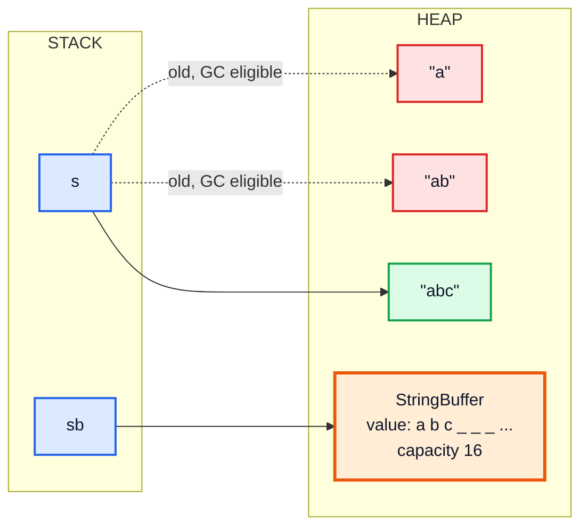
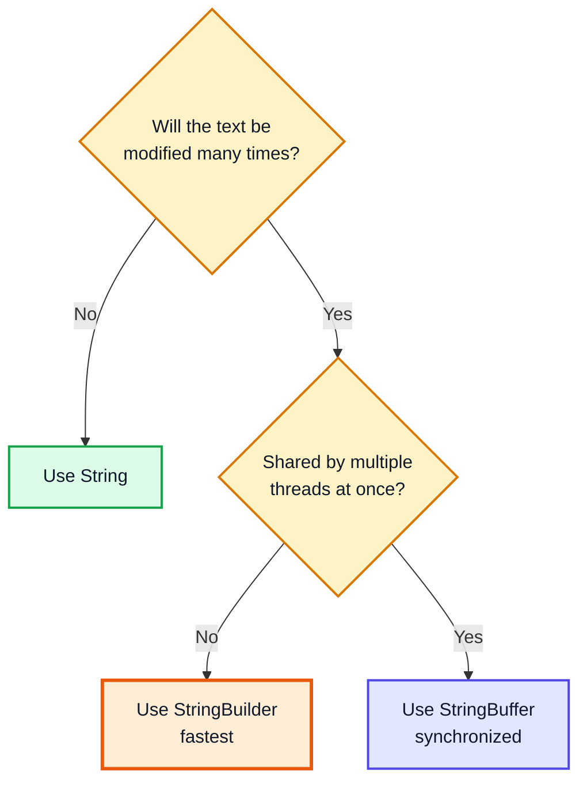
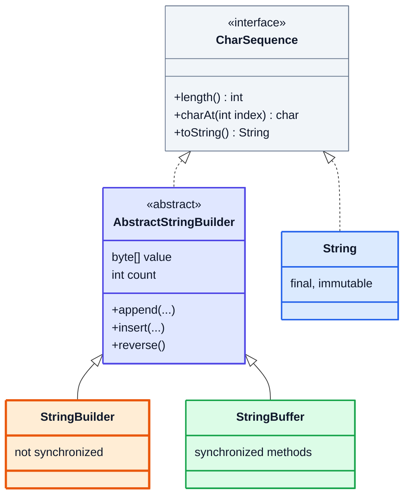
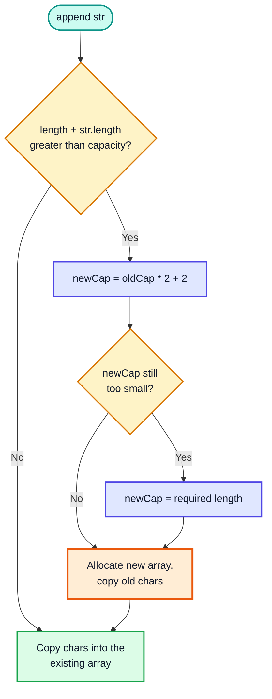
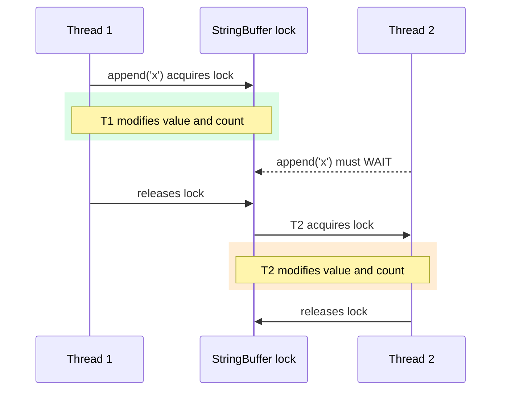
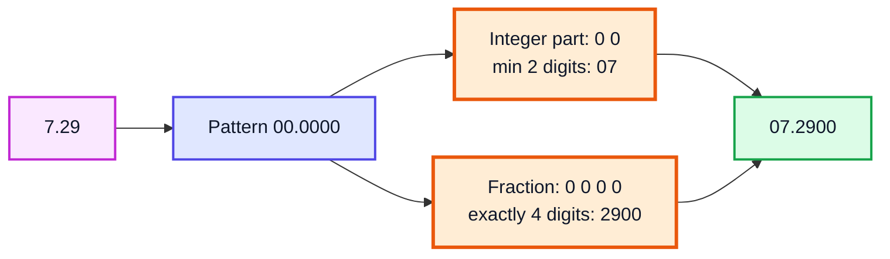
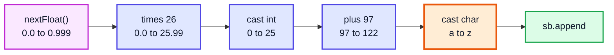
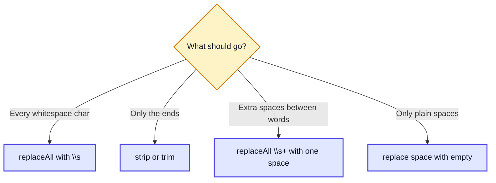
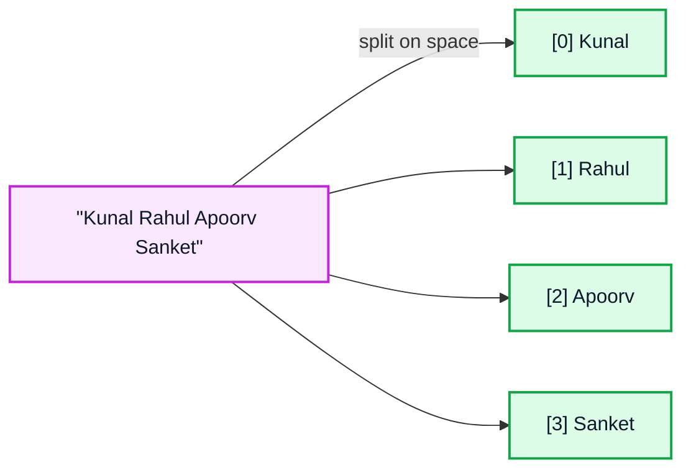

# StringBuffer & Data Formatting — Complete In-Depth Guide

**Video #52 of the Java + DSA playlist:** *StringBuffer in Java | Data Formatting | Working With Large Data* (36:21)

How to build and modify large strings efficiently with the mutable, thread-safe `StringBuffer` — how it compares with `String` and `StringBuilder`, how its capacity grows, its main methods — plus handy everyday tricks: formatting numbers with `DecimalFormat` / `String.format`, generating random strings, removing whitespace and splitting strings.

> [!NOTE]
> This video's description has **no timestamps**. The sections below are organised by topic (following the video's content and description), so the Timestamp column shows **(—)**.

---

## Table of Contents

| # | Topic | Timestamp |
|---|---|---|
| 0 | [Introduction](#0-introduction-) | (—) |
| 1 | [StringBuffer vs StringBuilder vs String](#1-stringbuffer-vs-stringbuilder-vs-string-) | (—) |
| 2 | [Constructors & Capacity](#2-constructors--capacity-) | (—) |
| 3 | [StringBuffer Methods](#3-stringbuffer-methods-) | (—) |
| 4 | [Thread Safety](#4-thread-safety-) | (—) |
| 5 | [Data Formatting with DecimalFormat](#5-data-formatting-with-decimalformat-) | (—) |
| 6 | [String.format and printf](#6-stringformat-and-printf-) | (—) |
| 7 | [Generating Random Strings](#7-generating-random-strings-) | (—) |
| 8 | [Removing Whitespace](#8-removing-whitespace-) | (—) |
| 9 | [Splitting Strings](#9-splitting-strings-) | (—) |
| 10 | [Outro](#10-outro-) | (—) |

---

## 0. Introduction (—)

In video #21 (Strings & StringBuilder) you saw that `String` is **immutable**, so building a string in a loop creates a new object every time. `StringBuilder` fixed that. This video covers its older sibling, **`StringBuffer`**, which does the same job but is also **thread-safe**, and then a set of practical string/number utilities you will use constantly when printing output or processing data.

> [!IMPORTANT]
> The one-sentence takeaway: **`String` = immutable, `StringBuilder` = mutable + fast (single thread), `StringBuffer` = mutable + synchronized (multi-thread safe).** Their APIs are almost identical.

---

## 1. StringBuffer vs StringBuilder vs String (—)

### The basics

`StringBuffer` (in `java.lang`, no import needed) is a **mutable sequence of characters**. You can append, insert, delete or reverse characters **in place** — no new object is created for each change.

```java
StringBuffer sb = new StringBuffer("Kunal");
sb.append(" Kushwaha");      // same object is modified
System.out.println(sb);      // Kunal Kushwaha
```

### Why not just `String`?

```java
String s = "";
for (int i = 0; i < 26; i++) {
    s = s + (char) ('a' + i);   // creates a NEW String object every iteration
}
```

Each `+` copies all existing characters into a new object: `1 + 2 + ... + n` copies → **`O(n²)`** time, and lots of garbage objects.



(Using `String`, each step leaves an old object behind (red). Using `StringBuffer`, one object with a spare-capacity array is modified in place (orange).)

```java
StringBuffer sb = new StringBuffer();
for (int i = 0; i < 26; i++) {
    sb.append((char) ('a' + i));   // amortised O(1) per append
}
System.out.println(sb);            // abcdefghijklmnopqrstuvwxyz
```

### Comparison table

| Feature | `String` | `StringBuilder` | `StringBuffer` |
|---|---|---|---|
| Mutable? | ❌ Immutable | ✅ Mutable | ✅ Mutable |
| Thread-safe? | ✅ (immutable, so naturally safe) | ❌ No | ✅ Yes — methods are `synchronized` |
| Speed for many edits | Slow (`O(n²)` in loops) | **Fastest** | Fast (small lock overhead) |
| Since | Java 1.0 | Java 1.5 | Java 1.0 |
| String pool | Literals are pooled | No | No |
| `equals()` compares content? | ✅ Yes | ❌ No (reference) — use `compareTo` or `toString()` | ❌ No (reference) |
| Typical use | Keys, constants, values that don't change | Building strings in one thread (99% of cases) | Building strings shared between threads |



### Class hierarchy



> [!NOTE]
> Both builders share the same parent, `AbstractStringBuilder`, which is why the APIs match. Since Java 9 (**Compact Strings**), the internal storage is a `byte[]` (Latin-1 or UTF-16) rather than a `char[]` — older explanations that say "a char array" are describing Java 8 and earlier. The behaviour is the same.

> [!WARNING]
> `StringBuffer` does **not** override `equals()`. `new StringBuffer("a").equals(new StringBuffer("a"))` is `false`. Compare contents with `sb1.toString().equals(sb2.toString())` or (Java 11+) `sb1.compareTo(sb2) == 0`.

---

## 2. Constructors & Capacity (—)

### Three main constructors

```java
StringBuffer sb1 = new StringBuffer();          // empty, capacity 16
StringBuffer sb2 = new StringBuffer("Kunal");   // "Kunal", capacity 5 + 16 = 21
StringBuffer sb3 = new StringBuffer(30);        // empty, capacity 30

System.out.println(sb1.capacity());   // 16
System.out.println(sb2.capacity());   // 21
System.out.println(sb3.capacity());   // 30
```

| Constructor | Content | Initial capacity |
|---|---|---|
| `StringBuffer()` | empty | `16` |
| `StringBuffer(String str)` | copy of `str` | `str.length() + 16` |
| `StringBuffer(int capacity)` | empty | `capacity` |
| `StringBuffer(CharSequence seq)` | copy of `seq` | `seq.length() + 16` |

### Length vs capacity

| | `length()` | `capacity()` |
|---|---|---|
| Meaning | Number of characters **actually stored** | Size of the internal array (room available) |
| Example `new StringBuffer("Kunal")` | `5` | `21` |

### How capacity grows

When an append doesn't fit, the buffer allocates a bigger array and copies the old characters into it:

**`newCapacity = oldCapacity * 2 + 2`** — or the required length, if that is even bigger.



```java
StringBuffer sb = new StringBuffer();      // capacity 16
sb.append("12345678901234567");            // 17 chars > 16
System.out.println(sb.capacity());         // 34  (16 * 2 + 2)

StringBuffer big = new StringBuffer();
big.append("x".repeat(35));                // 35 > 34
System.out.println(big.capacity());        // 35  (required length wins)
```

| Appended total length | Capacity before | Capacity after |
|---|---|---|
| 10 | 16 | 16 ✅ fits |
| 17 | 16 | 🟧 34 |
| 35 | 16 | 🟧 35 (34 not enough) |
| 40 | 34 | 🟧 70 |

### Capacity tuning methods

```java
StringBuffer t = new StringBuffer("Hello");   // capacity 21
t.ensureCapacity(100);
System.out.println(t.capacity());             // 100
t.trimToSize();                               // shrink array to length
System.out.println(t.capacity());             // 5
```

> [!TIP]
> **Working with large data:** if you know roughly how big the final string will be (e.g. building a 1 MB report), pass that size to the constructor: `new StringBuffer(1_000_000)`. That avoids repeated grow-and-copy cycles. Growth is amortised `O(1)` per append anyway, but pre-sizing removes the copies completely.

---

## 3. StringBuffer Methods (—)

### Core methods

```java
StringBuffer sb = new StringBuffer("WeMakeDevs");

sb.append(" is nice");
System.out.println(sb);   // WeMakeDevs is nice

sb.insert(2, " Rahul ");
System.out.println(sb);   // We Rahul MakeDevs is nice

sb.replace(1, 5, "Kushwaha");     // replaces indices [1, 5)
System.out.println(sb);   // WKushwahahul MakeDevs is nice

sb.delete(1, 5);                   // removes indices [1, 5)
System.out.println(sb);   // Wwahahul MakeDevs is nice

sb.reverse();
System.out.println(sb);   // ecin si sveDekaM luhahawW

String str = sb.toString();        // convert back to String
```

### Step-by-step trace

| Operation | Content after | `length()` |
|---|---|---|
| `new StringBuffer("WeMakeDevs")` | `WeMakeDevs` | 10 |
| `append(" is nice")` | `WeMakeDevs is nice` | 18 |
| `insert(2, " Rahul ")` | `We🟧 Rahul 🟧MakeDevs is nice` | 25 |
| `replace(1, 5, "Kushwaha")` | `W🟧Kushwaha🟧hul MakeDevs is nice` | 29 |
| `delete(1, 5)` | `W🟥(Kush removed)🟥wahahul MakeDevs is nice` → `Wwahahul MakeDevs is nice` | 25 |
| `reverse()` | `ecin si sveDekaM luhahawW` | 25 |

### Method reference

| Method | Does | Returns |
|---|---|---|
| `append(x)` | Adds `x` (any type) at the end | `this` (chainable) |
| `insert(i, x)` | Inserts `x` before index `i` | `this` |
| `replace(start, end, str)` | Replaces `[start, end)` with `str` | `this` |
| `delete(start, end)` | Removes `[start, end)` | `this` |
| `deleteCharAt(i)` | Removes one char | `this` |
| `reverse()` | Reverses in place | `this` |
| `charAt(i)` / `setCharAt(i, c)` | Read / write one char | `char` / `void` |
| `indexOf(str)` / `lastIndexOf(str)` | Search | `int` (or `-1`) |
| `substring(start, end)` | Copy a part | new `String` |
| `length()` / `capacity()` | Size / room | `int` |
| `setLength(n)` | Truncate or pad with `'\0'` | `void` |
| `toString()` | Snapshot as immutable `String` | `String` |

```java
StringBuffer u = new StringBuffer("Kunal");
u.setCharAt(0, 'k');        // kunal
u.deleteCharAt(4);          // kuna
System.out.println(u + " " + u.charAt(1) + " " + u.indexOf("na"));   // kuna u 2
```

### Method chaining

Because the mutators return `this`, you can chain them:

```java
String s = new StringBuffer()
        .append("Java")
        .append(' ')
        .append(21)
        .insert(0, ">> ")
        .toString();
System.out.println(s);   // >> Java 21
```

> [!CAUTION]
> Ranges are **end-exclusive** (`[start, end)`) like `substring`. An out-of-range index throws `StringIndexOutOfBoundsException`.

---

## 4. Thread Safety (—)

### Basics

A **thread** is an independent path of execution. When two threads modify the same object at the same time, their steps can interleave and corrupt the data (a **race condition**).

`StringBuffer` prevents this: every public method is declared **`synchronized`**, so only one thread at a time can be inside any method of a given `StringBuffer` object.

```java
// Simplified from the JDK source
public synchronized StringBuffer append(String str) {
    super.append(str);
    return this;
}
```



### Demo: two threads appending 1000 characters each

```java
StringBuffer safe = new StringBuffer();
Runnable task = () -> { for (int i = 0; i < 1000; i++) safe.append('x'); };
Thread t1 = new Thread(task);
Thread t2 = new Thread(task);
t1.start(); t2.start();
t1.join(); t2.join();
System.out.println(safe.length());   // always 2000
```

Replace `StringBuffer` with `StringBuilder` and the result is **unpredictable**: sometimes 2000, often less (lost updates), and occasionally an `ArrayIndexOutOfBoundsException` because two threads resized the internal array at once.

| | `StringBuilder` with 2 threads | `StringBuffer` with 2 threads |
|---|---|---|
| Final length | ❌ ≤ 2000, varies per run | ✅ Always 2000 |
| Exceptions possible | ❌ Yes | ✅ No |
| Single-thread speed | ✅ Faster | Slightly slower (lock each call) |

> [!NOTE]
> **Modern Java view:** the JVM removes uncontended locks very cheaply (lock elision via escape analysis), so in single-threaded code the gap is small. Still, `StringBuilder` is the default choice; and since per-method locking doesn't make **sequences** of calls atomic (e.g. "check length, then append"), real multi-threaded code often uses explicit locking or builds strings per thread and joins them. `StringBuffer` remains in legacy APIs like `StringWriter.getBuffer()` and `Matcher.appendReplacement` (older overload).

---

## 5. Data Formatting with DecimalFormat (—)

### Basics

`java.text.DecimalFormat` formats numbers using a **pattern string**.

```java
import java.text.DecimalFormat;

DecimalFormat df = new DecimalFormat("00.0000");
System.out.println(df.format(7.29));   // 07.2900
```

### Pattern symbols

| Symbol | Meaning | Example pattern → `format(...)` | Output |
|---|---|---|---|
| `0` | Digit, **always shown** (pads with 0) | `"00.0000"` → `7.29` | `07.2900` |
| `#` | Digit, **hidden if zero** | `"#.##"` → `3.14159` | `3.14` |
| `#` vs `0` | | `"#.##"` → `2.5` / `"0.00"` → `2.5` | `2.5` / `2.50` |
| `,` | Grouping separator | `"#,###.00"` → `1234567.891` | `1,234,567.89` |
| `%` | Multiply by 100, add `%` | `"#%"` → `0.256` | `26%` |
| `E` | Scientific notation | `"0.###E0"` → `123456` | `1.235E5` |



### Rounding mode: HALF_EVEN by default

`DecimalFormat` uses **banker's rounding** (`RoundingMode.HALF_EVEN`) — a tie rounds to the even neighbour — **not** the "always round .5 up" you learnt in school.

```java
DecimalFormat d = new DecimalFormat("0.00");
System.out.println(d.format(0.125));   // 0.12  (tie -> even digit 2)
System.out.println(d.format(0.135));   // 0.14  (tie -> even digit 4)
System.out.println(d.format(1.005));   // 1.00  (1.005 is really 1.00499999... in binary)

d.setRoundingMode(java.math.RoundingMode.HALF_UP);   // change it if needed
```

> [!WARNING]
> `double` cannot represent most decimals exactly, so "ties" may not be real ties (`1.005` above). For money, use `BigDecimal` with an explicit `RoundingMode`, and format it at the end.

> [!TIP]
> `DecimalFormat` is **not thread-safe**. Create one per thread (or per method call) rather than sharing a `static` instance across threads.

---

## 6. String.format and printf (—)

### Basics

`String.format(pattern, args...)` returns a formatted `String`; `System.out.printf(...)` prints it directly. Both use **format specifiers** `%[flags][width][.precision]conversion`.

```java
System.out.println(String.format("%.2f | %5d | %-6s|", 3.14159, 42, "Hi"));
// 3.14 |    42 | Hi    |

System.out.printf("Pi is %.3f and e is %.1f%n", Math.PI, Math.E);
// Pi is 3.142 and e is 2.7

// Java 15+: instance method formatted()
System.out.println("%s scored %d%%".formatted("Kunal", 95));
// Kunal scored 95%
```

### Common specifiers

| Specifier | Meaning | Example | Output |
|---|---|---|---|
| `%d` | Integer | `%d`, `42` | `42` |
| `%f` / `%.2f` | Floating point / 2 decimals | `%.2f`, `3.14159` | `3.14` |
| `%s` | String (any object via `toString`) | `%s`, `"Hi"` | `Hi` |
| `%c` | Character | `%c`, `'A'` | `A` |
| `%b` | Boolean | `%b`, `true` | `true` |
| `%e` | Scientific | `%e`, `12345.678` | `1.234568e+04` |
| `%x` / `%o` | Hex / octal | `%x`, `255` / `%o`, `8` | `ff` / `10` |
| `%n` | Platform newline | | |
| `%%` | Literal `%` | | `%` |

| Flag / width | Meaning | Example | Output |
|---|---|---|---|
| `%5d` | Right-align in width 5 | `42` | `   42` |
| `%-10s` | Left-align in width 10 | `"Name"` | `Name      ` |
| `%08.3f` | Zero-pad to width 8 | `3.14159` | `0003.142` |
| `%,d` | Grouping | `1234567` | `1,234,567` |
| `%+d` | Always show sign | `5` | `+5` |

### Printing aligned tables

```java
System.out.println(String.format("%-10s|%10s|", "Name", "Age"));
// Name      |       Age|
```

| | `DecimalFormat` | `String.format` / `printf` |
|---|---|---|
| Package | `java.text` | `java.lang` / `java.util.Formatter` |
| Style | Pattern like `"#,##0.00"` | C-style `%...` specifiers |
| Rounding | `HALF_EVEN` (configurable) | `HALF_UP` |
| Best for | Number-only formatting, locales, currency | Mixing text + values, alignment |

> [!NOTE]
> `String.format("%.2f", 0.125)` gives `0.13` (HALF_UP), while `new DecimalFormat("0.00").format(0.125)` gives `0.12` (HALF_EVEN). Pick one tool and be consistent.

---

## 7. Generating Random Strings (—)

### Approach

1. Characters `'a'`..`'z'` have codes `97`..`122` (26 letters).
2. `random.nextFloat()` returns a value in `[0.0, 1.0)`; multiply by 26 → `[0, 26)`; cast to `int` → `0..25`.
3. Add `97` → a random lowercase letter code; cast to `char` and append to a `StringBuffer`.

```java
import java.util.Random;

public class RandomString {
    static String generate(int size) {
        StringBuffer sb = new StringBuffer(size);   // pre-sized: no regrowth
        Random random = new Random();
        for (int i = 0; i < size; i++) {
            int randomChar = 97 + (int) (random.nextFloat() * 26);
            sb.append((char) randomChar);
        }
        return sb.toString();
    }

    public static void main(String[] args) {
        System.out.println(generate(20));   // e.g. qwhzkdpmaxbtuvlrcgen (different every run)
    }
}
```



| `nextFloat()` | `× 26` | `(int)` | `+ 97` | `char` |
|---|---|---|---|---|
| 0.00 | 0.0 | 0 | 97 | `a` |
| 0.50 | 13.0 | 13 | 110 | `n` |
| 0.73 | 18.98 | 18 | 115 | `s` |
| 0.999 | 25.97 | 25 | 122 | `z` |

- Time `O(n)`, space `O(n)` for the result.

### Variations

```java
// Simpler: nextInt(bound) gives 0..bound-1 directly
char c = (char) ('a' + random.nextInt(26));

// Any alphabet (letters + digits)
String alphabet = "ABCDEFGHIJKLMNOPQRSTUVWXYZabcdefghijklmnopqrstuvwxyz0123456789";
char d = alphabet.charAt(random.nextInt(alphabet.length()));

// Deterministic output for testing: fixed seed
Random seeded = new Random(42);   // same sequence every run
```

> [!CAUTION]
> `java.util.Random` is **predictable**. For passwords, tokens, OTPs or session IDs use `java.security.SecureRandom` instead (same API: `new SecureRandom().nextInt(26)`).

---

## 8. Removing Whitespace (—)

### Basics

Strings are immutable, so every method below **returns a new String** — remember to use the return value.

```java
String sentence = "  Hi  Kunal \t how are\nyou ";
System.out.println(sentence.replaceAll("\\s", ""));   // HiKunalhowareyou
```

`\\s` is a **regex** for any whitespace character: space, tab `\t`, newline `\n`, carriage return `\r`, form feed. (In Java source you write `"\\s"` because `\` itself must be escaped.)

### Options compared

| Code | Removes | Result for `"  hi  "` / notes |
|---|---|---|
| `s.replaceAll("\\s", "")` | **All** whitespace everywhere | `"hi"`; regex-based |
| `s.replace(" ", "")` | Only space characters (not tabs/newlines) | `"hi"`; no regex, faster |
| `s.replaceAll("\\s+", " ")` | Collapses runs into one space | `"a  b   c"` → `"a b c"` |
| `s.trim()` | Leading/trailing chars `<= ' '` | `"[hi]"` |
| `s.strip()` (Java 11+) | Leading/trailing **Unicode** whitespace | `"[hi]"` |
| `s.stripLeading()` / `stripTrailing()` | One side only | `"[hi  ]"` / `"[  hi]"` |
| `s.isBlank()` (Java 11+) | Check: empty or only whitespace | `"   ".isBlank()` → `true` |



> [!TIP]
> Prefer `strip()` over `trim()` in modern Java: `trim()` only knows ASCII-range whitespace, while `strip()` also handles Unicode whitespace such as the em space ` `.

### Manual approach (no regex)

```java
static String removeWhitespace(String s) {
    StringBuilder sb = new StringBuilder(s.length());
    for (char c : s.toCharArray()) {
        if (!Character.isWhitespace(c)) sb.append(c);
    }
    return sb.toString();
}
// removeWhitespace("  Hi  Kunal ") -> "HiKunal"   O(n) time, O(n) space
```

---

## 9. Splitting Strings (—)

### Basics

`split(regex)` breaks a string around matches of a **regular expression** and returns a `String[]`.

```java
String names = "Kunal Rahul Apoorv Sanket";
String[] parts = names.split(" ");
System.out.println(Arrays.toString(parts));   // [Kunal, Rahul, Apoorv, Sanket]
```



### In depth: edge cases

| Code | Output | Why |
|---|---|---|
| `"a   b  c".split(" ")` | `[a, , , b, , c]` | Each single space is a separator → empty strings between |
| `"a   b  c".split("\\s+")` | `[a, b, c]` | ✅ One-or-more whitespace |
| `"1,2,,3,,".split(",")` | `[1, 2, , 3]` | Trailing empty strings are **dropped** |
| `"a,b,,".split(",", -1)` | `[a, b, , ]` | Negative limit keeps trailing empties |
| `"x y z".split(" ", 2)` | `[x, y z]` | Limit = max number of pieces |
| `"a.b.c".split(".")` | `[]` (length 0) | ❌ `.` is a regex meaning "any char" |
| `"a.b.c".split("\\.")` | `[a, b, c]` | ✅ Escape regex metacharacters |
| `"a1b22c".split("\\d+")` | `[a, b, c]` | Split on runs of digits |

> [!CAUTION]
> Characters `. $ | ( ) [ { ^ ? * + \` are regex metacharacters. Splitting on them needs escaping (`"\\|"`, `"\\."`) or `Pattern.quote(".")`.

> [!NOTE]
> Leading whitespace produces a leading empty string: `" a b".split("\\s+")` → `["", "a", "b"]`. Call `strip()` first to avoid it.

### Join it back

```java
String joined = String.join("-", parts);   // Kunal-Rahul-Apoorv-Sanket
```

- `split` is `O(n)` in the string length (plus regex overhead); a single-character non-metachar separator like `","` or `" "` takes a fast path without the regex engine.

---

## 10. Outro (—)

- Use `StringBuilder` by default, `StringBuffer` when one builder is shared between threads, and `String` for values that don't change.
- Pre-size builders when working with large data; capacity otherwise grows as `old * 2 + 2`.
- Format numbers with `DecimalFormat` (patterns, HALF_EVEN) or `String.format` / `printf` (specifiers, HALF_UP).
- `replaceAll("\\s", "")`, `strip()`, and `split("\\s+")` cover most whitespace handling.

> [!TIP]
> Share what you learnt with **#DSAwithKunal**.

---

## 🧩 Complete Example: Everything Together

Uses a seeded `Random` so the "random" strings are the same on every run.

```java
import java.text.DecimalFormat;
import java.util.Arrays;
import java.util.Random;

public class StringBufferDemo {

    // Random string of given length using a seeded Random (deterministic)
    static String randomString(int size, Random random) {
        StringBuffer sb = new StringBuffer(size);
        for (int i = 0; i < size; i++) {
            int randomChar = 97 + (int) (random.nextFloat() * 26);   // 'a'..'z'
            sb.append((char) randomChar);
        }
        return sb.toString();
    }

    public static void main(String[] args) throws InterruptedException {
        // 1. Constructors & capacity
        StringBuffer sb1 = new StringBuffer();
        StringBuffer sb2 = new StringBuffer("Kunal");
        StringBuffer sb3 = new StringBuffer(30);
        System.out.println("capacity sb1 = " + sb1.capacity());   // 16
        System.out.println("capacity sb2 = " + sb2.capacity());   // 5 + 16
        System.out.println("capacity sb3 = " + sb3.capacity());   // 30

        sb1.append("12345678901234567");                          // 17 chars > 16
        System.out.println("sb1 grew to capacity " + sb1.capacity()); // 16*2+2

        // 2. Methods
        StringBuffer sb = new StringBuffer("WeMakeDevs");
        sb.append(" is nice");
        System.out.println("append  : " + sb);
        sb.insert(2, " Rahul ");
        System.out.println("insert  : " + sb);
        sb.replace(1, 5, "Kushwaha");
        System.out.println("replace : " + sb);
        sb.delete(1, 5);
        System.out.println("delete  : " + sb);
        sb.reverse();
        System.out.println("reverse : " + sb);
        System.out.println("length  : " + sb.length());
        String str = sb.toString();
        System.out.println("toString: " + str);

        // 3. Thread safety: 2 threads x 1000 appends
        StringBuffer safe = new StringBuffer();
        Runnable task = () -> { for (int i = 0; i < 1000; i++) safe.append('x'); };
        Thread t1 = new Thread(task);
        Thread t2 = new Thread(task);
        t1.start(); t2.start();
        t1.join(); t2.join();
        System.out.println("StringBuffer length after 2 threads: " + safe.length());

        // 4. Random strings
        Random random = new Random(42);
        System.out.println("random(10) = " + randomString(10, random));
        System.out.println("random(5)  = " + randomString(5, random));

        // 5. Removing whitespace
        String sentence = "  Hi  Kunal \t how are\nyou ";
        System.out.println("no spaces: " + sentence.replaceAll("\\s", ""));
        System.out.println("strip    : [" + "   Hello Java   ".strip() + "]");

        // 6. Splitting
        String names = "Kunal Rahul Apoorv Sanket";
        String[] parts = names.split(" ");
        System.out.println("split    : " + Arrays.toString(parts));
        System.out.println("split \\s+: " + Arrays.toString("a   b  c".split("\\s+")));
        System.out.println("csv      : " + Arrays.toString("1,2,,3,,".split(",")));

        // 7. Rounding / formatting
        DecimalFormat df = new DecimalFormat("00.0000");
        System.out.println("DecimalFormat 00.0000 : " + df.format(7.29));
        System.out.println("DecimalFormat #.##    : " + new DecimalFormat("#.##").format(3.14159));
        System.out.println("DecimalFormat #,###.00: " + new DecimalFormat("#,###.00").format(1234567.891));
        System.out.println(String.format("String.format: %.2f | %5d | %-6s|", 3.14159, 42, "Hi"));
        System.out.printf("printf: Pi is %.3f and e is %.1f%n", Math.PI, Math.E);
        System.out.println("formatted(): " + "%s scored %d%%".formatted("Kunal", 95));
    }
}
```

**Expected Output:**
```
capacity sb1 = 16
capacity sb2 = 21
capacity sb3 = 30
sb1 grew to capacity 34
append  : WeMakeDevs is nice
insert  : We Rahul MakeDevs is nice
replace : WKushwahahul MakeDevs is nice
delete  : Wwahahul MakeDevs is nice
reverse : ecin si sveDekaM luhahawW
length  : 25
toString: ecin si sveDekaM luhahawW
StringBuffer length after 2 threads: 2000
random(10) = sbrbiyhsrc
random(5)  = xljjh
no spaces: HiKunalhowareyou
strip    : [Hello Java]
split    : [Kunal, Rahul, Apoorv, Sanket]
split \s+: [a, b, c]
csv      : [1, 2, , 3]
DecimalFormat 00.0000 : 07.2900
DecimalFormat #.##    : 3.14
DecimalFormat #,###.00: 1,234,567.89
String.format: 3.14 |    42 | Hi    |
printf: Pi is 3.142 and e is 2.7
formatted(): Kunal scored 95%
```

> [!NOTE]
> The formatted numbers above use `.` and `,` because the program ran with an English locale. On a machine with, say, a German locale, `DecimalFormat` and `String.format` print `07,2900` and `1.234.567,89`. Pass a `Locale` (`String.format(Locale.US, ...)`, `new DecimalFormat(pattern, DecimalFormatSymbols.getInstance(Locale.US))`) for fixed output.

---

## Quick Reference Cheat Sheet

| Concept | One-Line Summary |
|---|---|
| **`String`** | Immutable; concatenating in a loop is `O(n²)` |
| **`StringBuilder`** | Mutable, not synchronized — default choice for building strings |
| **`StringBuffer`** | Mutable, `synchronized` methods — safe to share between threads |
| **Default capacity** | `16`; `new StringBuffer(str)` → `str.length() + 16` |
| **Growth** | `old * 2 + 2` (or the required size if bigger) |
| **`length()` vs `capacity()`** | Characters stored vs room in the internal array |
| **Pre-sizing** | `new StringBuffer(n)` for large data avoids regrowth copies |
| **Core methods** | `append`, `insert`, `replace`, `delete`, `deleteCharAt`, `reverse`, `setCharAt`, `toString` |
| **Ranges** | `[start, end)` — end exclusive |
| **`equals` on buffers** | Reference comparison — compare `toString()` or use `compareTo` |
| **`DecimalFormat`** | `0` = forced digit, `#` = optional digit, `,` grouping, `%` percent; HALF_EVEN |
| **`String.format` / `printf`** | `%d %f %.2f %s %c %b %n %%`, width `%5d`, left `%-10s`, zero-pad `%08.3f` |
| **`"...".formatted(args)`** | Java 15+ instance version of `String.format` |
| **Random letter** | `(char) ('a' + random.nextInt(26))`; use `SecureRandom` for secrets |
| **Remove all whitespace** | `s.replaceAll("\\s", "")` |
| **Trim ends** | `strip()` (Unicode, Java 11+) or `trim()` |
| **Split on whitespace** | `s.split("\\s+")`; escape metacharacters like `"\\."` |
| **Keep trailing empties** | `split(regex, -1)` |
| **Join back** | `String.join(delimiter, parts)` |
