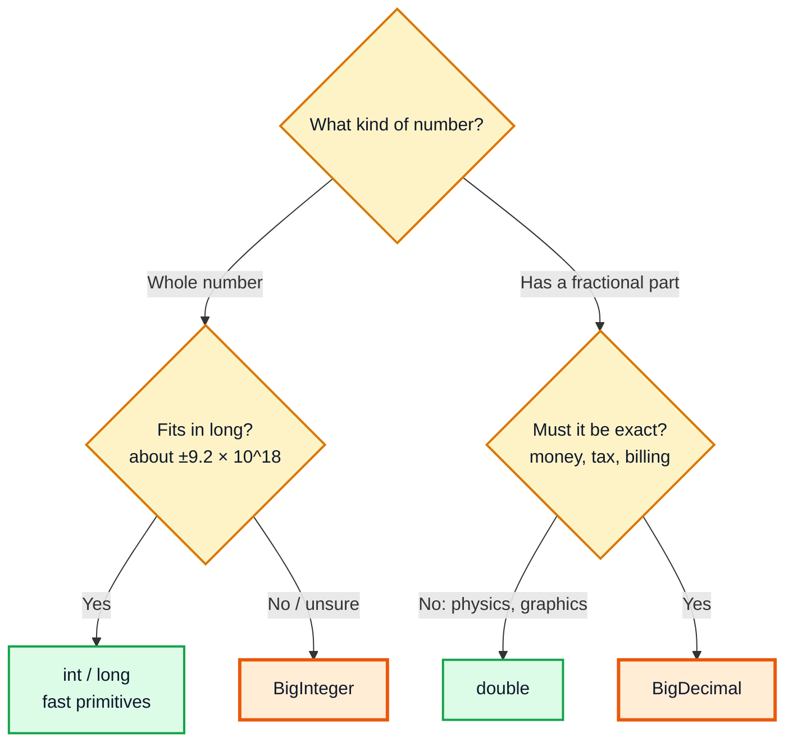
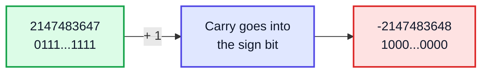
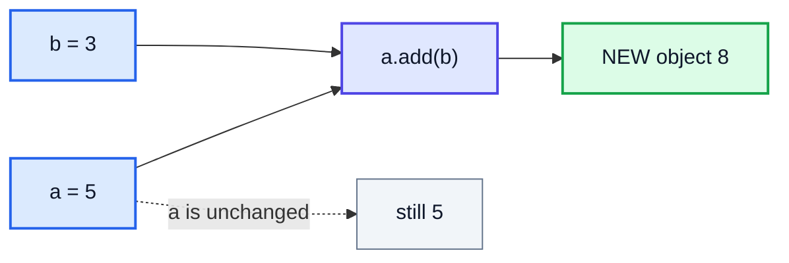
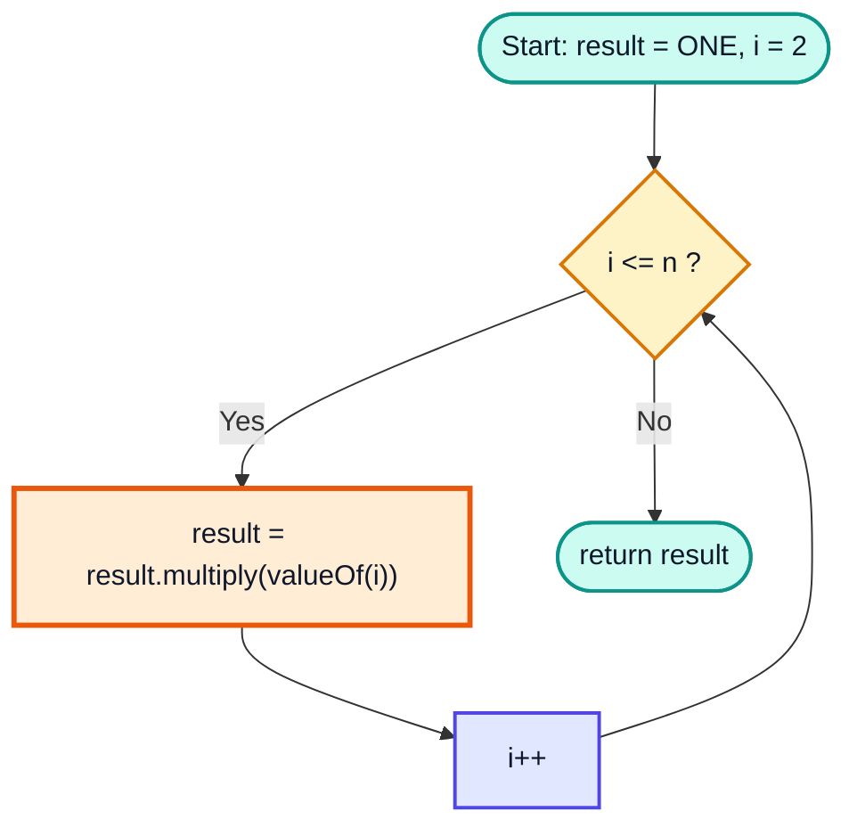
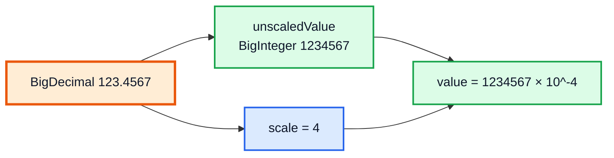
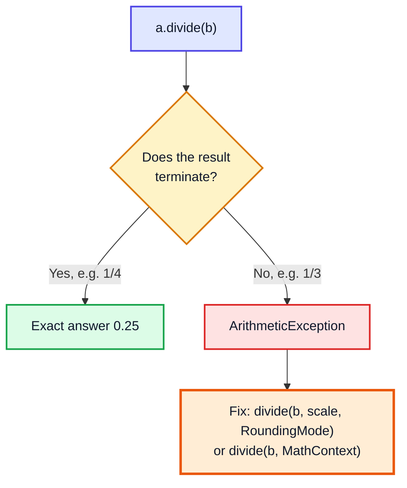
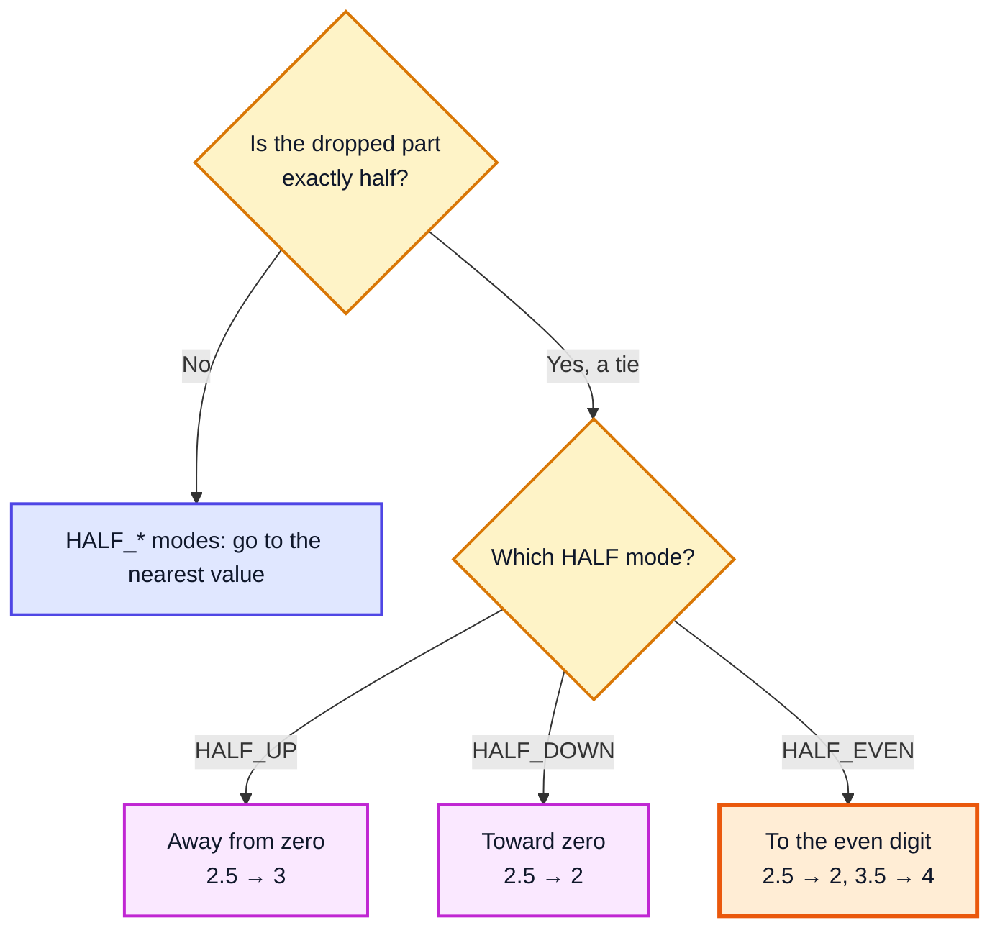
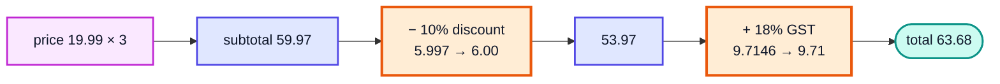

# BigInteger & BigDecimal — Complete In-Depth Guide

**Video #53 of the Java + DSA playlist:** *BigInteger & BigDecimal - Handling Large Numbers in Java* (34:56)

Primitive types have a fixed size, so they overflow quietly, and `double` can't store most decimal fractions exactly. This guide covers `java.math.BigInteger` (whole numbers of any size) and `java.math.BigDecimal` (exact decimals with rounding you choose): how to create them, the arithmetic methods, comparing them, the built-in constants, large factorials, precision and `RoundingMode`, and correct money calculations.

> [!NOTE]
> This video's description has **no timestamps**. The sections below follow the topics in the description and the video's well-known content, so each heading shows **(—)** instead of a time.

---

## Table of Contents

| # | Topic | Timestamp |
|---|---|---|
| 0 | [Introduction](#0-introduction-) | — |
| 1 | [Why Primitives Overflow](#1-why-primitives-overflow-) | — |
| 2 | [Floating-Point Precision Errors](#2-floating-point-precision-errors-) | — |
| 3 | [Creating BigInteger Objects](#3-creating-biginteger-objects-) | — |
| 4 | [BigInteger Arithmetic Methods](#4-biginteger-arithmetic-methods-) | — |
| 5 | [Comparing BigIntegers](#5-comparing-bigintegers-) | — |
| 6 | [BigInteger & BigDecimal Constants](#6-biginteger--bigdecimal-constants-) | — |
| 7 | [Factorial of Large Numbers](#7-factorial-of-large-numbers-) | — |
| 8 | [Creating BigDecimal Objects](#8-creating-bigdecimal-objects-) | — |
| 9 | [Precision, Scale & MathContext](#9-precision-scale--mathcontext-) | — |
| 10 | [RoundingMode](#10-roundingmode-) | — |
| 11 | [Money Calculations](#11-money-calculations-) | — |
| 12 | [Outro](#12-outro-) | — |

---

## 0. Introduction (—)

Earlier videos used `int` and `long` for everything. That works until a number gets too big (factorials, Fibonacci, huge powers, cryptography) or until you need **exact** decimals (prices, interest, tax). Java's answer is two classes in the `java.math` package:

| Class | Stores | Typical use |
|---|---|---|
| `BigInteger` | Whole numbers of any size, limited only by memory | `100!`, `2^1000`, big Fibonacci, modular arithmetic, RSA |
| `BigDecimal` | Decimal numbers stored exactly (digits + a decimal-point position) | Money, tax, interest, anything that must not drift |



> [!IMPORTANT]
> Both classes are **immutable**, just like `String`. Every method (`add`, `multiply`, ...) returns a **new** object. `a.add(b);` on its own does nothing useful — you must write `a = a.add(b);`.

---

## 1. Why Primitives Overflow (—)

### The basics

Every primitive integer type has a **fixed number of bits**, so it has a fixed range:

| Type | Bits | Minimum | Maximum |
|---|---|---|---|
| `byte` | 8 | -128 | 127 |
| `short` | 16 | -32,768 | 32,767 |
| `int` | 32 | -2,147,483,648 | 2,147,483,647 |
| `long` | 64 | -9,223,372,036,854,775,808 | 9,223,372,036,854,775,807 |

When a result goes past the maximum, Java **does not throw an error**. The extra bits are thrown away and the value wraps around to the negative side (two's complement, covered in the bitwise video [java_25_video_bitwise_number_systems.md](java_25_video_bitwise_number_systems.md)).

```java
public class Overflow {
    public static void main(String[] args) {
        int x = Integer.MAX_VALUE;
        System.out.println(x + 1);              // -2147483648

        long l = Long.MAX_VALUE;
        System.out.println(l + 1);              // -9223372036854775808

        long fact = 1;
        for (int i = 2; i <= 21; i++) fact *= i;
        System.out.println(fact);               // -4249290049419214848  (21! is wrong!)
    }
}
```



### In depth: catching overflow without BigInteger

If you only want to **detect** overflow (not handle bigger numbers), `Math` has exact methods that throw instead of wrapping:

```java
try {
    int r = Math.addExact(Integer.MAX_VALUE, 1);
} catch (ArithmeticException e) {
    System.out.println(e.getMessage());   // integer overflow
}
// also: Math.multiplyExact, Math.subtractExact, Math.incrementExact, Math.toIntExact
```

> [!WARNING]
> Silent overflow is one of the most common bugs in DSA problems: `mid = (low + high) / 2` overflowing in binary search, or `a * b` overflowing before you take `% MOD`. Cast to `long` first, or use `BigInteger` when even `long` is not enough.

---

## 2. Floating-Point Precision Errors (—)

### The basics

`float` and `double` store numbers in **binary** (IEEE 754). Just as 1/3 can't be written exactly in decimal (0.3333...), **0.1 can't be written exactly in binary** (0.000110011001100...). The computer stores the closest value it can, and the tiny errors add up.

```java
public class FloatError {
    public static void main(String[] args) {
        System.out.println(0.1 + 0.2);          // 0.30000000000000004
        System.out.println(1.10 - 1.00);        // 0.10000000000000009

        double sum = 0;
        for (int i = 0; i < 10; i++) sum += 0.1;
        System.out.println(sum);                // 0.9999999999999999
        System.out.println(sum == 1.0);         // false
    }
}
```

### In depth: what is actually stored

`new BigDecimal(double)` shows you the exact binary value hiding behind the literal `0.1`:

```java
System.out.println(new java.math.BigDecimal(0.1));
// 0.1000000000000000055511151231257827021181583404541015625
```

| Literal | What `double` really holds | Problem |
|---|---|---|
| `0.5` | exactly 0.5 (a power of 2) | none |
| `0.25` | exactly 0.25 | none |
| `0.1` | 0.1000000000000000055511... | slightly too big |
| `0.2` | 0.2000000000000000111022... | slightly too big |
| `0.1 + 0.2` | 0.3000000000000000444089... | prints as `0.30000000000000004` |

> [!CAUTION]
> Never use `double` or `float` for money. A bank that loses a fraction of a paisa on each of a million transactions loses real money, and `==` comparisons on doubles give surprising `false` results. Use `BigDecimal` (or store amounts as a `long` count of paise/cents).

> [!TIP]
> If you must compare doubles, compare with a tolerance: `Math.abs(a - b) < 1e-9`.

---

## 3. Creating BigInteger Objects (—)

### The basics

`BigInteger` lives in `java.math`, so import it first. There are two main ways to make one:

```java
import java.math.BigInteger;

public class CreateBig {
    public static void main(String[] args) {
        BigInteger a = new BigInteger("123456789012345678901234567890"); // from a String
        BigInteger b = BigInteger.valueOf(42);                           // from a long
        BigInteger c = new BigInteger("ff", 16);                         // String in base 16

        System.out.println(a);   // 123456789012345678901234567890
        System.out.println(b);   // 42
        System.out.println(c);   // 255
    }
}
```

### In depth

| Way | When to use | Notes |
|---|---|---|
| `new BigInteger("digits")` | Number is too big for a `long`, or comes from input | Throws `NumberFormatException` for bad text such as `"12a"` or `"1.5"` |
| `new BigInteger("digits", radix)` | Text in binary / hex / any base 2–36 | `new BigInteger("1010", 2)` is 10 |
| `BigInteger.valueOf(long)` | Value already fits in a `long` | Preferred: reuses cached objects for small values (-16 to 16) |
| `BigInteger.ZERO/ONE/TWO/TEN` | Common constants | See section 6 |
| `new BigInteger(bits, random)` | Random number with up to `bits` bits | Used in crypto / testing |

```java
// WRONG: the literal is evaluated as a long first and does not compile
// BigInteger x = BigInteger.valueOf(123456789012345678901L);   // error: integer number too large

// RIGHT: pass the digits as a String
BigInteger x = new BigInteger("123456789012345678901");
```

### Converting back to primitives

```java
BigInteger big = new BigInteger("99999999999");
System.out.println(big.intValue());        // 1215752191  (silently keeps only the low 32 bits!)
System.out.println(big.longValue());       // 99999999999
big.intValueExact();                       // throws ArithmeticException: BigInteger out of int range
System.out.println(big.toString(2));       // binary string
```

> [!WARNING]
> `intValue()` and `longValue()` truncate without warning — the same overflow problem as before. Use `intValueExact()` / `longValueExact()` (Java 8+) when you need a guarantee.

---

## 4. BigInteger Arithmetic Methods (—)

### The basics

Operators like `+`, `-`, `*`, `/`, `%` **do not work** on objects (Java has no operator overloading, except `+` for `String`). You call methods instead:

| Operation | Primitive | BigInteger |
|---|---|---|
| Add | `a + b` | `a.add(b)` |
| Subtract | `a - b` | `a.subtract(b)` |
| Multiply | `a * b` | `a.multiply(b)` |
| Divide (integer) | `a / b` | `a.divide(b)` |
| Remainder | `a % b` | `a.remainder(b)` |
| Modulus (never negative) | `Math.floorMod(a, b)` | `a.mod(b)` |
| Power | `Math.pow(a, n)` | `a.pow(n)` (`n` is an `int`) |
| Negate / absolute | `-a`, `Math.abs(a)` | `a.negate()`, `a.abs()` |

```java
import java.math.BigInteger;

public class BigMath {
    public static void main(String[] args) {
        BigInteger a = new BigInteger("123456789012345678901234567890");
        BigInteger b = new BigInteger("987654321");

        System.out.println(a.add(b));        // 123456789012345678902222222211
        System.out.println(a.subtract(b));   // 123456789012345678900246913569
        System.out.println(a.multiply(b));   // 121932631124828532112482853211126352690
        System.out.println(a.divide(b));     // 124999998873437499901
        System.out.println(a.mod(b));        // 574845669

        BigInteger[] qr = a.divideAndRemainder(b);    // both in one call
        System.out.println(qr[0] + " " + qr[1]);      // 124999998873437499901 574845669

        System.out.println(BigInteger.TWO.pow(100));  // 1267650600228229401496703205376
    }
}
```

### In depth: `mod` vs `remainder`

```java
BigInteger m = BigInteger.valueOf(-7);
BigInteger three = BigInteger.valueOf(3);
System.out.println(m.remainder(three));   // -1  (same as Java's %)
System.out.println(m.mod(three));         // 2   (always 0..divisor-1)
```

`mod` throws `ArithmeticException` if the divisor is zero or negative. `divide` by `BigInteger.ZERO` throws `ArithmeticException: BigInteger divide by zero`.

### Number-theory methods (great for DSA)

| Method | Result | Example |
|---|---|---|
| `gcd(b)` | Greatest common divisor | `48.gcd(180)` → 12 |
| `modPow(e, m)` | `this^e mod m`, fast | `3.modPow(200, 1e9+7)` → 136318165 |
| `modInverse(m)` | `x` such that `this * x ≡ 1 (mod m)` | Used in combinatorics nCr % p |
| `sqrt()` (Java 9+) | Floor of the square root | `1000000.sqrt()` → 1000 |
| `isProbablePrime(c)` | `true` if prime with probability 1 - 1/2^c | `97.isProbablePrime(20)` → true |
| `nextProbablePrime()` | Next prime above this | `100` → 101 |
| `bitLength()`, `bitCount()` | Bits needed / number of 1 bits | `255.bitLength()` → 8 |
| `shiftLeft(n)`, `and`, `or`, `xor`, `testBit(n)` | Bitwise operations | Same idea as `<<`, `&`, `|`, `^` |



> [!NOTE]
> **Performance:** `BigInteger` arithmetic is much slower than `long` arithmetic: every operation allocates a new object, and multiplying two n-digit numbers costs more than O(1). Java uses schoolbook multiplication for small numbers and switches to Karatsuba and Toom-Cook for very large ones. Use primitives when they are enough.

---

## 5. Comparing BigIntegers (—)

### The basics

`<`, `>`, `<=`, `>=` don't compile on objects, and `==` compares **references**, not values.

```java
BigInteger x = new BigInteger("1000");
BigInteger y = BigInteger.valueOf(1000);

System.out.println(x == y);                              // false (two different objects)
System.out.println(x.equals(y));                         // true  (same value)
System.out.println(x.compareTo(BigInteger.TEN.pow(4)));  // -1    (1000 < 10000)
```

`compareTo` returns a **negative number, zero, or a positive number** (for `BigInteger` it is exactly -1, 0 or 1):

| You want | Write |
|---|---|
| `a < b` | `a.compareTo(b) < 0` |
| `a <= b` | `a.compareTo(b) <= 0` |
| `a > b` | `a.compareTo(b) > 0` |
| `a == b` | `a.compareTo(b) == 0` or `a.equals(b)` |
| bigger / smaller | `a.max(b)`, `a.min(b)` |
| sign | `a.signum()` → -1, 0, 1 |

> [!TIP]
> A handy way to remember: put the operator **between** `compareTo(...)` and `0`. `a < b` becomes `a.compareTo(b) < 0`.

Because `BigInteger` implements `Comparable<BigInteger>`, you can sort a `List<BigInteger>` with `Collections.sort(list)` or put them in a `TreeSet` directly.

---

## 6. BigInteger & BigDecimal Constants (—)

Both classes provide ready-made `static final` objects for common values. Use them instead of creating new objects:

| Constant | BigInteger | BigDecimal |
|---|---|---|
| 0 | `BigInteger.ZERO` | `BigDecimal.ZERO` |
| 1 | `BigInteger.ONE` | `BigDecimal.ONE` |
| 2 | `BigInteger.TWO` (Java 9+) | `BigDecimal.TWO` (Java 19+) |
| 10 | `BigInteger.TEN` | `BigDecimal.TEN` |

```java
BigInteger sum = BigInteger.ZERO;                         // starting value for a sum
BigInteger product = BigInteger.ONE;                      // starting value for a product
BigInteger million = BigInteger.TEN.pow(6);               // 1000000
boolean even = million.mod(BigInteger.TWO).equals(BigInteger.ZERO);   // true
```

> [!NOTE]
> Older tutorials (and older Java versions) don't have `BigInteger.TWO`, so they write `BigInteger.valueOf(2)`. On Java 17/21 both work.

---

## 7. Factorial of Large Numbers (—)

### The problem

`n!` grows extremely fast. `20!` = 2,432,902,008,176,640,000 is the **largest factorial that fits in a `long`**; `21!` already overflows (we saw the negative result in section 1). `100!` has **158 digits**.

### Approach

Same loop as the normal factorial, but keep the running product in a `BigInteger` and multiply by `BigInteger.valueOf(i)`.

```java
import java.math.BigInteger;

public class BigFactorial {
    static BigInteger factorial(int n) {
        BigInteger result = BigInteger.ONE;
        for (int i = 2; i <= n; i++) {
            result = result.multiply(BigInteger.valueOf(i));   // reassign! (immutable)
        }
        return result;
    }

    public static void main(String[] args) {
        System.out.println(factorial(20));  // 2432902008176640000
        System.out.println(factorial(50));  // 30414093201713378043612608166064768844377641568960512000000000000
        System.out.println(factorial(100).toString().length());  // 158
    }
}
```

### Dry run for `factorial(5)`

| i | `result` before | `BigInteger.valueOf(i)` | `result` after |
|---|---|---|---|
| — | 1 (`ONE`) | — | 1 |
| 2 | 1 | 2 | 2 |
| 3 | 2 | 3 | 6 |
| 4 | 6 | 4 | 24 |
| 5 | 24 | 5 | **120** ✅ |



### Complexity

- **Time:** n - 1 multiplications. Each one is not O(1): the product has O(n log n) digits by the end, so the total is roughly O(n² log n) digit operations with schoolbook multiplication (faster in practice for big n thanks to Karatsuba/Toom-Cook).
- **Space:** O(n log n) digits to store the result.

### Alternatives and related problems

| Alternative | Idea |
|---|---|
| Recursive `factorial(n) = n * factorial(n-1)` | Same result, uses O(n) stack; fine for n up to a few thousand |
| Array of digits | Store digits in an `int[]` and multiply by hand, carrying like on paper — the classic "factorial of large numbers" interview question (GeeksforGeeks), for languages without big integers |
| Count trailing zeros only | Count factors of 5 — **LeetCode 172. Factorial Trailing Zeroes** — no need to compute `n!` at all |
| Result modulo a prime | Keep `long` and do `% MOD` at each step — no `BigInteger` needed |

> [!TIP]
> Many problems that look like they need `BigInteger` only ask for the answer `% 1_000_000_007`. Use `long` with a modulo at every step, and save `BigInteger` for when the full exact value is required. **LeetCode 43. Multiply Strings** and **LeetCode 415. Add Strings** ask you to do big-number arithmetic by hand and don't allow `BigInteger` in the solution, but `BigInteger` is a handy way to check your answers while testing.

---

## 8. Creating BigDecimal Objects (—)

### The basics

A `BigDecimal` stores two things:

- an **unscaled value**, a `BigInteger` holding all the digits
- a **scale**, the number of digits after the decimal point

`123.4567` is stored as unscaled `1234567` with scale `4`, and it means 1234567 × 10⁻⁴. Because the digits are decimal, `0.1` is stored **exactly**.



### Ways to create one

```java
import java.math.BigDecimal;

BigDecimal a = new BigDecimal("0.1");      // ✅ exact: 0.1
BigDecimal b = BigDecimal.valueOf(0.1);    // ✅ 0.1 (uses Double.toString, so you get the short form)
BigDecimal c = new BigDecimal(0.1);        // ❌ 0.1000000000000000055511151231257827021181583404541015625
BigDecimal d = BigDecimal.valueOf(1999, 2); // 19.99  (unscaled 1999, scale 2)
BigDecimal e = new BigDecimal("1E+3");     // 1E+3; toPlainString() gives 1000
```

| Constructor / factory | Exact? | Use it? |
|---|---|---|
| `new BigDecimal(String)` | ✅ Exactly the digits you typed | **Best choice** for literals and user input |
| `BigDecimal.valueOf(double)` | ✅ Matches how the double prints | OK when you already have a `double` |
| `BigDecimal.valueOf(long, scale)` | ✅ | Good for amounts stored as paise/cents |
| `new BigDecimal(double)` | ❌ Copies the binary error | Avoid (only for seeing the real binary value) |
| `new BigDecimal(int)` / `valueOf(long)` | ✅ | Whole numbers |

> [!CAUTION]
> `new BigDecimal(0.1)` is the most common `BigDecimal` mistake. By the time the constructor runs, `0.1` is already the inexact double. Always pass a **String**.

### Arithmetic

Same method names as `BigInteger`: `add`, `subtract`, `multiply`, `divide`, `remainder`, `pow`, `negate`, `abs`, plus `sqrt(MathContext)` (Java 9+), `movePointLeft/Right`, `stripTrailingZeros`.

```java
System.out.println(new BigDecimal("0.1").add(new BigDecimal("0.2")));        // 0.3   ✅
System.out.println(new BigDecimal("1.10").subtract(new BigDecimal("1.00")));  // 0.10  ✅
System.out.println(new BigDecimal("1.10").multiply(new BigDecimal("2.5")));    // 2.750 (scale 2 + 1 = 3)
System.out.println(new BigDecimal("1.10").add(new BigDecimal("2.5")));         // 3.60  (scale max(2, 1) = 2)
```

| Operation | Scale of the result |
|---|---|
| `add` / `subtract` | `max(scale1, scale2)` |
| `multiply` | `scale1 + scale2` |
| `divide` (no rounding given) | Exact result, or **exception** if it never ends |

### Comparing: `equals` vs `compareTo`

```java
BigDecimal x = new BigDecimal("2.0");
BigDecimal y = new BigDecimal("2.00");
System.out.println(x.equals(y));      // false  ❗ different scale (1 vs 2)
System.out.println(x.compareTo(y));   // 0      same numeric value
```

> [!WARNING]
> `BigDecimal.equals` checks the value **and the scale**. To ask "are these the same number?", always use `compareTo(...) == 0`. This also affects `HashSet<BigDecimal>`/`HashMap` keys: `2.0` and `2.00` count as different keys. (`TreeSet` uses `compareTo`, so there they count as the same.)

---

## 9. Precision, Scale & MathContext (—)

### The basics

| Term | Meaning | `123.4567` |
|---|---|---|
| **Precision** | Total number of significant digits | 7 |
| **Scale** | Digits to the right of the decimal point | 4 |
| **Unscaled value** | All the digits as an integer | 1234567 |

```java
BigDecimal p = new BigDecimal("123.4567");
System.out.println(p.precision() + " " + p.scale() + " " + p.unscaledValue());   // 7 4 1234567
```

### Why division needs help

`1 ÷ 3 = 0.3333...` never ends, so an exact `BigDecimal` can't hold it:

```java
BigDecimal one = BigDecimal.ONE, three = new BigDecimal("3");
one.divide(three);
// ArithmeticException: Non-terminating decimal expansion; no exact representable decimal result.
```

You must tell Java **where to stop** and **how to round**. There are two ways:

```java
import java.math.*;

// 1) Fix the SCALE (digits after the point): good for money
System.out.println(one.divide(three, 5, RoundingMode.HALF_UP));        // 0.33333

// 2) Fix the PRECISION (significant digits) with a MathContext: good for science
System.out.println(one.divide(three, new MathContext(5)));             // 0.33333
System.out.println(one.divide(three, MathContext.DECIMAL64));          // 0.3333333333333333 (16 digits)
System.out.println(new BigDecimal("2").sqrt(new MathContext(10)));     // 1.414213562
```



| `MathContext` | Precision | Rounding |
|---|---|---|
| `DECIMAL32` | 7 digits | `HALF_EVEN` |
| `DECIMAL64` | 16 digits | `HALF_EVEN` |
| `DECIMAL128` | 34 digits | `HALF_EVEN` |
| `UNLIMITED` | no limit | `HALF_UP` (division can still throw) |
| `new MathContext(n, mode)` | `n` digits | your choice |

### Changing scale and printing

```java
new BigDecimal("3.14159").setScale(2, RoundingMode.HALF_UP);   // 3.14
new BigDecimal("2.50").stripTrailingZeros();                    // 2.5
new BigDecimal("100").stripTrailingZeros();                     // 1E+2  (scientific!)
new BigDecimal("100").stripTrailingZeros().toPlainString();     // 100
```

> [!TIP]
> Use `toPlainString()` when showing values to users. `toString()` may switch to scientific notation (`1E+2`) when the scale is negative or the number is very small.

---

## 10. RoundingMode (—)

### The basics

`java.math.RoundingMode` is an `enum` that says what to do with the digits you drop. (The old `BigDecimal.ROUND_HALF_UP` int constants are **deprecated** since Java 9, so use the enum.)

| Mode | Rule in plain words |
|---|---|
| `UP` | Away from zero |
| `DOWN` | Toward zero (just chop the digits) |
| `CEILING` | Toward +∞ |
| `FLOOR` | Toward -∞ |
| `HALF_UP` | Nearest; a tie (.5) goes away from zero (what you learnt in school) |
| `HALF_DOWN` | Nearest; a tie goes toward zero |
| `HALF_EVEN` | Nearest; a tie goes to the **even** neighbour ("banker's rounding") |
| `UNNECESSARY` | Assert no rounding is needed; throws `ArithmeticException: Rounding necessary` otherwise |

### In depth: every mode on real values (`setScale(0, mode)`)

Output from running `new BigDecimal(v).setScale(0, mode)` on Java 21:

| Input | UP | DOWN | CEILING | FLOOR | HALF_UP | HALF_DOWN | HALF_EVEN |
|---|---|---|---|---|---|---|---|
| 5.5 | 6 | 5 | 6 | 5 | 6 | 5 | 6 |
| 2.5 | 3 | 2 | 3 | 2 | 3 | 2 | 🟧 **2** |
| 1.6 | 2 | 1 | 2 | 1 | 2 | 2 | 2 |
| 1.1 | 2 | 1 | 2 | 1 | 1 | 1 | 1 |
| 1.0 | 1 | 1 | 1 | 1 | 1 | 1 | 1 |
| -1.0 | -1 | -1 | -1 | -1 | -1 | -1 | -1 |
| -1.1 | -2 | -1 | -1 | -2 | -1 | -1 | -1 |
| -1.6 | -2 | -1 | -1 | -2 | -2 | -2 | -2 |
| -2.5 | -3 | -2 | -2 | -3 | -3 | -2 | 🟧 **-2** |
| -5.5 | -6 | -5 | -5 | -6 | -6 | -5 | -6 |



> [!IMPORTANT]
> **Why HALF_EVEN?** With `HALF_UP`, every tie rounds the same way, so over millions of transactions the totals drift upward. `HALF_EVEN` rounds half the ties up and half down, so the error averages out. That's why finance and the IEEE 754 standard use it. If a law or your business rules name a rounding method (often `HALF_UP` for tax), use that one.

> [!NOTE]
> `Math.round(2.5)` returns `3` and `Math.round(-2.5)` returns `-2`: it rounds ties toward **+∞** (it is `floor(x + 0.5)`), which is not quite any of the `HALF_*` modes. Another reason to use `BigDecimal` when the rounding rule matters.

---

## 11. Money Calculations (—)

### The basics

Rules for correct money code:

1. Create amounts from **Strings**: `new BigDecimal("19.99")`.
2. Fix the scale to the currency's minor unit (2 for ₹/$) with **one** rounding mode, used everywhere.
3. Always give a scale + `RoundingMode` when dividing (percentages, splitting, averages).
4. Compare with `compareTo`, not `equals`.
5. Round at the steps the business rules say to (per line, per tax), not only at the very end.

```java
import java.math.BigDecimal;
import java.math.RoundingMode;

public class Bill {
    static BigDecimal percentOf(BigDecimal amount, String percent) {
        return amount.multiply(new BigDecimal(percent))
                     .divide(BigDecimal.valueOf(100), 2, RoundingMode.HALF_EVEN);
    }

    public static void main(String[] args) {
        BigDecimal subtotal = new BigDecimal("19.99").multiply(BigDecimal.valueOf(3)); // 59.97
        BigDecimal discount = percentOf(subtotal, "10");                               // 6.00 (5.997 rounded)
        BigDecimal afterDiscount = subtotal.subtract(discount);                        // 53.97
        BigDecimal gst = percentOf(afterDiscount, "18");                               // 9.71 (9.7146 rounded)
        System.out.println(afterDiscount.add(gst));                                    // 63.68
    }
}
```



### In depth: splitting a bill without losing a paisa

63.68 ÷ 3 = 21.2266... If everyone pays 21.23, you collect 63.69 (one paisa too much); if everyone pays 21.22, you collect 63.66 (two paise short). The fix is to round **down**, then hand out the leftover paise one at a time:

| Step | Value |
|---|---|
| `share = 63.68 / 3` with scale 2, `DOWN` | 21.22 |
| `leftover = 63.68 - 21.22 × 3` | 0.02 |
| Give 0.01 to person 1, then person 2 | 21.23, 21.23, 21.22 |
| Sum | 63.68 ✅ |

(The complete example below includes this `splitBill` method.)

### Alternative: integer minor units

Many payment systems store `long amountInPaise = 6368;` and only format it as `63.68` for display. This is fast and exact for adding and subtracting, but percentages and currency conversion still need careful rounding, which is where `BigDecimal` helps.

| Approach | Pros | Cons |
|---|---|---|
| `double` | Fast, easy | ❌ Wrong answers; never for money |
| `long` paise/cents | Fast, exact for + and − | Manual rounding for %, division; must track the currency's decimals |
| `BigDecimal` | Exact, built-in rounding modes, any scale | Slower, wordy method calls |

---

## 12. Outro (—)

`BigInteger` removes the size limit on whole numbers, and `BigDecimal` removes the binary-fraction error on decimals. Both are immutable, use methods instead of operators, and should be compared with `compareTo`. Next in the playlist: **File Handling** ([java_54_video_file_handling.md](java_54_video_file_handling.md)).

---

## 🧩 Complete Example: Everything Together

```java
import java.math.BigDecimal;
import java.math.BigInteger;
import java.math.MathContext;
import java.math.RoundingMode;

public class LargeNumbers {

    // ---------- BigInteger helpers ----------
    static BigInteger factorial(int n) {
        BigInteger result = BigInteger.ONE;
        for (int i = 2; i <= n; i++) {
            result = result.multiply(BigInteger.valueOf(i));
        }
        return result;
    }

    static BigInteger fibonacci(int n) {
        BigInteger a = BigInteger.ZERO, b = BigInteger.ONE;
        for (int i = 0; i < n; i++) {
            BigInteger next = a.add(b);
            a = b;
            b = next;
        }
        return a;
    }

    // ---------- BigDecimal money helpers ----------
    static final int MONEY_SCALE = 2;
    static final RoundingMode MONEY_ROUNDING = RoundingMode.HALF_EVEN;

    static BigDecimal money(String amount) {
        return new BigDecimal(amount).setScale(MONEY_SCALE, MONEY_ROUNDING);
    }

    static BigDecimal percentOf(BigDecimal amount, String percent) {
        return amount.multiply(new BigDecimal(percent))
                     .divide(BigDecimal.valueOf(100), MONEY_SCALE, MONEY_ROUNDING);
    }

    static BigDecimal[] splitBill(BigDecimal total, int people) {
        BigDecimal share = total.divide(BigDecimal.valueOf(people), MONEY_SCALE, RoundingMode.DOWN);
        BigDecimal[] parts = new BigDecimal[people];
        BigDecimal leftover = total.subtract(share.multiply(BigDecimal.valueOf(people)));
        for (int i = 0; i < people; i++) {
            parts[i] = share;
        }
        // hand out the leftover paise one by one so nothing is lost
        BigDecimal paisa = new BigDecimal("0.01");
        for (int i = 0; leftover.signum() > 0; i++) {
            parts[i] = parts[i].add(paisa);
            leftover = leftover.subtract(paisa);
        }
        return parts;
    }

    public static void main(String[] args) {
        System.out.println("=== 1. Why primitives fail ===");
        int big = Integer.MAX_VALUE;
        System.out.println("Integer.MAX_VALUE + 1 = " + (big + 1));
        long f21 = 1;
        for (int i = 2; i <= 21; i++) f21 *= i;
        System.out.println("21! as long = " + f21);
        System.out.println("0.1 + 0.2 as double = " + (0.1 + 0.2));

        System.out.println("\n=== 2. BigInteger basics ===");
        BigInteger a = new BigInteger("123456789012345678901234567890");
        BigInteger b = BigInteger.valueOf(987654321L);
        System.out.println("a + b   = " + a.add(b));
        System.out.println("a * b   = " + a.multiply(b));
        System.out.println("a / b   = " + a.divide(b));
        System.out.println("a % b   = " + a.mod(b));
        System.out.println("2^100   = " + BigInteger.TWO.pow(100));
        System.out.println("gcd(48, 180) = " + BigInteger.valueOf(48).gcd(BigInteger.valueOf(180)));
        System.out.println("3^200 mod 1e9+7 = "
                + BigInteger.valueOf(3).modPow(BigInteger.valueOf(200), BigInteger.valueOf(1_000_000_007)));

        System.out.println("\n=== 3. Comparison ===");
        BigInteger x = new BigInteger("1000");
        BigInteger y = BigInteger.valueOf(1000);
        System.out.println("x == y        : " + (x == y));
        System.out.println("x.equals(y)   : " + x.equals(y));
        System.out.println("x.compareTo(TEN.pow(4)) : " + x.compareTo(BigInteger.TEN.pow(4)));
        System.out.println("max(x, 2^10)  : " + x.max(BigInteger.TWO.pow(10)));

        System.out.println("\n=== 4. Factorial & Fibonacci ===");
        System.out.println("50!  = " + factorial(50));
        System.out.println("100! has " + factorial(100).toString().length() + " digits");
        System.out.println("fib(100) = " + fibonacci(100));

        System.out.println("\n=== 5. BigDecimal precision ===");
        System.out.println("new BigDecimal(0.1)      = " + new BigDecimal(0.1));
        System.out.println("BigDecimal.valueOf(0.1)  = " + BigDecimal.valueOf(0.1));
        System.out.println("0.1 + 0.2 (BigDecimal)   = " + new BigDecimal("0.1").add(new BigDecimal("0.2")));
        BigDecimal p = new BigDecimal("123.4567");
        System.out.println("precision/scale of 123.4567 = " + p.precision() + "/" + p.scale());
        try {
            BigDecimal.ONE.divide(new BigDecimal("3"));
        } catch (ArithmeticException e) {
            System.out.println("1/3 without rounding -> " + e.getMessage());
        }
        System.out.println("1/3 scale 4 HALF_UP     = " + BigDecimal.ONE.divide(new BigDecimal("3"), 4, RoundingMode.HALF_UP));
        System.out.println("1/3 MathContext(6)      = " + BigDecimal.ONE.divide(new BigDecimal("3"), new MathContext(6)));
        System.out.println("2.0 equals 2.00?        = " + new BigDecimal("2.0").equals(new BigDecimal("2.00")));
        System.out.println("2.0 compareTo 2.00      = " + new BigDecimal("2.0").compareTo(new BigDecimal("2.00")));

        System.out.println("\n=== 6. Rounding modes on 2.5 and -2.5 ===");
        for (RoundingMode mode : new RoundingMode[]{RoundingMode.UP, RoundingMode.DOWN,
                RoundingMode.CEILING, RoundingMode.FLOOR,
                RoundingMode.HALF_UP, RoundingMode.HALF_DOWN, RoundingMode.HALF_EVEN}) {
            System.out.printf("%-9s 2.5 -> %s, -2.5 -> %s%n", mode,
                    new BigDecimal("2.5").setScale(0, mode),
                    new BigDecimal("-2.5").setScale(0, mode));
        }

        System.out.println("\n=== 7. Money: shopping bill ===");
        BigDecimal price = money("19.99");
        BigDecimal subtotal = price.multiply(BigDecimal.valueOf(3));
        BigDecimal discount = percentOf(subtotal, "10");
        BigDecimal afterDiscount = subtotal.subtract(discount);
        BigDecimal gst = percentOf(afterDiscount, "18");
        BigDecimal total = afterDiscount.add(gst);
        System.out.println("Subtotal (3 x 19.99) = " + subtotal);
        System.out.println("Discount 10%         = " + discount);
        System.out.println("After discount       = " + afterDiscount);
        System.out.println("GST 18%              = " + gst);
        System.out.println("Total                = " + total);

        BigDecimal[] shares = splitBill(total, 3);
        BigDecimal check = BigDecimal.ZERO;
        for (int i = 0; i < shares.length; i++) {
            System.out.println("Person " + (i + 1) + " pays        = " + shares[i]);
            check = check.add(shares[i]);
        }
        System.out.println("Shares add back to   = " + check + " (matches: " + (check.compareTo(total) == 0) + ")");

        System.out.println("\n=== 8. Money: compound interest ===");
        BigDecimal principal = money("10000.00");
        BigDecimal rate = new BigDecimal("0.075");          // 7.5% per year
        BigDecimal amount = principal;
        for (int year = 1; year <= 3; year++) {
            BigDecimal interest = amount.multiply(rate).setScale(MONEY_SCALE, MONEY_ROUNDING);
            amount = amount.add(interest);
            System.out.println("Year " + year + ": interest " + interest + ", balance " + amount);
        }
        System.out.println("double version of 3 years = " + (10000.00 * 1.075 * 1.075 * 1.075));
    }
}
```

**Expected Output:**
```
=== 1. Why primitives fail ===
Integer.MAX_VALUE + 1 = -2147483648
21! as long = -4249290049419214848
0.1 + 0.2 as double = 0.30000000000000004

=== 2. BigInteger basics ===
a + b   = 123456789012345678902222222211
a * b   = 121932631124828532112482853211126352690
a / b   = 124999998873437499901
a % b   = 574845669
2^100   = 1267650600228229401496703205376
gcd(48, 180) = 12
3^200 mod 1e9+7 = 136318165

=== 3. Comparison ===
x == y        : false
x.equals(y)   : true
x.compareTo(TEN.pow(4)) : -1
max(x, 2^10)  : 1024

=== 4. Factorial & Fibonacci ===
50!  = 30414093201713378043612608166064768844377641568960512000000000000
100! has 158 digits
fib(100) = 354224848179261915075

=== 5. BigDecimal precision ===
new BigDecimal(0.1)      = 0.1000000000000000055511151231257827021181583404541015625
BigDecimal.valueOf(0.1)  = 0.1
0.1 + 0.2 (BigDecimal)   = 0.3
precision/scale of 123.4567 = 7/4
1/3 without rounding -> Non-terminating decimal expansion; no exact representable decimal result.
1/3 scale 4 HALF_UP     = 0.3333
1/3 MathContext(6)      = 0.333333
2.0 equals 2.00?        = false
2.0 compareTo 2.00      = 0

=== 6. Rounding modes on 2.5 and -2.5 ===
UP        2.5 -> 3, -2.5 -> -3
DOWN      2.5 -> 2, -2.5 -> -2
CEILING   2.5 -> 3, -2.5 -> -2
FLOOR     2.5 -> 2, -2.5 -> -3
HALF_UP   2.5 -> 3, -2.5 -> -3
HALF_DOWN 2.5 -> 2, -2.5 -> -2
HALF_EVEN 2.5 -> 2, -2.5 -> -2

=== 7. Money: shopping bill ===
Subtotal (3 x 19.99) = 59.97
Discount 10%         = 6.00
After discount       = 53.97
GST 18%              = 9.71
Total                = 63.68
Person 1 pays        = 21.23
Person 2 pays        = 21.23
Person 3 pays        = 21.22
Shares add back to   = 63.68 (matches: true)

=== 8. Money: compound interest ===
Year 1: interest 750.00, balance 10750.00
Year 2: interest 806.25, balance 11556.25
Year 3: interest 866.72, balance 12422.97
double version of 3 years = 12422.96875
```

---

## Quick Reference Cheat Sheet

| Concept | One-Line Summary |
|---|---|
| **Overflow** | Primitives wrap around silently: `Integer.MAX_VALUE + 1 == Integer.MIN_VALUE` |
| **`Math.addExact` etc.** | Throw `ArithmeticException` on overflow instead of wrapping |
| **Floating-point error** | `0.1 + 0.2 == 0.30000000000000004` because 0.1 has no exact binary form |
| **Package** | `import java.math.BigInteger; import java.math.BigDecimal; import java.math.RoundingMode;` |
| **Immutable** | Every method returns a new object: write `a = a.add(b)` |
| **Create BigInteger** | `new BigInteger("digits")`, `BigInteger.valueOf(long)`, `new BigInteger("ff", 16)` |
| **Arithmetic** | `add`, `subtract`, `multiply`, `divide`, `mod`, `remainder`, `pow`, `divideAndRemainder` |
| **Number theory** | `gcd`, `modPow`, `modInverse`, `sqrt`, `isProbablePrime`, `nextProbablePrime` |
| **`mod` vs `remainder`** | `mod` is never negative; `remainder` keeps the dividend's sign like `%` |
| **Compare** | `a.compareTo(b) < 0` means `a < b`; never use `==` on objects |
| **Constants** | `ZERO`, `ONE`, `TWO` (BigInteger 9+, BigDecimal 19+), `TEN` |
| **Back to primitive** | `intValue()` truncates; `intValueExact()` / `longValueExact()` throw |
| **Big factorial** | Start at `BigInteger.ONE`, `result = result.multiply(valueOf(i))`; 20! is the last that fits in `long` |
| **Create BigDecimal** | Use `new BigDecimal("0.1")` or `BigDecimal.valueOf(0.1)`, never `new BigDecimal(0.1)` |
| **Precision vs scale** | Precision = total significant digits; scale = digits after the point |
| **Division** | `divide(b, scale, RoundingMode)` or `divide(b, MathContext)`; otherwise non-terminating results throw |
| **`equals` on BigDecimal** | Compares scale too (`2.0` ≠ `2.00`); use `compareTo(...) == 0` |
| **RoundingMode** | `UP`, `DOWN`, `CEILING`, `FLOOR`, `HALF_UP`, `HALF_DOWN`, `HALF_EVEN`, `UNNECESSARY` |
| **HALF_EVEN** | Banker's rounding: ties go to the even digit, so rounding errors average out |
| **Printing** | `toPlainString()` avoids scientific notation like `1E+2` |
| **Money** | String constructor, fixed scale 2, one rounding mode, distribute leftover paise when splitting |
