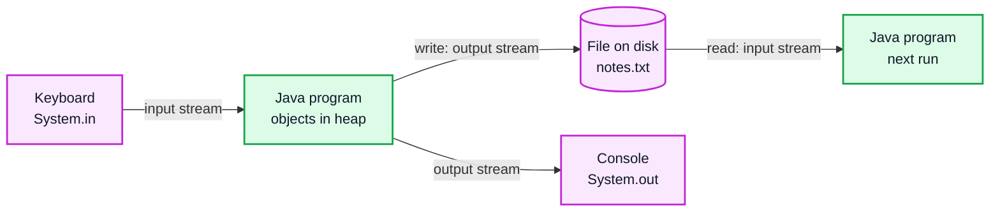
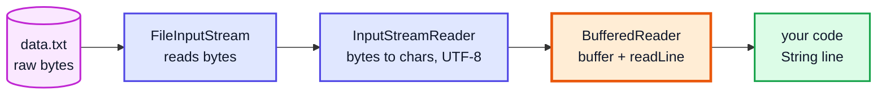
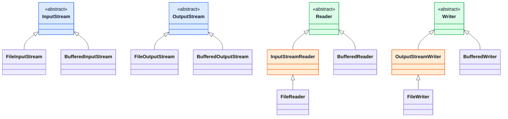
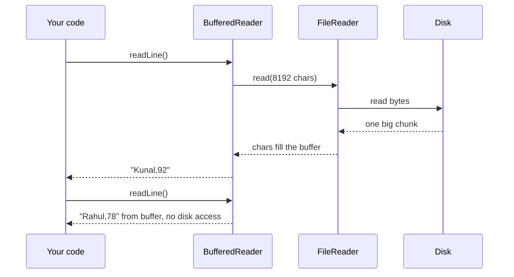
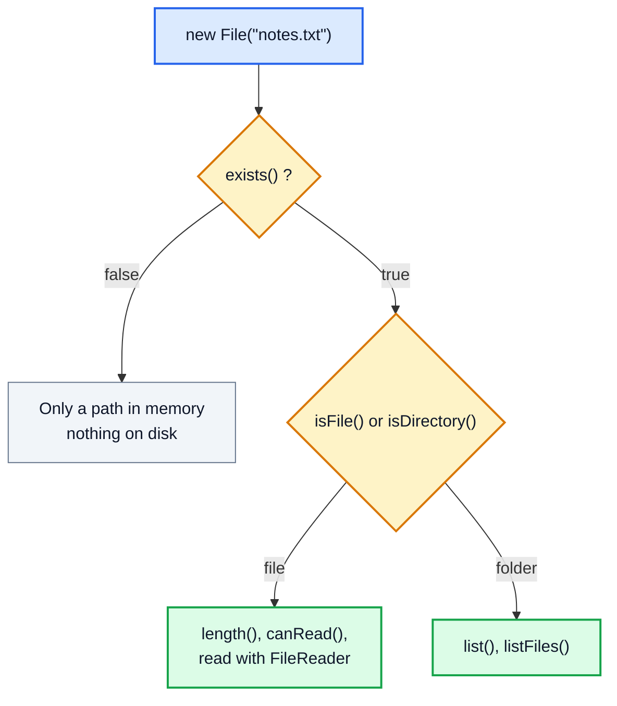
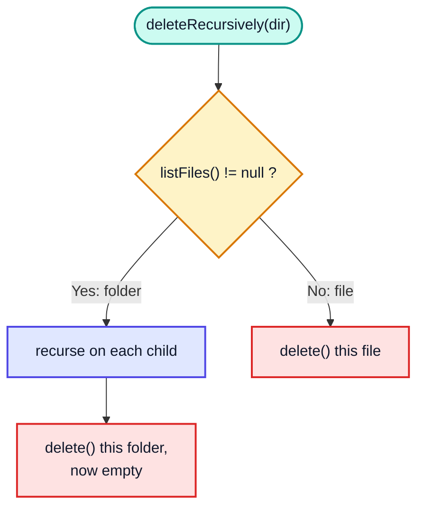
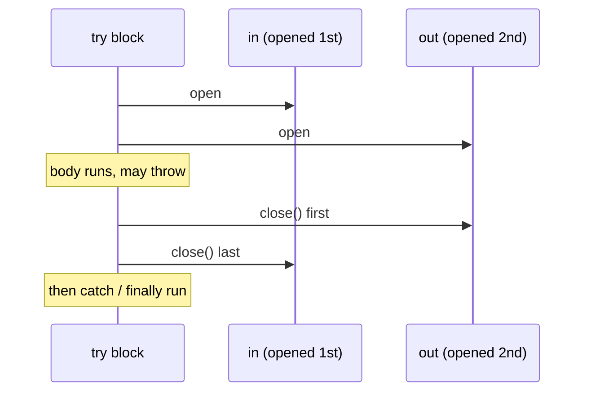
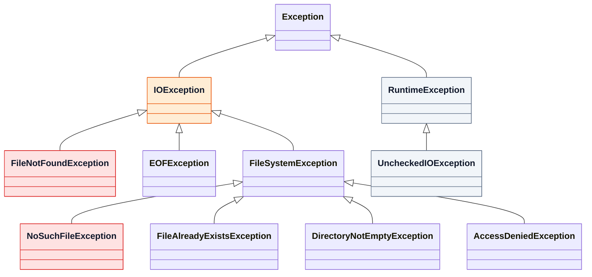
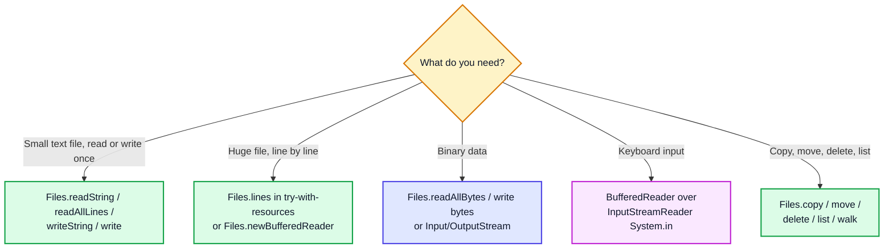

# File Handling in Java — Complete In-Depth Guide

**Video #54 of the Java + DSA playlist:** *File Handling in Java Complete Course* (1:01:03)

Programs lose everything in memory when they stop. File handling lets a program save data to disk and read it back. This guide covers Java's stream model (byte streams vs character streams), `InputStreamReader`, `FileReader`/`FileWriter`, `BufferedReader`/`BufferedWriter`, the `File` class for creating and deleting files, `try-with-resources`, the exceptions you have to handle, and the modern NIO API (`Path`, `Files.readAllLines`, `Files.writeString`) that most new code uses.

> [!NOTE]
> This video's description has **no timestamps**. The sections below follow the topics in the description and the video's well-known content, so each heading shows **(—)** instead of a time.

---

## Table of Contents

| # | Topic | Timestamp |
|---|---|---|
| 0 | [Introduction](#0-introduction-) | — |
| 1 | [Streams: The Big Picture](#1-streams-the-big-picture-) | — |
| 2 | [Byte Streams vs Character Streams](#2-byte-streams-vs-character-streams-) | — |
| 3 | [InputStream & InputStreamReader](#3-inputstream--inputstreamreader-) | — |
| 4 | [FileReader](#4-filereader-) | — |
| 5 | [BufferedReader](#5-bufferedreader-) | — |
| 6 | [OutputStream & FileWriter](#6-outputstream--filewriter-) | — |
| 7 | [BufferedWriter](#7-bufferedwriter-) | — |
| 8 | [The File Class](#8-the-file-class-) | — |
| 9 | [Creating & Deleting Files](#9-creating--deleting-files-) | — |
| 10 | [try-with-resources](#10-try-with-resources-) | — |
| 11 | [Exceptions in File Handling](#11-exceptions-in-file-handling-) | — |
| 12 | [Modern NIO: Files & Path](#12-modern-nio-files--path-) | — |
| 13 | [Outro](#13-outro-) | — |

---

## 0. Introduction (—)

Variables, arrays and objects live in RAM (stack and heap, see [java_05_video_intro_programming.md](java_05_video_intro_programming.md)). When the program ends, all of it is gone. A **file** stores data on disk so it survives restarts and can be shared with other programs.



Almost everything here is in two packages:

| Package | Contains | Since |
|---|---|---|
| `java.io` | `File`, `InputStream`, `OutputStream`, `Reader`, `Writer`, `FileReader`, `BufferedReader`, ... | Java 1.0 / 1.1 |
| `java.nio.file` | `Path`, `Paths`, `Files`, `StandardOpenOption` | Java 7 (more helpers in 8 and 11) |

> [!IMPORTANT]
> Nearly every file operation can fail (missing file, no permission, full disk), so nearly every method throws the **checked** exception `IOException`. You must either catch it or declare `throws IOException`. Exceptions get their own video in the playlist; here we use only what file handling needs.

---

## 1. Streams: The Big Picture (—)

### The basics

A **stream** is a sequence of data flowing in one direction:

- **Input stream**: data flows **into** your program (from a file, keyboard, network).
- **Output stream**: data flows **out of** your program (to a file, console, network).

You read or write the data one piece at a time, in order, like water through a pipe. The program doesn't need to care whether the other end is a file, a keyboard or a socket.

> [!NOTE]
> These I/O streams (`java.io.InputStream` etc.) have nothing to do with the **Stream API** (`java.util.stream.Stream`, `list.stream().map(...)`) from Java 8. Same word, different ideas.

### In depth: decorators (wrapping streams)

`java.io` classes are designed to be **wrapped** inside each other. Each layer adds one feature: a file source, a byte-to-character conversion, buffering. This is the **Decorator pattern**.



```java
BufferedReader br = new BufferedReader(
                        new InputStreamReader(
                            new FileInputStream("data.txt"), StandardCharsets.UTF_8));
```

Closing the outermost wrapper (`br.close()`) also closes everything inside it.

---

## 2. Byte Streams vs Character Streams (—)

### The basics

Everything on disk is bytes. The question is whether you want to deal with **raw bytes** or with **text characters**.

| | Byte streams | Character streams |
|---|---|---|
| Unit | 1 byte (8 bits), `int` 0–255 from `read()` | 1 `char` (16-bit UTF-16), `int` 0–65535 from `read()` |
| Base classes | `InputStream`, `OutputStream` | `Reader`, `Writer` |
| File classes | `FileInputStream`, `FileOutputStream` | `FileReader`, `FileWriter` |
| Buffered | `BufferedInputStream`, `BufferedOutputStream` | `BufferedReader`, `BufferedWriter` |
| Bridge | — | `InputStreamReader` (bytes → chars), `OutputStreamWriter` (chars → bytes) |
| Use for | Images, audio, video, zip, PDF, `.class` files, any binary data | `.txt`, `.csv`, `.json`, `.java`, any human-readable text |



(Blue = byte stream roots, green = character stream roots, orange = the bridges. `FileReader` is just an `InputStreamReader` around a `FileInputStream`.)

### In depth: why bytes and characters differ

With UTF-8, one character can take **1 to 4 bytes**:

| Character | UTF-8 bytes |
|---|---|
| `A` | 1 (`0x41`) |
| `é` | 2 (`0xC3 0xA9`) |
| `न` (Devanagari) | 3 |
| 😀 | 4 (and 2 Java `char`s, a surrogate pair) |

If you read `"café"` with a byte stream and cast each byte to `char`, `é` turns into two garbage characters. A character stream knows the **encoding** and decodes the bytes correctly.

```java
byte[] utf8 = "café".getBytes(StandardCharsets.UTF_8);
System.out.println(utf8.length);   // 5  (4 characters, 5 bytes)
```

> [!WARNING]
> Always say which **charset** you mean (`StandardCharsets.UTF_8`). Before **Java 18** the default charset depended on the operating system (often Windows-1252 on Windows), so the same program could read a file differently on different machines. Since Java 18 (JEP 400) the default is UTF-8 everywhere, but being explicit costs nothing.

---

## 3. InputStream & InputStreamReader (—)

### The basics

`System.in` is an `InputStream`: it gives you **raw bytes** typed on the keyboard. `InputStreamReader` wraps any `InputStream` and turns bytes into characters.

```java
import java.io.*;

public class ReadKeyboard {
    public static void main(String[] args) throws IOException {
        InputStreamReader isr = new InputStreamReader(System.in);
        System.out.print("Type something and press Enter: ");
        int letter = isr.read();                      // reads ONE character
        while (isr.ready()) {                         // more chars waiting?
            System.out.print((char) letter);
            letter = isr.read();
        }
        System.out.println();
        // (don't close System.in if you still need it later!)
    }
}
```

`read()` returns an `int`:

| Return value | Meaning |
|---|---|
| 0 – 65535 | the next character; cast with `(char)` |
| `-1` | end of stream (no more data) |

That's why `read()` returns `int` and not `char`: it needs one extra value, `-1`, that can't be a real character.

### In depth: reading a file through InputStreamReader

```java
try (InputStreamReader isr = new InputStreamReader(
         new FileInputStream("greet.txt"), StandardCharsets.UTF_8)) {
    int ch;
    while ((ch = isr.read()) != -1) {
        System.out.print((char) ch);
    }
}
```

The idiom `while ((ch = isr.read()) != -1)` reads, assigns and tests in one line. You'll see it with every `read()` method.

> [!TIP]
> For keyboard input in competitive programming, `new BufferedReader(new InputStreamReader(System.in))` is much faster than `Scanner`, because `Scanner` parses with regular expressions.

---

## 4. FileReader (—)

### The basics

`FileReader` is a ready-made "`InputStreamReader` + `FileInputStream`" for reading text files.

```java
import java.io.*;

public class ReadFile {
    public static void main(String[] args) {
        try (FileReader fr = new FileReader("notes.txt")) {
            int ch;
            while ((ch = fr.read()) != -1) {
                System.out.print((char) ch);
            }
        } catch (IOException e) {
            System.out.println("Could not read: " + e.getMessage());
        }
    }
}
```

### In depth

| Constructor | Notes |
|---|---|
| `new FileReader(String name)` | Default charset |
| `new FileReader(File file)` | Same, from a `File` object |
| `new FileReader(File/String, Charset)` | **Java 11+**: choose the encoding, e.g. `StandardCharsets.UTF_8` |

- If the file doesn't exist, the **constructor** throws `FileNotFoundException`.
- `read()` with no buffer makes one call into the underlying stream per character, so it's slow for big files. Use `read(char[] buf)` or wrap it in a `BufferedReader`.

```java
char[] buf = new char[1024];
int n;
while ((n = fr.read(buf)) != -1) {          // n = how many chars were actually read
    System.out.print(new String(buf, 0, n));
}
```

> [!NOTE]
> Before Java 11 you couldn't pass a charset to `FileReader`/`FileWriter`, so older tutorials use `new InputStreamReader(new FileInputStream(f), "UTF-8")` instead. On Java 17/21 the charset constructors are the simpler choice.

---

## 5. BufferedReader (—)

### The basics

`BufferedReader` wraps another `Reader` and reads a big **chunk** (8192 chars by default) into memory at once. Your `read()` calls are then served from that buffer, so the disk is touched far less often. It also adds the most useful method: **`readLine()`**.

```java
import java.io.*;

public class ReadLines {
    public static void main(String[] args) throws IOException {
        try (BufferedReader br = new BufferedReader(new FileReader("marks.txt"))) {
            String line;
            while ((line = br.readLine()) != null) {    // null at end of file
                System.out.println(line);
            }
        }
    }
}
```



### In depth

| Method | Returns |
|---|---|
| `read()` | one char as `int`, or -1 |
| `readLine()` | the next line **without** the `\n`/`\r\n`, or `null` at the end |
| `lines()` | a `Stream<String>` of all lines (Java 8+) |
| `ready()` | `true` if a read won't block |

**Parsing a CSV line** is a typical use:

```java
String line = "Kunal,92";
String[] parts = line.split(",");
String name = parts[0];                    // "Kunal"
int score = Integer.parseInt(parts[1]);    // 92
```

> [!WARNING]
> `readLine()` returns `null` at the end, not `-1` and not `""`. An empty line in the middle of the file comes back as `""`. Check `!= null`.

---

## 6. OutputStream & FileWriter (—)

### The basics

Writing mirrors reading. `System.out` is a `PrintStream` (a kind of `OutputStream`). For text files you use **`FileWriter`**:

```java
import java.io.*;

public class WriteFile {
    public static void main(String[] args) throws IOException {
        try (FileWriter fw = new FileWriter("notes.txt")) {          // creates or OVERWRITES
            fw.write("Hello Kunal\n");
        }
        try (FileWriter fw = new FileWriter("notes.txt", true)) {    // true = APPEND
            fw.write("Learning file handling\n");
        }
    }
}
```

| Constructor | Behaviour |
|---|---|
| `new FileWriter(name)` | Creates the file if missing; **erases** existing content |
| `new FileWriter(name, true)` | Creates if missing; **adds to the end** |
| `new FileWriter(file, charset)` / `(file, charset, append)` | Java 11+ with explicit encoding |

> [!CAUTION]
> `new FileWriter("notes.txt")` empties the file the moment the object is created, before you write anything. Opening an important file without `append = true` by mistake wipes it.

### In depth: byte output and OutputStreamWriter

```java
// Byte output: raw bytes, e.g. for binary files
try (FileOutputStream fos = new FileOutputStream("data.bin")) {
    fos.write(new byte[]{0, 1, 2, 127, -128, -1});
}

// Bridge: chars -> bytes with an explicit encoding (what FileWriter does internally)
try (Writer w = new OutputStreamWriter(new FileOutputStream("out.txt"), StandardCharsets.UTF_8)) {
    w.write("café");
}
```

### flush() vs close()

Writers keep data in memory and send it to the OS in batches.

| Method | What it does |
|---|---|
| `flush()` | Push buffered data out now; the stream stays open |
| `close()` | `flush()` + release the file handle; the stream can't be used again |

> [!IMPORTANT]
> If you forget to close (or flush) a writer, the last part of your data may **never reach the file**. `try-with-resources` (section 10) closes it for you.

---

## 7. BufferedWriter (—)

### The basics

`BufferedWriter` collects many small writes in a buffer and writes them to the file in one go. It also adds `newLine()`.

```java
import java.io.*;

public class WriteLines {
    public static void main(String[] args) throws IOException {
        String[] names = {"Kunal", "Rahul", "Priya"};
        int[] scores = {92, 78, 85};
        try (BufferedWriter bw = new BufferedWriter(new FileWriter("marks.txt"))) {
            for (int i = 0; i < names.length; i++) {
                bw.write(names[i] + "," + scores[i]);
                bw.newLine();              // OS line separator: \r\n on Windows, \n on Linux/macOS
            }
        }                                  // close() flushes the buffer to disk
    }
}
```

### In depth: buffered vs unbuffered

| Writing 1,000,000 short lines | What happens per `write` call | Speed |
|---|---|---|
| `FileWriter.write` each line | every call goes through the charset encoder (which has its own byte buffer) | slower |
| `BufferedWriter` around `FileWriter` | chars collect in an 8 KB buffer; the encoder runs once per full buffer | faster |
| `PrintWriter(new BufferedWriter(...))` | same, plus `println`/`printf` | fast and convenient |
| `FileOutputStream.write(b)` one byte at a time, unbuffered | one OS call per byte | very slow: always wrap in `BufferedOutputStream` |

```java
try (PrintWriter pw = new PrintWriter(new BufferedWriter(new FileWriter("report.txt")))) {
    pw.printf("%-6s %3d%n", "Kunal", 92);
}
```

> [!TIP]
> `newLine()` writes the **operating system's** separator. If the file must be identical on every OS (e.g. for tests), write `"\n"` yourself.

---

## 8. The File Class (—)

### The basics

`java.io.File` represents a **path name** to a file or folder. Creating a `File` object does **not** create anything on disk: it is just a description of a location. Its methods ask the OS about that location or change it.

```java
import java.io.File;

File f = new File("notes.txt");                 // relative to the working directory
File g = new File("folder", "notes.txt");       // parent + child
System.out.println(f.exists());                 // false until something creates it
```

### In depth: useful methods

| Method | Returns / does |
|---|---|
| `exists()` | Is there something at this path? |
| `isFile()`, `isDirectory()` | What kind is it? |
| `getName()` | Last part, e.g. `notes.txt` |
| `getPath()`, `getAbsolutePath()` | As given / full path |
| `getParent()`, `getParentFile()` | Containing folder |
| `length()` | Size in **bytes** (0 if missing) |
| `canRead()`, `canWrite()`, `canExecute()` | Permissions |
| `lastModified()` | Time in ms since 1970 |
| `list()`, `listFiles()` | Names / `File`s inside a folder (`null` if not a folder) |
| `createNewFile()`, `mkdir()`, `mkdirs()` | Create (section 9) |
| `delete()`, `renameTo(File)` | Delete / move (section 9) |



> [!NOTE]
> Relative paths like `"notes.txt"` are resolved against the **working directory** (where you ran `java`, or the project root in an IDE), not against the `.java` file's folder. `new File(".").getAbsolutePath()` shows where that is.

---

## 9. Creating & Deleting Files (—)

### The basics

```java
import java.io.*;

public class CreateDelete {
    public static void main(String[] args) throws IOException {
        File f = new File("new-file.txt");
        System.out.println(f.createNewFile());   // true  - created now
        System.out.println(f.createNewFile());   // false - already exists, nothing changed
        System.out.println(f.delete());          // true  - deleted
        System.out.println(f.delete());          // false - nothing left to delete
    }
}
```

Note that these methods return **`boolean`** instead of throwing exceptions when they fail.

| Method | `true` when | `false` when |
|---|---|---|
| `createNewFile()` | a new empty file was created | the file already exists (throws `IOException` if the folder is missing) |
| `mkdir()` | one folder was created | it exists, or the parent is missing |
| `mkdirs()` | the folder and any missing parents were created | it already exists |
| `delete()` | it was deleted | missing, a **non-empty folder**, locked, or no permission |
| `renameTo(dest)` | renamed/moved | many platform-specific reasons |

### In depth: deleting a folder

`delete()` refuses to remove a folder that still has something in it. Delete the contents first (recursively for nested folders):

```java
static void deleteRecursively(File f) {
    File[] children = f.listFiles();      // null for a regular file
    if (children != null) {
        for (File c : children) deleteRecursively(c);
    }
    f.delete();
}
```



> [!CAUTION]
> `delete()` does **not** go to the Recycle Bin/Trash. The file is gone. Double-check paths before deleting, especially in recursive code, and test inside a temporary folder (`Files.createTempDirectory`) as the complete example does.

> [!TIP]
> `File`'s `false` return values don't tell you **why** something failed. `Files.createFile`, `Files.delete` and `Files.move` from NIO throw exceptions that explain the reason (`FileAlreadyExistsException`, `DirectoryNotEmptyException`, `NoSuchFileException`). See section 12.

---

## 10. try-with-resources (—)

### The basics

Every stream holds an operating-system **file handle**. Too many open handles and the OS refuses to open more; an unclosed writer may also lose data. The old way to close safely was messy:

```java
// Old style (before Java 7)
FileReader fr = null;
try {
    fr = new FileReader("notes.txt");
    // ... use fr
} catch (IOException e) {
    e.printStackTrace();
} finally {
    if (fr != null) {
        try { fr.close(); } catch (IOException e) { /* ignore */ }
    }
}
```

**try-with-resources** (Java 7+) does the same thing automatically:

```java
try (FileReader fr = new FileReader("notes.txt")) {
    // ... use fr
} catch (IOException e) {
    e.printStackTrace();
}   // fr.close() is called here automatically, even if an exception was thrown
```

### In depth

- Anything that implements **`AutoCloseable`** (or its child `Closeable`) can go in the parentheses.
- Several resources are separated by `;` and closed in **reverse** order of opening.
- Since **Java 9** you can use an existing effectively-final variable: `try (br) { ... }`.
- If both the body and `close()` throw, the body's exception is thrown and the close exception is attached as a **suppressed** exception (`e.getSuppressed()`).

```java
try (BufferedReader in = new BufferedReader(new FileReader("a.txt"));
     BufferedWriter out = new BufferedWriter(new FileWriter("b.txt"))) {
    String line;
    while ((line = in.readLine()) != null) {
        out.write(line.toUpperCase());
        out.newLine();
    }
}   // closes out first, then in
```



> [!IMPORTANT]
> Use try-with-resources for **every** stream, reader and writer. It is shorter, and it can't forget to close.

---

## 11. Exceptions in File Handling (—)

### The basics

`IOException` is a **checked** exception: the compiler forces you to deal with it.

```java
// Option 1: handle it
try (FileReader fr = new FileReader("missing.txt")) {
    // ...
} catch (FileNotFoundException e) {
    System.out.println("No such file: " + e.getMessage());
} catch (IOException e) {
    System.out.println("Read failed: " + e.getMessage());
}

// Option 2: pass it to the caller
public static void main(String[] args) throws IOException { ... }
```

### In depth: the family tree



| Exception | Thrown by | Typical cause |
|---|---|---|
| `FileNotFoundException` | `FileReader`, `FileInputStream`, `FileOutputStream` constructors | File missing, path is a folder, or no permission |
| `NoSuchFileException` | NIO `Files.*` methods | File missing |
| `FileAlreadyExistsException` | `Files.createFile`, `Files.move` without `REPLACE_EXISTING` | Target exists |
| `DirectoryNotEmptyException` | `Files.delete` | Folder still has files |
| `AccessDeniedException` | NIO | Permission problem |
| `EOFException` | `DataInputStream.readInt()` etc. | Ran out of bytes mid-value |
| `UncheckedIOException` | `Files.lines` / `BufferedReader.lines` streams | An `IOException` wrapped so it can pass through lambdas |

> [!TIP]
> Catch the **specific** exception first and `IOException` last. Catching the parent first makes the child `catch` unreachable, which is a compile error.

> [!WARNING]
> Avoid empty `catch (IOException e) {}` blocks. At the very least print `e.getMessage()`. A silently swallowed error makes "my file is empty" bugs very hard to find.

---

## 12. Modern NIO: Files & Path (—)

### The basics

Java 7 added **NIO.2** (`java.nio.file`). Instead of building chains of streams for every small job, you call one-line static methods on **`Files`**, with a **`Path`** describing the location.

```java
import java.nio.file.*;
import java.util.List;

public class NioDemo {
    public static void main(String[] args) throws Exception {
        Path p = Path.of("todo.txt");                       // Java 11+ (older: Paths.get)

        Files.writeString(p, "buy milk\nlearn NIO\n");       // create/overwrite, UTF-8 (Java 11+)
        Files.writeString(p, "revise BigDecimal\n", StandardOpenOption.APPEND);

        List<String> lines = Files.readAllLines(p);          // UTF-8 by default
        System.out.println(lines);   // [buy milk, learn NIO, revise BigDecimal]

        String all = Files.readString(p);                    // whole file as one String (Java 11+)
        Files.delete(p);
    }
}
```

### In depth: old `java.io` vs NIO

| Task | `java.io` way | NIO way |
|---|---|---|
| Represent a path | `new File("a.txt")` | `Path.of("a.txt")` |
| Read all text | `BufferedReader` loop + `StringBuilder` | `Files.readString(p)` |
| Read all lines | `BufferedReader.readLine()` loop | `Files.readAllLines(p)` |
| Huge file, line by line | `BufferedReader` | `Files.lines(p)` (lazy `Stream`, close it!) or `Files.newBufferedReader(p)` |
| Write text | `FileWriter` / `BufferedWriter` | `Files.writeString(p, s)` / `Files.write(p, lines)` |
| Append | `new FileWriter(f, true)` | `StandardOpenOption.APPEND` |
| Create file / folder | `createNewFile()` / `mkdirs()` (boolean) | `Files.createFile` / `Files.createDirectories` (throws a clear exception) |
| Delete | `f.delete()` (boolean) | `Files.delete(p)` / `Files.deleteIfExists(p)` |
| Copy / move | manual stream loop / `renameTo` | `Files.copy(src, dst)` / `Files.move(src, dst)` |
| Exists, size | `exists()`, `length()` | `Files.exists(p)`, `Files.size(p)` |
| List a folder | `listFiles()` | `Files.list(dir)` / `Files.walk(dir)` |
| Temporary file / folder | `File.createTempFile` | `Files.createTempFile`, `Files.createTempDirectory` |
| Default charset | platform default (UTF-8 since Java 18) | **always UTF-8** for `readString`/`writeString`/`readAllLines` |

`Path` has helpful methods too: `resolve("child")` joins paths, `getFileName()`, `getParent()`, `toAbsolutePath()`, `normalize()`. Convert with `file.toPath()` and `path.toFile()`.



> [!WARNING]
> `Files.readAllLines` and `readString` load the **whole file into memory**. Fine for config files and test data, but use `Files.lines` or a `BufferedReader` for multi-gigabyte logs. And `Files.lines`, `Files.list` and `Files.walk` keep the file/folder open until the `Stream` is closed, so put them in try-with-resources.

> [!NOTE]
> The video teaches the classic `java.io` classes, which you still need to understand (keyboard input, legacy code, interviews). For new code on Java 11+, `Files` + `Path` is usually shorter and gives better error messages.

---

## 13. Outro (—)

You now have the whole toolbox: streams move data in or out; byte streams handle binary data, character streams handle text; `InputStreamReader` is the bridge between them; buffering makes everything faster and gives you `readLine()`; `File` and `Files` create, inspect and delete; try-with-resources guarantees cleanup; and `IOException` has to be dealt with everywhere. The previous video covered big numbers ([java_53_video_biginteger_bigdecimal.md](java_53_video_biginteger_bigdecimal.md)).

---

## 🧩 Complete Example: Everything Together

Every file this program touches is inside a fresh directory from `Files.createTempDirectory`, and the program deletes that directory (and all its files) at the end, so nothing is left behind and no existing files are read or changed. The text with an accent and Devanagari letters is written with `\u` escapes so the source compiles the same with any encoding.

```java
import java.io.*;
import java.nio.charset.StandardCharsets;
import java.nio.file.*;
import java.util.Arrays;
import java.util.List;
import java.util.stream.Stream;

public class FileHandlingDemo {

    public static void main(String[] args) throws IOException {
        // Everything happens inside a fresh temp directory that we delete at the end
        Path tempDir = Files.createTempDirectory("kunal-files-");
        System.out.println("Temp directory created: " + Files.isDirectory(tempDir));

        try {
            fileClassDemo(tempDir);
            characterStreamsDemo(tempDir);
            bufferedDemo(tempDir);
            byteStreamsDemo(tempDir);
            inputStreamReaderDemo(tempDir);
            exceptionsDemo(tempDir);
            nioDemo(tempDir);
        } finally {
            cleanUp(tempDir);
        }
    }

    // ---------- 1. The File class: create, inspect, delete ----------
    static void fileClassDemo(Path tempDir) throws IOException {
        System.out.println("\n=== 1. File class ===");
        File dir = tempDir.toFile();
        File notes = new File(dir, "notes.txt");

        System.out.println("exists before?     " + notes.exists());
        System.out.println("createNewFile()    " + notes.createNewFile());   // true: created
        System.out.println("createNewFile()    " + notes.createNewFile());   // false: already there
        System.out.println("exists after?      " + notes.exists());
        System.out.println("isFile / isDir     " + notes.isFile() + " / " + notes.isDirectory());
        System.out.println("name               " + notes.getName());
        System.out.println("length (bytes)     " + notes.length());

        File sub = new File(dir, "sub");
        System.out.println("mkdir()            " + sub.mkdir());
        File temp = new File(sub, "delete-me.txt");
        temp.createNewFile();
        System.out.println("delete non-empty dir? " + sub.delete());        // false: not empty
        System.out.println("delete file        " + temp.delete());
        System.out.println("delete empty dir   " + sub.delete());
    }

    // ---------- 2. FileWriter / FileReader (character streams) ----------
    static void characterStreamsDemo(Path tempDir) throws IOException {
        System.out.println("\n=== 2. FileWriter / FileReader ===");
        File notes = tempDir.resolve("notes.txt").toFile();

        try (FileWriter fw = new FileWriter(notes, StandardCharsets.UTF_8)) {       // overwrite
            fw.write("Hello Kunal\n");
        }
        try (FileWriter fw = new FileWriter(notes, StandardCharsets.UTF_8, true)) { // append
            fw.write("Learning file handling\n");
        }

        try (FileReader fr = new FileReader(notes, StandardCharsets.UTF_8)) {
            int ch;
            int count = 0;
            StringBuilder firstWord = new StringBuilder();
            while ((ch = fr.read()) != -1) {          // one char at a time, -1 = end of file
                if (count < 5) firstWord.append((char) ch);
                count++;
            }
            System.out.println("first 5 chars: " + firstWord + ", total chars: " + count);
        }
    }

    // ---------- 3. BufferedWriter / BufferedReader ----------
    static void bufferedDemo(Path tempDir) throws IOException {
        System.out.println("\n=== 3. BufferedWriter / BufferedReader ===");
        File marks = tempDir.resolve("marks.txt").toFile();

        String[] names = {"Kunal", "Rahul", "Priya"};
        int[] scores = {92, 78, 85};
        try (BufferedWriter bw = new BufferedWriter(new FileWriter(marks, StandardCharsets.UTF_8))) {
            for (int i = 0; i < names.length; i++) {
                bw.write(names[i] + "," + scores[i]);
                bw.newLine();
            }
        }

        int total = 0;
        try (BufferedReader br = new BufferedReader(new FileReader(marks, StandardCharsets.UTF_8))) {
            String line;
            int lineNo = 1;
            while ((line = br.readLine()) != null) {    // null = end of file
                String[] parts = line.split(",");
                total += Integer.parseInt(parts[1]);
                System.out.println("line " + lineNo++ + ": " + parts[0] + " scored " + parts[1]);
            }
        }
        System.out.println("total = " + total);
    }

    // ---------- 4. Byte streams: copy a file byte by byte ----------
    static void byteStreamsDemo(Path tempDir) throws IOException {
        System.out.println("\n=== 4. Byte streams ===");
        File bin = tempDir.resolve("data.bin").toFile();
        byte[] original = {0, 1, 2, 127, -128, -1};

        try (FileOutputStream fos = new FileOutputStream(bin)) {
            fos.write(original);
        }

        File copy = tempDir.resolve("data-copy.bin").toFile();
        try (BufferedInputStream in = new BufferedInputStream(new FileInputStream(bin));
             BufferedOutputStream out = new BufferedOutputStream(new FileOutputStream(copy))) {
            int b;
            while ((b = in.read()) != -1) {             // read() returns 0..255, or -1
                out.write(b);
            }
        }

        byte[] copied = Files.readAllBytes(copy.toPath());
        System.out.println("original: " + Arrays.toString(original));
        System.out.println("copied:   " + Arrays.toString(copied));
        System.out.println("same?     " + Arrays.equals(original, copied));

        // Why text needs character streams: "é" (e with accent) is 2 bytes in UTF-8
        String cafe = "café";
        byte[] utf8 = cafe.getBytes(StandardCharsets.UTF_8);
        System.out.println("\"café\" chars = " + cafe.length() + ", UTF-8 bytes = " + utf8.length);
    }

    // ---------- 5. InputStreamReader: bytes -> chars bridge ----------
    static void inputStreamReaderDemo(Path tempDir) throws IOException {
        System.out.println("\n=== 5. InputStreamReader ===");
        Path greet = tempDir.resolve("greet.txt");
        Files.writeString(greet, "café नमस्ते", StandardCharsets.UTF_8); // "café नमस्ते"

        try (InputStreamReader isr = new InputStreamReader(
                new FileInputStream(greet.toFile()), StandardCharsets.UTF_8)) {
            int ch;
            int chars = 0;
            while ((ch = isr.read()) != -1) chars++;
            System.out.println("bytes on disk: " + Files.size(greet) + ", chars read: " + chars);
        }

        // Same bridge used for keyboard input: new BufferedReader(new InputStreamReader(System.in))
        // Simulated here with a byte array so the output is deterministic
        InputStream fakeKeyboard = new ByteArrayInputStream("42\nKunal\n".getBytes(StandardCharsets.UTF_8));
        try (BufferedReader br = new BufferedReader(new InputStreamReader(fakeKeyboard, StandardCharsets.UTF_8))) {
            int n = Integer.parseInt(br.readLine());
            String name = br.readLine();
            System.out.println("read number " + n + " and name " + name);
        }
    }

    // ---------- 6. Exceptions ----------
    static void exceptionsDemo(Path tempDir) {
        System.out.println("\n=== 6. Exceptions ===");
        File missing = tempDir.resolve("missing.txt").toFile();
        try (FileReader fr = new FileReader(missing)) {
            System.out.println("never printed");
        } catch (FileNotFoundException e) {
            System.out.println("caught FileNotFoundException (subclass of IOException)");
        } catch (IOException e) {
            System.out.println("other IOException");
        }

        try {
            Files.readString(tempDir.resolve("missing.txt"));
        } catch (NoSuchFileException e) {
            System.out.println("caught NoSuchFileException from NIO");
        } catch (IOException e) {
            System.out.println("other IOException");
        }

        // try-with-resources closes in reverse order, even when an exception is thrown
        try (Tracker first = new Tracker("first"); Tracker second = new Tracker("second")) {
            throw new IllegalStateException("boom");
        } catch (IllegalStateException e) {
            System.out.println("caught: " + e.getMessage());
        }
    }

    static class Tracker implements AutoCloseable {
        private final String name;
        Tracker(String name) { this.name = name; System.out.println("open " + name); }
        @Override public void close() { System.out.println("close " + name); }
    }

    // ---------- 7. Modern NIO: Path + Files ----------
    static void nioDemo(Path tempDir) throws IOException {
        System.out.println("\n=== 7. NIO Files & Path ===");
        Path todo = tempDir.resolve("todo.txt");
        Files.writeString(todo, "buy milk\nlearn NIO\n");
        Files.writeString(todo, "revise BigDecimal\n", StandardOpenOption.APPEND);

        List<String> lines = Files.readAllLines(todo);
        System.out.println("readAllLines: " + lines);

        Files.write(todo, List.of("rewritten 1", "rewritten 2"));        // overwrites
        try (Stream<String> stream = Files.lines(todo)) {
            System.out.println("lines() count: " + stream.count());
        }

        Path moved = Files.move(todo, tempDir.resolve("todo-done.txt"));
        System.out.println("moved, old exists? " + Files.exists(todo) + ", new exists? " + Files.exists(moved));
        System.out.println("file name: " + moved.getFileName());

        try (Stream<Path> listing = Files.list(tempDir)) {
            System.out.println("files in temp dir: "
                    + listing.map(p -> p.getFileName().toString()).sorted().toList());
        }
    }

    // ---------- Clean up: delete every file, then the directory ----------
    static void cleanUp(Path tempDir) throws IOException {
        System.out.println("\n=== 8. Clean up ===");
        int deleted = 0;
        try (Stream<Path> listing = Files.list(tempDir)) {
            for (Path p : listing.toList()) {
                Files.delete(p);
                deleted++;
            }
        }
        Files.delete(tempDir);
        System.out.println("deleted " + deleted + " files; temp dir still exists? " + Files.exists(tempDir));
    }
}
```

**Expected Output:**
```
Temp directory created: true

=== 1. File class ===
exists before?     false
createNewFile()    true
createNewFile()    false
exists after?      true
isFile / isDir     true / false
name               notes.txt
length (bytes)     0
mkdir()            true
delete non-empty dir? false
delete file        true
delete empty dir   true

=== 2. FileWriter / FileReader ===
first 5 chars: Hello, total chars: 35

=== 3. BufferedWriter / BufferedReader ===
line 1: Kunal scored 92
line 2: Rahul scored 78
line 3: Priya scored 85
total = 255

=== 4. Byte streams ===
original: [0, 1, 2, 127, -128, -1]
copied:   [0, 1, 2, 127, -128, -1]
same?     true
"café" chars = 4, UTF-8 bytes = 5

=== 5. InputStreamReader ===
bytes on disk: 24, chars read: 11
read number 42 and name Kunal

=== 6. Exceptions ===
caught FileNotFoundException (subclass of IOException)
caught NoSuchFileException from NIO
open first
open second
close second
close first
caught: boom

=== 7. NIO Files & Path ===
readAllLines: [buy milk, learn NIO, revise BigDecimal]
lines() count: 2
moved, old exists? false, new exists? true
file name: todo-done.txt
files in temp dir: [data-copy.bin, data.bin, greet.txt, marks.txt, notes.txt, todo-done.txt]

=== 8. Clean up ===
deleted 6 files; temp dir still exists? false
```

(Compiled and run with `javac -encoding UTF-8` / `java` on Java 21. The `"café"` line shows the accent correctly when the console uses UTF-8.)

---

## Quick Reference Cheat Sheet

| Concept | One-Line Summary |
|---|---|
| **Stream** | One-way flow of data: input stream into the program, output stream out of it |
| **Byte streams** | `InputStream`/`OutputStream`, `FileInputStream`/`FileOutputStream`: binary data, 1 byte at a time |
| **Character streams** | `Reader`/`Writer`, `FileReader`/`FileWriter`: text, decoded with a charset |
| **Bridges** | `InputStreamReader` (bytes → chars), `OutputStreamWriter` (chars → bytes) |
| **Keyboard** | `new BufferedReader(new InputStreamReader(System.in))`, faster than `Scanner` |
| **`read()`** | Returns an `int`; `-1` means end of stream |
| **`readLine()`** | `BufferedReader` only; returns `null` at end of file, strips the line break |
| **FileWriter** | `new FileWriter(f)` overwrites, `new FileWriter(f, true)` appends |
| **Buffering** | `BufferedReader`/`BufferedWriter` read/write 8 KB chunks: far fewer disk calls |
| **`newLine()`** | Writes the OS line separator |
| **flush / close** | `flush` pushes buffered data; `close` flushes and frees the handle |
| **File class** | A path, not the file itself; `exists`, `isFile`, `length`, `listFiles` |
| **Create** | `createNewFile()` (false if exists), `mkdir()`, `mkdirs()` |
| **Delete** | `delete()` returns false for non-empty folders; no Recycle Bin |
| **try-with-resources** | `try (Res r = ...) { }` auto-closes `AutoCloseable`s in reverse order |
| **IOException** | Checked: catch it or declare `throws IOException` |
| **FileNotFoundException** | `java.io` constructors when the file can't be opened |
| **NoSuchFileException** | NIO equivalent; part of `FileSystemException` family |
| **Charset** | Pass `StandardCharsets.UTF_8`; default is UTF-8 only since Java 18 |
| **NIO Path** | `Path.of("a.txt")`, `dir.resolve("b.txt")`, `file.toPath()` |
| **NIO read** | `Files.readString`, `Files.readAllLines`, `Files.lines` (close it), `Files.readAllBytes` |
| **NIO write** | `Files.writeString(p, s)`, `Files.write(p, lines)`, `StandardOpenOption.APPEND` |
| **NIO manage** | `Files.createFile`, `createDirectories`, `delete`, `deleteIfExists`, `copy`, `move`, `list`, `walk` |
| **Safe testing** | `Files.createTempDirectory` and delete it afterwards |
