# Binary Tree Interview Questions — Complete In-Depth Guide

**Video #55 of the Java + DSA playlist:** *Binary Tree Questions for Technical Interviews - Google, Facebook, Amazon, Microsoft* (5:01:51)

A problem-solving marathon on binary trees: the two traversal families (**BFS** with a queue and **DFS** with recursion or a stack), and 24 classic interview questions built on them, each with approach, Java code, a dry run, complexity and alternatives.

> [!NOTE]
> The published timestamps for Q13–Q15 are slightly inconsistent: Q15 (*Validate BST*) is listed at 2:27:54, i.e. *earlier* than Q14 (2:28:05) even though it comes after it, and Q13 starts only a minute before Q14. The sections below keep the order and times exactly as published. The description's typo "Commom" is corrected to "Common".

---

## Table of Contents

| # | Topic | Timestamp |
|---|---|---|
| 0 | [Introduction](#0-introduction-00000) | 0:00:00 |
| 1 | [Breadth First Search (BFS)](#1-breadth-first-search-bfs-00620) | 0:06:20 |
| 2 | [Q1: Binary Tree Level Order Traversal](#2-q1-binary-tree-level-order-traversal-02004) | 0:20:04 |
| 3 | [Q2: Average of Levels in Binary Tree](#3-q2-average-of-levels-in-binary-tree-02801) | 0:28:01 |
| 4 | [Q3: Level Order Successor of a Node](#4-q3-level-order-successor-of-a-node-03408) | 0:34:08 |
| 5 | [Q4: Binary Tree Zigzag Level Order Traversal](#5-q4-binary-tree-zigzag-level-order-traversal-04210) | 0:42:10 |
| 6 | [Q5: Binary Tree Level Order Traversal II](#6-q5-binary-tree-level-order-traversal-ii-05411) | 0:54:11 |
| 7 | [Q6: Populating Next Right Pointers in Each Node](#7-q6-populating-next-right-pointers-in-each-node-05516) | 0:55:16 |
| 8 | [Q7: Binary Tree Right Side View](#8-q7-binary-tree-right-side-view-11113) | 1:11:13 |
| 9 | [Q8: Cousins in Binary Tree](#9-q8-cousins-in-binary-tree-11452) | 1:14:52 |
| 10 | [Q9: Symmetric Tree](#10-q9-symmetric-tree-12806) | 1:28:06 |
| 11 | [Depth First Search (DFS)](#11-depth-first-search-dfs-14245) | 1:42:45 |
| 12 | [Q10: Diameter of Binary Tree](#12-q10-diameter-of-binary-tree-15210) | 1:52:10 |
| 13 | [Q11: Invert Binary Tree](#13-q11-invert-binary-tree-20808) | 2:08:08 |
| 14 | [Q12: Maximum Depth of Binary Tree](#14-q12-maximum-depth-of-binary-tree-22401) | 2:24:01 |
| 15 | [Q13: Convert Sorted Array to Binary Search Tree](#15-q13-convert-sorted-array-to-binary-search-tree-22707) | 2:27:07 |
| 16 | [Q14: Flatten Binary Tree to Linked List](#16-q14-flatten-binary-tree-to-linked-list-22805) | 2:28:05 |
| 17 | [Q15: Validate Binary Search Tree](#17-q15-validate-binary-search-tree-22754) | 2:27:54 |
| 18 | [Q16: Lowest Common Ancestor of a Binary Tree](#18-q16-lowest-common-ancestor-of-a-binary-tree-25743) | 2:57:43 |
| 19 | [Q17: Kth Smallest Element in a BST](#19-q17-kth-smallest-element-in-a-bst-30844) | 3:08:44 |
| 20 | [Q18: Construct Binary Tree from Preorder and Inorder Traversal](#20-q18-construct-binary-tree-from-preorder-and-inorder-traversal-31828) | 3:18:28 |
| 21 | [Q19: Serialize and Deserialize Binary Tree](#21-q19-serialize-and-deserialize-binary-tree-33120) | 3:31:20 |
| 22 | [Q20: Path Sum](#22-q20-path-sum-34854) | 3:48:54 |
| 23 | [Q21: Sum Root to Leaf Numbers](#23-q21-sum-root-to-leaf-numbers-35556) | 3:55:56 |
| 24 | [Q22: Binary Tree Maximum Path Sum](#24-q22-binary-tree-maximum-path-sum-40511) | 4:05:11 |
| 25 | [Q23: Path Exists in Binary Tree from Root to Leaf](#25-q23-path-exists-in-binary-tree-from-root-to-leaf-41950) | 4:19:50 |
| 26 | [Q24: Path Exists in Binary Tree at Any Nodes](#26-q24-path-exists-in-binary-tree-at-any-nodes-42624) | 4:26:24 |
| 27 | [Top 50 Tree Coding Problems on GeeksForGeeks](#27-top-50-tree-coding-problems-on-geeksforgeeks-44527) | 4:45:27 |
| 28 | [Depth First Search (DFS) using Stack](#28-depth-first-search-dfs-using-stack-44800) | 4:48:00 |
| 29 | [Resources](#29-resources-45628) | 4:56:28 |

### LeetCode Map

| Q | Problem | LeetCode # | Family |
|---|---|---|---|
| Q1 | Binary Tree Level Order Traversal | **102** | BFS |
| Q2 | Average of Levels in Binary Tree | **637** | BFS |
| Q3 | Level Order Successor of a Node | — (not on LeetCode; GfG / Grokking classic) | BFS |
| Q4 | Binary Tree Zigzag Level Order Traversal | **103** | BFS |
| Q5 | Binary Tree Level Order Traversal II | **107** | BFS |
| Q6 | Populating Next Right Pointers in Each Node | **116** (follow-up: **117**) | BFS |
| Q7 | Binary Tree Right Side View | **199** | BFS |
| Q8 | Cousins in Binary Tree | **993** | BFS |
| Q9 | Symmetric Tree | **101** | BFS / DFS |
| Q10 | Diameter of Binary Tree | **543** | DFS |
| Q11 | Invert Binary Tree | **226** | DFS |
| Q12 | Maximum Depth of Binary Tree | **104** | DFS |
| Q13 | Convert Sorted Array to Binary Search Tree | **108** | DFS |
| Q14 | Flatten Binary Tree to Linked List | **114** | DFS |
| Q15 | Validate Binary Search Tree | **98** | DFS |
| Q16 | Lowest Common Ancestor of a Binary Tree | **236** | DFS |
| Q17 | Kth Smallest Element in a BST | **230** | DFS |
| Q18 | Construct Binary Tree from Preorder and Inorder Traversal | **105** | DFS |
| Q19 | Serialize and Deserialize Binary Tree | **297** | DFS |
| Q20 | Path Sum | **112** | DFS |
| Q21 | Sum Root to Leaf Numbers | **129** | DFS |
| Q22 | Binary Tree Maximum Path Sum | **124** | DFS |
| Q23 | Path Exists from Root to Leaf (given sequence) | **1430** (Premium) | DFS |
| Q24 | Paths with a Given Sum Starting at Any Node | **437** (Path Sum III) | DFS + backtracking |
| — | DFS with an explicit stack (preorder) | **144** | DFS (iterative) |

---

## 0. Introduction (0:00:00)

Binary-tree questions are the single most common category in FAANG interviews because they test **recursion**, **queues/stacks** and **reasoning about invariants** all at once. The good news: nearly every question is a small twist on one of two traversal templates.

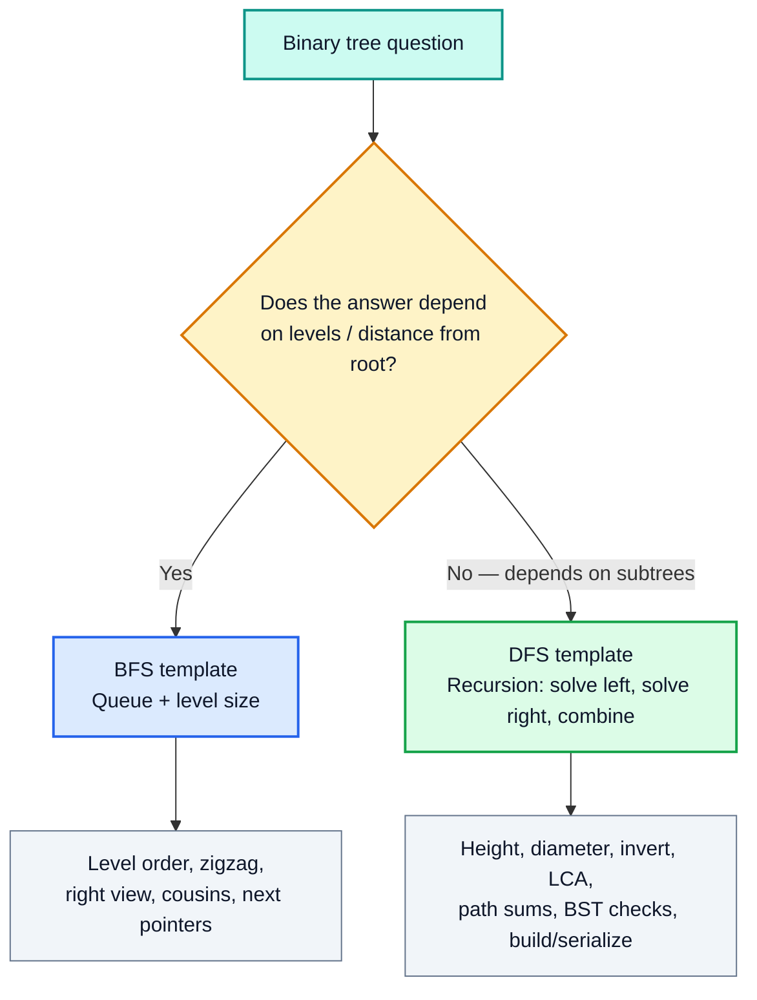

All code below uses the standard LeetCode node:

```java
public class TreeNode {
    int val;
    TreeNode left, right;
    TreeNode(int val) { this.val = val; }
}
```

> [!IMPORTANT]
> Before this video you should be comfortable with tree basics (videos on binary trees / BST / AVL / segment trees): node structure, height, and pre/in/post-order traversal. This video is about **applying** them.

---

## 1. Breadth First Search (BFS) (0:06:20)

### The Basics

**BFS** (level-order traversal) visits nodes **level by level, left to right**. Because the first node discovered must be the first one processed, it uses a **queue (FIFO)**.

Running example used throughout:

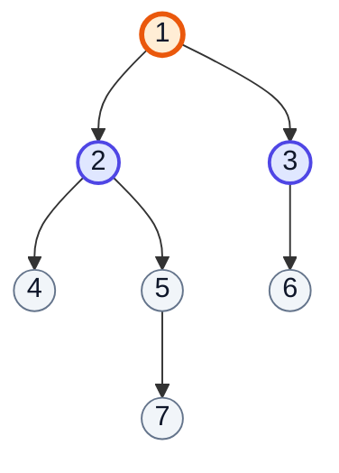

*(orange = node being processed, indigo = in the queue, grey = not discovered yet; 6 is the **right** child of 3, 7 the **left** child of 5)*

### The Algorithm

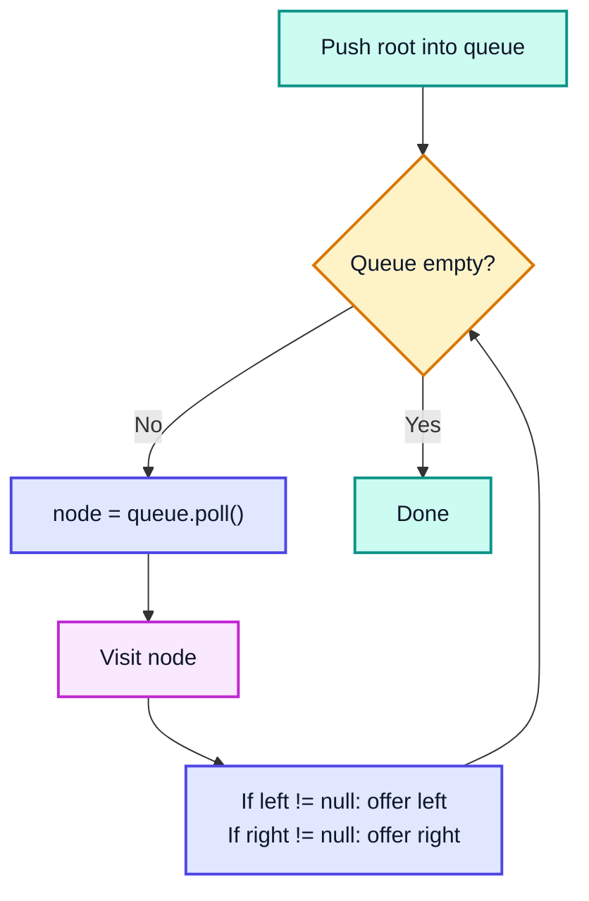

### The Key Trick: Freeze the Level Size

To know *where one level ends*, read `queue.size()` **before** the inner loop. At that moment the queue holds **exactly** the current level.

```java
Queue<TreeNode> q = new LinkedList<>();
q.offer(root);
while (!q.isEmpty()) {
    int levelSize = q.size();          // 🔒 frozen: nodes of THIS level only
    for (int i = 0; i < levelSize; i++) {
        TreeNode node = q.poll();
        // ... process node ...
        if (node.left != null)  q.offer(node.left);
        if (node.right != null) q.offer(node.right);
    }
    // ← a full level has just been processed
}
```

| Iteration | Queue before | levelSize | Polled (level) | Queue after |
|---|---|---|---|---|
| 1 | [1] | 1 | 🟧 1 | [2, 3] |
| 2 | [2, 3] | 2 | 🟧 2, 3 | [4, 5, 6] |
| 3 | [4, 5, 6] | 3 | 🟧 4, 5, 6 | [7] |
| 4 | [7] | 1 | 🟧 7 | [] |

### BFS vs DFS

| | **BFS** | **DFS** |
|---|---|---|
| Data structure | Queue | Recursion (call stack) or explicit Stack |
| Order | Level by level | Go deep first, then backtrack |
| Extra space | O(w) — max width (≈ n/2 for a full tree's last level) | O(h) — height (log n balanced, n skewed) |
| Best for | Levels, shortest distance from root, "closest" node | Subtree-based answers, paths, building/validating |

> [!TIP]
> In modern Java prefer `ArrayDeque` over `LinkedList` as a queue — it is faster and cache-friendlier. The one catch: `ArrayDeque` **rejects `null`**, so use `LinkedList` when you must enqueue null children (as in Q9).

---

## 2. Q1: Binary Tree Level Order Traversal (0:20:04)

**LeetCode 102.** Return node values grouped by level: `[[1], [2, 3], [4, 5, 6], [7]]`.

### Approach

Exactly the BFS template; create a new list for each level, fill it inside the inner loop, append it after.

```java
public List<List<Integer>> levelOrder(TreeNode root) {
    List<List<Integer>> result = new ArrayList<>();
    if (root == null) return result;

    Queue<TreeNode> queue = new LinkedList<>();
    queue.offer(root);

    while (!queue.isEmpty()) {
        int levelSize = queue.size();
        List<Integer> currentLevel = new ArrayList<>(levelSize);
        for (int i = 0; i < levelSize; i++) {
            TreeNode node = queue.poll();
            currentLevel.add(node.val);
            if (node.left != null)  queue.offer(node.left);
            if (node.right != null) queue.offer(node.right);
        }
        result.add(currentLevel);
    }
    return result;   // [[1], [2, 3], [4, 5, 6], [7]]
}
```

### Dry Run

| Level | levelSize | currentLevel | result after |
|---|---|---|---|
| 0 | 1 | [1] | [[1]] |
| 1 | 2 | [2, 3] | [[1], [2, 3]] |
| 2 | 3 | [4, 5, 6] | [[1], [2, 3], [4, 5, 6]] |
| 3 | 1 | [7] | [[1], [2, 3], [4, 5, 6], [7]] |

**Complexity:** Time **O(n)** (each node offered and polled once). Space **O(n)** for the output; the queue alone is O(w).

**Alternative — DFS with depth:** recurse with a `depth` argument; if `result.size() == depth` create a new list, then `result.get(depth).add(val)`. Same O(n), uses O(h) stack instead of O(w) queue.

```java
void dfs(TreeNode n, int depth, List<List<Integer>> res) {
    if (n == null) return;
    if (res.size() == depth) res.add(new ArrayList<>());
    res.get(depth).add(n.val);
    dfs(n.left, depth + 1, res);
    dfs(n.right, depth + 1, res);
}
```

---

## 3. Q2: Average of Levels in Binary Tree (0:28:01)

**LeetCode 637.** Return the average of each level: `[1.0, 2.5, 5.0, 7.0]`.

### Approach

Same template, but instead of storing values keep a running **sum** per level and divide by `levelSize`.

```java
public List<Double> averageOfLevels(TreeNode root) {
    List<Double> result = new ArrayList<>();
    if (root == null) return result;
    Queue<TreeNode> queue = new LinkedList<>();
    queue.offer(root);
    while (!queue.isEmpty()) {
        int levelSize = queue.size();
        long sum = 0;                                  // long: avoids int overflow
        for (int i = 0; i < levelSize; i++) {
            TreeNode node = queue.poll();
            sum += node.val;
            if (node.left != null)  queue.offer(node.left);
            if (node.right != null) queue.offer(node.right);
        }
        result.add((double) sum / levelSize);
    }
    return result;
}
```

| Level | Nodes | sum | levelSize | average |
|---|---|---|---|---|
| 0 | 1 | 1 | 1 | 1.0 |
| 1 | 2, 3 | 5 | 2 | 2.5 |
| 2 | 4, 5, 6 | 15 | 3 | 5.0 |
| 3 | 7 | 7 | 1 | 7.0 |

**Complexity:** O(n) time, O(w) extra space.

> [!WARNING]
> LeetCode's test cases include values near `Integer.MAX_VALUE`. Summing in an `int` (or `double` with an `int` cast too early) overflows — use `long` or `double` for the sum.

---

## 4. Q3: Level Order Successor of a Node (0:34:08)

**Not a LeetCode problem** (it is a GeeksforGeeks / "Grokking the Coding Interview" classic). Given a key, return the node that comes **right after it in level-order**. In our tree the successor of 5 is 6; the successor of 3 is 4 (the next level).

### Approach

Run a plain BFS (no level size needed). After polling a node and enqueuing its children, if it was the key, **stop** — the node now at the front of the queue is the answer.

```java
public TreeNode levelOrderSuccessor(TreeNode root, int key) {
    if (root == null) return null;
    Queue<TreeNode> queue = new LinkedList<>();
    queue.offer(root);
    while (!queue.isEmpty()) {
        TreeNode node = queue.poll();
        if (node.left != null)  queue.offer(node.left);
        if (node.right != null) queue.offer(node.right);
        if (node.val == key) break;          // children already enqueued ✅
    }
    return queue.peek();                     // null if key was last / not found
}
```

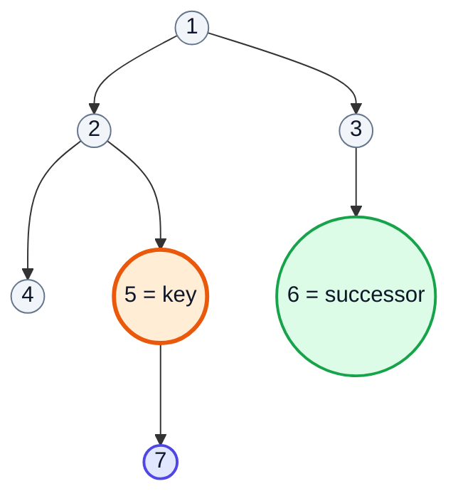

| Polled | Queue after enqueuing children | key? |
|---|---|---|
| 1 | [2, 3] | ❌ |
| 2 | [3, 4, 5] | ❌ |
| 3 | [4, 5, 6] | ❌ |
| 4 | [5, 6] | ❌ |
| 5 | [6, 7] | ✅ break → peek = **6** |

> [!IMPORTANT]
> The order "enqueue children **then** check key" matters: if the key is the last node of a level, its successor is the first node of the next level, which might be the key's **own** child (e.g. a single-chain tree).

**Complexity:** O(n) time, O(w) space.

---

## 5. Q4: Binary Tree Zigzag Level Order Traversal (0:42:10)

**LeetCode 103.** Alternate direction per level: `[[1], [3, 2], [4, 5, 6], [7]]`.

### Approach 1 (the video's): Deque, alternating ends

Use a **Deque** (double-ended queue):
- **Left → right levels:** poll from the **front**, add children (left, then right) to the **back**.
- **Right → left levels:** poll from the **back**, add children (right, then left) to the **front**.

```java
public List<List<Integer>> zigzagLevelOrder(TreeNode root) {
    List<List<Integer>> result = new ArrayList<>();
    if (root == null) return result;
    Deque<TreeNode> dq = new ArrayDeque<>();
    dq.offerLast(root);
    boolean leftToRight = true;

    while (!dq.isEmpty()) {
        int levelSize = dq.size();
        List<Integer> level = new ArrayList<>(levelSize);
        for (int i = 0; i < levelSize; i++) {
            if (leftToRight) {
                TreeNode n = dq.pollFirst();
                level.add(n.val);
                if (n.left != null)  dq.offerLast(n.left);
                if (n.right != null) dq.offerLast(n.right);
            } else {
                TreeNode n = dq.pollLast();
                level.add(n.val);
                if (n.right != null) dq.offerFirst(n.right);
                if (n.left != null)  dq.offerFirst(n.left);
            }
        }
        result.add(level);
        leftToRight = !leftToRight;
    }
    return result;
}
```

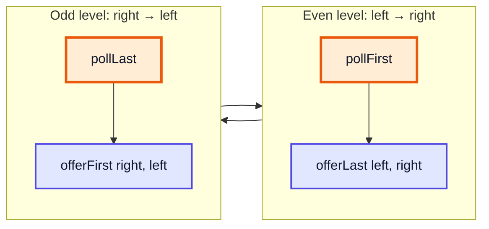

| Level | Direction | Deque before | Taken | Deque after |
|---|---|---|---|---|
| 0 | ➡️ | [1] | 1 (front) | [2, 3] |
| 1 | ⬅️ | [2, 3] | 3, then 2 (back) | [4, 5, 6] |
| 2 | ➡️ | [4, 5, 6] | 4, 5, 6 (front) | [7] |
| 3 | ⬅️ | [7] | 7 | [] |

### Approach 2: normal BFS + reverse / addFirst

Do regular BFS but insert into a `LinkedList` level with `addFirst` on odd levels (or `Collections.reverse`). Simpler to get right in an interview.

**Complexity:** both O(n) time, O(w) space.

---

## 6. Q5: Binary Tree Level Order Traversal II (0:54:11)

**LeetCode 107.** Levels **bottom-up**: `[[7], [4, 5, 6], [2, 3], [1]]`.

### Approach

Same as Q1, but insert each finished level at the **front**: `result.add(0, level)`. With a `LinkedList` result this is O(1); with an `ArrayList` it is O(levels) each, so either use `LinkedList` or call `Collections.reverse(result)` once at the end.

```java
public List<List<Integer>> levelOrderBottom(TreeNode root) {
    LinkedList<List<Integer>> result = new LinkedList<>();
    if (root == null) return result;
    Queue<TreeNode> q = new LinkedList<>();
    q.offer(root);
    while (!q.isEmpty()) {
        int size = q.size();
        List<Integer> level = new ArrayList<>(size);
        for (int i = 0; i < size; i++) {
            TreeNode n = q.poll();
            level.add(n.val);
            if (n.left != null)  q.offer(n.left);
            if (n.right != null) q.offer(n.right);
        }
        result.addFirst(level);           // ⬆️ newest level goes on top
    }
    return result;
}
```

> [!NOTE]
> Only the *order of levels* is reversed — values inside each level are still left → right.

**Complexity:** O(n) time, O(w) space.

---

## 7. Q6: Populating Next Right Pointers in Each Node (0:55:16)

**LeetCode 116** (perfect binary tree). Each node has an extra `next` pointer; point it to the node on its right in the same level, or `null` at the end.

```java
class Node {
    int val;
    Node left, right, next;
}
```

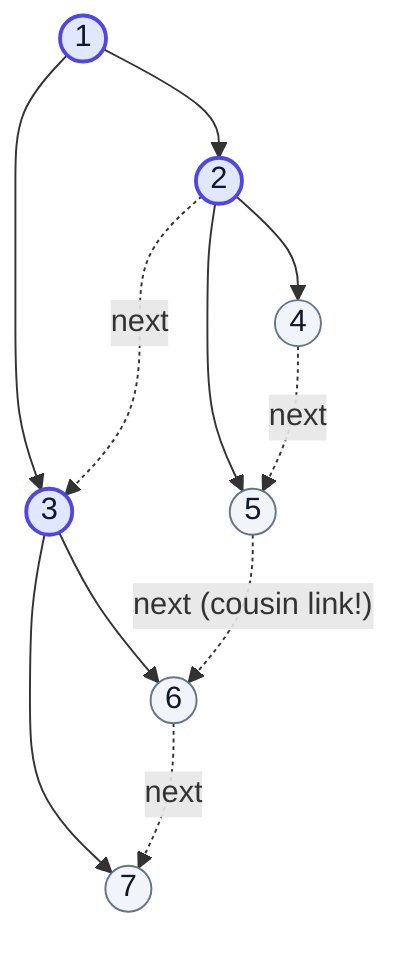

### Approach 1: BFS — O(n) time, O(w) space

Inside each level, link each polled node to `queue.peek()` unless it is the last one of the level.

```java
public Node connectBFS(Node root) {
    if (root == null) return null;
    Queue<Node> q = new LinkedList<>();
    q.offer(root);
    while (!q.isEmpty()) {
        int size = q.size();
        for (int i = 0; i < size; i++) {
            Node n = q.poll();
            if (i < size - 1) n.next = q.peek();
            if (n.left != null)  q.offer(n.left);
            if (n.right != null) q.offer(n.right);
        }
    }
    return root;
}
```

### Approach 2 (the video's optimal): use the level above — O(1) space

Since the tree is **perfect**, once level *k* is linked, it acts like a linked list we can walk to wire level *k+1*:
1. `cur.left.next = cur.right` (siblings)
2. `cur.right.next = cur.next.left` (cousins), if `cur.next != null`

```java
public Node connect(Node root) {
    if (root == null) return null;
    Node leftMost = root;
    while (leftMost.left != null) {             // there is a next level
        Node cur = leftMost;
        while (cur != null) {                    // walk this level via next
            cur.left.next = cur.right;
            if (cur.next != null) cur.right.next = cur.next.left;
            cur = cur.next;
        }
        leftMost = leftMost.left;                // drop one level
    }
    return root;
}
```

| leftMost | cur | Links created |
|---|---|---|
| 1 | 1 | 2→3 |
| 2 | 2 | 4→5, 5→6 |
| 2 | 3 | 6→7 |
| 4 | — | loop ends (4 has no children) |

**Complexity:** O(n) time, **O(1)** extra space.

> [!TIP]
> **LeetCode 117** (*Populating Next Right Pointers II*) removes the "perfect" guarantee. The O(1) trick still works with a **dummy head** node that collects the next level as you walk the current one.

---

## 8. Q7: Binary Tree Right Side View (1:11:13)

**LeetCode 199.** What you see standing on the right: the **last node of every level** → `[1, 3, 6, 7]`.

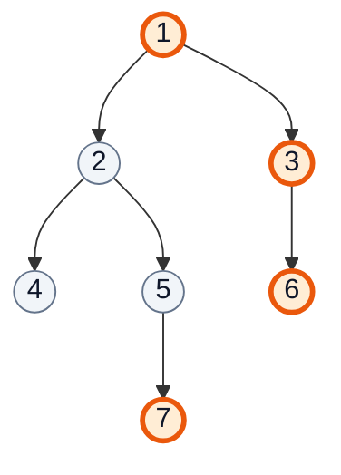

> [!CAUTION]
> The right view is **not** "keep going right". Node **7** is in the *left* subtree but is visible because nothing is to its right on level 3.

### Approach 1: BFS, record `i == levelSize - 1`

```java
public List<Integer> rightSideView(TreeNode root) {
    List<Integer> result = new ArrayList<>();
    if (root == null) return result;
    Queue<TreeNode> q = new LinkedList<>();
    q.offer(root);
    while (!q.isEmpty()) {
        int size = q.size();
        for (int i = 0; i < size; i++) {
            TreeNode n = q.poll();
            if (i == size - 1) result.add(n.val);   // last of the level
            if (n.left != null)  q.offer(n.left);
            if (n.right != null) q.offer(n.right);
        }
    }
    return result;
}
```

### Approach 2: DFS right-first

Visit **right before left**; the first node you reach at each new depth is the visible one.

```java
void dfs(TreeNode n, int depth, List<Integer> res) {
    if (n == null) return;
    if (depth == res.size()) res.add(n.val);    // first time at this depth
    dfs(n.right, depth + 1, res);
    dfs(n.left, depth + 1, res);
}
```

**Complexity:** both O(n) time; BFS O(w) space, DFS O(h) space. (Left side view = same with `i == 0` / left-first.)

---

## 9. Q8: Cousins in Binary Tree (1:14:52)

**LeetCode 993.** Two nodes are **cousins** if they are at the **same depth** but have **different parents**. In our tree: 4 & 6 → `true`; 4 & 5 → `false` (siblings); 2 & 6 → `false` (different depth).

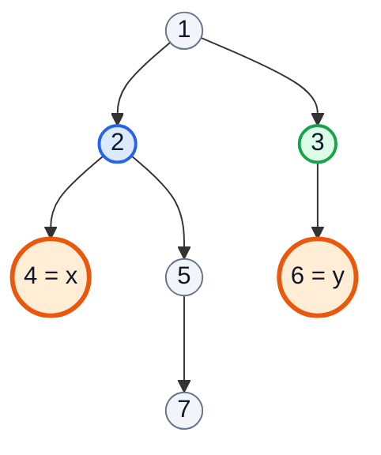

*(same level, parents 2 and 3 differ → cousins ✅)*

### Approach 1 (the video's): DFS helpers

`level(node, x)` finds depth, `isSibling(root, xNode, yNode)` checks whether any node has both as children. Answer = same level **and not** siblings. Clear but makes several passes.

```java
public boolean isCousins(TreeNode root, int x, int y) {
    TreeNode xx = findNode(root, x), yy = findNode(root, y);
    return level(root, xx, 0) == level(root, yy, 0) && !isSibling(root, xx, yy);
}
TreeNode findNode(TreeNode n, int x) {
    if (n == null) return null;
    if (n.val == x) return n;
    TreeNode l = findNode(n.left, x);
    return l != null ? l : findNode(n.right, x);
}
boolean isSibling(TreeNode n, TreeNode x, TreeNode y) {
    if (n == null) return false;
    return (n.left == x && n.right == y) || (n.left == y && n.right == x)
        || isSibling(n.left, x, y) || isSibling(n.right, x, y);
}
int level(TreeNode n, TreeNode x, int lev) {
    if (n == null) return 0;
    if (n == x) return lev;
    int l = level(n.left, x, lev + 1);
    return l != 0 ? l : level(n.right, x, lev + 1);
}
```

### Approach 2: single BFS pass

Per level, track `foundX` / `foundY`; while polling a parent, reject if its two children are exactly x and y.

```java
public boolean isCousinsBFS(TreeNode root, int x, int y) {
    Queue<TreeNode> q = new LinkedList<>();
    q.offer(root);
    while (!q.isEmpty()) {
        int size = q.size();
        boolean foundX = false, foundY = false;
        for (int i = 0; i < size; i++) {
            TreeNode n = q.poll();
            if (n.val == x) foundX = true;
            if (n.val == y) foundY = true;
            if (n.left != null && n.right != null) {
                int l = n.left.val, r = n.right.val;
                if ((l == x && r == y) || (l == y && r == x)) return false;  // siblings ❌
            }
            if (n.left != null)  q.offer(n.left);
            if (n.right != null) q.offer(n.right);
        }
        if (foundX && foundY) return true;      // same level, not siblings ✅
        if (foundX || foundY) return false;     // only one at this level ❌
    }
    return false;
}
```

| Level | Nodes | Sibling check | foundX (4) | foundY (6) | Verdict |
|---|---|---|---|---|---|
| 0 | 1 | children 2,3 — no | ❌ | ❌ | continue |
| 1 | 2, 3 | 2 → (4,5) no; 3 has one child | ❌ | ❌ | continue |
| 2 | 4, 5, 6 | — | ✅ | ✅ | **true** |

**Complexity:** O(n) time, O(w) space (BFS) / O(h) (DFS, but several passes).

---

## 10. Q9: Symmetric Tree (1:28:06)

**LeetCode 101.** Is the tree a mirror image of itself? `[1, 2, 2, 3, 4, 4, 3]` → `true`.

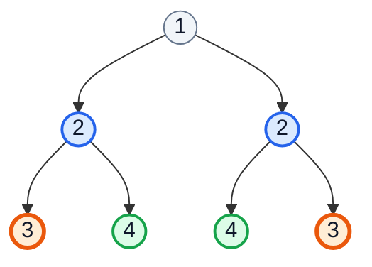

*(same colour = pair that must match: outer with outer, inner with inner)*

### Approach 1 (the video's): BFS on pairs

Enqueue `root.left` and `root.right` as a **pair**. Each step polls two nodes; they must both be null, or both non-null with equal values. Then enqueue the mirrored pairs: `(left.left, right.right)` and `(left.right, right.left)`.

```java
public boolean isSymmetric(TreeNode root) {
    Queue<TreeNode> q = new LinkedList<>();   // LinkedList: allows null ✅
    q.offer(root.left);
    q.offer(root.right);
    while (!q.isEmpty()) {
        TreeNode left = q.poll(), right = q.poll();
        if (left == null && right == null) continue;
        if (left == null || right == null) return false;
        if (left.val != right.val) return false;
        q.offer(left.left);   q.offer(right.right);    // outer pair
        q.offer(left.right);  q.offer(right.left);     // inner pair
    }
    return true;
}
```

| Pair polled | Equal? | Pairs enqueued |
|---|---|---|
| (2, 2) | ✅ | (3, 3), (4, 4) |
| (3, 3) | ✅ | (null, null) ×2 |
| (4, 4) | ✅ | (null, null) ×2 |
| (null, null) ×4 | skip | — → **true** |

### Approach 2: recursive mirror check

```java
boolean isMirror(TreeNode a, TreeNode b) {
    if (a == null || b == null) return a == b;
    return a.val == b.val && isMirror(a.left, b.right) && isMirror(a.right, b.left);
}
```

**Complexity:** O(n) time; O(w) space (BFS) or O(h) (recursion).

> [!WARNING]
> `ArrayDeque.offer(null)` throws `NullPointerException`. This is the one place where `LinkedList` as a queue is the right choice.

---

## 11. Depth First Search (DFS) (1:42:45)

### The Basics

**DFS** goes as deep as possible down one branch before backtracking. With recursion the **call stack** does the bookkeeping for you. The three classic orders differ only in *when* you visit the node relative to its children:

| Order | Sequence | Our tree | Typical use |
|---|---|---|---|
| **Preorder** | Node → Left → Right | 1 2 4 5 7 3 6 | Copy / serialize a tree, root-first decisions |
| **Inorder** | Left → Node → Right | 4 2 7 5 1 3 6 | **Sorted order for a BST**, kth smallest, validate BST |
| **Postorder** | Left → Right → Node | 4 7 5 2 6 3 1 | Answers that need children first: height, diameter, delete tree |

```java
void preorder(TreeNode n)  { if (n == null) return; visit(n); preorder(n.left);  preorder(n.right); }
void inorder(TreeNode n)   { if (n == null) return; inorder(n.left);  visit(n);   inorder(n.right); }
void postorder(TreeNode n) { if (n == null) return; postorder(n.left); postorder(n.right); visit(n); }
```

### The DFS "Think in Subtrees" Recipe

Most DFS questions follow one pattern: **trust the recursion** to solve both subtrees, then **combine** at the current node.

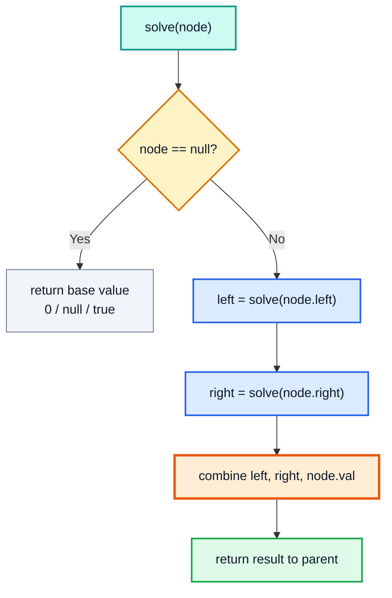

### When to Choose DFS over BFS

| Clue in the question | Pick |
|---|---|
| "level", "row", "nearest to root", "minimum depth" | BFS |
| "path", "subtree", "height", "ancestor", "BST property" | DFS |
| "rebuild / serialize the tree" | DFS (preorder) |
| Very wide tree, memory tight | DFS (O(h)) |
| Very deep / skewed tree (100k nodes) | BFS or iterative DFS — recursion may throw `StackOverflowError` |

> [!CAUTION]
> Java's default thread stack handles roughly 10k–20k nested calls for simple methods. A skewed tree with 10⁵ nodes can overflow it. For such inputs use an iterative DFS (section 28) or BFS.

---

## 12. Q10: Diameter of Binary Tree (1:52:10)

**LeetCode 543.** The **diameter** is the number of **edges** on the longest path between any two nodes. The path need **not** pass through the root.

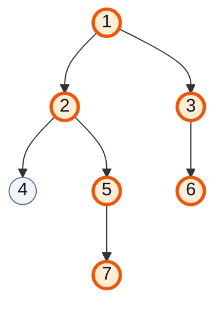

*(longest path 7 – 5 – 2 – 1 – 3 – 6 = **5 edges**)*

### Approach

The longest path that "bends" at node `n` has length `height(left) + height(right)` (in edges, if `height(null) = 0` and `height(leaf) = 1`). Compute height in **postorder**, and update a global maximum at each node as a side effect.

```java
class Solution {
    private int diameter = 0;

    public int diameterOfBinaryTree(TreeNode root) {
        height(root);
        return diameter;
    }

    private int height(TreeNode node) {
        if (node == null) return 0;
        int left = height(node.left);
        int right = height(node.right);
        diameter = Math.max(diameter, left + right);   // path bending here
        return 1 + Math.max(left, right);              // height for the parent
    }
}
```

### Dry Run (postorder)

| Node | left h | right h | left + right | diameter | returns h |
|---|---|---|---|---|---|
| 4 | 0 | 0 | 0 | 0 | 1 |
| 7 | 0 | 0 | 0 | 0 | 1 |
| 5 | 1 | 0 | 1 | 1 | 2 |
| 2 | 1 | 2 | 3 | 3 | 3 |
| 6 | 0 | 0 | 0 | 3 | 1 |
| 3 | 0 | 1 | 1 | 3 | 2 |
| 1 | 3 | 2 | **5** | **5** ✅ | 4 |

**Complexity:** O(n) time, O(h) space.

> [!WARNING]
> The naive version calls a separate `height()` for every node → **O(n²)** on skewed trees. Returning height *and* updating the diameter in the same pass is what makes it O(n). Also: the video's version may count **nodes** and subtract 1 at the end — both are fine, just be consistent about edges vs nodes.

---

## 13. Q11: Invert Binary Tree (2:08:08)

**LeetCode 226.** Mirror the tree: swap every node's left and right child. `[4, 2, 7, 1, 3, 6, 9]` → `[4, 7, 2, 9, 6, 3, 1]`.

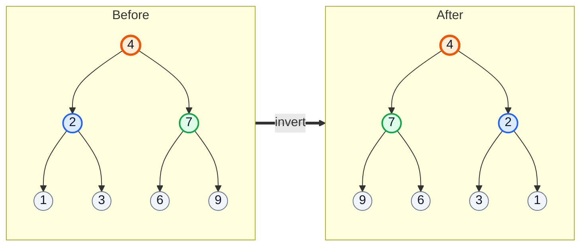

### Approach (postorder)

Invert the left subtree, invert the right subtree, then swap them.

```java
public TreeNode invertTree(TreeNode root) {
    if (root == null) return null;
    TreeNode left = invertTree(root.left);
    TreeNode right = invertTree(root.right);
    root.left = right;
    root.right = left;
    return root;
}
```

| Call order (post) | Swap at node | Result subtree |
|---|---|---|
| 1, 3 | leaves — nothing | — |
| 2 | (1, 3) → (3, 1) | 2[3, 1] |
| 6, 9 | leaves | — |
| 7 | (6, 9) → (9, 6) | 7[9, 6] |
| 4 | (2, 7) → (7, 2) | 4[7[9,6], 2[3,1]] ✅ |

**Complexity:** O(n) time, O(h) space. **Alternatives:** preorder (swap first, then recurse) works equally well; BFS swapping children of each polled node avoids recursion depth issues.

---

## 14. Q12: Maximum Depth of Binary Tree (2:24:01)

**LeetCode 104.** Number of **nodes** on the longest root-to-leaf path. Our tree → **4** (1 → 2 → 5 → 7).

```java
public int maxDepth(TreeNode root) {
    if (root == null) return 0;
    return 1 + Math.max(maxDepth(root.left), maxDepth(root.right));
}
```

| Node | maxDepth(left) | maxDepth(right) | returns |
|---|---|---|---|
| 7 | 0 | 0 | 1 |
| 5 | 1 | 0 | 2 |
| 4 | 0 | 0 | 1 |
| 2 | 1 | 2 | 3 |
| 6 | 0 | 0 | 1 |
| 3 | 0 | 1 | 2 |
| 1 | 3 | 2 | **4** |

**Complexity:** O(n) time, O(h) space. **Alternative:** BFS and count levels — O(w) space.

> [!NOTE]
> This is the same `height()` from Q10. Depth/height conventions differ between textbooks (counting nodes vs edges); LeetCode 104 counts **nodes**.

---

## 15. Q13: Convert Sorted Array to Binary Search Tree (2:27:07)

**LeetCode 108.** Build a **height-balanced** BST from a sorted array. `[1..7]` → root 4, level 2: 2, 6, level 3: 1, 3, 5, 7.

### Approach

The middle element must be the root (equal counts on each side → balanced). Recurse on the left half and the right half — this is binary search turned into a constructor.

```java
public TreeNode sortedArrayToBST(int[] nums) {
    return build(nums, 0, nums.length - 1);
}
private TreeNode build(int[] nums, int lo, int hi) {
    if (lo > hi) return null;
    int mid = lo + (hi - lo) / 2;          // overflow-safe midpoint
    TreeNode node = new TreeNode(nums[mid]);
    node.left = build(nums, lo, mid - 1);
    node.right = build(nums, mid + 1, hi);
    return node;
}
```

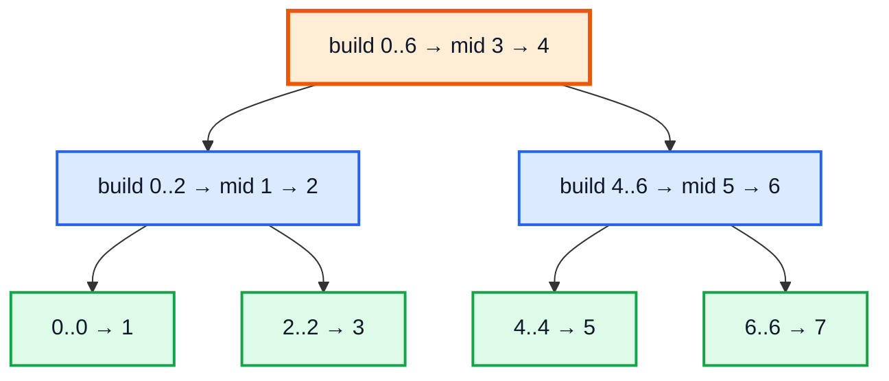

**Complexity:** O(n) time (each element becomes one node), O(log n) recursion depth.

---

## 16. Q14: Flatten Binary Tree to Linked List (2:28:05)

**LeetCode 114.** Flatten **in place** into a "linked list" using `right` pointers, in **preorder** order, with all `left` pointers `null`. `[1, 2, 5, 3, 4, null, 6]` → `1 → 2 → 3 → 4 → 5 → 6`.

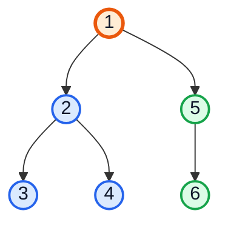

### Approach 1: preorder into a list, then relink — O(n) extra space (simple, but not "in place" in spirit).

### Approach 2 (the video's optimal): Morris-style rewiring — O(1) space

For the current node with a left subtree:
1. Find the **rightmost node of the left subtree** (preorder predecessor of `cur.right`).
2. Attach `cur.right` after it.
3. Move the left subtree to the right; set `left = null`.
4. Step to `cur.right`.

```java
public void flatten(TreeNode root) {
    TreeNode cur = root;
    while (cur != null) {
        if (cur.left != null) {
            TreeNode pre = cur.left;
            while (pre.right != null) pre = pre.right;  // rightmost of left subtree
            pre.right = cur.right;
            cur.right = cur.left;
            cur.left = null;
        }
        cur = cur.right;
    }
}
```

| cur | rightmost of left (`pre`) | Rewire | Chain so far |
|---|---|---|---|
| 1 | 4 | 4.right = 5; 1.right = 2 | 1 → 2 (2 still has left 3) |
| 2 | 3 | 3.right = 4; 2.right = 3 | 1 → 2 → 3 → 4 → 5 |
| 3 | — (no left) | — | |
| 4 | — | — | |
| 5 | — | — | 1 → 2 → 3 → 4 → 5 → 6 ✅ |

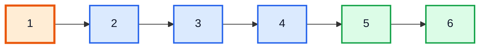

**Complexity:** O(n) time (each edge walked at most twice), **O(1)** space. **Alternative:** reverse-preorder recursion (right, left, node) with a `prev` pointer: `node.right = prev; node.left = null; prev = node;` — O(h) space.

---

## 17. Q15: Validate Binary Search Tree (2:27:54)

**LeetCode 98.** Every node must be **strictly greater** than everything in its left subtree and **strictly less** than everything in its right subtree.

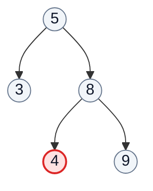

*(4 < 8 so it's fine locally, but 4 < 5 while sitting in 5's **right** subtree → invalid ❌)*

> [!CAUTION]
> Checking only `node.left.val < node.val < node.right.val` is the classic wrong answer. You must pass down a **range** `(low, high)` that every descendant has to respect.

### Approach 1 (the video's): range recursion

```java
public boolean isValidBST(TreeNode root) {
    return helper(root, null, null);
}
private boolean helper(TreeNode node, Integer low, Integer high) {
    if (node == null) return true;
    if (low != null && node.val <= low)   return false;
    if (high != null && node.val >= high) return false;
    return helper(node.left, low, node.val) && helper(node.right, node.val, high);
}
```

Using `Integer` with `null` meaning "unbounded" avoids the `Integer.MIN_VALUE` / `MAX_VALUE` edge case (LeetCode tests nodes equal to those values). `Long` bounds work too.

| Node | low | high | OK? |
|---|---|---|---|
| 5 | −∞ | +∞ | ✅ |
| 3 | −∞ | 5 | ✅ |
| 8 | 5 | +∞ | ✅ |
| 4 | **5** | 8 | ❌ 4 ≤ 5 → **false** |

### Approach 2: inorder must be strictly increasing

```java
private TreeNode prev = null;
public boolean isValidBSTInorder(TreeNode n) {
    if (n == null) return true;
    if (!isValidBSTInorder(n.left)) return false;
    if (prev != null && n.val <= prev.val) return false;
    prev = n;
    return isValidBSTInorder(n.right);
}
```

**Complexity:** both O(n) time, O(h) space.

---

## 18. Q16: Lowest Common Ancestor of a Binary Tree (2:57:43)

**LeetCode 236.** The **LCA** of p and q is the deepest node that has both as descendants (a node is a descendant of itself). In our tree: LCA(4, 7) = **2**; LCA(5, 7) = **5**; LCA(4, 6) = **1**.

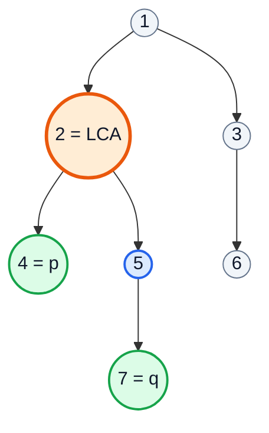

### Approach

Each call returns "p, q, the LCA, or null" for its subtree:
- If the node is null, p, or q → return it.
- Recurse left and right.
- **Both non-null** → p and q are split across this node → this node is the LCA.
- Otherwise bubble up whichever side is non-null.

```java
public TreeNode lowestCommonAncestor(TreeNode root, TreeNode p, TreeNode q) {
    if (root == null || root == p || root == q) return root;
    TreeNode left = lowestCommonAncestor(root.left, p, q);
    TreeNode right = lowestCommonAncestor(root.right, p, q);
    if (left != null && right != null) return root;   // split point 🎯
    return left != null ? left : right;
}
```

| Node | left returns | right returns | Node returns |
|---|---|---|---|
| 4 | — | — | 4 (is p) |
| 7 | — | — | 7 (is q) |
| 5 | 7 | null | 7 |
| 2 | 4 | 7 | **2** (both non-null) |
| 3 | null | null (6 → null) | null |
| 1 | 2 | null | **2** ✅ |

**Complexity:** O(n) time, O(h) space.

> [!TIP]
> For a **BST** (LeetCode 235) you don't need to search both sides: if both values are smaller go left, both larger go right, otherwise the current node is the LCA — O(h).

---

## 19. Q17: Kth Smallest Element in a BST (3:08:44)

**LeetCode 230.** Inorder traversal of a BST yields values in **sorted order**, so the k-th node visited in inorder is the answer. BST from `[1..7]`, k = 3 → **3**.

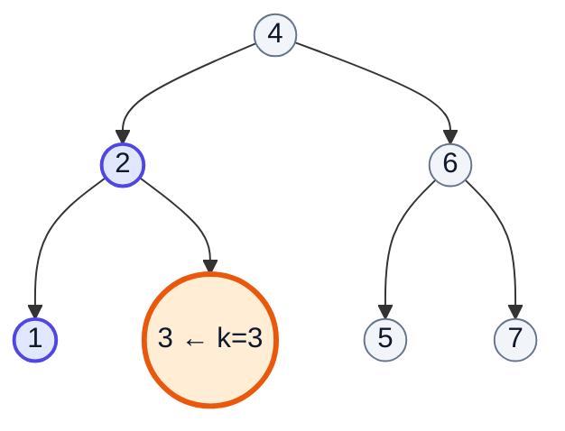

### Approach: inorder with a counter and early exit

```java
class Solution {
    private int count = 0;

    public int kthSmallest(TreeNode root, int k) {
        return helper(root, k).val;
    }

    private TreeNode helper(TreeNode node, int k) {
        if (node == null) return null;
        TreeNode left = helper(node.left, k);
        if (left != null) return left;        // already found — stop
        count++;
        if (count == k) return node;
        return helper(node.right, k);
    }
}
```

| Inorder visit | count | count == 3? |
|---|---|---|
| 1 | 1 | ❌ |
| 2 | 2 | ❌ |
| 3 | 3 | ✅ return 3 |

**Complexity:** O(h + k) time, O(h) space. **Alternatives:** collect the full inorder list (O(n) space); iterative inorder with a stack; for frequent queries on a changing BST, store **subtree sizes** in each node to answer in O(h).

---

## 20. Q18: Construct Binary Tree from Preorder and Inorder Traversal (3:18:28)

**LeetCode 105.** `preorder = [3, 9, 20, 15, 7]`, `inorder = [9, 3, 15, 20, 7]` → tree `[3, 9, 20, null, null, 15, 7]`.

### Key Insight

- **Preorder's first element is the root.**
- Finding that root in **inorder** splits it: everything to the left is the left subtree, everything to the right is the right subtree.
- The next preorder elements belong to the left subtree first, then the right.

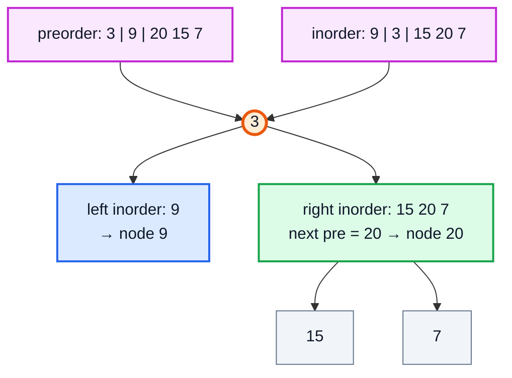

### Optimised Code (HashMap for inorder positions)

The video first slices arrays with `Arrays.copyOfRange` (O(n²) time and space). Using a moving preorder index and a value → index map brings it to O(n):

```java
class Solution {
    private int preIdx = 0;
    private Map<Integer, Integer> inPos = new HashMap<>();

    public TreeNode buildTree(int[] preorder, int[] inorder) {
        for (int i = 0; i < inorder.length; i++) inPos.put(inorder[i], i);
        return build(preorder, 0, inorder.length - 1);
    }

    private TreeNode build(int[] pre, int lo, int hi) {
        if (lo > hi) return null;
        TreeNode root = new TreeNode(pre[preIdx++]);
        int mid = inPos.get(root.val);
        root.left = build(pre, lo, mid - 1);      // left MUST be built first
        root.right = build(pre, mid + 1, hi);
        return root;
    }
}
```

| preIdx | Root | inorder range | split at | Left range | Right range |
|---|---|---|---|---|---|
| 0 | 3 | 0..4 | 1 | 0..0 | 2..4 |
| 1 | 9 | 0..0 | 0 | ∅ | ∅ |
| 2 | 20 | 2..4 | 3 | 2..2 | 4..4 |
| 3 | 15 | 2..2 | 2 | ∅ | ∅ |
| 4 | 7 | 4..4 | 4 | ∅ | ∅ |

**Complexity:** O(n) time, O(n) space (map + recursion).

> [!WARNING]
> This relies on **unique** values (stated in LeetCode 105). With duplicates the inorder position is ambiguous and the tree is not uniquely determined.

---

## 21. Q19: Serialize and Deserialize Binary Tree (3:31:20)

**LeetCode 297 (Hard).** Convert a tree to a string and back to the **same** structure.

### Approach: preorder with null markers

Preorder alone is ambiguous, but preorder **plus explicit null markers** uniquely describes a tree. Our tree serializes to:

```
1,2,4,#,#,5,7,#,#,#,3,#,6,#,#,
```

```java
public class Codec {
    public String serialize(TreeNode root) {
        StringBuilder sb = new StringBuilder();
        ser(root, sb);
        return sb.toString();
    }
    private void ser(TreeNode n, StringBuilder sb) {
        if (n == null) { sb.append("#,"); return; }
        sb.append(n.val).append(',');
        ser(n.left, sb);
        ser(n.right, sb);
    }

    public TreeNode deserialize(String data) {
        Deque<String> tokens = new ArrayDeque<>(Arrays.asList(data.split(",")));
        return des(tokens);
    }
    private TreeNode des(Deque<String> t) {
        String v = t.poll();
        if (v.equals("#")) return null;
        TreeNode n = new TreeNode(Integer.parseInt(v));
        n.left = des(t);      // consumes exactly the left subtree's tokens
        n.right = des(t);
        return n;
    }
}
```

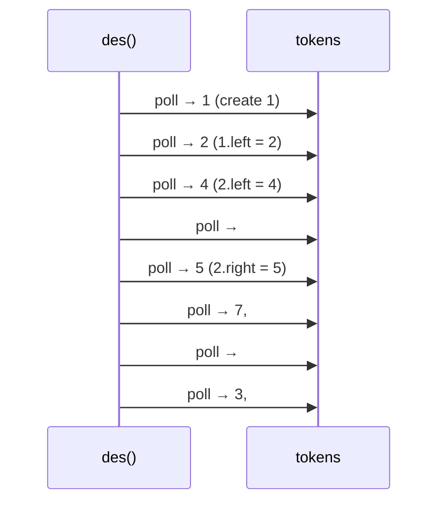

**Complexity:** O(n) time and space for both directions.

> [!TIP]
> `"a,b,".split(",")` drops the trailing empty string, so the trailing comma is harmless. An alternative format is **BFS with nulls** (LeetCode's own `[1,2,3,null,...]` style) — equally valid. Avoid `String +=` in a loop; `StringBuilder` keeps serialization linear.

---

## 22. Q20: Path Sum (3:48:54)

**LeetCode 112.** Is there a **root-to-leaf** path whose values add up to `targetSum`? Our tree, target 15 → `true` (1 + 2 + 5 + 7).

```mermaid
flowchart TD
    n1(("1")):::highlight --> n2(("2")):::highlight
    n1 --> n3(("3")):::muted
    n2 --> n4(("4")):::muted
    n2 --> n5(("5")):::highlight
    n3 --> n6(("6")):::muted
    n5 --> n7(("7 leaf")):::good
    classDef highlight fill:#ffedd5,stroke:#ea580c,stroke-width:3px,color:#0f172a
    classDef good fill:#dcfce7,stroke:#16a34a,stroke-width:2px,color:#0f172a
    classDef muted fill:#f1f5f9,stroke:#64748b,stroke-width:1px,color:#0f172a
```

### Approach

Subtract the current value from the target while going down; at a **leaf**, check whether what remains equals the leaf's value.

```java
public boolean hasPathSum(TreeNode root, int targetSum) {
    if (root == null) return false;
    if (root.left == null && root.right == null) return targetSum == root.val;
    int rest = targetSum - root.val;
    return hasPathSum(root.left, rest) || hasPathSum(root.right, rest);
}
```

| Node | target received | Leaf? | Result |
|---|---|---|---|
| 1 | 15 | ❌ | try children with 14 |
| 2 | 14 | ❌ | children with 12 |
| 4 | 12 | ✅ | 12 ≠ 4 ❌ |
| 5 | 12 | ❌ | children with 7 |
| 7 | 7 | ✅ | 7 == 7 ✅ → **true** (short-circuits, 3 and 6 never visited) |

**Complexity:** O(n) time, O(h) space.

> [!CAUTION]
> Checking `targetSum == 0` at `null` instead of at a leaf is a bug: a node with **one** child would count its empty side as a "leaf" path.

---

## 23. Q21: Sum Root to Leaf Numbers (3:55:56)

**LeetCode 129.** Each root-to-leaf path spells a number (digits 0–9). Return the sum. Our tree: 124 + 1257 + 136 = **1517**.

### Approach

Carry the number built so far: `soFar = soFar * 10 + node.val`. At a leaf, return it; otherwise return the sum of both sides.

```java
public int sumNumbers(TreeNode root) {
    return dfs(root, 0);
}
private int dfs(TreeNode node, int soFar) {
    if (node == null) return 0;
    soFar = soFar * 10 + node.val;
    if (node.left == null && node.right == null) return soFar;
    return dfs(node.left, soFar) + dfs(node.right, soFar);
}
```

| Path | soFar evolution | Leaf value |
|---|---|---|
| 1 → 2 → 4 | 1 → 12 → 124 | 124 |
| 1 → 2 → 5 → 7 | 1 → 12 → 125 → 1257 | 1257 |
| 1 → 3 → 6 | 1 → 13 → 136 | 136 |
| | **Total** | **1517** |

**Complexity:** O(n) time, O(h) space. Because `soFar` is a primitive passed by value, there is nothing to "undo" when backtracking.

---

## 24. Q22: Binary Tree Maximum Path Sum (4:05:11)

**LeetCode 124 (Hard).** A path is any sequence of connected nodes (each used once, need not pass through the root). Values can be **negative**. `[-10, 9, 20, null, null, 15, 7]` → **42** (15 + 20 + 7).

```mermaid
flowchart TD
    a(("-10")):::bad --> b(("9")):::muted
    a --> c(("20")):::highlight
    c --> d(("15")):::highlight
    c --> e(("7")):::highlight
    classDef highlight fill:#ffedd5,stroke:#ea580c,stroke-width:3px,color:#0f172a
    classDef bad fill:#fee2e2,stroke:#dc2626,stroke-width:2px,color:#0f172a
    classDef muted fill:#f1f5f9,stroke:#64748b,stroke-width:1px,color:#0f172a
```

### Approach (same shape as Diameter)

At each node compute two different things:
1. **Path bending here** (can use both sides): `val + leftGain + rightGain` → update global `best`.
2. **Gain returned to parent** (can use only **one** side, since a path cannot fork): `val + max(leftGain, rightGain)`.

Clamp gains at 0 — a negative branch is better dropped.

```java
class Solution {
    private int best = Integer.MIN_VALUE;

    public int maxPathSum(TreeNode root) {
        gain(root);
        return best;
    }

    private int gain(TreeNode node) {
        if (node == null) return 0;
        int left = Math.max(0, gain(node.left));
        int right = Math.max(0, gain(node.right));
        best = Math.max(best, node.val + left + right);
        return node.val + Math.max(left, right);
    }
}
```

| Node | left gain | right gain | bend sum | best | returns |
|---|---|---|---|---|---|
| 9 | 0 | 0 | 9 | 9 | 9 |
| 15 | 0 | 0 | 15 | 15 | 15 |
| 7 | 0 | 0 | 7 | 15 | 7 |
| 20 | 15 | 7 | **42** | **42** | 35 |
| -10 | 9 | 35 | 34 | 42 | 25 |

**Complexity:** O(n) time, O(h) space.

> [!IMPORTANT]
> Initialise `best` to `Integer.MIN_VALUE`, not 0 — for an all-negative tree like `[-3]` the answer is −3.

---

## 25. Q23: Path Exists in Binary Tree from Root to Leaf (4:19:50)

Given an array, is it exactly the values of some **root-to-leaf** path? This is **LeetCode 1430** (*Check If a String Is a Valid Sequence from Root to Leaves Path in a Binary Tree*, Premium). Our tree, `[1, 2, 5, 7]` → `true`; `[1, 2, 5]` → `false` (5 is not a leaf).

```java
public boolean isValidSequence(TreeNode root, int[] arr) {
    return check(root, arr, 0);
}
private boolean check(TreeNode node, int[] arr, int i) {
    if (node == null || i >= arr.length || node.val != arr[i]) return false;
    if (node.left == null && node.right == null) return i == arr.length - 1;
    return check(node.left, arr, i + 1) || check(node.right, arr, i + 1);
}
```

| Node | i | arr[i] | Match? | Leaf? | Action |
|---|---|---|---|---|---|
| 1 | 0 | 1 | ✅ | ❌ | go to children, i = 1 |
| 2 | 1 | 2 | ✅ | ❌ | children, i = 2 |
| 4 | 2 | 5 | ❌ | | false |
| 5 | 2 | 5 | ✅ | ❌ | children, i = 3 |
| 7 | 3 | 7 | ✅ | ✅ | i == 3 == length − 1 → **true** |

**Complexity:** O(n) worst case, O(h) space — and the mismatch check prunes most branches early.

---

## 26. Q24: Path Exists in Binary Tree at Any Nodes (4:26:24)

Count (or print) **downward** paths that may **start and end at any node** and sum to a target. This is **LeetCode 437 (Path Sum III)**. Our tree, target 7 → **3** paths: `[7]`, `[2, 5]`, `[1, 2, 4]`.

### Approach 1 (the video's): keep the current root-to-node path, look backwards

Maintain the path from the root to the current node in a list. At each node, walk the list **backwards** summing values — every suffix is a downward path ending here. Then recurse and **backtrack** (remove the node) on the way out.

```java
public int countPaths(TreeNode node, int target, List<Integer> path) {
    if (node == null) return 0;
    path.add(node.val);
    int count = 0, sum = 0;
    for (int i = path.size() - 1; i >= 0; i--) {   // all paths ending at node
        sum += path.get(i);
        if (sum == target) count++;
    }
    count += countPaths(node.left, target, path) + countPaths(node.right, target, path);
    path.remove(path.size() - 1);                   // ↩️ backtrack
    return count;
}
```

```mermaid
flowchart TD
    p1["path = 1"]:::muted --> p2["path = 1, 2"]:::muted
    p2 --> p4["path = 1, 2, 4<br/>suffix 1+2+4 = 7 ✅"]:::good
    p2 --> p5["path = 1, 2, 5<br/>suffix 2+5 = 7 ✅"]:::good
    p5 --> p7["path = 1, 2, 5, 7<br/>suffix 7 = 7 ✅"]:::good
    p1 --> p3["path = 1, 3"]:::muted
    p3 --> p6["path = 1, 3, 6"]:::bad
    classDef good fill:#dcfce7,stroke:#16a34a,stroke-width:2px,color:#0f172a
    classDef bad fill:#fee2e2,stroke:#dc2626,stroke-width:2px,color:#0f172a
    classDef muted fill:#f1f5f9,stroke:#64748b,stroke-width:1px,color:#0f172a
```

To **print** the paths instead of counting them, copy `path.subList(i, path.size())` whenever the suffix sum matches.

**Complexity:** O(n · h) time (O(n log n) balanced, O(n²) skewed), O(h) space.

### Approach 2 (optimal): prefix sums + HashMap — O(n)

A downward path from `a` to `b` sums to `prefix(b) − prefix(parent(a))`. Keep a map of prefix sums **on the current root path**; at each node, add `map.get(curr − target)` to the answer.

```java
public int pathSum(TreeNode root, int target) {
    Map<Long, Integer> prefix = new HashMap<>();
    prefix.put(0L, 1);                       // empty prefix
    return dfs(root, 0L, target, prefix);
}
private int dfs(TreeNode n, long curr, int target, Map<Long, Integer> prefix) {
    if (n == null) return 0;
    curr += n.val;
    int count = prefix.getOrDefault(curr - target, 0);
    prefix.merge(curr, 1, Integer::sum);
    count += dfs(n.left, curr, target, prefix) + dfs(n.right, curr, target, prefix);
    prefix.merge(curr, -1, Integer::sum);    // backtrack
    return count;
}
```

| | Approach 1 (path list) | Approach 2 (prefix map) |
|---|---|---|
| Time | O(n·h) | **O(n)** |
| Space | O(h) | O(h) |
| Prints actual paths easily | ✅ | ❌ (needs extra work) |

---

## 27. Top 50 Tree Coding Problems on GeeksForGeeks (4:45:27)

The video points to GeeksforGeeks' curated **"Top 50 Tree Coding Problems for Interviews"** list as practice after this lecture. Use it (plus the LeetCode map at the top of this file) as a checklist.

Suggested way to work through such a list:

```mermaid
flowchart LR
    a["Read problem"]:::io --> b{"Levels or subtrees?"}:::decision
    b -->|"Levels"| c["Start from BFS template"]:::stack
    b -->|"Subtrees / paths"| d["Start from DFS recipe"]:::heap
    c --> e["Dry-run on a 5–7 node tree"]:::process
    d --> e
    e --> f["State time and space"]:::good
    classDef io fill:#fae8ff,stroke:#c026d3,stroke-width:2px,color:#0f172a
    classDef decision fill:#fef3c7,stroke:#d97706,stroke-width:2px,color:#0f172a
    classDef stack fill:#dbeafe,stroke:#2563eb,stroke-width:2px,color:#0f172a
    classDef heap fill:#dcfce7,stroke:#16a34a,stroke-width:2px,color:#0f172a
    classDef process fill:#e0e7ff,stroke:#4f46e5,stroke-width:2px,color:#0f172a
    classDef good fill:#dcfce7,stroke:#16a34a,stroke-width:2px,color:#0f172a
```

| Pattern | Representative extra practice (LeetCode) |
|---|---|
| BFS by level | 111 Minimum Depth, 515 Largest Value in Each Row, 662 Maximum Width |
| Height-style postorder | 110 Balanced Binary Tree, 687 Longest Univalue Path |
| Two-tree recursion | 100 Same Tree, 572 Subtree of Another Tree, 617 Merge Two Trees |
| BST property | 235 LCA of BST, 450 Delete Node in BST, 173 BST Iterator |
| Paths + backtracking | 113 Path Sum II, 257 Binary Tree Paths, 863 All Nodes Distance K |

---

## 28. Depth First Search (DFS) using Stack (4:48:00)

Recursion uses the JVM call stack implicitly; you can do the same with an **explicit stack** to avoid `StackOverflowError` on deep trees. **LeetCode 144** (Preorder, iterative).

### Approach

Pop a node, visit it, push **right first, then left** — so left is popped (visited) first (LIFO).

```java
public List<Integer> preorderTraversal(TreeNode root) {
    List<Integer> result = new ArrayList<>();
    if (root == null) return result;
    Deque<TreeNode> stack = new ArrayDeque<>();   // modern replacement for java.util.Stack
    stack.push(root);
    while (!stack.isEmpty()) {
        TreeNode node = stack.pop();
        result.add(node.val);
        if (node.right != null) stack.push(node.right);
        if (node.left != null)  stack.push(node.left);
    }
    return result;   // [1, 2, 4, 5, 7, 3, 6]
}
```

| Pop | Visit order so far | Stack after pushes (top on the right) |
|---|---|---|
| 1 | 1 | [3, 2] |
| 2 | 1 2 | [3, 5, 4] |
| 4 | 1 2 4 | [3, 5] |
| 5 | 1 2 4 5 | [3, 7] |
| 7 | 1 2 4 5 7 | [3] |
| 3 | 1 2 4 5 7 3 | [6] |
| 6 | 1 2 4 5 7 3 6 | [] |

```mermaid
flowchart LR
    s["push root"]:::startend --> c{"stack empty?"}:::decision
    c -->|"No"| p["pop + visit"]:::highlight
    p --> r["push right"]:::stack
    r --> l["push left"]:::stack
    l --> c
    c -->|"Yes"| e["done"]:::startend
    classDef startend fill:#ccfbf1,stroke:#0d9488,stroke-width:2px,color:#0f172a
    classDef decision fill:#fef3c7,stroke:#d97706,stroke-width:2px,color:#0f172a
    classDef highlight fill:#ffedd5,stroke:#ea580c,stroke-width:3px,color:#0f172a
    classDef stack fill:#dbeafe,stroke:#2563eb,stroke-width:2px,color:#0f172a
```

### Iterative Inorder (bonus, LeetCode 94)

```java
Deque<TreeNode> st = new ArrayDeque<>();
TreeNode cur = root;
while (cur != null || !st.isEmpty()) {
    while (cur != null) { st.push(cur); cur = cur.left; }  // go far left
    cur = st.pop();
    result.add(cur.val);                                    // visit
    cur = cur.right;
}
```

> [!NOTE]
> The video may use `java.util.Stack`. It still works, but it extends the synchronized legacy `Vector`; the Java docs recommend `ArrayDeque` (via the `Deque` interface) for stacks in modern code.

---

## 29. Resources (4:56:28)

- **Lecture code:** the Replit linked in the video description (*TreeQuestions*).
- **Notes, code & assignments:** the `DSA-Bootcamp-Java` GitHub repository from the description.
- **Practice:** every LeetCode number in the map at the top of this file, then the GfG Top 50 list from section 27.

Next video (#56) covers **Heaps, Priority Queues and Heapsort**.

---

## 🧩 Complete Example: Everything Together

One program that builds trees from LeetCode-style arrays and runs a solution to **every** question in this video:

```java
import java.util.*;

public class TreeQuestions {

    static class TreeNode {
        int val;
        TreeNode left, right;
        TreeNode(int val) { this.val = val; }
    }

    // Build a tree from a LeetCode-style level-order array (null = missing child)
    static TreeNode build(Integer[] a) {
        if (a.length == 0 || a[0] == null) return null;
        TreeNode root = new TreeNode(a[0]);
        Queue<TreeNode> q = new LinkedList<>();
        q.offer(root);
        int i = 1;
        while (!q.isEmpty() && i < a.length) {
            TreeNode cur = q.poll();
            if (i < a.length && a[i] != null) { cur.left = new TreeNode(a[i]); q.offer(cur.left); }
            i++;
            if (i < a.length && a[i] != null) { cur.right = new TreeNode(a[i]); q.offer(cur.right); }
            i++;
        }
        return root;
    }

    // ═══════ BFS questions ═══════
    static List<List<Integer>> levelOrder(TreeNode root) {             // LC 102
        List<List<Integer>> res = new ArrayList<>();
        if (root == null) return res;
        Queue<TreeNode> q = new LinkedList<>();
        q.offer(root);
        while (!q.isEmpty()) {
            int size = q.size();
            List<Integer> level = new ArrayList<>(size);
            for (int i = 0; i < size; i++) {
                TreeNode n = q.poll();
                level.add(n.val);
                if (n.left != null) q.offer(n.left);
                if (n.right != null) q.offer(n.right);
            }
            res.add(level);
        }
        return res;
    }

    static List<Double> averageOfLevels(TreeNode root) {             // LC 637
        List<Double> res = new ArrayList<>();
        for (List<Integer> level : levelOrder(root)) {
            long sum = 0;
            for (int v : level) sum += v;
            res.add((double) sum / level.size());
        }
        return res;
    }

    static TreeNode levelOrderSuccessor(TreeNode root, int key) {
        if (root == null) return null;
        Queue<TreeNode> q = new LinkedList<>();
        q.offer(root);
        while (!q.isEmpty()) {
            TreeNode n = q.poll();
            if (n.left != null) q.offer(n.left);
            if (n.right != null) q.offer(n.right);
            if (n.val == key) break;
        }
        return q.peek();
    }

    static List<List<Integer>> zigzag(TreeNode root) {               // LC 103
        List<List<Integer>> res = new ArrayList<>();
        if (root == null) return res;
        Deque<TreeNode> dq = new ArrayDeque<>();
        dq.offerLast(root);
        boolean leftToRight = true;
        while (!dq.isEmpty()) {
            int size = dq.size();
            List<Integer> level = new ArrayList<>();
            for (int i = 0; i < size; i++) {
                if (leftToRight) {
                    TreeNode n = dq.pollFirst();
                    level.add(n.val);
                    if (n.left != null) dq.offerLast(n.left);
                    if (n.right != null) dq.offerLast(n.right);
                } else {
                    TreeNode n = dq.pollLast();
                    level.add(n.val);
                    if (n.right != null) dq.offerFirst(n.right);
                    if (n.left != null) dq.offerFirst(n.left);
                }
            }
            leftToRight = !leftToRight;
            res.add(level);
        }
        return res;
    }

    static List<List<Integer>> levelOrderBottom(TreeNode root) {     // LC 107
        List<List<Integer>> res = levelOrder(root);
        Collections.reverse(res);
        return res;
    }

    static List<Integer> rightSideView(TreeNode root) {             // LC 199
        List<Integer> res = new ArrayList<>();
        for (List<Integer> level : levelOrder(root)) res.add(level.get(level.size() - 1));
        return res;
    }

    static boolean isCousins(TreeNode root, int x, int y) {          // LC 993
        Queue<TreeNode> q = new LinkedList<>();
        q.offer(root);
        while (!q.isEmpty()) {
            int size = q.size();
            boolean foundX = false, foundY = false;
            for (int i = 0; i < size; i++) {
                TreeNode n = q.poll();
                if (n.val == x) foundX = true;
                if (n.val == y) foundY = true;
                if (n.left != null && n.right != null) {
                    int l = n.left.val, r = n.right.val;
                    if ((l == x && r == y) || (l == y && r == x)) return false; // siblings
                }
                if (n.left != null) q.offer(n.left);
                if (n.right != null) q.offer(n.right);
            }
            if (foundX && foundY) return true;
            if (foundX || foundY) return false;
        }
        return false;
    }

    static boolean isSymmetric(TreeNode root) {                       // LC 101
        Queue<TreeNode> q = new LinkedList<>();
        q.offer(root.left);
        q.offer(root.right);
        while (!q.isEmpty()) {
            TreeNode a = q.poll(), b = q.poll();
            if (a == null && b == null) continue;
            if (a == null || b == null || a.val != b.val) return false;
            q.offer(a.left);  q.offer(b.right);
            q.offer(a.right); q.offer(b.left);
        }
        return true;
    }

    // ═══════ DFS questions ═══════
    static int diameter;
    static int diameterOfBinaryTree(TreeNode root) {                  // LC 543
        diameter = 0;
        height(root);
        return diameter;
    }
    static int height(TreeNode n) {
        if (n == null) return 0;
        int l = height(n.left), r = height(n.right);
        diameter = Math.max(diameter, l + r);       // edges through n
        return 1 + Math.max(l, r);
    }

    static TreeNode invert(TreeNode n) {                              // LC 226
        if (n == null) return null;
        TreeNode l = invert(n.left), r = invert(n.right);
        n.left = r;
        n.right = l;
        return n;
    }

    static int maxDepth(TreeNode n) {                                 // LC 104
        return n == null ? 0 : 1 + Math.max(maxDepth(n.left), maxDepth(n.right));
    }

    static TreeNode sortedArrayToBST(int[] a, int lo, int hi) {       // LC 108
        if (lo > hi) return null;
        int mid = lo + (hi - lo) / 2;
        TreeNode n = new TreeNode(a[mid]);
        n.left = sortedArrayToBST(a, lo, mid - 1);
        n.right = sortedArrayToBST(a, mid + 1, hi);
        return n;
    }

    static void flatten(TreeNode root) {                              // LC 114 (Morris-style, O(1) space)
        TreeNode cur = root;
        while (cur != null) {
            if (cur.left != null) {
                TreeNode pre = cur.left;
                while (pre.right != null) pre = pre.right;
                pre.right = cur.right;
                cur.right = cur.left;
                cur.left = null;
            }
            cur = cur.right;
        }
    }

    static boolean isValidBST(TreeNode n, Integer low, Integer high) { // LC 98
        if (n == null) return true;
        if (low != null && n.val <= low) return false;
        if (high != null && n.val >= high) return false;
        return isValidBST(n.left, low, n.val) && isValidBST(n.right, n.val, high);
    }

    static TreeNode lca(TreeNode n, int p, int q) {                   // LC 236
        if (n == null || n.val == p || n.val == q) return n;
        TreeNode l = lca(n.left, p, q), r = lca(n.right, p, q);
        if (l != null && r != null) return n;
        return l != null ? l : r;
    }

    static int count;
    static int kthSmallest(TreeNode root, int k) {                    // LC 230
        count = 0;
        return inorderKth(root, k).val;
    }
    static TreeNode inorderKth(TreeNode n, int k) {
        if (n == null) return null;
        TreeNode left = inorderKth(n.left, k);
        if (left != null) return left;
        count++;
        if (count == k) return n;
        return inorderKth(n.right, k);
    }

    static int preIdx;
    static TreeNode buildTree(int[] pre, int[] in) {                  // LC 105
        Map<Integer, Integer> pos = new HashMap<>();
        for (int i = 0; i < in.length; i++) pos.put(in[i], i);
        preIdx = 0;
        return buildHelper(pre, pos, 0, in.length - 1);
    }
    static TreeNode buildHelper(int[] pre, Map<Integer, Integer> pos, int lo, int hi) {
        if (lo > hi) return null;
        TreeNode n = new TreeNode(pre[preIdx++]);
        int m = pos.get(n.val);
        n.left = buildHelper(pre, pos, lo, m - 1);
        n.right = buildHelper(pre, pos, m + 1, hi);
        return n;
    }

    static String serialize(TreeNode n) {                             // LC 297
        StringBuilder sb = new StringBuilder();
        ser(n, sb);
        return sb.toString();
    }
    static void ser(TreeNode n, StringBuilder sb) {
        if (n == null) { sb.append("#,"); return; }
        sb.append(n.val).append(',');
        ser(n.left, sb);
        ser(n.right, sb);
    }
    static TreeNode deserialize(String s) {
        Deque<String> tokens = new ArrayDeque<>(Arrays.asList(s.split(",")));
        return des(tokens);
    }
    static TreeNode des(Deque<String> t) {
        String v = t.poll();
        if (v.equals("#")) return null;
        TreeNode n = new TreeNode(Integer.parseInt(v));
        n.left = des(t);
        n.right = des(t);
        return n;
    }

    static boolean hasPathSum(TreeNode n, int target) {               // LC 112
        if (n == null) return false;
        if (n.left == null && n.right == null) return target == n.val;
        return hasPathSum(n.left, target - n.val) || hasPathSum(n.right, target - n.val);
    }

    static int sumNumbers(TreeNode n, int soFar) {                    // LC 129
        if (n == null) return 0;
        soFar = soFar * 10 + n.val;
        if (n.left == null && n.right == null) return soFar;
        return sumNumbers(n.left, soFar) + sumNumbers(n.right, soFar);
    }

    static int best;
    static int maxPathSum(TreeNode root) {                            // LC 124
        best = Integer.MIN_VALUE;
        gain(root);
        return best;
    }
    static int gain(TreeNode n) {
        if (n == null) return 0;
        int l = Math.max(0, gain(n.left)), r = Math.max(0, gain(n.right));
        best = Math.max(best, n.val + l + r);
        return n.val + Math.max(l, r);
    }

    static boolean isValidSequence(TreeNode n, int[] arr, int i) {   // LC 1430
        if (n == null || i >= arr.length || n.val != arr[i]) return false;
        if (n.left == null && n.right == null) return i == arr.length - 1;
        return isValidSequence(n.left, arr, i + 1) || isValidSequence(n.right, arr, i + 1);
    }

    static int countPaths(TreeNode n, int target, List<Integer> path) { // LC 437 (brute force)
        if (n == null) return 0;
        path.add(n.val);
        int c = 0, sum = 0;
        for (int i = path.size() - 1; i >= 0; i--) {   // every path ending at n
            sum += path.get(i);
            if (sum == target) c++;
        }
        c += countPaths(n.left, target, path) + countPaths(n.right, target, path);
        path.remove(path.size() - 1);                   // backtrack
        return c;
    }

    static List<Integer> preorderIterative(TreeNode root) {          // LC 144
        List<Integer> res = new ArrayList<>();
        Deque<TreeNode> st = new ArrayDeque<>();
        if (root != null) st.push(root);
        while (!st.isEmpty()) {
            TreeNode n = st.pop();
            res.add(n.val);
            if (n.right != null) st.push(n.right);   // right first so left is popped first
            if (n.left != null) st.push(n.left);
        }
        return res;
    }

    public static void main(String[] args) {
        //        1
        //      /   \
        //     2     3
        //    / \     \
        //   4   5     6
        //      /
        //     7
        TreeNode root = build(new Integer[]{1, 2, 3, 4, 5, null, 6, null, null, 7});

        System.out.println("Level order      : " + levelOrder(root));
        System.out.println("Averages         : " + averageOfLevels(root));
        System.out.println("Successor of 5   : " + levelOrderSuccessor(root, 5).val);
        System.out.println("Zigzag           : " + zigzag(root));
        System.out.println("Bottom-up        : " + levelOrderBottom(root));
        System.out.println("Right side view  : " + rightSideView(root));
        System.out.println("Cousins 4 & 6?   : " + isCousins(root, 4, 6));
        System.out.println("Cousins 4 & 5?   : " + isCousins(root, 4, 5));
        System.out.println("Symmetric?       : " + isSymmetric(build(new Integer[]{1, 2, 2, 3, 4, 4, 3})));
        System.out.println("Diameter         : " + diameterOfBinaryTree(root));
        System.out.println("Max depth        : " + maxDepth(root));
        System.out.println("LCA(4, 7)        : " + lca(root, 4, 7).val);
        System.out.println("Path sum 15?     : " + hasPathSum(root, 15));
        System.out.println("Root-to-leaf sum : " + sumNumbers(root, 0));
        System.out.println("Max path sum     : " + maxPathSum(build(new Integer[]{-10, 9, 20, null, null, 15, 7})));
        System.out.println("Sequence 1-2-5-7 : " + isValidSequence(root, new int[]{1, 2, 5, 7}, 0));
        System.out.println("Paths summing 7  : " + countPaths(root, 7, new ArrayList<>()));
        System.out.println("Preorder (stack) : " + preorderIterative(root));

        String s = serialize(root);
        System.out.println("Serialized       : " + s);
        System.out.println("Round-trip ok?   : " + s.equals(serialize(deserialize(s))));

        TreeNode bst = sortedArrayToBST(new int[]{1, 2, 3, 4, 5, 6, 7}, 0, 6);
        System.out.println("BST level order  : " + levelOrder(bst));
        System.out.println("Valid BST?       : " + isValidBST(bst, null, null));
        System.out.println("Valid BST (orig)?: " + isValidBST(root, null, null));
        System.out.println("3rd smallest     : " + kthSmallest(bst, 3));

        TreeNode rebuilt = buildTree(new int[]{3, 9, 20, 15, 7}, new int[]{9, 3, 15, 20, 7});
        System.out.println("Built from pre+in: " + levelOrder(rebuilt));

        System.out.println("Inverted         : " + levelOrder(invert(build(new Integer[]{4, 2, 7, 1, 3, 6, 9}))));

        TreeNode f = build(new Integer[]{1, 2, 5, 3, 4, null, 6});
        flatten(f);
        StringBuilder chain = new StringBuilder();
        for (TreeNode c = f; c != null; c = c.right) chain.append(c.val).append(c.right != null ? " -> " : "");
        System.out.println("Flattened        : " + chain);
    }
}
```

**Expected Output:**
```
Level order      : [[1], [2, 3], [4, 5, 6], [7]]
Averages         : [1.0, 2.5, 5.0, 7.0]
Successor of 5   : 6
Zigzag           : [[1], [3, 2], [4, 5, 6], [7]]
Bottom-up        : [[7], [4, 5, 6], [2, 3], [1]]
Right side view  : [1, 3, 6, 7]
Cousins 4 & 6?   : true
Cousins 4 & 5?   : false
Symmetric?       : true
Diameter         : 5
Max depth        : 4
LCA(4, 7)        : 2
Path sum 15?     : true
Root-to-leaf sum : 1517
Max path sum     : 42
Sequence 1-2-5-7 : true
Paths summing 7  : 3
Preorder (stack) : [1, 2, 4, 5, 7, 3, 6]
Serialized       : 1,2,4,#,#,5,7,#,#,#,3,#,6,#,#,
Round-trip ok?   : true
BST level order  : [[4], [2, 6], [1, 3, 5, 7]]
Valid BST?       : true
Valid BST (orig)?: false
3rd smallest     : 3
Built from pre+in: [[3], [9, 20], [15, 7]]
Inverted         : [[4], [7, 2], [9, 6, 3, 1]]
Flattened        : 1 -> 2 -> 3 -> 4 -> 5 -> 6
```

---

## Quick Reference Cheat Sheet

| Question | LC # | Core Idea | Time | Space |
|---|---|---|---|---|
| BFS template | — | Queue + freeze `size()` per level | O(n) | O(w) |
| Level Order | 102 | BFS, one list per level | O(n) | O(w) |
| Average of Levels | 637 | BFS, `long` sum / size | O(n) | O(w) |
| Level Order Successor | — | BFS, break after key, `peek()` | O(n) | O(w) |
| Zigzag | 103 | Deque, alternate ends | O(n) | O(w) |
| Level Order II | 107 | BFS, `addFirst` each level | O(n) | O(w) |
| Next Right Pointers | 116 | Walk linked level above; O(1) space | O(n) | O(1) |
| Right Side View | 199 | Last node per level / right-first DFS | O(n) | O(w) / O(h) |
| Cousins | 993 | Same depth + not siblings | O(n) | O(w) |
| Symmetric | 101 | Compare mirrored pairs | O(n) | O(w) |
| Diameter | 543 | `max(lh + rh)` while computing height | O(n) | O(h) |
| Invert | 226 | Swap children (post/preorder) | O(n) | O(h) |
| Max Depth | 104 | `1 + max(l, r)` | O(n) | O(h) |
| Sorted Array → BST | 108 | Middle = root, recurse halves | O(n) | O(log n) |
| Flatten to List | 114 | Rightmost of left → attach right | O(n) | O(1) |
| Validate BST | 98 | Pass `(low, high)` range down | O(n) | O(h) |
| LCA | 236 | Both sides non-null → current node | O(n) | O(h) |
| Kth Smallest BST | 230 | Inorder + counter | O(h + k) | O(h) |
| Build from Pre + In | 105 | Pre gives root, in splits; HashMap | O(n) | O(n) |
| Serialize / Deserialize | 297 | Preorder with `#` nulls | O(n) | O(n) |
| Path Sum | 112 | Subtract down, check at **leaf** | O(n) | O(h) |
| Sum Root-to-Leaf | 129 | `soFar * 10 + val` | O(n) | O(h) |
| Max Path Sum | 124 | Bend = val + l + r; return val + max(l, r); clamp at 0 | O(n) | O(h) |
| Root-to-Leaf Sequence | 1430 | Match index while descending; end at leaf | O(n) | O(h) |
| Paths with Sum (any node) | 437 | Path list + backtrack, or prefix-sum map | O(n·h) / O(n) | O(h) |
| Iterative Preorder | 144 | Stack: push right, then left | O(n) | O(h) |
