# Heaps, Priority Queue & Heapsort — Complete In-Depth Guide

**Video #56 of the Java + DSA playlist:** *Introduction to Heap Data Structure + Priority Queue + Heapsort Tutorial* (1:11:06)

What a binary heap is, why it beats sorted arrays and BSTs for "give me the min/max" workloads, how insert (up-heap) and remove (down-heap) work on a plain array, a generic Java implementation, heapsort, Java's `PriorityQueue`, and the O(n) bottom-up heap construction.

---

## Table of Contents

| # | Topic | Timestamp |
|---|---|---|
| 0 | [Introduction](#0-introduction-000) | 0:00 |
| 1 | [Why heaps?](#1-why-heaps-158) | 1:58 |
| 2 | [How heaps work](#2-how-heaps-work-1002) | 10:02 |
| 3 | [Inserting items in a heap](#3-inserting-items-in-a-heap-2140) | 21:40 |
| 4 | [Removing items from a heap](#4-removing-items-from-a-heap-2820) | 28:20 |
| 5 | [Code](#5-code-3515) | 35:15 |
| 6 | [Heapsort](#6-heapsort-5032) | 50:32 |
| 7 | [Priority Queue](#7-priority-queue-5545) | 55:45 |
| 8 | [Creating a heap from an unsorted array](#8-creating-a-heap-from-an-unsorted-array-5803) | 58:03 |
| 9 | [Closing remarks](#9-closing-remarks-10914) | 1:09:14 |

---

## 0. Introduction (0:00)

A **heap** is a tree-shaped data structure that always keeps the **smallest** (min-heap) or **largest** (max-heap) element at the top, while being stored in an ordinary **array**. It is the engine behind priority queues, heapsort, Dijkstra's shortest path, Prim's MST, scheduling, and "top-k" interview problems.

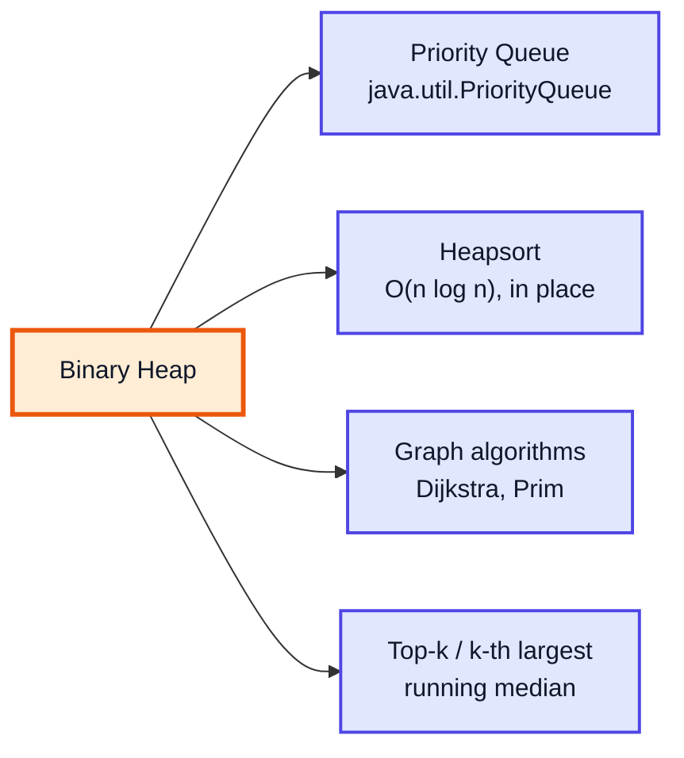

> [!NOTE]
> "Heap" the **data structure** has nothing to do with "heap" **memory** (where Java objects live, video #5). Same word, unrelated ideas.

---

## 1. Why heaps? (1:58)

### The Problem

We often need a collection where we repeatedly **insert** items and **take out the most important one** (smallest deadline, highest priority, shortest distance). Compare the options:

| Structure | Insert | Get min | Remove min | Notes |
|---|---|---|---|---|
| Unsorted array / list | O(1) | O(n) | O(n) | Must scan every time |
| Sorted array | O(n) | O(1) | O(1) from end / O(n) from front | Shifting elements on insert |
| Sorted linked list | O(n) | O(1) | O(1) | Must walk to find the insert spot |
| Balanced BST (`TreeMap`) | O(log n) | O(log n) | O(log n) | Works, but heavier: pointers, rotations |
| **Binary heap** | **O(log n)** | **O(1)** | **O(log n)** | Plain array, cache-friendly, simple |

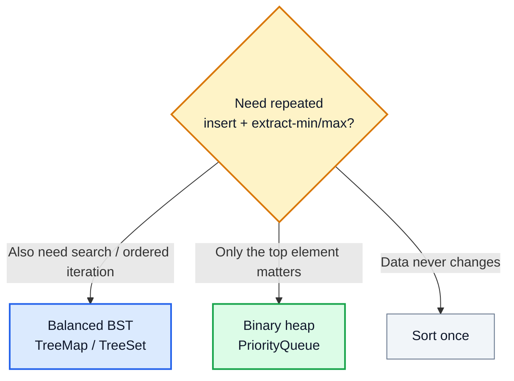

> [!IMPORTANT]
> A heap is **not** sorted — it only guarantees that the top is the min (or max). That weaker promise is exactly why it is cheaper to maintain than a sorted structure.

---

## 2. How heaps work (10:02)

### Two Rules

A binary heap is a binary tree that obeys:

1. **Shape property — complete binary tree:** every level is full except possibly the last, which is filled **left to right**, with no gaps.
2. **Heap property:**
   - **Min-heap:** every parent ≤ its children → the root is the minimum.
   - **Max-heap:** every parent ≥ its children → the root is the maximum.

There is **no** ordering between siblings or between left and right subtrees (unlike a BST).

### Tree View and Array View

Because the tree is complete, it can be stored level by level in an array with **no gaps and no pointers**. Example min-heap `[10, 45, 22, 89, 76, 34]`:

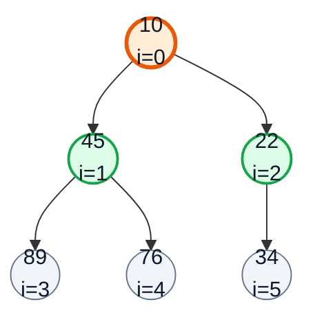

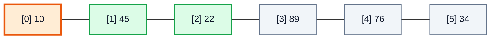

### Index Formulas (0-based)

| Relation | Formula | Example (i = 1, value 45) |
|---|---|---|
| Parent | `(i - 1) / 2` | (1 − 1)/2 = 0 → 10 |
| Left child | `2 * i + 1` | 3 → 89 |
| Right child | `2 * i + 2` | 4 → 76 |
| Last non-leaf | `n / 2 - 1` | 6/2 − 1 = 2 → 22 |

> [!NOTE]
> Some explanations (and older textbooks) use **1-based** arrays: parent `i/2`, children `2i` and `2i+1`. Same idea, shifted by one. Java code almost always uses 0-based.

### Height

A complete tree with `n` nodes has height ⌊log₂ n⌋. Every insert/remove moves along **one root-to-leaf path**, which is why they are O(log n).

| n | height | max swaps per insert/remove |
|---|---|---|
| 7 | 2 | 2 |
| 1,000 | 9 | 9 |
| 1,000,000 | 19 | 19 |

---

## 3. Inserting items in a heap (21:40)

### The Basics

1. **Add the new item at the end** of the array (the next free spot in the last level) — the shape stays complete.
2. **Up-heap (bubble up / sift up):** while the item is smaller than its parent (min-heap), swap it with the parent.

### Step by Step: insert 10 into `[22, 45, 34, 89, 76]`

**Step 1 — place at index 5** (parent = (5−1)/2 = 2 → 34). 10 < 34 → swap.

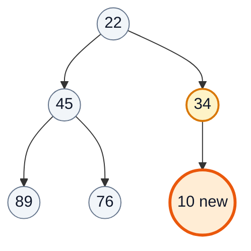

**Step 2 — now at index 2** (parent = 0 → 22). 10 < 22 → swap.

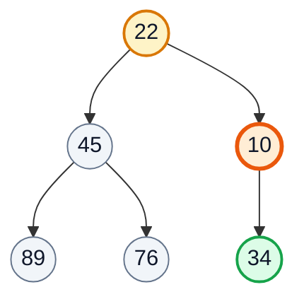

**Step 3 — at index 0** (root). Stop. ✅

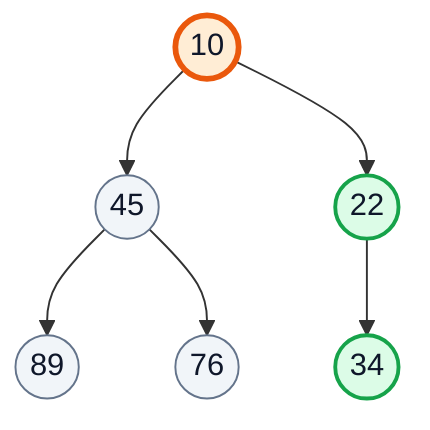

### Array View of the Same Swaps

| Step | Array | Current index | Compare with parent | Action |
|---|---|---|---|---|
| add | [22, 45, 34, 89, 76, 🟧10] | 5 | 10 vs 34 (i=2) | swap |
| 1 | [22, 45, 🟧10, 89, 76, 🟩34] | 2 | 10 vs 22 (i=0) | swap |
| 2 | [🟧10, 45, 🟩22, 89, 76, 34] | 0 | root | stop ✅ |

**Complexity:** O(log n) time (at most height swaps), O(1) extra space (amortised O(1) for the array append).

> [!TIP]
> Inserting an item that is **larger** than its parent costs zero swaps — e.g. inserting 89 or 76 in the build-up above.

---

## 4. Removing items from a heap (28:20)

You can only remove the **root** (the min). Removing it directly would leave a hole at the top, so:

1. Save the root (the answer).
2. **Move the last element to the root** and shrink the array — the shape stays complete.
3. **Down-heap (sift down / heapify):** while the item is larger than its **smaller** child, swap with that child.

> [!IMPORTANT]
> In a min-heap you must swap with the **smaller** child. Swapping with the larger one would put a bigger value above a smaller sibling and break the heap property.

### Step by Step: remove from `[10, 45, 22, 89, 76, 34]`

**Step 1 — take 10, move last (34) to root.** Children: 45 and 22 → smaller is 22. 34 > 22 → swap.

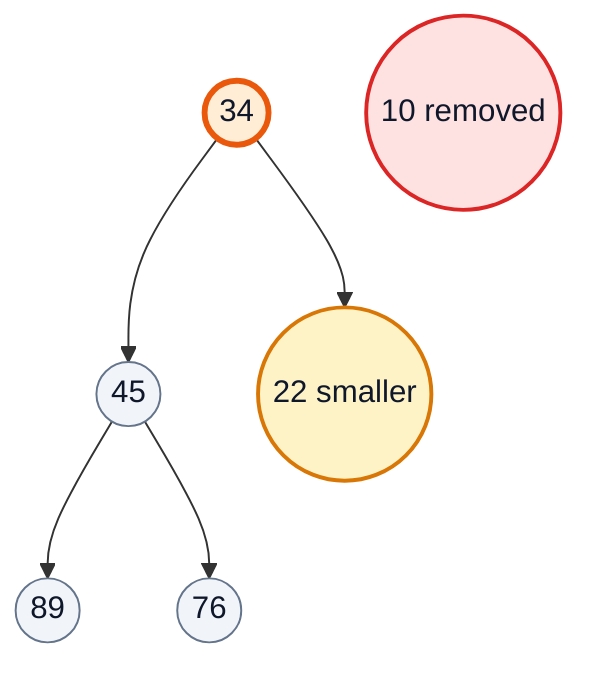

**Step 2 — 34 is now at index 2**, which has no children (5, 6 ≥ size 5). Stop. ✅

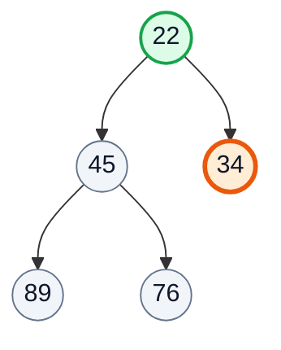

| Step | Array | Current | Children (values) | Smaller | Action |
|---|---|---|---|---|---|
| move last | [🟧34, 45, 22, 89, 76] | 0 | 45, 22 | 22 (i=2) | swap |
| 1 | [🟩22, 45, 🟧34, 89, 76] | 2 | none | — | stop ✅ |

### A Second Removal (deeper sift)

Remove again from `[22, 45, 34, 89, 76]` → last = 76 goes to root:

| Step | Array | Current | Children | Smaller | Action |
|---|---|---|---|---|---|
| move last | [🟧76, 45, 34, 89] | 0 | 45, 34 | 34 | swap |
| 1 | [🟩34, 45, 🟧76, 89] | 2 | none | — | stop ✅ |

**Complexity:** O(log n) time, O(1) extra space.

---

## 5. Code (35:15)

The video builds a **generic** heap backed by an `ArrayList`, with `T extends Comparable<T>` so it works for `Integer`, `String`, or any comparable class.

```java
import java.util.ArrayList;
import java.util.NoSuchElementException;

class Heap<T extends Comparable<T>> {
    private final ArrayList<T> list = new ArrayList<>();

    private int parent(int i) { return (i - 1) / 2; }
    private int left(int i)   { return 2 * i + 1; }
    private int right(int i)  { return 2 * i + 2; }

    private void swap(int a, int b) {
        T tmp = list.get(a);
        list.set(a, list.get(b));
        list.set(b, tmp);
    }

    public void insert(T value) {
        list.add(value);
        upheap(list.size() - 1);
    }

    private void upheap(int i) {
        while (i > 0 && list.get(i).compareTo(list.get(parent(i))) < 0) {
            swap(i, parent(i));
            i = parent(i);
        }
    }

    public T remove() {
        if (list.isEmpty()) throw new NoSuchElementException("Removing from an empty heap");
        T top = list.get(0);
        T last = list.remove(list.size() - 1);
        if (!list.isEmpty()) {
            list.set(0, last);
            downheap(0);
        }
        return top;
    }

    private void downheap(int i) {
        int n = list.size();
        while (true) {
            int min = i, l = left(i), r = right(i);
            if (l < n && list.get(l).compareTo(list.get(min)) < 0) min = l;
            if (r < n && list.get(r).compareTo(list.get(min)) < 0) min = r;
            if (min == i) return;       // heap property restored
            swap(i, min);
            i = min;
        }
    }

    public T peek() {
        if (list.isEmpty()) throw new NoSuchElementException();
        return list.get(0);
    }
    public boolean isEmpty() { return list.isEmpty(); }
}
```

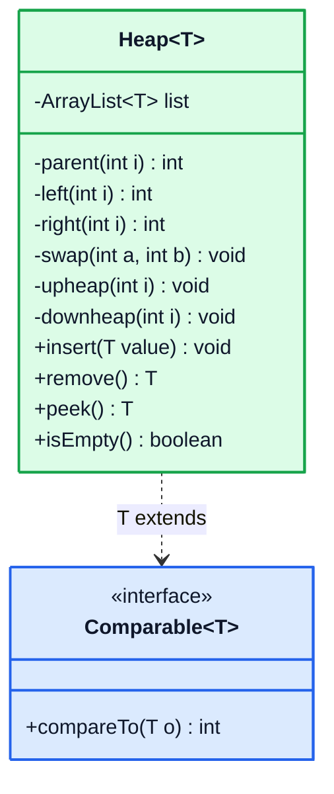

### Code Notes

| Line / choice | Why |
|---|---|
| `T extends Comparable<T>` | Lets us call `compareTo` on generic elements |
| `ArrayList` instead of `T[]` | Java can't create generic arrays (`new T[n]` is illegal); `ArrayList` also grows automatically |
| Remove the **last** element first | `list.remove(size-1)` is O(1); removing index 0 would shift everything (O(n)) |
| `if (!list.isEmpty())` after removing | Handles the single-element heap — otherwise we'd set index 0 of an empty list |
| Iterative up/down-heap | The video writes them recursively; loops avoid recursion overhead, same logic |

> [!NOTE]
> The video's version may throw a generic `Exception` from `remove()` and use recursion for `upheap`/`downheap`. In modern Java an **unchecked** `NoSuchElementException` (as `PriorityQueue`/`Deque` use) is the idiomatic choice, so callers aren't forced into `try/catch`.

> [!TIP]
> To make it a **max-heap**, flip the comparisons (`> 0` instead of `< 0`), or better, accept a `Comparator<T>` in the constructor — that's how `PriorityQueue` does it.

---

## 6. Heapsort (50:32)

### Idea

A min-heap hands back items in ascending order. So: **insert everything, then remove everything.**

```java
public static <T extends Comparable<T>> List<T> heapSort(List<T> items) {
    Heap<T> h = new Heap<>();
    for (T x : items) h.insert(x);              // n × O(log n)
    List<T> out = new ArrayList<>();
    while (!h.isEmpty()) out.add(h.remove());   // n × O(log n)
    return out;
}
// heapSort(List.of(5, 3, 8, 1, 9, 2)) → [1, 2, 3, 5, 8, 9]
```

### In-place Heapsort (the real algorithm)

The textbook version needs **no extra list**: build a **max-heap** inside the array, then repeatedly swap the max (root) to the end and shrink the heap.

```java
static void heapSort(int[] a) {
    int n = a.length;
    for (int i = n / 2 - 1; i >= 0; i--) siftDown(a, i, n);   // build max heap, O(n)
    for (int end = n - 1; end > 0; end--) {
        int t = a[0]; a[0] = a[end]; a[end] = t;               // max → final position
        siftDown(a, 0, end);                                   // heap is now a[0..end-1]
    }
}

static void siftDown(int[] a, int i, int n) {
    while (true) {
        int big = i, l = 2 * i + 1, r = 2 * i + 2;
        if (l < n && a[l] > a[big]) big = l;
        if (r < n && a[r] > a[big]) big = r;
        if (big == i) return;
        int t = a[i]; a[i] = a[big]; a[big] = t;
        i = big;
    }
}
```

Trace on `[3, 9, 2, 1, 4, 5]` (after building the max heap → `[9, 4, 5, 1, 3, 2]`; ▌ marks the sorted tail):

| Step | Swap root ↔ end | After siftDown | Sorted tail |
|---|---|---|---|
| 0 | — | [9, 4, 5, 1, 3, 2] | — |
| 1 | 9 ↔ 2 | [5, 4, 2, 1, 3 ▌ 9] | 9 |
| 2 | 5 ↔ 3 | [4, 3, 2, 1 ▌ 5, 9] | 5, 9 |
| 3 | 4 ↔ 1 | [3, 1, 2 ▌ 4, 5, 9] | 4, 5, 9 |
| 4 | 3 ↔ 2 | [2, 1 ▌ 3, 4, 5, 9] | 3, 4, 5, 9 |
| 5 | 2 ↔ 1 | [1 ▌ 2, 3, 4, 5, 9] | ✅ sorted |

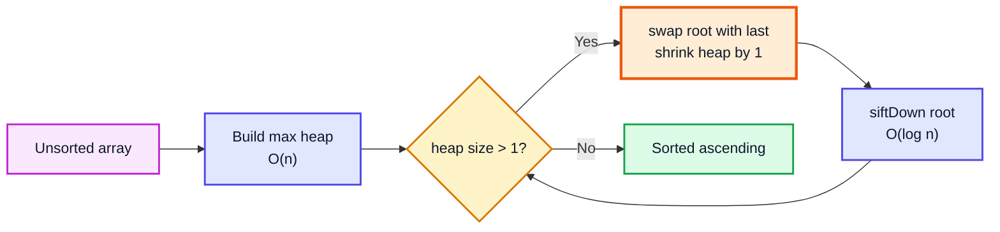

### Heapsort vs Other Sorts

| | Heapsort | Merge sort | Quick sort |
|---|---|---|---|
| Best / average / worst | O(n log n) all | O(n log n) all | O(n log n) avg, **O(n²)** worst |
| Extra space | **O(1)** (in-place version) | O(n) | O(log n) |
| Stable? | ❌ | ✅ | ❌ |
| In practice | Slower (poor cache locality) | Used for objects (`Arrays.sort(Object[])` → TimSort) | Used for primitives (dual-pivot) |

> [!NOTE]
> Heapsort is the fallback inside **introsort** (C++ `std::sort`): when quicksort recursion gets too deep, it switches to heapsort to guarantee O(n log n).

---

## 7. Priority Queue (55:45)

A **priority queue** is the abstract idea ("always serve the highest-priority item"); a **binary heap** is its standard implementation. Java ships one: `java.util.PriorityQueue` — a **min-heap** by default.

```java
import java.util.*;

PriorityQueue<Integer> minPq = new PriorityQueue<>();
minPq.addAll(List.of(34, 45, 22, 89, 76));
System.out.println(minPq.peek());   // 22

PriorityQueue<Integer> maxPq = new PriorityQueue<>(Comparator.reverseOrder());
maxPq.addAll(List.of(34, 45, 22, 89, 76));
while (!maxPq.isEmpty()) System.out.print(maxPq.poll() + " ");   // 89 76 45 34 22

// Custom objects: order by a field
record Task(String name, int priority) {}
PriorityQueue<Task> tasks = new PriorityQueue<>(Comparator.comparingInt(Task::priority));
```

| Operation | Method | Time |
|---|---|---|
| Insert | `offer(x)` / `add(x)` | O(log n) |
| Look at top | `peek()` (null if empty) / `element()` (throws) | O(1) |
| Remove top | `poll()` (null if empty) / `remove()` (throws) | O(log n) |
| Remove arbitrary | `remove(Object)` | O(n) |
| Contains | `contains(x)` | O(n) |
| Build from collection | `new PriorityQueue<>(collection)` | O(n) |

> [!WARNING]
> `System.out.println(pq)` and iterating with for-each show the **internal array order**, not sorted order. Only repeated `poll()` gives sorted output.

### Classic Pattern: Top-k with a Size-k Min-Heap

```java
int k = 3;
PriorityQueue<Integer> topK = new PriorityQueue<>();
for (int x : new int[]{7, 1, 9, 4, 8, 2, 6}) {
    topK.offer(x);
    if (topK.size() > k) topK.poll();     // evict the smallest
}
// topK holds 7, 8, 9 — the 3 largest; topK.peek() = 7 = 3rd largest (LeetCode 215)
```

O(n log k) time, O(k) space — far better than sorting when k ≪ n.

---

## 8. Creating a heap from an unsorted array (58:03)

### Two Ways

| Method | How | Time |
|---|---|---|
| **Top-down** | Insert elements one by one (up-heap each) | O(n log n) |
| **Bottom-up (heapify)** | Treat the array as a tree; sift **down** every non-leaf from `n/2 - 1` back to 0 | **O(n)** |

Leaves (the second half of the array) are already valid 1-node heaps, so we only fix the parents, from the bottom up.

### Bottom-up Trace: `[3, 9, 2, 1, 4, 5]` → max heap

Start (n = 6, last non-leaf = 6/2 − 1 = 2):

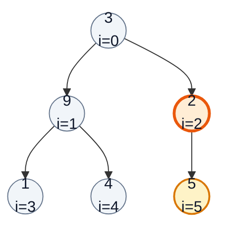

**i = 2:** 2 vs child 5 → swap. **i = 1:** 9 vs 1, 4 → OK. **i = 0:** 3 vs 9, 5 → swap with 9; then at i = 1: 3 vs 1, 4 → swap with 4.

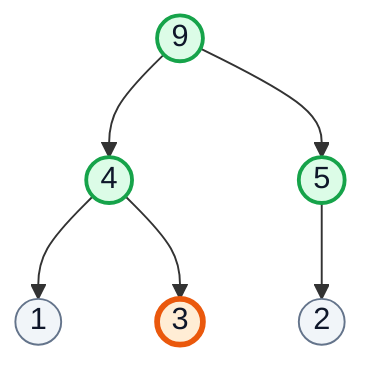

| i | Value | Compare with children | Swap | Array after |
|---|---|---|---|---|
| start | — | — | — | [3, 9, 2, 1, 4, 5] |
| 2 | 2 | 5 | 2 ↔ 5 | [3, 9, 🟧5, 1, 4, 🟩2] |
| 1 | 9 | 1, 4 | none | [3, 9, 5, 1, 4, 2] |
| 0 | 3 | 9, 5 | 3 ↔ 9 | [🟧9, 🟩3, 5, 1, 4, 2] |
| 0 → 1 | 3 | 1, 4 | 3 ↔ 4 | [9, 🟧4, 5, 1, 🟩3, 2] ✅ |

### Why Is It O(n) and Not O(n log n)?

Most nodes are near the **bottom** and sift only a little. About n/2 nodes are leaves (0 work), n/4 sift at most 1 level, n/8 at most 2, …

Total work ≈ n·(1/4·1 + 1/8·2 + 1/16·3 + …) = n · Σ k/2^(k+1) = **n · 1 = O(n)**.

> [!TIP]
> `new PriorityQueue<>(someCollection)` uses this O(n) bottom-up heapify internally — cheaper than calling `offer` n times.

---

## 9. Closing remarks (1:09:14)

- A heap = **complete binary tree** + **heap property**, stored in an **array** with index arithmetic.
- **Insert** = add at end + up-heap; **remove** = move last to root + down-heap (swap with the smaller child in a min-heap). Both O(log n).
- **Heapsort** is O(n log n) in every case and can be done in place; **bottom-up heapify** builds a heap in O(n).
- In real code, use `PriorityQueue` (with a `Comparator` for max-heaps or custom objects).

Upcoming practice: kth largest (LC 215), merge k sorted lists (LC 23), top k frequent (LC 347), find median from a data stream (LC 295, two heaps).

---

## 🧩 Complete Example: Everything Together

One program with the generic min-heap, heapsort (both versions), bottom-up heap building, `PriorityQueue` (min and max) and the top-k pattern:

```java
import java.util.*;

public class HeapDemo {

    // ═══════ A generic array-backed MIN heap (the video's Heap<T extends Comparable<T>>) ═══════
    static class Heap<T extends Comparable<T>> {
        private final ArrayList<T> list = new ArrayList<>();

        private int parent(int i) { return (i - 1) / 2; }
        private int left(int i)   { return 2 * i + 1; }
        private int right(int i)  { return 2 * i + 2; }

        private void swap(int a, int b) {
            T tmp = list.get(a);
            list.set(a, list.get(b));
            list.set(b, tmp);
        }

        public void insert(T value) {
            list.add(value);                 // 1. put at the end (keeps the tree complete)
            upheap(list.size() - 1);         // 2. bubble up
        }

        private void upheap(int i) {
            while (i > 0 && list.get(i).compareTo(list.get(parent(i))) < 0) {
                swap(i, parent(i));
                i = parent(i);
            }
        }

        public T remove() {
            if (list.isEmpty()) throw new NoSuchElementException("Removing from an empty heap");
            T top = list.get(0);
            T last = list.remove(list.size() - 1);   // 1. take the last element
            if (!list.isEmpty()) {
                list.set(0, last);                   // 2. move it to the root
                downheap(0);                         // 3. sink it
            }
            return top;
        }

        private void downheap(int i) {
            int n = list.size();
            while (true) {
                int min = i, l = left(i), r = right(i);
                if (l < n && list.get(l).compareTo(list.get(min)) < 0) min = l;
                if (r < n && list.get(r).compareTo(list.get(min)) < 0) min = r;
                if (min == i) return;
                swap(i, min);
                i = min;
            }
        }

        public boolean isEmpty() { return list.isEmpty(); }
        public int size() { return list.size(); }
        @Override public String toString() { return list.toString(); }

        // Heapsort using this heap: n inserts + n removes → ascending order
        public static <T extends Comparable<T>> List<T> heapSort(List<T> items) {
            Heap<T> h = new Heap<>();
            for (T x : items) h.insert(x);
            List<T> out = new ArrayList<>();
            while (!h.isEmpty()) out.add(h.remove());
            return out;
        }
    }

    // ═══════ In-place heapsort with a MAX heap built bottom-up (O(n) build) ═══════
    static void heapSortInPlace(int[] a) {
        int n = a.length;
        for (int i = n / 2 - 1; i >= 0; i--) siftDown(a, i, n);   // build max heap
        for (int end = n - 1; end > 0; end--) {
            int t = a[0]; a[0] = a[end]; a[end] = t;               // max → its final place
            siftDown(a, 0, end);                                   // repair heap of size end
        }
    }

    static void siftDown(int[] a, int i, int n) {
        while (true) {
            int big = i, l = 2 * i + 1, r = 2 * i + 2;
            if (l < n && a[l] > a[big]) big = l;
            if (r < n && a[r] > a[big]) big = r;
            if (big == i) return;
            int t = a[i]; a[i] = a[big]; a[big] = t;
            i = big;
        }
    }

    static void buildMaxHeap(int[] a) {
        for (int i = a.length / 2 - 1; i >= 0; i--) siftDown(a, i, a.length);
    }

    public static void main(String[] args) {
        // 1. Custom min heap: insert
        Heap<Integer> heap = new Heap<>();
        for (int x : new int[]{34, 45, 22, 89, 76}) heap.insert(x);
        System.out.println("Heap after inserts : " + heap);

        // 2. Insert a new minimum → bubbles all the way up
        heap.insert(10);
        System.out.println("After insert(10)   : " + heap);

        // 3. Remove the min twice
        System.out.println("remove()           : " + heap.remove());
        System.out.println("Heap now           : " + heap);
        System.out.println("remove()           : " + heap.remove());
        System.out.println("Heap now           : " + heap);

        // 4. Heapsort via the custom heap (works for any Comparable)
        System.out.println("heapSort (ints)    : " + Heap.heapSort(List.of(5, 3, 8, 1, 9, 2)));
        System.out.println("heapSort (strings) : " + Heap.heapSort(List.of("pear", "apple", "fig", "kiwi")));

        // 5. Build a max heap from an unsorted array in O(n)
        int[] arr = {3, 9, 2, 1, 4, 5};
        buildMaxHeap(arr);
        System.out.println("buildMaxHeap       : " + Arrays.toString(arr));

        // 6. In-place heapsort
        int[] data = {3, 9, 2, 1, 4, 5};
        heapSortInPlace(data);
        System.out.println("heapSortInPlace    : " + Arrays.toString(data));

        // 7. Java's PriorityQueue (a binary min heap)
        PriorityQueue<Integer> minPq = new PriorityQueue<>(List.of(34, 45, 22, 89, 76));
        System.out.println("PQ peek (min)      : " + minPq.peek());
        PriorityQueue<Integer> maxPq = new PriorityQueue<>(Comparator.reverseOrder());
        maxPq.addAll(List.of(34, 45, 22, 89, 76));
        StringBuilder sb = new StringBuilder();
        while (!maxPq.isEmpty()) sb.append(maxPq.poll()).append(' ');
        System.out.println("Max PQ poll order  : " + sb.toString().trim());

        // 8. Classic use: k largest elements with a size-k min heap
        int k = 3;
        PriorityQueue<Integer> topK = new PriorityQueue<>();
        for (int x : new int[]{7, 1, 9, 4, 8, 2, 6}) {
            topK.offer(x);
            if (topK.size() > k) topK.poll();
        }
        List<Integer> top = new ArrayList<>(topK);
        Collections.sort(top);
        System.out.println("Top 3 largest      : " + top);

        // 9. Empty heap
        try {
            new Heap<Integer>().remove();
        } catch (NoSuchElementException e) {
            System.out.println("Empty remove       : " + e.getMessage());
        }
    }
}
```

**Expected Output:**
```
Heap after inserts : [22, 45, 34, 89, 76]
After insert(10)   : [10, 45, 22, 89, 76, 34]
remove()           : 10
Heap now           : [22, 45, 34, 89, 76]
remove()           : 22
Heap now           : [34, 45, 76, 89]
heapSort (ints)    : [1, 2, 3, 5, 8, 9]
heapSort (strings) : [apple, fig, kiwi, pear]
buildMaxHeap       : [9, 4, 5, 1, 3, 2]
heapSortInPlace    : [1, 2, 3, 4, 5, 9]
PQ peek (min)      : 22
Max PQ poll order  : 89 76 45 34 22
Top 3 largest      : [7, 8, 9]
Empty remove       : Removing from an empty heap
```

---

## Quick Reference Cheat Sheet

| Concept | One-Line Summary |
|---|---|
| **Heap** | Complete binary tree where each parent ≤ (min) or ≥ (max) its children |
| **Array storage** | Level order, no gaps: parent `(i-1)/2`, left `2i+1`, right `2i+2` |
| **Not sorted** | Only the root is guaranteed; siblings have no order |
| **Insert** | Append at end, up-heap while smaller than parent — O(log n) |
| **Remove (min)** | Save root, move last to root, down-heap with the smaller child — O(log n) |
| **Peek** | `list.get(0)` — O(1) |
| **Generic heap** | `Heap<T extends Comparable<T>>` backed by `ArrayList` |
| **Heapsort (simple)** | Insert all, remove all — O(n log n), O(n) extra |
| **Heapsort (in place)** | Build max heap, swap root with end, shrink, sift down — O(n log n), O(1) |
| **Heapsort traits** | Not stable, guaranteed O(n log n), weaker cache locality |
| **Build heap bottom-up** | Sift down from `n/2 - 1` to 0 — **O(n)** |
| **PriorityQueue** | Java's binary min-heap; `offer`, `peek`, `poll` |
| **Max-heap in Java** | `new PriorityQueue<>(Comparator.reverseOrder())` |
| **Top-k largest** | Size-k min-heap, poll when size > k — O(n log k) |
| **Printing a PQ** | Shows internal array order, not sorted order |
