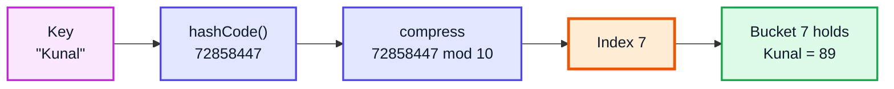
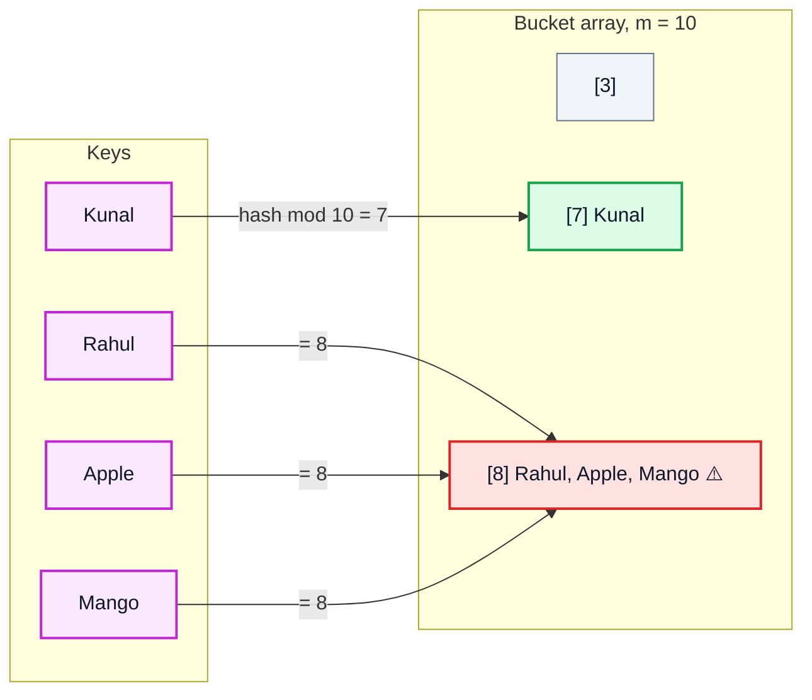
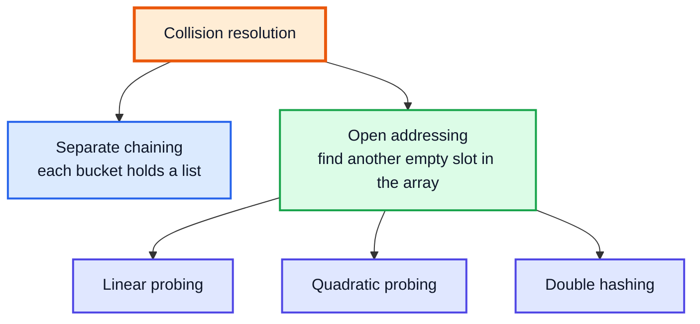
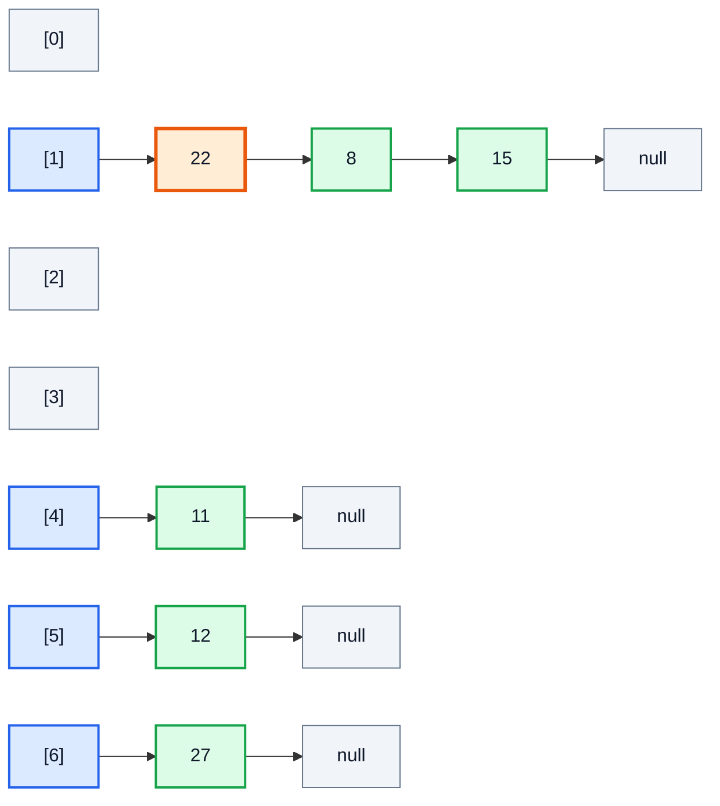
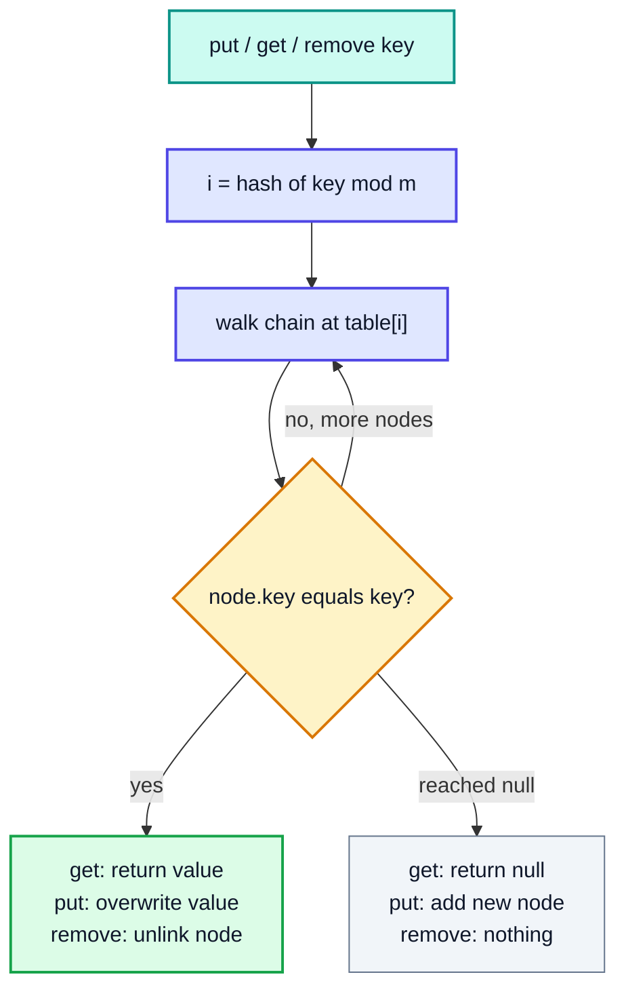
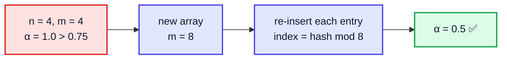
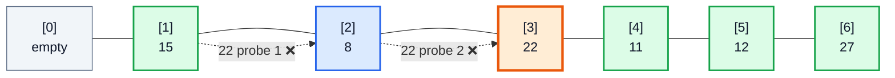
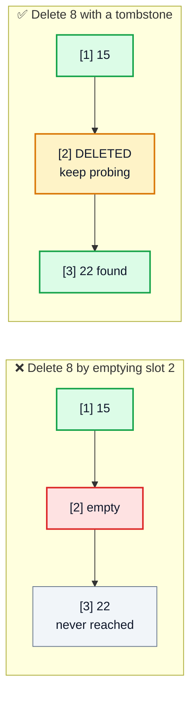
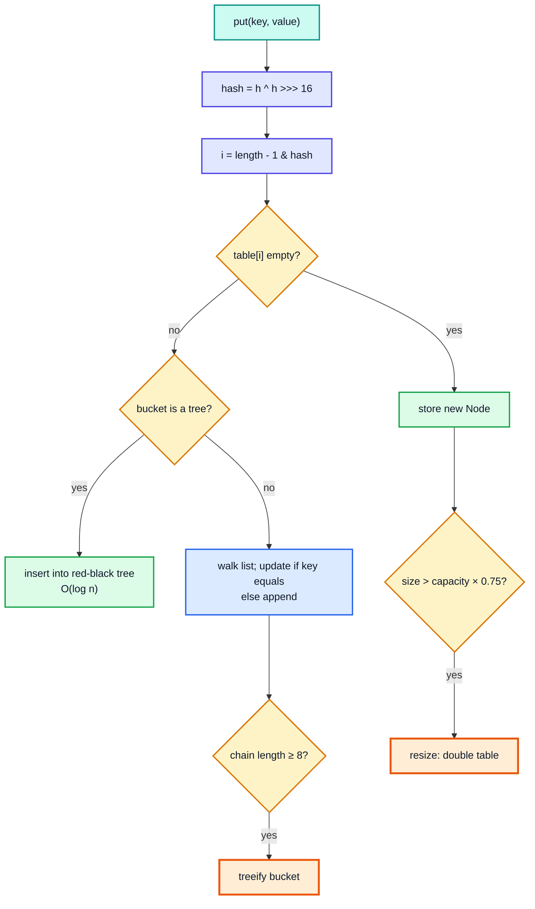

# HashMap & HashTable — Complete In-Depth Guide

**Video #57 of the Java + DSA playlist:** *Introduction to HashMap & HashTable in Java* (1:39:45)

How hash tables give you near-O(1) insert, search and delete: hash functions, turning a hash into an index, collisions and how to resolve them (separate chaining vs open addressing), load factor and rehashing, what `java.util.HashMap` actually does internally, and building your own HashMap from scratch.

---

## Table of Contents

| # | Topic | Timestamp |
|---|---|---|
| 0 | [Introduction](#0-introduction-000) | 0:00 |
| 1 | [How Hashmaps Work](#1-how-hashmaps-work-1025) | 10:25 |
| 2 | [Chaining](#2-chaining-2546) | 25:46 |
| 3 | [Open Addressing](#3-open-addressing-4914) | 49:14 |
| 4 | [Hashmaps in Java](#4-hashmaps-in-java-10623) | 1:06:23 |
| 5 | [Implementation](#5-implementation-11709) | 1:17:09 |
| 6 | [Closing Remarks](#6-closing-remarks-13840) | 1:38:40 |

---

## 0. Introduction (0:00)

### The problem hashing solves

Suppose you store student marks and want to look up "Kunal" quickly.

| Structure | Search by key | Insert | Delete |
|---|---|---|---|
| Unsorted array / list | O(n) | O(1) | O(n) |
| Sorted array (binary search) | O(log n) | O(n) | O(n) |
| Balanced BST (`TreeMap`) | O(log n) | O(log n) | O(log n) |
| **Hash table (`HashMap`)** | **O(1) average** | **O(1) average** | **O(1) average** |

Arrays already give O(1) access **by index**. A hash table's trick is to **convert any key into an array index**, so a lookup by key becomes a lookup by index.



### Using `HashMap` and `HashSet` first

```java
import java.util.HashMap;
import java.util.HashSet;
import java.util.Map;
import java.util.Set;

public class HashMapBasics {
    public static void main(String[] args) {
        Map<String, Integer> marks = new HashMap<>();
        marks.put("Kunal", 89);
        marks.put("Rahul", 99);
        marks.put("Karan", 47);
        marks.put("Kunal", 95);                               // same key → value REPLACED

        System.out.println(marks.get("Kunal"));                 // 95
        System.out.println(marks.get("Priya"));                 // null (missing key)
        System.out.println(marks.getOrDefault("Priya", 0));     // 0
        System.out.println(marks.containsKey("Karan"));         // true
        System.out.println(marks.remove("Karan"));              // 47
        System.out.println(marks.size());                       // 2

        Set<String> fruits = new HashSet<>();
        fruits.add("Apple");
        fruits.add("Mango");
        System.out.println(fruits.add("Apple"));                // false (duplicate ignored)
        System.out.println(fruits.contains("Mango"));           // true
        System.out.println(fruits.size());                      // 2
    }
}
```

| Concept | Meaning |
|---|---|
| **Map** | Stores **key → value** pairs; keys are unique |
| **Set** | Stores unique **keys only** (`HashSet` is internally a `HashMap` with a dummy value) |
| **Hash table** | The underlying data structure: an array of "buckets" indexed by hash |

> [!IMPORTANT]
> `HashMap` gives **no ordering guarantee**. Printing a `HashMap` may show keys in any order, and that order can change after a resize. Use `LinkedHashMap` (insertion order) or `TreeMap` (sorted) when order matters.

---

## 1. How Hashmaps Work (10:25)

### Step 1: The hash function

A **hash function** maps a key of any size to a fixed-size integer (the **hash code**). In Java every object has `int hashCode()`.

A good hash function is:

| Property | Why it matters |
|---|---|
| **Deterministic** | Same key must always give the same hash, or you could never find it again |
| **Fast** | It runs on every `put`/`get` |
| **Uniform** | Spreads keys evenly across buckets, so chains/probe sequences stay short |
| **Uses the whole key** | Keys differing in one character should usually hash differently |

How `String.hashCode()` is defined (polynomial with base 31):

$$h(s) = s[0]\cdot 31^{n-1} + s[1]\cdot 31^{n-2} + \dots + s[n-1]$$

So `"ab"` = 97·31 + 98 = **3105**. (This same polynomial idea powers Karp-Rabin in the next video.)

### Step 2: Compress the hash into an index

The hash can be any `int` (including negatives), but the array has only `m` slots:

```
index = hash mod m        (must land in 0 .. m-1)
```

```java
public class HashCodeDemo {
    static int indexFor(Object key, int capacity) {
        int h = key.hashCode();
        return Math.floorMod(h, capacity);   // always 0..capacity-1, even if h < 0
    }

    public static void main(String[] args) {
        System.out.println("a".hashCode());            // 97
        System.out.println("ab".hashCode());           // 3105  (97*31 + 98)
        System.out.println("Kunal".hashCode());        // 72858447
        System.out.println(Integer.valueOf(42).hashCode()); // 42

        System.out.println(indexFor("Kunal", 10));     // 7
        System.out.println(indexFor("Rahul", 10));     // 8
        System.out.println(indexFor("Apple", 10));     // 8
        System.out.println(indexFor("Mango", 10));     // 8  ← collision with Apple!

        System.out.println("Aa".hashCode() == "BB".hashCode()); // true — same hash, different keys
    }
}
```

> [!WARNING]
> `Math.abs(h) % m` (common in tutorials) has a hidden bug: `Math.abs(Integer.MIN_VALUE)` is still **negative**, giving a negative index. Use `Math.floorMod(h, m)` or `(h & 0x7fffffff) % m`.

### Step 3: Store in the bucket



### Collisions are unavoidable

A **collision** is when two different keys map to the same index. They can never be fully avoided:

- **Pigeonhole principle:** there are infinitely many strings but only 2³² `int` hash codes (and only `m` buckets).
- **Birthday paradox:** with just 23 people, there is a >50% chance two share a birthday (365 "buckets"). Collisions appear far sooner than intuition suggests.

So every hash table needs a **collision resolution strategy**:



### Common hash/compression techniques

| Technique | Formula | Notes |
|---|---|---|
| **Division** | `h mod m` | Simple; choose `m` prime (or use bit mixing) to avoid patterns |
| **Multiplication** | `floor(m · frac(h · A))`, A ≈ 0.618 | Choice of `m` matters less |
| **Power-of-two masking** | `h & (m - 1)` | Fast; what Java's `HashMap` uses (with extra bit-spreading) |
| **Universal hashing** | pick `h` randomly from a family | Protects against adversarial inputs |

---

## 2. Chaining (25:46)

### The idea

In **separate chaining**, each array slot holds a **linked list** (chain) of all entries that hashed there. A collision just means "add one more node to that list".

Example: insert keys `15, 11, 27, 8, 12, 22` with `h(k) = k mod 7`.

| Key | k mod 7 | Bucket | Collision? |
|---|---|---|---|
| 15 | 1 | 1 | ✅ empty |
| 11 | 4 | 4 | ✅ empty |
| 27 | 6 | 6 | ✅ empty |
| 8 | 1 | 1 | 🟧 yes → chain |
| 12 | 5 | 5 | ✅ empty |
| 22 | 1 | 1 | 🟧 yes → chain |



(New nodes are inserted at the **head**, so 22 — the last one inserted — is first.)

```java
import java.util.LinkedList;

public class ChainingDemo {
    public static void main(String[] args) {
        int m = 7;
        @SuppressWarnings("unchecked")
        LinkedList<Integer>[] table = new LinkedList[m];
        for (int i = 0; i < m; i++) table[i] = new LinkedList<>();

        int[] keys = {15, 11, 27, 8, 12, 22};
        for (int k : keys) {
            table[k % m].addFirst(k);          // insert at head → O(1)
        }

        for (int i = 0; i < m; i++) {
            System.out.println(i + " -> " + table[i]);
        }
        // search 22: go to bucket 22 % 7 = 1, walk the chain
        System.out.println("22 found? " + table[22 % m].contains(22));
        System.out.println("load factor = " + (double) keys.length / m);
    }
}
// Output:
// 0 -> []
// 1 -> [22, 8, 15]
// 2 -> []
// 3 -> []
// 4 -> [11]
// 5 -> [12]
// 6 -> [27]
// 22 found? true
// load factor = 0.8571428571428571
```

### Operations



> [!NOTE]
> `put` must first **search** the chain: if the key already exists, the value is updated instead of adding a duplicate node. That is why maps never have duplicate keys.

### Load factor (α)

$$\alpha = \frac{n \text{ (entries)}}{m \text{ (buckets)}}$$

With uniform hashing, the **average chain length is α**, so:

| Operation | Average | Worst case (all keys in one bucket) |
|---|---|---|
| Search hit | O(1 + α/2) | O(n) |
| Search miss | O(1 + α) | O(n) |
| Insert (after search) | O(1 + α) | O(n) |
| Delete | O(1 + α) | O(n) |

If we keep α bounded by a constant (e.g. ≤ 0.75), every operation is **O(1) on average**.

### Rehashing (resizing)

When α crosses the threshold, allocate a bigger array (usually **2×**) and **re-insert every entry** — the index depends on `m`, so every key's position must be recomputed.



> [!TIP]
> One rehash costs O(n), but because the size **doubles**, rehashes are rare. Spread over all inserts, the cost is **O(1) amortized** — the same argument as `ArrayList` growth.

### Chaining: pros & cons

| ✅ Pros | ❌ Cons |
|---|---|
| Simple; never "full" (α can exceed 1) | Extra memory for node pointers |
| Deletion is easy (just unlink) | Linked nodes are scattered → poor cache locality |
| Degrades gracefully as α grows | A bad hash can still pile everything into one chain |

---

## 3. Open Addressing (49:14)

### The idea

In **open addressing**, all entries live **inside the array itself** — no linked lists. On a collision, follow a **probe sequence** until an empty slot appears:

$$h(k, i) \text{ for } i = 0, 1, 2, \dots$$

Because everything is in the array, **α must stay below 1** (and in practice below ~0.5–0.7).

### Probing strategies

| Strategy | Probe formula | Problem it has / solves |
|---|---|---|
| **Linear probing** | `(h(k) + i) mod m` | Simple, cache-friendly; suffers **primary clustering** |
| **Quadratic probing** | `(h(k) + c₁·i + c₂·i²) mod m` | Breaks primary clusters; **secondary clustering** (same home → same sequence); may not visit all slots unless `m` is chosen carefully |
| **Double hashing** | `(h₁(k) + i·h₂(k)) mod m` | Each key gets its own step size → best spread; `h₂(k)` must never be 0 |

### Linear probing trace (`15, 11, 27, 8, 12, 22`, m = 7)

| Key | Home `k mod 7` | Probes tried | Final slot |
|---|---|---|---|
| 15 | 1 | 1 ✅ | 1 |
| 11 | 4 | 4 ✅ | 4 |
| 27 | 6 | 6 ✅ | 6 |
| 8 | 1 | 1 ❌ → 2 ✅ | 2 |
| 12 | 5 | 5 ✅ | 5 |
| 22 | 1 | 1 ❌ → 2 ❌ → 3 ✅ | 3 |



Slots 1–6 now form one long **cluster**: any new key hashing anywhere into 1..6 must walk to slot 0. That is **primary clustering** — clusters grow and merge, and probe counts climb sharply as α → 1.

With quadratic probing (`home + i²`), 22 would try 1, 2, 5, then (1 + 9) mod 7 = **3** — the jumps grow instead of stepping one by one.

```java
import java.util.Arrays;

public class OpenAddressingDemo {
    static Integer[] build(int[] keys, int m, boolean quadratic) {
        Integer[] t = new Integer[m];
        for (int k : keys) {
            int home = k % m;
            for (int i = 0; i < m; i++) {
                int probe = quadratic ? (home + i * i) % m : (home + i) % m;
                if (t[probe] == null) { t[probe] = k; break; }
            }
        }
        return t;
    }

    public static void main(String[] args) {
        int[] keys = {15, 11, 27, 8, 12, 22};
        System.out.println("Linear   : " + Arrays.toString(build(keys, 7, false)));
        System.out.println("Quadratic: " + Arrays.toString(build(keys, 7, true)));
    }
}
// Output:
// Linear   : [null, 15, 8, 22, 11, 12, 27]
// Quadratic: [null, 15, 8, 22, 11, 12, 27]
```

(Same final layout here by coincidence; on larger inputs the probe paths differ a lot.)

### Searching and the deletion problem

**Search** follows the same probe sequence as insertion and stops at the first **truly empty** slot ("the key would have been placed here").

That makes **deletion tricky**. If we delete 8 by setting slot 2 to empty, a search for 22 (home 1) stops at slot 2 and wrongly reports "not found".



The fix is a **tombstone** (a special "DELETED" marker): search **skips over** it, insert may **reuse** it. Too many tombstones slow things down, so tables periodically rebuild.

### Expected probes (uniform hashing)

| α | Unsuccessful search ≈ 1/(1−α) | Successful search ≈ (1/α)·ln(1/(1−α)) |
|---|---|---|
| 0.5 | 2 | 1.39 |
| 0.75 | 4 | 1.85 |
| 0.9 | 10 | 2.56 |

> [!CAUTION]
> Open addressing falls apart as α approaches 1. Keep the load factor low and resize early.

### Chaining vs open addressing

| | **Separate chaining** | **Open addressing** |
|---|---|---|
| Storage | Array + linked nodes | Array only |
| Load factor | Can exceed 1 | Must stay < 1 |
| Cache performance | Worse (pointer chasing) | Better (contiguous) |
| Deletion | Easy | Needs tombstones |
| Sensitivity to clustering/hash quality | Lower | Higher |
| Used by | Java `HashMap`, `Hashtable` | Python `dict`, C++ `absl::flat_hash_map`, Java's `IdentityHashMap`, `ThreadLocal` map |

---

## 4. Hashmaps in Java (1:06:23)

### How `java.util.HashMap` is built (Java 8+)

- Internally an array `Node<K,V>[] table` — **separate chaining**.
- Default capacity **16**, always a **power of two**; default load factor **0.75** → resizes when `size > capacity × 0.75` (first at 13 entries).
- On resize the table **doubles**; each chain splits into "stays at index i" or "moves to i + oldCap" — no full rehash computation needed.
- Index is computed with a mask instead of `%`:

```java
// What HashMap does (simplified from the JDK source)
static int hash(Object key) {
    int h;
    return (key == null) ? 0 : (h = key.hashCode()) ^ (h >>> 16);  // mix high bits into low bits
}
int index = (table.length - 1) & hash(key);   // same as hash mod length, when length is a power of 2
```

The XOR with `h >>> 16` matters because masking with `length - 1` only looks at the **low bits**; spreading prevents keys that differ only in high bits from all colliding.

- **Treeification:** when one bucket's chain reaches **8** nodes (and the table has at least **64** buckets), the chain is converted into a **red-black tree**, so the worst case for that bucket becomes **O(log n)** instead of O(n). It turns back into a list when it shrinks to 6.



> [!NOTE]
> Treeification was added in **Java 8**. Older explanations (and many interview answers) say "HashMap worst case is O(n)"; in modern Java the per-bucket worst case is O(log n) when keys are `Comparable`.

### `HashMap` vs `Hashtable` vs friends

| | `HashMap` | `Hashtable` | `ConcurrentHashMap` | `LinkedHashMap` | `TreeMap` |
|---|---|---|---|---|---|
| Since | Java 1.2 | Java 1.0 (legacy) | Java 5 | Java 1.4 | Java 1.2 |
| Thread-safe | ❌ | ✅ (every method `synchronized` — slow) | ✅ (fine-grained, fast) | ❌ | ❌ |
| `null` key / values | 1 null key, many null values | ❌ none (NPE) | ❌ none | like HashMap | no null key |
| Order | None | None | None | Insertion (or access) order | Sorted by key |
| get/put | O(1) avg | O(1) avg | O(1) avg | O(1) avg | O(log n) |

> [!TIP]
> Treat `Hashtable` as legacy. For single-threaded code use `HashMap`; for concurrent code use `ConcurrentHashMap`.

### The `hashCode()` / `equals()` contract

A `HashMap` first uses `hashCode()` to find the **bucket**, then `equals()` to find the **exact key** in it. So:

1. If `a.equals(b)`, then `a.hashCode() == b.hashCode()` **must** hold.
2. Equal hash codes do **not** imply equal objects (collisions are allowed, like `"Aa"` and `"BB"`).
3. Override **both** or neither.

```java
import java.util.HashMap;
import java.util.Map;

public class KeyContract {
    // ❌ Overrides equals() but NOT hashCode()
    static class BadPoint {
        int x, y;
        BadPoint(int x, int y) { this.x = x; this.y = y; }
        @Override public boolean equals(Object o) {
            return o instanceof BadPoint p && p.x == x && p.y == y;
        }
    }

    // ✅ A record generates equals() AND hashCode() from its fields
    record Point(int x, int y) {}

    public static void main(String[] args) {
        Map<BadPoint, String> bad = new HashMap<>();
        bad.put(new BadPoint(1, 2), "A");
        System.out.println(bad.get(new BadPoint(1, 2)));   // null  (almost always — different hash)

        Map<Point, String> good = new HashMap<>();
        good.put(new Point(1, 2), "A");
        System.out.println(good.get(new Point(1, 2)));     // A
    }
}
```

> [!WARNING]
> Never **mutate** a key after putting it in a map. Its hash changes, but it still sits in the old bucket, so `get` can no longer find it. Prefer immutable keys (`String`, `Integer`, records).

### Useful modern `Map` methods

| Method | What it does |
|---|---|
| `getOrDefault(k, d)` | Value or default if missing |
| `putIfAbsent(k, v)` | Insert only if key absent |
| `merge(k, 1, Integer::sum)` | Counting idiom: add 1 or start at 1 |
| `computeIfAbsent(k, x -> new ArrayList<>())` | Grouping idiom: create the list once |
| `entrySet()` | Iterate keys and values together |
| `Map.of(...)` / `Map.copyOf(...)` | Immutable maps (Java 9+/10+) |

---

## 5. Implementation (1:17:09)

The video builds the map in two stages: first a naive version with **no collision handling**, then a proper version using **separate chaining + rehashing**.

### Version 1: naive map (one entry per slot)

```java
class MapUsingHash {
    private final Entity[] entities = new Entity[100];

    public void put(String key, String value) {
        int hash = Math.abs(key.hashCode() % entities.length);
        entities[hash] = new Entity(key, value);       // ❌ overwrites on collision
    }

    public String get(String key) {
        int hash = Math.abs(key.hashCode() % entities.length);
        if (entities[hash] != null && entities[hash].key.equals(key)) {
            return entities[hash].value;
        }
        return null;
    }

    public void remove(String key) {
        int hash = Math.abs(key.hashCode() % entities.length);
        if (entities[hash] != null && entities[hash].key.equals(key)) {
            entities[hash] = null;
        }
    }

    private static class Entity {
        String key, value;
        Entity(String key, String value) { this.key = key; this.value = value; }
    }
}
```

`"Aa"` and `"BB"` have the same hash (2112), so `put("BB", ...)` silently **destroys** `"Aa"`. We need collision handling.

### Version 2: chaining + rehashing (generic)

```java
import java.util.ArrayList;
import java.util.LinkedList;

public class HashMapFinal<K, V> {
    private ArrayList<LinkedList<Entity>> list;
    private int size = 0;
    private final float lf = 0.5f;                     // load factor threshold

    public HashMapFinal() {
        list = new ArrayList<>();
        for (int i = 0; i < 10; i++) list.add(new LinkedList<>());
    }

    private int indexFor(K key, int buckets) {
        return Math.floorMod(key.hashCode(), buckets);
    }

    public void put(K key, V value) {
        LinkedList<Entity> entities = list.get(indexFor(key, list.size()));
        for (Entity e : entities) {
            if (e.key.equals(key)) { e.value = value; return; }   // update
        }
        if ((float) (size + 1) / list.size() > lf) {
            reHash();
            entities = list.get(indexFor(key, list.size()));
        }
        entities.add(new Entity(key, value));
        size++;
    }

    private void reHash() {
        System.out.println("  [rehash: " + list.size() + " -> " + list.size() * 2 + " buckets]");
        ArrayList<LinkedList<Entity>> old = list;
        list = new ArrayList<>();
        for (int i = 0; i < old.size() * 2; i++) list.add(new LinkedList<>());
        for (LinkedList<Entity> entries : old) {
            for (Entity e : entries) {
                list.get(indexFor(e.key, list.size())).add(e);   // index changes!
            }
        }
    }

    public V get(K key) {
        for (Entity e : list.get(indexFor(key, list.size()))) {
            if (e.key.equals(key)) return e.value;
        }
        return null;
    }

    public void remove(K key) {
        LinkedList<Entity> entities = list.get(indexFor(key, list.size()));
        if (entities.removeIf(e -> e.key.equals(key))) size--;
    }

    public boolean containsKey(K key) { return get(key) != null; }
    public int size() { return size; }

    @Override
    public String toString() {
        StringBuilder sb = new StringBuilder("{");
        for (LinkedList<Entity> entities : list)
            for (Entity e : entities)
                sb.append(e.key).append(" = ").append(e.value).append(", ");
        if (size > 0) sb.setLength(sb.length() - 2);
        return sb.append("}").toString();
    }

    private class Entity {
        K key; V value;
        Entity(K key, V value) { this.key = key; this.value = value; }
    }

    public static void main(String[] args) {
        MapUsingHash naive = new MapUsingHash();
        naive.put("Mango", "King of fruits");
        naive.put("Apple", "A sweet red fruit");
        System.out.println(naive.get("Mango"));       // King of fruits
        naive.put("Aa", "first");
        naive.put("BB", "second");                    // same hashCode as "Aa" → overwrites it
        System.out.println(naive.get("Aa"));          // null  ❌ data lost

        HashMapFinal<String, String> map = new HashMapFinal<>();
        map.put("Mango", "King of fruits");
        map.put("Apple", "A sweet red fruit");
        map.put("Litchi", "Kunal's fav fruit");
        map.put("Banana", "Yellow");
        map.put("Kiwi", "Green");
        map.put("Guava", "Hard");                      // 6th entry → 6/10 > 0.5 → rehash
        map.put("Mango", "Still king");                // update, size unchanged
        System.out.println(map.get("Mango"));          // Still king
        map.remove("Kiwi");
        System.out.println(map.containsKey("Kiwi"));   // false
        System.out.println(map.size());                // 5
        System.out.println(map);
    }
}
```

**Output (verified):**
```
King of fruits
null
  [rehash: 10 -> 20 buckets]
Still king
false
5
{Litchi = Kunal's fav fruit, Guava = Hard, Banana = Yellow, Mango = Still king, Apple = A sweet red fruit}
```

### Dry run of `put` calls

| Call | Bucket count | size before → after | (size+1)/buckets | Action |
|---|---|---|---|---|
| put Mango | 10 | 0 → 1 | 0.1 | add 🟩 |
| put Apple | 10 | 1 → 2 | 0.2 | add 🟩 |
| put Litchi | 10 | 2 → 3 | 0.3 | add 🟩 |
| put Banana | 10 | 3 → 4 | 0.4 | add 🟩 |
| put Kiwi | 10 | 4 → 5 | 0.5 | add 🟩 (not > 0.5) |
| put Guava | 10 → 20 | 5 → 6 | 0.6 | 🟧 rehash, then add |
| put Mango | 20 | 6 → 6 | — | key exists → update value |
| remove Kiwi | 20 | 6 → 5 | — | unlink from chain |

### Complexity

| Operation | Average | Worst case |
|---|---|---|
| `put` | O(1) amortized | O(n) (all in one chain, or during rehash) |
| `get` / `containsKey` | O(1) | O(n) |
| `remove` | O(1) | O(n) |
| `reHash` | O(n) — but rare | O(n) |
| Space | O(n + m) | O(n + m) |

> [!NOTE]
> Small improvements over the lecture code: `Math.floorMod` instead of `Math.abs(... % ...)` (safe for negative hashes), a generic `<K, V>` type, and `containsKey` here returns `false` for a key mapped to `null` — the JDK's `HashMap.containsKey` handles that case properly by searching for the key itself.

---

## 6. Closing Remarks (1:38:40)

- Hashing turns "search by key" into "index into an array", giving **O(1) average** operations.
- Collisions are inevitable; handle them with **chaining** (Java's choice) or **open addressing**.
- Keep the **load factor** bounded via **rehashing** to preserve O(1).
- Next video (#58) uses hashing on **strings**: the **Karp-Rabin** substring search algorithm with a rolling hash.

---

## 🧩 Complete Example: Everything Together

One program that builds a chaining map with resizing, an open-addressing set with tombstones, and uses Java's built-in maps (including LeetCode 1 — Two Sum):

```java
import java.util.*;

// ═══════ 1. SEPARATE CHAINING (array of linked lists + rehash) ═══════
class ChainedMap<K, V> {
    private static class Node<K, V> {
        final K key; V value; Node<K, V> next;
        Node(K key, V value, Node<K, V> next) { this.key = key; this.value = value; this.next = next; }
    }

    private Node<K, V>[] table;
    private int size;
    private static final double MAX_LOAD = 0.75;

    @SuppressWarnings("unchecked")
    ChainedMap(int capacity) { table = (Node<K, V>[]) new Node[capacity]; }

    private int index(K key, int cap) { return Math.floorMod(Objects.hashCode(key), cap); }

    void put(K key, V value) {
        int i = index(key, table.length);
        for (Node<K, V> n = table[i]; n != null; n = n.next) {
            if (Objects.equals(n.key, key)) { n.value = value; return; }
        }
        table[i] = new Node<>(key, value, table[i]);         // insert at head
        size++;
        if ((double) size / table.length > MAX_LOAD) resize();
    }

    V get(K key) {
        for (Node<K, V> n = table[index(key, table.length)]; n != null; n = n.next) {
            if (Objects.equals(n.key, key)) return n.value;
        }
        return null;
    }

    boolean remove(K key) {
        int i = index(key, table.length);
        Node<K, V> prev = null;
        for (Node<K, V> n = table[i]; n != null; prev = n, n = n.next) {
            if (Objects.equals(n.key, key)) {
                if (prev == null) table[i] = n.next; else prev.next = n.next;
                size--;
                return true;
            }
        }
        return false;
    }

    @SuppressWarnings("unchecked")
    private void resize() {
        Node<K, V>[] old = table;
        table = (Node<K, V>[]) new Node[old.length * 2];
        for (Node<K, V> head : old) {
            for (Node<K, V> n = head; n != null; n = n.next) {
                int i = index(n.key, table.length);
                table[i] = new Node<>(n.key, n.value, table[i]);
            }
        }
        System.out.println("  resized " + old.length + " -> " + table.length);
    }

    int size() { return size; }
    int capacity() { return table.length; }

    void printBuckets() {
        for (int i = 0; i < table.length; i++) {
            StringBuilder sb = new StringBuilder("  [" + i + "]");
            for (Node<K, V> n = table[i]; n != null; n = n.next) sb.append(" -> ").append(n.key);
            System.out.println(sb);
        }
    }
}

// ═══════ 2. OPEN ADDRESSING (linear probing + tombstones) ═══════
class ProbingSet {
    private static final int DELETED = Integer.MIN_VALUE;   // tombstone marker
    private final Integer[] slots;
    ProbingSet(int capacity) { slots = new Integer[capacity]; }

    int add(int key) {                                  // returns number of probes used
        int m = slots.length;
        for (int i = 0; i < m; i++) {
            int p = Math.floorMod(key + i, m);
            if (slots[p] == null || slots[p] == DELETED) { slots[p] = key; return i + 1; }
        }
        throw new IllegalStateException("table full");
    }

    boolean contains(int key) {
        int m = slots.length;
        for (int i = 0; i < m; i++) {
            int p = Math.floorMod(key + i, m);
            if (slots[p] == null) return false;          // true empty → stop
            if (slots[p] == key) return true;           // tombstone → keep probing
        }
        return false;
    }

    void remove(int key) {
        int m = slots.length;
        for (int i = 0; i < m; i++) {
            int p = Math.floorMod(key + i, m);
            if (slots[p] == null) return;
            if (slots[p] == key) { slots[p] = DELETED; return; }
        }
    }

    @Override public String toString() {
        StringJoiner sj = new StringJoiner(", ", "[", "]");
        for (Integer s : slots) sj.add(s == null ? "_" : s == DELETED ? "X" : s.toString());
        return sj.toString();
    }
}

public class Main {
    record Point(int x, int y) {}                       // equals + hashCode for free

    // LeetCode 1 — Two Sum, O(n) with a HashMap
    static int[] twoSum(int[] nums, int target) {
        Map<Integer, Integer> seen = new HashMap<>();
        for (int i = 0; i < nums.length; i++) {
            Integer j = seen.get(target - nums[i]);
            if (j != null) return new int[]{j, i};
            seen.put(nums[i], i);
        }
        return new int[0];
    }

    public static void main(String[] args) {
        System.out.println("== 1. Separate chaining ==");
        ChainedMap<String, Integer> marks = new ChainedMap<>(4);
        marks.put("Kunal", 89);
        marks.put("Rahul", 99);
        marks.put("Karan", 47);
        marks.put("Apple", 10);                         // 4/4 = 1.0 > 0.75 → resize
        marks.put("Kunal", 95);                         // update
        System.out.println("Kunal -> " + marks.get("Kunal"));
        System.out.println("removed Karan? " + marks.remove("Karan"));
        System.out.println("size = " + marks.size() + ", capacity = " + marks.capacity());
        marks.printBuckets();

        System.out.println("== 2. Linear probing ==");
        ProbingSet set = new ProbingSet(7);
        for (int k : new int[]{15, 11, 27, 8, 12, 22}) {
            System.out.println("  add " + k + " (home " + k % 7 + ") probes = " + set.add(k));
        }
        System.out.println("  table: " + set);
        set.remove(8);
        System.out.println("  after remove(8): " + set);
        System.out.println("  contains 22? " + set.contains(22));   // must probe past tombstone

        System.out.println("== 3. hashCode / equals ==");
        System.out.println("\"Aa\" vs \"BB\" hash: " + "Aa".hashCode() + " " + "BB".hashCode());
        Map<Point, String> grid = new HashMap<>();
        grid.put(new Point(1, 2), "treasure");
        System.out.println("Point(1,2) -> " + grid.get(new Point(1, 2)));

        System.out.println("== 4. Java collections ==");
        Map<String, Integer> freq = new TreeMap<>();    // sorted keys for stable output
        for (String w : "to be or not to be".split(" ")) freq.merge(w, 1, Integer::sum);
        System.out.println("word frequency: " + freq);
        Map<String, Integer> ordered = new LinkedHashMap<>();
        ordered.put("first", 1); ordered.put("second", 2); ordered.put("third", 3);
        System.out.println("LinkedHashMap keeps insertion order: " + ordered.keySet());
        System.out.println("Two Sum [2,7,11,15], 9 -> " + Arrays.toString(twoSum(new int[]{2, 7, 11, 15}, 9)));

        try {
            new Hashtable<String, String>().put(null, "x");
        } catch (NullPointerException e) {
            System.out.println("Hashtable rejects null keys: NullPointerException");
        }
        Map<String, String> hm = new HashMap<>();
        hm.put(null, "ok");
        System.out.println("HashMap allows one null key: " + hm.get(null));
    }
}
```

**Expected Output:**
```
== 1. Separate chaining ==
  resized 4 -> 8
Kunal -> 95
removed Karan? true
size = 3, capacity = 8
  [0] -> Rahul
  [1]
  [2] -> Apple
  [3]
  [4]
  [5]
  [6]
  [7] -> Kunal
== 2. Linear probing ==
  add 15 (home 1) probes = 1
  add 11 (home 4) probes = 1
  add 27 (home 6) probes = 1
  add 8 (home 1) probes = 2
  add 12 (home 5) probes = 1
  add 22 (home 1) probes = 3
  table: [_, 15, 8, 22, 11, 12, 27]
  after remove(8): [_, 15, X, 22, 11, 12, 27]
  contains 22? true
== 3. hashCode / equals ==
"Aa" vs "BB" hash: 2112 2112
Point(1,2) -> treasure
== 4. Java collections ==
word frequency: {be=2, not=1, or=1, to=2}
LinkedHashMap keeps insertion order: [first, second, third]
Two Sum [2,7,11,15], 9 -> [0, 1]
Hashtable rejects null keys: NullPointerException
HashMap allows one null key: ok
```

---

## Quick Reference Cheat Sheet

| Concept | One-Line Summary |
|---|---|
| **Hash table** | Array of buckets; key → `hashCode()` → index → bucket |
| **Hash function** | Deterministic, fast, uniform mapping from key to integer |
| **Compression** | `floorMod(h, m)` or `h & (m - 1)` for power-of-two `m` |
| **Collision** | Two keys, same index — unavoidable (pigeonhole, birthday paradox) |
| **Separate chaining** | Each bucket is a linked list; Java `HashMap` uses this |
| **Open addressing** | Probe other slots in the same array: linear, quadratic, double hashing |
| **Primary clustering** | Linear probing's long runs of filled slots |
| **Tombstone** | "Deleted" marker so open-addressing searches don't stop early |
| **Load factor α** | n / m; keep bounded (Java default 0.75) for O(1) average |
| **Rehashing** | Double the table and re-insert all entries; O(1) amortized |
| **Java HashMap** | Capacity 16, LF 0.75, hash spreading, treeify chains at 8 (Java 8+) |
| **Hashtable** | Legacy, synchronized, no nulls — prefer `HashMap` / `ConcurrentHashMap` |
| **equals/hashCode** | Equal objects must have equal hash codes; override both (or use records) |
| **Complexity** | O(1) average for put/get/remove; O(n) worst (O(log n) per bucket with treeify) |
