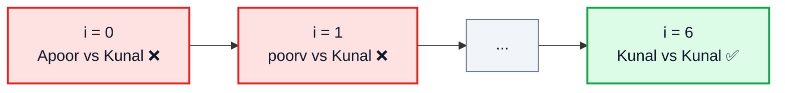
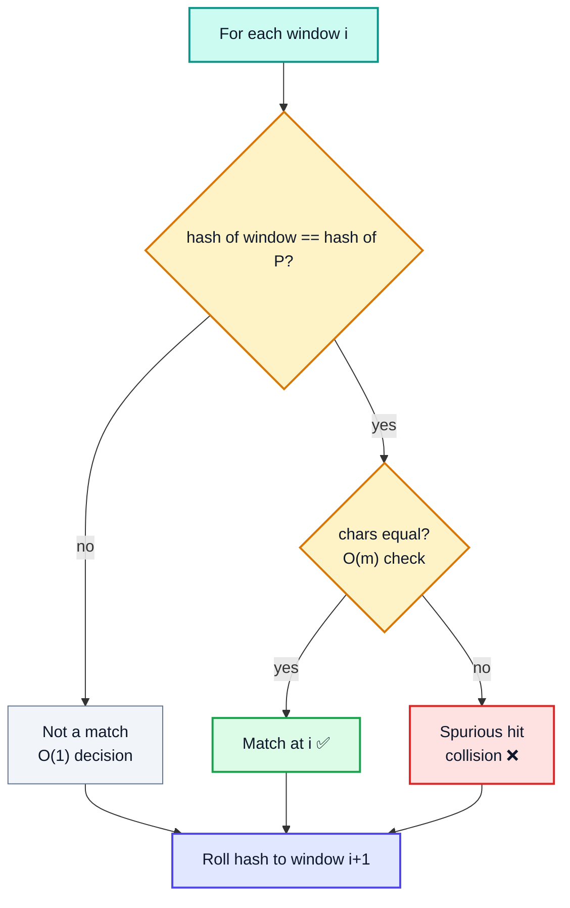
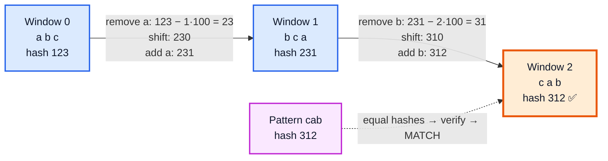
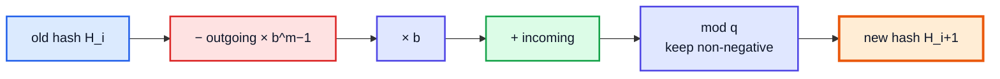
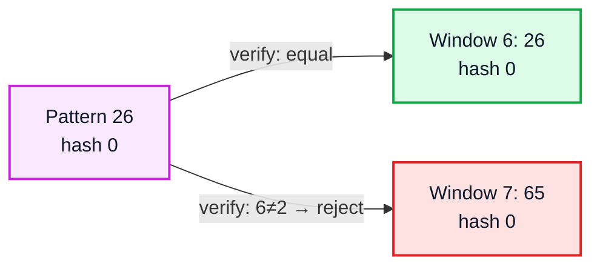

# Karp-Rabin String Matching — Complete In-Depth Guide

**Video #58 of the Java + DSA playlist:** *Karp-Rabin String Matching Algorithm | Substring Search Pattern* (24:00)

How to find a pattern inside a text by comparing **hashes** instead of characters: why naive search is slow, the polynomial rolling hash, updating the hash in O(1) as the window slides, handling collisions by verification, and a correct modular Java implementation.

> [!NOTE]
> This video's description has **no timestamps**, so the sections below follow the topics the lecture covers in order, and use "(—)" instead of a time.

---

## Table of Contents

| # | Topic | Timestamp |
|---|---|---|
| 0 | [Introduction](#0-introduction-) | — |
| 1 | [Naive String Search](#1-naive-string-search-) | — |
| 2 | [The Hashing Idea](#2-the-hashing-idea-) | — |
| 3 | [Polynomial Rolling Hash](#3-polynomial-rolling-hash-) | — |
| 4 | [Updating the Window](#4-updating-the-window-) | — |
| 5 | [Collisions & Verification](#5-collisions--verification-) | — |
| 6 | [Time & Space Complexity](#6-time--space-complexity-) | — |
| 7 | [Code: Karp-Rabin in Java](#7-code-karp-rabin-in-java-) | — |

---

## 0. Introduction (—)

**String matching** (substring search): given a **text** `T` of length `n` and a **pattern** `P` of length `m`, find every index `i` where `T[i .. i+m-1] == P`.

It is everywhere: Ctrl+F in an editor, `grep`, plagiarism detection, DNA sequence search, search engines scanning documents.

| Algorithm | Idea | Time |
|---|---|---|
| Naive | Try every position, compare char by char | O(n·m) |
| **Karp-Rabin** (Rabin-Karp) | Compare **hashes** of windows; roll the hash in O(1) | **O(n + m) expected** |
| KMP | Prefix function to never re-scan text | O(n + m) worst |
| Z-algorithm | Z-array of `P + $ + T` | O(n + m) worst |

> [!IMPORTANT]
> Karp-Rabin is the direct application of the previous video (#57): **hashing** turns an expensive comparison (m characters) into a cheap one (one number), as long as we can compute the numbers cheaply.

---

## 1. Naive String Search (—)

### Approach

Slide the pattern across the text one position at a time; at each position compare characters until a mismatch or a full match.

```java
static int naive(String text, String pat) {
    int n = text.length(), m = pat.length();
    for (int i = 0; i <= n - m; i++) {          // n - m + 1 windows
        int j = 0;
        while (j < m && text.charAt(i + j) == pat.charAt(j)) j++;
        if (j == m) return i;                   // full match
    }
    return -1;
}
// naive("ApoorvKunalRahulKunal", "Kunal") → 6
```



### Why it is slow

Worst case: `T = "aaaa...aaab"`, `P = "aaab"`. Every window matches `m − 1` characters before failing → **(n − m + 1) · m** comparisons = **O(n·m)**.

| Case | Comparisons |
|---|---|
| Best (first char mismatches everywhere) | O(n) |
| Worst (`aaa…ab` style) | O(n·m) |
| Space | O(1) |

> [!TIP]
> Java's `String.indexOf` is essentially a tuned naive search — fine for typical text, but the O(n·m) worst case is real for repetitive inputs.

---

## 2. The Hashing Idea (—)

Instead of comparing `m` characters per window, compare **one number**:

1. Compute `hash(P)` once.
2. For each window of the text, compute `hash(window)`.
3. If the hashes differ → definitely **not** a match (skip instantly).
4. If the hashes are equal → **probably** a match → verify character by character.



### The catch

If computing `hash(window)` takes O(m) every time, we gained nothing: still O(n·m). The whole algorithm depends on a hash that can be **updated in O(1)** when the window slides one step — a **rolling hash**.

### Why not just add the characters?

A simple sum hash rolls easily (`new = old − outgoing + incoming`) but is terrible: `"abc"`, `"cba"`, `"bca"` all have the same sum, so almost every window would be a false hit. We need a hash where **position matters**.

---

## 3. Polynomial Rolling Hash (—)

Treat the string as a number written in base `b`:

$$H(s_0 s_1 \dots s_{m-1}) = s_0 \cdot b^{m-1} + s_1 \cdot b^{m-2} + \dots + s_{m-1} \cdot b^0 \pmod q$$

- `b` (base): at least the alphabet size — 256 for extended ASCII, 31 or a prime like 101 are common.
- `q` (modulus): a large prime (e.g. 1 000 000 007) to keep numbers small and spread hashes.

### Toy example: base 10, `a = 1, b = 2, c = 3`

| String | Calculation | Hash |
|---|---|---|
| `"abc"` | 1·100 + 2·10 + 3 | 123 |
| `"bca"` | 2·100 + 3·10 + 1 | 231 |
| `"cab"` | 3·100 + 1·10 + 2 | 312 |

Each string literally becomes a number, so different orders give different hashes.

### Horner's rule (computing the first hash in O(m))

```java
long h = 0;
for (int i = 0; i < m; i++) {
    h = (h * base + s.charAt(i)) % mod;   // ((s0·b + s1)·b + s2)...
}
```

> [!NOTE]
> The lecture's version assigns powers the other way round — **first character × b⁰**, last character × b^(m−1): `hash += ch * Math.pow(101, i)`. Both orientations work; only the update formula changes (see next section). Java's own `String.hashCode()` uses the "first char × highest power" form with base 31.

---

## 4. Updating the Window (—)

When the window slides from `T[i .. i+m-1]` to `T[i+1 .. i+m]`:

1. **Remove** the outgoing char's contribution: subtract `T[i] · b^(m−1)`.
2. **Shift** everything one place: multiply by `b`.
3. **Add** the incoming char: add `T[i+m]`.

$$H_{i+1} = \big( (H_i - T[i] \cdot b^{m-1}) \cdot b + T[i+m] \big) \bmod q$$

`b^(m−1) mod q` is precomputed once, so each update is **O(1)**.

### Step by step: text `"abcab"`, pattern `"cab"` (hash 312), base 10



| Window i | Chars | Hash | == 312? |
|---|---|---|---|
| 0 | 🟦 a b c | 123 | ❌ |
| 1 | 🟦 b c a | 231 | ❌ |
| 2 | 🟧 c a b | 312 | ✅ verify → match at index 2 |

### What one roll does



### The lecture's (reversed) update

With "first char × b⁰" hashing, the update is:

$$H_{i+1} = \frac{H_i - T[i]}{b} + T[i+m] \cdot b^{m-1}$$

Subtract the outgoing char (it has power 0), **divide** by `b` to lower every power by one, then add the incoming char at the top power.

> [!WARNING]
> Division only works on exact integers/doubles — **not** under a modulus (you would need a modular inverse). The lecture uses `double` without a modulus, which is exact only while values stay below 2⁵³ ≈ 9·10¹⁵. With base 101 that breaks for patterns around **8+ characters** (101⁷ · 'z' > 2⁵³), silently producing wrong hashes. The modular "first char × highest power" version in section 7 has no such limit.

### Avoiding negative values in Java

`%` in Java can return a negative number. After subtracting, add `q` back:

```java
tHash = (tHash - text.charAt(i) * high % mod + mod) % mod;
tHash = (tHash * base + text.charAt(i + m)) % mod;
```

With `mod ≈ 10⁹` and `base = 256`, intermediate values stay below ~2.6·10¹¹, comfortably inside `long`.

---

## 5. Collisions & Verification (—)

A modular hash maps infinitely many strings to only `q` values, so **different strings can have equal hashes** (the pigeonhole principle again, from video #57). An equal hash with unequal text is a **spurious hit**.

### Example: digits, base 10, `q = 13`

Text `3141592653589793`, pattern `26` → `26 mod 13 = 0`.

| Window | Value | mod 13 | Result |
|---|---|---|---|
| 5 | 92 | 1 | ❌ skip |
| 6 | 26 | 0 | ✅ hash equal → verify → **MATCH** |
| 7 | 65 | 0 | 🟥 hash equal → verify → **spurious hit** |
| 8 | 53 | 1 | ❌ skip |



### Two ways to handle collisions

| Variant | What happens on equal hash | Correctness |
|---|---|---|
| **Las Vegas** (standard) | Compare the characters to confirm | Always correct; time is random |
| **Monte Carlo** | Trust the hash | Always fast; may rarely report a false match |

> [!IMPORTANT]
> Always **verify** on a hash match unless you deliberately accept a small error probability. Verification is what makes Karp-Rabin correct.

### Making collisions rare

- Choose a **large prime** `q` (e.g. 10⁹+7): probability of a spurious hit per window is about **1/q**.
- Use **double hashing** (two different `(b, q)` pairs; match only if both agree): collision chance ≈ 1/(q₁·q₂).
- Randomize the base `b` so an adversary can't craft colliding inputs.

---

## 6. Time & Space Complexity (—)

| Phase | Cost |
|---|---|
| Hash of pattern + first window | O(m) |
| Precompute `b^(m−1) mod q` | O(m) (or O(log m) with fast power) |
| Roll through `n − m + 1` windows | O(1) each → O(n) |
| Verify each real match | O(m) per match |
| Verify each spurious hit | O(m) per hit, expected ≈ n/q hits |

| Case | Time | When |
|---|---|---|
| **Expected / average** | **O(n + m)** | Good prime modulus, few matches |
| Many real matches (`k` of them) | O(n + k·m) | e.g. `T = "aaaa"`, `P = "aa"` |
| **Worst** | **O(n·m)** | Every window collides (bad/tiny `q` or adversarial input) |
| Space | O(1) extra | Only a few `long` variables (plus output list) |

### Karp-Rabin vs others

| | Naive | Karp-Rabin | KMP |
|---|---|---|---|
| Expected time | O(n·m) worst | O(n + m) | O(n + m) |
| Worst time | O(n·m) | O(n·m) | O(n + m) |
| Extra space | O(1) | O(1) | O(m) |
| Multiple patterns of the same length | Repeat | ✅ Put all pattern hashes in a `HashSet` | Repeat (or Aho-Corasick) |
| Also good for | — | Duplicate substrings, 2D matching, plagiarism (fingerprints) | Prefix/period problems |

Classic LeetCode problems that use this rolling hash:

| Problem | How Karp-Rabin helps |
|---|---|
| **LeetCode 28** — Find the Index of the First Occurrence in a String | Direct application |
| **LeetCode 187** — Repeated DNA Sequences | Rolling hash of every 10-letter window into a set |
| **LeetCode 1044** — Longest Duplicate Substring | Binary search on length + rolling hash |
| **LeetCode 686** — Repeated String Match | Search after repeating `a` enough times |

---

## 7. Code: Karp-Rabin in Java (—)

### The lecture's version (double, base 101, first char × b⁰)

```java
public class KarpRabin {
    private final int PRIME = 101;

    private double calculateHash(String str) {
        double hash = 0;
        for (int i = 0; i < str.length(); i++) {
            hash += str.charAt(i) * Math.pow(PRIME, i);
        }
        return hash;
    }

    private double updateHash(double prevHash, char oldChar, char newChar, int patternLength) {
        double newHash = (prevHash - oldChar) / PRIME;
        newHash = newHash + newChar * Math.pow(PRIME, patternLength - 1);
        return newHash;
    }

    public void search(String text, String pattern) {
        int patternLength = pattern.length();
        double patternHash = calculateHash(pattern);
        double textHash = calculateHash(text.substring(0, patternLength));

        for (int i = 0; i <= text.length() - patternLength; i++) {
            if (textHash == patternHash) {
                if (text.substring(i, i + patternLength).equals(pattern)) {
                    System.out.println("Pattern found at index " + i);
                }
            }
            if (i < text.length() - patternLength) {
                textHash = updateHash(textHash, text.charAt(i), text.charAt(i + patternLength), patternLength);
            }
        }
    }

    public static void main(String[] args) {
        KarpRabin algo = new KarpRabin();
        algo.search("ApoorvKunalRahulKunal", "Kunal");
    }
}
// Output:
// Pattern found at index 6
// Pattern found at index 16
```

Good for understanding; limited to short patterns because of `double` precision (see the warning in section 4).

### Modern version (modular, `long`, works for any length)

```java
import java.util.ArrayList;
import java.util.List;

public class RabinKarp {
    static final long BASE = 256;
    static final long MOD = 1_000_000_007L;

    static List<Integer> search(String text, String pat) {
        List<Integer> found = new ArrayList<>();
        int n = text.length(), m = pat.length();
        if (m == 0 || m > n) return found;

        long high = 1;                                   // BASE^(m-1) % MOD
        for (int i = 0; i < m - 1; i++) high = high * BASE % MOD;

        long pHash = 0, tHash = 0;
        for (int i = 0; i < m; i++) {
            pHash = (pHash * BASE + pat.charAt(i)) % MOD;
            tHash = (tHash * BASE + text.charAt(i)) % MOD;
        }

        for (int i = 0; i <= n - m; i++) {
            if (pHash == tHash && text.regionMatches(i, pat, 0, m)) {
                found.add(i);                            // verified match
            }
            if (i < n - m) {
                tHash = (tHash - text.charAt(i) * high % MOD + MOD) % MOD;
                tHash = (tHash * BASE + text.charAt(i + m)) % MOD;
            }
        }
        return found;
    }

    public static void main(String[] args) {
        System.out.println(search("ApoorvKunalRahulKunal", "Kunal"));  // [6, 16]
        System.out.println(search("aaaaa", "aa"));                     // [0, 1, 2, 3]
        System.out.println(search("hello", "xyz"));                    // []
    }
}
```

### Dry run: `"ApoorvKunalRahulKunal"`, pattern `"Kunal"`

| i | Window | Hash equal? | Verify | Result |
|---|---|---|---|---|
| 0 | `Apoor` | ❌ | — | skip |
| 1–5 | `poorv` … `vKuna` | ❌ | — | skip |
| 6 | `Kunal` | ✅ | equal | 🟩 match at 6 |
| 7–15 | `unalR` … `lKuna` | ❌ | — | skip |
| 16 | `Kunal` | ✅ | equal | 🟩 match at 16 |

17 windows, each decided by one `long` comparison; only 2 character-by-character checks.

---

## 🧩 Complete Example: Everything Together

Naive search vs Karp-Rabin, a deliberately tiny modulus to show verification catching a collision, the digit trace from section 5, and LeetCode 28:

```java
import java.util.ArrayList;
import java.util.List;

public class Main {
    static int charComparisons = 0;

    // ═══════ 1. NAIVE SEARCH: O(n · m) ═══════
    static List<Integer> naiveSearch(String text, String pat) {
        List<Integer> found = new ArrayList<>();
        int n = text.length(), m = pat.length();
        for (int i = 0; i <= n - m; i++) {
            int j = 0;
            while (j < m) {
                charComparisons++;
                if (text.charAt(i + j) != pat.charAt(j)) break;
                j++;
            }
            if (j == m) found.add(i);
        }
        return found;
    }

    // ═══════ 2. KARP-RABIN with modular rolling hash ═══════
    static int spuriousHits = 0;

    static List<Integer> karpRabin(String text, String pat, long base, long mod) {
        List<Integer> found = new ArrayList<>();
        int n = text.length(), m = pat.length();
        if (m == 0 || m > n) return found;

        long high = 1;                                   // base^(m-1) % mod
        for (int i = 0; i < m - 1; i++) high = high * base % mod;

        long pHash = 0, tHash = 0;
        for (int i = 0; i < m; i++) {                    // Horner's rule
            pHash = (pHash * base + pat.charAt(i)) % mod;
            tHash = (tHash * base + text.charAt(i)) % mod;
        }

        for (int i = 0; i <= n - m; i++) {
            if (pHash == tHash) {
                if (text.regionMatches(i, pat, 0, m)) found.add(i);   // verify!
                else spuriousHits++;
            }
            if (i < n - m) {                             // roll: drop text[i], add text[i+m]
                tHash = (tHash - text.charAt(i) * high % mod + mod) % mod;
                tHash = (tHash * base + text.charAt(i + m)) % mod;
            }
        }
        return found;
    }

    // ═══════ 3. LeetCode 28 — Find the Index of the First Occurrence ═══════
    static int strStr(String haystack, String needle) {
        if (needle.isEmpty()) return 0;
        List<Integer> r = karpRabin(haystack, needle, 256, 1_000_000_007L);
        return r.isEmpty() ? -1 : r.get(0);
    }

    // ═══════ 4. Rolling-hash trace on digits (base 10, mod 13) ═══════
    static void digitTrace(String digits, String pat, int q) {
        int m = pat.length();
        int h = 1;
        for (int i = 0; i < m - 1; i++) h = h * 10 % q;
        int p = 0, t = 0;
        for (int i = 0; i < m; i++) {
            p = (p * 10 + (pat.charAt(i) - '0')) % q;
            t = (t * 10 + (digits.charAt(i) - '0')) % q;
        }
        System.out.println("pattern " + pat + " mod " + q + " = " + p);
        for (int s = 0; s <= digits.length() - m; s++) {
            if (t == p) {
                boolean real = digits.startsWith(pat, s);
                System.out.println("  window " + s + " \"" + digits.substring(s, s + m) + "\" hash " + t
                        + (real ? " -> MATCH" : " -> spurious hit"));
            }
            if (s < digits.length() - m) {
                t = ((t - (digits.charAt(s) - '0') * h % q + q) % q * 10 + (digits.charAt(s + m) - '0')) % q;
            }
        }
    }

    public static void main(String[] args) {
        String text = "ApoorvKunalRahulKunal";
        String pat = "Kunal";

        System.out.println("== Naive ==");
        System.out.println("found at " + naiveSearch(text, pat) + ", char comparisons = " + charComparisons);

        System.out.println("== Karp-Rabin (base 256, mod 1e9+7) ==");
        System.out.println("found at " + karpRabin(text, pat, 256, 1_000_000_007L)
                + ", spurious hits = " + spuriousHits);

        spuriousHits = 0;
        System.out.println("== Karp-Rabin with a tiny modulus (mod 11) ==");
        System.out.println("found at " + karpRabin(text, pat, 256, 11)
                + ", spurious hits = " + spuriousHits + "  <- verification saves us");

        System.out.println("== Digit trace ==");
        digitTrace("3141592653589793", "26", 13);

        System.out.println("== LeetCode 28 ==");
        System.out.println("strStr(\"sadbutsad\", \"sad\") = " + strStr("sadbutsad", "sad"));
        System.out.println("strStr(\"leetcode\", \"leeto\") = " + strStr("leetcode", "leeto"));
    }
}
```

**Expected Output:**
```
== Naive ==
found at [6, 16], char comparisons = 25
== Karp-Rabin (base 256, mod 1e9+7) ==
found at [6, 16], spurious hits = 0
== Karp-Rabin with a tiny modulus (mod 11) ==
found at [6, 16], spurious hits = 1  <- verification saves us
== Digit trace ==
pattern 26 mod 13 = 0
  window 6 "26" hash 0 -> MATCH
  window 7 "65" hash 0 -> spurious hit
== LeetCode 28 ==
strStr("sadbutsad", "sad") = 0
strStr("leetcode", "leeto") = -1
```

---

## Quick Reference Cheat Sheet

| Concept | One-Line Summary |
|---|---|
| **String matching** | Find all `i` where `T[i..i+m-1] == P` |
| **Naive search** | Compare at every shift; O(n·m) worst, O(1) space |
| **Hashing idea** | Compare one number per window instead of m characters |
| **Polynomial hash** | `s0·b^(m−1) + … + s(m−1)` mod q — position-sensitive |
| **Horner's rule** | `h = h·b + c` (mod q) computes the first hash in O(m) |
| **Rolling update** | `((H − out·b^(m−1))·b + in) mod q` — O(1) per slide |
| **Lecture's variant** | First char × b⁰; update by `(H − out)/b + in·b^(m−1)`; double precision limits length |
| **Negative mod** | Add `q` after subtracting: `(x % q + q) % q` |
| **Spurious hit** | Equal hashes, different strings — always verify |
| **Choosing q** | Large prime (10⁹+7); double hashing for extra safety |
| **Complexity** | O(n + m) expected, O(n·m) worst, O(1) extra space |
| **Best use cases** | Many patterns of equal length, duplicate substrings, LeetCode 28 / 187 / 1044 |
