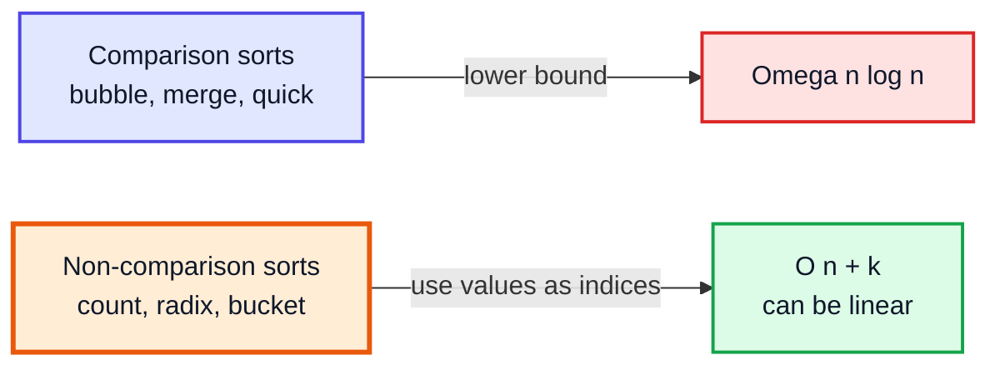
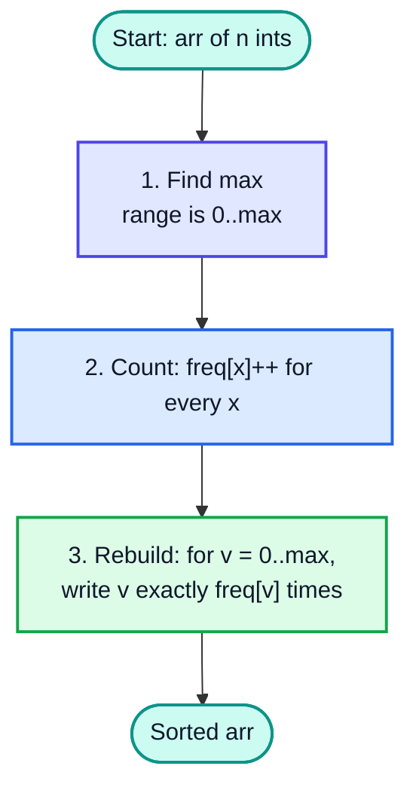
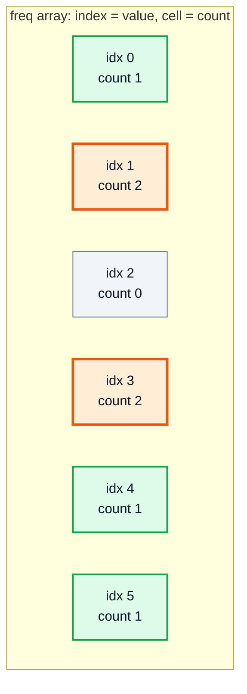
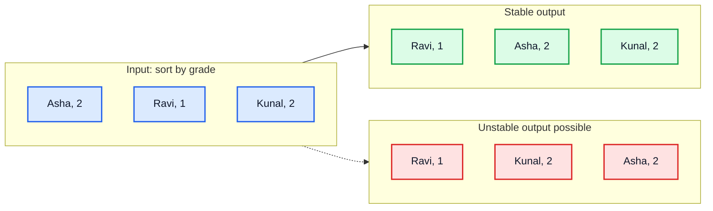
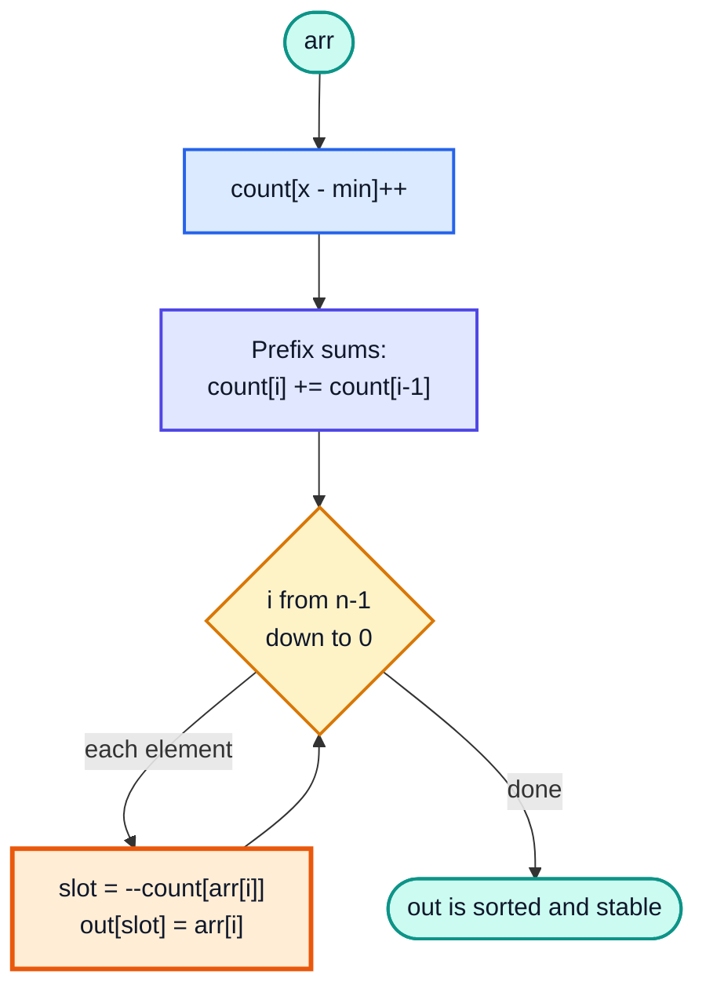
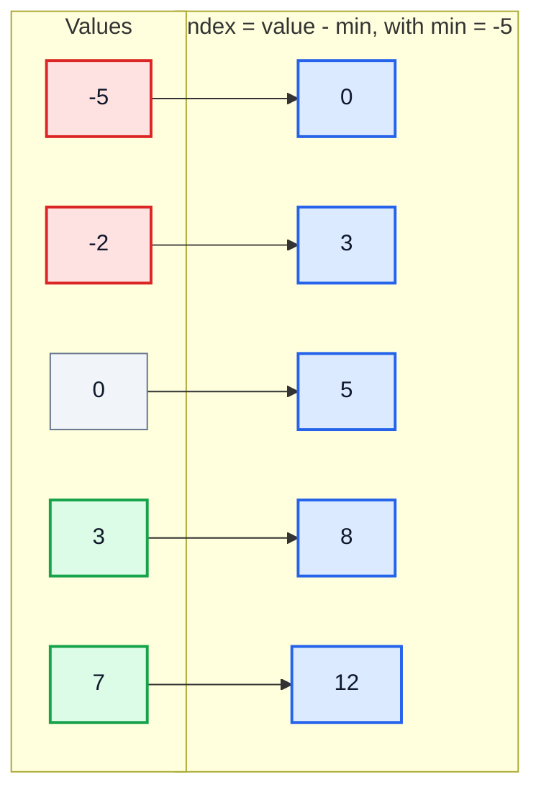
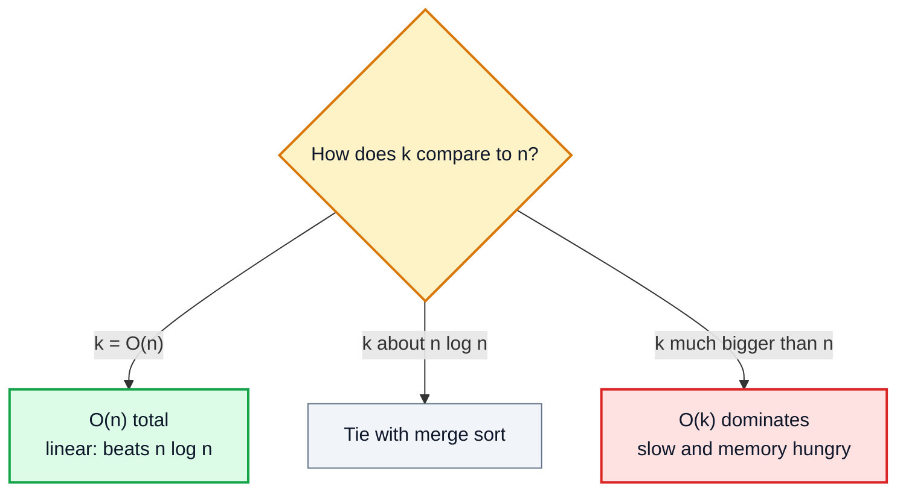
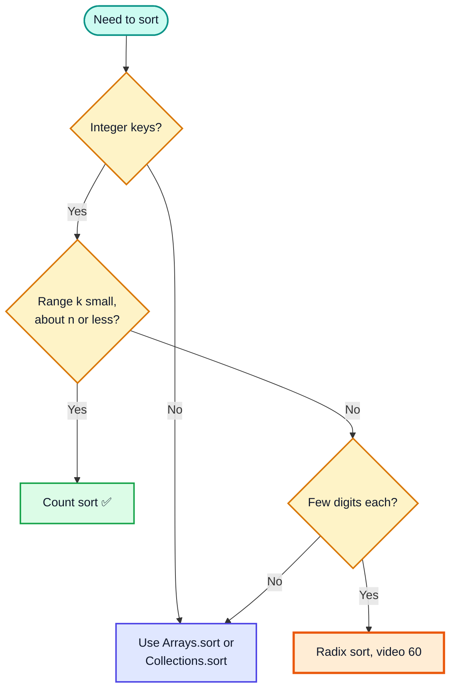

# Count Sort — Complete In-Depth Guide

**Video #59 of the Java + DSA playlist:** *Count Sort Algorithm - Theory + Code* (20:44)

Count sort sorts numbers **without comparing them**: it counts how many times each value appears and then rebuilds the array from those counts. These notes cover the idea, the frequency array, the simple and stable (prefix-sum) versions, a HashMap version for huge ranges, negative numbers, the O(n + k) complexity, and when count sort is the right tool.

> [!NOTE]
> This video's description has **no timestamps**, so the sections below are built from the topics the video covers and the standard count sort material. Every section shows **(—)** instead of a time.

---

## Table of Contents

| # | Topic | Timestamp |
|---|---|---|
| 0 | [Introduction](#0-introduction-) | — |
| 1 | [The Idea Behind Count Sort](#1-the-idea-behind-count-sort-) | — |
| 2 | [The Frequency Array](#2-the-frequency-array-) | — |
| 3 | [Simple Count Sort Code and Dry Run](#3-simple-count-sort-code-and-dry-run-) | — |
| 4 | [Stable Count Sort with Prefix Sums](#4-stable-count-sort-with-prefix-sums-) | — |
| 5 | [HashMap Version for Large Ranges](#5-hashmap-version-for-large-ranges-) | — |
| 6 | [Handling Negative Numbers](#6-handling-negative-numbers-) | — |
| 7 | [Time and Space Complexity](#7-time-and-space-complexity-) | — |
| 8 | [When to Use Count Sort](#8-when-to-use-count-sort-) | — |
| 9 | [Outro](#9-outro-) | — |

---

## 0. Introduction (—)

Every sort you have seen so far in this playlist — bubble, selection, insertion, merge, quick — is a **comparison sort**: it learns the order only by asking "is `a < b`?". A famous result says no comparison sort can beat **O(n log n)** in the worst case.

Count sort sidesteps that limit. It never compares two elements. Instead it uses the **value itself as an array index**.



> [!IMPORTANT]
> Count sort is fast **only when the range of values `k` is small** compared to the number of elements `n`. Sorting 1 million exam scores in `0..100`? Perfect. Sorting 10 numbers that range up to 10⁹? Terrible — unless you switch to the HashMap version (section 5).

---

## 1. The Idea Behind Count Sort (—)

### The basics

Imagine a teacher sorting a pile of answer sheets by marks out of 10. Instead of comparing sheets, she makes 11 small piles labelled `0` to `10`, drops each sheet onto its pile, then picks the piles up in order. That is count sort.

For plain integers we do not even need the piles — we only need **how many** sheets went on each pile, because two `3`s are indistinguishable.

### The three steps



### Comparison vs counting, side by side

| | **Comparison sort** (e.g. merge sort) | **Count sort** |
|---|---|---|
| Core operation | `arr[i] < arr[j]` | `freq[arr[i]]++` |
| Works on | Anything `Comparable` | Integers (or things mapped to small integer keys) |
| Best possible time | O(n log n) | O(n + k) |
| Extra space | O(n) or O(log n) | O(k) (+ O(n) for the stable version) |
| Depends on value range? | ❌ No | ✅ Yes — heavily |

---

## 2. The Frequency Array (—)

The **frequency array** (also called the *count array*) is the heart of the algorithm.

- Its **index** represents a **value** from the input.
- Its **cell** stores **how many times** that value appears.
- Its size is `max + 1` (indices `0..max`).

### Building it for `arr = {3, 4, 1, 3, 1, 0, 5}`

`max = 5`, so `freq` has 6 cells.

| Step | Read `x` | `freq` after `freq[x]++` (indices 0..5) |
|---|---|---|
| 1 | 3 | `[0, 0, 0, 1, 0, 0]` |
| 2 | 4 | `[0, 0, 0, 1, 1, 0]` |
| 3 | 1 | `[0, 1, 0, 1, 1, 0]` |
| 4 | 3 | `[0, 1, 0, 2, 1, 0]` |
| 5 | 1 | `[0, 2, 0, 2, 1, 0]` |
| 6 | 0 | `[1, 2, 0, 2, 1, 0]` |
| 7 | 5 | `[1, 2, 0, 2, 1, 1]` 🟩 |



Reading it left to right — "one 0, two 1s, no 2s, two 3s, one 4, one 5" — **is already the sorted array**: `[0, 1, 1, 3, 3, 4, 5]`.

> [!TIP]
> Wasted cells (grey, count 0) are the hidden cost of count sort. If values are `{1, 1000000}`, you allocate a million cells to sort two numbers.

### Finding `max` in modern Java

```java
int max = arr[0];
for (int x : arr) if (x > max) max = x;          // classic loop

int max2 = Arrays.stream(arr).max().getAsInt();  // stream version (Java 8+)
```

Both are O(n). The loop avoids stream overhead; the stream is shorter. `getAsInt()` throws `NoSuchElementException` on an empty array, so guard for that first.

---

## 3. Simple Count Sort Code and Dry Run (—)

### Code

```java
import java.util.Arrays;

public class CountSortSimple {

    static void countSort(int[] arr) {
        if (arr == null || arr.length <= 1) return;   // nothing to sort

        int max = arr[0];
        for (int x : arr) if (x > max) max = x;

        int[] freq = new int[max + 1];
        for (int x : arr) freq[x]++;                  // count every value

        int index = 0;
        for (int v = 0; v <= max; v++) {              // walk values in increasing order
            while (freq[v] > 0) {
                arr[index++] = v;                     // overwrite the original array
                freq[v]--;
            }
        }
    }

    public static void main(String[] args) {
        int[] arr = {3, 4, 1, 3, 1, 0, 5};
        countSort(arr);
        System.out.println(Arrays.toString(arr));     // [0, 1, 1, 3, 3, 4, 5]
    }
}
```

### Dry run of the rebuild phase

Starting `freq = [1, 2, 0, 2, 1, 1]`.

| `v` | `freq[v]` | Writes | `arr` so far | `index` after |
|---|---|---|---|---|
| 0 | 1 | `0` | `[0, _, _, _, _, _, _]` | 1 |
| 1 | 2 | `1, 1` | `[0, 1, 1, _, _, _, _]` | 3 |
| 2 | 0 | — 🟥 skip | `[0, 1, 1, _, _, _, _]` | 3 |
| 3 | 2 | `3, 3` | `[0, 1, 1, 3, 3, _, _]` | 5 |
| 4 | 1 | `4` | `[0, 1, 1, 3, 3, 4, _]` | 6 |
| 5 | 1 | `5` | `[0, 1, 1, 3, 3, 4, 5]` ✅ | 7 |

> [!NOTE]
> The nested `while` looks like O(n²), but it is not: across the **whole** outer loop the inner body runs exactly `n` times in total (once per element). The outer loop runs `k = max + 1` times. Total: **O(n + k)**.

### Limitations of the simple version

| Limitation | Why | Fix |
|---|---|---|
| ❌ Negative numbers crash | `freq[-2]` → `ArrayIndexOutOfBoundsException` | Offset by `min` (section 6) |
| ❌ Huge range wastes memory | `new int[max + 1]` with max = 10⁹ → ~4 GB | HashMap version (section 5) |
| ❌ Not usable for records | It *invents* values `v`; satellite data (names, IDs) is lost | Stable prefix-sum version (section 4) |

---

## 4. Stable Count Sort with Prefix Sums (—)

### What "stable" means

A sort is **stable** if elements with **equal keys keep their original relative order**. For plain `int`s this is invisible, but when sorting *records by a key* it matters — and it is the **whole reason radix sort works** (next video, #60).



### The prefix-sum trick

After counting, turn `count` into a **running total**: `count[i] += count[i - 1]`. Now `count[v]` means **"how many elements are ≤ v"**, which is exactly **one past the last slot** where `v` belongs in the output.

Then scan the input **from right to left**, place each element at `--count[value]`, and copy into a separate output array.



### Code

```java
import java.util.Arrays;

public class CountSortStable {

    static int[] countSortStable(int[] arr) {
        int n = arr.length;
        if (n == 0) return new int[0];

        int max = Arrays.stream(arr).max().getAsInt();
        int[] count = new int[max + 1];
        for (int x : arr) count[x]++;

        for (int i = 1; i <= max; i++) {
            count[i] += count[i - 1];         // count[v] = number of elements <= v
        }

        int[] out = new int[n];
        for (int i = n - 1; i >= 0; i--) {    // right-to-left = stable
            out[--count[arr[i]]] = arr[i];
        }
        return out;
    }

    public static void main(String[] args) {
        int[] arr = {2, 5, 3, 0, 2, 3, 0, 3};
        System.out.println(Arrays.toString(countSortStable(arr)));
        // [0, 0, 2, 2, 3, 3, 3, 5]
    }
}
```

### Dry run: `arr = {2, 5, 3, 0, 2, 3, 0, 3}`

**Counts** (indices 0..5): `[2, 0, 2, 3, 0, 1]`
**Prefix sums**: `[2, 2, 4, 7, 7, 8]` — e.g. `count[3] = 7` → the last `3` goes to slot 6.

| `i` | `arr[i]` | `count[arr[i]]` before → after | Placed at | `out` |
|---|---|---|---|---|
| 7 | 3 | 7 → 6 | 6 | `[_, _, _, _, _, _, 3, _]` |
| 6 | 0 | 2 → 1 | 1 | `[_, 0, _, _, _, _, 3, _]` |
| 5 | 3 | 6 → 5 | 5 | `[_, 0, _, _, _, 3, 3, _]` |
| 4 | 2 | 4 → 3 | 3 | `[_, 0, _, 2, _, 3, 3, _]` |
| 3 | 0 | 1 → 0 | 0 | `[0, 0, _, 2, _, 3, 3, _]` |
| 2 | 3 | 5 → 4 | 4 | `[0, 0, _, 2, 3, 3, 3, _]` |
| 1 | 5 | 8 → 7 | 7 | `[0, 0, _, 2, 3, 3, 3, 5]` |
| 0 | 2 | 3 → 2 | 2 | `[0, 0, 2, 2, 3, 3, 3, 5]` ✅ |

Notice the `3` from index 7 landed in slot 6 (the **last** `3` slot), and the `3` from index 2 landed in slot 4 (the **first** `3` slot). Original order preserved 🟩.

> [!WARNING]
> Scanning **left to right** with these "end position" prefix sums **reverses** the order of equal keys — the sort becomes unstable. Either scan right-to-left (as above) or convert to "start positions" (exclusive prefix sum) and scan left-to-right with `count[v]++`.

> [!NOTE]
> The lecture concentrates on the simple "rewrite from frequencies" version and a HashMap variant. The prefix-sum version is the standard textbook (CLRS) form; it is worth learning now because radix sort (#60) depends on it.

---

## 5. HashMap Version for Large Ranges (—)

### The problem

`{1_000_000_000, 5, 999_999}` would need `new int[1_000_000_001]` — roughly 4 GB of zeros. A `HashMap` stores **only the values that actually appear**.

### Version A: HashMap + walk `min..max` (the lecture-style approach)

```java
import java.util.Arrays;
import java.util.HashMap;
import java.util.Map;

public class CountSortHash {

    static void countSortHash(int[] arr) {
        if (arr.length <= 1) return;
        int min = Arrays.stream(arr).min().getAsInt();
        int max = Arrays.stream(arr).max().getAsInt();

        Map<Integer, Integer> freq = new HashMap<>();
        for (int x : arr) freq.put(x, freq.getOrDefault(x, 0) + 1);

        int index = 0;
        for (int v = min; v <= max; v++) {           // still walks the whole range!
            int c = freq.getOrDefault(v, 0);
            while (c-- > 0) arr[index++] = v;
        }
    }

    public static void main(String[] args) {
        int[] arr = {6, 3, 10, 9, 2, 4, 9, 7};
        countSortHash(arr);
        System.out.println(Arrays.toString(arr));    // [2, 3, 4, 6, 7, 9, 9, 10]
    }
}
```

This saves **memory** (O(distinct values)) and handles negatives for free, but **time is still O(n + k)** because the loop visits every `v` from `min` to `max`.

### Version B: TreeMap — skip the gaps entirely

```java
import java.util.Map;
import java.util.TreeMap;

static void countSortTree(int[] arr) {
    Map<Integer, Integer> freq = new TreeMap<>();   // keys kept in sorted order
    for (int x : arr) freq.merge(x, 1, Integer::sum);

    int index = 0;
    for (var e : freq.entrySet()) {
        for (int c = 0; c < e.getValue(); c++) arr[index++] = e.getKey();
    }
}
```

`TreeMap` is a red-black tree, so each insert is O(log m) where `m` = number of distinct values. Total **O(n log m)** — great when there are many duplicates and a huge, sparse range.

| Version | Time | Extra space | Negatives? | Huge range? |
|---|---|---|---|---|
| Array `freq[max+1]` | O(n + k) | O(k) | ❌ (needs offset) | ❌ |
| HashMap + `min..max` loop | O(n + k) | O(m) | ✅ | Memory ✅, time ❌ |
| TreeMap entries | O(n log m) | O(m) | ✅ | ✅ |

> [!TIP]
> `freq.merge(x, 1, Integer::sum)` (Java 8+) is the modern one-liner for "increment or insert 1". It replaces `put(x, getOrDefault(x, 0) + 1)`.

---

## 6. Handling Negative Numbers (—)

### The offset trick

Shift every value by `min` so the smallest value lands on index `0`:

- `index = value - min`
- `value = index + min`
- array size `k = max - min + 1`



### Code

```java
static int[] countSortWithNegatives(int[] arr) {
    if (arr.length == 0) return new int[0];
    int min = Arrays.stream(arr).min().getAsInt();
    int max = Arrays.stream(arr).max().getAsInt();
    int k = max - min + 1;

    int[] count = new int[k];
    for (int x : arr) count[x - min]++;
    for (int i = 1; i < k; i++) count[i] += count[i - 1];

    int[] out = new int[arr.length];
    for (int i = arr.length - 1; i >= 0; i--) {
        out[--count[arr[i] - min]] = arr[i];
    }
    return out;
}
// {4, -2, 7, 0, -2, 3, 7, -5}  ->  [-5, -2, -2, 0, 3, 4, 7, 7]
```

> [!CAUTION]
> `max - min + 1` can **overflow `int`** if values span close to the full `int` range (e.g. `min = -2_000_000_000`, `max = 2_000_000_000`). In that case count sort is the wrong algorithm anyway — use `Arrays.sort` or radix sort.

Bonus: the offset also **saves memory** when values are all large but close together, e.g. `{1000, 1003, 1001}` needs only 4 cells, not 1004.

---

## 7. Time and Space Complexity (—)

Let `n` = number of elements, `k` = range size (`max - min + 1`).

| Phase | Work | Cost |
|---|---|---|
| Find `min` / `max` | One pass over input | O(n) |
| Allocate + zero `count` | `k` cells | O(k) |
| Count frequencies | One pass over input | O(n) |
| Prefix sums (stable version) | One pass over `count` | O(k) |
| Place / rebuild | One pass over input + one over `count` | O(n + k) |
| **Total** | | **O(n + k)** |

| Case | Time | Why |
|---|---|---|
| Best | O(n + k) | Always does every phase — no early exit |
| Average | O(n + k) | Same |
| Worst | O(n + k) | Same; it is "bad" only when `k` ≫ `n` |
| Space (simple) | O(k) | The frequency array |
| Space (stable) | O(n + k) | Frequency array + output array |



> [!IMPORTANT]
> "Count sort is O(n)" is only true when **k = O(n)**. Always state it as **O(n + k)** in interviews.

### Properties

| Property | Simple version | Stable (prefix-sum) version |
|---|---|---|
| Stable? | N/A (rewrites values) | ✅ Yes |
| In-place? | Mostly (O(k) extra) | ❌ No (O(n) output) |
| Comparison-based? | ❌ No | ❌ No |
| Adaptive (faster on sorted input)? | ❌ No | ❌ No |

---

## 8. When to Use Count Sort (—)

### ✅ Good fits

- **Small known range**: ages (0–150), exam marks (0–100), RGB channel values (0–255), dice rolls, ratings 1–5.
- **Lots of duplicates**: millions of items, few distinct values.
- **As a subroutine**: the per-digit pass inside **radix sort** (video #60).
- **Sorting records by a small integer key** while keeping ties in order (stable version).

### ❌ Bad fits

- Floating-point numbers or arbitrary objects with no natural small integer key.
- Huge sparse ranges with few elements (`{1, 10⁹}`).
- When memory is tight and `k` is large.



### Related LeetCode problems

| Problem | How counting helps |
|---|---|
| **75. Sort Colors** | Only values 0, 1, 2 → count them, rewrite (or Dutch National Flag in one pass) |
| **1122. Relative Sort Array** | Values ≤ 1000 → frequency array, then emit in `arr2` order |
| **274. H-Index** | Bucket citations into `count[0..n]` (cap at n) → O(n) |
| **1051. Height Checker** | Heights 1–100 → count sort to get the expected order |
| **242. Valid Anagram** | `int[26]` frequency array — the same counting idea |

### Example: LeetCode 75 — Sort Colors (counting approach)

```java
public void sortColors(int[] nums) {
    int[] count = new int[3];
    for (int x : nums) count[x]++;
    int i = 0;
    for (int v = 0; v < 3; v++) {
        while (count[v]-- > 0) nums[i++] = v;
    }
}
// [2,0,2,1,1,0] -> [0,0,1,1,2,2]   Time O(n), Space O(1)
```

Alternative: the **Dutch National Flag** algorithm (three pointers `low`, `mid`, `high`) sorts in a single pass, also O(n) time and O(1) space.

---

## 9. Outro (—)

Count sort trades **memory for speed** by turning values into indices. Its stable prefix-sum form is the building block for the next video, **#60 Radix Sort**, which applies count sort once per digit so it can handle large numbers without a giant count array.

---

## 🧩 Complete Example: Everything Together

One program that runs the simple version, the stable version with negatives, the TreeMap version for a huge range, a stability demo on records, and a correctness check against `Arrays.sort`:

```java
import java.util.Arrays;
import java.util.Map;
import java.util.TreeMap;

public class CountSortDemo {

    // ═══════ 1. SIMPLE COUNT SORT (non-negative ints, rewrites values) ═══════
    static void countSortSimple(int[] arr) {
        if (arr == null || arr.length <= 1) return;
        int max = Arrays.stream(arr).max().getAsInt();
        int[] freq = new int[max + 1];          // index = value, cell = how many times it appears
        for (int x : arr) freq[x]++;

        int index = 0;
        for (int v = 0; v <= max; v++) {
            while (freq[v] > 0) {               // write value v, freq[v] times
                arr[index++] = v;
                freq[v]--;
            }
        }
    }

    // ═══════ 2. STABLE COUNT SORT (prefix sums, handles negatives via offset) ═══════
    static int[] countSortStable(int[] arr) {
        if (arr.length == 0) return arr.clone();
        int min = Arrays.stream(arr).min().getAsInt();
        int max = Arrays.stream(arr).max().getAsInt();
        int k = max - min + 1;                  // size of the value range
        int[] count = new int[k];
        for (int x : arr) count[x - min]++;     // shift so min lands on index 0

        for (int i = 1; i < k; i++) count[i] += count[i - 1];   // prefix sums = end positions

        int[] out = new int[arr.length];
        for (int i = arr.length - 1; i >= 0; i--) {             // right-to-left keeps it stable
            int slot = --count[arr[i] - min];
            out[slot] = arr[i];
        }
        return out;
    }

    // ═══════ 3. HASHMAP / TREEMAP VERSION (huge sparse range) ═══════
    static void countSortMap(int[] arr) {
        Map<Integer, Integer> freq = new TreeMap<>();            // keys come out sorted
        for (int x : arr) freq.merge(x, 1, Integer::sum);
        int index = 0;
        for (var e : freq.entrySet()) {
            for (int c = 0; c < e.getValue(); c++) arr[index++] = e.getKey();
        }
    }

    // ═══════ 4. STABILITY DEMO: sort records by a small integer key ═══════
    record Student(String name, int grade) {}

    static Student[] sortByGrade(Student[] students, int maxGrade) {
        int[] count = new int[maxGrade + 1];
        for (Student s : students) count[s.grade()]++;
        for (int i = 1; i <= maxGrade; i++) count[i] += count[i - 1];
        Student[] out = new Student[students.length];
        for (int i = students.length - 1; i >= 0; i--) {
            out[--count[students[i].grade()]] = students[i];
        }
        return out;
    }

    public static void main(String[] args) {
        int[] a = {3, 4, 1, 3, 1, 0, 5};
        countSortSimple(a);
        System.out.println("Simple       : " + Arrays.toString(a));

        int[] b = {4, -2, 7, 0, -2, 3, 7, -5};
        System.out.println("Stable (neg) : " + Arrays.toString(countSortStable(b)));

        int[] c = {1_000_000_000, 5, 999_999, 5, -1_000_000_000};
        countSortMap(c);
        System.out.println("TreeMap      : " + Arrays.toString(c));

        Student[] students = {
            new Student("Asha", 2), new Student("Ravi", 1),
            new Student("Kunal", 2), new Student("Meera", 0), new Student("Dev", 1)
        };
        System.out.println("By grade (stable):");
        for (Student s : sortByGrade(students, 2)) {
            System.out.println("  " + s.grade() + " " + s.name());
        }

        int[] d = {9, 8, 7, 6, 5, 4, 3, 2, 1, 0};
        int[] expected = d.clone();
        Arrays.sort(expected);
        System.out.println("Matches Arrays.sort? " + Arrays.equals(countSortStable(d), expected));
    }
}
```

**Expected Output:**
```
Simple       : [0, 1, 1, 3, 3, 4, 5]
Stable (neg) : [-5, -2, -2, 0, 3, 4, 7, 7]
TreeMap      : [-1000000000, 5, 5, 999999, 1000000000]
By grade (stable):
  0 Meera
  1 Ravi
  1 Dev
  2 Asha
  2 Kunal
Matches Arrays.sort? true
```

(Compiled and run with Java 21. `record` needs Java 16+.) Notice Ravi stays before Dev and Asha before Kunal: that is stability.

---

## Quick Reference Cheat Sheet

| Concept | One-Line Summary |
|---|---|
| **Count sort** | Non-comparison sort: count occurrences of each value, rebuild in order |
| **Frequency array** | `freq[value]` = how many times `value` appears; size `max - min + 1` |
| **Simple version** | For `v = 0..max`, write `v` exactly `freq[v]` times; fine for plain ints |
| **Prefix sums** | `count[i] += count[i-1]` → `count[v]` = number of elements ≤ v (end slot) |
| **Stable version** | Scan input right-to-left, `out[--count[x]] = x`; equal keys keep their order |
| **Stability** | Equal keys keep their input order; needed for records and for radix sort |
| **Negatives** | Offset: `index = x - min`, `value = index + min` |
| **HashMap version** | Stores only present values (memory O(m)); a `min..max` walk still costs O(k) time |
| **TreeMap version** | Iterates only present keys in order; O(n log m) time |
| **Time** | O(n + k) in every case |
| **Space** | O(k) simple, O(n + k) stable |
| **Use when** | Integer keys with small range `k` ≈ n or less, many duplicates |
| **Avoid when** | Huge sparse range, floats, arbitrary objects |
| **`max - min + 1` overflow** | Possible for near-full `int` ranges; pick another sort |
| **LeetCode** | 75 Sort Colors, 1122 Relative Sort Array, 274 H-Index, 1051 Height Checker |
