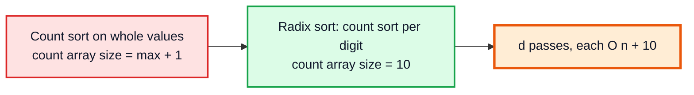
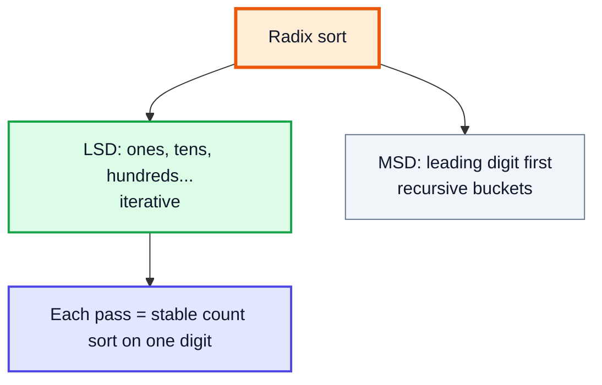
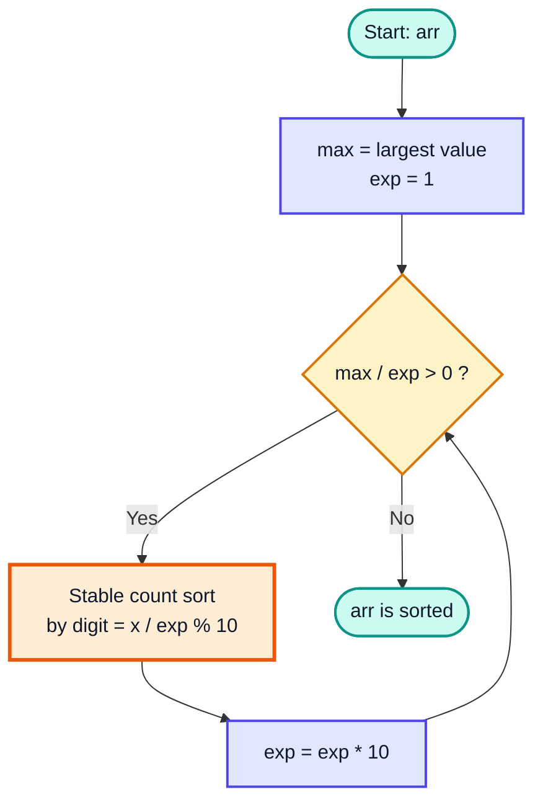
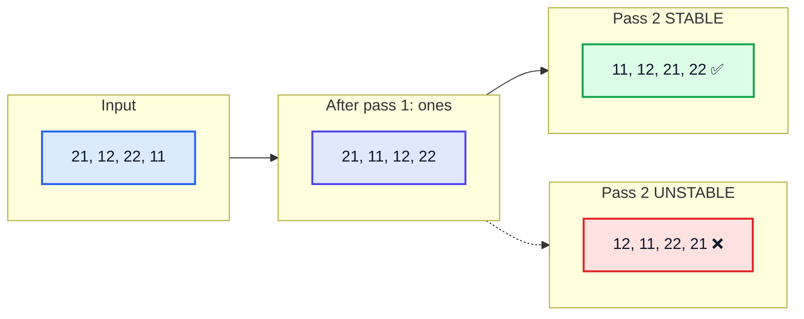
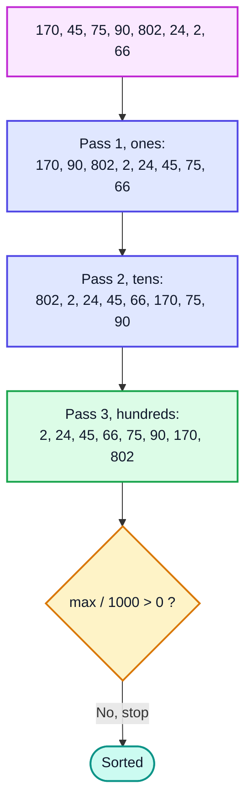
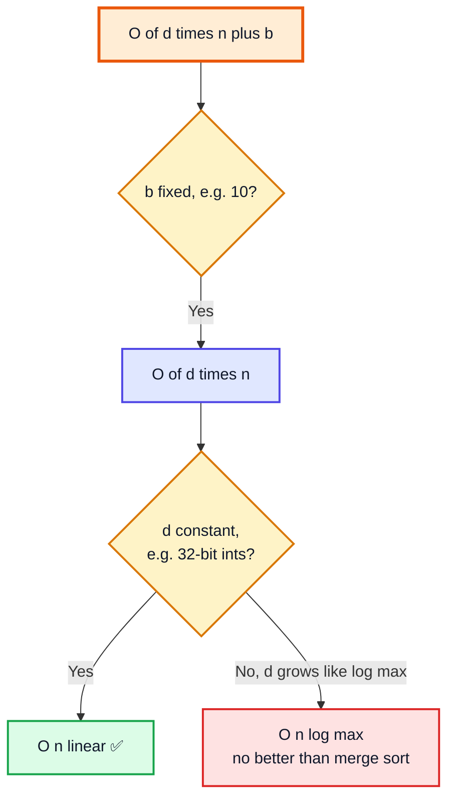
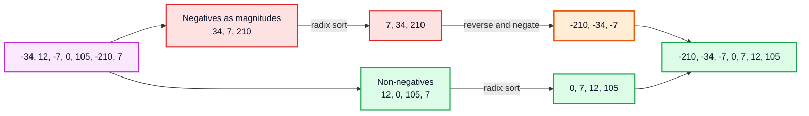
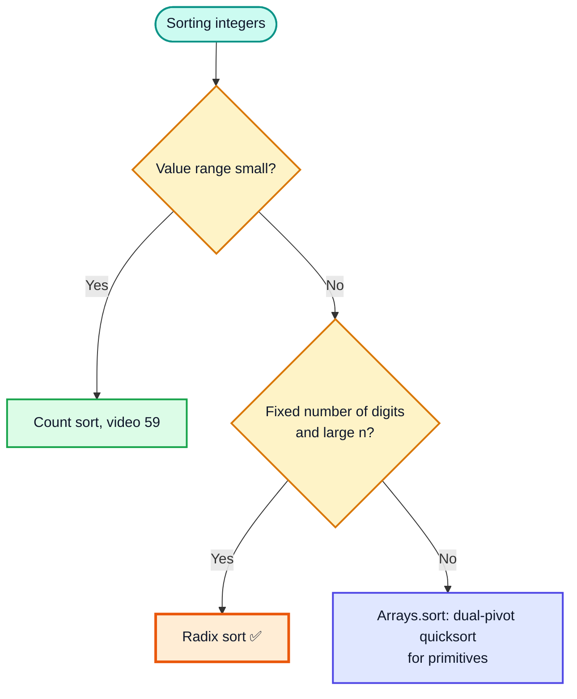

# Radix Sort — Complete In-Depth Guide

**Video #60 of the Java + DSA playlist:** *Radix Sort Algorithm - Theory + Code* (31:22)

Radix sort sorts integers **one digit at a time**, from the least significant digit to the most significant, and uses a **stable count sort** for each digit. These notes cover the idea, LSD passes, why stability is essential, a full dry run, the code, the O(d·(n + b)) complexity, negative numbers, and how radix sort compares with comparison sorts.

> [!NOTE]
> This video's description has **no timestamps**, so the sections below are built from the topics the video covers and the standard radix sort material. Every section shows **(—)** instead of a time.

---

## Table of Contents

| # | Topic | Timestamp |
|---|---|---|
| 0 | [Introduction](#0-introduction-) | — |
| 1 | [The Idea Behind Radix Sort](#1-the-idea-behind-radix-sort-) | — |
| 2 | [LSD Radix Sort Digit by Digit Passes](#2-lsd-radix-sort-digit-by-digit-passes-) | — |
| 3 | [Stable Count Sort for Each Digit](#3-stable-count-sort-for-each-digit-) | — |
| 4 | [Why Stability Matters](#4-why-stability-matters-) | — |
| 5 | [Complete Dry Run](#5-complete-dry-run-) | — |
| 6 | [Radix Sort Code](#6-radix-sort-code-) | — |
| 7 | [Time and Space Complexity](#7-time-and-space-complexity-) | — |
| 8 | [Handling Negative Numbers](#8-handling-negative-numbers-) | — |
| 9 | [Radix Sort vs Comparison Sorts](#9-radix-sort-vs-comparison-sorts-) | — |
| 10 | [Outro](#10-outro-) | — |

---

## 0. Introduction (—)

In video #59, count sort gave us **O(n + k)**, but it fell apart when the range `k` was huge: sorting `{802, 2, 170}` meant a count array of 803 cells; sorting numbers up to 10⁹ meant gigabytes.

Radix sort fixes that. Instead of counting **whole values** (range `k`), it counts **one digit at a time** (range `b = 10` for decimal). A number with `d` digits needs `d` cheap count-sort passes.



> [!IMPORTANT]
> Radix sort is only correct if the per-digit sort is **stable**. If you remember one thing from this video, remember that.

---

## 1. The Idea Behind Radix Sort (—)

### The basics

"Radix" means **base** — the number of possible digit values. Decimal has radix 10 (digits 0–9), binary has radix 2, bytes have radix 256.

Think of sorting dates written as `YYYYMMDD`. You could sort by **day** first, then (stably) by **month**, then (stably) by **year**. After the last pass, everything is sorted by year; ties in year are already in month order; ties in month are already in day order. Radix sort does exactly this with digits.

### Two flavours

| | **LSD** (Least Significant Digit first) | **MSD** (Most Significant Digit first) |
|---|---|---|
| Starts at | Ones digit, moves left | Leftmost digit, moves right |
| Structure | Simple loop of `d` passes | Recursive: split into buckets, recurse on each |
| Needs stable inner sort? | ✅ Yes, essential | Within each bucket, yes |
| Typical use | Fixed-length integers | Strings, variable-length keys, early exit |
| Covered in the video | ✅ This one | — |



### Extracting a digit

For position `exp` (1 = ones, 10 = tens, 100 = hundreds…):

```java
int digit = (num / exp) % 10;
```

| `num` | `exp` | `num / exp` | `% 10` → digit |
|---|---|---|---|
| 802 | 1 | 802 | **2** |
| 802 | 10 | 80 | **0** |
| 802 | 100 | 8 | **8** |
| 802 | 1000 | 0 | **0** (numbers with fewer digits get implicit leading zeros) |

---

## 2. LSD Radix Sort Digit by Digit Passes (—)

### The algorithm

1. Find `max`. The number of passes `d` = number of digits in `max`.
2. For `exp = 1, 10, 100, …` while `max / exp > 0`: stable-sort the array by digit `(x / exp) % 10`.
3. After the last pass the array is sorted.



### The invariant

> After pass `p`, the array is sorted by the **last `p` digits** of each number.

- Pass 1 → sorted by the ones digit.
- Pass 2 → sorted by the last two digits (tens, with ties broken by ones thanks to stability).
- Pass `d` → sorted by all digits = fully sorted.

This invariant is why we go **right to left** across digits: the final pass decides the most important digit, and earlier passes only break ties.

---

## 3. Stable Count Sort for Each Digit (—)

Each pass is the **prefix-sum count sort** from video #59, but the key is a digit, so the count array always has exactly **10 cells**.

```java
static void countSortByDigit(int[] arr, int exp) {
    int n = arr.length;
    int[] out = new int[n];
    int[] count = new int[10];

    for (int x : arr) count[(x / exp) % 10]++;                // 1. count digits
    for (int d = 1; d < 10; d++) count[d] += count[d - 1];    // 2. prefix sums = end slots
    for (int i = n - 1; i >= 0; i--) {                        // 3. right-to-left => STABLE
        int digit = (arr[i] / exp) % 10;
        out[--count[digit]] = arr[i];
    }
    System.arraycopy(out, 0, arr, 0, n);                      // 4. copy back
}
```

### Pass 1 in detail: `arr = {170, 45, 75, 90, 802, 24, 2, 66}`, `exp = 1`

Ones digits: `0, 5, 5, 0, 2, 4, 2, 6`

| digit | 0 | 1 | 2 | 3 | 4 | 5 | 6 | 7 | 8 | 9 |
|---|---|---|---|---|---|---|---|---|---|---|
| count | 2 | 0 | 2 | 0 | 1 | 2 | 1 | 0 | 0 | 0 |
| prefix | 2 | 2 | 4 | 4 | 5 | 7 | 8 | 8 | 8 | 8 |

Placement, scanning right to left:

| `i` | `arr[i]` | digit | `count[digit]` before → after | `out` slot |
|---|---|---|---|---|
| 7 | 66 | 6 | 8 → 7 | 7 |
| 6 | 2 | 2 | 4 → 3 | 3 |
| 5 | 24 | 4 | 5 → 4 | 4 |
| 4 | 802 | 2 | 3 → 2 | 2 |
| 3 | 90 | 0 | 2 → 1 | 1 |
| 2 | 75 | 5 | 7 → 6 | 6 |
| 1 | 45 | 5 | 6 → 5 | 5 |
| 0 | 170 | 0 | 1 → 0 | 0 |

`out = [170, 90, 802, 2, 24, 45, 75, 66]` ✅ — `170` stays before `90` (both digit 0), `802` before `2`, `45` before `75`, exactly as they were in the input.

> [!TIP]
> Why not use the *simple* count sort from #59 here? Because it rebuilds the array from counts of **values**. Here the key is the digit, but we must move the **whole number**, so we need the placement version with prefix sums.

---

## 4. Why Stability Matters (—)

### The tie-breaker argument

Take `21` and `22`. Both have tens digit `2`. Pass 1 already put `21` before `22` (by ones digit). In pass 2 they **tie** on tens. A stable sort keeps `21` before `22`; an unstable one may swap them and destroy pass 1's work.



### What makes a pass unstable

The single most common bug: scanning **left to right** while using "end slot" prefix sums with `--count[d]`. That fills each digit's bucket **back to front**, so ties come out **reversed**.

```java
// ❌ UNSTABLE — left-to-right with end-slot prefix sums
for (int i = 0; i < n; i++) {
    int digit = (arr[i] / exp) % 10;
    out[--count[digit]] = arr[i];
}
```

Running two such passes over `{21, 12, 22, 11}` gives `[12, 11, 22, 21]` (verified in the complete example below), which is not sorted.

| Inner sort | Stable? | Radix sort correct? |
|---|---|---|
| Count sort, right-to-left with end slots | ✅ | ✅ |
| Count sort, left-to-right with start slots (`count[d]++` after placing) | ✅ | ✅ |
| Count sort, left-to-right with end slots | ❌ | ❌ |
| Selection sort / quick sort / heap sort per digit | ❌ | ❌ |
| Insertion sort / merge sort per digit | ✅ | ✅ (but slower — O(n log n) or O(n²) per pass) |

> [!WARNING]
> Correctness depends only on **stability** of the inner sort, but the **O(n) per pass** speed depends on using **count sort**. Swap in anything else and you lose one or the other.

---

## 5. Complete Dry Run (—)

`arr = {170, 45, 75, 90, 802, 24, 2, 66}`, `max = 802` → 3 digits → 3 passes. Treat short numbers as zero-padded: `045`, `002`, …

### Pass 1: ones digit (`exp = 1`)

| Bucket | 0 | 2 | 4 | 5 | 6 |
|---|---|---|---|---|---|
| Elements (in order) | 17**0**, 9**0** | 80**2**, **2** | 2**4** | 4**5**, 7**5** | 6**6** |

Result: `[170, 90, 802, 2, 24, 45, 75, 66]`

### Pass 2: tens digit (`exp = 10`)

| Bucket | 0 | 2 | 4 | 6 | 7 | 9 |
|---|---|---|---|---|---|---|
| Elements (in order) | 8**0**2, **0**2 | **2**4 | **4**5 | **6**6 | 1**7**0, **7**5 | **9**0 |

Result: `[802, 2, 24, 45, 66, 170, 75, 90]` — sorted by the last two digits: 02, 02, 24, 45, 66, 70, 75, 90 ✅

### Pass 3: hundreds digit (`exp = 100`)

| Bucket | 0 | 1 | 8 |
|---|---|---|---|
| Elements (in order) | 2, 24, 45, 66, 75, 90 | 170 | 802 |

Result: `[2, 24, 45, 66, 75, 90, 170, 802]` 🟩 sorted.



Watch `802` and `2`: they tie on ones (2) and tens (0) and stay in input order the whole time, until the hundreds pass finally separates them.

---

## 6. Radix Sort Code (—)

```java
import java.util.Arrays;

public class RadixSort {

    static void radixSort(int[] arr) {
        if (arr.length <= 1) return;
        int max = Arrays.stream(arr).max().getAsInt();

        // long exp avoids overflow: for max near Integer.MAX_VALUE, an int exp
        // would go 1_000_000_000 * 10 -> negative and loop forever / crash
        for (long exp = 1; max / exp > 0; exp *= 10) {
            countSortByDigit(arr, (int) exp);
        }
    }

    static void countSortByDigit(int[] arr, int exp) {
        int n = arr.length;
        int[] out = new int[n];
        int[] count = new int[10];

        for (int x : arr) count[(x / exp) % 10]++;
        for (int d = 1; d < 10; d++) count[d] += count[d - 1];
        for (int i = n - 1; i >= 0; i--) {
            int digit = (arr[i] / exp) % 10;
            out[--count[digit]] = arr[i];
        }
        System.arraycopy(out, 0, arr, 0, n);
    }

    public static void main(String[] args) {
        int[] arr = {29, 83, 471, 36, 91, 8};
        radixSort(arr);
        System.out.println(Arrays.toString(arr));   // [8, 29, 36, 83, 91, 471]
    }
}
```

> [!NOTE]
> The common textbook (and lecture-style) loop uses an `int exp` (`for (int exp = 1; max / exp > 0; exp *= 10)`). That is fine for typical inputs, but if `max` is ≥ 1,000,000,000 the multiplication overflows. Using `long exp` (as above) is the safe modern form.

### Optimization: a bigger base

Base 10 is easy to read but not the fastest. Using **base 256** (one byte per pass) means a 32-bit `int` always takes **4 passes**, and digit extraction becomes bit operations:

```java
static void radixSortBase256(int[] arr) {          // non-negative ints only
    int n = arr.length;
    int[] out = new int[n];
    for (int shift = 0; shift < 32; shift += 8) {
        int[] count = new int[256];
        for (int x : arr) count[(x >>> shift) & 0xFF]++;
        for (int d = 1; d < 256; d++) count[d] += count[d - 1];
        for (int i = n - 1; i >= 0; i--) {
            out[--count[(arr[i] >>> shift) & 0xFF]] = arr[i];
        }
        System.arraycopy(out, 0, arr, 0, n);
    }
}
```

| Base `b` | Passes `d` for 32-bit ints | Count array size | Notes |
|---|---|---|---|
| 2 | 32 | 2 | Many passes, tiny buckets |
| 10 | up to 10 | 10 | Easy to trace by hand (the video's choice) |
| 256 | 4 | 256 | Common in practice; bit shifts, fits cache |
| 65536 | 2 | 65536 | Fewer passes, but large count array per pass |

---

## 7. Time and Space Complexity (—)

Let `n` = number of elements, `d` = number of digits in `max` (in base `b`), `b` = base.

| Part | Cost |
|---|---|
| Find `max` | O(n) |
| One count-sort pass | O(n + b): count n digits, prefix-sum b cells, place n items, copy n |
| Number of passes | d = ⌊log_b(max)⌋ + 1 |
| **Total time** | **O(d · (n + b))** |
| **Extra space** | **O(n + b)**: output array + count array, reused each pass |

| Case | Time | Why |
|---|---|---|
| Best | O(d · (n + b)) | No early exit; every pass touches every element |
| Average | O(d · (n + b)) | Same |
| Worst | O(d · (n + b)) | Same |



> [!IMPORTANT]
> "Radix sort is O(n)" is true only when the number of digits `d` is a constant (fixed-width keys like 32-bit ints). If values are distinct, `max ≥ n`, so `d ≥ log_b(n)`, and radix sort is O(n log n) in disguise. In interviews, say **O(d·(n + b))**.

### Properties

| Property | Radix sort (LSD, count-sort passes) |
|---|---|
| Stable? | ✅ Yes (each pass is stable) |
| In-place? | ❌ No, O(n + b) extra |
| Comparison-based? | ❌ No |
| Adaptive? | ❌ No, same work on sorted input |
| Works on | Integers, fixed-length strings, anything with digit-like keys |

---

## 8. Handling Negative Numbers (—)

`(-34 / 1) % 10` is `-4` in Java (the remainder keeps the sign of the dividend), so `count[-4]` throws `ArrayIndexOutOfBoundsException`. Three standard fixes:

### Fix 1: split, sort magnitudes, reverse the negatives

```java
static void radixSortWithNegatives(int[] arr) {
    int negCount = 0;
    for (int x : arr) if (x < 0) negCount++;
    int[] neg = new int[negCount];
    int[] pos = new int[arr.length - negCount];
    int ni = 0, pi = 0;
    for (int x : arr) {
        if (x < 0) neg[ni++] = -x;   // magnitude (Integer.MIN_VALUE needs long)
        else pos[pi++] = x;
    }
    radixSort(neg);
    radixSort(pos);
    int k = 0;
    for (int i = neg.length - 1; i >= 0; i--) arr[k++] = -neg[i];  // -210 before -34
    for (int x : pos) arr[k++] = x;
}
// {-34, 12, -7, 0, 105, -210, 7} -> [-210, -34, -7, 0, 7, 12, 105]
```



### Fix 2: offset by `min`

Subtract `min` from every value (making all values ≥ 0), radix sort, then add `min` back. Do the shift in `long` to avoid overflow when the range is wide.

### Fix 3: flip the sign bit (bitwise radix)

For base-256 radix, `x ^ Integer.MIN_VALUE` maps the signed order onto unsigned order (negatives become small, positives large). Sort on the flipped keys, flip back. This is what high-performance libraries do.

| Fix | Extra work | Notes |
|---|---|---|
| Split + reverse | Two sorts + merge, O(n) extra | Easiest to understand |
| Offset by `min` | Two O(n) passes | Can increase `d` if range is wide |
| Sign-bit flip | O(1) per element | Best with bitwise base-256 passes |

---

## 9. Radix Sort vs Comparison Sorts (—)

| Algorithm | Best | Average | Worst | Extra space | Stable | Comparison? |
|---|---|---|---|---|---|---|
| Bubble sort (#17) | O(n) | O(n²) | O(n²) | O(1) | ✅ | ✅ |
| Selection sort (#18) | O(n²) | O(n²) | O(n²) | O(1) | ❌ | ✅ |
| Insertion sort (#19) | O(n) | O(n²) | O(n²) | O(1) | ✅ | ✅ |
| Merge sort (#30) | O(n log n) | O(n log n) | O(n log n) | O(n) | ✅ | ✅ |
| Quick sort (#31) | O(n log n) | O(n log n) | O(n²) | O(log n) | ❌ | ✅ |
| Count sort (#59) | O(n + k) | O(n + k) | O(n + k) | O(n + k) | ✅ | ❌ |
| **Radix sort (#60)** | **O(d·(n+b))** | **O(d·(n+b))** | **O(d·(n+b))** | **O(n + b)** | ✅ | ❌ |

### When radix sort wins, and when it loses

| ✅ Radix sort wins | ❌ Comparison sort wins |
|---|---|
| Millions of fixed-width integers (IDs, IPs, timestamps) | Small arrays (constant factors dominate) |
| Fixed-length strings (zip codes, phone numbers) | Floats, doubles, custom objects with a `Comparator` |
| Need a stable sort with guaranteed linear-ish time | Memory is tight (radix needs O(n) extra) |
| Keys with few digits relative to log n | Keys with very many digits (long strings, BigIntegers) |



> [!NOTE]
> In real Java code, `Arrays.sort(int[])` (dual-pivot quicksort, with extra tuning in recent JDKs) is usually fast enough and needs no extra memory. Reach for radix sort when profiling shows sorting is the bottleneck on large integer data, or when a problem demands linear time.

### LeetCode: 164. Maximum Gap

> Given an unsorted array, return the maximum difference between two successive elements in its sorted form. Must run in **linear time** and use linear extra space.

**Approach:** comparison sorts are O(n log n), which is not allowed. Values are non-negative ints (≤ 10⁹, so at most 10 decimal digits), so LSD radix sort is O(10·n) = O(n). Then scan adjacent pairs.

```java
public int maximumGap(int[] nums) {
    if (nums.length < 2) return 0;
    radixSort(nums);                 // from section 6
    int best = 0;
    for (int i = 1; i < nums.length; i++) {
        best = Math.max(best, nums[i] - nums[i - 1]);
    }
    return best;
}
// [3, 6, 9, 1] -> sorted [1, 3, 6, 9] -> gaps 2, 3, 3 -> 3
```

| | Time | Space |
|---|---|---|
| Radix sort approach | O(d·n) = O(n) for 32-bit ints | O(n) |
| Alternative: bucket / pigeonhole | O(n) | O(n) |
| Naive `Arrays.sort` | O(n log n) ❌ breaks the constraint | O(log n) |

The **bucket (pigeonhole) alternative**: with `n` numbers between `min` and `max`, the max gap is at least `⌈(max - min) / (n - 1)⌉`, so use buckets of that width, keep only each bucket's min and max, and the answer is the largest gap between consecutive non-empty buckets.

---

## 10. Outro (—)

Radix sort = **count sort, once per digit, least significant first**, made correct by **stability**. It closes the sorting-algorithms series by showing that the O(n log n) limit applies only to comparison sorts. With fixed-width keys, you can sort in linear time.

---

## 🧩 Complete Example: Everything Together

One program that traces LSD passes, handles negatives, demonstrates why an unstable pass breaks the result, and safely sorts values near `Integer.MAX_VALUE`:

```java
import java.util.Arrays;

public class RadixSortDemo {

    // ═══════ Stable count sort on ONE digit (exp = 1, 10, 100, ...) ═══════
    static void countSortByDigit(int[] arr, int exp, int base) {
        int n = arr.length;
        int[] out = new int[n];
        int[] count = new int[base];

        for (int x : arr) count[(x / exp) % base]++;                  // 1. frequency of each digit
        for (int d = 1; d < base; d++) count[d] += count[d - 1];      // 2. prefix sums = end slots
        for (int i = n - 1; i >= 0; i--) {                            // 3. right-to-left = STABLE
            int digit = (arr[i] / exp) % base;
            out[--count[digit]] = arr[i];
        }
        System.arraycopy(out, 0, arr, 0, n);                          // 4. copy back
    }

    // ═══════ LSD radix sort for non-negative ints, prints every pass ═══════
    static void radixSort(int[] arr, boolean trace) {
        if (arr.length <= 1) return;
        int max = Arrays.stream(arr).max().getAsInt();
        int pass = 1;
        // exp > 0 guard avoids int overflow for values near Integer.MAX_VALUE
        for (long exp = 1; max / exp > 0; exp *= 10) {
            countSortByDigit(arr, (int) exp, 10);
            if (trace) System.out.println("  after pass " + pass++ + " (exp=" + exp + "): " + Arrays.toString(arr));
        }
    }

    // ═══════ Negatives: split, sort magnitudes, reverse the negative half ═══════
    static void radixSortWithNegatives(int[] arr) {
        int negCount = 0;
        for (int x : arr) if (x < 0) negCount++;
        int[] neg = new int[negCount];
        int[] pos = new int[arr.length - negCount];
        int ni = 0, pi = 0;
        for (int x : arr) {
            if (x < 0) neg[ni++] = -x;          // store magnitude (assumes x != Integer.MIN_VALUE)
            else pos[pi++] = x;
        }
        radixSort(neg, false);
        radixSort(pos, false);
        int k = 0;
        for (int i = neg.length - 1; i >= 0; i--) arr[k++] = -neg[i];   // biggest magnitude first
        for (int x : pos) arr[k++] = x;
    }

    // ═══════ Why stability matters: an UNSTABLE digit pass breaks the result ═══════
    static void unstableDigitPass(int[] arr, int exp) {
        int[] count = new int[10];
        for (int x : arr) count[(x / exp) % 10]++;
        for (int d = 1; d < 10; d++) count[d] += count[d - 1];
        int[] out = new int[arr.length];
        for (int i = 0; i < arr.length; i++) {          // LEFT-to-right with prefix ends = reverses ties
            int digit = (arr[i] / exp) % 10;
            out[--count[digit]] = arr[i];
        }
        System.arraycopy(out, 0, arr, 0, arr.length);
    }

    public static void main(String[] args) {
        int[] a = {170, 45, 75, 90, 802, 24, 2, 66};
        System.out.println("Input : " + Arrays.toString(a));
        radixSort(a, true);
        System.out.println("Sorted: " + Arrays.toString(a));

        int[] b = {-34, 12, -7, 0, 105, -210, 7};
        radixSortWithNegatives(b);
        System.out.println("With negatives: " + Arrays.toString(b));

        int[] c = {21, 12, 22, 11};
        int[] cStable = c.clone();
        for (int exp = 1; exp <= 10; exp *= 10) unstableDigitPass(c, exp);
        radixSort(cStable, false);
        System.out.println("Unstable passes: " + Arrays.toString(c));
        System.out.println("Stable passes  : " + Arrays.toString(cStable));

        int[] big = {Integer.MAX_VALUE, 0, 1_000_000_000, 7};
        radixSort(big, false);
        System.out.println("Large values  : " + Arrays.toString(big));
    }
}
```

**Expected Output:**
```
Input : [170, 45, 75, 90, 802, 24, 2, 66]
  after pass 1 (exp=1): [170, 90, 802, 2, 24, 45, 75, 66]
  after pass 2 (exp=10): [802, 2, 24, 45, 66, 170, 75, 90]
  after pass 3 (exp=100): [2, 24, 45, 66, 75, 90, 170, 802]
Sorted: [2, 24, 45, 66, 75, 90, 170, 802]
With negatives: [-210, -34, -7, 0, 7, 12, 105]
Unstable passes: [12, 11, 22, 21]
Stable passes  : [11, 12, 21, 22]
Large values  : [0, 7, 1000000000, 2147483647]
```

(Compiled and run with Java 21.)

---

## Quick Reference Cheat Sheet

| Concept | One-Line Summary |
|---|---|
| **Radix sort** | Non-comparison sort: stable-sort by each digit, least significant first |
| **Radix / base `b`** | Number of possible digit values (10 decimal, 256 bytes) |
| **Digit extraction** | `(x / exp) % 10` with `exp = 1, 10, 100, …` |
| **Number of passes `d`** | Digits in `max`: loop while `max / exp > 0` |
| **LSD vs MSD** | LSD: ones first, iterative (this video). MSD: leading digit first, recursive |
| **Invariant** | After pass p, array is sorted by its last p digits |
| **Per-digit sort** | Prefix-sum count sort with a 10-cell count array, scanned right-to-left |
| **Stability** | Mandatory: ties on the current digit must keep the order from earlier passes |
| **Classic bug** | Left-to-right scan with `--count[d]` reverses ties, so the result is wrong |
| **Time** | O(d·(n + b)) for all cases |
| **Space** | O(n + b) |
| **"Linear" claim** | Only when d is constant (fixed-width keys) |
| **Overflow** | Use `long exp`; an `int exp` overflows when max ≥ 10⁹ |
| **Negatives** | Split and reverse, offset by min, or flip the sign bit |
| **vs comparison sorts** | Beats O(n log n) on large fixed-width integer data; loses on small arrays, floats, objects |
| **LeetCode** | 164 Maximum Gap (linear time required) |
