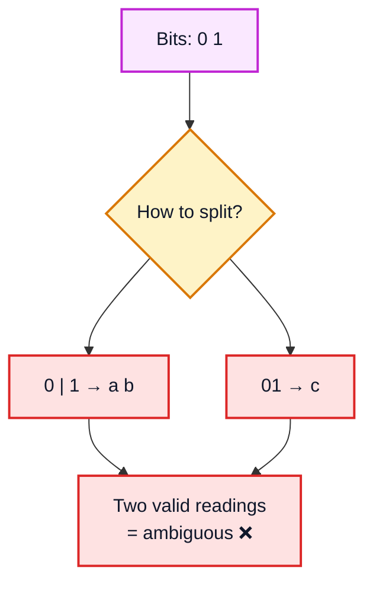
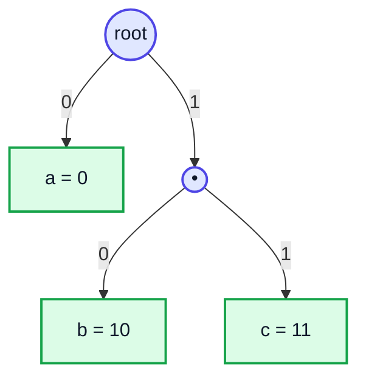
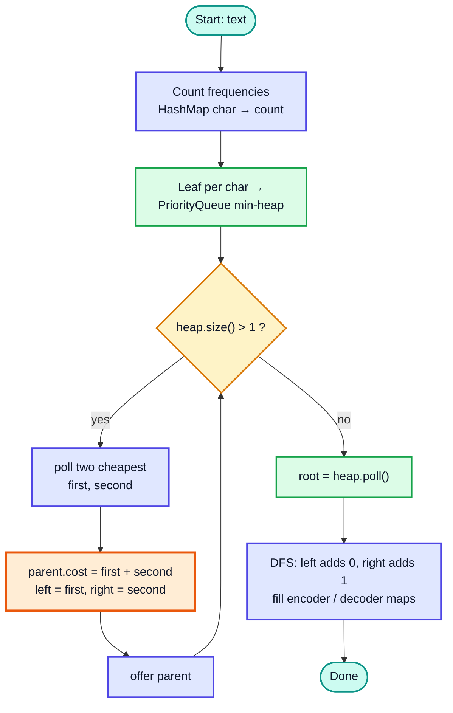
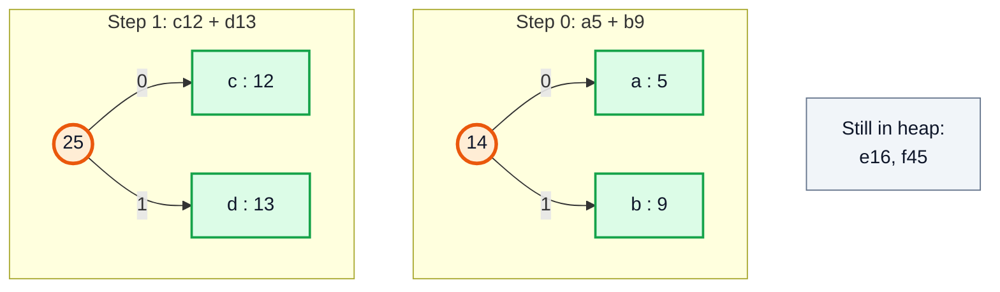
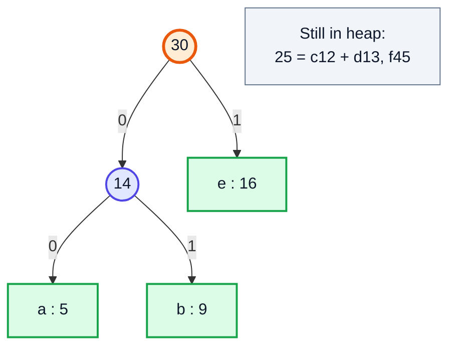
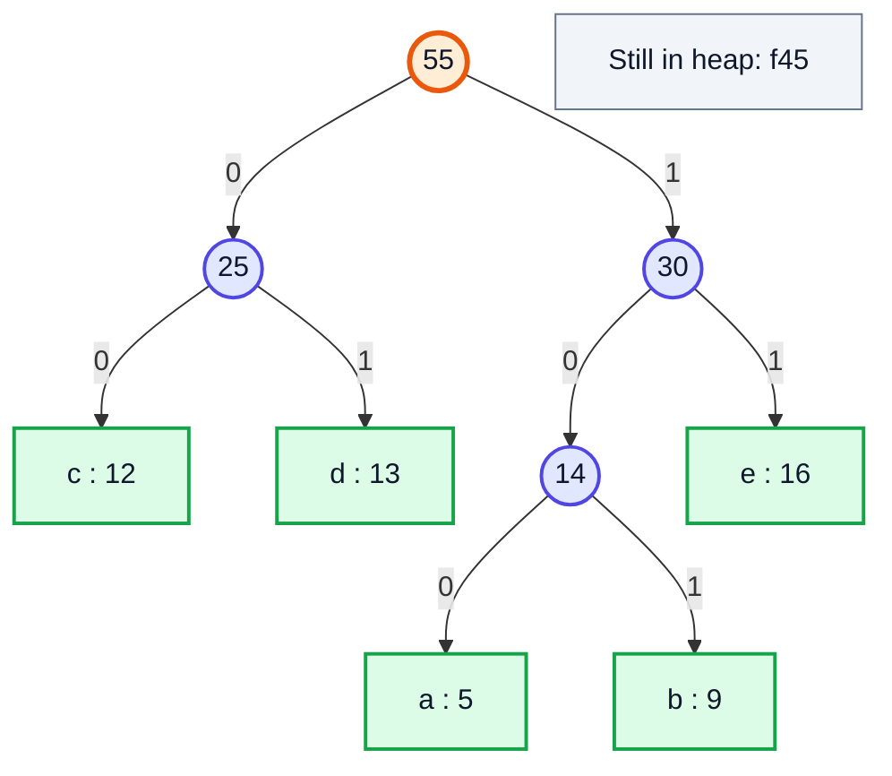
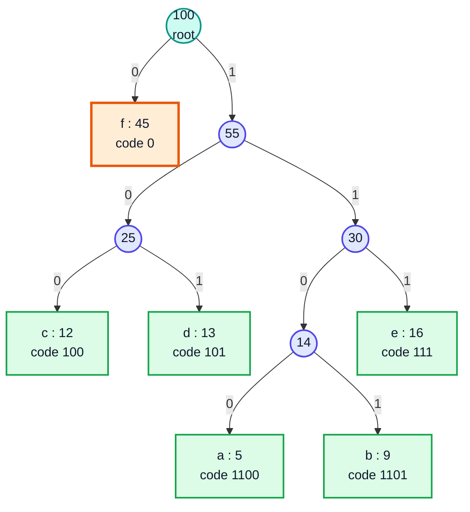
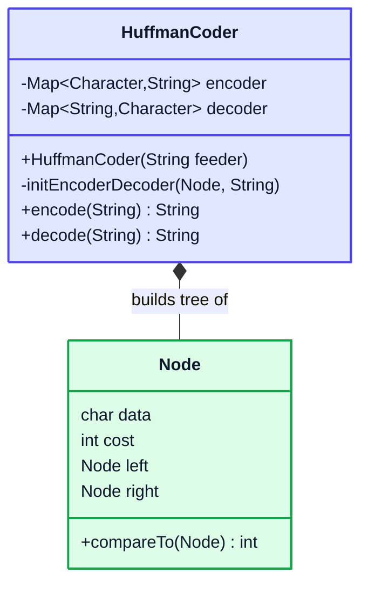
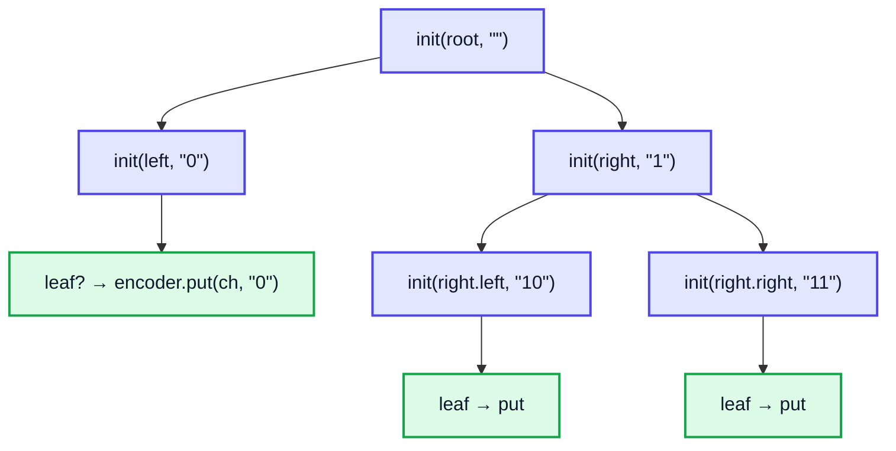
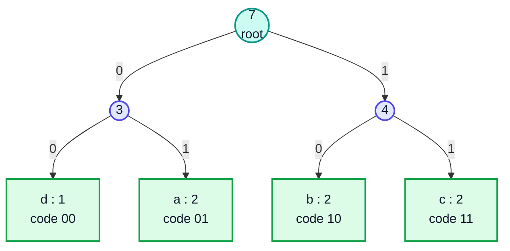

# Huffman Coding (Greedy Text Compression) — Complete In-Depth Guide

**Video #61 of the Java + DSA playlist:** *Huffman Coding Greedy Algorithm | Text Compression* (49:25)

How Huffman coding compresses text by giving frequent characters short bit codes and rare characters long ones: fixed vs variable-length codes, the prefix-free rule, building the Huffman tree greedily with a min-heap, encoding and decoding, why the greedy choice is optimal, and a full Java implementation.

> [!NOTE]
> This video's description has only **two** timestamps (Theory and Code), so these notes have two numbered sections. Each one is split into many sub-topics (H3 headings) to keep the same depth as the other notes.

---

## Table of Contents

| # | Topic | Timestamp |
|---|---|---|
| 0 | [Theory](#0-theory-000) | 0:00 |
| 1 | [Code](#1-code-2524) | 25:24 |

---

## 0. Theory (0:00)

### What is data compression?

**Compression** means storing the same information in **fewer bits**. There are two kinds:

| | **Lossless** | **Lossy** |
|---|---|---|
| After decompressing | Exactly the original data | An approximation |
| Used for | Text, source code, ZIP files, PNG | Photos (JPEG), audio (MP3), video |
| Example algorithms | **Huffman**, LZ77, DEFLATE | DCT plus quantisation |

Huffman coding is **lossless**: decode the bits and you get back exactly the original text.

### How text is normally stored: fixed-length codes

Normally every character takes the **same** number of bits. In ASCII or Latin-1 a `char` takes **8 bits** (in memory a Java `char` is actually 16 bits, UTF-16).

```text
"abbccda" in 8-bit ASCII:
a        b        b        c        c        d        a
01100001 01100010 01100010 01100011 01100011 01100100 01100001   → 7 × 8 = 56 bits
```

If the text uses only 4 distinct characters, 2 bits per character are enough (`a=00, b=01, c=10, d=11`), which gives **14 bits**. This is still a **fixed-length** code, because every character costs the same.

> [!IMPORTANT]
> Fixed-length codes ignore **how often** each character appears. In English, `e` is far more common than `z`, yet both cost 8 bits. Huffman's idea: **frequent characters get short codes, rare characters get long codes.**

### Variable-length codes and the ambiguity problem

Suppose we choose `a=0, b=1, c=01`. Then what does `01` mean?



The problem: the code for `a` (`0`) is a **prefix** of the code for `c` (`01`).

### Prefix-free codes (prefix codes)

A code is **prefix-free** when **no code is the prefix of another code**. With a prefix-free code the decoder never has to guess: as soon as the bits read so far match a code, that match is the only possible one.

| Code set | Prefix-free? | Why |
|---|---|---|
| `a=0, b=1, c=01` | ❌ | `0` is a prefix of `01` |
| `a=0, b=10, c=11` | ✅ | No code starts with another code |
| `a=00, b=01, c=10, d=11` | ✅ | All codes have the same length, so none can be a prefix |

> [!TIP]
> Put the characters **only at the leaves** of a binary tree, with `0` meaning "go left" and `1` meaning "go right". The path to each leaf is then automatically prefix-free, because no leaf lies on the path to another leaf. **The Huffman tree is exactly such a tree.**



### The goal stated precisely

For characters with frequencies `f(c)` and code lengths `len(c)` (= depth of the leaf):

```text
Total encoded size = Σ f(c) × len(c)      ← minimise this
```

Huffman's algorithm (David Huffman, 1952) builds the prefix-free code that makes this sum **as small as possible**.

### The greedy algorithm

1. Count the frequency of every character.
2. Make one **leaf node** per character (`cost = frequency`) and put them all into a **min-heap** (priority queue ordered by cost).
3. While the heap has more than one node:
   - `poll` the **two cheapest** nodes, `first` and `second`.
   - Create a new internal node with `cost = first.cost + second.cost`, `left = first`, `right = second`.
   - `offer` it back into the heap.
4. The last node left is the **root** of the Huffman tree.
5. Walk the tree: append `0` when going left and `1` when going right. The path to each leaf is that character's code.



> [!NOTE]
> This is a **greedy** algorithm. At every step it makes the locally best choice (merge the two rarest trees) and never goes back. Merging the rarest characters first pushes them deepest into the tree, so they get the longest codes, and that is exactly what we want.

### Worked example: building the tree step by step

Frequencies (the classic textbook example, 100 characters in total):

| Char | a | b | c | d | e | f |
|---|---|---|---|---|---|---|
| Frequency | 5 | 9 | 12 | 13 | 16 | 45 |

**Heap contents at each step** (🟧 = the two nodes being merged):

| Step | Heap (min first) | Merge | New node |
|---|---|---|---|
| 0 | 🟧a5, 🟧b9, c12, d13, e16, f45 | a5 + b9 | **14** |
| 1 | 🟧c12, 🟧d13, 14, e16, f45 | c12 + d13 | **25** |
| 2 | 🟧14, 🟧e16, 25, f45 | 14 + e16 | **30** |
| 3 | 🟧25, 🟧30, f45 | 25 + 30 | **55** |
| 4 | 🟧f45, 🟧55 | f45 + 55 | **100** (root) |
| 5 | 100 | — | done ✅ |

**Steps 0 and 1: merge the two cheapest pairs**



**Step 2: merge 14 + e16 → 30**



**Step 3: merge 25 + 30 → 55**



**Step 4: merge f45 + 55 → 100 (final Huffman tree)**



**Resulting codes and total size:**

| Char | Freq | Code | Bits used (freq × length) |
|---|---|---|---|
| f | 45 | `0` | 45 × 1 = 45 |
| c | 12 | `100` | 12 × 3 = 36 |
| d | 13 | `101` | 13 × 3 = 39 |
| e | 16 | `111` | 16 × 3 = 48 |
| a | 5 | `1100` | 5 × 4 = 20 |
| b | 9 | `1101` | 9 × 4 = 36 |
| **Total** | **100** | | **224 bits** |

| Encoding | Size | vs 8-bit |
|---|---|---|
| 8-bit ASCII | 800 bits | — |
| Fixed 3-bit (6 symbols need ⌈log₂6⌉ = 3) | 300 bits | 62.5% smaller |
| **Huffman** | **224 bits** | **72% smaller** |

> [!TIP]
> A quick check: the total encoded size equals the **sum of all internal node costs**: 14 + 25 + 30 + 55 + 100 = **224**. Every merge adds one bit to every character below that node.

### Encoding

Replace each character with its code and join the codes together:

```text
"face" → f   a     c    e
         0   1100  100  111   →  "01100100111"  (11 bits instead of 32)
```

### Decoding

Start at the root and read one bit at a time: `0` means go left, `1` means go right. When you reach a **leaf**, output its character and jump back to the root.

| Bit read | Move | Node reached | Output |
|---|---|---|---|
| 0 | left | **f** (leaf) | `f` → back to root |
| 1 | right | 55 | |
| 1 | right | 30 | |
| 0 | left | 14 | |
| 0 | left | **a** (leaf) | `a` → back to root |
| 1 | right | 55 | |
| 0 | left | 25 | |
| 0 | left | **c** (leaf) | `c` → back to root |
| 1, 1, 1 | right, right, right | **e** (leaf) | `e` ✅ |

Result: `face`. Because the code is prefix-free, there is never any doubt about where a code ends.

### Why the greedy choice is optimal (proof sketch)

| Property | What it says |
|---|---|
| **Greedy-choice property** | There is an optimal tree in which the two **least frequent** characters are siblings at the deepest level. If a rarer character sat higher than a more frequent one, swapping them would never increase `Σ f × len`. |
| **Optimal substructure** | Merge those two into one "super-character" with frequency `x + y`. An optimal tree for the smaller problem, with the super-character expanded back into its two leaves, is optimal for the original problem. Expanding adds exactly `x + y` bits, whatever the tree looks like. |

Together these give a proof by induction that Huffman's tree is optimal among **all prefix-free codes that assign one code per character**.

> [!CAUTION]
> "Optimal" has limits. Huffman is optimal **per character**. Methods that code **whole words or repeated substrings** (LZ77, LZW) or that use **fractional bits** (arithmetic coding, ANS) can compress better. Real formats combine them: DEFLATE (ZIP, gzip, PNG) runs LZ77 first and then Huffman-codes the output.

### Ties and non-uniqueness

When two nodes have equal cost, either may be polled first, and different tie-breaks give **different trees**. They all have the **same total size**, so all are optimal. The left/right choice (`0` vs `1`) is also arbitrary.

> [!WARNING]
> The encoder and decoder must use the **same tree**. In a real compressor you therefore store the tree (or the frequency table, or the code lengths as in "canonical Huffman") in the file header. That overhead is why Huffman can make very short texts **larger**.

### Complexity

Let `n` = text length and `k` = number of distinct characters.

| Phase | Time | Space |
|---|---|---|
| Count frequencies | O(n) | O(k) |
| Build heap (k offers) | O(k log k) | O(k) |
| k − 1 merges (2 polls + 1 offer each) | O(k log k) | O(k) nodes |
| Generate codes (DFS) | O(k × depth) ≤ O(k²) | O(k) codes |
| Encode | O(total bits) | O(output) |
| Decode | O(total bits) | O(output) |

Since `k` is at most the alphabet size (256 for bytes), the tree work is tiny compared with the O(n) passes over the text.

### Where Huffman is used and related problems

- **DEFLATE** (ZIP, gzip, PNG), **JPEG** (entropy-coding stage), **MP3**, HTTP/2 **HPACK** header compression.
- **Same greedy idea in interview problems:** "Minimum Cost to Connect Sticks" (LeetCode 1167) and "Connect n ropes with minimum cost" (GFG): always join the two smallest using a min-heap. The answer is exactly the "sum of internal nodes" total above.
- GFG practice: "Huffman Encoding".

---

## 1. Code (25:24)

### The plan (same structure as the video)

| Piece | Role |
|---|---|
| `Node implements Comparable<Node>` | Holds `data` (char), `cost`, `left`, `right`; ordered by `cost` |
| `HashMap<Character, Integer>` | Frequency table |
| `PriorityQueue<Node>` | Min-heap for the greedy merges |
| `HashMap<Character, String> encoder` | char → bit string |
| `HashMap<String, Character> decoder` | bit string → char |
| `encode(String)` / `decode(String)` | Use the two maps |



### Step 1: the Node class

```java
class Node implements Comparable<Node> {
    char data;      // the character ('\0' for internal nodes)
    int cost;       // frequency
    Node left, right;

    Node(char data, int cost) {
        this.data = data;
        this.cost = cost;
    }

    @Override
    public int compareTo(Node other) {
        return Integer.compare(this.cost, other.cost);  // smaller cost = higher priority
    }
}
```

> [!TIP]
> Use `Integer.compare(a, b)` instead of `this.cost - other.cost`. Subtraction can overflow for huge values and give the wrong sign. That cannot happen with character counts, but it is a good habit.

### Step 2: build the tree in the constructor

```java
public HuffmanCoder(String feeder) {
    // 1. frequencies
    HashMap<Character, Integer> fmap = new HashMap<>();
    for (char c : feeder.toCharArray()) {
        fmap.put(c, fmap.getOrDefault(c, 0) + 1);   // or fmap.merge(c, 1, Integer::sum)
    }

    // 2. leaves into the min-heap
    PriorityQueue<Node> minHeap = new PriorityQueue<>();
    for (Map.Entry<Character, Integer> entry : fmap.entrySet()) {
        minHeap.offer(new Node(entry.getKey(), entry.getValue()));
    }

    // 3. greedy merging
    while (minHeap.size() != 1) {
        Node first = minHeap.poll();
        Node second = minHeap.poll();
        Node parent = new Node('\0', first.cost + second.cost);
        parent.left = first;
        parent.right = second;
        minHeap.offer(parent);
    }

    // 4. code tables
    Node root = minHeap.poll();
    this.encoder = new HashMap<>();
    this.decoder = new HashMap<>();
    initEncoderDecoder(root, "");
}
```

### Step 3: generate the codes with DFS

```java
private void initEncoderDecoder(Node node, String osf) {   // osf = "output so far"
    if (node == null) return;
    if (node.left == null && node.right == null) {          // leaf
        encoder.put(node.data, osf);
        decoder.put(osf, node.data);
        return;
    }
    initEncoderDecoder(node.left, osf + "0");
    initEncoderDecoder(node.right, osf + "1");
}
```



> [!NOTE]
> Checking for a leaf with `node.data != '\0'` (as some versions do) breaks if the text itself contains `'\0'`. Checking `left == null && right == null` is always correct.

### Step 4: encode and decode

```java
public String encode(String source) {
    StringBuilder ans = new StringBuilder();
    for (char c : source.toCharArray()) {
        ans.append(encoder.get(c));
    }
    return ans.toString();
}

public String decode(String codedString) {
    StringBuilder key = new StringBuilder();
    StringBuilder ans = new StringBuilder();
    for (char bit : codedString.toCharArray()) {
        key.append(bit);
        if (decoder.containsKey(key.toString())) {   // prefix-free → first match is the right one
            ans.append(decoder.get(key.toString()));
            key.setLength(0);
        }
    }
    return ans.toString();
}
```

> [!IMPORTANT]
> The bits here are a **`String` of `'0'`/`'1'` characters**, and each of those characters takes 16 bits in memory. That is fine for learning, but it is not real compression. A real compressor packs the bits into a `byte[]` or `BitSet` (see "Packing into real bytes" below).

### Dry run: `"abbccda"`

Frequencies: `a=2, b=2, c=2, d=1`. With ties broken by insertion order (a, b, c, d):

| Step | Heap (cheapest first) | Poll first, second | New node |
|---|---|---|---|
| 0 | 🟧d1, 🟧a2, b2, c2 | d1, a2 | **3** (left d, right a) |
| 1 | 🟧b2, 🟧c2, 3 | b2, c2 | **4** (left b, right c) |
| 2 | 🟧3, 🟧4 | 3, 4 | **7** = root |



Encoding: `a b b c c d a` → `01 10 10 11 11 00 01` = `01101011110001` (**14 bits vs 56**).

Decoding with the `decoder` map:

| Bits in `key` | In map? | Output so far |
|---|---|---|
| `0` | ❌ | |
| `01` | ✅ a | `a` |
| `1` → `10` | ❌ → ✅ b | `ab` |
| `1` → `10` | ❌ → ✅ b | `abb` |
| `1` → `11` | ❌ → ✅ c | `abbc` |
| `1` → `11` | ❌ → ✅ c | `abbcc` |
| `0` → `00` | ❌ → ✅ d | `abbccd` |
| `0` → `01` | ❌ → ✅ a | `abbccda` ✅ |

> [!NOTE]
> Here every code has 2 bits, the same as a fixed 2-bit code, because the frequencies are almost equal. Huffman gains the most when the frequencies are **skewed**.

### Edge cases

| Case | Problem | Fix |
|---|---|---|
| Empty string | Heap is empty, so `poll()` returns `null` | Reject the input or return `""` early |
| Only one distinct character (`"aaaa"`) | The root is a leaf, so its code is `""` and the encoded text is empty | Give it the code `"0"` |
| `while (minHeap.size() != 1)` | Loops forever (or crashes) if the heap starts empty | Use `size() > 1` and handle empty input first |
| Equal frequencies | Output depends on tie-breaking | Add a tie-breaker (e.g. creation order) if you need repeatable output |

### Faster decoding: walk the tree

The map-based decoder builds a new `String` key for every bit. Walking the tree avoids that:

```java
String decodeByTree(Node root, String bits) {
    StringBuilder out = new StringBuilder();
    Node cur = root;
    for (char b : bits.toCharArray()) {
        cur = (b == '0') ? cur.left : cur.right;
        if (cur.left == null && cur.right == null) {   // reached a leaf
            out.append(cur.data);
            cur = root;
        }
    }
    return out.toString();
}
```

| Decoder | Time per bit | Extra objects |
|---|---|---|
| `HashMap<String, Character>` | O(code length) for hashing + string building | A new `String` per bit |
| **Tree walk** | **O(1)** | None |
| Table lookup on k bits at once (production) | O(1) per symbol | Precomputed table |

### Packing into real bytes (beyond the video)

```java
import java.util.BitSet;

BitSet pack(String bits) {
    BitSet bs = new BitSet(bits.length());
    for (int i = 0; i < bits.length(); i++) {
        if (bits.charAt(i) == '1') bs.set(i);
    }
    return bs;            // bs.toByteArray() → ⌈bits/8⌉ bytes; also store the bit length!
}
```

> [!TIP]
> Store the **exact bit count** next to the bytes, because the last byte may contain padding bits that would otherwise be decoded as garbage characters.

### Modern Java notes

- `fmap.merge(c, 1, Integer::sum)` replaces the `getOrDefault` + `put` pattern.
- `new PriorityQueue<Node>(Comparator.comparingInt(n -> n.cost))` works if you prefer not to implement `Comparable`.
- A `record` cannot be used for `Node` here because `left`/`right` are assigned after construction (records are immutable). You could pass the children to the constructor instead.

---

## 🧩 Complete Example: Everything Together

One program that builds the Huffman tree with deterministic tie-breaking, prints the codes, measures the compression, decodes both with the map and by walking the tree, and handles the single-character edge case:

```java
import java.util.*;

// ═══════ 1. THE HUFFMAN CODER ═══════
class HuffmanCoder {

    // A tree node: leaves hold a real character, internal nodes hold '\0'
    private static class Node implements Comparable<Node> {
        final char data;
        final int cost;      // frequency (leaf) or sum of children (internal)
        final int order;     // creation order -> deterministic tie-breaking
        Node left, right;

        Node(char data, int cost, int order) {
            this.data = data;
            this.cost = cost;
            this.order = order;
        }

        boolean isLeaf() { return left == null && right == null; }

        @Override
        public int compareTo(Node other) {
            if (this.cost != other.cost) return Integer.compare(this.cost, other.cost);
            return Integer.compare(this.order, other.order);
        }
    }

    private final Map<Character, String> encoder = new TreeMap<>();
    private final Map<String, Character> decoder = new HashMap<>();
    private final Node root;

    HuffmanCoder(String feeder) {
        if (feeder.isEmpty()) throw new IllegalArgumentException("empty text");

        // Step 1: frequency table (TreeMap -> characters inserted in sorted order)
        Map<Character, Integer> fmap = new TreeMap<>();
        for (char c : feeder.toCharArray()) fmap.merge(c, 1, Integer::sum);

        // Step 2: one leaf per character into a min-heap
        PriorityQueue<Node> minHeap = new PriorityQueue<>();
        int order = 0;
        for (Map.Entry<Character, Integer> e : fmap.entrySet()) {
            minHeap.offer(new Node(e.getKey(), e.getValue(), order++));
        }

        // Step 3: greedily merge the two cheapest trees
        while (minHeap.size() > 1) {
            Node first = minHeap.poll();
            Node second = minHeap.poll();
            Node parent = new Node('\0', first.cost + second.cost, order++);
            parent.left = first;
            parent.right = second;
            minHeap.offer(parent);
        }
        root = minHeap.poll();

        // Step 4: walk the tree to build the code tables
        if (root.isLeaf()) {
            fill(root, "0");             // edge case: only one distinct character
        } else {
            fill(root, "");
        }
    }

    private void fill(Node node, String code) {
        if (node == null) return;
        if (node.isLeaf()) {
            encoder.put(node.data, code);
            decoder.put(code, node.data);
            return;
        }
        fill(node.left, code + "0");
        fill(node.right, code + "1");
    }

    String encode(String text) {
        StringBuilder sb = new StringBuilder();
        for (char c : text.toCharArray()) sb.append(encoder.get(c));
        return sb.toString();
    }

    // Decode with the lookup table (what the video does)
    String decode(String bits) {
        StringBuilder key = new StringBuilder();
        StringBuilder out = new StringBuilder();
        for (char b : bits.toCharArray()) {
            key.append(b);
            Character c = decoder.get(key.toString());
            if (c != null) {
                out.append(c);
                key.setLength(0);
            }
        }
        return out.toString();
    }

    // Decode by walking the tree (no string keys, faster)
    String decodeByTree(String bits) {
        StringBuilder out = new StringBuilder();
        if (root.isLeaf()) {                 // single-character text
            for (int i = 0; i < bits.length(); i++) out.append(root.data);
            return out.toString();
        }
        Node cur = root;
        for (char b : bits.toCharArray()) {
            cur = (b == '0') ? cur.left : cur.right;
            if (cur.isLeaf()) {
                out.append(cur.data);
                cur = root;
            }
        }
        return out.toString();
    }

    Map<Character, String> codes() { return encoder; }
}

// ═══════ 2. DEMO ═══════
public class HuffmanDemo {

    static String show(char c) { return c == ' ' ? "' '" : String.valueOf(c); }

    public static void main(String[] args) {
        // --- Part A: the classic textbook frequencies (no ties) ---
        String text = "a".repeat(5) + "b".repeat(9) + "c".repeat(12)
                    + "d".repeat(13) + "e".repeat(16) + "f".repeat(45);
        HuffmanCoder hc = new HuffmanCoder(text);

        System.out.println("=== Part A: a5 b9 c12 d13 e16 f45 ===");
        hc.codes().forEach((ch, code) -> System.out.println(ch + " -> " + code));

        String bits = hc.encode(text);
        System.out.println("Characters       : " + text.length());
        System.out.println("Fixed 8-bit size : " + text.length() * 8 + " bits");
        System.out.println("Fixed 3-bit size : " + text.length() * 3 + " bits");
        System.out.println("Huffman size     : " + bits.length() + " bits");
        System.out.printf("Saved vs 8-bit   : %.1f%%%n", 100.0 * (1 - bits.length() / (text.length() * 8.0)));
        System.out.println("Round trip OK?   : " + hc.decode(bits).equals(text));

        // --- Part B: a short string ---
        String msg = "abbccda";
        HuffmanCoder small = new HuffmanCoder(msg);
        String enc = small.encode(msg);
        System.out.println();
        System.out.println("=== Part B: \"" + msg + "\" ===");
        small.codes().forEach((ch, code) -> System.out.println(show(ch) + " -> " + code));
        System.out.println("Encoded          : " + enc + " (" + enc.length() + " bits vs " + msg.length() * 8 + ")");
        System.out.println("Decoded (table)  : " + small.decode(enc));
        System.out.println("Decoded (tree)   : " + small.decodeByTree(enc));

        // --- Part C: edge case, one distinct character ---
        HuffmanCoder one = new HuffmanCoder("aaaa");
        String e1 = one.encode("aaaa");
        System.out.println();
        System.out.println("=== Part C: \"aaaa\" ===");
        System.out.println("Encoded          : " + e1);
        System.out.println("Decoded (tree)   : " + one.decodeByTree(e1));
    }
}
```

**Expected Output:**
```
=== Part A: a5 b9 c12 d13 e16 f45 ===
a -> 1100
b -> 1101
c -> 100
d -> 101
e -> 111
f -> 0
Characters       : 100
Fixed 8-bit size : 800 bits
Fixed 3-bit size : 300 bits
Huffman size     : 224 bits
Saved vs 8-bit   : 72.0%
Round trip OK?   : true

=== Part B: "abbccda" ===
a -> 01
b -> 10
c -> 11
d -> 00
Encoded          : 01101011110001 (14 bits vs 56)
Decoded (table)  : abbccda
Decoded (tree)   : abbccda

=== Part C: "aaaa" ===
Encoded          : 0000
Decoded (tree)   : aaaa
```

---

## Quick Reference Cheat Sheet

| Concept | One-Line Summary |
|---|---|
| **Huffman coding** | Lossless compression: frequent chars get short codes, rare chars get long codes |
| **Fixed-length code** | Every char costs the same bits (8 in ASCII); ignores frequency |
| **Prefix-free code** | No code is a prefix of another, so decoding is unambiguous |
| **Huffman tree** | Chars only at leaves; left = `0`, right = `1`; path = code |
| **Greedy step** | Poll the two cheapest nodes, merge into `cost = a + b`, offer back |
| **Data structure** | `PriorityQueue<Node>` (min-heap) with `Node implements Comparable` |
| **Stop condition** | `while (heap.size() > 1)`; the last node is the root |
| **Code generation** | DFS with "output so far": `left → osf + "0"`, `right → osf + "1"` |
| **Encode** | Concatenate `encoder.get(c)` for every char |
| **Decode** | Read bits until they match a code (map) or reach a leaf (tree walk) |
| **Total bits** | Σ freq × depth = sum of all internal node costs |
| **Optimality** | Greedy-choice + optimal substructure → minimum among per-char prefix codes |
| **Ties** | Different trees, same total size; encoder and decoder must share the tree |
| **Single distinct char** | Root is a leaf, so assign it code `"0"` |
| **Complexity** | O(n + k log k) time, O(k) space for the tree (k = distinct chars) |
| **Real compression** | Pack bits into `byte[]`/`BitSet`, store the tree + bit length in the header |
| **Used in** | DEFLATE (ZIP/gzip/PNG), JPEG, MP3, HTTP/2 HPACK |
| **Same greedy pattern** | LeetCode 1167 Minimum Cost to Connect Sticks / connect ropes |
