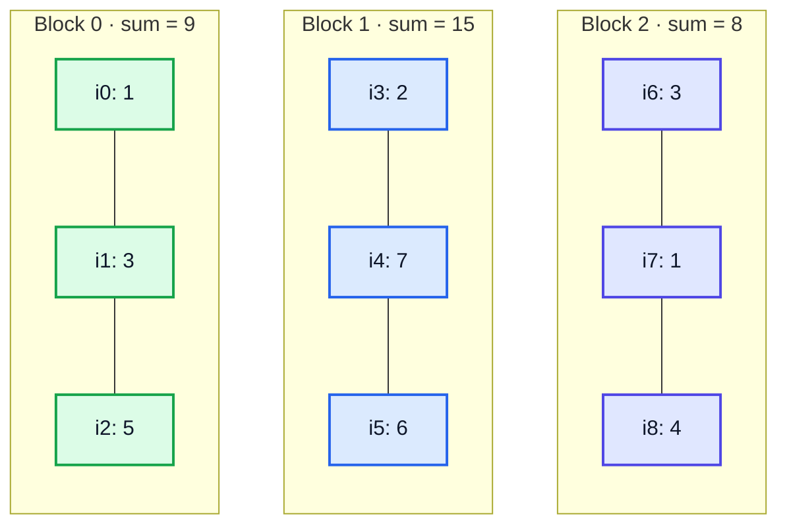
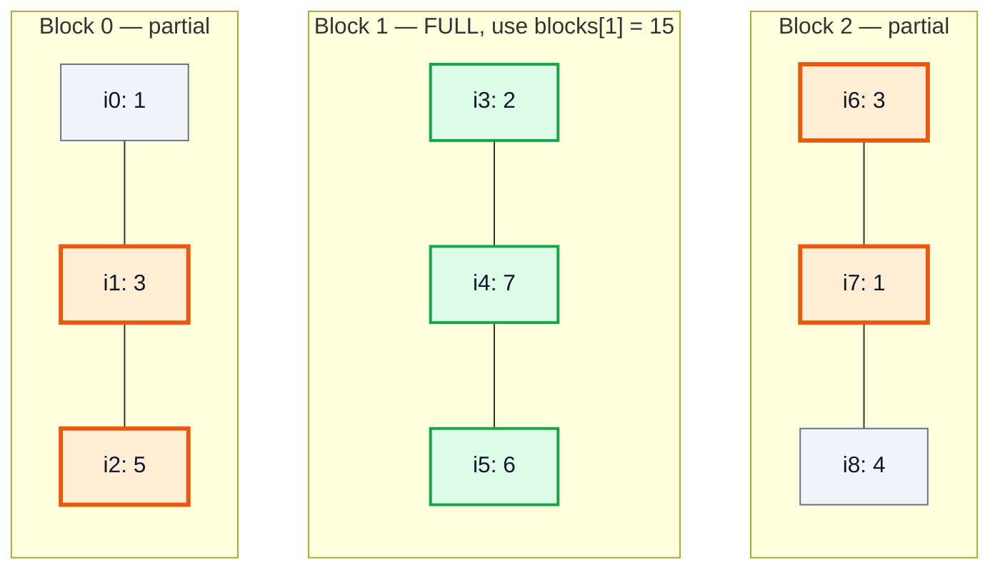
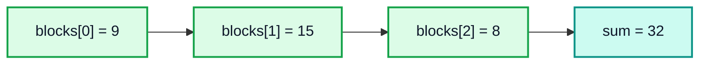
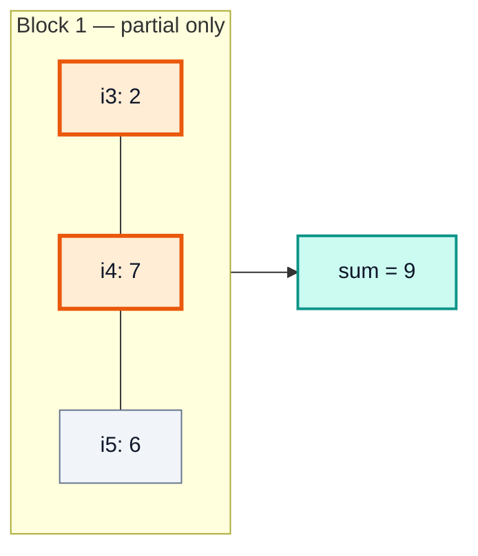
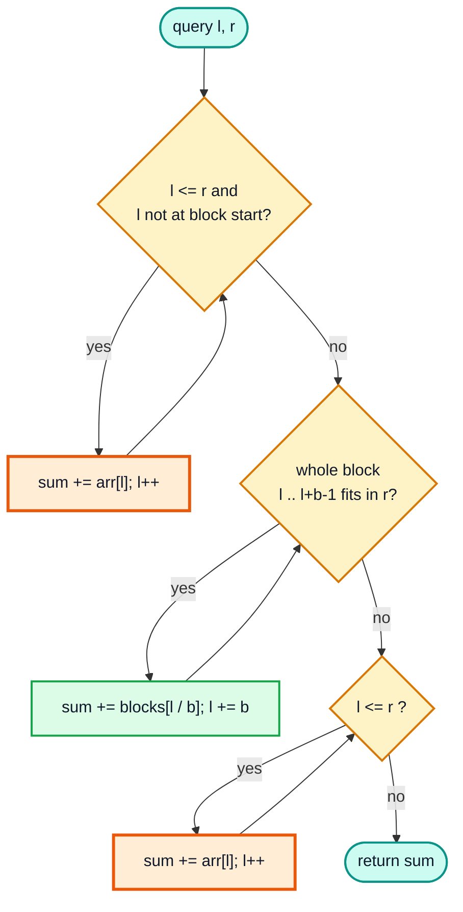
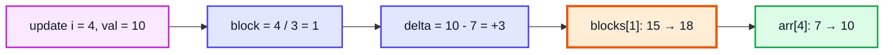
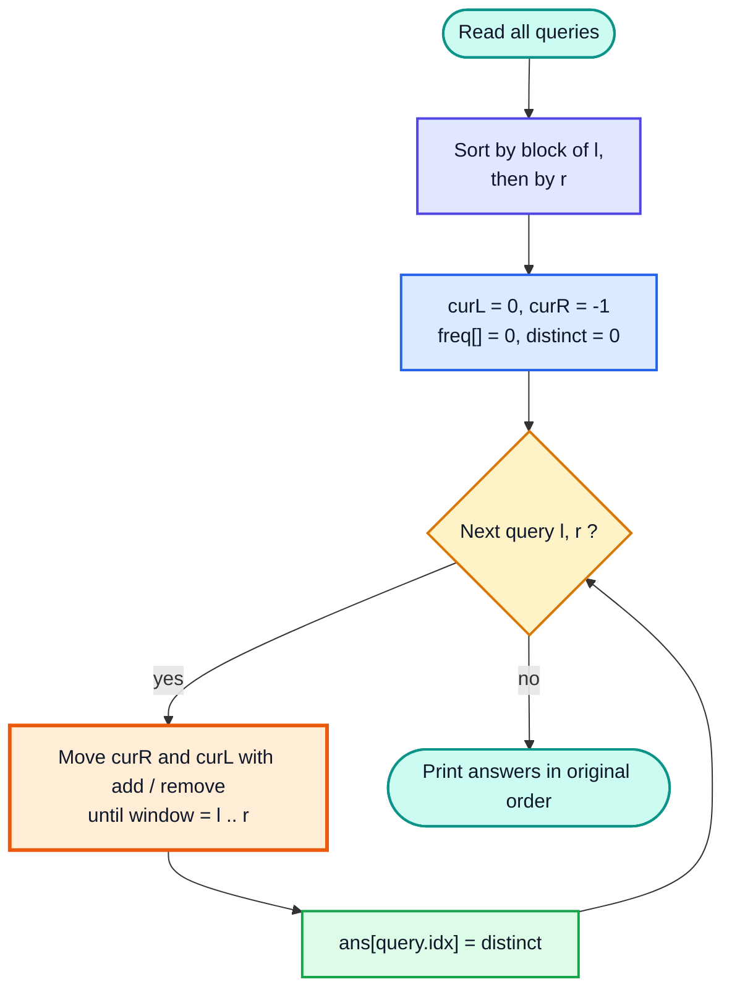
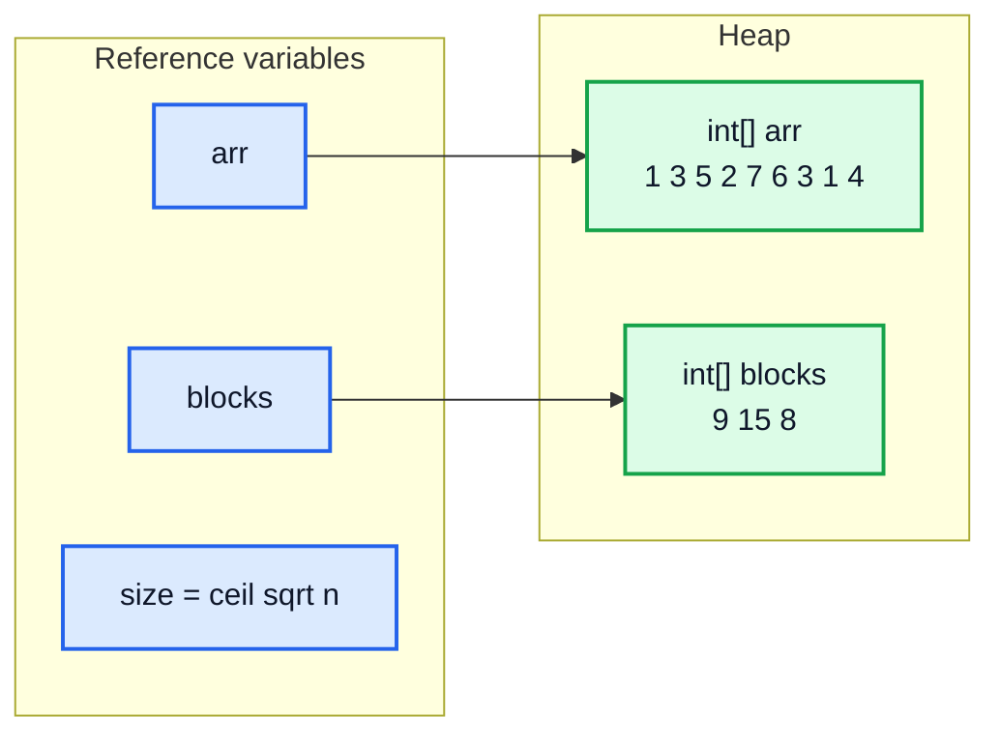
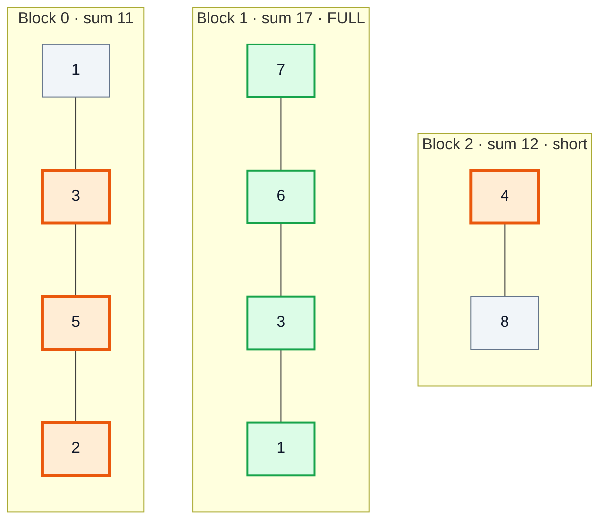

# Square Root Decomposition & Mo's Algorithm — Complete In-Depth Guide

**Video #62 of the Java + DSA playlist:** *Easily Solve Range Query Interview Problems with Square Root Decomposition/Mo's Algorithm* (39:17)

How to answer range queries (sum, min, count, ...) on an array in **O(√n)** per query: splitting the array into √n blocks, precomputing block answers, handling partial and full blocks, point updates, choosing the block size, and Mo's algorithm for answering many offline queries by reordering them.

> [!NOTE]
> This video's description has only **two** timestamps (Theory and Code), so these notes have two numbered sections. Each one is split into many sub-topics (H3 headings) to keep the same depth as the other notes.

---

## Table of Contents

| # | Topic | Timestamp |
|---|---|---|
| 0 | [Theory](#0-theory-000) | 0:00 |
| 1 | [Code](#1-code-2859) | 28:59 |

---

## 0. Theory (0:00)

### What is a range query?

A **range query** asks for something about a contiguous part of an array, `arr[l..r]`:

| Query type | Example: `arr = [1, 3, 5, 2, 7, 6, 3, 1, 4]`, range `[1, 7]` |
|---|---|
| Range sum | 3 + 5 + 2 + 7 + 6 + 3 + 1 = **27** |
| Range min / max | min = **1**, max = **7** |
| Count of a property | evens in range = **2** (2, 6) |
| Distinct count | {3, 5, 2, 7, 6, 1} = **6** |

Interview and competitive problems usually give **many** queries (`q` up to 10⁵) on a big array (`n` up to 10⁵), sometimes mixed with **updates** (`arr[i] = x`).

### Approaches compared

| Approach | Build | Query | Point update | Notes |
|---|---|---|---|---|
| Brute force (loop l..r) | O(1) | **O(n)** | O(1) | q × n = 10¹⁰ → too slow |
| Prefix sums | O(n) | **O(1)** | **O(n)** | Great until updates appear |
| **Sqrt decomposition** | O(n) | **O(√n)** | **O(1)** (sum) | Simple, flexible, middle ground |
| Segment tree (video #51) | O(n) | O(log n) | O(log n) | Faster, more code |
| Fenwick tree (BIT) | O(n log n) | O(log n) | O(log n) | Compact, only invertible operations like sum |

> [!IMPORTANT]
> Sqrt decomposition sits **between** brute force and a segment tree. It is slower than O(log n), but it is very easy to write correctly, and it handles queries that are awkward for segment trees (e.g. Mo's algorithm, block-wise sorting, "count elements ≤ x").

### The core idea: split into √n blocks

Cut the array into blocks of size `b ≈ √n`. There are about `n / b ≈ √n` blocks. For each block, **precompute** its answer (e.g. its sum).

For `n = 9` the block size is `√9 = 3`:



```text
arr    = [1, 3, 5 | 2, 7, 6 | 3, 1, 4]
blocks = [   9    |   15    |    8   ]

Block of index i = i / b     (integer division)
Block k covers indices  k*b  ...  k*b + b - 1
```

### Answering a query: left partial + full blocks + right partial

Any range `[l, r]` breaks into at most **three** parts:

1. **Left partial block**: from `l` up to the end of `l`'s block. Loop over the elements (at most `b` of them).
2. **Full blocks** in the middle: use the precomputed `blocks[k]` (at most `n/b` of them).
3. **Right partial block**: from the start of `r`'s block to `r`. Loop over the elements (at most `b`).

**Query `sum(1, 7)`** (🟧 = partial elements read one by one, 🟩 = full block read as one value, grey = outside the range):



```text
left partial  : arr[1] + arr[2]  = 3 + 5 = 8
full block 1  : blocks[1]        = 15
right partial : arr[6] + arr[7]  = 3 + 1 = 4
answer        : 8 + 15 + 4       = 27   ✅  (brute force: 3+5+2+7+6+3+1 = 27)
```

**Query `sum(0, 8)`**: the whole array is three full blocks, so it costs only 3 additions:



**Query `sum(3, 4)`**: the range lies inside a single block, so we just loop over it:



### Query algorithm as a flowchart



### Point update

To set `arr[i] = val`, only **one** block changes:

```text
blocks[i / b] += val - arr[i];   // remove the old value, add the new one
arr[i] = val;
```

Example: `arr[4] = 10` (was 7) → `blocks[1] = 15 + 3 = 18`. This is **O(1)**.



> [!WARNING]
> The "add the delta" trick only works for **invertible** operations like sum or XOR. For **min/max**, a block's minimum cannot be fixed with a delta (if the old min is removed, what is the new min?), so you **recompute the whole block** in O(√n).

### Why √n? Choosing the block size

With block size `b`, a query costs at most:

```text
cost(b) = b  (left partial)  +  n/b  (full blocks)  +  b  (right partial)  ≈  2b + n/b
```

| Block size b | Partial cost ~2b | Full-block cost n/b | Total for n = 10⁶ |
|---|---|---|---|
| 10 | 20 | 100,000 | ~100,020 ❌ |
| 100 | 200 | 10,000 | ~10,200 |
| **1,000 = √n** | **2,000** | **1,000** | **~3,000 ✅** |
| 10,000 | 20,000 | 100 | ~20,100 |
| 100,000 | 200,000 | 10 | ~200,010 ❌ |

The two parts balance when `b = n/b`, i.e. **`b = √n`**, which gives **O(√n)** per query. (Exactly, `2b + n/b` is minimised at `b = √(n/2)`, but the constant factor does not matter.)

> [!TIP]
> When `n` is not a perfect square, use `b = ceil(√n)` and `numBlocks = ceil(n / b)`. The **last block may be smaller**, and the query code above handles that because it always checks against `r`. In practice people often just pick a fixed size like 300–500 for n = 10⁵.

### Complexity summary

| Operation | Time | Space |
|---|---|---|
| Build `blocks[]` | O(n) | O(√n) extra |
| Range query | O(√n) | O(1) |
| Point update (sum) | O(1) | O(1) |
| Point update (min/max) | O(√n) | O(1) |
| q queries | O(q√n) | — |

For `n = q = 10⁵`: `10⁵ × 316 ≈ 3 × 10⁷` operations, which runs comfortably in time.

### Mo's algorithm: sqrt decomposition on the queries

Some queries, like "**how many distinct values** are in `[l, r]`?", cannot be stored per block, because the distinct values of two blocks cannot be combined from two numbers. **Mo's algorithm** solves such problems when:

- all queries are known in advance (**offline**), and
- there are **no updates**, and
- you can **add** or **remove** one element from a "current window" answer in O(1).

**Idea:** keep a window `[curL, curR]` and move its edges to each query. If the queries are answered in a clever order, the edges move only **O((n + q)√n)** steps in total.

**Ordering:** sort queries by `(l / b, r)`, i.e. by the block of `l`, and inside the same block by `r`.



**Why it is fast:**

| Pointer | Movement per query | Total over all queries |
|---|---|---|
| `curL` | Stays inside one block (≤ b) or moves to the next block | O(q × √n) |
| `curR` | Only increases inside a block (sorted by r); can reset once per block | O(√n blocks × n) = O(n√n) |
| **Total** | | **O((n + q)√n)** |

Without sorting, each query could move the pointers O(n), for O(q × n) in total.

> [!TIP]
> **Odd-even trick:** sort `r` ascending in even blocks and **descending** in odd blocks. Then `curR` sweeps back instead of jumping back to the start, which often makes it about 2× faster in practice.

**Mo's dry run:** `a = [1, 1, 2, 1, 3, 4, 5, 2, 8]`, b = 3. Sorted order: q1(1,3), q0(0,4), q2(2,4), q3(0,8) from block 0 (r ascending), then q4(5,8) from block 1.

| Query | Pointer moves | Window | distinct |
|---|---|---|---|
| start | — | empty | 0 |
| q1 (1,3) | R: −1→3 (add 1,1,2,1); L: 0→1 (remove 1) | [1,2,1] | **2** |
| q0 (0,4) | R: 3→4 (add 3); L: 1→0 (add 1) | [1,1,2,1,3] | **3** |
| q2 (2,4) | L: 0→2 (remove 1, 1) | [2,1,3] | **3** |
| q3 (0,8) | R: 4→8 (add 4,5,2,8); L: 2→0 (add 1,1) | whole array | **6** |
| q4 (5,8) | L: 0→5 (remove 1,1,2,1,3) | [4,5,2,8] | **4** |

Answers in original order: `[3, 2, 3, 6, 4]` ✅

### Where this shows up

| Problem | Technique |
|---|---|
| LeetCode 307 — Range Sum Query - Mutable | Sqrt decomposition (or segment tree / BIT) |
| LeetCode 303 — Range Sum Query - Immutable | Prefix sums are enough (no updates) |
| SPOJ DQUERY — distinct elements in range | Mo's algorithm |
| CF 86D — Powerful Array | Mo's algorithm |
| Range min with updates | Sqrt decomposition (recompute block on update) |

---

## 1. Code (28:59)

### Data layout



### Step 1: build the blocks

```java
int n = arr.length;
int size = (int) Math.ceil(Math.sqrt(n));         // block size
int[] blocks = new int[(n + size - 1) / size];    // ceil(n / size) blocks

for (int i = 0; i < n; i++) {
    blocks[i / size] += arr[i];                    // i / size = which block i belongs to
}
```

| i | arr[i] | i / 3 | blocks after |
|---|---|---|---|
| 0 | 1 | 0 | [1, 0, 0] |
| 1 | 3 | 0 | [4, 0, 0] |
| 2 | 5 | 0 | [9, 0, 0] |
| 3 | 2 | 1 | [9, 2, 0] |
| 4 | 7 | 1 | [9, 9, 0] |
| 5 | 6 | 1 | [9, 15, 0] |
| 6 | 3 | 2 | [9, 15, 3] |
| 7 | 1 | 2 | [9, 15, 4] |
| 8 | 4 | 2 | [9, 15, 8] ✅ |

> [!NOTE]
> A common shortcut is `int sqrt = (int) Math.sqrt(n)` with `blocks = new int[sqrt + 1]`. That array can be **too small**: for n = 8 the block size is 2, so indices 0..7 map to blocks 0..3 (4 blocks), but only 3 slots exist → `ArrayIndexOutOfBoundsException`. Computing the count as `ceil(n / size)` is always safe.

### Step 2: query

```java
static int query(int[] arr, int[] blocks, int size, int l, int r) {
    int sum = 0;

    // 1. left partial block: walk until l reaches a block boundary
    while (l <= r && l % size != 0) {
        sum += arr[l];
        l++;
    }

    // 2. full blocks: the whole block [l, l + size - 1] lies inside [l, r]
    while (l + size - 1 <= r) {
        sum += blocks[l / size];
        l += size;
    }

    // 3. right partial block
    while (l <= r) {
        sum += arr[l];
        l++;
    }
    return sum;
}
```

**Dry run `query(1, 7)` with size 3:**

| Phase | l before | Condition | Action | sum |
|---|---|---|---|---|
| left | 1 | 1 % 3 ≠ 0 ✅ | sum += arr[1] = 3 | 3 |
| left | 2 | 2 % 3 ≠ 0 ✅ | sum += arr[2] = 5 | 8 |
| left | 3 | 3 % 3 = 0 ❌ | stop | 8 |
| full | 3 | 3 + 2 = 5 ≤ 7 ✅ | sum += blocks[1] = 15, l = 6 | 23 |
| full | 6 | 6 + 2 = 8 ≤ 7 ❌ | stop | 23 |
| right | 6 | 6 ≤ 7 ✅ | sum += arr[6] = 3 | 26 |
| right | 7 | 7 ≤ 7 ✅ | sum += arr[7] = 1 | 27 |
| right | 8 | 8 ≤ 7 ❌ | stop | **27** ✅ |

> [!CAUTION]
> Classic bugs: forgetting `l <= r` in the left loop (the range lies inside a single block and you run past `r`), using `<` instead of `<=` with inclusive bounds, and indexing `blocks` with `l` instead of `l / size`.

### Step 3: update

```java
static void update(int[] arr, int[] blocks, int size, int i, int val) {
    blocks[i / size] += val - arr[i];
    arr[i] = val;
}
```

### Variant: range minimum

```java
// build
Arrays.fill(blockMin, Integer.MAX_VALUE);
for (int i = 0; i < n; i++) blockMin[i / size] = Math.min(blockMin[i / size], arr[i]);

// update → recompute the whole block, O(√n)
static void updateMin(int[] arr, int[] blockMin, int size, int i, int val) {
    arr[i] = val;
    int k = i / size, start = k * size, endIdx = Math.min(arr.length, start + size);
    blockMin[k] = Integer.MAX_VALUE;
    for (int j = start; j < endIdx; j++) blockMin[k] = Math.min(blockMin[k], arr[j]);
}
```

The query is the same three loops with `Math.min` instead of `+`.

### Mo's algorithm in Java

```java
record Query(int l, int r, int idx) {}   // Java 16+ record

int block = (int) Math.sqrt(n);
Arrays.sort(q, (x, y) -> {
    int bx = x.l() / block, by = y.l() / block;
    if (bx != by) return Integer.compare(bx, by);
    return (bx % 2 == 0) ? Integer.compare(x.r(), y.r())   // even block: r ascending
                         : Integer.compare(y.r(), x.r());  // odd block: r descending
});

int curL = 0, curR = -1, distinct = 0;
for (Query qu : q) {
    while (curR < qu.r()) if (freq[a[++curR]]++ == 0) distinct++;   // expand right
    while (curL > qu.l()) if (freq[a[--curL]]++ == 0) distinct++;   // expand left
    while (curR > qu.r()) if (--freq[a[curR--]] == 0) distinct--;   // shrink right
    while (curL < qu.l()) if (--freq[a[curL++]] == 0) distinct--;   // shrink left
    ans[qu.idx()] = distinct;
}
```

> [!IMPORTANT]
> **Expand before you shrink.** If you shrink first, the window can become "negative" (`curL > curR + 1`) and the frequency counts go below zero. Also remember to store `idx`, because the answers have to be printed in the **original** query order.

> [!NOTE]
> Values in `freq[]` are used as array indices here, so they must be small and non-negative. For large or negative values, **coordinate-compress** them first (sort the distinct values and map each one to its rank).

### LeetCode 307 — Range Sum Query - Mutable

```java
class NumArray {
    private final int[] nums, blocks;
    private final int size;

    public NumArray(int[] nums) {
        this.nums = nums;
        size = Math.max(1, (int) Math.ceil(Math.sqrt(nums.length)));
        blocks = new int[(nums.length + size - 1) / size];
        for (int i = 0; i < nums.length; i++) blocks[i / size] += nums[i];
    }

    public void update(int index, int val) {
        blocks[index / size] += val - nums[index];
        nums[index] = val;
    }

    public int sumRange(int left, int right) {
        int sum = 0;
        while (left <= right && left % size != 0) sum += nums[left++];
        while (left + size - 1 <= right) { sum += blocks[left / size]; left += size; }
        while (left <= right) sum += nums[left++];
        return sum;
    }
}
```

| | Sqrt decomposition | Segment tree | Fenwick (BIT) |
|---|---|---|---|
| `update` | O(1) | O(log n) | O(log n) |
| `sumRange` | O(√n) | O(log n) | O(log n) |
| Lines of code | ~15 | ~40 | ~20 |
| Supports min/max | ✅ (O(√n) update) | ✅ | ❌ (not easily) |

---

## 🧩 Complete Example: Everything Together

One program with a reusable sqrt-decomposition class (range sum + point update, checked against brute force on an array whose length, 10, is **not** a perfect square) and Mo's algorithm for distinct-value queries:

```java
import java.util.*;

// ═══════ 1. SQRT DECOMPOSITION: range sum + point update ═══════
class SqrtDecomposition {
    private final int[] arr;
    private final int[] blocks;
    private final int size;      // block size ≈ √n

    SqrtDecomposition(int[] input) {
        arr = input.clone();
        int n = arr.length;
        size = Math.max(1, (int) Math.ceil(Math.sqrt(n)));
        blocks = new int[(n + size - 1) / size];
        for (int i = 0; i < n; i++) blocks[i / size] += arr[i];
    }

    int blockCount() { return blocks.length; }
    int blockSize()  { return size; }
    int[] blockSums() { return blocks.clone(); }

    // sum of arr[l..r], both inclusive
    int query(int l, int r) {
        int sum = 0;
        // left partial block
        while (l <= r && l % size != 0) sum += arr[l++];
        // full blocks
        while (l + size - 1 <= r) {
            sum += blocks[l / size];
            l += size;
        }
        // right partial block
        while (l <= r) sum += arr[l++];
        return sum;
    }

    // point assignment arr[i] = val
    void update(int i, int val) {
        blocks[i / size] += val - arr[i];
        arr[i] = val;
    }
}

// ═══════ 2. MO'S ALGORITHM: distinct values in [l, r] (offline) ═══════
class MoDistinct {
    record Query(int l, int r, int idx) {}

    static int[] solve(int[] a, int[][] qs) {
        int n = a.length;
        int block = Math.max(1, (int) Math.sqrt(n));
        Query[] q = new Query[qs.length];
        for (int i = 0; i < qs.length; i++) q[i] = new Query(qs[i][0], qs[i][1], i);

        Arrays.sort(q, (x, y) -> {
            int bx = x.l() / block, by = y.l() / block;
            if (bx != by) return Integer.compare(bx, by);
            return (bx % 2 == 0) ? Integer.compare(x.r(), y.r())    // odd-even trick
                                 : Integer.compare(y.r(), x.r());
        });

        int maxVal = Arrays.stream(a).max().orElse(0);
        int[] freq = new int[maxVal + 1];
        int[] ans = new int[qs.length];
        int curL = 0, curR = -1, distinct = 0;

        for (Query query : q) {
            while (curR < query.r()) if (freq[a[++curR]]++ == 0) distinct++;
            while (curL > query.l()) if (freq[a[--curL]]++ == 0) distinct++;
            while (curR > query.r()) if (--freq[a[curR--]] == 0) distinct--;
            while (curL < query.l()) if (--freq[a[curL++]] == 0) distinct--;
            ans[query.idx()] = distinct;
        }
        return ans;
    }
}

// ═══════ 3. DEMO ═══════
public class SqrtDemo {
    static int brute(int[] a, int l, int r) {
        int s = 0;
        for (int i = l; i <= r; i++) s += a[i];
        return s;
    }

    public static void main(String[] args) {
        int[] arr = {1, 3, 5, 2, 7, 6, 3, 1, 4, 8};
        SqrtDecomposition sd = new SqrtDecomposition(arr);

        System.out.println("=== Sqrt decomposition ===");
        System.out.println("Array      : " + Arrays.toString(arr));
        System.out.println("Block size : " + sd.blockSize() + ", blocks: " + sd.blockCount());
        System.out.println("Block sums : " + Arrays.toString(sd.blockSums()));

        int[][] ranges = {{1, 7}, {0, 9}, {4, 5}, {3, 8}};
        for (int[] q : ranges) {
            System.out.println("sum(" + q[0] + ", " + q[1] + ") = " + sd.query(q[0], q[1])
                    + "   brute = " + brute(arr, q[0], q[1]));
        }

        sd.update(4, 10);                // arr[4]: 7 -> 10
        arr[4] = 10;
        System.out.println("After update arr[4] = 10");
        System.out.println("Block sums : " + Arrays.toString(sd.blockSums()));
        System.out.println("sum(1, 7) = " + sd.query(1, 7) + "   brute = " + brute(arr, 1, 7));

        System.out.println();
        System.out.println("=== Mo's algorithm: distinct values ===");
        int[] a = {1, 1, 2, 1, 3, 4, 5, 2, 8};
        int[][] qs = {{0, 4}, {1, 3}, {2, 4}, {0, 8}, {5, 8}};
        int[] res = MoDistinct.solve(a, qs);
        System.out.println("Array      : " + Arrays.toString(a));
        for (int i = 0; i < qs.length; i++) {
            System.out.println("distinct(" + qs[i][0] + ", " + qs[i][1] + ") = " + res[i]);
        }
    }
}
```

Here `n = 10`, so the block size is `ceil(√10) = 4` and the blocks are `[0..3]`, `[4..7]` and a short last block `[8..9]`:



(Highlighted: query `sum(1, 8)` = 3 + 5 + 2 + **17** + 4 = 31.)

**Expected Output:**
```
=== Sqrt decomposition ===
Array      : [1, 3, 5, 2, 7, 6, 3, 1, 4, 8]
Block size : 4, blocks: 3
Block sums : [11, 17, 12]
sum(1, 7) = 27   brute = 27
sum(0, 9) = 40   brute = 40
sum(4, 5) = 13   brute = 13
sum(3, 8) = 23   brute = 23
After update arr[4] = 10
Block sums : [11, 20, 12]
sum(1, 7) = 30   brute = 30

=== Mo's algorithm: distinct values ===
Array      : [1, 1, 2, 1, 3, 4, 5, 2, 8]
distinct(0, 4) = 3
distinct(1, 3) = 2
distinct(2, 4) = 3
distinct(0, 8) = 6
distinct(5, 8) = 4
```

---

## Quick Reference Cheat Sheet

| Concept | One-Line Summary |
|---|---|
| **Range query** | Answer something about `arr[l..r]` (sum, min, distinct, ...) many times |
| **Sqrt decomposition** | Split the array into ~√n blocks of size ~√n and precompute each block's answer |
| **Block of index i** | `i / size`; block k spans `k*size .. k*size + size - 1` |
| **Block size** | `ceil(√n)`; block count `ceil(n / size)`; the last block may be shorter |
| **Query** | Left partial (loop) + full blocks (`blocks[k]`) + right partial (loop) |
| **Query cost** | ≤ 2√n + √n → **O(√n)** |
| **Why √n** | Balances `2b` (partials) against `n/b` (full blocks) |
| **Point update (sum)** | `blocks[i/size] += val - arr[i]; arr[i] = val;` → O(1) |
| **Point update (min/max)** | Recompute that block → O(√n) |
| **Build** | One pass: `blocks[i / size] += arr[i]` → O(n) |
| **vs prefix sums** | Prefix: O(1) query but O(n) update; sqrt: O(√n) / O(1) |
| **vs segment tree** | Segment tree: O(log n) both, more code |
| **Mo's algorithm** | Offline, no updates: sort queries by `(l / b, r)`, slide a window with add/remove |
| **Mo's complexity** | O((n + q)√n) pointer moves |
| **Mo's pitfalls** | Expand before shrink; keep the original query index; compress large values |
| **Odd-even trick** | Alternate r ascending/descending per block for fewer moves |
| **Problems** | LC 307 Range Sum Query - Mutable, SPOJ DQUERY, CF 86D Powerful Array |
