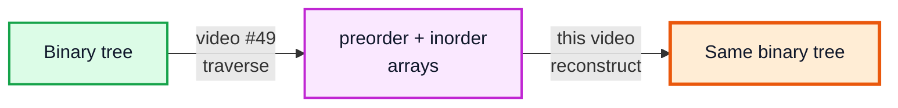
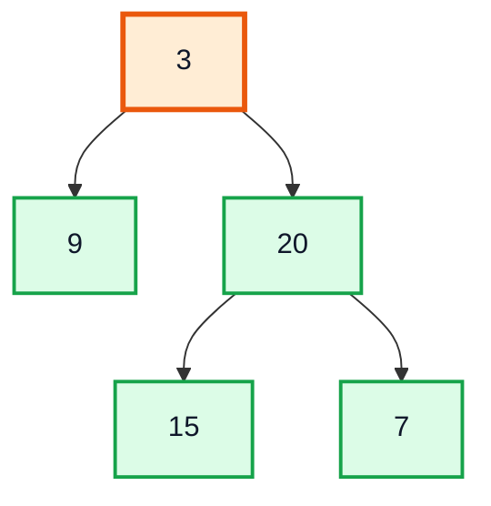
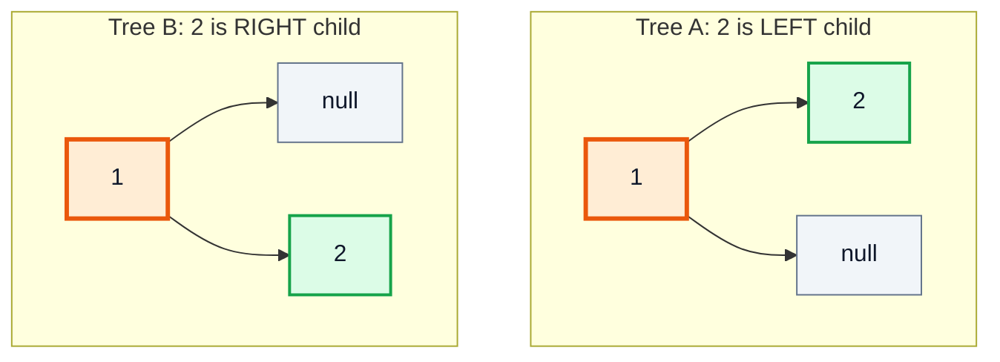
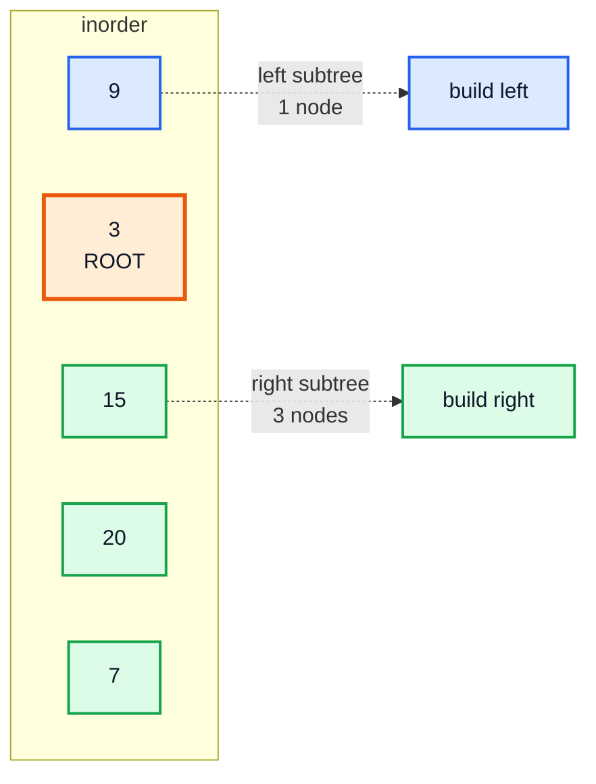
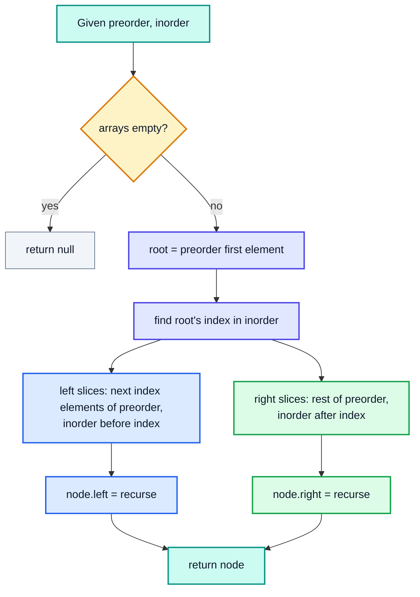
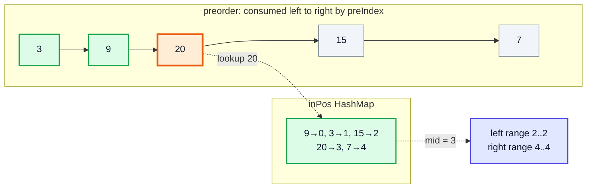
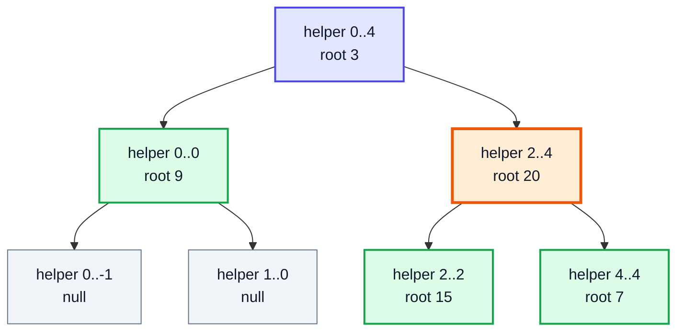
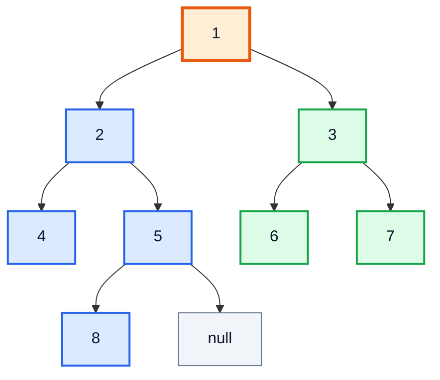

# Construct Binary Tree from Preorder and Inorder Traversal — Complete In-Depth Guide

**Video #63 of the Java + DSA playlist:** *Binary Tree from Preorder & Inorder Traversal - Advance Tree Questions* (28:11)

How to rebuild a binary tree when all you are given are two traversal arrays: why preorder tells you *who the root is*, why inorder tells you *what goes left and right*, a simple recursive solution, its O(n) HashMap upgrade, a full dry run and the sister problem that uses postorder instead (LeetCode 105 and 106).

> [!NOTE]
> This video's description has **no timestamps**, so the sections below are built from the topics the video covers and use **(—)** instead of a time. Tree basics (node class, traversals, height) are not repeated here; see [java_49_video_binary_trees_bst.md](java_49_video_binary_trees_bst.md), especially *Section 8: Traversals*.

---

## Table of Contents

| # | Topic | Timestamp |
|---|---|---|
| 0 | [Introduction](#0-introduction-) | — |
| 1 | [The Problem: LeetCode 105](#1-the-problem-leetcode-105-) | — |
| 2 | [Key Insight: Root First, Then Split Inorder](#2-key-insight-root-first-then-split-inorder-) | — |
| 3 | [Recursive Solution with Array Copies](#3-recursive-solution-with-array-copies-) | — |
| 4 | [HashMap Index Optimisation](#4-hashmap-index-optimisation-) | — |
| 5 | [Dry Run](#5-dry-run-) | — |
| 6 | [Time and Space Complexity](#6-time-and-space-complexity-) | — |
| 7 | [Related: LeetCode 106 Inorder and Postorder](#7-related-leetcode-106-inorder-and-postorder-) | — |

---

## 0. Introduction (—)

In video #49 you learned to go **tree → traversal**: walk a tree and print its pre-order, in-order or post-order sequence. This video goes the other way, **traversal → tree**: given the printed sequences, reconstruct the exact tree that produced them.

This is a classic "advance tree question" because it tests whether you really understand *what each traversal order means*, not just how to code it.



> [!IMPORTANT]
> The whole solution rests on two facts. **Preorder** = Node, Left, Right, so the first element is always the root. **Inorder** = Left, Node, Right, so everything before the root is the left subtree and everything after is the right subtree. Keep these two lines in your head and the code writes itself.

---

## 1. The Problem: LeetCode 105 (—)

**LeetCode 105: *Construct Binary Tree from Preorder and Inorder Traversal*** (Medium)

> Given two integer arrays `preorder` and `inorder`, where `preorder` is the preorder traversal of a binary tree and `inorder` is the inorder traversal of the same tree, construct and return the binary tree.

Constraints worth noticing:

| Constraint | Why it matters |
|---|---|
| `preorder.length == inorder.length`, 1 to 3000 | Both arrays describe the same set of nodes |
| **All values are unique** | We can find the root in inorder by value. With duplicates the answer would be ambiguous |
| Values in -3000 to 3000 | Fits in `int`; can be used as HashMap keys |
| Input is guaranteed valid | No need to check that the arrays agree |

**Example 1:**

```text
preorder = [3, 9, 20, 15, 7]
inorder  = [9, 3, 15, 20, 7]
Output   = [3, 9, 20, null, null, 15, 7]   (level-order form)
```



### Why one traversal is not enough

A single traversal does not pin down a tree. Both trees below have preorder `[1, 2]`:



Their inorders differ, though: A gives `[2, 1]`, B gives `[1, 2]`. That is exactly why the problem gives you **two** arrays.

| Pair given | Unique tree? |
|---|---|
| Preorder + Inorder | ✅ Yes (unique values) — LeetCode 105 |
| Postorder + Inorder | ✅ Yes — LeetCode 106 |
| Preorder + Postorder | ❌ Not in general (only for full binary trees) — LeetCode 889 |
| Only one traversal | ❌ No |

> [!TIP]
> The rule of thumb: you need **inorder** plus one other traversal. Preorder/postorder tell you *who* the root is; only inorder tells you *where the left/right boundary* is.

---

## 2. Key Insight: Root First, Then Split Inorder (—)

### Step 1: the root is `preorder[0]`

Preorder prints a node **before** its children, so the very first value printed is the root of the whole tree. Here: `3`.

### Step 2: find the root in inorder

Inorder prints the left subtree, then the node, then the right subtree. So once you know where `3` sits in inorder, you know the exact contents of both subtrees:



### Step 3: split preorder using the **size** of the left subtree

The root sits at inorder index `index = 1`, so the left subtree has `index = 1` node. In preorder, after the root come **all left-subtree nodes, then all right-subtree nodes**. So:

| Part | Preorder slice | Inorder slice |
|---|---|---|
| Root | `preorder[0]` = 3 | `inorder[index]` = 3 |
| Left subtree | `preorder[1 .. index]` = [9] | `inorder[0 .. index-1]` = [9] |
| Right subtree | `preorder[index+1 .. n-1]` = [20, 15, 7] | `inorder[index+1 .. n-1]` = [15, 20, 7] |

(🟧 root, 🟦 left part, 🟩 right part)

| Array | 0 | 1 | 2 | 3 | 4 |
|---|---|---|---|---|---|
| preorder | 🟧 3 | 🟦 9 | 🟩 20 | 🟩 15 | 🟩 7 |
| inorder | 🟦 9 | 🟧 3 | 🟩 15 | 🟩 20 | 🟩 7 |

### Step 4: recurse

Each pair of slices is *itself* a valid (preorder, inorder) pair for a smaller tree. Apply the same three steps to each side until a slice is empty (that is a `null` child).



> [!IMPORTANT]
> The trick most people miss: you split **preorder** by the **count** of left nodes (`index`), not by searching for anything in preorder. In a subarray, the root's inorder index *is* the size of the left subtree.

---

## 3. Recursive Solution with Array Copies (—)

The most direct translation of the insight: physically cut the arrays with `Arrays.copyOfRange` and recurse on the copies. This is the first version the video writes.

```java
import java.util.Arrays;

class TreeNode {
    int val;
    TreeNode left, right;
    TreeNode(int val) { this.val = val; }
}

class Solution {
    public TreeNode buildTree(int[] preorder, int[] inorder) {
        if (preorder.length == 0) {
            return null;                       // empty slice = no subtree
        }

        int rootVal = preorder[0];             // 1. root is first in preorder
        int index = 0;
        for (int i = 0; i < inorder.length; i++) {   // 2. find it in inorder
            if (inorder[i] == rootVal) {
                index = i;
                break;
            }
        }

        TreeNode node = new TreeNode(rootVal);

        // 3. left subtree: `index` nodes
        node.left = buildTree(
                Arrays.copyOfRange(preorder, 1, index + 1),
                Arrays.copyOfRange(inorder, 0, index));

        // 4. right subtree: everything after
        node.right = buildTree(
                Arrays.copyOfRange(preorder, index + 1, preorder.length),
                Arrays.copyOfRange(inorder, index + 1, inorder.length));

        return node;
    }
}
```

`Arrays.copyOfRange(arr, from, to)` copies indices `from` (inclusive) to `to` (**exclusive**), so:

| Call | Range | Elements |
|---|---|---|
| `copyOfRange(preorder, 1, index + 1)` | 1 … index | the `index` left-subtree nodes |
| `copyOfRange(inorder, 0, index)` | 0 … index-1 | same nodes, inorder |
| `copyOfRange(preorder, index + 1, n)` | index+1 … n-1 | right-subtree nodes |
| `copyOfRange(inorder, index + 1, n)` | index+1 … n-1 | same nodes, inorder |

> [!WARNING]
> Off-by-one errors are the main bug here. Sanity check: the left preorder slice and left inorder slice must always have the **same length** (`index`), and so must the right ones (`n - index - 1`).

### What this costs

Correct and easy to reason about, but wasteful:

- Every call does a **linear search** in inorder → O(n) per node.
- Every call **copies** its slices → another O(n) per level, plus O(n²) extra memory in the worst case.

On a skewed tree (every node only has a left child) this is **O(n²)** time. For n = 3000 it still passes LeetCode, but interviewers will expect the next version.

---

## 4. HashMap Index Optimisation (—)

Two changes remove both costs:

1. **No more copies.** Pass index boundaries `lo..hi` into the *original* inorder array instead of new arrays.
2. **No more linear search.** Precompute `value → inorder index` in a `HashMap` once, so finding the root is O(1).

And one neat observation removes the need for preorder boundaries altogether: if you always build **left before right**, you consume preorder **strictly left to right**. So a single shared pointer `preIndex` that increments each time you create a node always points at the next root.

```java
import java.util.HashMap;
import java.util.Map;

class Solution {
    private int preIndex = 0;
    private Map<Integer, Integer> inPos;

    public TreeNode buildTree(int[] preorder, int[] inorder) {
        inPos = new HashMap<>();
        for (int i = 0; i < inorder.length; i++) {
            inPos.put(inorder[i], i);          // value -> position in inorder
        }
        preIndex = 0;
        return helper(preorder, 0, inorder.length - 1);
    }

    // build the subtree whose nodes are inorder[lo..hi]
    private TreeNode helper(int[] preorder, int lo, int hi) {
        if (lo > hi) {
            return null;                       // empty range
        }
        int rootVal = preorder[preIndex++];    // next root in preorder
        TreeNode node = new TreeNode(rootVal);

        int mid = inPos.get(rootVal);          // O(1) lookup
        node.left = helper(preorder, lo, mid - 1);   // MUST be first
        node.right = helper(preorder, mid + 1, hi);
        return node;
    }
}
```



| | Copy version | HashMap version |
|---|---|---|
| Find root in inorder | Linear scan O(n) | `HashMap.get` O(1) |
| Sub-problems described by | New arrays | `lo`, `hi` indices + shared `preIndex` |
| Extra memory | Copies: up to O(n²) total | Map O(n) + stack O(h) |
| Time | O(n²) worst case | **O(n)** |
| Order of recursive calls | Doesn't matter | **Left must come before right** |

> [!CAUTION]
> `preIndex` must be a **field** (or a one-element array / `AtomicInteger`), not a normal parameter. Java passes `int` by value, so incrementing a parameter inside the left call would not be seen by the right call. And if you reset the field, do it inside `buildTree`, because LeetCode reuses one `Solution` object for several tests.

> [!TIP]
> Alternative without a field: pass preorder boundaries too, `helper(preStart, inLo, inHi)`, and compute the right subtree's preorder start as `preStart + 1 + (mid - inLo)`. Same complexity; slightly more arithmetic, but the calls become order-independent.

### Alternative: iterative with a stack (O(n), no recursion)

For very deep trees you can avoid recursion. Walk preorder; push nodes as left children while they do not match the current inorder value; when the stack top matches inorder, pop until it stops matching and attach the next preorder value as a right child.

```java
public TreeNode buildTreeIterative(int[] preorder, int[] inorder) {
    java.util.Deque<TreeNode> stack = new java.util.ArrayDeque<>();
    TreeNode root = new TreeNode(preorder[0]);
    stack.push(root);
    int in = 0;
    for (int p = 1; p < preorder.length; p++) {
        TreeNode node = stack.peek();
        if (node.val != inorder[in]) {          // still going down-left
            node.left = new TreeNode(preorder[p]);
            stack.push(node.left);
        } else {                                 // left side finished: climb up
            while (!stack.isEmpty() && stack.peek().val == inorder[in]) {
                node = stack.pop();
                in++;
            }
            node.right = new TreeNode(preorder[p]);
            stack.push(node.right);
        }
    }
    return root;
}
```

This is beyond the video; the recursive HashMap version is what you should be able to write from memory.

---

## 5. Dry Run (—)

Input: `preorder = [3, 9, 20, 15, 7]`, `inorder = [9, 3, 15, 20, 7]`, `inPos = {9:0, 3:1, 15:2, 20:3, 7:4}`.

| Step | Call `helper(lo, hi)` | `preIndex` before | Root | `mid` | Next calls | Result |
|---|---|---|---|---|---|---|
| 1 | (0, 4) | 0 | **3** | 1 | left (0,0), right (2,4) | |
| 2 | (0, 0) | 1 | **9** | 0 | left (0,-1), right (1,0) | |
| 3 | (0, -1) | 2 | — | — | — | null ❌ |
| 4 | (1, 0) | 2 | — | — | — | null ❌ |
| 5 | | | | | | 9 returned ✅, becomes 3.left |
| 6 | (2, 4) | 2 | **20** | 3 | left (2,2), right (4,4) | |
| 7 | (2, 2) | 3 | **15** | 2 | both children null | 15 ✅ = 20.left |
| 8 | (4, 4) | 4 | **7** | 4 | both children null | 7 ✅ = 20.right |
| 9 | | 5 | | | | 20 ✅ = 3.right, tree done |

Recursion tree of the calls (orange = the call in step 6, the root of the right subtree):



The calls form exactly the shape of the answer tree. That is a good sanity check: **the recursion tree of a construction algorithm is the tree being constructed** (plus the null leaves).

### A bigger example

`preorder = [1, 2, 4, 5, 8, 3, 6, 7]`, `inorder = [4, 2, 8, 5, 1, 6, 3, 7]`

| Level | Root picked | Inorder range split |
|---|---|---|
| 0 | 1 | [4 2 8 5] · **1** · [6 3 7] |
| 1 (left) | 2 | [4] · **2** · [8 5] |
| 1 (right) | 3 | [6] · **3** · [7] |
| 2 | 5 (inside [8 5]) | [8] · **5** · [] |



Note how `8` comes *before* `5` in inorder, which is what makes it the **left** child of 5.

---

## 6. Time and Space Complexity (—)

Let n = number of nodes, h = height of the tree.

| Version | Time | Extra space | Why |
|---|---|---|---|
| Array copies + linear search | O(n²) worst (skewed), O(n log n) balanced | O(n²) worst for copies, O(n log n) balanced | Each level scans/copies O(n) elements; skewed tree has n levels |
| HashMap + indices | **O(n)** | **O(n)** | Each node created once with O(1) lookup; map O(n) + recursion stack O(h) |
| Iterative stack | O(n) | O(h) stack | Each node pushed and popped once |

| Shape | h | Recursion stack |
|---|---|---|
| Balanced | ≈ log₂ n | O(log n) |
| Skewed | n | O(n), may hit `StackOverflowError` for ~10⁴+ nodes with default stack |

> [!NOTE]
> `HashMap` lookups are O(1) **on average**. With `Integer` keys in a small range like −3000…3000 collisions are negligible. Since values are bounded, you could even replace the map with an `int[6001]` offset by 3000 for a constant-factor speed-up. See [java_57_video_hashmap_hashtable.md](java_57_video_hashmap_hashtable.md) for how HashMap works internally.

---

## 7. Related: LeetCode 106 Inorder and Postorder (—)

**LeetCode 106: *Construct Binary Tree from Inorder and Postorder Traversal*** (Medium)

Postorder is Left, Right, Node, so the root is now the **last** element. Everything else mirrors 105:

| | LC 105 (preorder) | LC 106 (postorder) |
|---|---|---|
| Root is | `preorder[0]` (first) | `postorder[n-1]` (last) |
| Pointer moves | `preIndex++` (left → right) | `postIndex--` (right → left) |
| Read backwards, the traversal is | — | Node, Right, Left |
| So build | **left** subtree first | **right** subtree first |
| Inorder split | Same | Same |

```java
class Solution106 {
    private int postIndex;
    private Map<Integer, Integer> inPos;

    public TreeNode buildTree(int[] inorder, int[] postorder) {
        inPos = new HashMap<>();
        for (int i = 0; i < inorder.length; i++) inPos.put(inorder[i], i);
        postIndex = postorder.length - 1;
        return helper(postorder, 0, inorder.length - 1);
    }

    private TreeNode helper(int[] postorder, int lo, int hi) {
        if (lo > hi) return null;
        int rootVal = postorder[postIndex--];
        TreeNode node = new TreeNode(rootVal);
        int mid = inPos.get(rootVal);
        node.right = helper(postorder, mid + 1, hi);   // RIGHT first!
        node.left = helper(postorder, lo, mid - 1);
        return node;
    }
}
```

> [!WARNING]
> Building the left subtree first in LC 106 is the most common bug. Reading postorder backwards gives Root, **Right**, Left, so the next value after the root belongs to the right subtree.

### Other problems in the same family

| Problem | Idea |
|---|---|
| LC 889: *Construct Binary Tree from Preorder and Postorder Traversal* | `preorder[1]` is the left child's root; find it in postorder to get the left subtree's size. Not unique in general, any valid answer accepted |
| LC 1008: *Construct BST from Preorder Traversal* | A BST's inorder is just the sorted preorder, or use value bounds (`lo < val < hi`) for O(n) |
| LC 297: *Serialize and Deserialize Binary Tree* | Preorder **with null markers** is enough on its own to rebuild a tree |

---

## 🧩 Complete Example: Everything Together

Builds trees with both LC 105 versions and the LC 106 version, then checks the results by traversing them again.

```java
import java.util.*;

public class BuildTreeDemo {

    static class TreeNode {
        int val;
        TreeNode left, right;
        TreeNode(int val) { this.val = val; }
    }

    // ---------- Approach 1: copy sub-arrays (the video's first version) ----------
    static TreeNode buildCopy(int[] preorder, int[] inorder) {
        if (preorder.length == 0) return null;
        int rootVal = preorder[0];
        int index = 0;
        for (int i = 0; i < inorder.length; i++) {
            if (inorder[i] == rootVal) { index = i; break; }
        }
        TreeNode node = new TreeNode(rootVal);
        node.left = buildCopy(Arrays.copyOfRange(preorder, 1, index + 1),
                              Arrays.copyOfRange(inorder, 0, index));
        node.right = buildCopy(Arrays.copyOfRange(preorder, index + 1, preorder.length),
                               Arrays.copyOfRange(inorder, index + 1, inorder.length));
        return node;
    }

    // ---------- Approach 2: HashMap + index ranges, O(n) ----------
    static int preIndex;
    static Map<Integer, Integer> inPos;

    static TreeNode buildFast(int[] preorder, int[] inorder) {
        inPos = new HashMap<>();
        for (int i = 0; i < inorder.length; i++) inPos.put(inorder[i], i);
        preIndex = 0;
        return helper(preorder, 0, inorder.length - 1);
    }

    static TreeNode helper(int[] preorder, int lo, int hi) {
        if (lo > hi) return null;
        int rootVal = preorder[preIndex++];
        TreeNode node = new TreeNode(rootVal);
        int mid = inPos.get(rootVal);
        node.left = helper(preorder, lo, mid - 1);   // left FIRST (preorder order)
        node.right = helper(preorder, mid + 1, hi);
        return node;
    }

    // ---------- LeetCode 106: inorder + postorder ----------
    static int postIndex;

    static TreeNode buildFromPost(int[] inorder, int[] postorder) {
        inPos = new HashMap<>();
        for (int i = 0; i < inorder.length; i++) inPos.put(inorder[i], i);
        postIndex = postorder.length - 1;
        return helperPost(postorder, 0, inorder.length - 1);
    }

    static TreeNode helperPost(int[] postorder, int lo, int hi) {
        if (lo > hi) return null;
        int rootVal = postorder[postIndex--];
        TreeNode node = new TreeNode(rootVal);
        int mid = inPos.get(rootVal);
        node.right = helperPost(postorder, mid + 1, hi);  // right FIRST
        node.left = helperPost(postorder, lo, mid - 1);
        return node;
    }

    // ---------- helpers to check the result ----------
    static void pre(TreeNode n, List<Integer> out) {
        if (n == null) return;
        out.add(n.val); pre(n.left, out); pre(n.right, out);
    }
    static void in(TreeNode n, List<Integer> out) {
        if (n == null) return;
        in(n.left, out); out.add(n.val); in(n.right, out);
    }
    static void post(TreeNode n, List<Integer> out) {
        if (n == null) return;
        post(n.left, out); post(n.right, out); out.add(n.val);
    }
    static List<Integer> preList(TreeNode n) { List<Integer> l = new ArrayList<>(); pre(n, l); return l; }
    static List<Integer> inList(TreeNode n) { List<Integer> l = new ArrayList<>(); in(n, l); return l; }
    static List<Integer> postList(TreeNode n) { List<Integer> l = new ArrayList<>(); post(n, l); return l; }

    static List<String> levelOrder(TreeNode root) {
        List<String> levels = new ArrayList<>();
        Queue<TreeNode> q = new ArrayDeque<>();
        if (root != null) q.offer(root);
        while (!q.isEmpty()) {
            int size = q.size();
            StringBuilder sb = new StringBuilder();
            for (int i = 0; i < size; i++) {
                TreeNode n = q.poll();
                sb.append(n.val).append(i < size - 1 ? " " : "");
                if (n.left != null) q.offer(n.left);
                if (n.right != null) q.offer(n.right);
            }
            levels.add(sb.toString());
        }
        return levels;
    }

    static void display(TreeNode n, String indent) {
        if (n == null) return;
        display(n.right, indent + "    ");
        System.out.println(indent + n.val);
        display(n.left, indent + "    ");
    }

    public static void main(String[] args) {
        int[] preorder = {3, 9, 20, 15, 7};
        int[] inorder  = {9, 3, 15, 20, 7};

        System.out.println("=== LeetCode 105, Example 1 ===");
        TreeNode a = buildCopy(preorder, inorder);
        TreeNode b = buildFast(preorder, inorder);
        System.out.println("Copy version levels : " + levelOrder(a));
        System.out.println("Fast version levels : " + levelOrder(b));
        System.out.println("Pre-order check     : " + preList(b));
        System.out.println("In-order check      : " + inList(b));

        System.out.println();
        System.out.println("=== Bigger tree ===");
        int[] pre2 = {1, 2, 4, 5, 8, 3, 6, 7};
        int[] in2  = {4, 2, 8, 5, 1, 6, 3, 7};
        TreeNode c = buildFast(pre2, in2);
        System.out.println("Levels    : " + levelOrder(c));
        System.out.println("Post-order: " + postList(c));
        System.out.println("Sideways view (rotate head left):");
        display(c, "");

        System.out.println();
        System.out.println("=== LeetCode 106: inorder + postorder ===");
        int[] post2 = postList(c).stream().mapToInt(Integer::intValue).toArray();
        TreeNode d = buildFromPost(in2, post2);
        System.out.println("Rebuilt levels : " + levelOrder(d));
        System.out.println("Same as before : " + levelOrder(d).equals(levelOrder(c)));

        System.out.println();
        System.out.println("=== Edge cases ===");
        System.out.println("Single node : " + levelOrder(buildFast(new int[]{-1}, new int[]{-1})));
        System.out.println("Left-skewed : " + levelOrder(buildFast(new int[]{3, 2, 1}, new int[]{1, 2, 3})));
        System.out.println("Empty       : " + levelOrder(buildFast(new int[]{}, new int[]{})));
    }
}
```

**Expected Output:**

```text
=== LeetCode 105, Example 1 ===
Copy version levels : [3, 9 20, 15 7]
Fast version levels : [3, 9 20, 15 7]
Pre-order check     : [3, 9, 20, 15, 7]
In-order check      : [9, 3, 15, 20, 7]

=== Bigger tree ===
Levels    : [1, 2 3, 4 5 6 7, 8]
Post-order: [4, 8, 5, 2, 6, 7, 3, 1]
Sideways view (rotate head left):
        7
    3
        6
1
        5
            8
    2
        4

=== LeetCode 106: inorder + postorder ===
Rebuilt levels : [1, 2 3, 4 5 6 7, 8]
Same as before : true

=== Edge cases ===
Single node : [-1]
Left-skewed : [3, 2, 1]
Empty       : []
```

---

## Quick Reference Cheat Sheet

| Concept | One-Line Summary |
|---|---|
| **LC 105** | Build a tree from preorder + inorder (unique values) |
| **Root** | `preorder[0]` is always the root of the current subtree |
| **Split** | Root's position `index` in inorder: left of it = left subtree, right of it = right subtree |
| **Left size** | `index - lo` nodes; use it to cut preorder |
| **Base case** | Empty array / `lo > hi` → `null` |
| **Copy version** | `Arrays.copyOfRange` slices + linear search: simple, O(n²) worst case |
| **HashMap version** | Precompute value → inorder index, recurse on `lo..hi`, shared `preIndex`: O(n) time, O(n) space |
| **Call order** | Preorder pointer moving forward ⇒ build **left before right** |
| **`preIndex`** | Must be a field (Java passes `int` by value); reset it on every `buildTree` call |
| **LC 106** | Root = last of postorder, `postIndex--`, build **right before left** |
| **Uniqueness** | Inorder + (pre or post) is unique; pre + post is not (LC 889) |
| **Duplicates** | Break the HashMap idea; the problem guarantees unique values |
| **Recursion stack** | O(h): log n balanced, n skewed |
