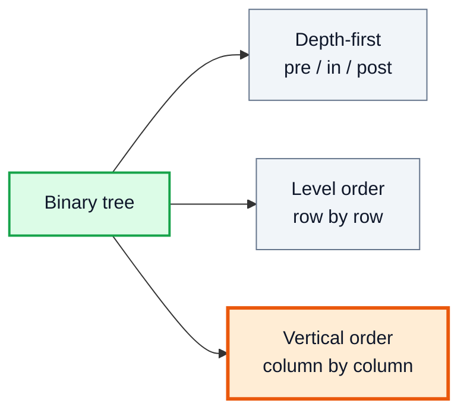
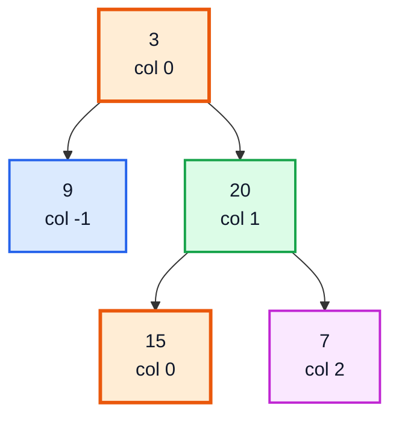
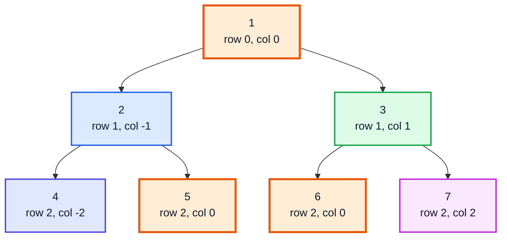
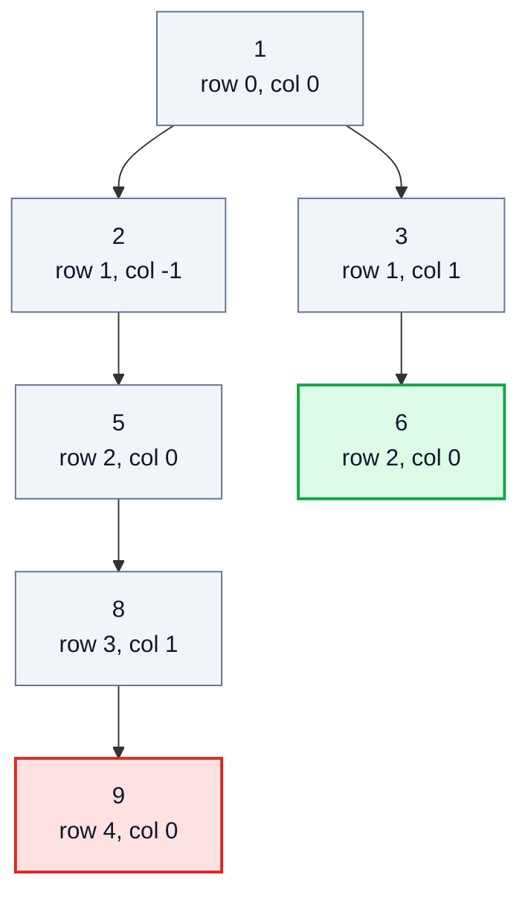
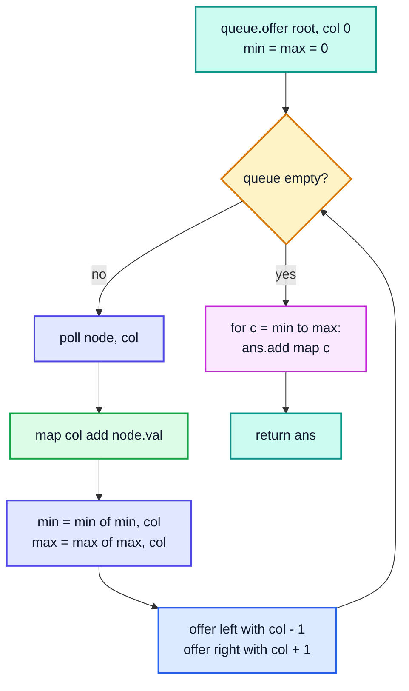
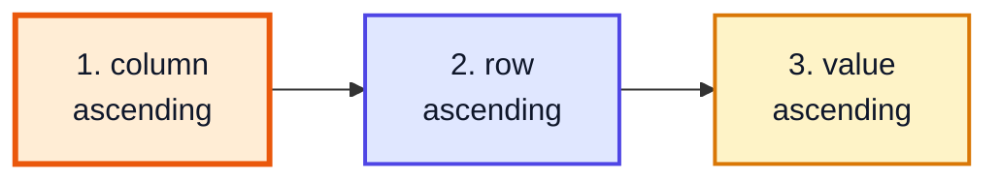
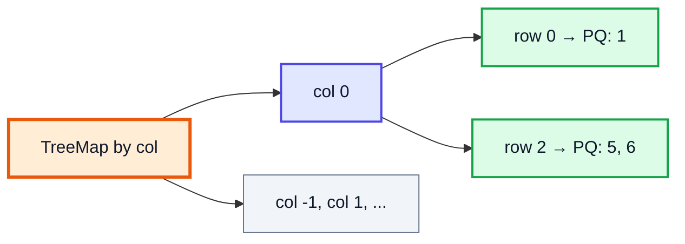
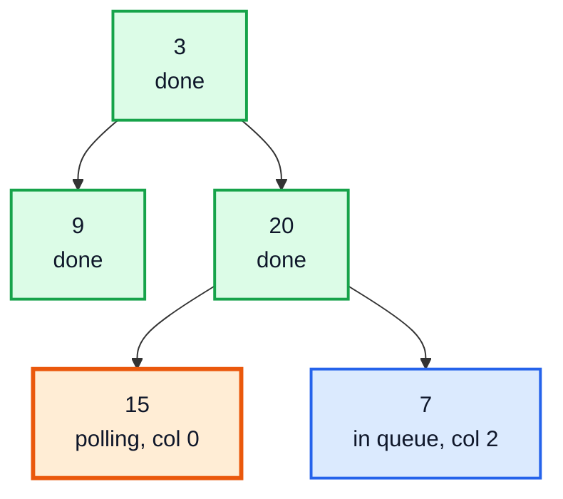
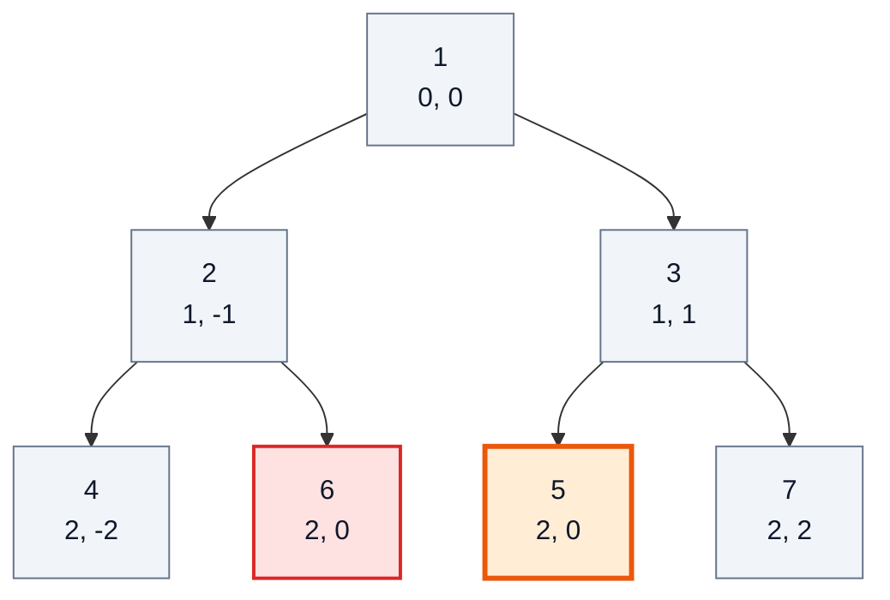

# Vertical Order Traversal of a Binary Tree — Complete In-Depth Guide

**Video #64 of the Java + DSA playlist:** *Vertical Order Traversal of a Binary Tree - Google Interview Question* (22:28)

How to read a binary tree column by column, left to right: giving every node a (row, column) coordinate, using BFS with a queue so nodes in each column come out top to bottom, collecting columns in a `HashMap` while tracking the minimum and maximum column, and the extra sorting rule that LeetCode 987 adds for nodes that share a position (LeetCode 987, also LeetCode 314).

> [!NOTE]
> This video's description has **no timestamps**, so the sections below are built from the topics the video covers and use **(—)** instead of a time. Tree basics (node class, depth-first traversals) are in [java_49_video_binary_trees_bst.md](java_49_video_binary_trees_bst.md); queues are in [java_46_video_stacks_queues.md](java_46_video_stacks_queues.md); HashMap internals are in [java_57_video_hashmap_hashtable.md](java_57_video_hashmap_hashtable.md).

---

## Table of Contents

| # | Topic | Timestamp |
|---|---|---|
| 0 | [Introduction](#0-introduction-) | — |
| 1 | [The Problem: LeetCode 987 and 314](#1-the-problem-leetcode-987-and-314-) | — |
| 2 | [Column and Row Coordinates](#2-column-and-row-coordinates-) | — |
| 3 | [Why BFS (Level Order)](#3-why-bfs-level-order-) | — |
| 4 | [BFS with Queue, HashMap and Min-Max Column](#4-bfs-with-queue-hashmap-and-min-max-column-) | — |
| 5 | [Sorting Ties by Row then Value: LeetCode 987](#5-sorting-ties-by-row-then-value-leetcode-987-) | — |
| 6 | [TreeMap Alternative](#6-treemap-alternative-) | — |
| 7 | [Dry Run](#7-dry-run-) | — |
| 8 | [Time and Space Complexity](#8-time-and-space-complexity-) | — |

---

## 0. Introduction (—)

The traversals from video #49 (pre/in/post-order) go **depth-first**; level-order goes **row by row**. Vertical order traversal asks for yet another view: stand in front of the tree and read it in **vertical columns**, from the leftmost column to the rightmost.



It is a popular interview question (often attributed to Google) because it combines three ideas in one problem:

1. **Coordinates** for tree nodes (column = horizontal distance from the root).
2. **BFS** with a queue, so that each column is filled top to bottom.
3. **Maps** (HashMap or TreeMap) to group nodes by column, plus careful **tie-breaking**.

> [!IMPORTANT]
> The single idea to remember: **left child = column − 1, right child = column + 1**. Everything else is bookkeeping around that rule.

---

## 1. The Problem: LeetCode 987 and 314 (—)

**LeetCode 987: *Vertical Order Traversal of a Binary Tree*** (Hard)

> For each node at position `(row, col)`, its left child is at `(row + 1, col - 1)` and its right child at `(row + 1, col + 1)`. The root is at `(0, 0)`. Return the vertical order traversal: for each column from leftmost to rightmost, list its nodes from top to bottom. If several nodes share the **same row and column**, sort them **by value**.

**LeetCode 314: *Binary Tree Vertical Order Traversal*** (Medium, premium) asks almost the same thing, but nodes in the same row and column keep **left-to-right** order instead of being sorted by value.

| Rule | LC 314 | LC 987 |
|---|---|---|
| Columns | Leftmost to rightmost | Leftmost to rightmost |
| Inside a column | Top to bottom (by row) | Top to bottom (by row) |
| Same row **and** same column | Left to right (BFS order) | **Smaller value first** |
| Plain BFS + HashMap enough? | ✅ Yes | ❌ Needs sorting |

**Example 1** (`root = [3, 9, 20, null, null, 15, 7]`):



```text
Output: [[9], [3, 15], [20], [7]]
         col-1  col 0   col1  col2
```

`3` and `15` are both in column 0 (same colour); 3 is higher, so it comes first.

---

## 2. Column and Row Coordinates (—)

### The basics

Give each node two numbers:

| Coordinate | Meaning | Root | Left child | Right child |
|---|---|---|---|---|
| **row** | Depth (level) | 0 | parent row + 1 | parent row + 1 |
| **col** | Horizontal distance from the root | 0 | parent col **− 1** | parent col **+ 1** |

Columns can be **negative** (anything left of the root). That detail drives the data-structure choice later: you cannot index an array with `-2`.

### A full example

Tree `[1, 2, 3, 4, 5, 6, 7]`:



Grouped into columns:

| Column | -2 | -1 | 0 | 1 | 2 |
|---|---|---|---|---|---|
| Nodes (top → bottom) | 4 | 2 | 1, 5, 6 | 3 | 7 |

`5` and `6` are both at `(2, 0)` — a **tie**. They come from *different* parents (2's right and 3's left) yet land in the same spot. That is the case the two LeetCode versions disagree on.

> [!TIP]
> Picture the columns as vertical lines through the tree. A node's column is "how many steps right minus how many steps left" on the path from the root, so 5 (left then right) and 6 (right then left) both get `-1 + 1 = 0`.

---

## 3. Why BFS (Level Order) (—)

Inside a column the output must go **top to bottom**. Compare the two ways of walking the tree:

| Walk | Visits nodes in order of | Column lists come out |
|---|---|---|
| DFS (pre-order) | Path order: goes deep on the left before touching the right | **Not** sorted by row: a deep left node can be added before a shallow right node in the same column |
| **BFS** (queue) | Row 0, then row 1, then row 2 … | **Already** top to bottom, and left to right within a row |

DFS failure example: in the tree below, pre-order reaches `9` (row 4, col 0, via 2 → 5 → 8 → 9) before it ever enters `3`'s subtree, but `6` (row 2, col 0) is shallower and should come first.



Pre-order visits `1, 2, 5, 8, 9, 3, 6`, so column 0 would be built as `[1, 5, 9, 6]` ❌. The correct top-to-bottom order is `[1, 5, 6, 9]` ✅, which BFS gives for free because it finishes row 2 before row 4.

> [!NOTE]
> DFS still works if you **record the row** with each node and sort afterwards (Section 5 does exactly that). BFS just saves the sort when you only need LC 314's rules.

---

## 4. BFS with Queue, HashMap and Min-Max Column (—)

### The plan

1. Put `(root, col 0)` in a queue.
2. Repeatedly poll `(node, col)`:
   - append `node.val` to `map[col]`,
   - update `min` and `max` column seen,
   - offer `(left, col - 1)` and `(right, col + 1)` if they exist.
3. Read the map from `min` to `max` to build the answer.

Why track `min` / `max`? A `HashMap` has **no ordering**. Since columns are consecutive integers (there are no gaps between the leftmost and rightmost column), a simple `for (c = min; c <= max; c++)` visits them in order without sorting the keys.



### Code

The queue must carry the node **and** its column together. The video's style uses `Map.Entry<TreeNode, Integer>` as a ready-made pair:

```java
import java.util.*;

class Solution {
    public List<List<Integer>> verticalOrder(TreeNode root) {
        List<List<Integer>> ans = new ArrayList<>();
        if (root == null) return ans;

        Map<Integer, List<Integer>> map = new HashMap<>();
        Queue<Map.Entry<TreeNode, Integer>> queue = new ArrayDeque<>();
        queue.offer(new AbstractMap.SimpleEntry<>(root, 0));
        int min = 0, max = 0;

        while (!queue.isEmpty()) {
            Map.Entry<TreeNode, Integer> e = queue.poll();
            TreeNode node = e.getKey();
            int col = e.getValue();

            map.computeIfAbsent(col, k -> new ArrayList<>()).add(node.val);
            min = Math.min(min, col);
            max = Math.max(max, col);

            if (node.left != null)  queue.offer(new AbstractMap.SimpleEntry<>(node.left, col - 1));
            if (node.right != null) queue.offer(new AbstractMap.SimpleEntry<>(node.right, col + 1));
        }

        for (int c = min; c <= max; c++) {
            ans.add(map.get(c));
        }
        return ans;
    }
}
```

| Piece | Purpose |
|---|---|
| `Queue<Map.Entry<TreeNode, Integer>>` | Pairs each node with its column |
| `AbstractMap.SimpleEntry` | A concrete, mutable `Map.Entry` you can create directly |
| `computeIfAbsent(col, k -> new ArrayList<>())` | Creates the column list the first time, then returns it |
| `min`, `max` | Range of column keys, so the map can be read in order |

> [!NOTE]
> **Modern Java:** older code writes `if (!map.containsKey(col)) map.put(col, new ArrayList<>()); map.get(col).add(...)`. `computeIfAbsent` (Java 8+) does the same in one line. Since Java 9 you can also make an immutable pair with `Map.entry(node, col)`, and since Java 16 a `record Pair(TreeNode node, int col) {}` is the cleanest choice of all. `ArrayDeque` is preferred over `LinkedList` as a queue (no per-element node objects).

> [!WARNING]
> This version returns **LC 314's** order. For ties at the same `(row, col)` it keeps BFS (left-to-right) order, not value order. On LC 987, the tree `[1, 2, 3, 4, 6, 5, 7]` returns `[1, 6, 5]` for column 0 instead of the required `[1, 5, 6]`. Section 5 fixes this.

---

## 5. Sorting Ties by Row then Value: LeetCode 987 (—)

LC 987's ordering is a three-level sort key:



So the simplest correct solution is: **record `(row, col, val)` for every node, sort, then group by column.** Any traversal works for collecting the triples, because the sort does all the ordering.

```java
import java.util.*;

class Solution {
    record Item(int row, int col, int val) {}

    public List<List<Integer>> verticalTraversal(TreeNode root) {
        List<Item> items = new ArrayList<>();
        dfs(root, 0, 0, items);

        items.sort(Comparator.comparingInt(Item::col)
                             .thenComparingInt(Item::row)
                             .thenComparingInt(Item::val));

        List<List<Integer>> ans = new ArrayList<>();
        Integer lastCol = null;
        for (Item it : items) {
            if (lastCol == null || it.col() != lastCol) {   // a new column starts
                ans.add(new ArrayList<>());
                lastCol = it.col();
            }
            ans.get(ans.size() - 1).add(it.val());
        }
        return ans;
    }

    private void dfs(TreeNode node, int row, int col, List<Item> items) {
        if (node == null) return;
        items.add(new Item(row, col, node.val));
        dfs(node.left, row + 1, col - 1, items);
        dfs(node.right, row + 1, col + 1, items);
    }
}
```

The tie case, `[1, 2, 3, 4, 6, 5, 7]`:

| Node | (row, col) | Sorted position |
|---|---|---|
| 4 | (2, -2) | 1st 🟦 |
| 2 | (1, -1) | 2nd 🟦 |
| 1 | (0, 0) | 3rd 🟧 |
| **5** | (2, 0) | 4th 🟧 — value 5 < 6 |
| **6** | (2, 0) | 5th 🟧 |
| 3 | (1, 1) | 6th 🟩 |
| 7 | (2, 2) | 7th 🟩 |

Result: `[[4], [2], [1, 5, 6], [3], [7]]` ✅ (BFS alone gave `[1, 6, 5]` ❌).

> [!TIP]
> If you prefer to keep the BFS + HashMap shape from Section 4: BFS already gives row order, so you only need to sort each **group of equal rows** inside a column by value. Storing `int[]{row, val}` in each column list and sorting that list by `(row, val)` at the end is equivalent and keeps the min/max trick.

---

## 6. TreeMap Alternative (—)

A `TreeMap` keeps its keys **sorted**, which removes the need for `min`/`max` and handles negative columns naturally. Nesting it gives all three sort levels directly:

```text
TreeMap<col, TreeMap<row, PriorityQueue<val>>>
         ^ sorted cols   ^ sorted rows  ^ smallest value first
```



```java
public List<List<Integer>> verticalTraversal(TreeNode root) {
    TreeMap<Integer, TreeMap<Integer, PriorityQueue<Integer>>> map = new TreeMap<>();
    Queue<TreeNode> nodes = new ArrayDeque<>();
    Queue<int[]> coords = new ArrayDeque<>();        // {row, col}, kept in step with nodes
    if (root != null) { nodes.offer(root); coords.offer(new int[]{0, 0}); }

    while (!nodes.isEmpty()) {
        TreeNode n = nodes.poll();
        int[] rc = coords.poll();
        map.computeIfAbsent(rc[1], k -> new TreeMap<>())
           .computeIfAbsent(rc[0], k -> new PriorityQueue<>())
           .offer(n.val);
        if (n.left != null)  { nodes.offer(n.left);  coords.offer(new int[]{rc[0] + 1, rc[1] - 1}); }
        if (n.right != null) { nodes.offer(n.right); coords.offer(new int[]{rc[0] + 1, rc[1] + 1}); }
    }

    List<List<Integer>> ans = new ArrayList<>();
    for (TreeMap<Integer, PriorityQueue<Integer>> rows : map.values()) {
        List<Integer> column = new ArrayList<>();
        for (PriorityQueue<Integer> pq : rows.values()) {
            while (!pq.isEmpty()) column.add(pq.poll());
        }
        ans.add(column);
    }
    return ans;
}
```

| Approach | Ordering of columns | Ties | Typical use |
|---|---|---|---|
| BFS + HashMap + min/max | Loop `min..max` | BFS order | LC 314; the video's main idea |
| Collect triples + sort | Comparator | By value | LC 987, shortest correct code |
| Nested TreeMap + PriorityQueue | TreeMap order | By value | LC 987, no explicit sort |

> [!NOTE]
> `TreeMap` is a red-black tree (a self-balancing BST, the same family as the AVL trees in [java_50_video_avl_trees.md](java_50_video_avl_trees.md)), so each insert costs O(log k) for k keys instead of HashMap's O(1) average.

---

## 7. Dry Run (—)

### BFS + HashMap on Example 1: `[3, 9, 20, null, null, 15, 7]`

| Step | Poll (node, col) | Map after step | min | max | Queue after step |
|---|---|---|---|---|---|
| 0 | — | {} | 0 | 0 | (3,0) |
| 1 | (3, 0) | {0:[3]} | 0 | 0 | (9,-1) (20,1) |
| 2 | (9, -1) | {-1:[9], 0:[3]} | -1 | 0 | (20,1) |
| 3 | (20, 1) | {…, 1:[20]} | -1 | 1 | (15,0) (7,2) |
| 4 | (15, 0) | {…, 0:[3, 15] 🟧} | -1 | 1 | (7,2) |
| 5 | (7, 2) | {…, 2:[7]} | -1 | 2 | empty ✅ |

Read `c = -1, 0, 1, 2` → `[[9], [3, 15], [20], [7]]`.

The tree at step 4, with the node being polled highlighted:



### The tie trap: `[1, 2, 3, 4, 6, 5, 7]`

BFS polls in the order `1, 2, 3, 4, 6, 5, 7`:

| Poll | (row, col) | Column 0 list (BFS) |
|---|---|---|
| 1 | (0, 0) | [1] |
| 2 | (1, -1) | [1] |
| 3 | (1, 1) | [1] |
| 4 | (2, -2) | [1] |
| 6 | (2, 0) | [1, 6] |
| 5 | (2, 0) | [1, 6, 5] 🟥 for LC 987 |
| 7 | (2, 2) | [1, 6, 5] |



6 is reached first (it hangs off the left side), but 5 has the smaller value at the same `(2, 0)`. LC 314 answer: `[1, 6, 5]`. LC 987 answer after sorting: `[1, 5, 6]`.

---

## 8. Time and Space Complexity (—)

Let n = number of nodes, w = number of columns (at most n).

| Approach | Time | Space | Bottleneck |
|---|---|---|---|
| BFS + HashMap + min/max (LC 314) | **O(n)** | O(n) | Each node polled once, O(1) map append |
| Collect triples + sort (LC 987) | O(n log n) | O(n) | The sort |
| Nested TreeMap + PQ (LC 987) | O(n log n) | O(n) | TreeMap/PQ inserts, O(log n) each |
| BFS + per-column sort of tied rows | O(n log n) worst | O(n) | Sorting groups |

| Space part | Size |
|---|---|
| Queue | Up to the widest level, about n/2 for a complete tree |
| Map / list of triples | n entries |
| Output | n values |
| DFS recursion (Section 5 collector) | O(h) |

> [!TIP]
> You cannot beat O(n log n) for LC 987 in general: if many nodes share one `(row, col)`, the problem literally asks you to sort their values.

---

## 🧩 Complete Example: Everything Together

Builds trees from LeetCode-style level-order arrays and runs all three approaches side by side, including the tie case where LC 314 and LC 987 disagree.

```java
import java.util.*;

public class VerticalOrderDemo {

    static class TreeNode {
        int val;
        TreeNode left, right;
        TreeNode(int val) { this.val = val; }
    }

    // Build a tree from a LeetCode-style level-order array (null = missing child)
    static TreeNode fromLevelOrder(Integer[] a) {
        if (a.length == 0 || a[0] == null) return null;
        TreeNode root = new TreeNode(a[0]);
        Queue<TreeNode> q = new ArrayDeque<>();
        q.offer(root);
        int i = 1;
        while (!q.isEmpty() && i < a.length) {
            TreeNode n = q.poll();
            if (i < a.length && a[i] != null) { n.left = new TreeNode(a[i]); q.offer(n.left); }
            i++;
            if (i < a.length && a[i] != null) { n.right = new TreeNode(a[i]); q.offer(n.right); }
            i++;
        }
        return root;
    }

    // ---------- Version 1: BFS + HashMap + min/max column (LeetCode 314 order) ----------
    static List<List<Integer>> verticalOrderBFS(TreeNode root) {
        List<List<Integer>> ans = new ArrayList<>();
        if (root == null) return ans;

        Map<Integer, List<Integer>> map = new HashMap<>();
        Queue<Map.Entry<TreeNode, Integer>> queue = new ArrayDeque<>();
        queue.offer(new AbstractMap.SimpleEntry<>(root, 0));
        int min = 0, max = 0;

        while (!queue.isEmpty()) {
            Map.Entry<TreeNode, Integer> e = queue.poll();
            TreeNode node = e.getKey();
            int col = e.getValue();

            map.computeIfAbsent(col, k -> new ArrayList<>()).add(node.val);
            min = Math.min(min, col);
            max = Math.max(max, col);

            if (node.left != null) queue.offer(new AbstractMap.SimpleEntry<>(node.left, col - 1));
            if (node.right != null) queue.offer(new AbstractMap.SimpleEntry<>(node.right, col + 1));
        }

        for (int c = min; c <= max; c++) ans.add(map.get(c));
        return ans;
    }

    // ---------- Version 2: LeetCode 987 (ties sorted by row, then value) ----------
    record Item(int row, int col, int val) {}

    static List<List<Integer>> verticalTraversal(TreeNode root) {
        List<Item> items = new ArrayList<>();
        dfs(root, 0, 0, items);

        items.sort(Comparator.comparingInt(Item::col)
                             .thenComparingInt(Item::row)
                             .thenComparingInt(Item::val));

        List<List<Integer>> ans = new ArrayList<>();
        Integer lastCol = null;
        for (Item it : items) {
            if (lastCol == null || it.col() != lastCol) {
                ans.add(new ArrayList<>());
                lastCol = it.col();
            }
            ans.get(ans.size() - 1).add(it.val());
        }
        return ans;
    }

    static void dfs(TreeNode node, int row, int col, List<Item> items) {
        if (node == null) return;
        items.add(new Item(row, col, node.val));
        dfs(node.left, row + 1, col - 1, items);
        dfs(node.right, row + 1, col + 1, items);
    }

    // ---------- Version 3: LeetCode 987 with TreeMap<col, TreeMap<row, PriorityQueue>> ----------
    static List<List<Integer>> verticalTraversalTreeMap(TreeNode root) {
        TreeMap<Integer, TreeMap<Integer, PriorityQueue<Integer>>> map = new TreeMap<>();
        Queue<int[]> coords = new ArrayDeque<>();   // {row, col} kept in step with nodes
        Queue<TreeNode> nodes = new ArrayDeque<>();
        if (root != null) { nodes.offer(root); coords.offer(new int[]{0, 0}); }

        while (!nodes.isEmpty()) {
            TreeNode n = nodes.poll();
            int[] rc = coords.poll();
            map.computeIfAbsent(rc[1], k -> new TreeMap<>())
               .computeIfAbsent(rc[0], k -> new PriorityQueue<>())
               .offer(n.val);
            if (n.left != null)  { nodes.offer(n.left);  coords.offer(new int[]{rc[0] + 1, rc[1] - 1}); }
            if (n.right != null) { nodes.offer(n.right); coords.offer(new int[]{rc[0] + 1, rc[1] + 1}); }
        }

        List<List<Integer>> ans = new ArrayList<>();
        for (TreeMap<Integer, PriorityQueue<Integer>> rows : map.values()) {
            List<Integer> column = new ArrayList<>();
            for (PriorityQueue<Integer> pq : rows.values()) {
                while (!pq.isEmpty()) column.add(pq.poll());
            }
            ans.add(column);
        }
        return ans;
    }

    static void run(String name, Integer[] arr) {
        TreeNode root = fromLevelOrder(arr);
        System.out.println("=== " + name + " " + Arrays.toString(arr) + " ===");
        System.out.println("BFS + HashMap (314) : " + verticalOrderBFS(root));
        System.out.println("Sort list (987)     : " + verticalTraversal(root));
        System.out.println("TreeMap + PQ (987)  : " + verticalTraversalTreeMap(root));
        System.out.println();
    }

    public static void main(String[] args) {
        run("Example 1", new Integer[]{3, 9, 20, null, null, 15, 7});
        run("Example 2", new Integer[]{1, 2, 3, 4, 5, 6, 7});
        run("Tie trap ", new Integer[]{1, 2, 3, 4, 6, 5, 7});
        run("Single   ", new Integer[]{42});
    }
}
```

**Expected Output:**

```text
=== Example 1 [3, 9, 20, null, null, 15, 7] ===
BFS + HashMap (314) : [[9], [3, 15], [20], [7]]
Sort list (987)     : [[9], [3, 15], [20], [7]]
TreeMap + PQ (987)  : [[9], [3, 15], [20], [7]]

=== Example 2 [1, 2, 3, 4, 5, 6, 7] ===
BFS + HashMap (314) : [[4], [2], [1, 5, 6], [3], [7]]
Sort list (987)     : [[4], [2], [1, 5, 6], [3], [7]]
TreeMap + PQ (987)  : [[4], [2], [1, 5, 6], [3], [7]]

=== Tie trap  [1, 2, 3, 4, 6, 5, 7] ===
BFS + HashMap (314) : [[4], [2], [1, 6, 5], [3], [7]]
Sort list (987)     : [[4], [2], [1, 5, 6], [3], [7]]
TreeMap + PQ (987)  : [[4], [2], [1, 5, 6], [3], [7]]

=== Single    [42] ===
BFS + HashMap (314) : [[42]]
Sort list (987)     : [[42]]
TreeMap + PQ (987)  : [[42]]
```

---

## Quick Reference Cheat Sheet

| Concept | One-Line Summary |
|---|---|
| **LC 987** | Columns left → right; in a column by row, then by **value** for ties |
| **LC 314** | Same, but ties keep **left-to-right** (BFS) order |
| **Coordinates** | Root (0, 0); left (row+1, col−1); right (row+1, col+1) |
| **Negative columns** | Normal — left of the root; use a map, not an array |
| **Why BFS** | Visits rows top to bottom, so column lists come out in row order |
| **Queue element** | Node + column pair: `Map.Entry`, `int[]`, or a `record` |
| **HashMap + min/max** | Columns are consecutive, so loop `min..max` instead of sorting keys |
| **`computeIfAbsent`** | Create-or-get the column list in one call |
| **Ties (987)** | Sort `(col, row, val)` triples with a chained `Comparator` |
| **TreeMap version** | `TreeMap<col, TreeMap<row, PriorityQueue<val>>>` — sorted at every level |
| **Complexity** | BFS + HashMap O(n); any LC 987 version O(n log n); space O(n) |
| **Common bug** | Using DFS without recording the row, or using plain BFS on LC 987 |
