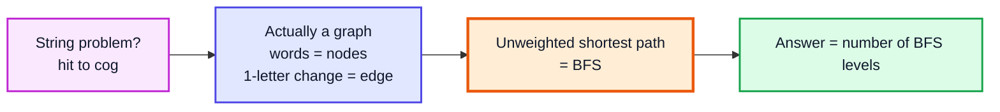
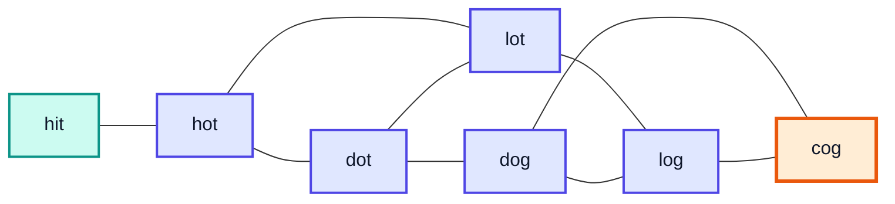
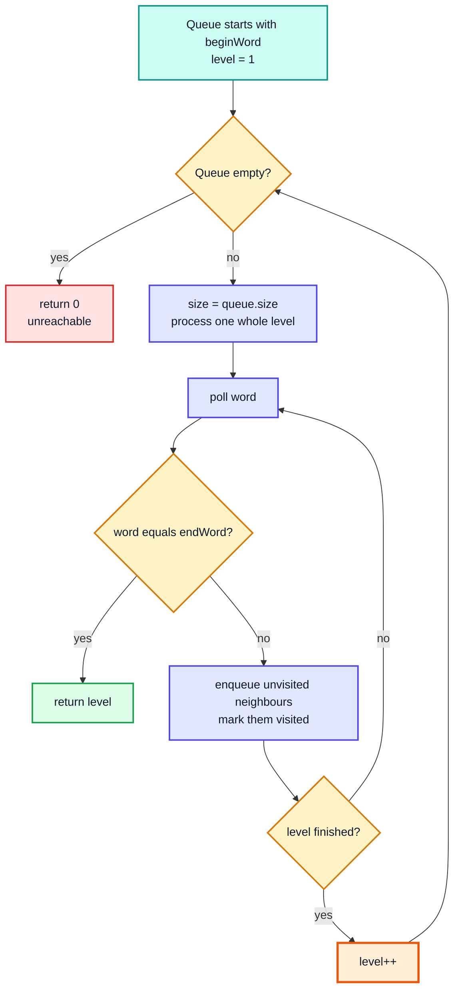
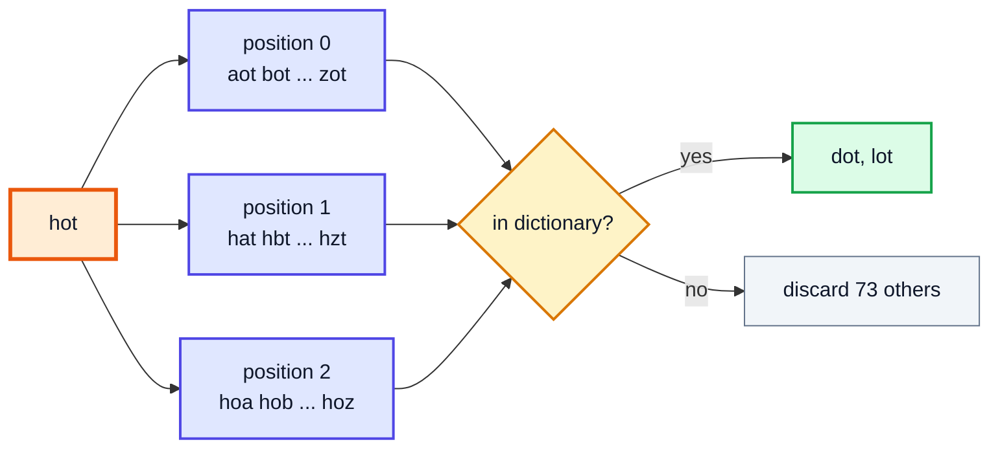
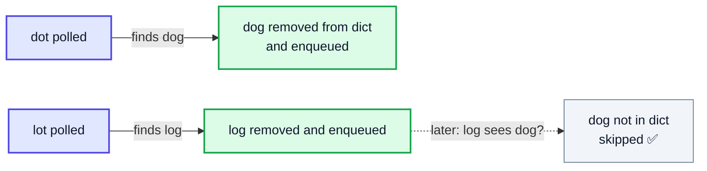
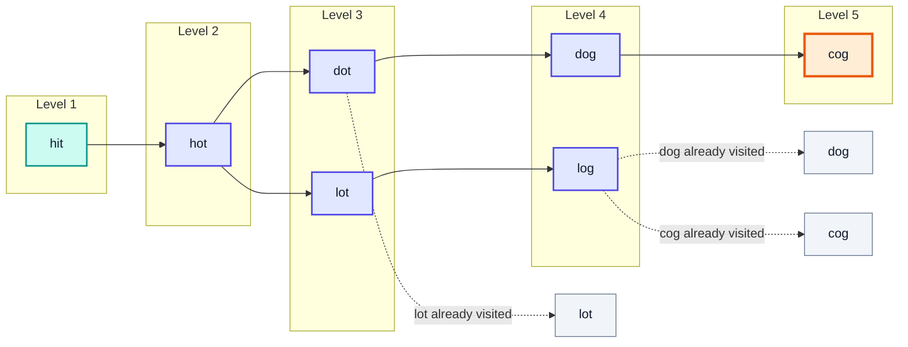
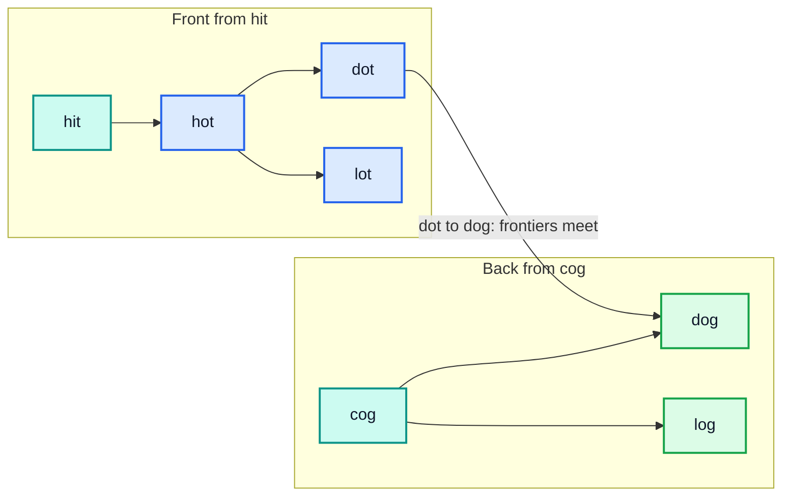
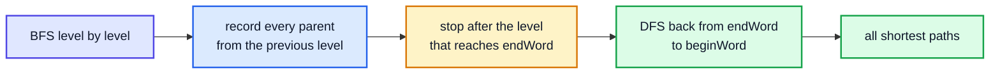

# Word Ladder (BFS on an Implicit Graph) — Complete In-Depth Guide

**Video #65 of the Java + DSA playlist:** *Word Ladder - LeetCode Hard - Google Phone Screen Interview Question* (17:45)

How to solve **LeetCode 127 – Word Ladder** by modelling words as nodes of a graph and running **Breadth-First Search** to find the shortest transformation sequence, plus a faster **bidirectional BFS** and a pointer to the follow-up **LeetCode 126 – Word Ladder II**.

> [!NOTE]
> This video's description has **no timestamps**. The sections below are organised by topic (following the video's content and description), so the Timestamp column shows **(—)**.

---

## Table of Contents

| # | Topic | Timestamp |
|---|---|---|
| 0 | [Introduction](#0-introduction-) | (—) |
| 1 | [Problem Statement: LeetCode 127](#1-problem-statement-leetcode-127-) | (—) |
| 2 | [Modelling Words as a Graph](#2-modelling-words-as-a-graph-) | (—) |
| 3 | [Why BFS Gives the Shortest Path](#3-why-bfs-gives-the-shortest-path-) | (—) |
| 4 | [Generating Neighbours: Change Each Letter a to z](#4-generating-neighbours-change-each-letter-a-to-z-) | (—) |
| 5 | [Visited Set and Removing from the Word Set](#5-visited-set-and-removing-from-the-word-set-) | (—) |
| 6 | [The Complete BFS Solution](#6-the-complete-bfs-solution-) | (—) |
| 7 | [Dry Run on hit to cog](#7-dry-run-on-hit-to-cog-) | (—) |
| 8 | [Time and Space Complexity](#8-time-and-space-complexity-) | (—) |
| 9 | [Bidirectional BFS](#9-bidirectional-bfs-) | (—) |
| 10 | [Related Problem: Word Ladder II (LeetCode 126)](#10-related-problem-word-ladder-ii-leetcode-126-) | (—) |
| 11 | [Outro](#11-outro-) | (—) |

---

## 0. Introduction (—)

Word Ladder is a classic **LeetCode Hard** that shows up in Google phone screens. It looks like a string problem, but the real trick is **recognising it as a graph problem**:

1. Every word is a **node**.
2. Two words are connected by an **edge** if they differ by **exactly one letter**.
3. "Shortest transformation sequence" = **shortest path** in an **unweighted** graph → **BFS**.



> [!IMPORTANT]
> The skill being tested is **modelling**, not coding. Once you say "this is BFS on an implicit graph", the code is a standard BFS template you already know from the tree level-order videos.

---

## 1. Problem Statement: LeetCode 127 (—)

### The Problem

Given `beginWord`, `endWord`, and a dictionary `wordList`, return the **number of words** in the **shortest transformation sequence** from `beginWord` to `endWord`, such that:

- Only **one letter** changes at each step.
- Every intermediate word (and `endWord`) must be in `wordList`. `beginWord` does **not** need to be in the list.
- Return `0` if no such sequence exists.

### Examples

| beginWord | endWord | wordList | Answer | Why |
|---|---|---|---|---|
| `hit` | `cog` | `[hot, dot, dog, lot, log, cog]` | **5** | `hit → hot → dot → dog → cog` |
| `hit` | `cog` | `[hot, dot, dog, lot, log]` | **0** | `cog` is not in the list |
| `a` | `c` | `[a, b, c]` | **2** | `a → c` |

### Constraints (LeetCode)

| Constraint | Value |
|---|---|
| Word length `L` | 1 to 10 |
| `wordList.length` `N` | up to 5000 |
| Characters | lowercase English letters only |
| All words | same length, `wordList` values are unique |

> [!WARNING]
> The answer counts **words**, not **steps**. `hit → hot → dot → dog → cog` has 4 transformations but the answer is **5**. That is why BFS starts at `level = 1`.

---

## 2. Modelling Words as a Graph (—)

### Basics: What Are the Nodes and Edges?

- **Node** = a word (`beginWord` + every word in `wordList`).
- **Edge** = two words of equal length that differ in **exactly one position**.
- Edges are **undirected** and **unweighted** (every step costs 1).

We never build this graph explicitly. It is an **implicit graph**: we discover a node's neighbours on the fly when BFS visits it.

### The Graph for the Example



| Edge | Changed position | Change |
|---|---|---|
| hit – hot | index 1 | `i → o` |
| hot – dot | index 0 | `h → d` |
| hot – lot | index 0 | `h → l` |
| dot – lot | index 0 | `d → l` |
| dot – dog | index 2 | `t → g` |
| lot – log | index 2 | `t → g` |
| dog – log | index 0 | `d → l` |
| dog – cog | index 0 | `d → c` |
| log – cog | index 0 | `l → c` |

### Two Ways to Find Edges

| Method | How | Cost per word | Best when |
|---|---|---|---|
| **Compare with every word** | Check each dictionary word for a 1-letter difference | `O(N · L)` | Very small dictionaries |
| **Mutate each letter a–z** (video's approach) | Try all `26 · L` one-letter variants and look them up in a `HashSet` | `O(26 · L · L)` | Large `N` — almost always |
| **Wildcard patterns** | Map `h*t`, `*it`, `hi*` → words; neighbours share a pattern | `O(L · L)` lookups | Precomputed adjacency, used in Word Ladder II |

> [!TIP]
> With `N = 5000` and `L ≤ 10`, comparing against every word costs ~50,000 per node, while mutating costs ~2,600. Mutation wins because `26 · L` does not grow with the dictionary.

---

## 3. Why BFS Gives the Shortest Path (—)

### Basics

BFS explores the graph **layer by layer**: first every node at distance 1, then distance 2, and so on. The **first time** BFS reaches a node, it has reached it by a shortest path, because all shorter distances were fully explored earlier.



### BFS vs DFS for This Problem

| | **BFS** | **DFS / Backtracking** |
|---|---|---|
| Finds shortest path in unweighted graph | ✅ first hit is shortest | ❌ first hit can be any path |
| Must explore all paths? | No, stops at first hit | Yes, to be sure it is minimal |
| Time | `O(N · 26 · L²)` | Exponential in the worst case |
| Data structure | Queue | Recursion stack |

> [!NOTE]
> The `size = queue.size()` trick is the same **level-order traversal** pattern from the binary tree BFS videos. Each "level" of the queue corresponds to one more word in the ladder.

---

## 4. Generating Neighbours: Change Each Letter a to z (—)

### The Idea

For a word of length `L`, there are exactly `25 · L` other strings that differ in one position. Generate each one and keep it only if it is in the dictionary.



### Code

```java
import java.util.*;

public class Neighbours {
    static List<String> neighbours(String word, Set<String> dict) {
        List<String> result = new ArrayList<>();
        char[] chars = word.toCharArray();          // mutable copy
        for (int i = 0; i < chars.length; i++) {
            char original = chars[i];
            for (char c = 'a'; c <= 'z'; c++) {
                if (c == original) continue;        // skip the word itself
                chars[i] = c;
                String candidate = new String(chars);
                if (dict.contains(candidate)) result.add(candidate);
            }
            chars[i] = original;                    // ⚠️ restore before next position
        }
        return result;
    }

    public static void main(String[] args) {
        Set<String> dict = new HashSet<>(List.of("hot", "dot", "dog", "lot", "log", "cog"));
        System.out.println(neighbours("hit", dict)); // [hot]
        System.out.println(neighbours("hot", dict)); // [dot, lot]
    }
}
```

> [!CAUTION]
> Forgetting `chars[i] = original;` is the most common bug. Without it, the change from position 0 "leaks" into position 1, and you generate words that differ in **two** letters.

### Why a `char[]` and Not `String` Concatenation?

| Approach | Per candidate | Notes |
|---|---|---|
| `word.substring(0, i) + c + word.substring(i + 1)` | 2 substrings + 1 concat | Easy to read, more garbage |
| `char[]` mutate + `new String(chars)` | 1 array copy | What most solutions use |

Either way, building a candidate and hashing it costs `O(L)`, which is where the extra `L` in the complexity comes from.

---

## 5. Visited Set and Removing from the Word Set (—)

### Why We Need "Visited"

The graph has cycles (`hot – dot – lot – hot`). Without tracking visited words, BFS would re-add `hot` from `dot`, then `dot` from `hot`, forever.

### Two Equivalent Options

| Option | How | Pros |
|---|---|---|
| Separate `Set<String> visited` | `if (dict.contains(w) && visited.add(w))` | Leaves the dictionary intact |
| **Remove from the word set** (video's approach) | `dict.remove(w)` when enqueued | One set instead of two, less memory |

```java
for (String next : neighbours(word, dict)) {
    dict.remove(next);       // "visited" = no longer in the dictionary
    queue.offer(next);
}
```

> [!IMPORTANT]
> Mark a word visited **when you enqueue it**, not when you poll it. If you wait until polling, the same word can be enqueued several times from different parents on the same level (`dog` could be added by both `dot` and `log`), wasting time and memory.



> [!NOTE]
> Also remove `beginWord` from the set at the start. If `beginWord` happens to be in `wordList`, a neighbour could otherwise step back to it.

---

## 6. The Complete BFS Solution (—)

```java
import java.util.*;

class Solution {
    public int ladderLength(String beginWord, String endWord, List<String> wordList) {
        Set<String> dict = new HashSet<>(wordList);   // O(1) lookups
        if (!dict.contains(endWord)) return 0;        // early exit

        Queue<String> queue = new ArrayDeque<>();
        queue.offer(beginWord);
        dict.remove(beginWord);
        int level = 1;                                // ladder includes beginWord

        while (!queue.isEmpty()) {
            int size = queue.size();                  // freeze this level
            for (int k = 0; k < size; k++) {
                String word = queue.poll();
                if (word.equals(endWord)) return level;

                char[] chars = word.toCharArray();
                for (int i = 0; i < chars.length; i++) {
                    char original = chars[i];
                    for (char c = 'a'; c <= 'z'; c++) {
                        if (c == original) continue;
                        chars[i] = c;
                        String next = new String(chars);
                        if (dict.remove(next)) {      // true only if it was unvisited
                            queue.offer(next);
                        }
                    }
                    chars[i] = original;
                }
            }
            level++;
        }
        return 0;
    }
}
```

> [!TIP]
> `dict.remove(next)` returns `true` only when the word was present, so it does the "is it a valid, unvisited word?" check **and** marks it visited in one call.

### Edge Cases

| Case | Result | Handled by |
|---|---|---|
| `endWord` not in list | `0` | Early `contains` check |
| `beginWord == endWord` | Not possible on LeetCode (they differ), but returns `1` here | First poll check |
| No path (disconnected) | `0` | Queue empties |
| `beginWord` in list | Works | Removed at start |

> [!NOTE]
> Modern Java: prefer `ArrayDeque` over `LinkedList` for queues. It is faster and has no per-node allocation. `queue.offer`/`poll` behave the same.

---

## 7. Dry Run on hit to cog (—)

Input: `beginWord = "hit"`, `endWord = "cog"`, `wordList = [hot, dot, dog, lot, log, cog]`.

### BFS Levels

Grey nodes are words already removed from the set (visited); the orange node is the target.



### Trace Table

| Level | Queue at start of level | Polled | New neighbours found (and removed from set) | Set after level |
|---|---|---|---|---|
| 1 | `[hit]` | hit | hot 🟩 | `{dot, dog, lot, log, cog}` |
| 2 | `[hot]` | hot | dot 🟩, lot 🟩 | `{dog, log, cog}` |
| 3 | `[dot, lot]` | dot | dog 🟩 (lot ❌ already removed) | `{log, cog}` |
| | | lot | log 🟩 | `{cog}` |
| 4 | `[dog, log]` | dog | cog 🟧 | `{}` |
| | | log | — (dog, cog ❌ removed) | `{}` |
| 5 | `[cog]` | cog | **cog == endWord → return 5** ✅ | |

Shortest ladder: `hit → hot → dot → dog → cog` (5 words). `hit → hot → lot → log → cog` is an equally short alternative.

> [!NOTE]
> You could also check `next.equals(endWord)` **while generating** neighbours and return `level + 1` immediately. That skips one extra level of polling, a small but real speed-up.

---

## 8. Time and Space Complexity (—)

Let `N` = number of words, `L` = word length.

| Part | Cost | Reason |
|---|---|---|
| Each word enqueued | at most once | Removed from set on enqueue |
| Candidates per word | `26 · L` | 26 letters at each of `L` positions |
| Build + hash one candidate | `O(L)` | `new String(chars)` and `hashCode` |
| **Total time** | **`O(N · 26 · L²)` = `O(N · L²)`** | |
| Set + queue | `O(N · L)` | Up to `N` strings of length `L` |
| **Total space** | **`O(N · L)`** | |

> [!TIP]
> For LeetCode limits: `5000 · 26 · 10 · 10 ≈ 1.3 × 10⁷` character operations — comfortably fast.

---

## 9. Bidirectional BFS (—)

### The Idea

Instead of one BFS from `beginWord`, run two: one from `beginWord` and one from `endWord`, and stop when the frontiers **meet**. Always expand the **smaller** frontier.

If the branching factor is `b` and the answer depth is `d`, normal BFS touches about `b^d` nodes; bidirectional touches about `2 · b^(d/2)` — dramatically fewer.



### Code

```java
import java.util.*;

class Solution {
    public int ladderLength(String beginWord, String endWord, List<String> wordList) {
        Set<String> dict = new HashSet<>(wordList);
        if (!dict.contains(endWord)) return 0;

        Set<String> front = new HashSet<>(Set.of(beginWord));
        Set<String> back = new HashSet<>(Set.of(endWord));
        dict.remove(beginWord);
        dict.remove(endWord);
        int level = 1;

        while (!front.isEmpty() && !back.isEmpty()) {
            if (front.size() > back.size()) {          // expand the smaller side
                Set<String> tmp = front; front = back; back = tmp;
            }
            Set<String> nextFront = new HashSet<>();
            for (String word : front) {
                char[] chars = word.toCharArray();
                for (int i = 0; i < chars.length; i++) {
                    char original = chars[i];
                    for (char c = 'a'; c <= 'z'; c++) {
                        chars[i] = c;
                        String candidate = new String(chars);
                        if (back.contains(candidate)) return level + 1;  // met!
                        if (dict.remove(candidate)) nextFront.add(candidate);
                    }
                    chars[i] = original;
                }
            }
            front = nextFront;
            level++;
        }
        return 0;
    }
}
```

| | **Single BFS** | **Bidirectional BFS** |
|---|---|---|
| Worst-case time | `O(N · L²)` | `O(N · L²)` (same bound) |
| Typical nodes explored | `b^d` | `≈ 2 · b^(d/2)` |
| Frontier structure | Queue | Two `HashSet`s |
| Code complexity | Simple | Moderate |
| Interview use | Expected answer | Great follow-up / optimisation |

> [!NOTE]
> Bidirectional BFS works here because the graph is **undirected** (if `a → b` is one letter, so is `b → a`) and the target is known in advance.

---

## 10. Related Problem: Word Ladder II (LeetCode 126) (—)

**LeetCode 126** asks for **all** shortest transformation sequences, not just the length.

| | **127 Word Ladder** | **126 Word Ladder II** |
|---|---|---|
| Output | Length of shortest ladder | Every shortest ladder (list of lists) |
| Visited marking | Per word, on enqueue | Per **level** (a word can have several parents on the same level) |
| Extra structure | None | `Map<String, List<String>>` of parents/children |
| Typical approach | BFS | BFS to build a layered DAG, then DFS/backtracking from `endWord` |



For the example, 126 returns both `[hit, hot, dot, dog, cog]` and `[hit, hot, lot, log, cog]`.

> [!WARNING]
> In 126, if you remove a word from the set the moment it is first enqueued (as in 127), you lose its **second** parent on the same level and miss valid paths. Remove all words discovered in a level only **after** the level finishes.

A single shortest path (not all of them) only needs a `parent` map in the 127 BFS — see the complete example below.

---

## 11. Outro (—)

Takeaways: spot the **implicit graph**, use **BFS** for unweighted shortest paths, generate neighbours by **mutating letters**, and mark visited by **removing from the set on enqueue**. The next video (#66) continues the advanced tree questions with **Two Sum IV – Input is a BST**.

---

## 🧩 Complete Example: Everything Together

One program with neighbour generation, single BFS (with a level trace), bidirectional BFS, path reconstruction, and the edge cases:

```java
import java.util.*;

public class Main {

    // ═══════ 1. NEIGHBOUR GENERATION: change one letter a–z ═══════
    static List<String> neighbours(String word, Set<String> dict) {
        List<String> result = new ArrayList<>();
        char[] chars = word.toCharArray();
        for (int i = 0; i < chars.length; i++) {
            char original = chars[i];
            for (char c = 'a'; c <= 'z'; c++) {
                if (c == original) continue;
                chars[i] = c;
                String candidate = new String(chars);
                if (dict.contains(candidate)) result.add(candidate);
            }
            chars[i] = original;                 // restore before next position
        }
        return result;
    }

    // ═══════ 2. BFS SHORTEST PATH (LeetCode 127) ═══════
    static int ladderLength(String beginWord, String endWord, List<String> wordList, boolean trace) {
        Set<String> dict = new HashSet<>(wordList);
        if (!dict.contains(endWord)) return 0;   // target unreachable

        Queue<String> queue = new ArrayDeque<>();
        queue.offer(beginWord);
        dict.remove(beginWord);                  // the word set doubles as "unvisited"
        int level = 1;                           // beginWord counts as 1 word

        while (!queue.isEmpty()) {
            int size = queue.size();
            if (trace) System.out.println("  Level " + level + ": " + queue);
            for (int k = 0; k < size; k++) {
                String word = queue.poll();
                if (word.equals(endWord)) return level;
                for (String next : neighbours(word, dict)) {
                    dict.remove(next);           // mark visited when ENQUEUED
                    queue.offer(next);
                }
            }
            level++;
        }
        return 0;
    }

    // ═══════ 3. BIDIRECTIONAL BFS ═══════
    static int ladderLengthBidirectional(String beginWord, String endWord, List<String> wordList) {
        Set<String> dict = new HashSet<>(wordList);
        if (!dict.contains(endWord)) return 0;

        Set<String> front = new HashSet<>(Set.of(beginWord));
        Set<String> back = new HashSet<>(Set.of(endWord));
        dict.remove(beginWord);
        dict.remove(endWord);
        int level = 1;

        while (!front.isEmpty() && !back.isEmpty()) {
            if (front.size() > back.size()) {    // always expand the smaller side
                Set<String> tmp = front; front = back; back = tmp;
            }
            Set<String> nextFront = new HashSet<>();
            for (String word : front) {
                char[] chars = word.toCharArray();
                for (int i = 0; i < chars.length; i++) {
                    char original = chars[i];
                    for (char c = 'a'; c <= 'z'; c++) {
                        chars[i] = c;
                        String candidate = new String(chars);
                        if (back.contains(candidate)) return level + 1;  // frontiers met
                        if (dict.remove(candidate)) nextFront.add(candidate);
                    }
                    chars[i] = original;
                }
            }
            front = nextFront;
            level++;
        }
        return 0;
    }

    // ═══════ 4. RECONSTRUCT ONE SHORTEST PATH (idea behind LeetCode 126) ═══════
    static List<String> onePath(String beginWord, String endWord, List<String> wordList) {
        Set<String> dict = new HashSet<>(wordList);
        if (!dict.contains(endWord)) return List.of();
        Map<String, String> parent = new HashMap<>();
        Queue<String> queue = new ArrayDeque<>(List.of(beginWord));
        dict.remove(beginWord);
        while (!queue.isEmpty()) {
            String word = queue.poll();
            if (word.equals(endWord)) break;
            for (String next : neighbours(word, dict)) {
                dict.remove(next);
                parent.put(next, word);
                queue.offer(next);
            }
        }
        if (!parent.containsKey(endWord)) return List.of();
        LinkedList<String> path = new LinkedList<>();
        for (String w = endWord; w != null; w = parent.get(w)) path.addFirst(w);
        return path;
    }

    public static void main(String[] args) {
        List<String> words = List.of("hot", "dot", "dog", "lot", "log", "cog");

        System.out.println("Neighbours of hit: " + neighbours("hit", new HashSet<>(words)));
        System.out.println("Neighbours of hot: " + neighbours("hot", new HashSet<>(words)));

        System.out.println("BFS trace hit -> cog:");
        int len = ladderLength("hit", "cog", words, true);
        System.out.println("Ladder length (BFS): " + len);

        System.out.println("Ladder length (bidirectional): "
                + ladderLengthBidirectional("hit", "cog", words));

        System.out.println("One shortest path: " + String.join(" -> ", onePath("hit", "cog", words)));

        List<String> noCog = List.of("hot", "dot", "dog", "lot", "log");
        System.out.println("Without cog in list: " + ladderLength("hit", "cog", noCog, false));

        System.out.println("Same-length single step a -> c: "
                + ladderLength("a", "c", List.of("a", "b", "c"), false));
    }
}
```

**Expected Output:**
```
Neighbours of hit: [hot]
Neighbours of hot: [dot, lot]
BFS trace hit -> cog:
  Level 1: [hit]
  Level 2: [hot]
  Level 3: [dot, lot]
  Level 4: [dog, log]
  Level 5: [cog]
Ladder length (BFS): 5
Ladder length (bidirectional): 5
One shortest path: hit -> hot -> dot -> dog -> cog
Without cog in list: 0
Same-length single step a -> c: 2
```

---

## Quick Reference Cheat Sheet

| Concept | One-Line Summary |
|---|---|
| **Problem** | LeetCode 127: fewest words from `beginWord` to `endWord`, one letter at a time, via `wordList` |
| **Graph model** | Words = nodes; differ by exactly one letter = undirected, unweighted edge |
| **Implicit graph** | Neighbours generated on the fly, never stored as adjacency lists |
| **Why BFS** | First arrival in BFS = shortest path in an unweighted graph |
| **Answer counts** | Words, not steps — start `level = 1` |
| **Early exit** | `endWord` not in `wordList` → return `0` |
| **Neighbours** | For each position, try `'a'..'z'`, keep candidates in the `HashSet`; restore the char |
| **Visited** | Remove from the word set **on enqueue**; `dict.remove(x)` returns whether it was unvisited |
| **Level loop** | `int size = queue.size();` then poll exactly `size` words |
| **Time** | `O(N · 26 · L²)` = `O(N · L²)` |
| **Space** | `O(N · L)` |
| **Bidirectional BFS** | Expand smaller frontier from both ends; stop when they meet; ~`2·b^(d/2)` vs `b^d` |
| **LeetCode 126** | All shortest ladders: BFS with per-level visited + parent map, then DFS back |
| **Queue choice** | `ArrayDeque` over `LinkedList` in modern Java |
