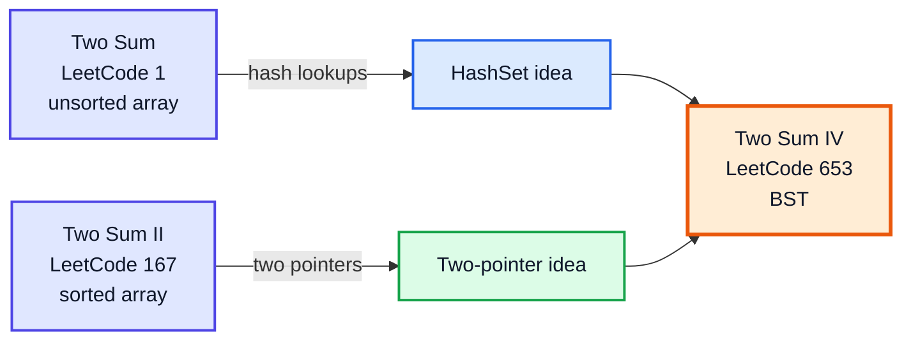
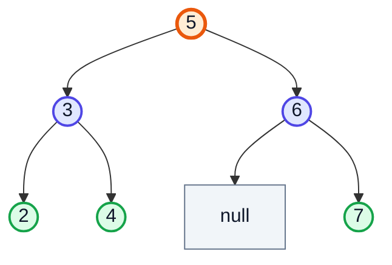
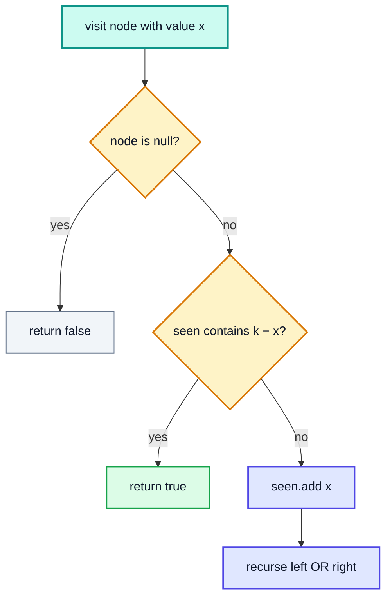
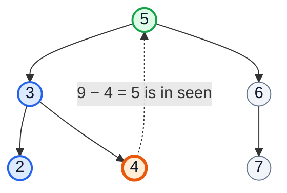
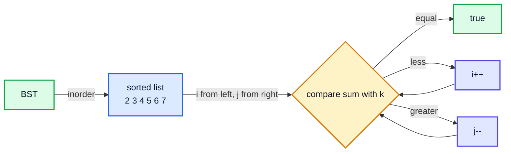
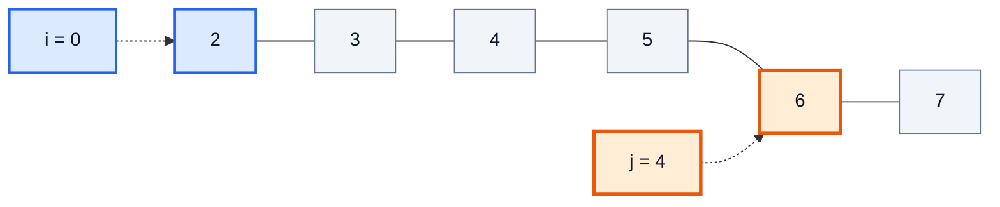
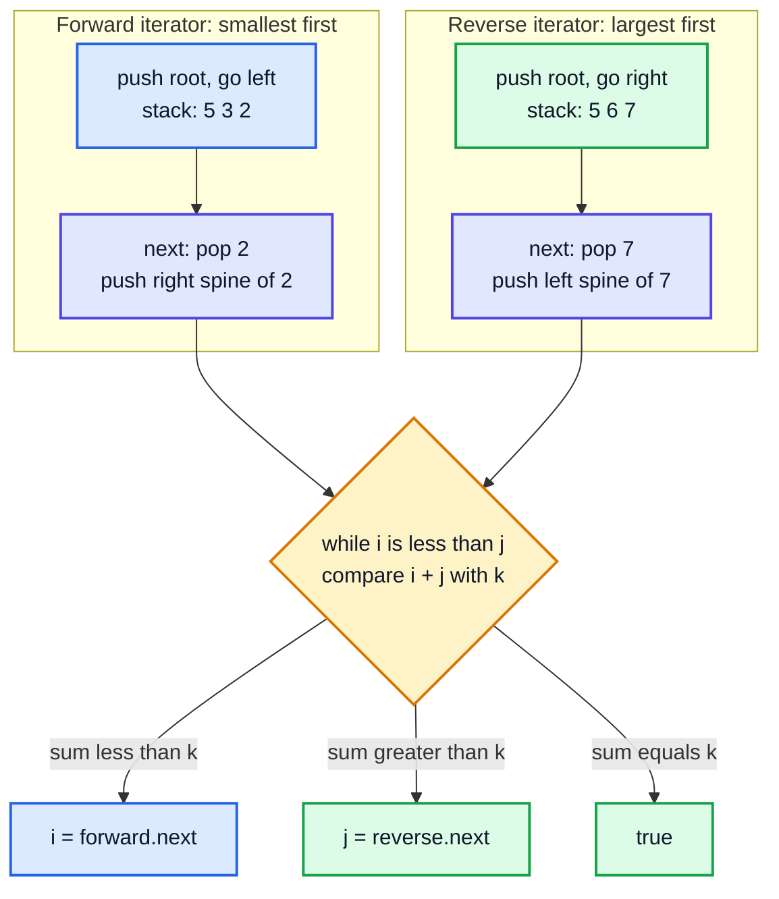
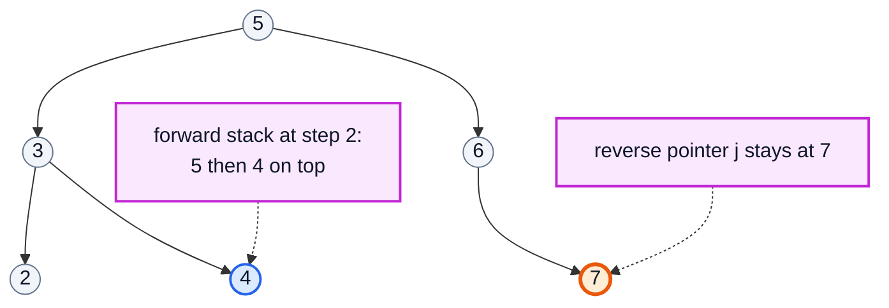

# Two Sum IV – Input is a BST — Complete In-Depth Guide

**Video #66 of the Java + DSA playlist:** *Two Sum IV - Google, Amazon, Facebook Interview Question* (8:38)

How to solve **LeetCode 653 – Two Sum IV – Input is a BST** three ways: a DFS with a `HashSet`, an inorder traversal into a sorted list plus two pointers, and a space-optimised version that runs two pointers directly on the tree with **BST iterators** in `O(h)` space.

> [!NOTE]
> This video's description has **no timestamps**. The sections below are organised by topic (following the video's content and description), so the Timestamp column shows **(—)**. The description speaks of "two Binary Tree questions"; these notes cover Two Sum IV, the problem in the video's title.

---

## Table of Contents

| # | Topic | Timestamp |
|---|---|---|
| 0 | [Introduction](#0-introduction-) | (—) |
| 1 | [Problem Statement: LeetCode 653](#1-problem-statement-leetcode-653-) | (—) |
| 2 | [Approach 1: DFS with a HashSet](#2-approach-1-dfs-with-a-hashset-) | (—) |
| 3 | [Dry Run: HashSet Approach](#3-dry-run-hashset-approach-) | (—) |
| 4 | [Approach 2: Inorder to Sorted List and Two Pointers](#4-approach-2-inorder-to-sorted-list-and-two-pointers-) | (—) |
| 5 | [Dry Run: Two Pointers on the Sorted List](#5-dry-run-two-pointers-on-the-sorted-list-) | (—) |
| 6 | [Approach 3: Two BST Iterators in O(h) Space](#6-approach-3-two-bst-iterators-in-oh-space-) | (—) |
| 7 | [Dry Run: BST Iterators](#7-dry-run-bst-iterators-) | (—) |
| 8 | [Complexity Comparison](#8-complexity-comparison-) | (—) |
| 9 | [Outro](#9-outro-) | (—) |

---

## 0. Introduction (—)

You already know **Two Sum** on an array (LeetCode 1, using a `HashMap`) and on a **sorted** array (LeetCode 167, using two pointers). Two Sum IV asks the same question when the numbers live in a **Binary Search Tree**.



> [!IMPORTANT]
> The key BST fact used here: **an inorder traversal of a BST visits values in sorted order**. That turns the tree into a "sorted array" and unlocks the two-pointer technique.

---

## 1. Problem Statement: LeetCode 653 (—)

Given the `root` of a BST and an integer `k`, return `true` if there exist **two different nodes** whose values sum to `k`.

### The Example Tree



| `k` | Answer | Pair |
|---|---|---|
| 9 | ✅ `true` | 2 + 7, 3 + 6, 4 + 5 |
| 28 | ❌ `false` | max possible is 6 + 7 = 13 |
| 4 | ❌ `false` | 2 + 2 would reuse the same node |

### Constraints (LeetCode)

| Constraint | Value |
|---|---|
| Nodes | 1 to 10⁴ |
| Values | −10⁴ to 10⁴ |
| `root` | guaranteed to be a valid BST |
| `k` | −10⁵ to 10⁵ |

> [!WARNING]
> The two nodes must be **different**. A single node with value `k / 2` does not count. Each approach below handles this naturally: the HashSet checks **before** inserting the current value, and the two pointers stop when they meet.

### The Node Class

```java
class TreeNode {
    int val;
    TreeNode left, right;
    TreeNode(int val) { this.val = val; }
}
```

---

## 2. Approach 1: DFS with a HashSet (—)

### The Idea

Traverse the tree in any order. At each node with value `x`, ask: "Have I already seen `k − x`?"
- Yes → found a pair.
- No → remember `x` and keep going.

This is exactly LeetCode 1's trick, applied while walking the tree.



### Code

```java
import java.util.*;

class Solution {
    public boolean findTarget(TreeNode root, int k) {
        return dfs(root, k, new HashSet<>());
    }

    private boolean dfs(TreeNode node, int k, Set<Integer> seen) {
        if (node == null) return false;
        if (seen.contains(k - node.val)) return true;   // complement seen earlier
        seen.add(node.val);                              // add AFTER checking
        return dfs(node.left, k, seen) || dfs(node.right, k, seen);
    }
}
```

> [!TIP]
> `||` short-circuits: once the left subtree returns `true`, the right subtree is never explored.

> [!NOTE]
> This approach **does not use the BST property at all**. It works on any binary tree, which makes it a safe first answer in an interview before you optimise.

---

## 3. Dry Run: HashSet Approach (—)

Tree `[5, 3, 6, 2, 4, null, 7]`, `k = 9`. DFS goes in preorder: 5, 3, 2, 4, …

| Step | Node | Need `k − x` | In `seen`? | `seen` after |
|---|---|---|---|---|
| 1 | 5 | 4 | ❌ | `{5}` |
| 2 | 3 | 6 | ❌ | `{5, 3}` |
| 3 | 2 | 7 | ❌ | `{5, 3, 2}` |
| 4 | 4 | 5 | ✅ **found** | — |

Returns `true` (4 + 5) without ever visiting 6 or 7.



(Blue = visited and stored, orange = current node, green = the complement found, grey = never visited.)

---

## 4. Approach 2: Inorder to Sorted List and Two Pointers (—)

### The Idea

1. Inorder traversal (left → node → right) of a BST gives a **sorted** list.
2. Run the classic two-pointer search (LeetCode 167) on that list:
   - `sum == k` → `true`
   - `sum < k` → need bigger → `i++`
   - `sum > k` → need smaller → `j--`



### Code

```java
import java.util.*;

class Solution {
    public boolean findTarget(TreeNode root, int k) {
        List<Integer> sorted = new ArrayList<>();
        inorder(root, sorted);

        int i = 0, j = sorted.size() - 1;
        while (i < j) {                       // i < j guarantees two DIFFERENT nodes
            int sum = sorted.get(i) + sorted.get(j);
            if (sum == k) return true;
            if (sum < k) i++;
            else j--;
        }
        return false;
    }

    private void inorder(TreeNode node, List<Integer> out) {
        if (node == null) return;
        inorder(node.left, out);
        out.add(node.val);
        inorder(node.right, out);
    }
}
```

### Why Two Pointers Never Miss a Pair

When `sum < k`, the smallest value `sorted[i]` cannot pair with anything: its biggest possible partner `sorted[j]` is already too small. So discarding `i` is safe. The mirror argument works for `j` when `sum > k`. Each step eliminates one element, so the loop runs at most `n − 1` times.

---

## 5. Dry Run: Two Pointers on the Sorted List (—)

Sorted list from inorder: `[2, 3, 4, 5, 6, 7]`.

### `k = 8` (needs a `j--`)

| Step | `i` → val | `j` → val | sum | Action |
|---|---|---|---|---|
| 1 | 0 → 2 🟦 | 5 → 7 🟧 | 9 | 9 > 8 → `j--` |
| 2 | 0 → 2 🟦 | 4 → 6 🟧 | 8 | ✅ **return true** |

### `k = 28` (no pair)

| Step | `i` → val | `j` → val | sum | Action |
|---|---|---|---|---|
| 1 | 0 → 2 | 5 → 7 | 9 | < 28 → `i++` |
| 2 | 1 → 3 | 5 → 7 | 10 | < 28 → `i++` |
| 3 | 2 → 4 | 5 → 7 | 11 | < 28 → `i++` |
| 4 | 3 → 5 | 5 → 7 | 12 | < 28 → `i++` |
| 5 | 4 → 6 | 5 → 7 | 13 | < 28 → `i++` |
| 6 | 5 → 7 | 5 → 7 | — | `i == j` → ❌ **return false** |



(Final state of the `k = 8` run: `2 + 6 = 8`.)

> [!NOTE]
> This uses `O(n)` extra space for the list, the same as the HashSet. Its value is that it **does** use the BST property, and it leads straight to the `O(h)` optimisation.

---

## 6. Approach 3: Two BST Iterators in O(h) Space (—)

### The Idea

We don't need the whole sorted list — the two pointers only ever look at **one smallest-remaining** and **one largest-remaining** value. A **BST iterator** (LeetCode 173) produces inorder values one at a time using a stack that holds at most `h` nodes.

- **Forward iterator** (ascending): push the root and keep going **left**. `next()` pops a node, then pushes its **right** child and that child's left spine.
- **Reverse iterator** (descending): mirror image — go **right**, and after popping push the **left** child's right spine.



### Code

```java
import java.util.*;

class BSTIterator {
    private final Deque<TreeNode> stack = new ArrayDeque<>();
    private final boolean reverse;          // false = ascending, true = descending

    BSTIterator(TreeNode root, boolean reverse) {
        this.reverse = reverse;
        pushAll(root);
    }

    private void pushAll(TreeNode node) {
        while (node != null) {
            stack.push(node);
            node = reverse ? node.right : node.left;
        }
    }

    boolean hasNext() { return !stack.isEmpty(); }

    int next() {
        TreeNode node = stack.pop();
        pushAll(reverse ? node.left : node.right);
        return node.val;
    }
}

class Solution {
    public boolean findTarget(TreeNode root, int k) {
        if (root == null) return false;
        BSTIterator left = new BSTIterator(root, false);
        BSTIterator right = new BSTIterator(root, true);

        int i = left.next(), j = right.next();
        while (i < j) {                     // values are distinct in a BST
            int sum = i + j;
            if (sum == k) return true;
            if (sum < k) i = left.next();
            else j = right.next();
        }
        return false;
    }
}
```

> [!TIP]
> `next()` is **amortised `O(1)`**: each node is pushed and popped exactly once over the whole traversal, even though a single call might push several nodes.

> [!NOTE]
> Safety of `next()` inside the loop: while `i < j`, the forward iterator has not yet reached `j`'s node (and vice versa), so both stacks still hold the elements between them — neither iterator can run dry.

> [!NOTE]
> Modern Java: use `ArrayDeque` as the stack (`push`/`pop`) rather than the legacy, synchronised `java.util.Stack` class.

---

## 7. Dry Run: BST Iterators (—)

Same tree. Stack contents are listed bottom → top.

### `k = 8`

| Step | Action | Forward stack | Reverse stack | `i` | `j` | sum |
|---|---|---|---|---|---|---|
| init | push left spine / right spine | `[5, 3, 2]` | `[5, 6, 7]` | | | |
| 1 | `i = next()`, `j = next()` | `[5, 3]` | `[5, 6]` | 2 | 7 | 9 > 8 → `j` |
| 2 | `j = next()` (pop 6) | `[5, 3]` | `[5]` | 2 | 6 | **8** ✅ |

### `k = 28` (shows the stack refilling)

| Step | Action | Forward stack | `i` | `j` | sum |
|---|---|---|---|---|---|
| 1 | pop 2 | `[5, 3]` | 2 | 7 | 9 < 28 |
| 2 | pop 3, push right child 4 | `[5, 4]` | 3 | 7 | 10 < 28 |
| 3 | pop 4 | `[5]` | 4 | 7 | 11 < 28 |
| 4 | pop 5, push right child 6 | `[6]` | 5 | 7 | 12 < 28 |
| 5 | pop 6, push right child 7 | `[7]` | 6 | 7 | 13 < 28 |
| 6 | pop 7 | `[]` | 7 | 7 | `i == j` → ❌ **false** |



The stack never holds more than `h + 1` nodes (here at most 3), compared to all 6 values in Approach 2.

---

## 8. Complexity Comparison (—)

`n` = number of nodes, `h` = tree height (`log n` if balanced, `n` if skewed).

| Approach | Time | Extra Space | Uses BST property? | Early exit? |
|---|---|---|---|---|
| **1. DFS + HashSet** | `O(n)` | `O(n)` set + `O(h)` recursion | ❌ (works on any binary tree) | ✅ |
| **2. Inorder list + two pointers** | `O(n)` | `O(n)` list + `O(h)` recursion | ✅ | ❌ always builds the full list |
| **3. Two BST iterators** | `O(n)` (amortised `O(1)` per `next`) | **`O(h)`** two stacks | ✅ | ✅ lazy, stops at first hit |
| Brute force: for each node, search `k − x` in BST | `O(n · h)` | `O(h)` | ✅ | ✅ |

> [!IMPORTANT]
> Interview path: start with **Approach 1** (simplest, always correct), mention **Approach 2** to show you know inorder = sorted, then optimise to **Approach 3** when asked to reduce space.

> [!CAUTION]
> On a **skewed** BST (`h = n`), the recursive approaches can hit deep recursion. The iterator approach uses an explicit stack, so it avoids `StackOverflowError` from recursion — though its stack still grows to `O(n)` in that case.

---

## 9. Outro (—)

Two Sum IV ties together three earlier ideas: hashing for complements, inorder traversal of a BST being sorted, and two pointers on sorted data. The BST iterator itself (LeetCode 173) is worth practising on its own — it reappears in problems like "Kth smallest element in a BST" and "merge two BSTs".

---

## 🧩 Complete Example: Everything Together

One program that builds the BST, shows both iterators, and checks all three approaches on several targets:

```java
import java.util.*;

class TreeNode {
    int val;
    TreeNode left, right;
    TreeNode(int val) { this.val = val; }
}

// ═══════ BST iterator: ascending (forward) or descending (reverse) ═══════
class BSTIterator {
    private final Deque<TreeNode> stack = new ArrayDeque<>();
    private final boolean reverse;

    BSTIterator(TreeNode root, boolean reverse) {
        this.reverse = reverse;
        pushAll(root);
    }

    private void pushAll(TreeNode node) {
        while (node != null) {
            stack.push(node);
            node = reverse ? node.right : node.left;
        }
    }

    boolean hasNext() { return !stack.isEmpty(); }

    int next() {
        TreeNode node = stack.pop();
        pushAll(reverse ? node.left : node.right);
        return node.val;
    }
}

public class Main {

    static TreeNode insert(TreeNode root, int val) {
        if (root == null) return new TreeNode(val);
        if (val < root.val) root.left = insert(root.left, val);
        else root.right = insert(root.right, val);
        return root;
    }

    // ═══════ Approach 1: DFS + HashSet — O(n) time, O(n) space ═══════
    static boolean findTargetHashSet(TreeNode root, int k) {
        return dfs(root, k, new HashSet<>());
    }

    private static boolean dfs(TreeNode node, int k, Set<Integer> seen) {
        if (node == null) return false;
        if (seen.contains(k - node.val)) return true;
        seen.add(node.val);
        return dfs(node.left, k, seen) || dfs(node.right, k, seen);
    }

    // ═══════ Approach 2: inorder -> sorted list -> two pointers ═══════
    static boolean findTargetInorder(TreeNode root, int k) {
        List<Integer> sorted = new ArrayList<>();
        inorder(root, sorted);
        int i = 0, j = sorted.size() - 1;
        while (i < j) {
            int sum = sorted.get(i) + sorted.get(j);
            if (sum == k) return true;
            if (sum < k) i++;
            else j--;
        }
        return false;
    }

    private static void inorder(TreeNode node, List<Integer> out) {
        if (node == null) return;
        inorder(node.left, out);
        out.add(node.val);
        inorder(node.right, out);
    }

    // ═══════ Approach 3: two BST iterators — O(n) time, O(h) space ═══════
    static boolean findTargetIterators(TreeNode root, int k) {
        if (root == null) return false;
        BSTIterator left = new BSTIterator(root, false);
        BSTIterator right = new BSTIterator(root, true);
        int i = left.next(), j = right.next();
        while (i < j) {
            int sum = i + j;
            if (sum == k) return true;
            if (sum < k) i = left.next();
            else j = right.next();
        }
        return false;
    }

    public static void main(String[] args) {
        TreeNode root = null;
        for (int v : new int[]{5, 3, 6, 2, 4, 7}) root = insert(root, v);

        List<Integer> sorted = new ArrayList<>();
        inorder(root, sorted);
        System.out.println("Inorder (sorted): " + sorted);

        BSTIterator asc = new BSTIterator(root, false);
        StringBuilder sb = new StringBuilder();
        while (asc.hasNext()) sb.append(asc.next()).append(' ');
        System.out.println("Forward iterator: " + sb.toString().trim());

        BSTIterator desc = new BSTIterator(root, true);
        sb.setLength(0);
        while (desc.hasNext()) sb.append(desc.next()).append(' ');
        System.out.println("Reverse iterator: " + sb.toString().trim());

        for (int k : new int[]{9, 28, 13, 10, 4}) {
            System.out.printf("k=%-2d HashSet=%-5b Inorder=%-5b Iterators=%b%n", k,
                    findTargetHashSet(root, k), findTargetInorder(root, k), findTargetIterators(root, k));
        }

        TreeNode single = new TreeNode(1);
        System.out.println("Single node, k=2: " + findTargetIterators(single, 2));
    }
}
```

**Expected Output:**
```
Inorder (sorted): [2, 3, 4, 5, 6, 7]
Forward iterator: 2 3 4 5 6 7
Reverse iterator: 7 6 5 4 3 2
k=9  HashSet=true  Inorder=true  Iterators=true
k=28 HashSet=false Inorder=false Iterators=false
k=13 HashSet=true  Inorder=true  Iterators=true
k=10 HashSet=true  Inorder=true  Iterators=true
k=4  HashSet=false Inorder=false Iterators=false
Single node, k=2: false
```

---

## Quick Reference Cheat Sheet

| Concept | One-Line Summary |
|---|---|
| **Problem** | LeetCode 653: do two **different** BST nodes sum to `k`? |
| **Related** | LeetCode 1 (HashMap), 167 (two pointers on sorted array), 173 (BST iterator) |
| **HashSet DFS** | At node `x`, check `k − x` in set, then add `x`; works on any binary tree |
| **Check before add** | Prevents pairing a node with itself (`2 + 2` for `k = 4`) |
| **Inorder of BST** | Left → node → right gives values in ascending order |
| **Two pointers** | `sum < k` → `i++`, `sum > k` → `j--`, stop when `i >= j` |
| **Forward iterator** | Stack of left spine; `next()` pops, then pushes right child's left spine |
| **Reverse iterator** | Stack of right spine; `next()` pops, then pushes left child's right spine |
| **`next()` cost** | Amortised `O(1)`; each node pushed/popped once |
| **Time (all three)** | `O(n)` |
| **Space** | HashSet / list: `O(n)`; iterators: `O(h)` |
| **Best interview answer** | Two BST iterators — `O(n)` time, `O(h)` space, early exit |
| **Stack class** | Use `ArrayDeque`, not legacy `Stack` |
