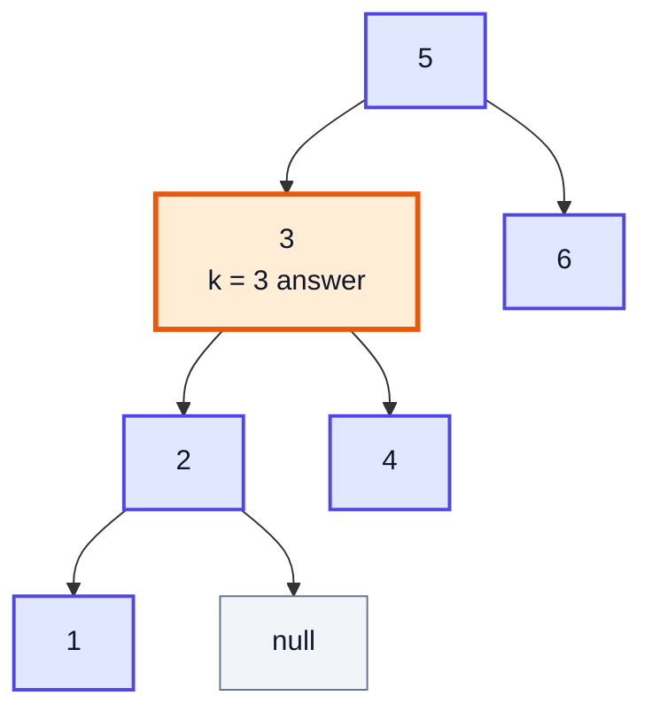
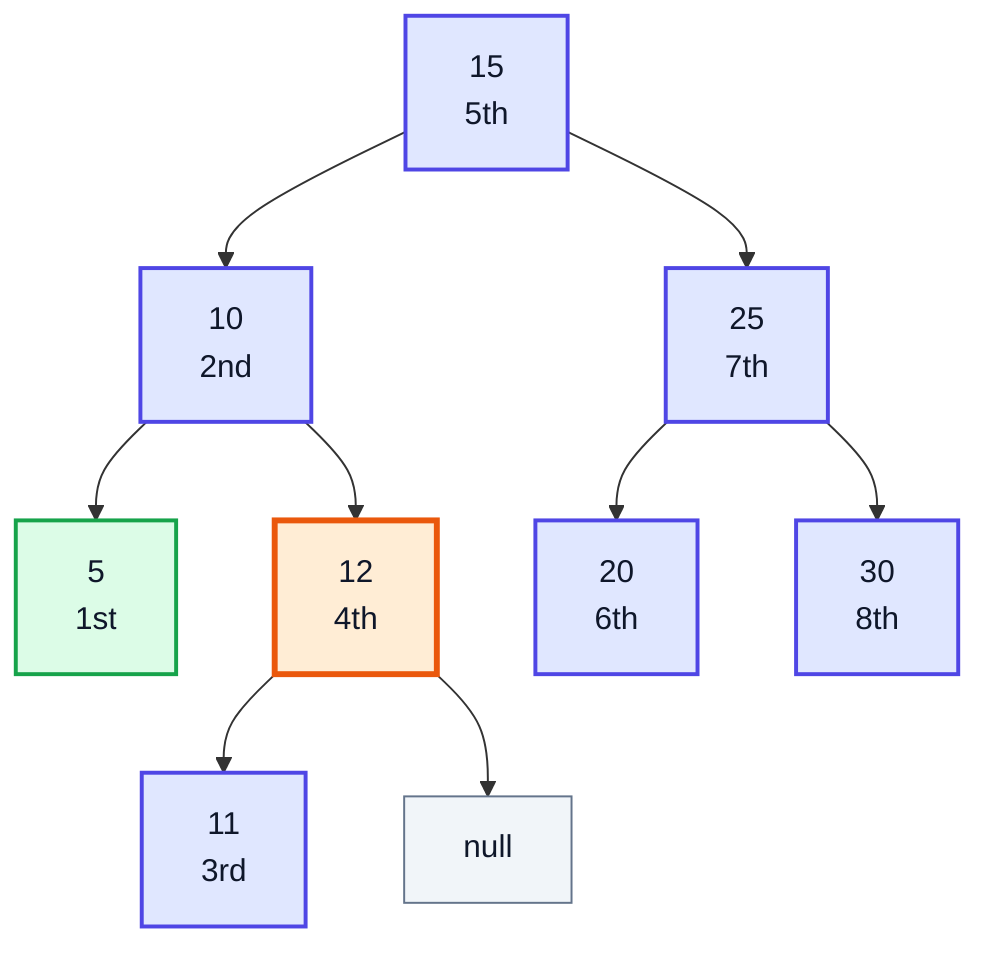
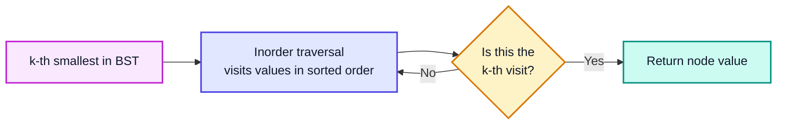
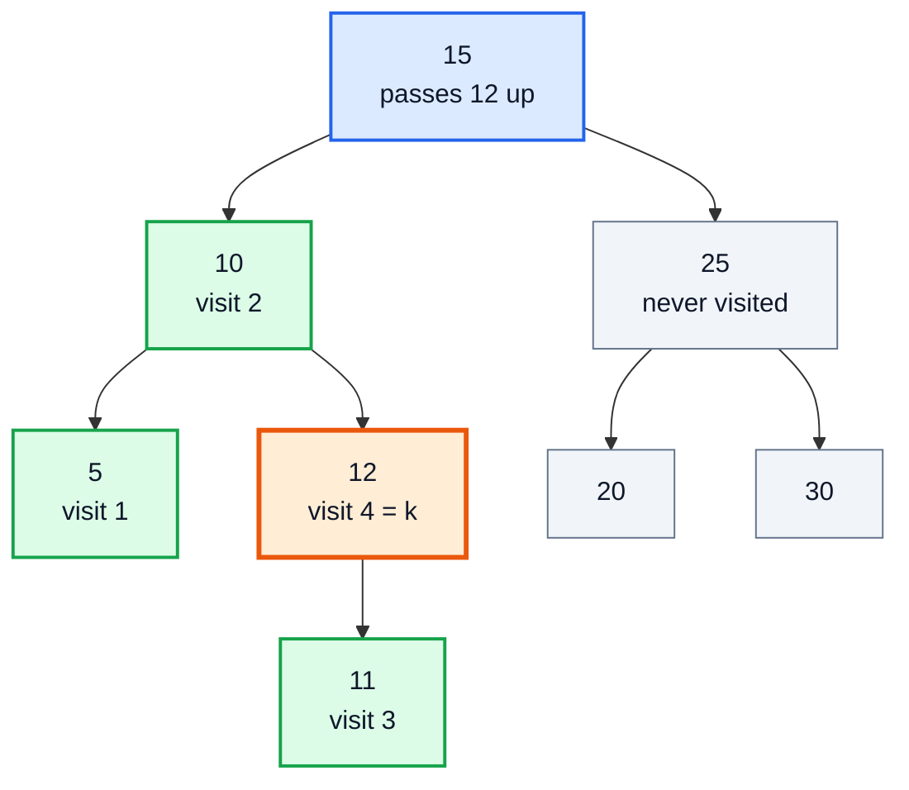
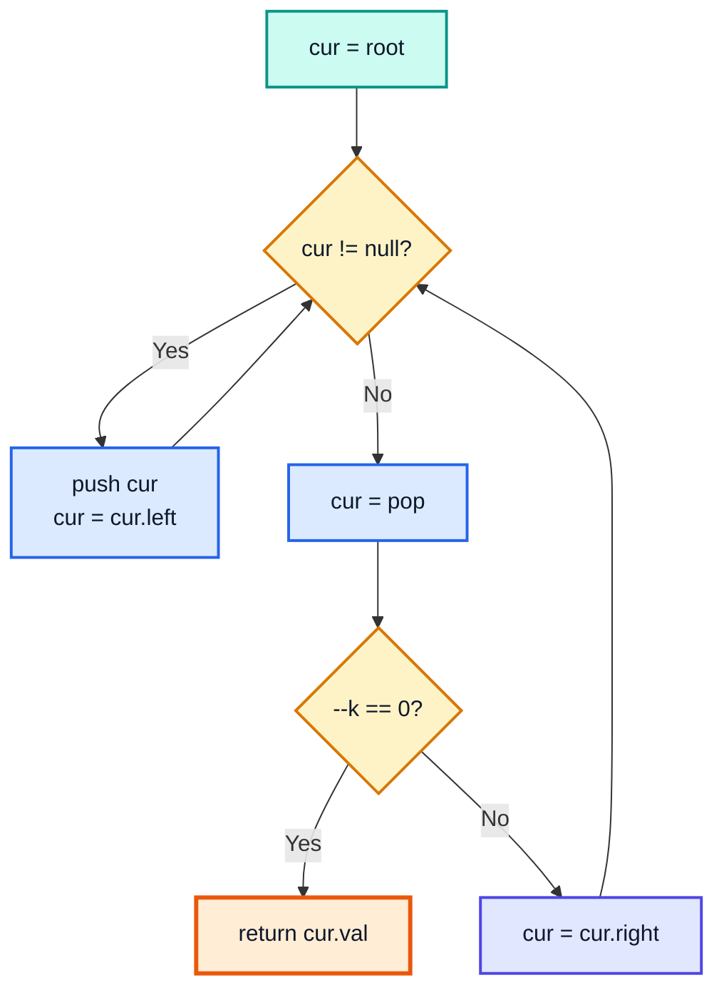
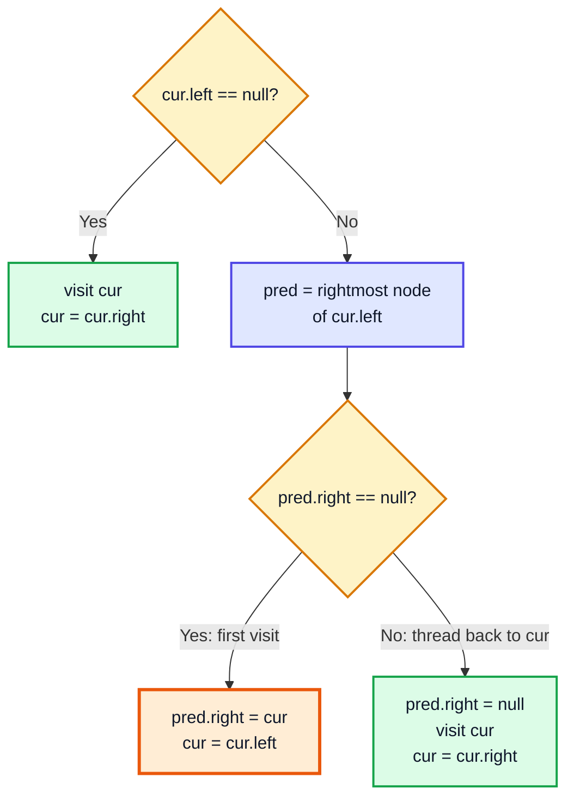
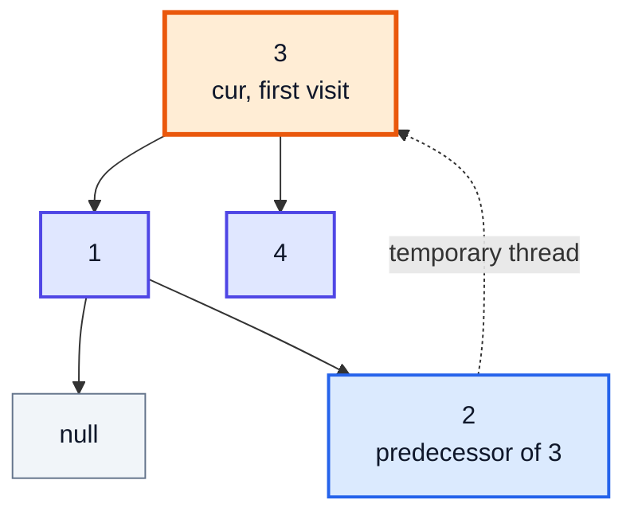
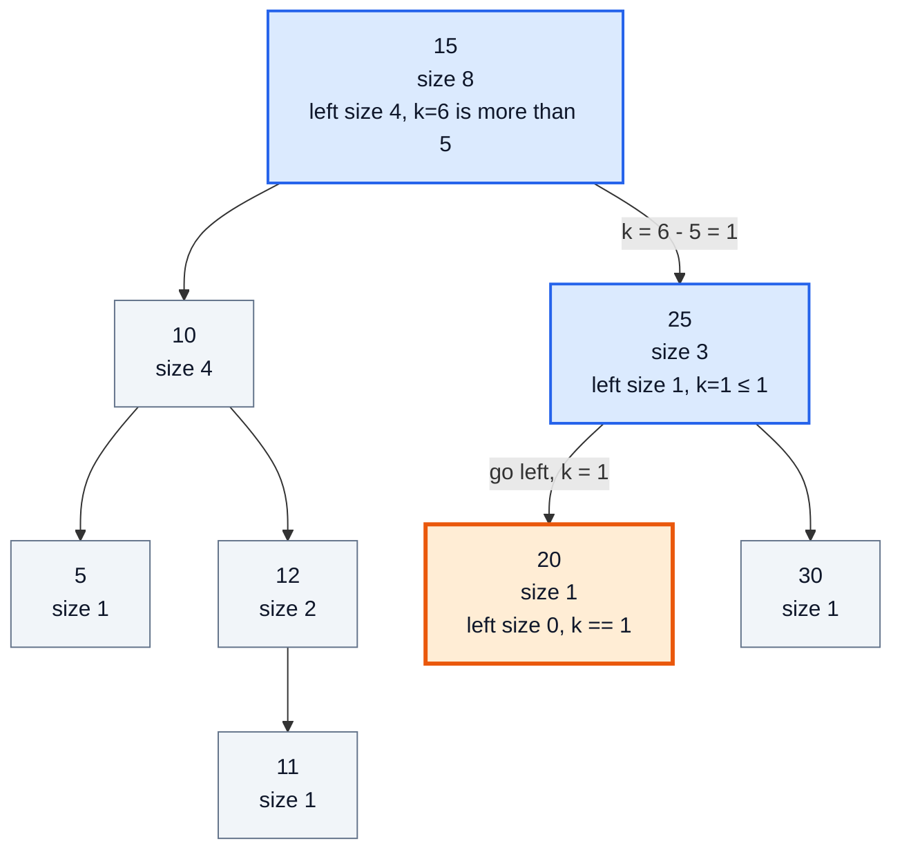

# Kth Smallest Element in a BST — Complete In-Depth Guide

**Video #67 of the Java + DSA playlist:** *Kth Smallest Element in a BST - Google, Amazon, Facebook Interview Question* (14:22)

How to find the k-th smallest value in a Binary Search Tree (LeetCode 230) by using one fact: an inorder traversal of a BST visits values in sorted order. These notes cover the brute-force list, the early-stopping recursive counter, the iterative stack version, Morris traversal in O(1) extra space, and the interview follow-up where the tree changes often (subtree sizes stored in each node).

> [!NOTE]
> This video's description has **no timestamps**. The sections below are organised by topic, in the order you would solve the problem in an interview, and use **(—)** in place of a time.

> [!TIP]
> Tree basics (nodes, BST rule, insert, the three traversals) are covered in the [video #49 notes](java_49_video_binary_trees_bst.md). This file assumes them and does not re-explain them.

---

## Table of Contents

| # | Topic | Timestamp |
|---|---|---|
| 0 | [Introduction](#0-introduction-) | — |
| 1 | [Problem Statement - LeetCode 230](#1-problem-statement---leetcode-230-) | — |
| 2 | [Key Insight - Inorder of a BST Is Sorted](#2-key-insight---inorder-of-a-bst-is-sorted-) | — |
| 3 | [Brute Force - Collect the Inorder List](#3-brute-force---collect-the-inorder-list-) | — |
| 4 | [Recursive Inorder with a Counter](#4-recursive-inorder-with-a-counter-) | — |
| 5 | [Iterative Inorder with a Stack](#5-iterative-inorder-with-a-stack-) | — |
| 6 | [Morris Traversal - O(1) Space](#6-morris-traversal---o1-space-) | — |
| 7 | [Follow-up - Frequent Inserts and Deletes](#7-follow-up---frequent-inserts-and-deletes-) | — |
| 8 | [Comparing the Approaches and Outro](#8-comparing-the-approaches-and-outro-) | — |

---

## 0. Introduction (—)

This is the first of a run of **advanced tree interview questions** in the playlist. All three videos in this run (#67, #68, #69) are solved with the same tool: an **inorder traversal**, sometimes with a little extra state carried along.

What you need from earlier videos:

| Concept | Where it was covered |
|---|---|
| BST rule: left < node < right | [Video #49, section 7](java_49_video_binary_trees_bst.md#7-binary-search-trees-13914) |
| Inorder = Left → Node → Right | [Video #49, section 8](java_49_video_binary_trees_bst.md#8-traversals-23000) |
| Iterative inorder with `ArrayDeque` | [Video #49, section 8](java_49_video_binary_trees_bst.md#8-traversals-23000) |
| Recursion and the call stack | Videos #23 and #27 |

> [!IMPORTANT]
> Asked at Google, Amazon and Facebook. It looks easy, so interviewers judge you on the **follow-ups**: can you stop early, can you do it without recursion, can you do it in O(1) space, and what changes if the tree is modified constantly?

---

## 1. Problem Statement - LeetCode 230 (—)

**LeetCode 230: *Kth Smallest Element in a BST***

> Given the `root` of a binary search tree and an integer `k`, return the k-th smallest value (**1-indexed**) of all the values in the tree.

| Constraint | Value |
|---|---|
| Number of nodes `n` | 1 to 10⁴ |
| `k` | 1 ≤ k ≤ n (always valid) |
| Node values | 0 to 10⁴ |

**Example 1:** `root = [3,1,4,null,2]`, `k = 1` → `1`
**Example 2:** `root = [5,3,6,2,4,null,null,1]`, `k = 3` → `3`

Example 2 as a tree:



Sorted values: `1, 2, 3, 4, 5, 6` → the 3rd is **3**.

The LeetCode signature (they give you this `TreeNode`):

```java
class TreeNode {
    int val;
    TreeNode left, right;
    TreeNode(int val) { this.val = val; }
}

class Solution {
    public int kthSmallest(TreeNode root, int k) {
        // ...
    }
}
```

---

## 2. Key Insight - Inorder of a BST Is Sorted (—)

### Why inorder gives sorted order

Inorder visits **left subtree → node → right subtree**. In a BST:

- everything in the left subtree is **smaller** than the node,
- everything in the right subtree is **larger**.

So inorder prints all the smaller values first, then the node, then all the larger values. Apply that at every level and the whole output is in ascending order.

This is the tree used for the rest of these notes (the same one as the video #49 notes):



Inorder: `5 10 11 12 15 20 25 30`. The green node is the 1st smallest (the leftmost node); the orange node is the 4th smallest.

| k | 1 | 2 | 3 | 4 | 5 | 6 | 7 | 8 |
|---|---|---|---|---|---|---|---|---|
| k-th smallest | 5 | 10 | 11 | **12** | 15 | 20 | 25 | 30 |

So the problem becomes: **"return the k-th node visited by an inorder traversal."** Every approach below is a different way of running that traversal.



> [!CAUTION]
> This only works for a **BST**. For an ordinary binary tree, inorder is not sorted. You would have to collect all values and sort them (O(n log n)), or keep a max-heap of size k while visiting every node (O(n log k)).

---

## 3. Brute Force - Collect the Inorder List (—)

The simplest correct solution: do a full inorder traversal into a list, then index it.

```java
public int kthSmallest(TreeNode root, int k) {
    List<Integer> sorted = new ArrayList<>();
    fill(root, sorted);
    return sorted.get(k - 1);        // k is 1-indexed, lists are 0-indexed
}

private void fill(TreeNode node, List<Integer> out) {
    if (node == null) return;
    fill(node.left, out);
    out.add(node.val);
    fill(node.right, out);
}
// tree above, k = 4 → sorted = [5, 10, 11, 12, 15, 20, 25, 30] → 12
```

| | Cost |
|---|---|
| Time | O(n): visits every node, even when k = 1 |
| Space | O(n) for the list + O(h) recursion stack |

> [!WARNING]
> The classic off-by-one: `sorted.get(k)` returns the (k+1)-th smallest. LeetCode's k starts at **1**.

It is correct, but it wastes work: if k = 1 you only needed the leftmost node, yet you copied the whole tree. The next approaches **stop as soon as the k-th node is reached** and need no list.

---

## 4. Recursive Inorder with a Counter (—)

### The idea

Keep a counter that goes up by one every time inorder **visits** a node (the "Node" step of Left → Node → Right). When the counter equals k, that node is the answer. Return it, and make every caller pass it straight up without doing more work.

This is the approach built in the video:

```java
class Solution {
    int count = 0;                                   // shared across all calls

    public int kthSmallest(TreeNode root, int k) {
        return helper(root, k).val;
    }

    private TreeNode helper(TreeNode node, int k) {
        if (node == null) return null;

        TreeNode left = helper(node.left, k);        // 1. Left
        if (left != null) return left;               //    answer found in the left subtree: pass it up

        count++;                                     // 2. Node: this is visit number `count`
        if (count == k) return node;

        return helper(node.right, k);                // 3. Right
    }
}
```

### Why the counter is a field, not a parameter

Java passes `int` **by value**. If `count` were a parameter, each call would get its own copy, and an increment inside the left subtree would be lost when that call returned. The counter has to be **shared** by every call, so it lives in a field.

| Option | Works? | Note |
|---|---|---|
| `int count` field | ✅ | Simple. Reset it if the same object is reused for another query. |
| `int[] count = {0}` passed down | ✅ | The array object is shared, so `count[0]++` is seen by all calls. |
| `int count` parameter | ❌ | Every call increments its own copy. |
| Return the updated count | ✅ | Works, but you then need a second channel for the answer. |

> [!WARNING]
> A field counter is not reset between calls. If you call `kthSmallest` twice on the same `Solution` object, set `count = 0` at the start of `kthSmallest` (the complete example does this).

### Dry run (tree from section 2, k = 4)

| Step | Call | Action | `count` | Returns |
|---|---|---|---|---|
| 1 | helper(15) | go left | 0 | |
| 2 | helper(10) | go left | 0 | |
| 3 | helper(5) | left null → visit 5 | 1 | |
| 4 | helper(5) | count ≠ 4 → right null | 1 | null |
| 5 | helper(10) | left gave null → visit 10 | 2 | |
| 6 | helper(12) | go left | 2 | |
| 7 | helper(11) | left null → visit 11 | 3 | null (right null) |
| 8 | helper(12) | visit 12 → **count == 4** | 4 | 🟧 node 12 |
| 9 | helper(10) | right call returned 12 | 4 | node 12 |
| 10 | helper(15) | `left != null` → pass up | 4 | node 12 ✅ |

Nodes 15, 25, 20 and 30 are **never visited**. Where the traversal stops:



### Complexity

| | Cost | Why |
|---|---|---|
| Time | **O(h + k)** | Walk down about h nodes to reach the smallest, then k visits |
| Space | **O(h)** | Recursion stack: O(log n) balanced, O(n) skewed |

In the worst case (k = n, or a skewed tree) this is still O(n), but it is never worse than the brute force and often much better.

### Variant: k-th largest

Run inorder **backwards**: Right → Node → Left visits values in **descending** order, so the k-th visit is the k-th largest. (Alternatively, k-th largest = (n − k + 1)-th smallest, but that needs n first.)

```java
private TreeNode helperLargest(TreeNode node, int k) {
    if (node == null) return null;
    TreeNode right = helperLargest(node.right, k);
    if (right != null) return right;
    count++;
    if (count == k) return node;
    return helperLargest(node.left, k);
}
// tree above, k = 2 → 25
```

---

## 5. Iterative Inorder with a Stack (—)

### Why bother

Recursion uses the JVM call stack. On a skewed tree with 10⁴ nodes that is 10⁴ frames, which is usually fine, but a much larger or deeper tree can throw `StackOverflowError`. An explicit stack moves that memory to the heap, and it makes "stop at the k-th node" a plain `return` from a loop.

```java
public int kthSmallest(TreeNode root, int k) {
    Deque<TreeNode> stack = new ArrayDeque<>();
    TreeNode cur = root;
    while (cur != null || !stack.isEmpty()) {
        while (cur != null) {          // 1. go as far left as possible
            stack.push(cur);
            cur = cur.left;
        }
        cur = stack.pop();             // 2. leftmost unvisited node = next in sorted order
        if (--k == 0) return cur.val;  //    count down instead of up
        cur = cur.right;               // 3. then its right subtree
    }
    throw new IllegalArgumentException("k is larger than the tree size");
}
```



### Dry run (same tree, k = 4)

| Step | Action | Stack (top on right) | k after | Answer |
|---|---|---|---|---|
| 1 | push 15, 10, 5 | 15, 10, 5 | 4 | |
| 2 | pop 5, visit | 15, 10 | 3 | |
| 3 | 5.right is null; pop 10, visit | 15 | 2 | |
| 4 | cur = 12; push 12, 11 | 15, 12, 11 | 2 | |
| 5 | pop 11, visit | 15, 12 | 1 | |
| 6 | pop 12, visit | 15 | **0** | ✅ 12 |

The stack never holds more than h + 1 nodes.

| | Cost |
|---|---|
| Time | O(h + k) |
| Space | O(h) explicit stack |

> [!NOTE]
> Use `ArrayDeque` for stacks in modern Java, not the legacy `java.util.Stack` (synchronized, extends `Vector`). `push`/`pop` on `ArrayDeque` work at the head, which is exactly stack behaviour.

---

## 6. Morris Traversal - O(1) Space (—)

### The problem with the stack

Both previous approaches need O(h) memory to remember "where do I go back to after finishing the left subtree?". **Morris traversal** removes that memory by temporarily writing the answer **into the tree itself**.

### Threads

For the current node `cur`, its **inorder predecessor** is the rightmost node of its left subtree. That predecessor's `right` pointer is always `null` (it is the rightmost). Morris borrows that empty pointer:

1. **First time** you reach `cur`: point `predecessor.right` to `cur` (a *thread*), then go left.
2. When the left subtree is finished, the walk follows the thread **back up** to `cur`. You arrive a **second time**, see the thread, remove it, **visit `cur`**, and go right.



The tree from Example 1 (`[3,1,4,null,2]`) with the thread from 2 back to 3 in place (dotted):



### Code

```java
public int kthSmallest(TreeNode root, int k) {
    TreeNode cur = root;
    int answer = -1;
    while (cur != null) {
        if (cur.left == null) {
            if (--k == 0) answer = cur.val;      // visit
            cur = cur.right;                     // may follow a thread upward
        } else {
            TreeNode pred = cur.left;
            while (pred.right != null && pred.right != cur) pred = pred.right;

            if (pred.right == null) {            // first arrival: create thread
                pred.right = cur;
                cur = cur.left;
            } else {                             // second arrival: remove thread, visit
                pred.right = null;
                if (--k == 0) answer = cur.val;
                cur = cur.right;
            }
        }
    }
    return answer;
}
```

### Dry run (`[3,1,4,null,2]`, visiting every node)

| Step | `cur` | Situation | Action | Visit # |
|---|---|---|---|---|
| 1 | 3 | left exists; pred = 2, `2.right == null` | thread 2 → 3; cur = 1 | |
| 2 | 1 | no left | visit 1; cur = 2 | 1 |
| 3 | 2 | no left | visit 2; cur = 2.right = **3** (thread) | 2 |
| 4 | 3 | left exists; pred = 2, `2.right == 3` | remove thread; visit 3; cur = 4 | 3 |
| 5 | 4 | no left | visit 4; cur = null | 4 |

### Why the loop does not `return` early

If you `return` the moment k hits 0, some threads may still be in the tree, and the caller gets back a **modified tree** (with cycles). The safe version records the answer and **lets the loop finish**, which removes every thread. The complete example checks that the tree is intact afterwards.

| | Cost | Why |
|---|---|---|
| Time | **O(n)** | Each edge is walked at most about 3 times (down, finding predecessor, back up) |
| Space | **O(1)** | Only a few pointers; no stack, no recursion |

> [!CAUTION]
> Morris **modifies the tree while it runs**. Do not use it when other threads may read the tree at the same time, or when the tree is immutable. In interviews, mention it as the answer to "can you do it in O(1) space?", then state this trade-off.

---

## 7. Follow-up - Frequent Inserts and Deletes (—)

### The question

LeetCode's own follow-up:

> If the BST is modified often (insert/delete) and you need the k-th smallest frequently, how would you optimise?

Every approach so far costs O(h + k) per query. With many queries and k close to n, that is O(n) each time.

### The idea: store subtree sizes

Augment each node with `size` = number of nodes in its subtree (including itself). Then at any node you know how many values are smaller than it **inside its subtree**: `size(left)`. Compare k with it:

| Condition | Meaning | Move |
|---|---|---|
| `k <= size(left)` | Answer is in the left subtree | go left, k unchanged |
| `k == size(left) + 1` | This node is the answer | return it |
| `k > size(left) + 1` | Answer is in the right subtree | `k -= size(left) + 1`, go right |

This is binary search on **rank** instead of on value.

Sizes for our tree, searching k = 6:



6th smallest = **20** ✅ (sorted: 5 10 11 12 15 **20** 25 30). Only one root-to-node path was walked.

### Code

```java
class SizeBST {
    private static class Node {
        int val, size = 1;
        Node left, right;
        Node(int val) { this.val = val; }
    }
    private Node root;

    private static int size(Node n) { return n == null ? 0 : n.size; }

    void insert(int val) { root = insert(root, val); }

    private Node insert(Node node, int val) {
        if (node == null) return new Node(val);
        if (val < node.val) node.left = insert(node.left, val);
        else node.right = insert(node.right, val);
        node.size = 1 + size(node.left) + size(node.right);   // fix size on the way back up
        return node;
    }

    int kthSmallest(int k) {
        Node cur = root;
        while (cur != null) {
            int leftSize = size(cur.left);
            if (k <= leftSize) cur = cur.left;
            else if (k == leftSize + 1) return cur.val;
            else { k -= leftSize + 1; cur = cur.right; }
        }
        throw new IllegalArgumentException("k is larger than the tree size");
    }
}
```

Delete works the same way: after removing a node recursively, recompute `size` for each node on the path back to the root.

### Complexity

| Operation | Plain BST + inorder | Size-augmented BST |
|---|---|---|
| Insert / delete | O(h) | O(h), plus O(1) size update per level |
| k-th smallest | O(h + k) | **O(h)** |
| Extra space | none | one `int` per node |

> [!IMPORTANT]
> O(h) is only O(log n) if the tree stays **balanced**. In a real answer, combine subtree sizes with a self-balancing tree (AVL from [video #50](java_50_video_avl_trees.md), or a red-black tree). This structure is called an **order-statistic tree**. Rotations must update `size` too.

> [!NOTE]
> Java's `TreeMap` and `TreeSet` are red-black trees but do **not** expose rank queries, so they cannot answer "k-th smallest" in O(log n). You must build the augmented tree yourself, or (for fixed value ranges) use a Fenwick tree / segment tree over the values ([video #51](java_51_video_segment_trees.md)).

---

## 8. Comparing the Approaches and Outro (—)

| Approach | Time | Extra space | Modifies tree? | When to use |
|---|---|---|---|---|
| Collect inorder list | O(n) | O(n) | No | First answer, easiest to explain |
| Recursive counter | O(h + k) | O(h) | No | Standard interview answer (the video's solution) |
| Iterative stack | O(h + k) | O(h) | No | Avoid recursion depth; easy early exit |
| Morris traversal | O(n) | **O(1)** | Temporarily | "Do it in O(1) space" follow-up |
| Size-augmented tree | **O(h)** per query | O(n) once | Stores sizes | Many queries on a changing tree |

The same "inorder + a bit of state" pattern solves the next two videos:

- **Video #68**: carry a `prev` pointer during inorder to link nodes into a doubly linked list.
- **Video #69**: carry a `prev` pointer during inorder to spot where sorted order breaks.

> [!TIP]
> Related practice: LeetCode **94** (inorder traversal), **98** (validate BST, also inorder + `prev`), **173** (BST iterator, the iterative stack approach as a class), **671** (second minimum node), **703** (k-th largest in a stream, heap-based).

---

## 🧩 Complete Example: Everything Together

One program that runs **every approach** on the same BST and checks that they agree:

```java
import java.util.ArrayDeque;
import java.util.ArrayList;
import java.util.Deque;
import java.util.List;

// ═══════ Plain BST node (LeetCode's TreeNode) ═══════
class TreeNode {
    int val;
    TreeNode left, right;
    TreeNode(int val) { this.val = val; }
}

// ═══════ Approaches 1-4 for LeetCode 230 ═══════
class KthSmallest {

    // 1. Brute force: full inorder into a list
    static int byList(TreeNode root, int k) {
        List<Integer> sorted = new ArrayList<>();
        fill(root, sorted);
        return sorted.get(k - 1);
    }
    private static void fill(TreeNode node, List<Integer> out) {
        if (node == null) return;
        fill(node.left, out);
        out.add(node.val);
        fill(node.right, out);
    }

    // 2. Recursive inorder with a counter (stops early)
    private int count = 0;
    int recursive(TreeNode root, int k) {
        count = 0;
        return helper(root, k).val;
    }
    private TreeNode helper(TreeNode node, int k) {
        if (node == null) return null;
        TreeNode left = helper(node.left, k);
        if (left != null) return left;          // answer already found on the left
        count++;
        if (count == k) return node;            // this node is the k-th visited
        return helper(node.right, k);
    }

    // 3. Iterative inorder with an explicit stack
    static int iterative(TreeNode root, int k) {
        Deque<TreeNode> stack = new ArrayDeque<>();
        TreeNode cur = root;
        while (cur != null || !stack.isEmpty()) {
            while (cur != null) {
                stack.push(cur);
                cur = cur.left;
            }
            cur = stack.pop();
            if (--k == 0) return cur.val;
            cur = cur.right;
        }
        throw new IllegalArgumentException("k is larger than the tree size");
    }

    // 4. Morris inorder: O(1) extra space
    static int morris(TreeNode root, int k) {
        TreeNode cur = root;
        int answer = -1;
        while (cur != null) {
            if (cur.left == null) {
                if (--k == 0) answer = cur.val;     // keep going so every thread is removed
                cur = cur.right;
            } else {
                TreeNode pred = cur.left;
                while (pred.right != null && pred.right != cur) pred = pred.right;
                if (pred.right == null) {           // first visit: create the thread
                    pred.right = cur;
                    cur = cur.left;
                } else {                            // second visit: remove thread, visit cur
                    pred.right = null;
                    if (--k == 0) answer = cur.val;
                    cur = cur.right;
                }
            }
        }
        return answer;
    }

    // Bonus: k-th largest = reverse inorder (right, node, left)
    static int kthLargest(TreeNode root, int k) {
        Deque<TreeNode> stack = new ArrayDeque<>();
        TreeNode cur = root;
        while (cur != null || !stack.isEmpty()) {
            while (cur != null) { stack.push(cur); cur = cur.right; }
            cur = stack.pop();
            if (--k == 0) return cur.val;
            cur = cur.left;
        }
        throw new IllegalArgumentException("k too large");
    }
}

// ═══════ Approach 5: follow-up, BST augmented with subtree sizes ═══════
class SizeBST {
    private static class Node {
        int val, size = 1;                       // size = nodes in this subtree
        Node left, right;
        Node(int val) { this.val = val; }
    }
    private Node root;

    private static int size(Node n) { return n == null ? 0 : n.size; }

    void insert(int val) { root = insert(root, val); }
    private Node insert(Node node, int val) {
        if (node == null) return new Node(val);
        if (val < node.val) node.left = insert(node.left, val);
        else node.right = insert(node.right, val);
        node.size = 1 + size(node.left) + size(node.right);
        return node;
    }

    int kthSmallest(int k) {
        Node cur = root;
        while (cur != null) {
            int leftSize = size(cur.left);
            if (k <= leftSize) cur = cur.left;              // answer is in the left subtree
            else if (k == leftSize + 1) return cur.val;     // cur itself
            else { k -= leftSize + 1; cur = cur.right; }    // skip left + cur
        }
        throw new IllegalArgumentException("k is larger than the tree size");
    }
}

public class Main {
    static TreeNode insert(TreeNode node, int val) {
        if (node == null) return new TreeNode(val);
        if (val < node.val) node.left = insert(node.left, val);
        else node.right = insert(node.right, val);
        return node;
    }

    static void inorder(TreeNode node, StringBuilder sb) {
        if (node == null) return;
        inorder(node.left, sb);
        sb.append(node.val).append(' ');
        inorder(node.right, sb);
    }

    public static void main(String[] args) {
        // Same BST as the video #49 notes
        TreeNode root = null;
        for (int v : new int[]{15, 10, 25, 5, 12, 20, 30, 11}) root = insert(root, v);

        StringBuilder sb = new StringBuilder();
        inorder(root, sb);
        System.out.println("Inorder (sorted): " + sb.toString().trim());

        KthSmallest solver = new KthSmallest();
        for (int k = 1; k <= 8; k += 3) {
            System.out.printf("k=%d -> list=%d recursive=%d iterative=%d morris=%d%n",
                    k, KthSmallest.byList(root, k), solver.recursive(root, k),
                    KthSmallest.iterative(root, k), KthSmallest.morris(root, k));
        }

        sb.setLength(0);
        inorder(root, sb);
        System.out.println("Tree intact after Morris: " + sb.toString().trim());
        System.out.println("2nd largest: " + KthSmallest.kthLargest(root, 2));

        // LeetCode 230 example 2: [5,3,6,2,4,null,null,1], k = 3
        TreeNode lc = null;
        for (int v : new int[]{5, 3, 6, 2, 4, 1}) lc = insert(lc, v);
        System.out.println("LeetCode example 2 (k=3): " + KthSmallest.iterative(lc, 3));

        // Follow-up: frequent inserts + frequent k-th queries
        SizeBST bst = new SizeBST();
        for (int v : new int[]{15, 10, 25, 5, 12, 20, 30, 11}) bst.insert(v);
        System.out.println("SizeBST 4th smallest: " + bst.kthSmallest(4));
        bst.insert(1);
        bst.insert(13);
        System.out.println("After inserting 1 and 13, 4th smallest: " + bst.kthSmallest(4));
        System.out.println("After inserting 1 and 13, 7th smallest: " + bst.kthSmallest(7));
    }
}
```

**Expected Output:**
```
Inorder (sorted): 5 10 11 12 15 20 25 30
k=1 -> list=5 recursive=5 iterative=5 morris=5
k=4 -> list=12 recursive=12 iterative=12 morris=12
k=7 -> list=25 recursive=25 iterative=25 morris=25
Tree intact after Morris: 5 10 11 12 15 20 25 30
2nd largest: 25
LeetCode example 2 (k=3): 3
SizeBST 4th smallest: 12
After inserting 1 and 13, 4th smallest: 11
After inserting 1 and 13, 7th smallest: 15
```

---

## Quick Reference Cheat Sheet

| Concept | One-Line Summary |
|---|---|
| **LeetCode 230** | Return the k-th smallest value (1-indexed) in a BST |
| **Key fact** | Inorder (Left → Node → Right) of a BST visits values in ascending order |
| **Brute force** | Inorder into a list, return `list.get(k - 1)`; O(n) time, O(n) space |
| **Recursive counter** | Shared `count` field; `count++` at the Node step; return node when `count == k`; O(h + k) |
| **Why a field** | `int` is passed by value, so a parameter counter loses increments |
| **Early exit** | `if (left != null) return left;` passes the found node straight up |
| **Iterative** | Push lefts, pop, `--k == 0` → answer, go right; O(h + k) time, O(h) space |
| **Morris** | Thread predecessor.right → cur, remove on second arrival; O(n) time, O(1) space |
| **Morris caveat** | Changes the tree while running; finish the loop so all threads are removed |
| **k-th largest** | Reverse inorder: Right → Node → Left |
| **Follow-up** | Store subtree `size` in each node; compare k with `size(left) + 1`; O(h) per query |
| **Balanced needed** | O(h) = O(log n) only with AVL / red-black; this is an order-statistic tree |
| **Not a BST?** | Collect + sort O(n log n), or max-heap of size k O(n log k) |
