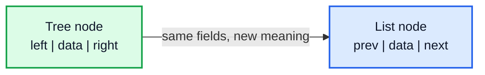
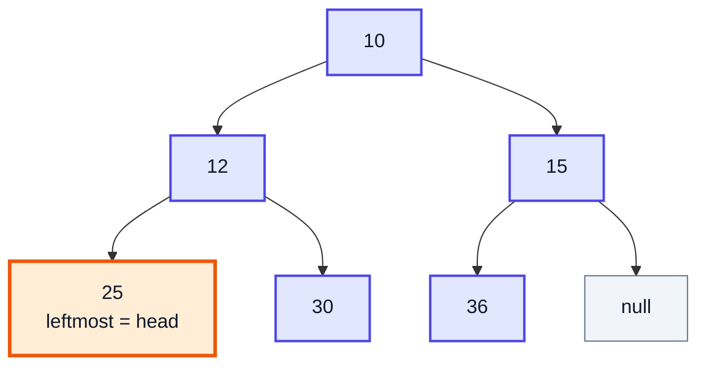
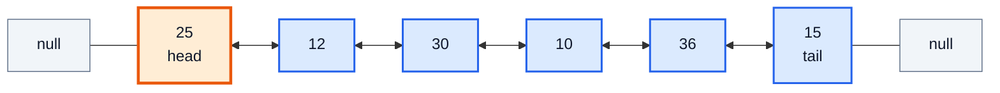
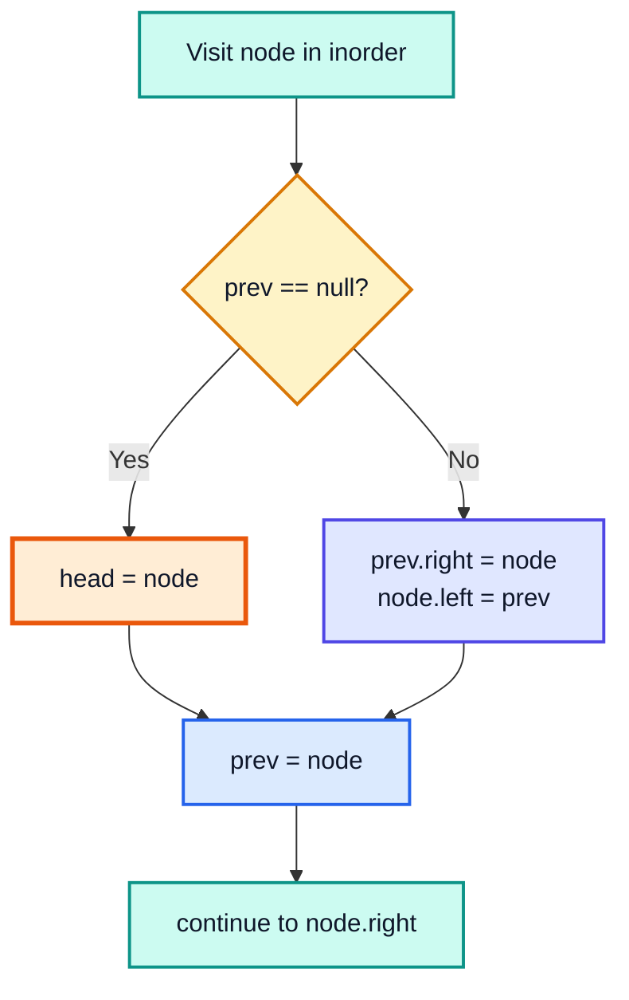
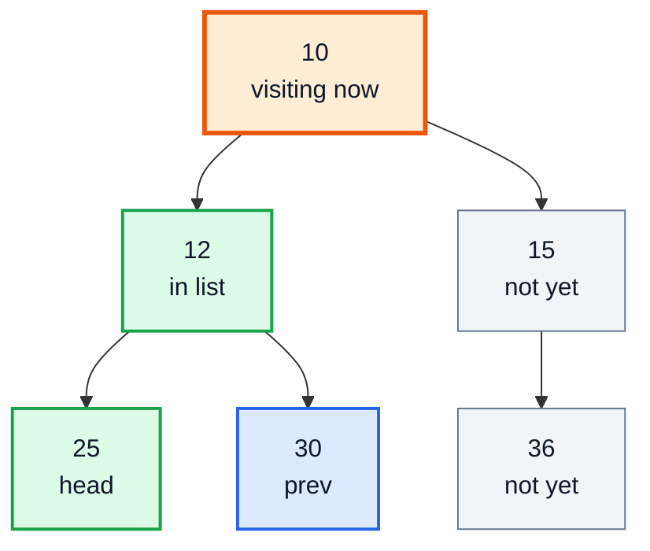
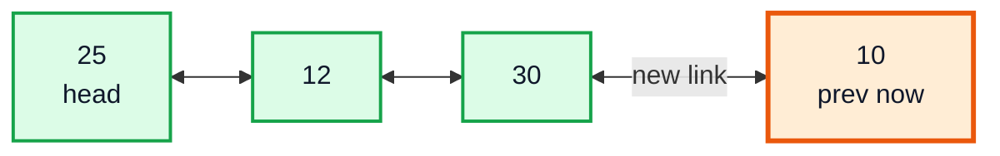
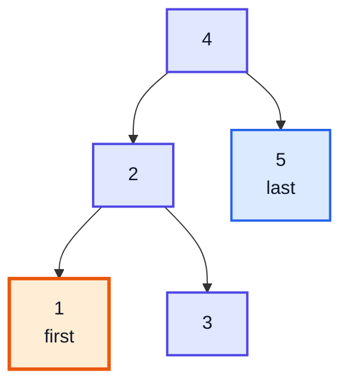
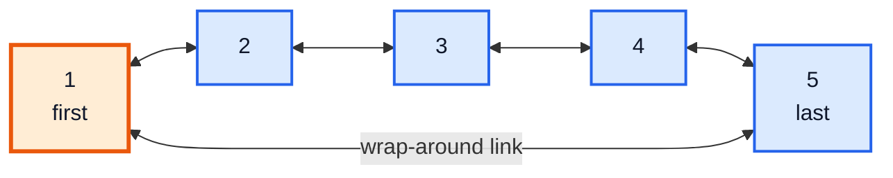
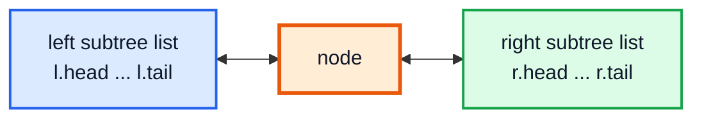

# Convert Binary Tree to Doubly Linked List — Complete In-Depth Guide

**Video #68 of the Java + DSA playlist:** *Convert Binary Tree to Doubly Linked List - FAANG Interview Question* (10:36)

How to rearrange the pointers of a binary tree, in place, so its nodes form a doubly linked list in inorder order: `left` becomes `prev` and `right` becomes `next`. These notes cover the core "inorder with a `prev` pointer" solution, a full dry run, why it is safe to overwrite pointers mid-traversal, the circular variant from LeetCode 426, and iterative and divide-and-conquer alternatives.

> [!NOTE]
> This video's description has **no timestamps**. The sections below are organised by topic, in the order you would solve the problem, and use **(—)** in place of a time.

> [!TIP]
> Tree basics and the inorder traversal are covered in the [video #49 notes](java_49_video_binary_trees_bst.md); doubly linked lists are covered in the [video #44 notes](java_44_video_linked_list.md). Neither is re-explained here.

---

## Table of Contents

| # | Topic | Timestamp |
|---|---|---|
| 0 | [Introduction](#0-introduction-) | — |
| 1 | [Problem Statement](#1-problem-statement-) | — |
| 2 | [Mapping Tree Pointers to List Pointers](#2-mapping-tree-pointers-to-list-pointers-) | — |
| 3 | [Approach - Inorder with a prev Pointer](#3-approach---inorder-with-a-prev-pointer-) | — |
| 4 | [Code - Recursive Solution](#4-code---recursive-solution-) | — |
| 5 | [Dry Run](#5-dry-run-) | — |
| 6 | [Time and Space Complexity](#6-time-and-space-complexity-) | — |
| 7 | [LeetCode 426 - Circular Doubly Linked List](#7-leetcode-426---circular-doubly-linked-list-) | — |
| 8 | [Alternative Approaches](#8-alternative-approaches-) | — |
| 9 | [Outro](#9-outro-) | — |

---

## 0. Introduction (—)

The second question in the advanced-trees run. Like [video #67](java_67_video_kth_smallest_bst.md) (k-th smallest), it is solved with **inorder traversal plus one extra piece of state**. In #67 the extra state was a counter; here it is a pointer to the **previously visited node**.

A tree node and a doubly linked list node have the same shape: a value and **two** pointers. So no new nodes are needed. The task is purely to **re-wire** the existing pointers.



> [!IMPORTANT]
> Interviewers ask this to test whether you can **mutate a structure while traversing it** without losing track of where you are. The core code is about 10 lines; explaining why it is safe is the real test.

---

## 1. Problem Statement (—)

### GeeksforGeeks: *Binary Tree to DLL*

> Given a binary tree, convert it **in place** into a doubly linked list. Use `left` as the previous pointer and `right` as the next pointer. The order of nodes in the list must be the **inorder** order of the tree. Return the **head** (the first node in inorder, i.e. the leftmost node).

Example tree:



Inorder: `25 12 30 10 36 15`. Expected list:



The tree is **not** a BST, so the list is not sorted. It is just in inorder order. If the input is a BST, the same code produces a **sorted** list (section 7).

### Variants you may be asked

| Variant | Difference |
|---|---|
| GfG *Binary Tree to DLL* | Linear list; head's `left` and tail's `right` are `null` |
| **LeetCode 426** *Convert Binary Search Tree to Sorted Doubly Linked List* | Input is a BST; list must be **circular** (tail.right = head, head.left = tail) |
| LeetCode 114 *Flatten Binary Tree to Linked List* | **Preorder**, singly linked via `right`, all `left` set to null |
| LeetCode 897 *Increasing Order Search Tree* | Inorder, singly linked via `right`, all `left` null |

> [!NOTE]
> LeetCode 426 is a premium problem. The GfG version is free and is the one the video's title describes; the circular version needs only two extra lines.

The node class used throughout:

```java
class Node {
    int data;
    Node left, right;      // after conversion: left = prev, right = next
    Node(int data) { this.data = data; }
}
```

---

## 2. Mapping Tree Pointers to List Pointers (—)

For every node in the final list:

| Tree pointer | Becomes | Points to |
|---|---|---|
| `node.left` | `prev` | the node visited **just before** it in inorder (its inorder predecessor) |
| `node.right` | `next` | the node visited **just after** it in inorder (its inorder successor) |

So the whole problem reduces to: **for each pair of consecutive nodes in inorder, `(a, b)`, set `a.right = b` and `b.left = a`.**

Consecutive inorder pairs in the example:

| Pair | Set | Set |
|---|---|---|
| (25, 12) | 25.right = 12 | 12.left = 25 |
| (12, 30) | 12.right = 30 | 30.left = 12 |
| (30, 10) | 30.right = 10 | 10.left = 30 |
| (10, 36) | 10.right = 36 | 36.left = 10 |
| (36, 15) | 36.right = 15 | 15.left = 36 |

Plus the two ends: `25.left = null` (head) and `15.right = null` (tail). In this tree they are already null, because the leftmost node has no left child and the rightmost node has no right child. That is always true, so the ends need no special code.

---

## 3. Approach - Inorder with a prev Pointer (—)

### The simple (but wasteful) idea

Do an inorder traversal into an `ArrayList<Node>`, then loop over the list linking `list[i]` and `list[i + 1]`. It works, but uses O(n) extra memory for the list.

### The in-place idea

You do not need all the nodes at once. To link a pair you only need **the previous node** and **the current node**. Inorder hands you nodes one at a time, so keep a single field `prev`:

1. Traverse inorder.
2. At each visited `node`:
   - if `prev == null`, this is the first node → it is the **head**;
   - otherwise link `prev.right = node` and `node.left = prev`.
3. Set `prev = node` (the current node becomes the tail of the list built so far).



Invariant: after visiting a node, **every node visited so far is already a correct doubly linked list from `head` to `prev`**.

### Why overwriting pointers mid-traversal is safe

This is the part to explain in an interview. We write `node.left` and `prev.right` while the traversal is still using the tree.

| Write | Why it does not break the traversal |
|---|---|
| `node.left = prev` | We are at the **Node** step, so `inorder(node.left)` has already **finished**. The left subtree is never read again. |
| `prev.right = node` | `prev` is the inorder predecessor of `node`. Either `prev` is the rightmost node of `node`'s left subtree (so `prev.right` was `null`), or `node` is the leftmost node inside `prev`'s right subtree, and the call `inorder(prev.right)` **already read** `prev.right` and is running now. Either way nobody reads the old value again. |

> [!CAUTION]
> The order of the three steps inside the recursion matters. `inorder(node.left)` must run **before** you overwrite `node.left`, and `inorder(node.right)` reads `node.right` **after** the link step. That is fine, because the link step only writes `prev.right` (a different node) and `node.left`, never `node.right`. `node.right` is overwritten later, when its successor is visited, after it has been read.

---

## 4. Code - Recursive Solution (—)

```java
class TreeToDLL {
    private Node head, prev;            // prev = tail of the list built so far

    Node convert(Node root) {
        head = null;
        prev = null;
        inorder(root);
        return head;
    }

    private void inorder(Node node) {
        if (node == null) return;

        inorder(node.left);             // 1. Left: convert the left subtree first

        if (prev == null) head = node;  // 2. Node: first node visited = head
        else {
            prev.right = node;          //    link prev <-> node
            node.left = prev;
        }
        prev = node;

        inorder(node.right);            // 3. Right
    }
}
```

To print the list, walk `right` from `head`; to check the `prev` links, walk `left` from the tail (which is `prev` once `convert` returns):

```java
static void printForward(Node head) {
    for (Node n = head; n != null; n = n.right) System.out.print(n.data + " ");
}
// 25 12 30 10 36 15

static void printBackward(Node tail) {
    for (Node n = tail; n != null; n = n.left) System.out.print(n.data + " ");
}
// 15 36 10 30 12 25
```

> [!WARNING]
> Do not print the converted structure with a tree traversal: the `left`/`right` pointers now form a list, so a "tree" traversal will walk back and forth between neighbours forever. In the circular version even a forward walk never ends unless you stop when you get back to `head`.

> [!NOTE]
> Some versions of this solution keep `head` and `prev` as `static` fields. That breaks if the method is called twice (the old values remain) or from two threads. Instance fields reset at the start of `convert`, as above, are the safer modern style.

---

## 5. Dry Run (—)

Tree from section 1. "List so far" is read by walking `right` from `head`.

| Step | Visit | `prev` before | Links made | `head` | `prev` after | List so far |
|---|---|---|---|---|---|---|
| 1 | 25 | null | none (first node) | 25 | 25 | 25 |
| 2 | 12 | 25 | 25.right = 12, 12.left = 25 | 25 | 12 | 25 ⇄ 12 |
| 3 | 30 | 12 | 12.right = 30, 30.left = 12 | 25 | 30 | 25 ⇄ 12 ⇄ 30 |
| 4 | 10 | 30 | 30.right = 10, 10.left = 30 | 25 | 10 | … ⇄ 30 ⇄ 10 |
| 5 | 36 | 10 | 10.right = 36, 36.left = 10 | 25 | 36 | … ⇄ 10 ⇄ 36 |
| 6 | 15 | 36 | 36.right = 15, 15.left = 36 | 25 | 15 | 25 ⇄ 12 ⇄ 30 ⇄ 10 ⇄ 36 ⇄ 15 ✅ |

Snapshot at step 4 (visiting 10). Green nodes are already in the list, orange is the current node, grey nodes have not been visited:



The list at that moment, just after linking 30 and 10:



> [!TIP]
> At step 4, `10.left` used to point to 12 and now points to 30. That is safe because `inorder(10.left)` finished at step 3. Then `inorder(10.right)` reads `10.right = 15`, which is still the original child; it is overwritten to 36 at step 5, after it was read.

---

## 6. Time and Space Complexity (—)

| | Cost | Why |
|---|---|---|
| Time | **O(n)** | Each node is visited once, with O(1) work (two pointer writes) per visit |
| Extra space | **O(h)** | Only the recursion stack. O(log n) for a balanced tree, O(n) for a skewed one |
| New nodes | **0** | Fully in place |

| Approach | Time | Extra space |
|---|---|---|
| Inorder into `ArrayList`, then link | O(n) | O(n) list + O(h) stack |
| **Inorder with `prev`** | O(n) | O(h) |
| Iterative with explicit stack | O(n) | O(h) |
| Divide and conquer (head, tail) | O(n) | O(h) |
| Morris-style threading | O(n) | O(1), but much harder to get right |

---

## 7. LeetCode 426 - Circular Doubly Linked List (—)

**LeetCode 426: *Convert Binary Search Tree to Sorted Doubly Linked List***

> Convert a BST to a sorted **circular** doubly linked list in place. The predecessor of the first element is the last element, and the successor of the last element is the first element. Return a pointer to the smallest element.

Because the input is a BST, inorder is sorted, so the list is sorted automatically. Only two changes are needed: handle an empty tree, and **close the circle** after the traversal.

```java
class Solution {
    private Node first, last;

    public Node treeToDoublyList(Node root) {
        if (root == null) return null;
        first = last = null;
        link(root);
        last.right = first;            // close the circle
        first.left = last;
        return first;
    }

    private void link(Node node) {
        if (node == null) return;
        link(node.left);
        if (last == null) first = node;
        else {
            last.right = node;
            node.left = last;
        }
        last = node;
        link(node.right);
    }
}
```

Input BST `[4,2,5,1,3]`:



Output (circular):



> [!WARNING]
> A circular list has no `null` at the end. Loop with a step count or `do { ... } while (n != head)`, never `while (n != null)`.

| Edge case | Linear (GfG) | Circular (LC 426) |
|---|---|---|
| Empty tree | return `null` | return `null` (must check before closing the circle) |
| One node | head = that node, both pointers null | node.left = node.right = node (points to itself) |

---

## 8. Alternative Approaches (—)

### A. Iterative inorder with a stack

Same linking logic, but the traversal uses an explicit `ArrayDeque` (no recursion depth limit):

```java
static Node convert(Node root) {
    Deque<Node> stack = new ArrayDeque<>();
    Node cur = root, head = null, prev = null;
    while (cur != null || !stack.isEmpty()) {
        while (cur != null) { stack.push(cur); cur = cur.left; }
        cur = stack.pop();
        Node next = cur.right;          // right child: where inorder goes next
        if (prev == null) head = cur;
        else { prev.right = cur; cur.left = prev; }
        prev = cur;
        cur = next;
    }
    return head;
}
```

Here the "safe to overwrite" argument is simpler: a node is pushed **before** we move to its left child, and its `right` is read right after it is popped, before any later write touches it.

### B. Divide and conquer: return (head, tail)

Think recursively: convert the left subtree into a list, convert the right subtree into a list, then join **left list ⇄ node ⇄ right list**. Each call returns both ends of its list, so joining is O(1). A Java 16+ `record` is a tidy way to return two values:

```java
record Ends(Node head, Node tail) {}

static Ends convert(Node node) {
    if (node == null) return null;
    Ends l = convert(node.left);            // left subtree as a list
    Ends r = convert(node.right);           // right subtree as a list
    Node head = node, tail = node;
    if (l != null) { l.tail().right = node; node.left = l.tail(); head = l.head(); }
    if (r != null) { node.right = r.head(); r.head().left = node; tail = r.tail(); }
    return new Ends(head, tail);
}
```



> [!NOTE]
> Older Java code (and many tutorials) returns two values with an `int[]`/`Node[]` array or a small mutable class. A `record` (Java 16+) is immutable, gets `equals`/`hashCode`/`toString` for free, and states the intent clearly.

### C. Collect into a list, then link

```java
List<Node> nodes = new ArrayList<>();
collectInorder(root, nodes);              // plain inorder
for (int i = 0; i + 1 < nodes.size(); i++) {
    nodes.get(i).right = nodes.get(i + 1);
    nodes.get(i + 1).left = nodes.get(i);
}
// head = nodes.get(0), tail = nodes.get(size - 1); set their outer pointers to null
```

Easiest to get right, but O(n) extra space. A fine first answer to state before optimising.

| Approach | Pros | Cons |
|---|---|---|
| Recursive `prev` (video) | Shortest code, O(h) space | Needs fields or a holder for `head`/`prev` |
| Iterative stack | No recursion limit | Slightly longer |
| Divide and conquer | Pure function, no shared state | Allocates one small record per node |
| List then link | Trivially correct | O(n) extra space |

---

## 9. Outro (—)

The pattern from videos #67 and #68 is the same: **inorder traversal, plus a variable that remembers something about the previous visit**. Video #69 uses exactly this `prev` pointer again, this time to detect where a BST's sorted order is broken.

> [!TIP]
> Related practice: LeetCode **114** (flatten to linked list, preorder), **897** (increasing order search tree), **109** (the reverse direction: sorted linked list → balanced BST), and GfG *Binary Tree to CDLL* (circular).

---

## 🧩 Complete Example: Everything Together

One program that converts the same trees with every approach and walks the result in both directions:

```java
import java.util.ArrayDeque;
import java.util.Deque;

// ═══════ One node class for both the tree and the list ═══════
// left  = prev pointer once converted
// right = next pointer once converted
class Node {
    int data;
    Node left, right;
    Node(int data) { this.data = data; }
}

// ═══════ Approach 1: recursive inorder with a prev pointer (GfG version) ═══════
class TreeToDLL {
    private Node head, prev;

    Node convert(Node root) {
        head = null;
        prev = null;
        inorder(root);
        return head;
    }

    private void inorder(Node node) {
        if (node == null) return;
        inorder(node.left);
        if (prev == null) head = node;      // first node visited = smallest = head
        else {
            prev.right = node;              // link prev <-> node
            node.left = prev;
        }
        prev = node;                        // node is now the tail of the list
        inorder(node.right);
    }

    Node tail() { return prev; }
}

// ═══════ Approach 2: LeetCode 426, circular doubly linked list ═══════
class TreeToCircularDLL {
    private Node first, last;

    Node treeToDoublyList(Node root) {
        if (root == null) return null;
        first = last = null;
        link(root);
        last.right = first;                 // close the circle
        first.left = last;
        return first;
    }

    private void link(Node node) {
        if (node == null) return;
        link(node.left);
        if (last == null) first = node;
        else {
            last.right = node;
            node.left = last;
        }
        last = node;
        link(node.right);
    }
}

// ═══════ Approach 3: iterative inorder (no recursion) ═══════
class TreeToDLLIterative {
    static Node convert(Node root) {
        Deque<Node> stack = new ArrayDeque<>();
        Node cur = root, head = null, prev = null;
        while (cur != null || !stack.isEmpty()) {
            while (cur != null) { stack.push(cur); cur = cur.left; }
            cur = stack.pop();
            Node next = cur.right;          // right child: where inorder goes next
            if (prev == null) head = cur;
            else { prev.right = cur; cur.left = prev; }
            prev = cur;
            cur = next;
        }
        return head;
    }
}

// ═══════ Approach 4: divide and conquer, each call returns (head, tail) ═══════
class TreeToDLLDivide {
    record Ends(Node head, Node tail) {}

    static Ends convert(Node node) {
        if (node == null) return null;
        Ends l = convert(node.left);            // left subtree as a list
        Ends r = convert(node.right);           // right subtree as a list
        Node head = node, tail = node;
        if (l != null) { l.tail().right = node; node.left = l.tail(); head = l.head(); }
        if (r != null) { node.right = r.head(); r.head().left = node; tail = r.tail(); }
        return new Ends(head, tail);
    }
}

public class Main {
    static String forward(Node head) {
        StringBuilder sb = new StringBuilder();
        for (Node n = head; n != null; n = n.right) sb.append(n.data).append(n.right != null ? " <-> " : "");
        return sb.toString();
    }

    static String backward(Node tail) {
        StringBuilder sb = new StringBuilder();
        for (Node n = tail; n != null; n = n.left) sb.append(n.data).append(n.left != null ? " <-> " : "");
        return sb.toString();
    }

    static Node gfgTree() {
        //        10
        //      /    \
        //    12      15
        //   /  \    /
        //  25  30  36
        Node root = new Node(10);
        root.left = new Node(12);
        root.right = new Node(15);
        root.left.left = new Node(25);
        root.left.right = new Node(30);
        root.right.left = new Node(36);
        return root;
    }

    static Node bst() {
        //      4
        //     / \
        //    2   5
        //   / \
        //  1   3
        Node root = new Node(4);
        root.left = new Node(2);
        root.right = new Node(5);
        root.left.left = new Node(1);
        root.left.right = new Node(3);
        return root;
    }

    public static void main(String[] args) {
        // 1. Recursive with prev pointer
        TreeToDLL converter = new TreeToDLL();
        Node head = converter.convert(gfgTree());
        System.out.println("Forward : " + forward(head));
        System.out.println("Backward: " + backward(converter.tail()));

        // 2. Iterative
        Node head2 = TreeToDLLIterative.convert(gfgTree());
        System.out.println("Iterative forward: " + forward(head2));

        // 3. Divide and conquer
        TreeToDLLDivide.Ends ends = TreeToDLLDivide.convert(gfgTree());
        System.out.println("Divide and conquer: " + forward(ends.head()) + "  (tail = " + ends.tail().data + ")");

        // 4. BST becomes a SORTED list
        Node head3 = converter.convert(bst());
        System.out.println("BST as DLL: " + forward(head3));

        // 5. LeetCode 426 circular version: walk 7 steps to show it wraps around
        Node c = new TreeToCircularDLL().treeToDoublyList(bst());
        StringBuilder sb = new StringBuilder();
        Node n = c;
        for (int i = 0; i < 7; i++) { sb.append(n.data).append(' '); n = n.right; }
        System.out.println("Circular, 7 steps: " + sb.toString().trim());
        System.out.println("head.left (tail) = " + c.left.data + ", tail.right (head) = " + c.left.right.data);
    }
}
```

**Expected Output:**
```
Forward : 25 <-> 12 <-> 30 <-> 10 <-> 36 <-> 15
Backward: 15 <-> 36 <-> 10 <-> 30 <-> 12 <-> 25
Iterative forward: 25 <-> 12 <-> 30 <-> 10 <-> 36 <-> 15
Divide and conquer: 25 <-> 12 <-> 30 <-> 10 <-> 36 <-> 15  (tail = 15)
BST as DLL: 1 <-> 2 <-> 3 <-> 4 <-> 5
Circular, 7 steps: 1 2 3 4 5 1 2
head.left (tail) = 5, tail.right (head) = 1
```

---

## Quick Reference Cheat Sheet

| Concept | One-Line Summary |
|---|---|
| **Problem** | Re-wire a binary tree in place into a doubly linked list in inorder order |
| **Pointer mapping** | `left` → prev, `right` → next |
| **Head** | First node visited in inorder (the leftmost node) |
| **Core trick** | Keep `prev`; at each visit: `prev.right = node; node.left = prev; prev = node` |
| **First visit** | `prev == null` → set `head = node` instead of linking |
| **Why it is safe** | Left subtree is finished before `node.left` is written; `prev.right` was already read |
| **Ends** | Leftmost node's left and rightmost node's right are already `null` |
| **Time / space** | O(n) time, O(h) recursion stack, no new nodes |
| **BST input** | Same code gives a **sorted** list |
| **LeetCode 426** | Circular: after traversal set `last.right = first; first.left = last`; check empty tree |
| **Printing** | Walk `right` from head (forward), `left` from tail (backward); never a tree traversal |
| **Iterative** | `ArrayDeque` inorder, same linking logic |
| **Divide and conquer** | Return `record Ends(head, tail)`; join left list ⇄ node ⇄ right list |
| **Older style** | `static` head/prev fields; prefer instance fields reset per call |
