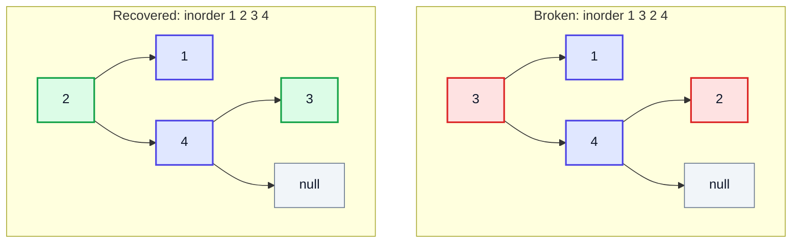
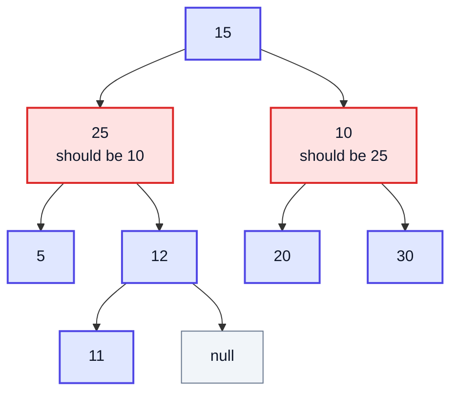
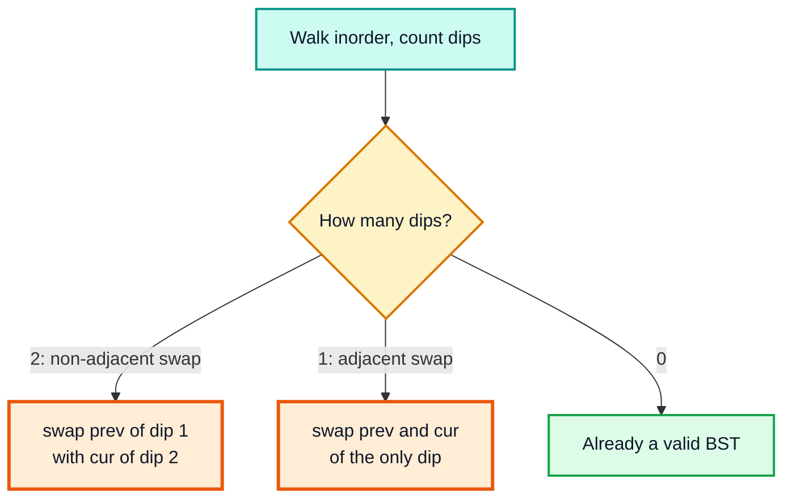
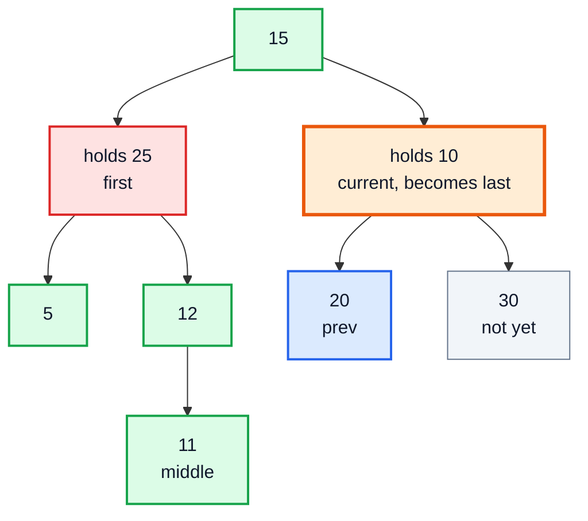
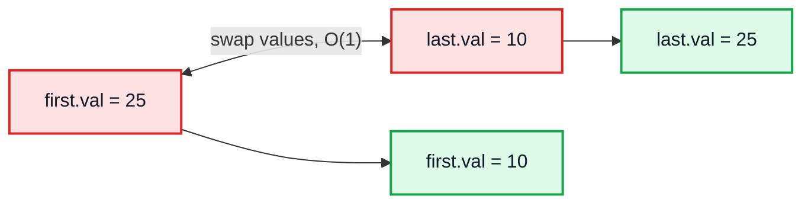
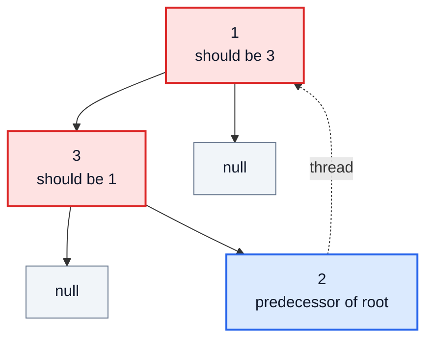
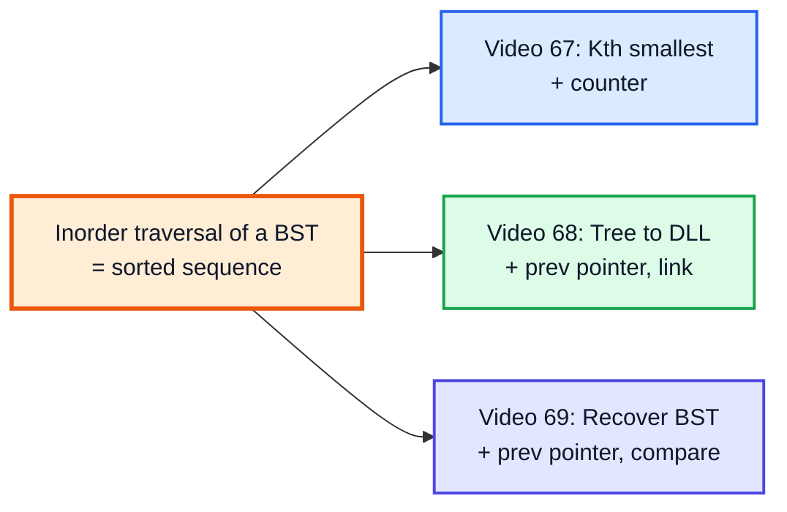

# Recover Binary Search Tree (Two Nodes Swapped) — Complete In-Depth Guide

**Video #69 of the Java + DSA playlist:** *Correct Binary Tree That Has Two Nodes Swapped - FAANG Interview Question* (10:32)

Exactly two nodes of a BST have had their values swapped by mistake; restore the tree without changing its structure (LeetCode 99). These notes show why an inorder traversal exposes the mistake, how to find the two wrong nodes with `first` / `middle` / `last` pointers, the difference between an adjacent and a non-adjacent swap, why swapping values is enough, and the O(1)-space Morris follow-up.

> [!NOTE]
> This video's description has **no timestamps**. The sections below are organised by topic, in the order you would solve the problem, and use **(—)** in place of a time.

> [!TIP]
> The BST rule and inorder traversal are covered in the [video #49 notes](java_49_video_binary_trees_bst.md). Morris traversal is explained step by step in the [video #67 notes](java_67_video_kth_smallest_bst.md#6-morris-traversal---o1-space-), and the `prev`-pointer pattern in the [video #68 notes](java_68_video_binary_tree_to_dll.md#3-approach---inorder-with-a-prev-pointer-).

---

## Table of Contents

| # | Topic | Timestamp |
|---|---|---|
| 0 | [Introduction](#0-introduction-) | — |
| 1 | [Problem Statement - LeetCode 99](#1-problem-statement---leetcode-99-) | — |
| 2 | [Key Insight - Inorder Reveals the Swap](#2-key-insight---inorder-reveals-the-swap-) | — |
| 3 | [Adjacent vs Non-adjacent Swaps](#3-adjacent-vs-non-adjacent-swaps-) | — |
| 4 | [Brute Force - Sort and Rewrite](#4-brute-force---sort-and-rewrite-) | — |
| 5 | [Detecting first, middle and last During Inorder](#5-detecting-first-middle-and-last-during-inorder-) | — |
| 6 | [Dry Run](#6-dry-run-) | — |
| 7 | [Fixing the Tree by Swapping Values](#7-fixing-the-tree-by-swapping-values-) | — |
| 8 | [Follow-up - Morris Traversal in O(1) Space](#8-follow-up---morris-traversal-in-o1-space-) | — |
| 9 | [Complexity Comparison and Outro](#9-complexity-comparison-and-outro-) | — |

---

## 0. Introduction (—)

The third question in the advanced-trees run, and it reuses everything from the previous two:

| From | Reused idea |
|---|---|
| [Video #67](java_67_video_kth_smallest_bst.md) | Inorder of a BST is **sorted**; Morris traversal for O(1) space |
| [Video #68](java_68_video_binary_tree_to_dll.md) | Carry a `prev` pointer through inorder to compare **consecutive** nodes |

The new part is the reasoning: in a sorted sequence where two elements were swapped, **where exactly does the order break, and how many times?**

> [!IMPORTANT]
> The title says "Binary Tree", but the input is a **Binary Search Tree** with two values swapped. Without the BST property there would be no "correct" order to restore.

---

## 1. Problem Statement - LeetCode 99 (—)

**LeetCode 99: *Recover Binary Search Tree***

> You are given the `root` of a binary search tree where the values of **exactly two** nodes were swapped by mistake. Recover the tree **without changing its structure**.
>
> Follow-up: a solution using O(n) space is straightforward. Could you devise a constant O(1) space solution?

| Constraint | Value |
|---|---|
| Number of nodes | 2 to 1000 |
| Node values | −2³¹ to 2³¹ − 1 (the full `int` range) |

**Example 1:** `[1,3,null,null,2]` → `[3,1,null,null,2]` (3 and 1 were swapped)
**Example 2:** `[3,1,4,null,null,2]` → `[2,1,4,null,null,3]` (3 and 2 were swapped)

Example 2 before and after. Red nodes hold the wrong values:



"Without changing its structure" means the **shape** stays the same: same nodes, same parent-child links. Only values move.

```java
class TreeNode {
    int val;
    TreeNode left, right;
    TreeNode(int val) { this.val = val; }
}

class Solution {
    public void recoverTree(TreeNode root) {
        // modify in place, return nothing
    }
}
```

---

## 2. Key Insight - Inorder Reveals the Swap (—)

A valid BST's inorder is **strictly increasing**. If two values are swapped, the inorder is a sorted sequence with two elements swapped. So the tree problem becomes an **array problem**:

> In a sorted array where exactly two elements were swapped, find those two elements.

The tree used in the rest of these notes (same as the video #49 notes) with **10 and 25 swapped**:



| Position | 0 | 1 | 2 | 3 | 4 | 5 | 6 | 7 |
|---|---|---|---|---|---|---|---|---|
| Correct inorder | 5 | 10 | 11 | 12 | 15 | 20 | 25 | 30 |
| Broken inorder | 5 | 🟥 **25** | 11 | 12 | 15 | 20 | 🟥 **10** | 30 |

### What a "violation" is

Walk the inorder and compare each value with the one before it. A **violation** (or "dip") is a pair `(prev, cur)` with `prev.val > cur.val`. In a correct BST there are **none**.

| Pair | (5, 25) | (25, 11) | (11, 12) | (12, 15) | (15, 20) | (20, 10) | (10, 30) |
|---|---|---|---|---|---|---|---|
| prev > cur? | ✅ ok | ❌ **dip 1** | ✅ ok | ✅ ok | ✅ ok | ❌ **dip 2** | ✅ ok |

- At **dip 1**, the wrong value is `prev` (25): a **too-large** value moved **earlier**, so it is bigger than what follows it.
- At **dip 2**, the wrong value is `cur` (10): a **too-small** value moved **later**, so it is smaller than what precedes it.

> [!TIP]
> Rule of thumb: **first dip → blame the left element; last dip → blame the right element.**

---

## 3. Adjacent vs Non-adjacent Swaps (—)

How many dips you see depends on whether the two swapped values are **next to each other** in the inorder sequence.

### Case 1: non-adjacent swap → two dips

Shown above (10 and 25): two violations. The swapped nodes are `prev` of the first dip and `cur` of the second dip.

### Case 2: adjacent swap → one dip

Swap **11 and 12**, which are consecutive in sorted order:

| Position | 0 | 1 | 2 | 3 | 4 | 5 | 6 | 7 |
|---|---|---|---|---|---|---|---|---|
| Broken inorder | 5 | 10 | 🟥 **12** | 🟥 **11** | 15 | 20 | 25 | 30 |

| Pair | (5, 10) | (10, 12) | (12, 11) | (11, 15) | … |
|---|---|---|---|---|---|
| prev > cur? | ✅ | ✅ | ❌ **only dip** | ✅ | ✅ |

There is no second dip. Both wrong nodes are in the **same** pair: `prev` (12) and `cur` (11).



### Naming the three pointers

To handle both cases in one pass, record three nodes:

| Pointer | Set when | Holds |
|---|---|---|
| `first` | at the **first** dip | `prev` (the too-large value) |
| `middle` | at the **first** dip | `cur` (correct partner if the swap was adjacent) |
| `last` | at the **second** dip, if any | `cur` (the too-small value) |

After the traversal:

- `last != null` → non-adjacent → swap `first` and `last`.
- `last == null` → adjacent → swap `first` and `middle`.

> [!NOTE]
> There can never be more than two dips: one swap of two elements in a sorted sequence breaks the order in at most two places. If you find three, the input does not match the problem's promise.

---

## 4. Brute Force - Sort and Rewrite (—)

Use the array view directly: read the inorder values, sort them, and write them back in inorder. The tree shape is untouched; only values change.

```java
public void recoverTree(TreeNode root) {
    List<Integer> values = new ArrayList<>();
    collect(root, values);                // inorder: 5 25 11 12 15 20 10 30
    Collections.sort(values);             //          5 10 11 12 15 20 25 30
    writeBack(root, values, new int[]{0});
}

private void collect(TreeNode n, List<Integer> out) {
    if (n == null) return;
    collect(n.left, out);
    out.add(n.val);
    collect(n.right, out);
}

private void writeBack(TreeNode n, List<Integer> values, int[] idx) {
    if (n == null) return;
    writeBack(n.left, values, idx);
    n.val = values.get(idx[0]++);         // i-th inorder node gets i-th smallest value
    writeBack(n.right, values, idx);
}
```

| | Cost |
|---|---|
| Time | O(n log n) for the sort |
| Space | O(n) for the list |

It works for **any** number of misplaced values, but it ignores the "exactly two swapped" promise. Since the sequence is sorted except for two elements, you can find them in one O(n) scan instead of sorting.

> [!NOTE]
> The `int[] idx` holder is there because Java passes `int` by value; a plain `int` parameter would not advance across recursive calls. An instance field works too.

---

## 5. Detecting first, middle and last During Inorder (—)

No list needed. Like video #68, keep a `prev` field during inorder and compare it with the current node.

```java
class Solution {
    private TreeNode prev, first, middle, last;

    public void recoverTree(TreeNode root) {
        prev = first = middle = last = null;
        inorder(root);
        if (last != null) swap(first, last);     // non-adjacent: two dips
        else swap(first, middle);                // adjacent: one dip
    }

    private void inorder(TreeNode node) {
        if (node == null) return;
        inorder(node.left);

        if (prev != null && prev.val > node.val) {   // a dip
            if (first == null) {                     // first dip
                first = prev;
                middle = node;
            } else {                                 // second dip
                last = node;
            }
        }
        prev = node;

        inorder(node.right);
    }

    private void swap(TreeNode a, TreeNode b) {
        int t = a.val;
        a.val = b.val;
        b.val = t;
    }
}
```

> [!WARNING]
> Keep `prev` as a **node** (or check `prev != null`), not an `int` initialised to `Integer.MIN_VALUE`. LeetCode 99 allows node values equal to `Integer.MIN_VALUE`, and some tests use it, so a sentinel value can hide or fake a dip.

### A compact two-pointer form

`middle` and `last` are never both needed. Simply **overwrite** `second` at every dip:

```java
if (prev != null && prev.val > node.val) {
    if (first == null) first = prev;   // only the first dip sets first
    second = node;                     // first dip sets it; a second dip overwrites it
}
// after traversal: swap(first, second)
```

With one dip, `second` = `cur` of that dip (the `middle` case). With two dips, it ends up as `cur` of the second dip (the `last` case). The Morris version in section 8 uses this form.

| Form | Variables | Clarity |
|---|---|---|
| `first` / `middle` / `last` | 3 + `prev` | Makes the two cases explicit; easier to explain |
| `first` / `second` | 2 + `prev` | Shorter; same result |

---

## 6. Dry Run (—)

### Case A: non-adjacent (10 and 25 swapped)

Inorder visit sequence: `5 25 11 12 15 20 10 30`.

| Visit | `prev` | prev > cur? | `first` | `middle` | `last` |
|---|---|---|---|---|---|
| 5 | null | n/a | | | |
| 25 | 5 | no | | | |
| 11 | 25 | ❌ **yes, dip 1** | 🟥 25 | 11 | |
| 12 | 11 | no | 25 | 11 | |
| 15 | 12 | no | 25 | 11 | |
| 20 | 15 | no | 25 | 11 | |
| 10 | 20 | ❌ **yes, dip 2** | 25 | 11 | 🟥 10 |
| 30 | 10 | no | 25 | 11 | 10 |

`last != null` → swap `first` (25) and `last` (10) → `5 10 11 12 15 20 25 30` ✅

The moment dip 2 is found (visiting the node that holds 10). Orange is the current node, blue is `prev`, red is `first`:



### Case B: adjacent (11 and 12 swapped)

Inorder: `5 10 12 11 15 20 25 30`.

| Visit | `prev` | prev > cur? | `first` | `middle` | `last` |
|---|---|---|---|---|---|
| 5 | null | n/a | | | |
| 10 | 5 | no | | | |
| 12 | 10 | no | | | |
| 11 | 12 | ❌ **yes, dip 1** | 🟥 12 | 🟥 11 | |
| 15 | 11 | no | 12 | 11 | |
| 20, 25, 30 | … | no | 12 | 11 | null |

`last == null` → swap `first` (12) and `middle` (11) → `5 10 11 12 15 20 25 30` ✅

> [!CAUTION]
> A common bug is to always swap `first` and `last`. On an adjacent swap `last` is `null` and you get a `NullPointerException`. Another is to stop the traversal at the first dip: then a non-adjacent swap is never fully detected.

---

## 7. Fixing the Tree by Swapping Values (—)

### Why swapping values is enough

The problem says the **values** of two nodes were swapped. The shape was never broken: every node is in the right **position**, it just holds the wrong number. So exchanging the two `val` fields restores the BST exactly.

```java
private void swap(TreeNode a, TreeNode b) {
    int t = a.val;
    a.val = b.val;
    b.val = t;
}
```



| Option | Work | When needed |
|---|---|---|
| **Swap `val` fields** | O(1), 3 lines | LeetCode 99 and the video. Structure unchanged as required |
| Swap the **nodes** themselves | Must re-link parents and children of both nodes; special cases when one is the other's parent | Only if values are immutable or nodes carry other data that must move with them |

> [!NOTE]
> If a node held more than a key (for example, a key plus a large payload in a real database index), you would swap the whole payload, or re-link nodes. For LeetCode's `int val`, swapping values is the expected answer.

### Verifying the result

After fixing, a quick validity check (LeetCode 98, *Validate Binary Search Tree*) confirms the tree is a BST again. Using `long` bounds avoids the `Integer.MIN_VALUE` / `MAX_VALUE` edge case:

```java
static boolean isBST(TreeNode n, long lo, long hi) {
    if (n == null) return true;
    if (n.val <= lo || n.val >= hi) return false;
    return isBST(n.left, lo, n.val) && isBST(n.right, n.val, hi);
}
// isBST(root, Long.MIN_VALUE, Long.MAX_VALUE)
```

---

## 8. Follow-up - Morris Traversal in O(1) Space (—)

The recursive solution uses O(h) stack space, which is O(n) for a skewed tree. LeetCode's follow-up asks for O(1). Morris inorder (explained in the [video #67 notes](java_67_video_kth_smallest_bst.md#6-morris-traversal---o1-space-)) visits nodes in the same inorder sequence without a stack, so the dip-detection logic slots straight in at both "visit" points.

```java
public void recoverTree(TreeNode root) {
    TreeNode cur = root, prev = null, first = null, second = null;
    while (cur != null) {
        if (cur.left == null) {
            // ── visit cur ──
            if (prev != null && prev.val > cur.val) {
                if (first == null) first = prev;
                second = cur;
            }
            prev = cur;
            cur = cur.right;                       // may follow a thread upward
        } else {
            TreeNode pred = cur.left;
            while (pred.right != null && pred.right != cur) pred = pred.right;
            if (pred.right == null) {
                pred.right = cur;                  // create thread, go left
                cur = cur.left;
            } else {
                pred.right = null;                 // remove thread
                // ── visit cur ──
                if (prev != null && prev.val > cur.val) {
                    if (first == null) first = prev;
                    second = cur;
                }
                prev = cur;
                cur = cur.right;
            }
        }
    }
    int t = first.val; first.val = second.val; second.val = t;
}
```

### Dry run on Example 1: `[1,3,null,null,2]`

Inorder is `3 2 1` (1 and 3 swapped; the dips are (3,2) and (2,1)).



| Step | `cur` | Situation | Action | `prev` | `first` | `second` |
|---|---|---|---|---|---|---|
| 1 | 1 | left exists; pred = 2, `2.right == null` | thread 2 → 1; cur = 3 | null | | |
| 2 | 3 | no left → visit 3 | cur = 2 | 3 | | |
| 3 | 2 | no left → visit 2; 3 > 2 dip | cur = 2.right = 1 (thread) | 2 | 🟥 3 | 2 |
| 4 | 1 | pred = 2, `2.right == 1` → remove thread, visit 1; 2 > 1 dip | cur = null | 1 | 3 | 🟥 1 |

Swap 3 and 1 → inorder `1 2 3`, root now holds **3** ✅ (matches the expected `[3,1,null,null,2]`).

> [!IMPORTANT]
> With Morris, **never** break out of the loop early, even though both nodes might be known. The threads must all be removed, or the "recovered" tree will contain cycles. Let the loop finish, then swap.

| | Recursive | Morris |
|---|---|---|
| Time | O(n) | O(n) |
| Extra space | O(h) stack | **O(1)** |
| Tree modified during run | No | Yes (temporarily) |

---

## 9. Complexity Comparison and Outro (—)

| Approach | Time | Extra space | Notes |
|---|---|---|---|
| Collect, sort, write back | O(n log n) | O(n) | Works for any number of wrong values |
| Collect, find two by scan, swap | O(n) | O(n) | Array version of the dip idea |
| **Recursive inorder + `first`/`middle`/`last`** | O(n) | O(h) | The video's approach; best to explain |
| Iterative inorder with `ArrayDeque` | O(n) | O(h) | Same logic, no recursion |
| **Morris inorder** | O(n) | **O(1)** | Answers the follow-up |

### The three-video pattern



> [!TIP]
> Related practice: LeetCode **98** (validate BST, inorder + `prev`), **530** / **783** (minimum difference between BST nodes, inorder + `prev`), **501** (mode in a BST), and the array version of this problem: find two swapped elements in an almost-sorted array.

---

## 🧩 Complete Example: Everything Together

One program that breaks the same BST in different ways and repairs it with each approach, checking validity before and after:

```java
import java.util.ArrayList;
import java.util.Collections;
import java.util.List;

class TreeNode {
    int val;
    TreeNode left, right;
    TreeNode(int val) { this.val = val; }
}

// ═══════ Approach 1: brute force (collect, sort, write back) ═══════
class RecoverBrute {
    static void recover(TreeNode root) {
        List<Integer> values = new ArrayList<>();
        collect(root, values);
        Collections.sort(values);
        int[] idx = {0};
        writeBack(root, values, idx);
    }
    private static void collect(TreeNode n, List<Integer> out) {
        if (n == null) return;
        collect(n.left, out);
        out.add(n.val);
        collect(n.right, out);
    }
    private static void writeBack(TreeNode n, List<Integer> values, int[] idx) {
        if (n == null) return;
        writeBack(n.left, values, idx);
        n.val = values.get(idx[0]++);
        writeBack(n.right, values, idx);
    }
}

// ═══════ Approach 2: inorder with prev, first / middle / last ═══════
class RecoverInorder {
    private TreeNode prev, first, middle, last;

    void recoverTree(TreeNode root) {
        prev = first = middle = last = null;
        inorder(root);
        if (last != null) swap(first, last);        // non-adjacent swap: two violations
        else swap(first, middle);                   // adjacent swap: one violation
    }

    private void inorder(TreeNode node) {
        if (node == null) return;
        inorder(node.left);
        if (prev != null && prev.val > node.val) {  // violation: sequence went down
            if (first == null) {                    // 1st violation
                first = prev;
                middle = node;
            } else {                                // 2nd violation
                last = node;
            }
        }
        prev = node;
        inorder(node.right);
    }

    static void swap(TreeNode a, TreeNode b) {
        int t = a.val;
        a.val = b.val;
        b.val = t;
    }
}

// ═══════ Approach 3: Morris inorder, O(1) extra space ═══════
class RecoverMorris {
    static void recoverTree(TreeNode root) {
        TreeNode cur = root, prev = null, first = null, second = null;
        while (cur != null) {
            if (cur.left == null) {
                // visit cur
                if (prev != null && prev.val > cur.val) {
                    if (first == null) first = prev;
                    second = cur;
                }
                prev = cur;
                cur = cur.right;
            } else {
                TreeNode pred = cur.left;
                while (pred.right != null && pred.right != cur) pred = pred.right;
                if (pred.right == null) {
                    pred.right = cur;               // thread
                    cur = cur.left;
                } else {
                    pred.right = null;              // unthread, then visit cur
                    if (prev != null && prev.val > cur.val) {
                        if (first == null) first = prev;
                        second = cur;
                    }
                    prev = cur;
                    cur = cur.right;
                }
            }
        }
        RecoverInorder.swap(first, second);
    }
}

public class Main {
    static TreeNode insert(TreeNode node, int val) {
        if (node == null) return new TreeNode(val);
        if (val < node.val) node.left = insert(node.left, val);
        else node.right = insert(node.right, val);
        return node;
    }

    static TreeNode build() {
        TreeNode root = null;
        for (int v : new int[]{15, 10, 25, 5, 12, 20, 30, 11}) root = insert(root, v);
        return root;
    }

    static TreeNode find(TreeNode node, int val) {
        while (node != null && node.val != val) node = val < node.val ? node.left : node.right;
        return node;
    }

    static void breakTree(TreeNode root, int a, int b) {
        RecoverInorder.swap(find(root, a), find(root, b));
    }

    static String inorder(TreeNode n) {
        StringBuilder sb = new StringBuilder();
        walk(n, sb);
        return sb.toString().trim();
    }
    private static void walk(TreeNode n, StringBuilder sb) {
        if (n == null) return;
        walk(n.left, sb);
        sb.append(n.val).append(' ');
        walk(n.right, sb);
    }

    static boolean isBST(TreeNode n, long lo, long hi) {
        if (n == null) return true;
        if (n.val <= lo || n.val >= hi) return false;
        return isBST(n.left, lo, n.val) && isBST(n.right, n.val, hi);
    }

    public static void main(String[] args) {
        // Case A: non-adjacent swap (10 and 25)
        TreeNode a = build();
        breakTree(a, 10, 25);
        System.out.println("Broken (non-adjacent): " + inorder(a) + "  valid=" + isBST(a, Long.MIN_VALUE, Long.MAX_VALUE));
        new RecoverInorder().recoverTree(a);
        System.out.println("Fixed by inorder     : " + inorder(a) + "  valid=" + isBST(a, Long.MIN_VALUE, Long.MAX_VALUE));

        // Case B: adjacent swap (11 and 12)
        TreeNode b = build();
        breakTree(b, 11, 12);
        System.out.println("Broken (adjacent)    : " + inorder(b) + "  valid=" + isBST(b, Long.MIN_VALUE, Long.MAX_VALUE));
        new RecoverInorder().recoverTree(b);
        System.out.println("Fixed by inorder     : " + inorder(b) + "  valid=" + isBST(b, Long.MIN_VALUE, Long.MAX_VALUE));

        // Case C: Morris on a non-adjacent swap (5 and 30)
        TreeNode c = build();
        breakTree(c, 5, 30);
        System.out.println("Broken (5 <-> 30)    : " + inorder(c));
        RecoverMorris.recoverTree(c);
        System.out.println("Fixed by Morris      : " + inorder(c) + "  valid=" + isBST(c, Long.MIN_VALUE, Long.MAX_VALUE));

        // Case D: brute force on LeetCode example 1: [1,3,null,null,2]
        TreeNode d = new TreeNode(1);
        d.left = new TreeNode(3);
        d.left.right = new TreeNode(2);
        System.out.println("LeetCode ex1 broken  : " + inorder(d));
        RecoverBrute.recover(d);
        System.out.println("Fixed by brute force : " + inorder(d) + "  root=" + d.val);

        // Case E: LeetCode example 2: [3,1,4,null,null,2]
        TreeNode e = new TreeNode(3);
        e.left = new TreeNode(1);
        e.right = new TreeNode(4);
        e.right.left = new TreeNode(2);
        System.out.println("LeetCode ex2 broken  : " + inorder(e));
        RecoverMorris.recoverTree(e);
        System.out.println("Fixed by Morris      : " + inorder(e) + "  root=" + e.val);
    }
}
```

**Expected Output:**
```
Broken (non-adjacent): 5 25 11 12 15 20 10 30  valid=false
Fixed by inorder     : 5 10 11 12 15 20 25 30  valid=true
Broken (adjacent)    : 5 10 12 11 15 20 25 30  valid=false
Fixed by inorder     : 5 10 11 12 15 20 25 30  valid=true
Broken (5 <-> 30)    : 30 10 11 12 15 20 25 5
Fixed by Morris      : 5 10 11 12 15 20 25 30  valid=true
LeetCode ex1 broken  : 3 2 1
Fixed by brute force : 1 2 3  root=3
LeetCode ex2 broken  : 1 3 2 4
Fixed by Morris      : 1 2 3 4  root=2
```

---

## Quick Reference Cheat Sheet

| Concept | One-Line Summary |
|---|---|
| **LeetCode 99** | Two node values in a BST were swapped; fix it without changing the structure |
| **Key fact** | Inorder of a valid BST is strictly increasing, so the swap shows up as dips |
| **Dip** | Consecutive inorder pair with `prev.val > cur.val` |
| **First dip** | `first = prev` (too-large value), `middle = cur` |
| **Second dip** | `last = cur` (too-small value) |
| **Non-adjacent swap** | Two dips → swap `first` and `last` |
| **Adjacent swap** | One dip → swap `first` and `middle` |
| **Two-pointer form** | `if (first == null) first = prev; second = cur;` at every dip, then swap |
| **Fix** | Swap the two `val` fields; O(1); shape untouched |
| **Brute force** | Collect inorder, sort, write back; O(n log n) time, O(n) space |
| **Recursive** | O(n) time, O(h) space |
| **Morris** | O(n) time, O(1) space; finish the loop before swapping so all threads are removed |
| **Sentinel trap** | Track `prev` as a node, not `Integer.MIN_VALUE`; values span the full `int` range |
| **Verify** | `isBST(root, Long.MIN_VALUE, Long.MAX_VALUE)` (LeetCode 98) |
