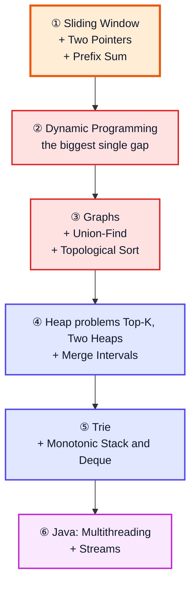

# Topics Not Covered — Java & DSA Gap List

**What this is:** Java and DSA topics that are **not taught** in Kunal Kushwaha's *Java + DSA + Interview Preparation Course* playlist (69 videos). The list comes from what the 66 notes files in this folder cover (videos 4–69).

> [!NOTE]
> Kunal may teach some of these in other videos or courses. They just aren't in **this playlist**. Use this file as a checklist of what to learn from other sources.

**Priority:** 🔴 asked very often in interviews · 🟡 useful · 🟢 nice to know

---

## Table of Contents

| # | Section |
|---|---|
| 1 | [Java Gaps](#1-java-gaps) |
| 2 | [DSA: Whole Topics Missing](#2-dsa-whole-topics-missing) |
| 3 | [DSA: Missing Patterns](#3-dsa-missing-patterns) |
| 4 | [Recommended Study Order](#4-recommended-study-order) |
| 5 | [Checklist](#5-checklist) |

---

## 1. Java Gaps

| Topic | Priority | Why it matters / what's missing |
|---|---|---|
| **Multithreading & Concurrency**: Thread, Runnable, `synchronized`, `volatile`, ExecutorService, CompletableFuture, locks, race conditions, deadlock | 🔴 | A favourite topic in Java interviews. Only Vector's thread safety is touched ([video 43](java_43_video_collections_vector_enums.md)). |
| **Streams API in depth**: `map`, `filter`, `reduce`, `collect`, `groupingBy`, `flatMap`, parallel streams | 🔴 | Lambdas are covered ([video 42](java_42_video_generics_lambdas_exceptions_cloning.md)), but streams aren't really taught. |
| **Comparator & Comparable in depth**: `Comparator.comparing`, `thenComparing`, custom sorting | 🔴 | Needed for sorting objects and for PriorityQueue problems. |
| **Design Patterns**: Factory, Builder, Observer, Strategy, Decorator… | 🟡 | Only Singleton is covered ([video 38](java_38_video_oop_static_packages_singleton.md)). |
| **SOLID principles / low-level design** | 🟡 | Asked in design rounds. |
| **Functional interfaces & `Optional`**: Supplier, Consumer, Predicate, Function | 🟡 | Used everywhere in modern Java code. |
| **Modern Java features**: records, sealed classes, `var`, text blocks, switch pattern matching, virtual threads | 🟡 | The course uses older Java. The notes mention some of these only in passing. |
| **Generics in depth**: wildcards `? extends` / `? super`, type erasure, bounded types | 🟡 | [Video 42](java_42_video_generics_lambdas_exceptions_cloning.md) only covers the basics. |
| **JVM internals**: memory model, GC algorithms and tuning, class loading in depth | 🟡 | [Video 7](java_07_video_java_architecture.md) is introductory only. |
| **Iterator / Iterable**, fail-fast vs fail-safe iterators | 🟡 | A common question about collections. |
| Serialization, Reflection, Regex, Date/Time API (`java.time`) | 🟢 | Practical, but less often asked. |
| Unit testing (JUnit), build tools (Maven/Gradle), JDBC | 🟢 | Real-world development rather than interview topics. |

---

## 2. DSA: Whole Topics Missing

| Topic | Priority | What's missing |
|---|---|---|
| **Dynamic Programming** | 🔴 | All of it: memoization vs tabulation, 1D DP (climbing stairs, house robber), 0/1 and unbounded knapsack, LIS, LCS, edit distance, grid DP, partition DP, DP on trees, bitmask DP. Only the memoized dice solution in [video 34](java_34_video_recursion_dice_phone_letters.md) comes close. |
| **Graphs** | 🔴 | Representing a graph (adjacency list/matrix), BFS/DFS on graphs, connected components, cycle detection, **topological sort**, **Dijkstra**, Bellman-Ford, Floyd-Warshall, **MST** (Prim/Kruskal), bipartite check, SCC, bridges. Only [Word Ladder (video 65)](java_65_video_word_ladder.md) touches this. |
| **Union-Find (DSU)** | 🔴 | Union by rank, path compression, connected-component problems. |
| **Trie** | 🔴 | Insert and search, prefix search, Word Search II, autocomplete. |

---

## 3. DSA: Missing Patterns

| Pattern | Priority | Typical problems |
|---|---|---|
| **Sliding Window** (fixed and variable size) | 🔴 | Longest Substring Without Repeating Characters (LC 3), Minimum Window Substring (LC 76), max sum subarray of size k |
| **Two Pointers on arrays** | 🔴 | 3Sum (LC 15), Container With Most Water (LC 11), Trapping Rain Water (LC 42), sorted Two Sum (LC 167) |
| **Prefix Sum / Difference Array** | 🔴 | Subarray Sum Equals K (LC 560), Range Sum Query (LC 303), Product of Array Except Self (LC 238) |
| **Kadane's Algorithm** | 🔴 | Maximum Subarray (LC 53), Maximum Sum Circular Subarray (LC 918) |
| **Merge Intervals** | 🔴 | Merge Intervals (LC 56), Insert Interval (LC 57), Meeting Rooms (LC 252/253) |
| **Top-K / K-way Merge** with heaps | 🔴 | Kth Largest Element (LC 215), Top K Frequent (LC 347), Merge K Sorted Lists (LC 23). [Video 56](java_56_video_heaps_priority_queue.md) teaches heaps but doesn't solve these. |
| **Two Heaps** | 🟡 | Find Median from Data Stream (LC 295), Sliding Window Median (LC 480) |
| **Monotonic Stack in depth** | 🟡 | Next Greater Element (LC 496/503), Daily Temperatures (LC 739), Online Stock Span (LC 901). Only the histogram problem is in [video 47](java_47_video_stack_queue_questions.md). |
| **Monotonic Deque** | 🟡 | Sliding Window Maximum (LC 239) |
| **Greedy in general** | 🟡 | Jump Game (LC 55/45), Gas Station (LC 134), activity selection, interval scheduling. Only [Huffman coding (video 61)](java_61_video_huffman_coding.md) is covered. |
| **Matrix traversal** | 🟡 | Spiral Matrix (LC 54), Rotate Image (LC 48), Set Matrix Zeroes (LC 73), Flood Fill / Number of Islands (LC 733/200) |
| **Combination-style backtracking** | 🟡 | Combination Sum (LC 39/40), Word Search (LC 79), Palindrome Partitioning (LC 131) |
| **System-design data structures** | 🟡 | LRU Cache (LC 146), LFU Cache (LC 460) |
| **String algorithms** | 🟢 | KMP, Z-algorithm, Manacher. Only [Karp-Rabin (video 58)](java_58_video_karp_rabin.md) is covered. |
| **Advanced range-query structures** | 🟢 | Fenwick tree (BIT), segment tree with lazy propagation, sparse table |
| **Maths extras** | 🟢 | Fast power, modular inverse, nCr, combinatorics |

---

## 4. Recommended Study Order

If you're preparing for interviews after finishing this playlist, this order gives the most value:

| Step | Why this order |
|---|---|
| ① Sliding Window, Two Pointers, Prefix Sum | Quick to learn, and asked all the time in array and string rounds. |
| ② Dynamic Programming | The biggest gap. It builds on the recursion videos (23, 27–36), which the playlist covers well. |
| ③ Graphs, Union-Find, Topological Sort | Builds on the tree BFS/DFS from [video 55](java_55_video_binary_tree_questions.md). |
| ④ Heap problems, Merge Intervals | Uses the heap from [video 56](java_56_video_heaps_priority_queue.md) and the sorting from videos 17–31. |
| ⑤ Trie, Monotonic Stack and Deque | Medium-frequency patterns that round out the list. |
| ⑥ Java Multithreading and Streams | Needed for Java-specific interview rounds. |

---

## 5. Checklist

Tick these off as you learn them.

**Java**
- [ ] Multithreading & Concurrency
- [ ] Streams API
- [ ] Comparator & Comparable
- [ ] Design Patterns
- [ ] SOLID / Low-level design
- [ ] Functional interfaces & `Optional`
- [ ] Modern Java (records, sealed classes, pattern matching, virtual threads)
- [ ] Generics wildcards & type erasure
- [ ] JVM internals & GC
- [ ] Iterator, fail-fast vs fail-safe
- [ ] Serialization, Reflection, Regex, `java.time`
- [ ] JUnit, Maven/Gradle, JDBC

**DSA**
- [ ] Dynamic Programming
- [ ] Graphs (BFS/DFS, topological sort, Dijkstra, MST)
- [ ] Union-Find
- [ ] Trie
- [ ] Sliding Window
- [ ] Two Pointers (arrays)
- [ ] Prefix Sum / Difference Array
- [ ] Kadane's Algorithm
- [ ] Merge Intervals
- [ ] Top-K / K-way Merge
- [ ] Two Heaps
- [ ] Monotonic Stack & Deque
- [ ] Greedy
- [ ] Matrix traversal
- [ ] Combination backtracking
- [ ] LRU / LFU Cache
- [ ] KMP / Z / Manacher
- [ ] Fenwick tree, lazy segment tree, sparse table
- [ ] Maths extras (fast power, modular inverse, nCr)
